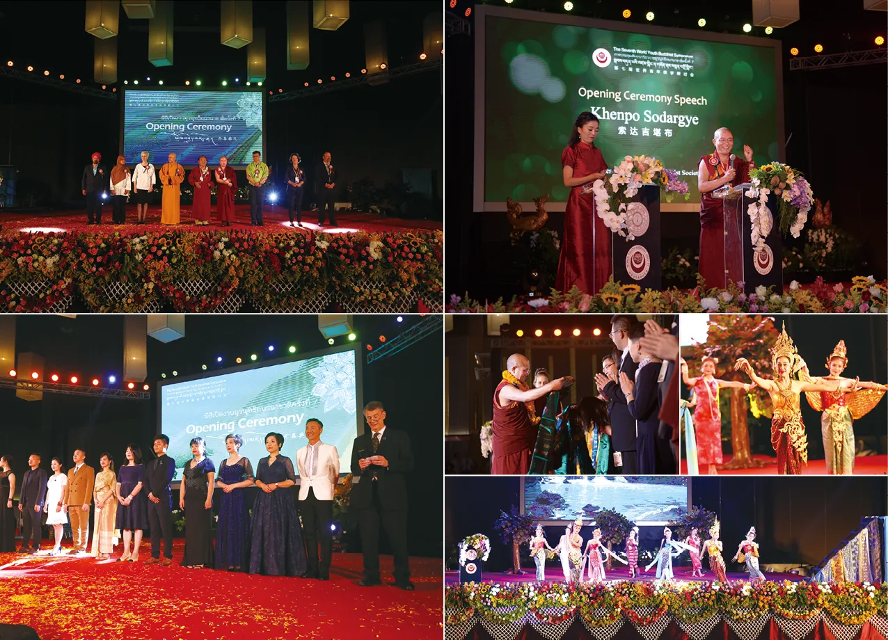

## 生死与幸福

## Life Death and Happiness

2017年7月30日

|索甲仁波切 本觉会创办人、精神导师

《西藏生死书》作者

|索达吉堪布 世界青年佛学研究会会长

视频旁白：索达吉堪布与索甲仁波切之间的渊源颇深，这段奇妙的因缘，可以追溯到一段深具意义的历史。1993年，索达吉堪布陪同他的上师如意宝晋美彭措法王在西方传法。期间，法王拜访了索甲仁波切位于法国南部的寺院列绕林。这是法王如意宝与索甲仁波切的首次会面。两人都被认为是伏藏师索甲列绕朗巴的转世。法王如意宝当时提到，列绕朗巴预言，他会有两位主要转世，两位转世都会为佛法与众生带来极大的利益。另一个授记里提到，其中一位是持戒的出家人，另一位则是广传密咒金刚乘的瑜伽士。法王说，当他看到这个授记时，他就确信，索甲仁波切就是那位弘扬密法的瑜伽士，而法王自己应该就是那位出家人。当时法王非常动人地讲述，列绕朗巴还有授记：如果他的两位转世能和谐共处、互相合作，那么他们对佛法和众生的利益就可以广大如虚空。法王也在演讲中提到，两人的心意无二无别，彼此在精神上、物质上是合而为一的。源自同一转世的两个人，在当时承诺要互相扶持。

主持人：两位大德已经很久没见面了，有什么话想跟对方说的呢？

索达吉堪布：我们很荣幸请到了索甲仁波切，他也是《西藏生死书》的作者。这本书在东西方都很受欢迎，他能莅临，我感到非常开心。同时，我也感谢海涛法师，他来到现场代表汉传佛教给大家带来精彩的开示。这些高僧大德都是非常有加持力的，我非常开心。

索甲仁波切：受邀前来，我非常荣幸。索达吉堪布的事业让人赞叹。1993年，我在法国与堪布见面，也亲见了堪布的上师晋美彭措法王。当时，我得到法王的厚爱，得到无上的加持。法王的事业是有目共睹的，非常殊胜。法王虽然已经涅槃，但法王的心子慈诚罗珠堪布与索达吉堪布仍旧延续法王的事业，我希望他们的事业能利益更多众生。

主持人：今天，索达吉堪布与索甲仁波切同时提到，幸福不假外求，应该通过精神、心灵去获取。请问仁波切，我们怎样才能幸福地活着？怎样才能幸福地死去？

索甲仁波切：在写《西藏生死书》时，我希望能引发一场宁静的革命，来改变我们对死亡的看法、改变临终关怀的方式，进而也改变我们对人生的看法、改变关怀生者的方式。我试着在书里表达一种实际而有效的方法——在生命中找到意义，在死亡中找到希望。如果我们真正直面死亡，它就能帮助我们完全接纳自己，认同自己，找到真实的自己。

死亡的时刻是生命中最重要的时刻，它能教导我们如何面对自己。死亡时，肉身在死亡，凡夫心、迷惑也在死亡。当念头、迷惑全部消失时，我们最内在的基础——地光明（明光）会显露。如果能善用这个时刻，我们将获得解脱。

死亡时，有两点至关重要：一、我们如何度过这一生？人生的意义，不在于喝过多名贵的香槟，而在于是否曾真心帮助过他人？二、死亡的一刻心境如何？对普通修行人而言，死亡时可以用精神迁识法（颇瓦法），将意识迁转到阿弥陀佛的净土。对于更上一层的修行人而言，他们会在死亡的时刻认证心性。当地光明显现时，他们会安住其中，得到最终的解脱。

所以，死亡的时刻最重要的是什么呢？最重要的是，我们要放下所有的执著和厌恶，保持心意的清净，将自己的心与诸佛的智慧心合而为一，安住在心性当中。

主持人：索达吉堪布曾经写过一本畅销的书《苦才是人生》，那么我们该如何从苦的人生中找到幸福呢？

索达吉堪布：刚刚看视频时，我内心特别想念我的上师，当时的很多经历浮现在眼前。在法国时，索甲仁波切也说过，他年轻时曾给敦珠法王当过翻译。敦珠法王圆寂后，他经常想起他的笑容，所以心里常有些痛苦。我对上师很执著，但对于自己的身体、对于父母亲，我没有那么执著。上师给的智慧、幸福，实际上是所有人包括父母也不一定能赐予的。我相信很多人会在现在或将来感受到这样的道理。

讲起《苦才是人生》，因缘很奇妙。索甲仁波切曾经给这本书写过序，但他老人家可能已经忘了。（众笑，仁波切笑着否认忘记）

我为什么说“苦才是人生”呢？刚才有位教授也说了，现在亚马逊上大概有两千五百多本关于幸福的书。我也曾经上网看过，除了季羡林先生的书内容近似以外，很少有书揭示这个道理。所以，我想特意借这本书，点明人生的部分痛苦。

我也想提醒在座的年轻人，不要认为所有的人生都是快乐的，也不要认为所有的人生都是痛苦的，应该要用智慧去抉择，这就是选择幸福。

主持人：人在回忆过去时，往往苦乐参半。那么，回忆过去会成为幸福的障碍吗？

索达吉堪布：如果我们探寻比较深奥的本来心性，所谓的幸福、所谓的痛苦，在胜义实相中都是远离四边八戏的。在世俗显现中，则如梦、如幻、如阳焰。所以，回忆的痛苦也好，当下的痛苦也好，一切都是了不可得。

如果我们没有深入抉择，在世俗显现中去寻找的话，一切现实生活都如是存在。印度学者月称论师曾说：“我在任何时候，也没有诋毁过世俗的显现。”佛教最深的中观派尚且如此，更何况其他宗派了。

主持人：西方是物质化的社会。索甲仁波切，您与他人谈及生死问题时，是否遇到过挑战？

索甲仁波切：非常多！那么多！太多了！

我们没有把死和生看成一个整体，以至于我们对生非常执著，但又拒绝、否认、逃避死亡。我常常告诉人们：“你如果很怕死亡，真的不用怕，我们所有人都会死得很成功。”（众笑）

到底为何我们如此惧怕死亡呢？其实，惧怕面对死亡，源于我们害怕深入看待、面对自己。死亡的时刻，就是真理的时刻。死亡就像一面镜子，它将此生的真意映照在其中。很不幸地，现代人却常常把死亡看成是一种失去、一种失败。然而就精神观点而言，死亡并不是需要惧怕的悲剧，而是重要的转化机会。佛陀也示现涅槃，这是佛陀最终的、最伟大的教法，他让我们从懒散、天真烂漫中觉醒，从而领悟到死亡和无常的真理。然而，最麻烦的是，我们即使知道自己有一天终将会死，却不知道如何死、何时死，所以，我们常常以为人生是无止境的。故而，我们常在拖延、懈怠。

如果在临死前才思考死亡，这不是有点太晚了吗？教法显示，我们必须在当下就省思死亡、准备死亡，尤其在我们被启发的时候。谁能预料是无常先到，还是明天先到？死，其实真的很容易——吸进去一口气，呼出一口气，忽然再吸不进下一口气时，就死了。如果我们能省思死亡，就会领悟到，死亡会随时发生。有濒死经验的人，往往在复活后会彻底改善他们的人生，这样的经验让他们领悟到死亡的迅速、不可预料。他们会用更有意义的方式来看待死亡，看待人生。

主持人：死亡是怎样一种状态？会不会永远消失？观修死亡对我们而言，到底有什么利益？

索甲仁波切：伟大的西藏瑜伽士米拉日巴曾说：“在死亡的恐惧中，我辛苦地爬上山巅，一再禅修死亡的不可预料。在征服了无死心性的堡垒之后，我对死亡的恐惧全都消失了。”这不太容易，要花一生去修持。省思死亡，对修行人而言是非常有帮助的，它可以帮助我们精进——当我们省思无常、省思死亡的不可预料时，每天的思考、禅修会让我们更想好好把握这一生。这就是省思死亡的最大利益。

就如米拉日巴所说，在死亡的恐惧中，他最终到达了无死心性的堡垒。一位伟大的上师也说过：“我们全部都会死亡。但死亡其实就像换件衣服一样。”当我们真的省思时，就会发现：在相对层面上，我们会死亡，但在胜义层面上，死亡时消失的是凡夫心，佛性永不死亡。米拉日巴受他上师玛尔巴的鼓舞，谈到当他攻占了不死心性的堡垒时，对死亡的恐惧完全消失。

刚刚堪布仁波切谈到他对法王如意宝的思念，其实我非常理解，因为我对自己的上师们，如蒋扬钦哲秋吉罗卓也是一样的。他们给我直指胜义的心性，让我能够认识，让我知道死亡时我们就像失去了云朵，但整个天空是展开的。刚刚我和堪布都谈到了，最胜义、最永恒的快乐其实是上师给予的。米拉日巴尊者所谈到的攻占不死心性的堡垒，这份胜义心性也是上师给予的最大恩德。我记得上师涅槃的时候，我非常伤心，我想：“要不是您来引导我、教导我，我怎么可能有如此的认识呢？”

主持人：索达吉堪布作为藏族人，常常和汉族人交流幸福、人生、生命的话题。请问堪布，在过往三十年里，您发现藏族、汉族在幸福观上有什么不一样的地方吗？

索达吉堪布：确实，我给汉族人讲佛法刚好整整30年。今年的7月27日，藏历六月初四，我去了五台山，那天是佛陀初转法轮日。1987年，也是在藏历六月初四，上师如意宝晋美彭措让我给汉族人讲课。当时上师的一句话，让我一直支撑到今天，中间不管遇到什么事情，我都坚持了下来，至今整整30年。所以前一段时间，我特意去五台山还愿并继续许愿。我已经做了30年，也就是说，因为他老人家的一句话，我坚持了30年。

在这30年里，我了解了汉族人的心态。作为一个藏族人，藏族人的幸福观我也清楚。我认为，根据民族不同，不一定能区分出幸福的高下。因为有些汉族人，尤其是有信仰、修行比较好的人，幸福感应该是非常强的，而藏族人里也有很多痛苦的。但总的来讲，如果承认前世后世、业因果，这样的人所追求的幸福，不仅是今生的幸福，还会有来世的幸福。而且这样的人今生即使遇到一些生活上的困难，他也有很好的方法去面对。

因此，我很赞同索甲仁波切为主的宗教大德、学者们的话，我们最好是寻找内心的、稳定的、恒常的幸福，这样的幸福应该是最可靠的。

主持人：我们应该怎样看待科学？科学对佛法有什么益处呢？

索达吉堪布：我在十多年前写过一本《佛教科学论》。其实，佛教可以从宏观、微观两个角度阐述宇宙，涉及到精神世界和物质世界。但科学大多数只讲物质世界。所以，研究科学对认知物质世界有很大的益处，但如果要更好地、细致地了解我们的精神世界，要探寻人心的幸福感，那么我建议在佛教或其他宗教中研究、修行，也许你会得到超越科学所带来的幸福。

主持人：对于在座来自世界各地的年轻朋友，两位仁波切还有哪些建议和忠告吗？

索甲仁波切：给年轻人的教法，与给成年人的教法其实没有什么不同。但是给年轻人的教法需要更实际，能让他们运用在人生当中，而不是把精神修持和日常生活分开。所以我觉得给年轻人的教法——对年轻人有帮助的指导，必须是简单、清楚、深刻、独特、好玩、有趣的。

索达吉堪布：藏地高僧大德们传法的方式，可能跟世间学校的学习方式有很大差别。藏地有些重要的法，可能需要传3个月或者6个月。早上6点起来，晚上10点才结束，期间吃饭也只有半小时。这次研讨会的时间安排，让有些年轻人比较累，但实际上跟藏地求知识的时间相比，还是有很大差别。

我很赞叹海涛法师，我刚才问：“你要不要休息一下？”海涛法师说：“没事。我有时候讲8节课都没有问题。”

最后，希望年轻人能用智慧观察自己、认识自己，用智慧观察世界、认识世界，这样我们就会获得真正的快乐幸福。
