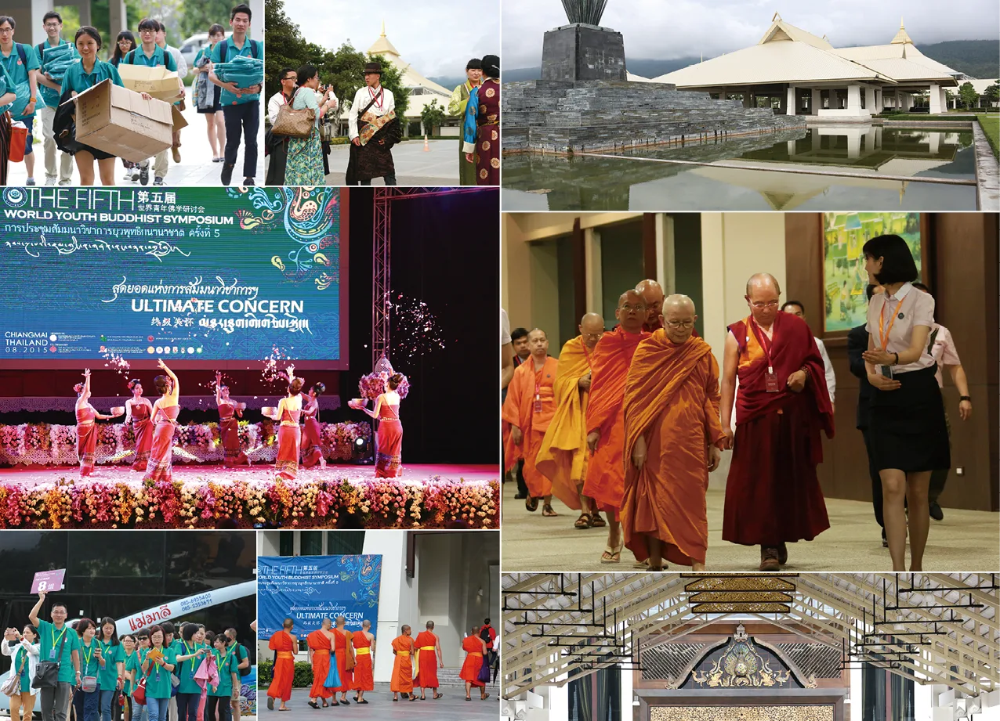
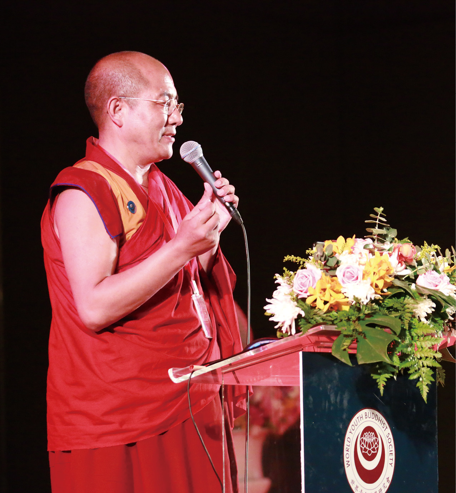

本 届 主 题

终 极 关 怀

ultimate care

第5届

世界青年佛学研讨会

World Youth Buddhist Symposium

泰国·清迈

2015 / 8 / 1 - 8 / 4

## 开幕词

## opening speech

2015年8月1日

在这个吉祥的日子里，我们齐聚美丽的泰国清迈，举办第五届世界青年佛学研讨会。欢迎来自世界各地的高僧大德、教授、学者、老师、同学们，以及所有的参会人员。在这里，我想表达我诚挚的祝福：欢迎你们，扎西德勒！

感谢本次主办方——世界青年佛学研究会、泰国摩诃朱拉隆功大学清迈校区和香港教育学院宗教教育与心灵教育中心。也感谢协办方——香港理工大学佛学会、香港中文大学禅与人类文明研究中心、清迈大学等九所单位。当然，还要特别感谢所有为本次大会付出努力的志愿者们，感谢你们的辛勤付出，才让我们能够在这里顺利举办本次研讨会，谢谢！

历年来，世界青年佛学研讨会的宗旨都是“开放、包容、求真、利他”，就是围绕这些宗旨开展的。第一届，我们的主题是“探索人生真理”；第二届是“佛教与心灵教育”；第三届是“可持续发展”；第四届是“社会责任”。我们今年第五届世界青年佛学研讨会的主题是“终极关怀”，与此同时，还要围绕“心灵安适”“生与死”“藏传佛教传统”三个分主题展开不同的讨论。

据统计，这次有1467人申请报名，但由于各方面原因，我们实际录取了大约720人，他们来自世界上22个国家255所大学。1467人中，相当于每两人只选了一个人，所以这个机会非常难得、宝贵。正如前面的法师所说，这是一个让我们学习各种宗教的机会。所以希望大家能够重视，同时做一些相关的笔记，把学到的东西记在心里。

这次的研讨会，或者说是对佛教的研究，其实是在训练我们的心。同时，希望这个平台能让大家学到很多东西，更希望你们能把这些学到的东西运用到现实生活中去，帮助更多的人。

最后，祈愿三宝加持你们一切圆满吉祥。谢谢！
