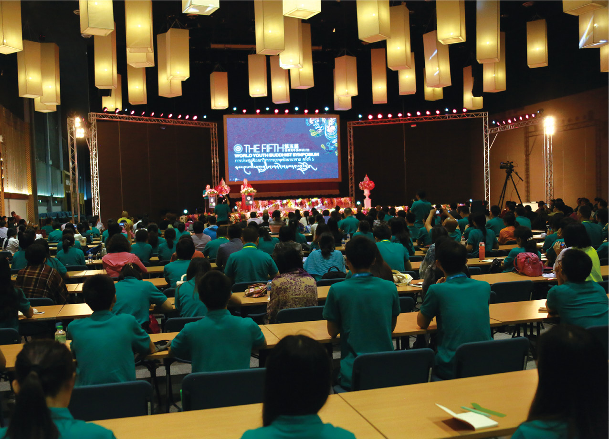

## 闭幕词

## closing speech

2015年8月4日

尊敬的沃喇穆尼校长，在座的各位高僧大德、教授、专家、智者和同学们：

我们第五届世界青年佛学研讨会即将闭幕。在这个特殊时刻，我有一种意犹未尽、依依不舍的感觉。

如果用简单的语言来总结这四天的研讨会，首先我想说，希望大家能包涵我们组委会的一些不足之处。我们这里有很多著名的专家、老师，很多人想上台演讲，但没有办法给大家足够的时间。此外，虽然我们已经尽力为大家提供了一些便利，但有些地方，比如你们的饮食和住宿，仍然不尽如人意，希望各位谅解。

其次，我想谈谈这次大会成功的地方。

1．在这四天里，我们的参与者几乎没有缺席，大家都很准时到位。无论是台上演讲，还是台下聆听，整个会场的纪律都非常好。

2．整个会议期间，很多人都说收获很大。我看到大家都在做笔记，还有人用微信给我发过来，说这段时间做了50多页笔记，他平时不喜欢参加会议，不过这几天他很愿意听专家们的发言、老师们的分享。

第三，我想说：谢谢！首先特别感谢摩诃朱拉隆功大学清迈校区、清迈大学、皇家大学等所有主办方和协办方。

特别感谢台湾国际藏传佛教研究会，其众多高僧大德一直陪伴我们完成本次研讨会。

特别感谢香港教育学院宗教教育与心灵教育中心，从第二届到第四届为我们提供场地，第五届也派代表来这里帮助我们完成这次研讨会。

特别感谢所有的翻译团队。没有他们的全程翻译，我们很难听懂所有嘉宾的发言。

特别感谢所有的志愿者。虽然我们的团队不是特别大，但他们在背后确实付出了很多，所以我要感谢所有的志愿者，包括几位主持人，以及所有参与研讨会的贡献者。

最后，我想说：明天很多老师和同学就要各奔前程了，每个人来的时候欢欢喜喜，走的时候依依不舍，但这是一切万法的规律。

对于下一届世界青年佛学研讨会，我们初步计划明年这个时候继续在泰国清迈举办，希望有缘者乐于参加。

只要大家努力，相信我们一定会把这个研讨会办得更加国际化，努力成为一个世界性的盛会。

祝大家吉祥如意！扎西德勒！
