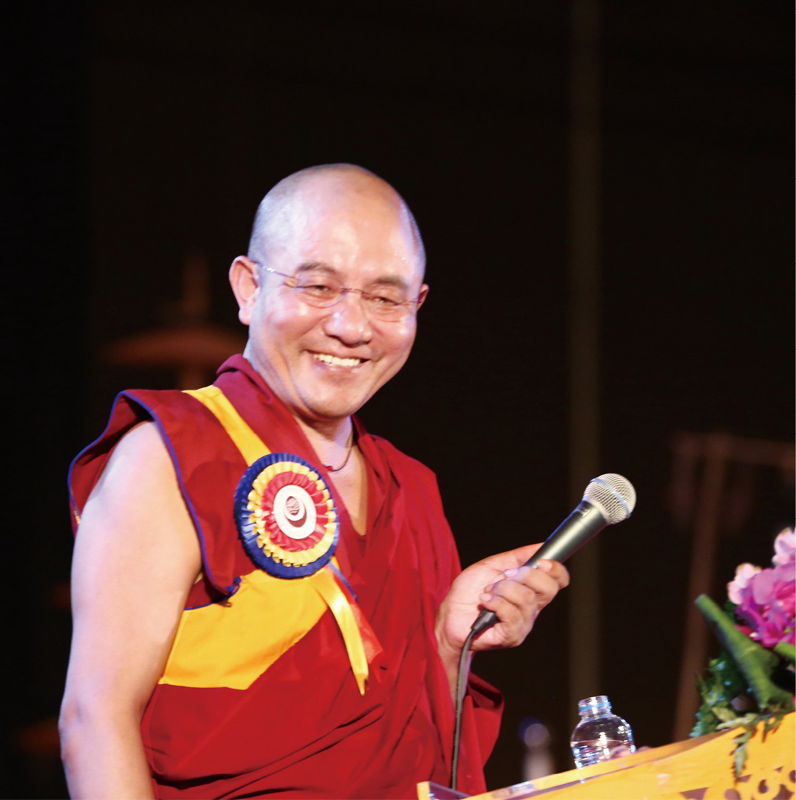

## 闭幕词

## cloSING SPEECH

2016年7月15日

尊敬的各位高僧大德、嘉宾朋友，来自世界各地的青年学者们：

晚上好！

很高兴这次在泰国摩诃朱拉隆功大学清迈校区举办了第六届世界青年佛学研讨会，也很高兴通过高僧大德、专家学者的精心演讲，让许多青年学者受益匪浅。

我个人在这四天里学到了很多知识，包括南传佛教、北传佛教、藏传佛教的思想，世界各地宗教的思想，以及现代科技知识。在紧张有序的日子里，许多人充满激情的演讲让大家法喜充满。

接下来，根据组委会的要求，我总结了对这次会议的几点想法：

第一点，我要表示感谢。

首先感谢主办方泰国摩诃朱拉隆功大学清迈校区，协办单位香港教育大学宗教教育与心灵教育中心、香港中文大学禅与人类文明研究中心和香港理工大学佛学会，感谢清迈的梅州大学、清迈大学以及清迈警察局等机构的支持。如果没有你们，我们不可能举行这样一次世界级的大型会议。

其次，我要感谢来自世界各地的翻译人员。这次有20名翻译应用了17个国家的语言，交传有20场以上，同传有30场以上，所有翻译总共60场以上。没有你们，那么多来自不同地方、使用不同语言的人，根本无法从会议现场获得知识。

之后要感谢我们的主持人。这次有13位主持人，没有你们的主持，不可能让研讨会的每个环节顺利圆满。

还要感谢这次大会的功德主，是你们赞助了这次会议。现在是一个高消费时代，没有你们强有力的经济支持，我们将无法举办这样的活动。

最后要感谢的是，所有参与此次活动的工作人员和志愿者。没有你们，我想我们很难举办这么有秩序的高端会议。

当然，我也要感谢我们世界青年佛学研讨会的所有负责人和成员。没有你们的精心策划和全心服务，举办这样的活动并不容易。

第二点，我想总结一下这次会议。这四天，我们有主题演讲、微演说、自由发言、放生、供灯、禅修等环节，以及宗教与科学、传统文化与现代社会的各种对话。通过这几天的大会，相信很多年轻人在不同知识的碰撞中收获了很多，这对每个人都有着重要意义。

本届研讨会，应该说是佛教界目前规模最大、国际化程度最高的高端学术研讨会。参与者来自非洲、亚洲、欧洲、北美洲和大洋洲，可以说是来自五大洲的知识分子和宗教人士。

第三点，我想谈谈这个研讨会的宗旨或愿景。我们世界青年佛学研讨会，其实是基于“包容、开放、求真、利他”的精神，既没有经济目的，也没有政治目的，它纯粹是一个开放包容的学术交流平台，面向全球有信仰或无信仰的青年学者。

第四点，不足之处，请大家多包涵。

我们每个人都有不同的习惯、传统、成长背景，来到这里，可能无法适应所有的人。包括我自己，从第一天到今天，我全身心地投入。一位仁波切今天说，即使拍照也会给别人提供方便，我也是这么认为的。然而，我并没有让很多人满意。刚才有些人因为重要的事情想约我，但无论我怎么安排时间，都很难满足所有人，可是我已经尽力了。同样，当我们的工作人员和志愿者团队为每个人提供便利时，可能也会有一些事情让大家感到不满意或不开心。希望大家不要用暴力来解决问题，而要用和平的方式化解自己的情绪，因为我们都是来学习和平的。

第五点，希望和建议。

如果因缘具足，世界青年佛学研讨会将不断地办下去，明年可能也会在泰国举办。

当我们带着这些智慧回到故土时，有几种方法有助于弘扬。一是通过学仁社学习传统文化。在中国，学“仁”更适合，其他国家不一定，每个国家都有自己的传统文化。另一种方式是将古老的、有价值的传统文化，与我们日常生活相结合，让古老文化和现代文化相交融，取长补短，以这种方式进行弘扬。最终我们要学会一件事，就是世界需要和平，和平要从自身做起。

明天，来自世界各地的人们将各奔前程。虽然有点依依不舍，但我们只能观这一切如梦如幻。

最后，再次表达对大家的感谢。还有一些人，不管我今天有没有提到，我都铭记在心。记得马丁·路德·金（Martin Luther King, Jr.，1929-1968）在1964年12月10日获得诺贝尔和平奖时发表了一篇和平演讲，其中一句话是：“每次我坐飞机时，在高空上的成功旅程，离不开那些地勤人员。”同样，当我们人类和平的梦想实现时，也不能忘记背后还有无数人的付出。非常感谢！
