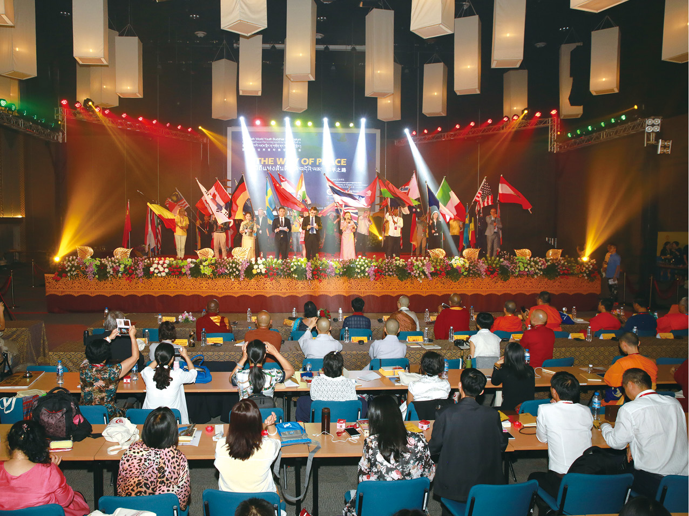
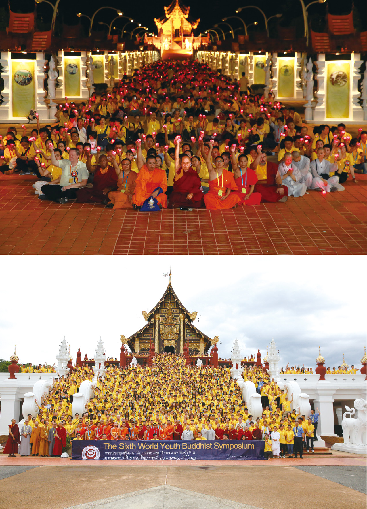
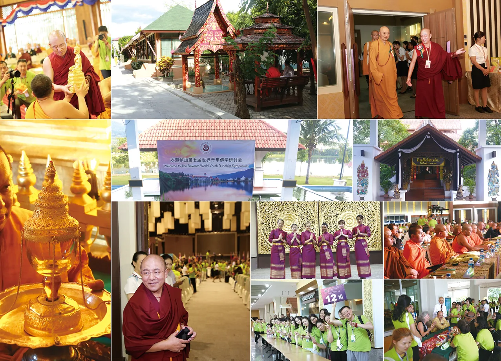
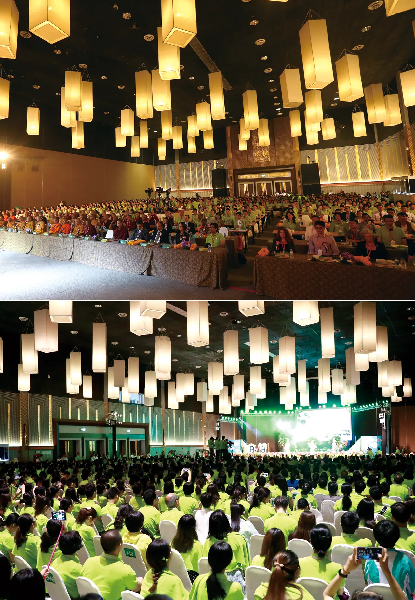

本 届 主 题

幸 福 之 路

The Way to Happiness

第7届

世界青年佛学研讨会

World Youth Buddhist Symposium

泰国·清迈

2017 / 7 / 30 - 8 / 2

## 开幕词

## opening speech

2017年7月30日

尊敬的各位高僧大德，来自世界各地的嘉宾朋友、青年学子们：

大家早上好！今天，在这个吉祥的日子里，我们再次相聚在美丽的清迈，举办第七届世界青年佛学研讨会。

这里有许多来自世界各地的学者和年轻人，这样的机会非常殊胜。俗话说，有缘千里来相会。非常感谢来自世界各地的青少年来到这里，我谨代表世界青年佛学研究会，向你们表示欢迎，并致以诚挚的祝福！

同时，特别感谢本次研讨会的主办方：世界青年佛学研究会、泰国摩诃朱拉隆功大学清迈校区！感谢大会的协办方：香港中文大学禅与人类文明研究中心、香港理工大学佛学会，感谢他们一直以来的支持和帮助！此外，感谢清迈宗教协会、清迈省办公厅、清迈省佛教协会、清迈大学等12家机构对本次研讨会的支持！还要感谢这里所有的志愿者朋友，感谢你们的辛勤付出。特别感谢！

世界青年佛学研讨会是一个自发的非营利组织。自2011年首次召开以来，今年已是第七届了。历年来，世青会一直秉承着“开放、包容、求真、利他”的宗旨。所谓“开放”，就是没有宗教限制，不管你信仰基督教、佛教还是其他宗教，甚至是没有宗教信仰的人，都可以来参加这个研讨会。所谓“包容”，是指平等和自由，大家互相尊重，对藏传佛教、南传佛教、北传佛教，都以一颗包容的心互相探讨。所谓“求真”，就是不求财富，只求真理和知识。所谓“利他”， 指不是为了满足自己的利益，而是为了造福众生，不管是什么样的人，都以慈悲心去利益他。

带着这样的目的，第一届世界青年佛学研讨会在藏地喇荣佛教大学举办，当时的主题是“探索人生真理”；第二届、第三届、第四届均在香港教育学院举办，主题分别为“佛教与心灵教育”“可持续发展”“社会责任”；第五届、第六届、第七届在泰国清迈举行，主题分别是“终极关怀”“和平之路”和今年的“幸福之路”。

据大会组委会统计，本次报名总人数为2511人，实际录取人数为910人，当中有很多来自世界各地的年轻朋友，所以这次机会非常宝贵，希望大家珍惜。

参加这次世青会的，共有271所大学，其中国内145所，国外126所。他们来自非洲的马拉维、乌干达，美洲的美国、加拿大、智利，欧洲的英国、德国、法国、荷兰，亚洲的印度、尼泊尔、不丹、新加坡、马来西亚、日本、中国、韩国，大洋洲的澳大利亚、新西兰，等等。很抱歉这次没有说出所有国家的名字，也没能把所有国旗都摆放在舞台上，希望相关人士能给予理解。

本次研讨会以“幸福之路”为主题，从“心灵探索”“生态共存”“生活佛教”三个分主题展开讨论。第三天，我们将一起禅修，并去参拜一座寺庙。第四天，我们将讨论“生活佛教”这个话题。希望大家珍惜这四天参加大会的经历，以开放的心态，带着学习的目的，认真聆听每一位嘉宾的发言，做好笔记。你们不仅要把学到的东西记在心里，还要用它来提升自己和修行，用这种感悟和体验在现实生活中去帮助更多的众生。

无论什么样的人都在追求幸福，就连地上的蚂蚁也不例外。所以希望大家在这几天好好学习，找到属于自己的幸福。我相信你们都会收获很多。

最后，衷心祝愿第七届世界青年佛学研讨会吉祥圆满！祈愿三宝加持，祝大家吉祥如意！谢谢！
