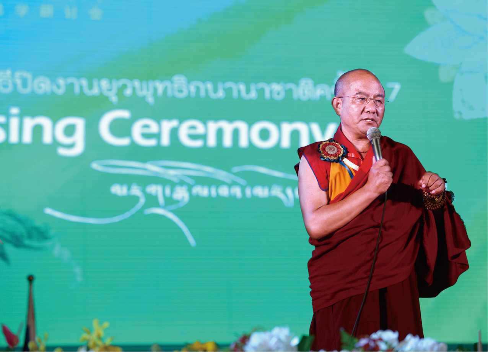

## 闭幕词

## closing speech

2017年8月2日

尊敬的摩诃朱拉隆功大学清迈校区校长，尊敬的各位高僧大德、专家学者，以及相关政府官员：

大家晚上好！大慈大悲的佛陀告诉我们：“聚积必散。”第七届世界青年佛学研讨会在美丽的清迈即将圆满。

下面我简单总结一下，给大家做个汇报。

首先，特别感谢我们的主办方——泰国摩诃朱拉隆功大学清迈校区，感谢所有的协办方和相关学校，感谢所有的支持单位，因为我们能够成功举办这样一场世界性的盛会，靠的就是你们的支持和努力！我还要特别感谢在这次大会中，所有赐予教诲的高僧大德，所有分享专业知识的专家学者，以及非常高端的翻译人员！我数了一下，我们有26名翻译，14名电视台和新闻媒体的主持人。正是因为你们无私的付出，才有了这场精彩的盛会，这是无法用金钱衡量的。

我也发现在举办活动的过程中，还有不少需要改进的地方。从去年到今年，也就是这次活动开始之前，我们组委会已经做了各方面的准备，包括我自己，参加了21场筹备会，其他人参加的应该会更多。然而，由于参与者的国家、民族习俗、宗教信仰等不同，无论是从精神层面、还是物质层面，我们都无法满足每个人的要求。当然，我们也会接受不同层面的宝贵意见，不断学习和提高，相信下次活动会有更多的经验。

在这四天的活动中，我大概了解了一下，共有4场主题演讲、18场微演说、自由谈等多个环节，其中包括62次交传、20多次同传。特别感谢所有参与者、所有服务人员和志愿者！

我们对未来有美好的理想和愿景，第八届世界青年佛学研讨会极有可能继续在泰国的清迈或其他城市举办。在此过程中，或许会增加一些学术论文的收集。无论如何，我们的未来应该是学习和成长的未来。

有句话说得好：“今天的离别是为了明天的相遇。”这是通往幸福之路。这几天我们过得非常幸福，明天大家就各奔东西了，相信每个人都会有美好的回忆，我也会想着你们每一个人。

谢谢大家！
