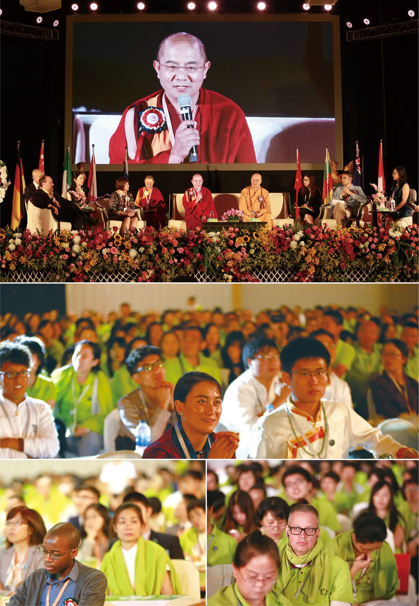
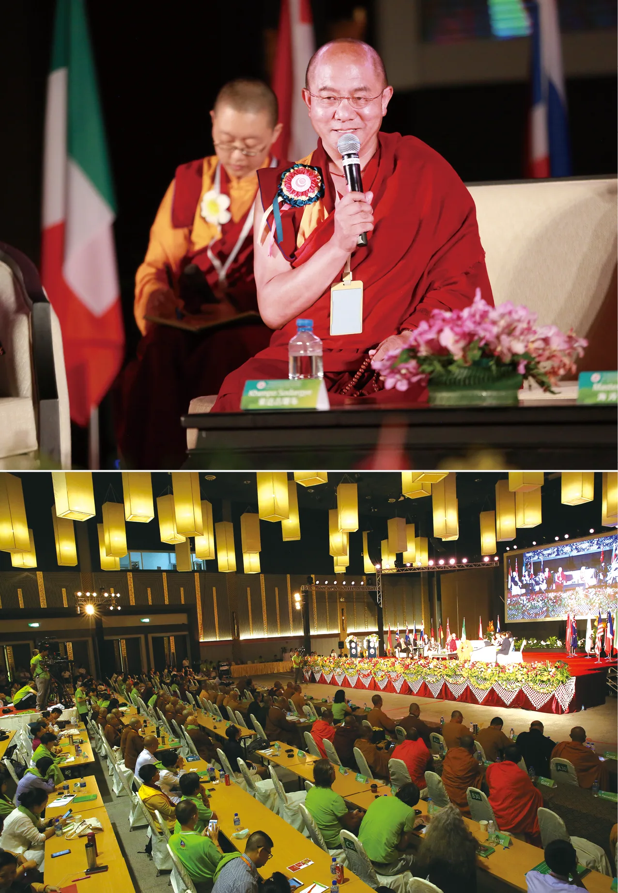
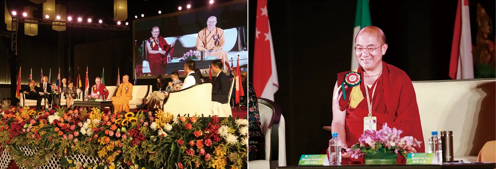

## 聚焦人工智能与人类幸福

## Artificial Intelligence and Human Happiness

2017年7月31日

|索达吉堪布 世界青年佛学研究会会长

|海涛法师 台湾生命电视台台长

海内外慈悲志业各基金会&协会总会长

|肯农·谢尔顿教授 美国密苏里大学心理学

|伊丽莎白·洛布教授 澳大利亚新南威尔士州卫生部

卡尔弗利医院临终关怀

悉尼圣母大学医学院

|朱家岳博士 科学家Google DeepMind

## 大咖眼中的AI

主持人：今天的主题是“人工智能”。很多人都看过李世石与AlphaGo的比赛，也看过关于AI人工智能的电影。我想请教在座各位，你们眼中的AI人工智能是怎样的？

海涛法师：AI人工智能可能就是想塑造一个人工佛陀的头脑，来解决人类的各种问题，如网购。我想象中的AI，有点像我们过机场时那个“哔哔哔”的机器。如果能制造这种人工智能，人一旦有贪嗔痴，“哔——”的大声响一下，人就不能通过。人工智能的进步就是希望让我们的生活更便利、更快速。这就像中医给我们会诊，搭搭脉，就知道有什么病。如果人工智能也能给我们按一下手，就知道有什么病，那当然也很好。站在修行者的立场，我希望人工智能帮助我们更快速地了解自己、了解世间，制造一个人类的、头脑的结晶体帮助我们得到幸福。

但是，我关注的重点是动机。所谓动机，就是悲心。悲心是人工智能做不到的。这就像把妈妈的眼泪放在一滴水里，我们不知道这里面充满了爱、充满了慈悲。人工智能的确能带来便利，但要以利他的动机来使用。正如手机可以帮助我们，也可以害我们。

索达吉堪布：我很关心这个话题。现在在座各位的手里可能都拿着智能手机吧？有智能手机的人，举手让我看看。（下面纷纷举手）所以，人类到了21世纪的今天，想要回去，是回不去啦。我们每个人都是在机器的控制下生活。作为一个出家人，我对人工智能、对人类所面临的问题很关心。在最后一天，我会有一个短短的讲座，到时候我会说出我的看法。

伊丽莎白·洛布教授：我认为AI是一种由技术组成的系统。这个系统可以帮助和支持人类，并非取代人类。就人类历史而言，任何一种技术的革新都会创造出新的工作机会。回顾工业革命，工业革命导致农业中的许多工作被取代，但同时，工业革命也创造了很多新的机械化的职位。所以，AI引发的机器人科技，是一种非常先进的技术，是一种水平极高的、和认知的复杂度混合在一起的、可以给医疗行业带来革新的一种技术。事实上，AI这种技术在1970年的时候就已经被应用在医疗行业了。

肯农·谢尔顿教授：在谈人工智能之前，我想先谈一谈什么是“智能”。追溯至19世纪，当时很多定义被广泛提出，比如音乐的、数学的、社会的。我认为“智能”是一种能力——能够观察发现问题，并寻求解决办法的能力。1990年，我在论文里研究过这些内容，我的研究项目是创造性。创造性意味着能够提出问题，能够发现现有的知识体系里缺乏什么。在我的印象里，现在的人工智能仍然不能实现我所描述的“提出问题”，但是它可以把已有的知识通过程序的形式表现出来。除非哪一天AI能提出问题，否则在此之前，我宁愿把它叫做计算机编程，或者计算机程序，而非人工智能。

## 从GIGO到AlphaGo

主持人：朱家岳博士，您来自Google，AlphaGo[^1]就是您命名的。您能不能给大家讲一讲AlphaGo的故事？

朱家岳博士：我仅谈谈个人观点，不能代表Google DeepMind。

其实，我本人并不是AlphaGo这个团队里的。AlphaGo的比赛里有一个人，他是AlphaGo的人肉机械手（帮AlphaGo下棋），那个人叫Aja，是我朋友的同事。AlphaGo以前不叫AlphaGo，它叫GIGO。有一天我们在聊天，我对他说：“GIGO，GIGO，听起来像‘鸡狗’，不好听。”他也承认这个名字听起来不太吉利。Aja说：“不然你帮忙取一个名字？”我说：“好，让我想几天。”我问他：“你希望这个名字有什么样的感觉？”他说，他希望能代表世界上最强的围棋。因此，回去以后我就开始思考。通常在一个陆战队里面，最强的团队叫做Alpha Team。狼群里面，狼的领导被称为Alpha Male。因此，我建议他，不如我们就叫AlphaGo好了。我们内部是非常民主的，他们有个选举，投票决定用GIGO还是AlphaGo。大部分人觉得AlphaGo比GIGO好听，因此AlphaGo这个名字就成型了。

什么是AI？什么是人工智能（Artificial Intelligence）？许多人对AI的认知来自于电影，他们的认知与我们科研领域、产业领域对AI的定义不太一样。“智能”在这里指的是能够解决一个被清楚定义的问题。所谓“被清楚定义的问题”，指的是其结果能够被测量。举例来说：围棋有可以测量的输和赢，影像识别有可以被清楚测量的正确和错误，自动驾驶系统也可以清楚地测量一辆车是否有从A点到达B点，车子有没有损伤，或者违反交通法规。

主持人：那么，如果是不好计算的，例如画画、书法，这个应该就很难了吧？

朱家岳博士：这要视乎你怎样定义“写一个字”。现在有很多系统，能够产生与人写的字一样字迹的毛笔字。当然，一个系统并不能自己认为自己美好。因为，AI是没有分别心的，它只是一个工具。有分别心的是人。

## 人工智能的前景

主持人：有人说，AI在未来的10年或者8年内会打败人类，有这种可能吗？未来5年，人工智能在人类生活和工作领域中，将会实现哪些功能？

朱家岳博士：在某些难题上，AI可能会超越人类，例如，最常见的“ImageNet Competition”。许多不同种类物件的影像，由电脑与人辨别。在这个比赛中，电脑的精确度已经超越了人类。但是在其他方面，例如吟作诗词、煮出好吃的料理、创造并不存在的概念等，我不认为AI可以在短期内超越人类。

主持人：那么，五六年以后，人工智能会实现哪些功能呢？

朱家岳博士：5年后，很有可能会实现以下功能：

1．自动驾驶系统。目前在美国，已经有大约265家自动驾驶公司。这些公司一定是确定自动驾驶系统是可行的，才会成立公司。因此，5年后，我很确定，大家一定可以看到自己的车有自动驾驶功能，在路上也能找到自动驾驶的出租车。

2．自动手臂。目前的机械手臂必须要设计好程序。但是目前，我们已经有了更先进的机械手臂，它能根据状态自动学习、适应组装机件的方法。以后，或许各位的智能手机可以几乎完全依靠机械手臂来组装。

3．语言系统和自动发音系统的整合。想想看，以后到了海外，在语言不通的地方，你只要利用手机，输入你想说的话，手机就可以自动把你的话上传到云端翻译，再自动播出来。这样就等于你能与当地人轻松地沟通。

4．智慧电网和智能空调。其实，现在的电网和空调是非常没有效率的。像会场这种地方，它的温度不是以最省电的方法来控制。使用智能空调和智慧电网，则大概可以省下30%~40%的电力，会更环保。

5．AI还可以应用于辅助新药品、新化学产品、新能源（如核融合）的研发。如果要发展新的材料，我们可以利用AI帮助找寻比较可能成功的研究方向，而不需要浪费过多的资源。

## 没了“饭碗”，怎么办？

主持人：朱家岳博士讲到了诗词。现在，大家一起来看看大屏幕——有两首“西津”的七绝。其中一首是人工智能写的，另一首是古代诗人写的。

第一首：

西津潮水入天栏，云外烟帆霁色间。

明魄荻花宜下马，一溪鸥鹭共相关。

第二首：

西津江口月初弦，水气昏昏上接天。

清渚白沙茫不辨，只应灯火是渔船。

两首诗，一首来自宋代诗人秦观，另一首来自IBM公司名叫“偶得”的写诗程序。大家能分辨出来吗？现场的嘉宾也来猜一猜？（嘉宾举手表态）

其实，第二首才是人写的。

咱们再来看两张图——左边这张是8年前的瑞银集团交易大厅，里面坐满了交易员。右边是交易大厅现在的样子，操作员已寥寥无几了。肯农·谢尔顿教授，您认为您所在的行业会不会因为人工智能的出现而导致大量失业？AI不能替代的领域有哪些？

肯农·谢尔顿教授：可以很肯定地说，不会。作为一个从事科研的科学家，我刚刚也说了，最重要的是创造力。例如现在，我有一个写满问题的单子，上面写了下学期我要进行哪些研究，我要在这些问题里挑出哪些是最重要的、哪些是相关联的。这种提出问题的能力是不会被AI取代的。每一个科学家都要有能力提出问题。我比较担心的，是刚刚看到的那个画面（瑞银的画面），这么多工作职位因为AI已经失去了。人类该如何创造更多的职位？这需要我们的创造力想出解决的方法。教育系统可以帮助我们实现这一点。

主持人：伊丽莎白·洛布教授，在医护领域，您觉得AI会取代人类吗？

伊丽莎白·洛布教授：我从事的主要是临终关怀，关怀一些即将面临死亡和即将死亡的人。我们关注的不仅是人的肉体（物理上的身体）而已，我们会更多地关心这个人的整体——物理的身体、生理的身体、心理、情绪、精神等方面。所以，人是非常复杂的、各种体验的综合体，我们需要去觉察，把他作为一个非常独特的整体来考虑。这就是目前我从事的领域。

在临终关怀领域里，对死亡的了解让我们更好地了解生命的本质，并且拥抱生命中的遭遇、痛苦及死亡，我觉得这种人类的体验是不能被AI所取代的。很多感知是人类所特有的，机器人不能达到人类的深度和广度。对机器人而言，“人类感知”是个难题——机器人对非常特殊的对象的感知能力，并不能达到人类所拥有的天赋。所以，机器人并不能做到像人类一样——当我们手和手接触时、皮肤和皮肤接触时，能带来非常丰富的感知，机器人却无能为力。因此，我们对濒死之人的关怀，是机器人或者AI不能取代的。

主持人：海涛法师，您有没有想过，某一天您以前所有讲过的经论全部进入了人工智能系统，您的生命电视台也变成了智能系统。佛教徒只要对着智能系统说出自己想听的佛法，阐述自己的困扰，系统就能调出相关的论述，并与人交流。如果真有这么一天，您会怎样调整您的弘法计划？

海涛法师：事实上，世青会的这几天我们就运用了人工智能，世界上有几十万人在同时收看直播，它让佛法的知识传播得更远。但是，我相信以后索达吉堪布会更忙，为什么呢？因为通过佛法，很多问题被暴露了。要解决问题，只能靠亲近善知识，因为人工智能是没办法给对方悲心的。所以，母子相遇，大乘佛教就是上师的悲心感动了弟子而转化了他的贪嗔痴。人工智能如果能发展成这样，那我会不断祈愿这一天早日到来。

看到刚才那些画面，我要讲一件痛苦的事情：12年前，我们收了40位小和尚，他们决心长期出家。但自从有了手机以后，现在只剩下4个了，而且还摇摇欲坠。缅甸佛教、泰国佛教也为此事开会，自从有了手机以后，出家人每年减少四分之一。

针对现状，如今我们只能向堪布学习，变得更有悲心。因为科技越进步，人就离自己越远，离自己的心越远。所以，作为一名佛教徒，我们要把大悲心融入每一部手机里。阿弥陀佛！

主持人：翻译已经成为人工智能发展的重点。据报道，Google公司运用神经网络算法催生了新一代的智能翻译，使之前的错误率锐减60%。微软公司也奋起直追。智能翻译系统已经成为了2017年最值得期待的五大科技成果之一。在过去的30年时间里，堪布为汉族弟子翻译了大量藏文佛教经典。随着未来翻译人工智能的普及，堪布您觉得翻译事业会不会遇到挑战？

索达吉堪布：我可以很坚定地说，佛教方面的翻译不会被人工智能取代。有些翻译工作，包括旅游、商业，这些可能会取代一部分。但是精神层面的，尤其是佛学层面的，暂时应该不会。如果真的被取代，我也很高兴，因为我可以闭关了。（众笑）

## AI来袭，幸福在哪里？

主持人：人工智能时代的到来已是大势所趋，无法改变。在这个时代里，我们该怎样与时代共融，提升内心的幸福感？

肯农·谢尔顿教授：我不认为我们的文明会在几十年间被Google发明的这些技术取代。这些技术、小工具可以成为辅助我们的手段。现代社会真正急需的是其他方面的东西，如政治、社会的改革。如果AI能够帮助我们解决这些问题，我会非常非常高兴。

伊丽莎白·洛布教授：关于AI这个话题，我做了很多调查，研究了很多数据。关于这个话题，我们可以从各大媒体中得到相关信息，比如ABC、澳大利亚的各种新闻媒体。其实，所有的信息都提到，重复性越强的工作，越有可能会被取代。在澳大利亚有这样的预测，有将近500万个工作岗位在2030年的时候，会被自动化取代。但是，我还是非常乐观。正如索达吉堪布所讲，在精神层面被善知识引导，能够认识心的本质真相，这是最有价值的，是AI无法取代的。精神层面的引导者是一把钥匙，能够帮助我们打开智慧和慈悲，可以帮助我们释放内心不可限量的资源。帮助濒死之人，帮助我们面对死亡，这些精神层面的难题，AI无能为力。

索达吉堪布：如果人工智能真的取代了大量工作，许多人可能连吃的、穿的、金钱都没有了保障。不管怎样，那个时候这些人会很痛苦。我们经常说认识心的本性是很快乐的，但是如果没有吃的、没有穿的，哪怕认识了心的本性，恐怕也生存不下去。不管在哪一个时代，我们都要有满足感，这样会比较幸福。我用佛教的语言做个结尾，佛在《遗教经》中说：“知足之人，虽卧地上，犹为安乐。”有满足感的人，即使没有很多的资源，也会过得很快乐。

海涛法师：科技在进步，但是无论如何也没办法制造人工智能爱人，如果能制造AI情人，那这些女人就被“超度”了。我们佛教徒相信有天界，在玉皇大帝的天界上不需要人工智能，所以人工智能也没办法征服太多。但科技越发达，人越空虚。科技给你物质的便利，但也让你越来越痛苦。科技的进步是无法避免的，商人会用尽一切方法赚更多的钱。我们现在唯一能做的，就是保护自己，守护菩提心，守护大悲心，以强大的悲心运用科技，帮助别人。

朱家岳博士：我相信在不久的将来，强人工智能系统（Strong AI System）会形成，人类将进入新纪元。AI能够帮助我们更有效率地使用能源，因此弗艾特教授（Louise Vet, 1954-）所担心的环境问题也许不再是问题，因为AI系统能够帮助我们节省能源。在全球变暖的问题上，AI能够降低碳排放，能帮助我们使用更少的资源、更有效率的系统。届时，世间上的许多食物、资源都会变得更加便宜。AI甚至可以帮我们开发新的能源，例如核融合（Nuclear Fusion），这样，人类可能拥有趋近于无限的能源。AI系统也许还能帮助我们发展更有效率的有机耕种系统，使用立体耕种法。对于食物，人类将没有后顾之忧。到时候，如果各国的政府能够推出“Universal Basic Income”（全民基本收入），那么人人都会有固定的薪资，每个人的衣食住行、教育医疗，都能获得基本的保障。这样大家就会有更多的时间开发心智、修行、学习佛法，或者闭关。

当然，这些都是建构在人类充满善心的基础上，因为我们知道，科技是一把双刃剑，它可以用在好的地方，也可以用在不好的地方。刚才许多大德都说过，其实人类最忧心的就是人工智能会取代大量工作。这的确有可能。届时，因为资源的分配，将有一些人拥有非常多的资源。而诸位善知识，你们因为充满福报，将来可能会成为拥有更多资源的那群人。我希望大家以后拥有更多的资源时，能够用大悲心布施给那些丧失资源的人，让这个地球变为一个更平衡的世界。

[^1]: 阿尔法狗（AlphaGo），第一个击败人类职业围棋选手、第一个战胜围棋世界冠军的人工智能机器人，英文名为AlphaGo。它象征着计算机技术已进入人工智能的新信息技术时代（新IT时代），其特征就是大数据、大计算、大决策，三位一体，其智慧正在接近人类。
