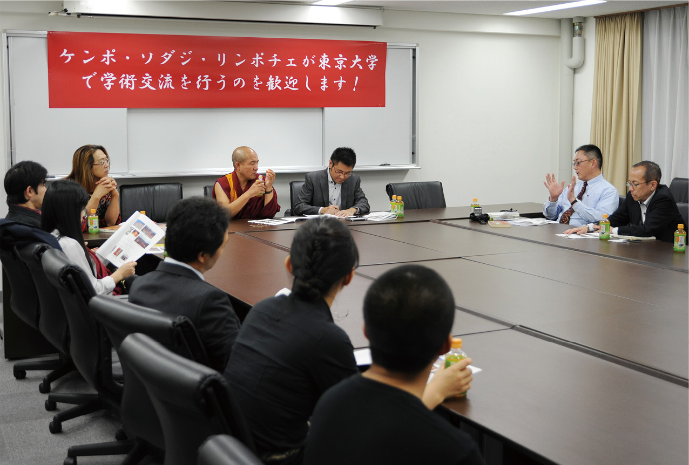
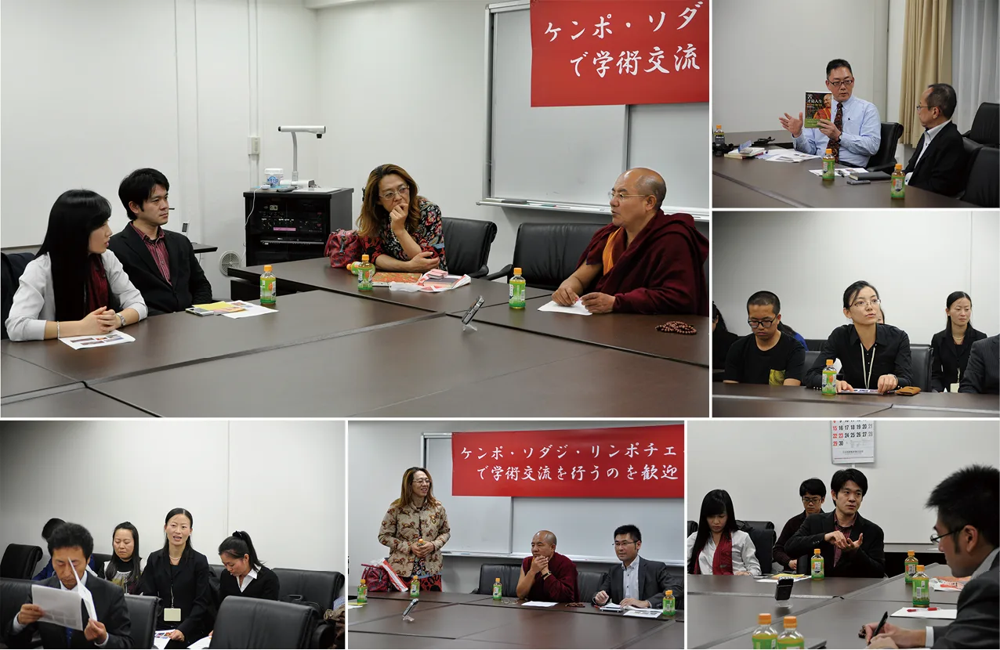

心灵鸡汤也很有营养

索达吉堪布 & 东京大学学者

东京大学董泽文化研究所

University of Tokyo

2015/11/11

1．宁玛的红辉

东京大学学者：

2001年，我去过喇荣五明佛学院，还有亚青寺、德格印经院、阿坝州的几个寺院。此后每年都会去几个地方，四川、甘肃、云南、青海的藏区。虽然我是外国人，但没有什么限制。

我的研究课题是中国共产党的宗教政策，所以会去几个藏区，了解当地的情况和变化。我以前看过这本书《宁玛的红辉》，看完很感动。遗憾的是，大部分日本人都不知道这本书，也不知道它的内容。这本书上第二页的照片是早期的佛学院的坛城。我想问一下，这座坛城的一楼是不是招待所？

索达吉堪布：

不是。招待所在坛城的旁边。坛城的一楼是各个教派的殿堂，比如汉传佛教、南传佛教，藏地的格鲁派、宁玛派、萨迦派，还有苯教等，共有各个教派的十三个殿堂。

东京大学学者：

堪布的教派主张是教法要超越宗派。除此之外，还特别提出，应该大开门户，除了藏族人，让其他民族和国家的人，如美国、新加坡等地的人，也都能够学习佛法。

从我们的角度来看，佛学院的影响力——这样一种风潮的流行现在刚刚开始。但并不是有信仰的风潮，而是一种没有信仰的风潮。没有信仰的人们，抱着一种观光旅游的心态，前来访问佛学院。他们希望看到真正的藏地的天葬，还希望能拍下照片。同时，因为佛学院处于海拔四五千米的地方，很多人产生了高原反应。

我有一个疑问请教堪布。近几年来，很多没有信仰的汉族人，前来佛学院参观，人数越来越多。您对这个现象有什么看法？

索达吉堪布：

我不会排斥这些没有信仰的人，和他们也有共同的话题。其实佛学院里的一些出家人最初也是没有信仰的，甚至很反对和排斥信仰，但现在他们都皈依了、出家了。可见，人的信仰随时都会改变。同样，一些有信仰的出家人最后选择还俗，也有这样的情况。现在出现的各种状况都是正常的。

东京大学学者：

《宁玛的红辉》的作者陈晓东，不知道能不能和他联系上？

索达吉堪布：

应该可以的。听说他在上海，但后来我没有再见过了，具体情况就不清楚了。

东京大学学者：

大概三四年前，佛学院的僧房的屋顶都变成了红色的铁板。这是由佛学院统一制作的吗？有什么特别的原因吗？

索达吉堪布：

日本的佛教建筑大部分是灰白色的，有什么特别的原因吗？（堪布笑）

学者：

之所以会问这个问题，是因为十五年前，我曾经看到过那些僧房，当时屋顶并不是红色的。这几年，全部都变成红色了，个人观感有点奇怪，所以才想问一下您。

索达吉堪布：

因为佛学院是红色的世界，哈哈哈。

其实，也并没有特别的原因。本身藏传佛教、汉传佛教很多寺院的屋顶是黄色的，包括寺院院落和僧房，都是这样的。我们原来的经堂的屋顶是一种深红色，出家人的僧房屋顶盖了一些土，看上去是灰色的。大概三四年前，开始使用铁皮屋顶，因为原先的屋顶很容易漏水，铁皮防水，性能更好一些，就逐渐替换成现在的铁皮屋顶了。刚开始大家买的铁皮屋顶，各种颜色都有。后来佛学院的管理部门商量了一下，还是决定统一使用红色，和学院本身的颜色比较匹配。

我们自己也觉得没有之前的好看，太显眼了。后来也商量了，不能太红，颜色稍微淡雅一些。主要就是这个原因，其他就没什么了。

学者：

不是因为佛学院的红辉。

索达吉堪布：

宁玛派也叫做红教。

2．为什么学习堪布的教法

东京大学学者：

堪布在2012年出版的《苦才是人生》在国内造成很大的轰动，在各个平台和书店都卖得很好。之后的第二本《残酷才是青春》、第三本《做才是得到》也同样非常畅销。但在日本，即使对藏地很有兴趣的人，也不清楚这些情况，也不了解堪布所进行的各种活动。这一点是很可惜的。

对于一个日本人来说，不太理解为何堪布您的教法能渗透到汉人的心里，在汉地有那么大的影响力。当然，对于藏地来说，您本身是如意宝一样的存在，是希望的寄托。您对汉地的知识分子群体、女性群体产生了很大的影响力。我想问问在座的信众，为什么您对他们来说，有那么大的魅力？

观众甲：

我是在2011年遇到了堪布，被堪布的教法所吸引。为什么呢？因为我一直在闻思堪布所讲的佛法，目前以学习《入行论·善说海》为主。在学习的过程中，我发现通过次第的闻思和修行，可以对治我的烦恼，同时自身性格也会有所改变，变得更加调柔。对于自身来说，这种心的训练非常有益。这就是为什么这么多年以来，都特别尊敬索达吉堪布，对堪布的教法特别投入。

观众乙：

我也补充一点。我目前在高野山大学的研究所做研究员。我的研究课题是“入唐八家”。今年上半年，我在高野山大学选修了十五门课，通过这些课程学习，我发现真言宗的很多思想和宁玛派的经典内容，也就是索达吉堪布所宣讲的内容，非常相近。这是一个很有意思的现象，值得我们更多地关注。

东京大学学者：

这两天看了一些宁玛派的书，觉得和日本佛教有很多接近的地方，和您有同样的感想。

观众丙：

人从哪里来？为什么有些人出生在富贵的家庭，而有些人出生在贫穷的家庭？为什么有些人的生活一帆风顺，而有些人的人生非常坎坷？在这些现象背后，到底有着怎样的原因？从小时候开始，我就对这些人生问题充满了疑惑。

通过网络，了解到喇荣五明佛学院的存在，还有索达吉堪布的教法，找到了所有疑问的答案，也确立了自己的人生观，找到了自己人生的归宿。追寻和探讨人生的真理，这就是我学习堪布的教法的原因。

东京大学学者：

您所说的人生方向的确认，找到人生的方向，具体来说是什么？

观众丙：

具体来说就是，以前只考虑自己和亲朋好友，从来就没有想过为别人付出。通过学习，现在渐渐意识到，除了利益自己，还要去帮助身边一些有需要的人。通过学习利他来克服自私自利的心。此外还意识到，需要有包容心，超越民族、国家、文化的界限，在这个基础上，为更多的大众付出，促进彼此的交流和融合。

东京大学学者：

您都阅读了哪些书？

观众丙：

堪布所有出版的著作，包括刚才教授介绍的《苦才是人生》系列。也修习了五加行。更重要的是，上师的言传身教，三十多年来的传法，以身作则的利他行为，深入自心，令人感动。

观众丁：

在学习索达吉堪布的佛法之前，我曾认为佛教就是烧香拜佛、念念经，或者是参加各种各样的法会……也会疑惑佛教是不是就是一种迷信。来到日本之后，对于日本佛教的某些状况，包括戒律等，感觉和自己心中想的不太一样，不是想象中那种伟大殊胜的形象。

这三年时间，通过学习堪布的法，内心有了巨大的转变：完全颠覆了之前的人生观和价值观。从前，总是想要向外去寻求幸福和快乐，比如想要获得金钱，想要得到家人、社会的认可。但不断地往外寻求，就会发现，内心的欲望不但得不到满足，反而增加了烦恼。

正如堪布在《苦才是人生》中所写的那样，人生的底色就是三苦、八苦，各种各样的苦。我们通过学习，改变了自己的人生观和价值观之后，就要去追寻真正的出离轮回的大乐：成就佛果。

原来我们所认为的幸福和快乐，就是为了自己和身边的人。学习了堪布的法之后，自己的内心就会变得更宽容、更豁达。不仅想到自己，还想到整个人类，甚至想到我们身边的旁生以及所有众生。也希望自己能够把爱身边人的这种小爱，转变成超越民族、国家乃至物种界限的大爱。希望自己能生起这样利他的菩提心。

学习佛法，主要是通过闻思修，调伏内心的烦恼，减少贪嗔痴慢疑，增加慈悲和智慧。

3．从学术专著到大学演讲

现场观众（东京大学研究员）：

十年前我就读过您的《中论讲解》，对这部学术类著作印象深刻。但这几年您出版的著作和讲座，学术性的内容并不多。

我个人从本科开始学习佛教，一直是相关专业，我在东京大学留学三年，目前在印度哲学研究室做研究员，也在国内教学。我的困惑是为什么您这几年主要都在大学里做讲座，而且都是非学术性的，包括今天的讲座也是如此。对于学术界，您可能以批评为主，但其实在日本，学术界和宗教界的关系非常融洽，我们研究室里就有很多僧人，以学术的方式在大学里进行研究和学习，非学术的情况是比较少的。

您的教言对我们的帮助非常大，但从佛学的研究者角度来看，这类非学术的著作，算是一种心灵鸡汤吧，我可能就在飞机上翻一下，不会特别认真地阅读。

如果您在大学里讲授专业性的课程，比如您带我们读一些文献，或者讲一些学术性的内容，当然非常欢迎。但像今天这样的非学术性讲座，印度研究室的教授们都不会参加。这是日本学术界的普遍情况。中国的情况是，出家人去大学做讲座还是很受欢迎的。但这同时会给学生们带来一个困惑，即什么是佛教？什么是佛学研究？

我个人非常崇拜您，读过您很多著作。2008年出国后，有机会见到很多仁波切和喇嘛，大部分喇嘛都不会选择在大学里做演讲。而我知道您在全世界很多著名学府都做过讲座，宣传力度也很大。在此，想请教一下堪布，您这几年的转变是出于什么原因？

索达吉堪布：

这个问题很好，我来回答一下。

可能早期我偏重于学术方面的翻译和研究，包括中观、因明等比较深的学问。但是除了一些专业人员，能在这方面受益的人很少。那个时候在汉地，比较简单的佛学课程，大概有十万人在学；比较深的五部大论，如中观、因明、俱舍等，只有不到五千人在学，学的人特别特别少。就整体人群而言，这是一种普遍情况。

我刚开始去一些学校讲课，像北京大学哲学系，我就去讲一些中观的哲理。北京大学听众的接受度还稍微好些，我去其他大学讲的时候，发现很多学生听不懂。后来我就会换一些通俗的话题来讲。

有时候去国外的大学，也会讲一些比较深的专业方面的内容，比如有位教授要求我讲如来藏，我就专注于讲如来藏，可能包括教授在内有五六位专业人士，很感兴趣，听得很投入，但其他的五六百人都听不懂。

后来我也思考，演讲不能仅仅满足个别人的需求，要考虑到更多人的需求。再加上很多人对现代佛教还有成见和误解，我去一些大学演讲，目的都是为了澄清。因为大学里的老师和学生，在整个社会中发挥着很重要的作用，如果这部分人群对佛教有误解，会影响更大范围的人群，甚至会影响下一代人。这就是我去很多大学演讲的初衷。

说到图书出版这部分，我翻译、写作的书其实非常多，但是在出版的时候，出版方都喜欢偏心灵鸡汤方面的内容。如果内容深一点，他们会担心卖不动。偏市场化的正规出版社，不会选择出版专业性强的图书。

现在我个人的时间分配是这样的，大概百分之三十左右出去讲心灵鸡汤，另外百分之七十，在学院里讲一些密法和中观的专业课程。这些专业书真的很多，没有人去出版，我有时候也觉得很可惜。

在学院内部讲课的时候，我更多地专注地讲一些自己很有感受的专业内容；在大学里面，讲世间法不合适，也不是我的专业，讲深一点的佛法，下面的人都打瞌睡，所以就尽量和大家讲一些佛教的简单道理。

刚才说到很多大学里的老师和学者对佛教有一些偏见，也影响到了学生，刚开始我发愿去大学里澄清这种误解，只要有大学请我，我就去。现在很多人希望我去，又有越来越多的学校对我发出邀请函，看到其中一些有名的大学，会想：“这个学校很出名，那我去这里吧！”确实有这样的心理活动。

去美国的时候，有二十几所大学发来邀请函，我就选了那些比较出名的学校。出于自己的好奇心也好，自私心也罢，有这样一种心来做选择。

上次我们去美国，有些学校没去成，很多教授向我抱怨，我说：“可能需要慢慢来吧。”比如第一次去美国的学校里做演讲，我会先观察一下，这些著名大学里的老师和学生，他们对佛教的理解水平怎么样？有些可能很高，提的问题我都回答不上来；有些可能不一定很高。但不管怎么样，有机会的话，还是想去看看，感受一下。

这就是我这几年在大学里做演讲的想法和原则。

现场观众（东京大学研究员）：

感谢您的回答，这个问题确实也困扰了我好几年。我一直都很关注您，您大学里的讲座我全部都知道。您有没有想过，将弘法的内容和大学里的讲座内容，做一些区分？

索达吉堪布：

我自己觉得很有必要做出区分。

比如这次在欧洲，有极少数会面是纯粹的专业人士之间的交流，还有一些小型的讲座和互动。其中有几个学校，每次大概十来个人，都是研究藏传佛教的，我们花两三个小时，一起探讨交流。这种形式我还是很愿意的，有时候很想与一些很有智慧的人一起探讨，这样是很有意义的。

国内也有类似的情况，有纯粹学术性质的研讨会，包括在心理学方面做探讨和交流。但大部分还是公开的讲座。

我看到其他一些佛教上师，在大学里讲的内容都比较简单，刚开始的时候我不理解，觉得去这么好的大学应该讲深一点，应该把佛教里最深的东西分享给大家。后来我自己去做演讲，才发现情况不像我想的那样。听众里不一定都是大学生，而且有相当一部分人，对佛法没有任何了解。国内外的大学里都是这样，我只能相应地去做一些调整。

在公开场合的演讲中，有好几次都挺失败的。有一次，我在厦门大学讲如来藏，观众全部都睡着了，后面我换其他的话题也无济于事。还有一次在香港中文大学，也是在讲的过程中，临时转换话题。因为我比较敏感，发现下面的人都不听或者睡着的时候，就会想是什么原因。

你们以后去做演讲的时候，也会有这种感觉。刚开始可能觉得，“我这么专业，一定要讲深一点”，结果大部分人都接受不了。所以我现在出去演讲，不会讲佛学院里的专业内容，基本上都是你所说的心灵鸡汤。我也会安慰自己，心灵鸡汤也很有营养。

现场观众（东京大学研究员）：

是的是的，我只是觉得有点遗憾，您作为一位那么优秀的学者，那么好的学问的那一面，不被大家所看见。藏传佛教有那么好的传承，是汉地所没有的。藏地有那么多的高僧大德，都那么有学问，如果能和学者之间进行交流，指导学者，就非常理想。

日本高校里有一些很有学问的仁波切，比如京都大学有一位仁波切，培养了很多日本学者，他们的藏文、义理等都是跟这位仁波切学的。但现在这样做的仁波切比较少，大家都愿意讲一些心灵鸡汤，受众会比较广。

您这次来日本，很可惜没有能和日本学者进行深入的交流。

索达吉堪布：

我也是第一次来日本，不可能满足所有人。你说的问题，我也有过顾虑，也在思考。刚开始的时候，我的想法和你是一样的。后来去得多了，也调整过很多次，就变成现在这样了。

我还没进大学做演讲前，宗萨钦哲仁波切去北京大学讲四谛，我还说他，这么简单的法理，怎么在北大里面讲。后来自己去了，才发现还是要讲简单的。

现场观众（东京大学研究员）：

是的，没错，一般我们研究室进行专业的学术性讲座，现场的人不会超过三十个，都是研究室内部的学生和老师。在东京大学，弘法性讲座非常少，更多的还是学术性讲座。

索达吉堪布：

我也喜欢讲学术性的内容。之前翻译的《中观庄严论释》推荐大家学一下。这不是我讲的法，是麦彭仁波切很重要的一部论著。

现场观众（东京大学研究员）：

您将藏文翻译成汉文，对于汉人来说，机会非常难得。对于我们这样的佛教研究者来说，也非常重要。

索达吉堪布：

我还是很努力的，一直都在翻译，外出时也在翻译。这类译作，很多出版社都不会出，拉萨的个别出版社愿意出，但印得很少，每本只印一万册。

现在很多人对比较深的内容都不感兴趣。我刚开始发微博的时候，每天都发一些比较深的内容，然后发现都没什么人看。所以后来我就会写一些现在人喜欢看的内容。有时候自己也觉得很无奈。

我是这样想的，虽然是用一个通俗的故事来讲道理，但我尽量不重复别人，而用自己的智慧来分析，重新包装，表达自己的观点。包括今天讲的一些内容也点出了日本学界和佛教界的很多状况，提出了一些建议。

我以自己的智慧，用适应于现代的方式说出来，这一点可能最重要。有时候最深的东西不一定是最适合的，如果没有以适合现代的方式挖掘出来，不一定能让很多人受益。

现场观众（东京大学研究员）：

您的佛法和书，能够吸引很多人来亲近上师、亲近佛教，这还是非常非常重要的，也是学者们做不到的。所以还是非常崇拜您，同时也期待看到您更多的学术著作能够出版。

索达吉堪布：

除了学术著作，修行方面的著作可能更好。

如果一辈子都在搞学术，最后死的时候什么也都没有修的话，还是不行的。所以学术界的人士还是要好好修行，随着年龄变大，各方面的无常也会显现，最后如果连一些基本的生老病死的道理都没真正领悟，时间也所剩无几，就太可惜了。
