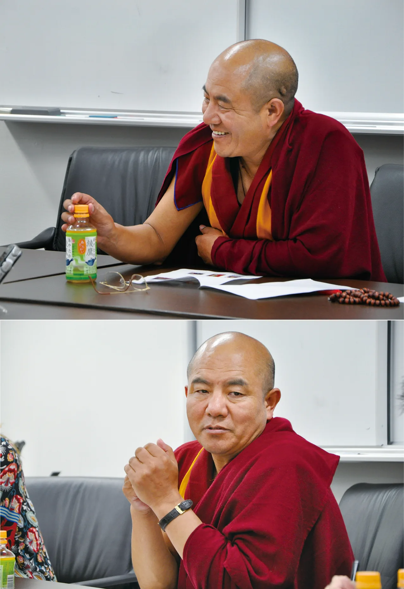

净密是一家

索达吉堪布 & 净空法师

香港佛陀教育协会

Hong Kong Buddhist Education Foundation

2016/01/04

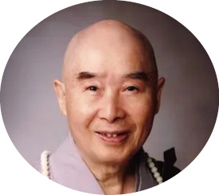

净空法师（Master Jing Kong）

释净空（1927年3月18日－2022年7月26日），汉传佛教著名高僧。1959年于台北市临济护国禅寺出家，追随方东美、第七世章嘉呼图克图、佛教居士李炳南等学习哲学与佛法。以专弘佛教净土宗为主，受邀于联合国教科文组织协助推动宗教团结，2005年获澳大利亚最高荣誉骑士勋章。曾任国内外多所知名高校的荣誉教授，以及澳洲净宗学院院长、香港佛陀教育协会董事主席。

1．若要佛法兴，唯有僧赞僧

主持人：

尊敬的索达吉堪布仁波切，尊敬的上净下空老法师，尊敬的诸位法师、诸位来宾、诸位同修，大家下午好，阿弥陀佛！

此时此刻，相信大家都非常欢喜，因为今天有一位非常尊贵的客人——当今藏传佛教最有影响的大德索达吉堪布仁波切莅临协会。我们非常荣幸，能聆听堪布与老法师一同为我们开示佛法。这也是我们多生累劫的福报。

堪布的法务非常繁忙，所以能聆听堪布的教诲非常难得，也让我们非常感动。在此，就让我们以挚诚感恩的心，用热烈的掌声欢迎堪布到来，谢谢！

首先，我为大家做一个简要的介绍。索达吉堪布仁波切，出生于1962年，堪布与生俱来对佛陀有着深厚的感情，对一切众生也有着非常强烈的大悲心，看到众生受到苦难，都会流下泪水。堪布幼年家贫，经由自己的勤奋努力，初中毕业后考入甘孜师范学校就读。

1985年，堪布依止四川色达喇荣五明佛学院法王如意宝出家修学，在短短的三年内，就通达了显教的五部大论和密宗的诸多经典，成为五明佛学院的大堪布。近三十年来，堪布一直致力于佛教教育事业，讲经说法，从不间断。堪布也是法王如意宝亲自任命的为汉地四众弟子传法的主要导师，多年来，将大量藏传佛教经典翻译为汉语。堪布在全球各地将佛法弘传到全世界。堪布也大力弘扬净土法门，并宣扬《弟子规》，和我们在座净宗同修的目标和理念完全一致。

接下来，请尊敬的老法师致欢迎辞——

净空法师：

尊敬的索达吉堪布，各位法师，各位大德，大家好。

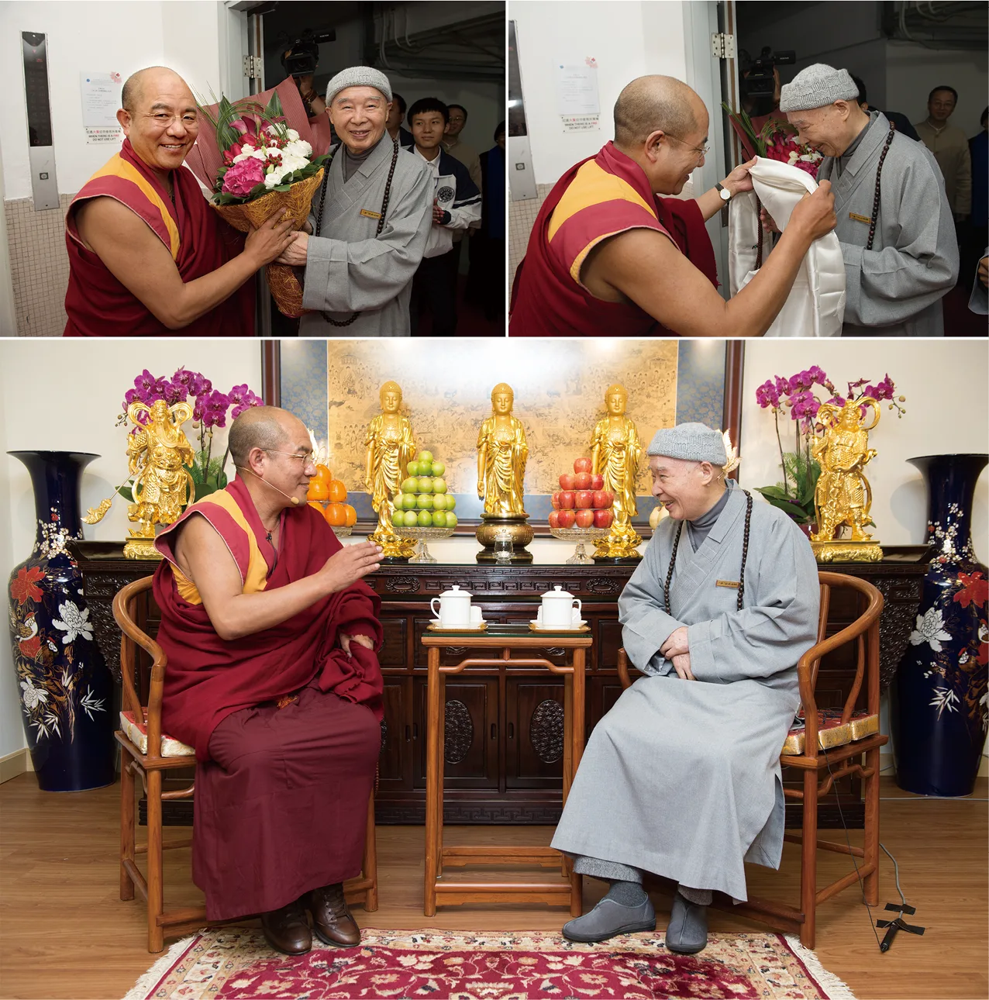

今天，我们感到非常荣幸，能够邀请到尊贵的索达吉堪布莅临香港佛陀教育协会，为我们开示佛法。从堪布的简介当中，我们了解到堪布从小就具足对佛法的欢喜心和对众生的慈悲心，真正是“不忍众生苦，不忍圣教衰”。堪布善根福德殊胜，令我们非常敬佩。

堪布承传享誉海外的藏传佛教导师法王如意宝的大法与度众生的大愿，翻译并传讲五部大论和其他显密经典。不但利益了藏地的佛教徒，而且也大大地利益了汉地的佛教徒，真是功德无量。

作为精通藏文和汉文的大师级人物，堪布比任何人都更适合弘通汉藏两地的佛法，把佛法的弘法事业推上更高的一层楼。堪布还不辞辛劳地在海外各地弘法，把佛法传扬到全世界，贡献卓著，我们衷心随喜赞叹。

我们看到法王如意宝一生无比殊胜的成就，最后导归阿弥陀佛的西方极乐世界，劝人往生极乐净土，跟《华严经》里普贤菩萨和文殊菩萨的示现没有两样。我们看到堪布也是极力赞叹净土法门。这让我们深刻感受到净密不二、显密不二，见证了佛教不同宗派的教法是不相违背的。

现在这个时代，人心坏了，社会乱了，佛法衰微了。尤其是汉传佛法，实在是衰微到了极点。更需要堪布这样的大德来大力弘扬佛法，振兴圣贤教言。

前几天，我在学习班当中提到，看到堪布，让我感到佛法有救了，众生有救了。堪布悲智具足，年富力强，让我们看到振兴佛法的曙光。希望堪布的弘法事业不断地兴旺发达，为汉藏的佛法、为全世界的佛教做出殊胜稀有的贡献。未来培养佛教各宗派弘护人才，促进各宗派的团结。

我们在斯里兰卡创建了龙喜国际佛教大学，传授汉传、藏传、南传三大语系的佛法。今年，这个佛教大学就要正式成立了。我建议校长强蒂玛老法师礼请堪布住持藏语系的教学工作，希望堪布慈悲接受。同时也希望堪布能成立一个藏汉译经院，将藏文大藏经翻译成汉文。将汉文儒释道的重要经典翻译成藏文，促进这两大语系佛法与传统文化的交流。这项工作的意义非常重大，影响也将非常深远。

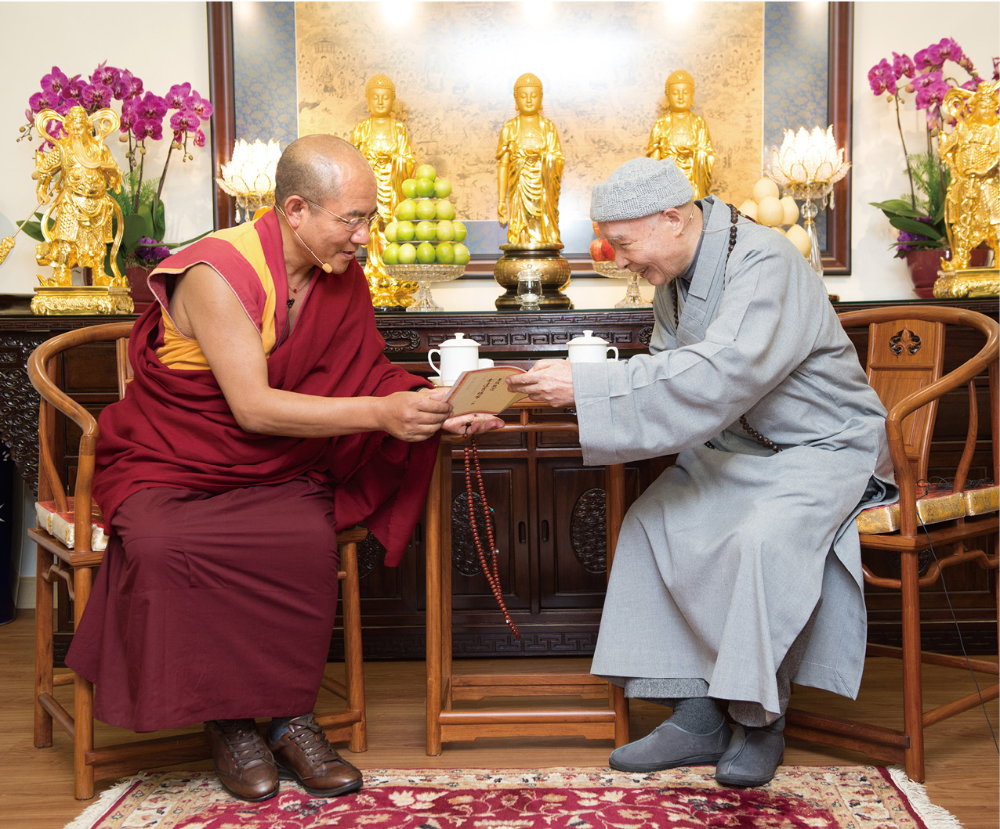

看到如今汉传佛法衰微到这种程度，我心里很痛苦，常常为这件事情忧心。这几天，当我看到堪布驻锡的喇荣五明佛学院有一千多名汉传四众弟子，我非常欢喜，感到汉传佛教有救了。

希望堪布能够指导这些汉传的四众弟子发大心，将汉传佛法的大乘八宗复兴起来。发心学华严的把贤首宗复兴起来，学法华的把天台宗复兴起来，学三论的把三论宗复兴起来，学唯识的把法相宗复兴起来……让大乘八个宗都有继承人，中国大乘佛法就能兴旺起来了。这是一件功德无量无边的大好事，一切诸佛菩萨都会加持、保佑。这个希望就在堪布身上。我们全心全力来做护法，从旁协助堪布。

我今年都90岁了，唯一的希望就是往生极乐世界。堪布所学的法门也是回归极乐世界。将来到了极乐世界，大家聚在一起。所以，净密是一家，一个方向、一个目标，都是阿弥陀佛的弟子。要互相赞叹、互相尊重、互相学习，正如古德所说：“若要佛法兴，唯有僧赞僧。”

我们希望供养堪布的喇荣五明佛学院《乾隆大藏经》、《四库全书》、《四库会要》、《国学治要》和《群书治要》。

《乾隆大藏经》又称为《龙藏》，自清朝雍正皇帝开始编刊，完成于乾隆皇帝的时代，是非常精致完整的一部汉文大藏经。

《四库全书》和《四库会要》完整保存了中国老祖宗几千年来格物、致知、正心、诚意、修身齐家治国平天下的智慧、理念、方法、经验和成效，是人类传统文化无价的宝藏。《国学治要》是《四库全书》的精华与入门的钥匙，《群书治要》是唐太宗的治国宝典，真正能够解决今天社会的种种问题。

我们曾将《群书治要360》赠送给联合国教科文组织、各国的大使和各国的元首，大家都非常欢喜，可见这部书在今天真正管用。在汉藏同胞交流非常频繁的今天，相信这些文化瑰宝在贵学院能发挥很好的参考价值。

最近，看到堪布的《漫谈弟子规》出版了。我们非常欢喜。堪布能够同时弘扬汉藏两处的传统文化，利益广大的人民群众，功德殊胜，令人赞叹。

在此，我跟净宗同学推荐的三部书，《净土大经科注》《净修捷要报恩谈》《来佛三圣永思集》，还有蕅益大师所著的《四书蕅益解》，谨供堪布参考。

十多年来，我时常参加国际性的和平论坛，提出宗教团结、宗教回归教育、宗教互相学习等理念，能够化解冲突、促进世界和平。并且介绍中国传统文化的伦理、道德、因果和圣贤教育，为当今世界安定和谐所必需。

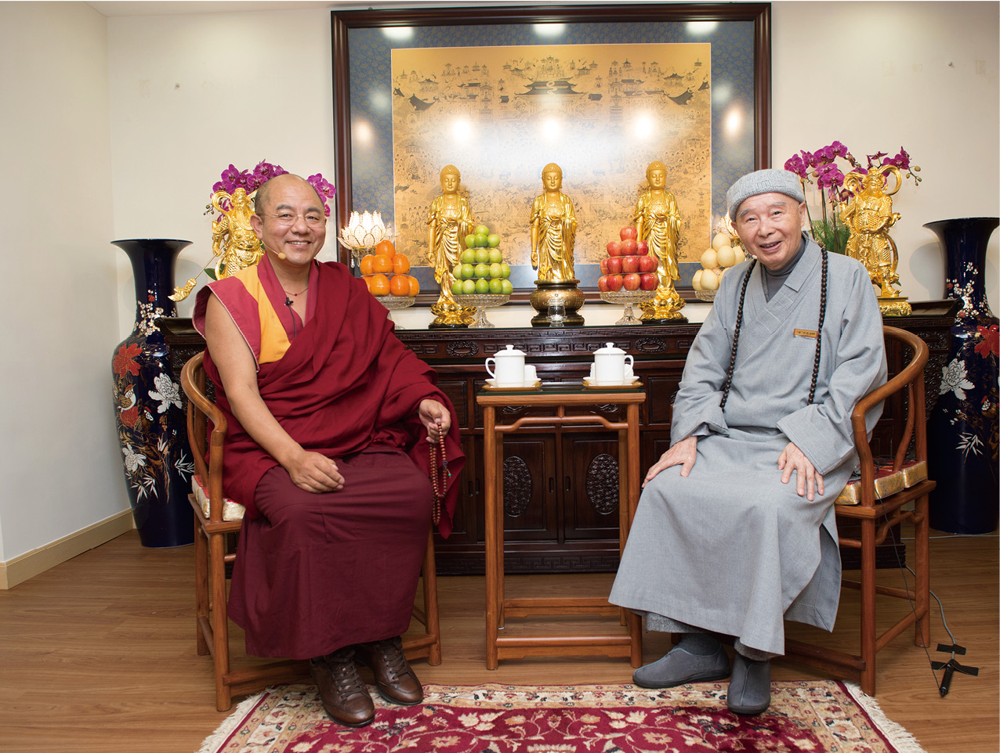

我们不是空谈理论，而是把这些理论真正付诸实践了。我们在新加坡和澳大利亚的图文巴做出宗教团结的榜样，在中国安徽庐江汤池做出传统文化、和谐社会的榜样。

希望今后能有因缘邀请堪布一起参与国际性的和平会议，将藏传佛教促进和谐的智慧介绍给全世界，共同为世界和平贡献力量。

祝福堪布六时吉祥，法轮常转，长住世间，广度有情。祝福诸位法师、各位大德身心安康，道业增上，福慧圆满，光寿无量。祝福祖国国泰民安，国运昌隆。祝福世界安定和平，永续大同。谢谢大家！

主持人：

我们聆听了老法师的欢迎辞，相信大家都非常感动。我们也更加了解到堪布仁波切这位大善知识的伟大之处。正如老法师的开示中赞叹堪布的功德：有了堪布，佛教就有救了，众生就有救了。

老法师还谈到净密是一家，一个方向、一个目标，都是阿弥陀佛的弟子。“若要佛法兴，唯有僧赞僧”，要互相赞叹，要互相学习，互相尊重。

老法师刚刚也讲到，要供养五明佛学院和堪布一些礼物。现在我们就恭请尊敬的老法师供养礼物。

首先供养五明佛学院的礼物，是《四库全书》《四库会要》《乾隆大藏经》，还有《群书治要》《国学治要》，还有一幅《地狱变相图》。

接下来，供养索达吉堪布的礼物是斯里兰卡南传佛教的佛像，据我所知，这是斯里兰卡总统供养老法师的。接下来继续赠送的是老法师亲笔写的一幅墨宝“大圆满觉”。接下来还有《群书治要》、《一切精英义》和道德丛书三十套。

再接下来，是堪布供养老法师的礼物，是一尊长寿佛像。还有一件，藏传佛教的转经轮。这是《漫谈弟子规》，堪布最新的著作。

好，恭请两位大善知识就座。

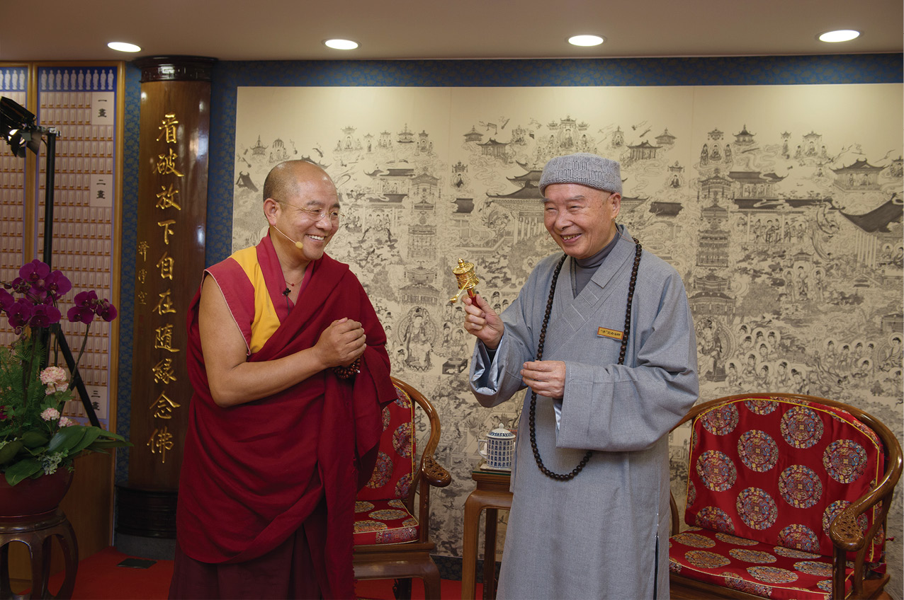

接下来，我们恭请香港佛陀教育学会代表向堪布供养礼物，是老法师一直礼拜的阿弥陀佛的白瓷佛像，这尊佛像也是我们净宗同修供奉时间最长的一尊佛像。再接下来，是我们的净宗同修代表供养堪布的礼物。

接下来，进入最重要的一个环节，也是大家最期待的，礼请我们尊贵的堪布仁波切为大家开示佛法。大家以最热烈的掌声礼请——

2．显密无二无别

索达吉堪布：

今天是非常吉祥的一个日子，很荣幸拜见在全世界范围对佛教非常有贡献的净空老法师。

在上个世纪的八九十年代，我看了很多净空老法师的书和音频、视频，当时用的是录音磁带，后来又有了CD、VCD等。所以对我来说，非常熟悉净空老法师的声音和他的智慧。只不过他真正的法体，今天第一次有机会亲自拜见。

我个人而言，的确非常地赞叹老法师，他这一生的所有时间、精力、智慧全部都奉献于整个人类乃至一切众生。这一点并不是光口头上说的，实际上，老法师多年的付出和奉献，也是我们全世界的人类有目共睹的。

其实对于净空老法师，不用我个人特意地去赞叹，借着今天特殊的因缘和机会，我对老法师的赞叹和关注主要是以下几个方面：

首先，当我们儒释道传统文化极其衰败的时候，他老人家第一个站出来，想尽一切办法，想把传统文化救回来，由此为大家延续了新的慧命。大家应该知道，在特殊的历史背景、环境和因缘之下，我们的传统文化包括佛教遭遇了危机，受到了一定的损害。依靠老法师等很多有志之士的全力以赴，这些非常珍贵的智慧和思想，得到了保护。

还有，从佛教界的角度来讲，老法师率先运用了现代科技来传播佛法的智慧和思想。全世界很多佛教徒最早就是通过录像带和录音带，看到、听到了老法师讲经说法。应该说，以先进的科学技术进行全球性的弘法，老法师是我们佛教界最早的实践者。

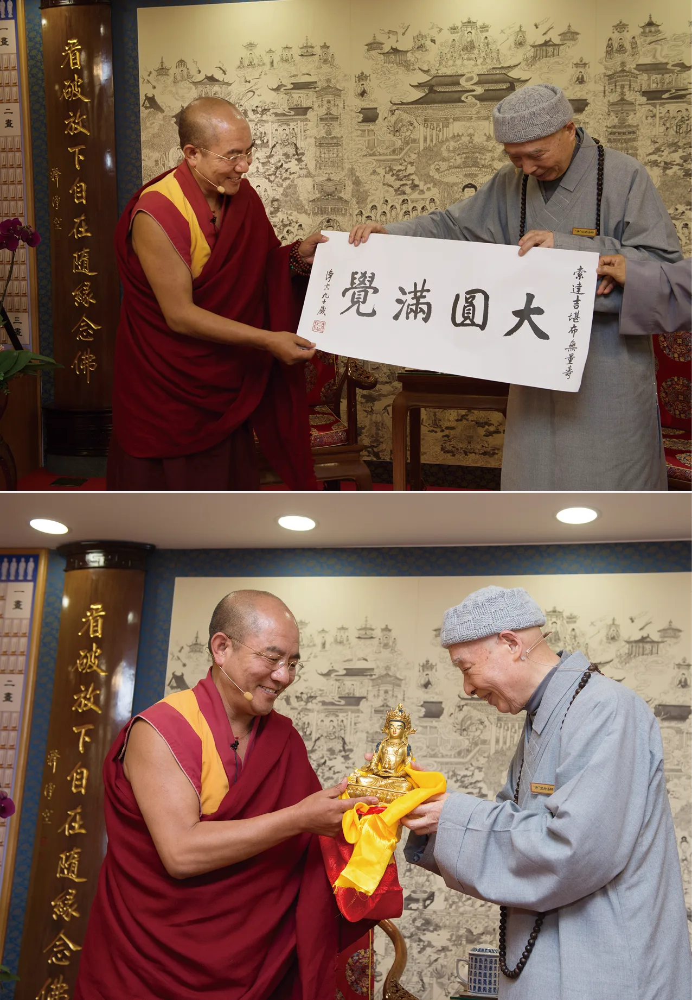

如今，老法师也在不断地说法。前两天，我问了老法师的一些弟子，得知90岁的他，现在每天还都进行两三个小时的讲经说法。

我出家已经三十年了，讲经说法也有二十多年了。不管是在佛学院，还是外出，最重要的事情就是讲经说法。从这点看，与老法师也很相似。我对很多事情都没有兴趣，唯一的爱好或者说是责任，就是讲经说法。

当我看到以老法师为代表的老一辈出家人，到了90岁还在不断地讲经说法，内心充满了钦佩。我们都不一定能活那么长时间，即使勉强活着，很可能那时候已经稀里糊涂了，不要说讲经说法，连世间的语言能不能表达清楚都很难说。因此，老法师清晰的头脑、记忆力和智慧，非常令人赞叹。

对整个汉传佛教而言，老法师成功弘扬了净土法门。大家都应该很清楚，如今在全世界，净土宗遍地开花。可以说，净土宗的佛教徒人数最多，修行人最有成就。

在老法师这么多年讲经说法的影响下，念佛修行的理念深入人心，往生极乐世界的人也是不计其数。我们经常看到很多人通过念佛而往生，从而令民众对佛教产生极大的信心。这些不是神话，也不是传说，是21世纪的当下，大家都亲眼所见、亲耳所闻的事实。

像老法师这样的高僧大德，深切关心众生苦难，视为己任，一生中都在竭力拯救全人类的优秀文化。这样的人，本身就是罕见的瑰宝。

我还了解到，老法师与各国元首、国际顶尖科学家、不同领域的有识之士有着广泛的交往与交流，通过这样的方式，不分宗教派别、不分阶层，在全世界范围共同倡导和平、非暴力等智慧和慈悲的理念。

我说的这些并不是表面上的赞叹，而是通过大家所做的事情可以看出来的。当然，除了以上这些，还有很多值得赞叹的事情，没有必要一一道来。

我很清楚自己的行为、能力、智慧等都是微不足道的，依靠老法师的智慧和垂念，包括一定的密意，在今天这样一种特殊的缘起或者说特殊的因缘之下，我也做出以下承诺：

第一，我很荣幸地接受斯里兰卡佛教大学藏传佛教方面的教学工作。相关的责任和事务，都会尽心尽力。

第二，近三十年来，个人一直不断地将藏传佛教的许多经典和论典翻译成汉文，将来也会积极参与藏汉译经院的相关工作。

最后，给今天在座的佛教徒和各位法师提几个建议：

第一个建议，大家都知道，如今在佛教徒团体中，人数比较多的是净土宗佛教徒和藏传佛教徒。正如老法师刚才所讲的，“若要佛法兴，唯有僧赞僧”。汉传和藏传佛教之间，净土宗和密宗之间，一定要互相尊重、互相了解、互相学习。如果所有的佛教徒都能做到这一点，佛法兴盛就有了希望。

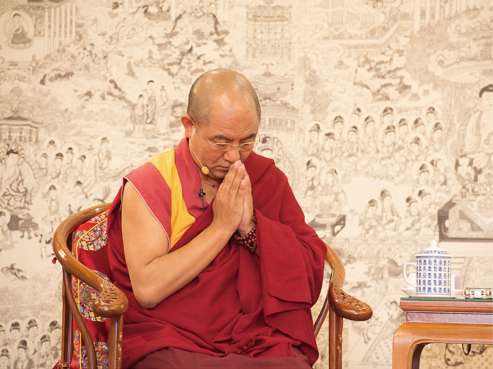

多年来，我个人不但学习和弘扬密教和显宗，还翻译、传讲过很多显宗相关论典，如《藏传净土法》、净土宗的《五经一论》等。《五经一论》中的《观经》，在藏文《大藏经》中是没有的，藏文里只有《无量寿经》和《阿弥陀经》。我花了一些时间将《观经》翻成藏文。

我特别希望大家学习净土宗，学密宗的人也学习净土宗。我还发现，很多学净土宗的，不但不排斥密宗的观点和教义，也希望多多了解密宗。

实际上，在藏传佛教中，显密是不分的，每一个藏传佛教宗派都是显密双修的。正如刚才净空老法师所讲的，净土宗和密宗实际上是殊途同归的，都是释迦牟尼佛的传承、释迦牟尼佛的教法。

净空老法师经常提倡世界上的各个宗教、佛教内部要团结和睦。如果我们佛教内部不能团结，跟其他宗教团结可能有一定困难。因此，以净土宗和密宗为主的佛教徒，汉传、藏传、南传的佛教徒，要先好好地团结起来，再和其他宗教如基督教、伊斯兰教、天主教等等，一起团结，和睦相处。

同时，我们也非常希望和欢迎非佛教徒，包括没有任何宗教信仰的人们加入，我们一起为全人类的和平做出自己的贡献。我觉得这也是非常必要的。

刚才主持人让我讲前行和无常，我想了一下，在座的很多人可能也比较清楚佛教的前期修行，比如人生难得、因果不虚等道理。一切万法无常的道理，相信大家只要看看电视，就会发现新闻媒体是最好的教授无常的善知识。

今天因为与老法师有这样一种机缘，与净宗学会等团体有这么一个近的缘起，机会十分难得。以后的确要像老法师所说的那样，互相尊重、互相赞叹、互相学习。世间还有很多需要做的事情，我们可以一起来完成。

作为大乘修行人，相信我们都有一个共同的心愿，就是通过自己的修行来利益无量无边的众生。

最后，我也特别希望以净空老法师为主的德高望重的高僧大德们，长久住世，常转法轮，用他们的智慧和悲心持续、长期地教化世间的芸芸众生。

谢谢大家！

主持人：

非常感恩堪布慈悲的开示。聆听了堪布充满智慧的法语，相信大家和我一样都非常感动。

刚才堪布谈到他这一生最有兴趣的就是讲经说法。我们深刻地体会到，佛教的确是一种教育，是对九法界众生至善圆满的教育。

同时我们也感受到了堪布非常广大的心量。不仅仅希望佛教内部的各个宗派要互相团结、互相尊重、互相学习，而且也要团结其他宗教，如伊斯兰教、基督教等，最终也是要团结一切众生。

我们再次以热烈的掌声感恩堪布慈悲的开示。谢谢！

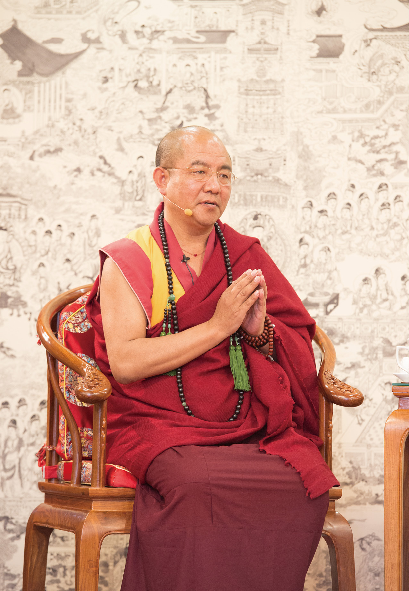

3．学习佛法，先抓住儒释道的三个根

主持人：

接下来，代表我们的四众同修向尊敬的堪布和老法师请教几个问题，尤其是想聆听老法师和堪布开示《弟子规》相关的话题。

首先就请老法师为我们开示一下，您为什么要提倡《弟子规》的教学？

净空法师：

我跟堪布不一样的地方，他是天生的，是再来人。我承认学佛不是自己有这份天分。我年轻的时候不相信宗教，尤其是佛教。我认为宗教都是迷信，而佛教是低级宗教，是多神教。高级宗教只有一个神，低级宗教是多神教。所以对于宗教，从来没有碰过。

26岁我在台湾，那个时候对这些有兴趣，所以就找到一位老师方东美先生。他和我是同乡，我们两家的距离也很近，大概不到三十里，在乡下算很近。这是一位当时台湾知名的大哲学家。我给他写了一封信，向他介绍、推荐自己。还写了一篇文章，寄给他看。

一个星期后，老师回了我一封信，要我去他家里见面。遵照约定，我到他家里去拜访。他就问我的学历。我说我初中毕业，高中只念了半年，就到台湾来了。抗战期间，因为战乱逃难，没有机会读书，自学四年，感觉很痛苦。他听了之后，问我：“你有没有骗我？”我说：“不敢骗老师，我说的句句都是真实的。”老师就说：“你写的文章，我们台湾的大学生写不出来，所以有点怀疑。”我就明白了，我虽然是自学，没有上学，可是我喜欢读书，读书这件事没有丢掉。也许是这个原因。然后他就告诉我：“现在的学校，先生不像先生，学生不像学生。要到学校去听课，会大失所望。”

今年是2016年，那是65年前的事情。

我当时听了之后，认为老师完全拒绝了我，心里感觉很沮丧、很难过。坐了一会儿，老师就说：“那这样好了，你每个星期到我家里来，我给你上两个钟点的课。”我的课不是在学校学，是在老师家里学的。每个星期天上午九点半到十一点半，这是我们上课的时间。

老师给我讲了一部《哲学概论》，分了四个单元来讲。最后一个单元讲的是佛教哲学。我当时很惊讶。我说：“佛教是宗教，是多神教，是低级宗教，怎么会有哲学。”老师告诉我：“你年轻，你不懂，释迦牟尼（他没有说佛）是世界上最伟大的哲学家。大乘经典是世界上哲学的最高峰。学佛是人生最高的享受。”

我就是在这个课程当中学了佛教。所以我信佛教，不是迷信进来的，也不是真正有求道的心，没有。就是完全通过学哲学，这么进来的。知道它是很了不起的大学问。

65年过去了，我不但肯定了大乘经典是最高的哲学，而且还是最高的科学。今天看量子力学领域的科学家的研究报告，大乘经典里全有。佛在三千年前就把整个宇宙讲得这么清楚。科学家们现在才发现，现在才知道。

佛经里说，用第六意识，也就是我们的思考，能够缘到阿赖耶识的三细相。这个了不起的宇宙奥秘，解释了物质现象、精神现象与自然现象是从哪里来的，佛都讲得很清楚。

过去我们读佛经，对这个很难理解。佛说的话又不能不信，佛是胜义量。可是仍然有怀疑，这一切断不了。看到科学报告的时候，完全明白了，不再怀疑了。这个过程还是科学的。借助科学断疑生信，没有趋入境界，趋入境界我们就真的证果了。

这么多年来，大家在一起学习，老同修还是心不清净，妄念多、杂念多、分别执著多，能不能往生？靠不住。这些都是障碍。

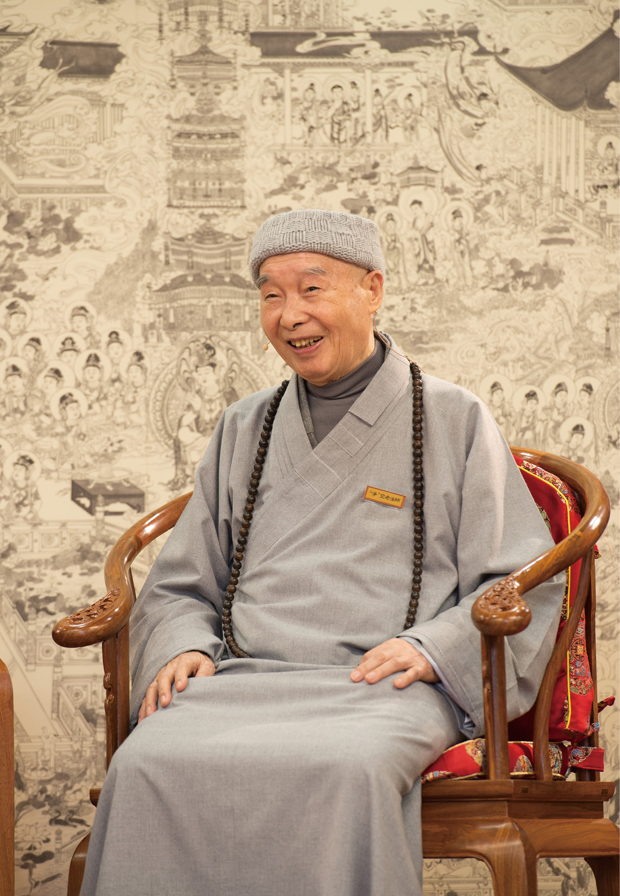

所以堪布这次来了，我想请他讲一个前行。前行是什么，就是这些东西，统统要放下。往生预备的工夫，彻底放下，放下身心世界，佛号就灵了。真的想往生，寿命也可以不要了，阿弥陀佛会带你去。净宗有这样的殊胜。所以信心比什么都重要。

往生的标准都在经题上。所以《无量寿经》了不起。

我们念佛的标准是什么？清净，平等，觉悟。我们念佛了，清净心有没有生起来？清净心就是没有染污。没有分别，心就平等。清净心是阿罗汉的境界，平等心是菩萨的境界，觉就成佛了。

大彻大悟，明心见性，这就是修行的标准。天天要拿这个标准来对照：我的功夫有没有进步。还有那么多的怀疑，那么多的忧虑，那么多的分别，那怎么行？

果报也在经题上。第一个大乘，大乘是智慧，般若智慧。无量寿是福报，庄严是美好，西方极乐世界依正庄严。修成正果，在经题上。我们每一天读经，有没有认真反省，有没有认真地去落实，很重要。

刚才提到的《弟子规》，我和堪布不一样，堪布是天才，一看他就入进去了。我需要人鞭策，没有人找我，我不会想起来。

《弟子规》从哪里来的？从王财贵来的。他是台湾的一位教授，提倡儿童读经。提了大概五六年，出了问题：孩子背了很多经典，在家里瞧不起父母，在学校瞧不起老师。

王财贵到香港来找我，问我怎么办。我说：孩子怎么可以这样教法。孩子最重要就是积德。要教他们读《弟子规》《太上感应篇》《十善业道经》这些，不能一开头就教他们读经。至少要从十一岁到十五岁，这个年纪才适合读经。因为这个时候，他懂得孝顺父母、尊敬师长了。千万不要一上来就搞得孩子贡高我慢，眼睛长在头顶上，将来没有人愿意和他们往来，一辈子吃大亏。

我告诉王财贵：“你要换课本，换成《弟子规》《太上感应篇》。先抓住儒释道的三个根。”我让弟子讲《弟子规》是有根据的。根据是净业三福。净业三福的第一福：“孝养父母，奉事师长，慈心不杀，修十善业。”前两句的孝亲尊师，就落实在《弟子规》。

儒释道的三个根，是德行的根，是根之根。有了这个根本之后，再去读儒释道三家有代表的经典作品。

儒家的经典是朱熹所编的《四书集注》。我相信朱夫子也是虔诚的佛教徒，我相信他编书的灵感来自《华严经》。《四书集注》编得好，精简，有圆满的理论，有巧妙的方法，还带表演。

方老师教我的《佛学概要》，在佛经里就是《华严经》。《华严经》是“佛学概要”，它有理论，有方法，有表演。“五十三参”是表演，落实在男女老少，各行各业。无论你在哪个行业，都有华严的理论，都用的是华严的方法，那就是菩萨示现在人间。妙极了。

《四书集注》恰好就是这个味道。有理论，是《中庸》；有方法，是《大学》，从格物致知、诚意正心到修身齐家治国平天下。这还得了啊！

《中庸》讲到最后一个字“诚”，真诚，人一定要真诚。诚是什么意思？无自欺也。不要欺骗自己。你不欺骗自己，你就不会欺骗别人。儒家一直以来抓着这个“诚”字不放。生活要诚心诚意，工作要真诚，为人处世、待人接物都离不开一个真诚。

因此，君子提升是贤人，贤人提升是圣人。学了这么多年，我意识到，那些圣人，孔子、孟子、老子、庄子，还有佛陀，他们的老师是谁？他们其实是无师自通。真诚到极处就通了。真诚到极处，究根自现。诚也就是定，是三摩地。

真就是自心本定，像《六祖坛经》里所说的，六祖开悟后，说了四句话。第四句“何其自性，本无动摇”，就是说，心是定的，自性本定。要定在一处。后面一句“能生万法”，万法就是宇宙，整个宇宙从哪里来？自性所生、所现。自性是自己，是一个，是一体。整个宇宙和我们是什么关系，是一体，多亲密啊，我们怎么能看不起人呢？

大乘佛教告诉我们，一切众生，本来是佛。现在也还是佛，是迷惑颠倒的佛。一转过来就是真佛了，不是假佛。

所以我们的心量一定要打开，要包容，我们共同学净土法门，内部不可以对立，不可以自赞毁他。因为是真正的亲兄弟，一家人。其他不同的佛教宗派，如华严、天台等，是我们的堂兄弟。再往外推，其他的宗教，如基督教、天主教等，那是我们的表兄弟。

既然全是一家人，一家人要相亲相爱，家和万事兴。万事兴就是天下太平，整个地球充满美好，什么灾难都没有了。这是真实的，不是假的。量子力学已经为我们证明了：物质的变化是从念头产生的。正如佛经上所说，“相由心生”“境随心转”。随着念头的转变，一切都在转变，风水就不一样了，灾难也就化除了。

我们每到一个地方，就想把那个地方的宗教群体团结起来。1998年，我第一次到新加坡。新加坡有九个宗教，我用了一年多时间，将九个宗教团结得像一家人。我们办活动，其他宗教都来随喜，都来参加。他们办活动，我也去参加。互相的对立和毁谤，都没有了。

后来的十几年，一直在澳洲做这项工作。澳洲的宗教团结起来比新加坡困难，因为澳洲面积很大，人不多，有十几个宗教。我居住在小城图文巴，十四年了，这两年才把各个宗教团结起来，成绩非常可观。

今年春天，会邀请联合国的大使们去图文巴考察和参观。不同宗教、不同族群、不同的语言文化，大家可以生活在一起，像兄弟姐妹一样。在没有做出榜样，没有看到之前，别人都不相信。真正做出来了之后，大家亲眼看到，就信服了。你能做到，他也能做到，其实大家都能做到。

我们希望地球变成一家人，各个宗教变成一家人。我在新加坡做宗教团结，最困难的是基督教。其他宗教一年就团结起来了，碍于面子，基督教也加入了，但真正加入是三年后。如何来判断呢？有一次，伊斯兰教遇到困难，办活动缺少资金，基督教送给他们一个大红包，十万块钱。真金白银地互相帮助，很不容易。从这样的行为上来判断，是真正地团结起来了。

心量要大，地球才有救。西方人为什么说，解决21世纪的问题，需要中国的孔孟之道和大乘佛法。因为那体现了中国人的心量。自古以来，中国人很少谈国家，开口闭口都是天下，这就是心量。这就是为什么中国传统文化好。

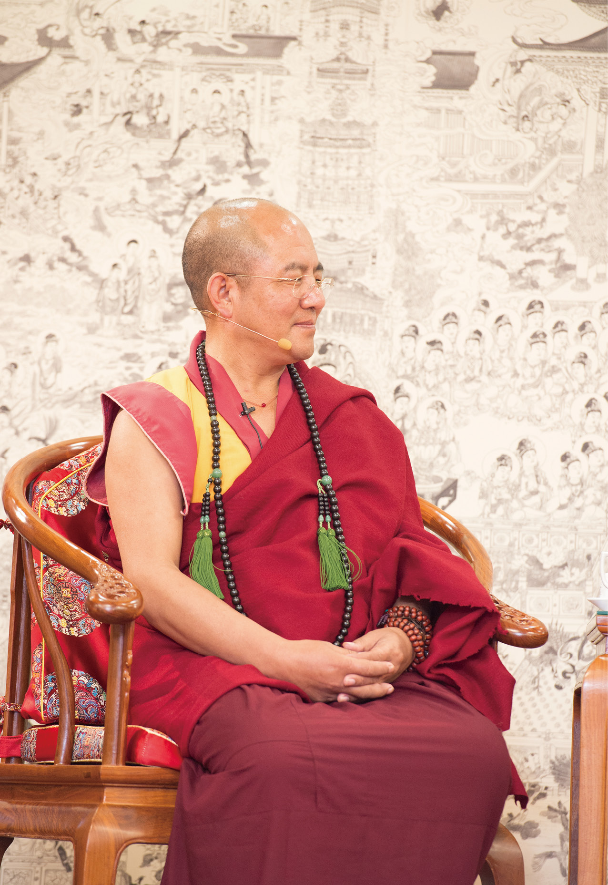

我推广《弟子规》就是这么来的。多亏王财贵，出了麻烦来问我。之后我们就竭力介绍、推广《弟子规》。现在在全世界都有影响，是好事情，每一个人读到这本书，都很好。

今年六月份，我到英国去访问，这次是应英国上议院的邀请。上议院相当于中国的人大，是立法机构。看到他们也在进行宗教团结，我非常欢喜。英国准备建立一个大规模的宗教活动中心，让全国的宗教团体都在这里进行活动。这样做很好。如果各自有各自的地盘，分开进行各自的活动，就很难团结。让大家办公在一起，教学在一起，做活动在一起，天天见面，这是非常好的理想愿景。

二十多年前，我第一次访问祖国，在北京见到赵朴初老居士。我们是同乡，第一次见面，谈了四个半小时，其中就谈到这个话题。国家、宗教要统一，要办宗教大学，要办佛教大学。通过佛教大学来团结佛教各个宗派，通过宗教大学统合全国不同宗教。以后大家都是同学，都是一个学校毕业的，只不过念的科系不一样，都是一家人。这个方法很好。

现在交通和资讯高度发达，太方便了。堪布运用网络教学，非常好！我用网络传法已经有二十多年了，产生了很大的影响。

我没有道场，这个道场是今天开张，第一次使用。可能是感应到了堪布今天到这里来。我非常欢喜，太难得了。

许多事情都是别人问我，问出来的。不问我，我什么都不知道；问我，还都能答得出来。

《群书治要360》也是问出来的。马来西亚的老首相马哈蒂尔、现任首相纳吉布，都是我的老朋友，我把《群书治要》这套书介绍给他们。但是他们看不懂中文，问能不能翻译成英文。这套书有五十万字，翻译成英文需要很长时间。

他们急着要，我就想到了办法，就有了《群书治要360》。我在书里选择了三十六段精华文字，都是现代社会之必需，学了马上就管用。他们当时着急到什么程度呢？我这边翻译好一部分，就马上送过去，一周送一次。翻译成英文，他们就能看懂了，看了之后告诉我，这些内容真是智慧。几千年前的人写的东西，现在依然管用。我就告诉他们，几千年之后，这些内容还管用。

现在我们要求，每个宗教都整理一部自己的360。我来帮大家印，把所有的宗教360都印在一起，叫《宗教圣经》。这样以后宗教之间就不会再有争执了。这就是宗教团结的理论依据。神、先知都是这样教导我们的，所以，我们团结有理论根据。

所以，都是有人在询问或者催促我，我受到触动，才会想到解决方法。一定要往大处去想，想到道家的“天地与我同根，万物与我一体”。佛法里说得更好，“一切法，心现识变”。

《华严经》告诉我们，整个宇宙从哪里来？唯心所现，唯识所变。所现的就是一真法界和佛土，十法界、六道轮回是识变的。识就是妄想、分别和执著。我们要想这一生过得很幸福、很圆满，这些必须要知道。

我的一生主要就是讲经。我在家里供养着老师的照片，天天行礼、回向。这三位老师缺一个，我都不能成就。没有方东美先生，我不会相信宗教；没有章嘉大师，我的佛教没有根。我扎下了这个根，之后到台东去，十年学经教。真的一个都不能少。

堪布是再来人，我由衷地佩服他。看到他，我觉得佛教有救了。我最担心的就是，现在的大乘八个宗，都没有传人。我33岁出家，那个时候还有几个传人，现在都往生了。后继无人了，我有这个担忧。

最近这几年，我想到办汉学院，因为传统文化不能丢。中国传统文化在《四库全书》里。早年在台湾，这部书只有一套，如果有什么变故，被毁掉了，是多大的损失啊。这是人类的文明之光！

当时的读书人，都希望能把这部书印出来，但是成本太高了，那么多那么厚，总共一千五百册。《四库全书荟要》有五百册，是乾隆皇帝自己选、自己读的，很有价值。《四库全书》里对清朝不利的批评内容，都删掉了，但保留在了《荟要》里。

《荟要》这套书印第二版的时候，老板打电话问我要不要。我说要，但不能涨价，还是以前的老价钱，一套五万元钱，我要一百套。前后我一共买了三百三十套，是他们家的大主顾。

我这一生不盖庙，不盖庙我还能生存，盖庙我就不能生存了。我非常感激释迦牟尼佛一生不建道场，树下一宿，日中一食。

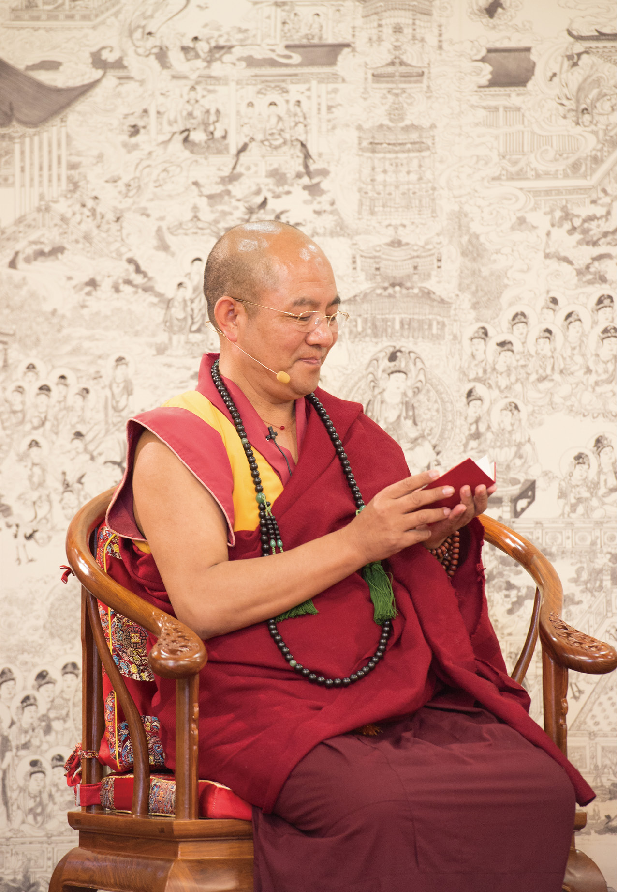

今天这样的环境下，有了道场，就没办法不和别人发生冲突，肯定会发生冲突。有了道场，又讲经、又做佛事，信徒都来了，供养也都来了，这还得了吗？大家争的就是这些。

我没有道场，没有法会，没有信徒。我的听众很多，他认识我，我不认识他。走到哪里，常常有人给打招呼，都是听众。这些道理都要懂得。

我买这么多书做什么用呢？送大学图书馆、国家图书馆收藏。这样哪怕整个世界发生灾难，也总会有几部书留存，不会全部消亡。用这样的方法来保存有价值的东西。但回头一想，如果没有人能读，那不等于废纸一堆吗？所以我就想到，要办汉学院。

我在英国，威尔士大学的校长来找我，我们谈了三个多小时，谈得非常投缘。他问我，办汉学院的目的是什么？我说，很简单，培养三十到五十个学生，能够认识汉字，能够懂文言文，能够读这部《四库全书》，能把其中的道理讲明白、讲透彻，能把它翻成白话文。

翻成白话文是为了利益现在的社会，也是为了利益其他的国家。通过白话文再翻译成不同的语言，英语、法语、德语、西班牙语、俄罗斯语、韩语、日语、印尼语等。这样翻译下去，可以遍及全世界。我希望三十年后，全世界的人都能读到《群书治要》和《国学治要》。

校长问我什么时候开始编教材。我说，我不编教材，没有教材。我们这一代人，和古人比，差远了。古人的心是真心、真诚、清净、平等；我们现在的人心是染污、不平，是心浮气躁。古人心生智慧，我们心生烦恼。我们编的教材，是烦恼编出来的，天天改，也改得不理想。就用古人的教材，那些教材用了几百年，也没有什么问题。

所以，我们主张，完全用古老的教材、古老的理念、古老的方法，我们走古人的老路。我们这个汉学，不叫中文系，叫汉学系，意思是中国的古老的学术。这个东西管用，能救中国，能救全世界。

古代传统文化要从哪里教起？要从娃娃开始。我们的汉学院要辐射幼儿园、小学、中学……再往上，就和汉学院连起来了，成为一条龙的学校教育。我们真正的希望是下一代。现在这一代都是半路出家。

我们需要的老师是能够奉献，做出自我牺牲，不要搞名闻利养，这一生就在汉学院教书，教小学、教中学、教大学。我会照顾你们一辈子。

我们在学校附近，建一座阿弥陀佛大饭店，那是我们的活动中心，也是我们的养老院。我们每个人在饭店里有两个房间，一间是书房，一间是卧室。学生一个人一间房间，老师一个人两个房间。吃饭有餐厅，餐厅只收服务的费用。房屋是让老师和同学一直使用的。我们会过得很快乐，每个人都快快乐乐，法喜充满。

没想到老祖宗、佛菩萨安排，把我们安排到英国去了。在英国办汉学院，成本会很高，但很值得。因为英国是欧洲的龙头，在英国做上三年，肯定能影响整个欧洲，五六年可以影响全世界。

我在跟堪布商量，希望他长命百岁，希望他身体健康。因为我要请堪布来做汉学院的院长。

我们这个学院是双院长制，一个院长是英国人，一个院长是我们的人。课程百分之八十是中文，百分之二十是英文。现在学校正在积极筹备中。

将来我会邀请堪布去参观。我们一起去看看，也看看欧洲的宗教团体。英国能够做出那样庄严的建筑，那样有规模的宗教活动中心。将来我们在联合国的活动就不办了，改到这个活动中心来办。这个活动中心会变成全世界的宗教活动中心，非常有意义。

要想我们自己一生幸福美满，家庭和谐，社会安定，国家富强，世界太平，一定要从自己打开心量做起。心量不打开就做不到，障碍很多。我们做出牺牲奉献，在澳大利亚的图文巴做了十四年，做出了宗教团结的模式。一个国家做好了，其他国家来参观、考察、学习，都按照这个模式去做，世界就太平了，冲突就没有了，天灾人祸都会消失，地球恢复清净，变得兴旺繁荣。

我们相信老祖宗和佛陀的话。我认为我们的老祖宗中有很多是佛菩萨再来；我也认为，世界上很多宗教的创始人也是佛菩萨再来。核心的价值观是四个字：仁慈博爱。所有的宗教都在提倡这个价值观。可见，仁慈博爱是宗教团结的核心价值观。

主持人：

非常感恩老法师慈悲的开示，相信我们在座的所有嘉宾听了这一席开示，都是法喜充满。

老法师在一开始就告诉我们，要往生西方极乐世界，一定要修因证果。修因证果就在我们《无量寿经》的经题上。还教导我们要看破放下，恢复我们本有的真诚、恭敬心；要老实听话，真实行动。

从哪里去落实呢？刚才老法师也特别强调，就是从我们儒释道的三个根——《弟子规》《十善业道经》《太上感应篇》，来扎下我们做人的根本。而根中之根就是孝养父母、奉侍师长。因为我们教育的目的就是恢复父子友亲的亲爱，将这份亲爱用在对一切人、一切事、一切物。

老法师的开示，也是在为我们表演《弟子规》的教诲：“兄道友，弟道恭，兄弟睦，孝在中。”我们有很多的亲兄弟、堂兄弟，还有表兄弟，应该说世界人民都是一家人，都是兄弟姐妹。这样世界的和谐和平才会到来。

最后，也是再次地恭请尊敬的堪布能够一同到英国去参观、访问。再次感谢尊敬的老法师和堪布。

4．学习《弟子规》，发扬中国传统文化

主持人：

接下来，仍然回到《弟子规》的话题。请尊敬的堪布也为我们分享开示一下您的新书《漫谈弟子规》。

索达吉堪布：

实际上，我写这本《漫谈弟子规》是因为老法师在这方面的推崇。刚开始，老法师对《弟子规》《太上感应篇》，还有儒家经典《大学》《中庸》都很赞叹。于是我也产生兴趣，想去了解一下《弟子规》。

本来以为《弟子规》只是针对孩童启蒙的读本，后来我读着读着，感觉不仅适合未成年人，也非常适合现在的世间人，包括已经成年的年轻人，去学习和读诵。由此，对这部书就很有兴趣了。

我没有这部书的传承，也没有在很多老师面前得到过这部书的相关教授，仅仅是依靠自己的分别念和智慧对这部书进行思考，同时翻阅了一些相关的解说。

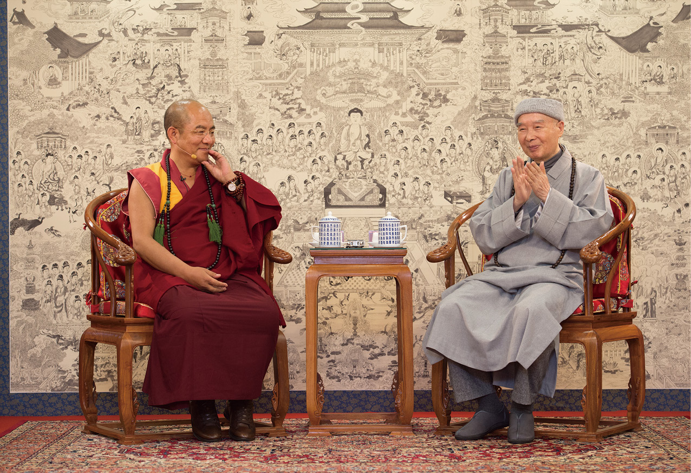

我先给少数人讲了这部《弟子规》。有一次，我去云南的鸡足山，同行的还有亲戚家的两个藏族孩子。一路上，我就把他们俩当作听众，每天用藏语给他们讲《弟子规》。他们听着，也觉得很有兴趣。就这样，在朝拜鸡足山的过程中，把整部《弟子规》给他们讲了一遍。个人感觉还比较不错。

回到佛学院，我也给四众弟子讲了《弟子规》。《弟子规》传达的是儒家思想，我在传讲中运用了一些佛教的道理加以解释。之后整理成书，书名叫《弟子规另解》。

后来，我感觉《弟子规》还有很多甚深的意义，就想办法翻译成藏文，让藏地的孩子们可以学习。虽然藏地有自己的传统文化，但藏族的孩子们也可以学习汉地优秀的传统文化，比如孝顺，还有为人处世、待人接物等道理。不同民族有着不同的文化智慧结晶，可以互相借鉴学习。

我发心将《弟子规》翻译成藏文，在青海民族出版社出版了。后来听说青海和甘肃地区，将它当作藏文方面的通行教材。之后，我又将讲解的文字进一步完善，就成了现在的这本《漫谈弟子规》。

当然，我对《弟子规》的理解与老法师之间有着天壤之别。因为我对于中国的传统文化主要是凭借自己的兴趣进行自学，没有依止过优秀的老师。在上个世纪的特殊时期，我们本有的传统文化基本上毁于一旦。反而在世界其他国家，如新加坡、日本等，这些传统还在广泛地延续、使用着。

前阵子我去日本的时候，发现他们文化传统中的自我约束、恭敬、孝顺等，其实是从中国先传到朝鲜，再传到日本的。我们自己现在想要把这些传统恢复起来，有一定的困难。我在《漫谈弟子规》里也提到，很多人很想恢复传统文化，但就像面对一个奄奄一息的病人，要让他立刻站起来也很不容易。

无论如何，我觉得《弟子规》对当下的社会来说很重要。就算再过几百年几千年，只要人类社会还存在，它也依然会很有用。正如汤因比博士所说的，21世纪人类的希望，在东方的孔孟思想和大乘佛教。

我们每个人，不管是否有宗教信仰，首先都要先把人做好。现在世间人都特别强调和追求所谓的成功，但即使你有钱、有地位、有名声，如果连基本的人格都不具备，自己恐怕也很难快乐，更不要说为周围的人、为世界带来温暖和快乐。

因此，我们特别希望通过学习《三字经》《弟子规》，还有《中庸》《大学》等传统经典，让大家建立起基本的做人准则。不管是儒家的孔子、孟子，还是道家的老子，他们的思想都是非常珍贵的人类智慧结晶。

两千五百多年前，释迦牟尼佛、孔子、老子——儒释道的创始者相继出现于世，时间相差不过二三十年。他们的智慧经过了漫长的时间长河，时至今日，丝毫没有蒙尘。谁能够真正拥有这些智慧结晶，哪怕身无分文，内心也会无比快乐。

如果一味地追求和贪著外在的财物，很难获得快乐，其实人类更需要的是内心的财富。内心的财富包括两方面，一是传统文化的精神财富；还有就是以佛教为主的各种宗教信仰的精神财富。如果缺失了这两种财富，对很多人来说，恐怕是很大的损失。

我遇到过很多有钱人，也遇到过很多有权力的领导官员、有名气的明星，他们被无数人追捧和羡慕。如果没有自我调整的智慧和能力，其实他们的内心不一定快乐，生活也不一定有安全感。一旦遇到挫折和不顺，就会处于焦虑、沮丧和恐惧的状态中。

所以，我们希望通过各种方法和举措来恢复、继承中国优秀的传统文化。

主持人：

非常感恩堪布的慈悲开示。聆听了您的一番教诲，的确让我们都受益匪浅。

刚才堪布谈到如果连最基本的做人都做不好，还谈什么成功。在此，我们更能体会到堪布的广阔心量，作为一位藏传佛教的高僧大德，愿意将汉地儒家的经典翻译成藏文，让藏族人民去阅读、学习。

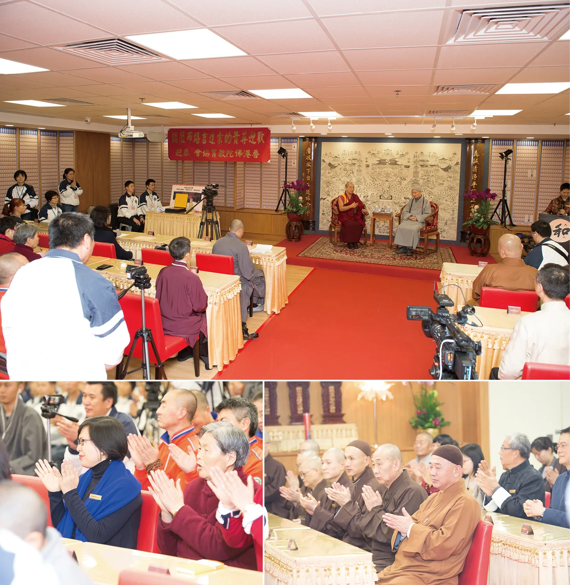

除此之外，我们了解到，堪布将很多藏传佛教的经典翻译成汉文，让汉族的兄弟姐妹们有了学习机会。这是真正在为我们表演和示现一颗平等的心、没有分别的心。

让我们再次用掌声感谢堪布的慈悲开示。谢谢！

今天，这样一场殊胜的因缘就接近尾声了。最后，让我们挚诚地感恩诸佛菩萨、龙天护法慈悲护佑和加持，让我们迎来了这样一个吉祥殊胜的日子。在新年伊始，就迎来了这样一位尊贵的客人。

聆听了老法师和堪布的慈悲开示，相信各位同修都能够感受到两位大善知识的大智慧、大慈悲和大愿力，真正是无量欢喜。

在此，感恩堪布，感恩老法师，感恩到场的各位来宾、各位同修。诚如老法师所说，要和堪布多交流。希望堪布能够多来香港，多为我们法布施。

“若要佛法兴，唯有僧赞僧”，希望汉传佛教与藏传佛教的大德，多交流、多互动，也祈愿佛陀的教育在这个时代能够兴盛。

最后，预祝各位嘉宾新年如意，法喜充满。恭祝尊敬的堪布和老法师，法体安康，光寿无量。

让我们用挚诚感恩的心向堪布和老法师问讯。阿弥陀佛！今天的活动到此吉祥圆满。

问 心 对话埃亚·阿维夫教授

在美国大学教佛法 对话本杰明·伯根教授

修行者说 索达吉堪布 & 范彼德教授

叩问我们的时代  对话施耐德教授

缘聚纽约谈藏密  对话滕华睿教授

科学时代的佛教  对话皓利·盖利教授

环保从心开始  对话叶蓓教授

佛法与科学是殊途同归  对话朱清时教授

什么是佛教心理学 对话凯瑟琳·格雷戈里博士、科里·贝尔博士

灵魂的前世今生  对话吉姆·塔克博士

在浮躁的世界里安静地活  对话张卫教授

文殊菩萨的智慧宝剑  对话威廉·道格拉斯教授

心灵鸡汤也很有营养  对话东京大学学者

净密是一家  对话净空法师
