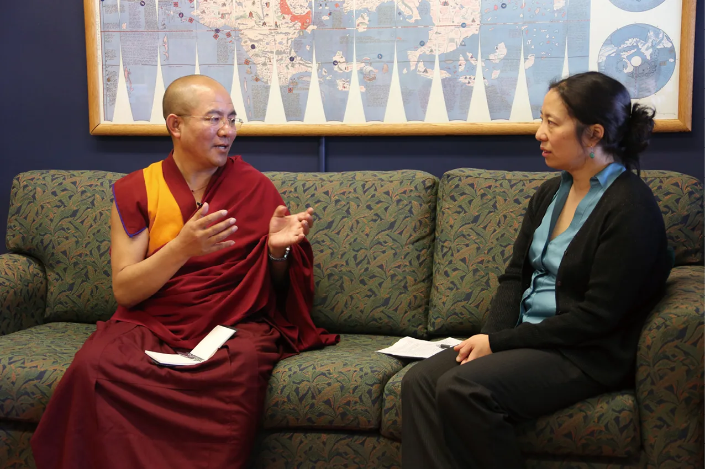
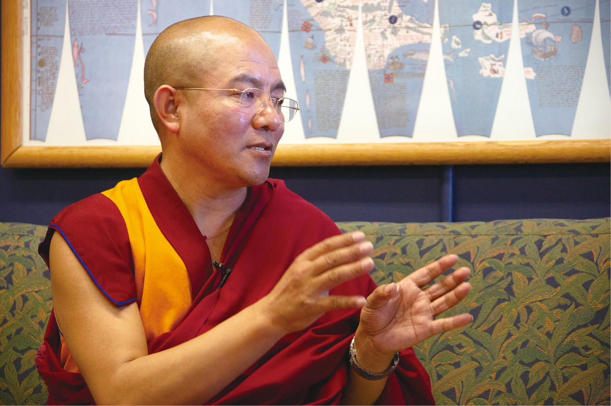

环保从心开始

索达吉堪布 & 叶蓓教授

科罗拉多大学博尔德分校

University of Colorado Boulder

2013/04/24

叶蓓（Emily Yeh）

美国科罗拉多大学博尔德分校人文地理学教授，美国地理学家协会主席。对中国西部地区的发展和自然关系进行了长达20多年的跟踪研究，包括气候变化的脆弱性、牧场管理的政治生态、发展中的经济与文化关系、自然资源商品链和环境主观性。著有《驯服西藏：景观转变与中国发展的礼物》等。

1．改变从人心开始

索达吉堪布：

这次来到科罗拉多大学，昨天我们探讨了“藏文化与环境”，感到非常高兴。叶教授主要研究地理学，对藏地的环境保护做出了很大贡献。今天您能在百忙之中抽出时间和我一起交流，我表示衷心的感谢。

叶蓓教授：

我也非常感谢堪布！我主要从事地理研究，也包括研究藏地的环境及其保护方法。佛法方面我不太懂。

索达吉堪布：

前几天与一些教授讨论了佛教，今天我们的主题不是佛法，主要就环境保护来进行交流。我有一些这方面的问题请教，您有什么想法也可以提出来。

叶蓓教授：

最近在藏地有很多环保组织，我也见过其中的一些。他们把藏文化、藏传佛教和环境保护之间的关系给我简单介绍了一下。但我还是有些不明白的地方，今天想问一下仁波切。

之前有个藏族人跟我这样解释：“从佛教的角度来思考，我们要真正做到环保是很困难的，因为环境与人的关系在于人们各自的业和福报。虽然我们需要做环保工作，但真正的环保是很难做到的。真正的环保，需要从心开始。”

应该如何理解这个说法？环保工作是要从外界开始，还是要从人们各自的心开始？

索达吉堪布：

佛教里讲，人们所生活的环境，是各自往昔所造的业成熟的果报。当业力成熟时，众生会因各自所造的不同业而感召不同的果报。如果曾经造下恶业，所生之地就极为不悦意，环境污秽，岩石和荆棘遍地；如果曾经积累福报，所生之地会是美好悦意的。

佛教所说的，只是一方面的原因，也不能说环保工作没有必要。我们现在所做的事情，必定对环境起到很大作用。环保概念是20世纪70年代才出现的，在此之前人类没有环保意识。我们应该相应于时代，切实采取一些措施保护环境，否则环境会持续恶化。

一般而言，人们所处的环境跟往昔的业有关系，但未来状况如何，关键在于我们当下的行为。现阶段，第一，需要多做善事；第二，要停止对环境的人为破坏。断除所有恶行，努力行持善法。

我认为，佛教中并没有一味地说“这就是前世的业，没有办法改变”。这种说法只是一个侧面，并不是佛教的究竟观点。

2．因为因果，永远公平

叶蓓教授：

我想知道，从佛教的观点来看，如何从现世的角度理解社会的公正性。

我曾经与一位藏传佛教的修行者对话，他也是一位环保人士。我们谈到一些岛屿国家即将被淹没，原因是全球变暖。实际上，那些岛屿国家对此的责任最小。我认为从某方面来讲，这是非常不公平的。对方说：“如果这些岛屿国家的人会被淹死，那是因为他们的福报不够。即使没有全球变暖，他们也会因为其他意外而葬身海底。”从长远来看，业力一直跟随着我们，一切是公平的。但我们怎样去随顺当下的愿望，如何解决暂时现世的不公平呢？

索达吉堪布：

在环境保护的过程中，这些岛屿国家确实面临着很大威胁，很多专家也一直关注着事态的发展。

前一段时间，我们从德国飞过冰川。当时我也在想，如果全球变暖问题越来越严重，这些大海里的岛屿国家非常危险。

这些岛屿国家的人没做什么坏事，为什么要感受这种痛苦呢？从佛教角度看，虽然这些国家的人在近期或这一生中没造下特别的恶业，但这是他们的共业。历史上有许多类似的案例，一些人在前世共同造了恶业，今生中即使没有犯错，也会感受痛苦。这是一个原因。

另一个原因是杀生。按照佛教观点，杀生，即杀害众生的行为，过失很大。与其他地方不同，这些岛屿国家的人几乎每天都在杀生，他们从小到大都在海里打捞捕杀活物，一个人一辈子杀了无数生命。这样的行为也会导致果报现前。

日本出现地震和海啸时，很多日本人都说“我们天天吃海里的生命，现在水神、龙王不高兴了，把我们吞下去了”。我们先吞它们，它们再吞我们，也有这样的说法。

叶蓓教授：

如果是这样，那么今生我们应该争取社会公平吗？还是说，这样做也没有什么用？

索达吉堪布：

虽然有前世的业力，但在即生当中，我们还需要创造好的因缘。佛教并不是宿命论，不是说我们现在安居乐业，非常快乐，就再也不需要努力了。

佛教并不像某些宗教所承许的，每个人的际遇全部是业力所致，是固定的，不会有任何变化。在佛教眼里，一部分是前世决定的，还有一部分会随着当下的因缘有所改变。

3．老鼠和藏羚羊都应被保护

叶蓓教授：

在西方的环保理念中，有些动物需要保护，比如藏羚羊等濒临灭绝的动物。但如老鼠、猫等很多动物，没有濒临灭绝的危险，就不会去特别保护。佛教中讲每个众生都渴望生存，都应加以保护。这两种理念该怎么平衡？

索达吉堪布：

佛教中讲，从人类到蝼蚁，凡是有情众生都同样希求快乐，同样不愿意感受痛苦。不管是藏羚羊还是老鼠，都同样地具有生命。有些动物似乎对人类社会或环境有害，但它们也都具有生命。

拿人类群体来说，有一些人秉性善良，另一些人比较一般或者相对恶劣，但无论善恶，他们都同样拥有生存的权利，在这方面是平等的。

现在人们对待动物的态度是，对人类有利的就保护起来。比如在汉地，熊猫具有观赏性，比较稀有，杀害熊猫是违法行为。而有些动物对人类有害，就要用毒药去杀害。这种区别对待的态度，并不符合佛教的理念。

就好比有些国家中，小偷和强盗要判处死刑，只有好人的生命才能被保护。这不符合当今人类平等的理念。一切众生在生存方面都是平等的。

佛教中所讲的生命平等、世界和平，我认为是非常伟大的思想，既有广度，也有深度，并且具有包容性。

4．植物有生命吗？

叶蓓教授：

佛教中“器”和“情”是什么关系？动物是属于“情”对吧，那植物是属于“器”还是“情”呢？

索达吉堪布：

器情世界，是佛教的专有名词。植物属于“器”还是“情”，有两种解释方法。

从广义上讲，现代植物学认为，所有植物都有生命，植物可以被称为“有情”。而从狭义上讲，或从佛教本义上讲，植物在遇到刺激时，虽然有一些反应，但它不像动物和人类那样具有真正的生命，即五蕴所摄的生命，不会成为苦乐的所依。从这个角度看，植物属于器世界，不属于有情世界。

有情世界的众生，除了人类和动物，还包括其他世界如天界的众生。山河大地以及植物，则属于器世界。

植物学家所承许的植物具有生命，与动物的生命有极大差别。以前我看过一本书叫《植物的生命之书》，它在国际上影响比较大，让人们觉得杀生和砍树是一样的。这种观点不对。虽然植物也有生命，但我们砍一棵树不算杀生，没有那么大的罪业，杀动物的罪业会更大。

叶蓓教授：

对，植物和动物是两种不同的生命形态。

5．被透支的大自然

叶蓓教授：

环境在汉语中被称为“大自然”，我不是很清楚大自然和器情之间的关系。大自然包括植物和动物，可是从器情角度来看，植物和动物是不同的。我们用现在的方法解释大自然，是否符合传统的器情概念？

索达吉堪布：

现在的科学家和知识分子说到“大自然”，就认为是除人之外的一切，主要包括众生和环境这两方面，这样理解也可以。

一般来说，它们之间的关系可以理解为能依和所依。所依是指地方，如山、海、岩石、雪山等；能依是动物、人类和树木。动物又分为海居和陆居，分别依于大海与大地。这些全部依于大自然。

我们一方面要保护树木森林，另一方面也要保护各种动物。如果将所有的树木、动物都摧毁了，人类的生存环境也会越来越差。树木消失了，矿产挖光了，地球会变得非常荒芜。

我去过一些地方，那里的矿产和森林全被破坏了，可以说透支了下一代的财富和资源。此外，毫无节制地捕捞鱼类等海洋动物供人类食用，也会对大自然造成巨大的伤害。

佛教的观点与学者的观点，在广度上有所不同。有些动物保护者说，某些动物被杀是合理的，只要不让它灭绝，就可以适度宰杀，因为人类需要肉食。他们一边吃肉一边提倡环保，保护与杀害同时进行，这种行为可以说是一种矛盾。

6．龙王与土地神：不是神话

叶蓓教授：

藏传佛教中有龙神，一些地方还有山神、土地神，这些神祇是一种文化还是属于自然？从西方的观点来看，自然、人文、社会学之间有很大差别。佛教里是怎么界定的？

索达吉堪布：

龙、山神、护法神的存在，不一定能通过现代科学加以证明。科学是通过仪器来判断一个东西存在与否，但世界上还有许多凭我们的肉眼和感官，甚至科学仪器都确定不了的神秘存在。龙、护法神、非人在藏地有大量感应现象，很多科学家都非常惊讶。

我个人而言，从小到大都生活在佛教氛围中，对龙、土地神的存在深信不疑。在藏地，护法神与人类之间的关系，他们的种种对话，这些都真实不虚，如果将此视为神话，我绝对不认可。

作为科学家，一定要正视古代智者所造的典籍，以此为依据进行取舍和判断。关于龙是否存在，经典中记载，龙猛菩萨从龙宫带回了《般若经》，并在龙宫为龙王说法。综合这些资料，应该可以确定龙这种生物的真实性。

但这些特殊的众生，并非每个人都能看到。就像电子和磁场也看不到一样，只是物理学家通过仪器和实验才发现了它，并对它的存在和作用进行了有理有据的说明。

我经常会想，在某个层面，佛法也相当于量子力学这样的学科，如果没有专家对它进行针对性研究，很难了知其中深奥的意义。所以，对佛教进行专业研究，是非常有必要的。

这次我来美国，一方面特别随喜，因为很多高等学府对藏文化、藏传佛教十分重视；另一方面也有点遗憾，可能由于文化背景不同，很多老师和学者将藏地的一些历史视作神话。

确实，其中可能有神话的部分，但有些是真实的历史，如果统统归为神话，应该不符合实相。我们一直提倡“地球村”，但东西方文化还是有很大的差异。如果我将在美国真实发生的历史，回藏地后在课堂上说这些是神话，也是不太合理的。

叶蓓教授：

这似乎是一直存在的问题，像学习、研究在西方学术界都被归纳到文化范畴，但在堪布看来，其实也是自然现象的一部分。我也正想提出这一点，文化与自然现象的割裂问题。

7．环保是保护群生的大爱

叶蓓教授：

在西方教授环境伦理学，伦理通常会被划分为不同种类。人类中心伦理以关注人类幸福为宗旨，生命中心伦理侧重于关注每个生命个体的权益，生态中心伦理是将生态系统作为整体的研究对象。

举例来说，你不能触怒山神，因为他可能伤害你，这是人类中心伦理的观点。佛教认为每个众生都有生存的权利，这是生命中心伦理的观点。而西方倾向的做法是，如果有争议，就留出一部分土地作为保护区，这更偏向于生态中心伦理。

不知道堪布是否了解这些分类，藏传佛教中怎么理解这些分类？

索达吉堪布：

您刚才提到以生态为中心的环境伦理，可能与我提到的广义上的生命和大自然相符合；佛教更注重以生命为中心的环境伦理，也就是尊重每个人类和动物的生命，佛教总说生命最可贵，我也一直这样认为。人的思想有高有低，有些思想还是很高尚的。

总的来说，爱护所有众生的生命，包括动物与人类，重视环保，这是不分国界的，也是全球性趋势。为什么呢？如果我们只以人类为中心，人人只考虑自身利益，为了满足欲望而不断掠夺，那对其他生命和整体生态太不负责任。如果每个国家都为了自己的利益而摧毁环境，地球生态是难以长期维系的。

佛教与其他宗教、科学界最大的不同，就是强调对所有生命的保护。如果将人类与动物相比，很多人可能选择保护人类，实际上这种思想不是很先进。佛教是要保护动物、人类在内的一切众生，还包括植物界、大自然，乃至整个地球。这种思想归纳来说，源于大乘佛教的利他心，完全没有自私自利。这样的境界非常高尚，值得每个人去接受。即便是诺贝尔和平奖获奖者，也只是对人类做出了贡献，从这个层面说，我觉得人类的思想还要不断提升，要关爱所有生命。

如果有一天，我们真做到了对动物与人类一视同仁，像爱护人类那样爱护动物，那人类一切行动就会趋于合理，有助于实现整个生态环境的平衡。

8．“坏人”也有生存权

叶蓓教授：

生态学家对这种情况可能不会赞成。比如具有侵略性的物种，当把它放到某个环境里，这一物种随后会侵占整个生态系统。从科学的角度，我们需要做些什么来阻挡这些物种的侵略，因为如果不这么做，本地的物种可能会灭绝。考虑到所有生命都有生存权，您怎么看待这样的情况？

索达吉堪布：

人群中也有好人和坏人，坏人多了，去另一个地方后，对当地的好人可能有影响。在佛教中，对坏人的惩罚是判刑，最严厉的就是无期徒刑，把他们一辈子关在监狱里，但尽量不要判死刑。这是佛教的基本原则。

同样，对动物也是类似的态度。比如有些动物以吃其他动物为生，不能因为这样，就把它们也杀掉。佛教不提倡这样做。

任何一个众生，即使性格不好、行为不好，我们也不能因此就杀掉他（它）。每个众生都有自己的生存权。他去伤害别的众生，甚至消灭其他物种，只是他的一种选择。

佛教徒放生的时候，也会面临放生毒蛇的难题。有些人说不能放，会对环境或其他物种有害，有些人说可以放在合适的地方。不管怎么样，我们也会放生毒蛇，因为它毕竟是一条生命。即便是毒蛇，也不能随意杀掉它。如果救了它，它再去杀其他动物，就是它的事，我们也没办法。

9．内环保：远离心灵的通货膨胀

叶蓓教授：

堪布提到了内环保的意识，作为社会科学家，我对这个可能没有深度了解，那么能不能请您阐述一下，佛教理念里的内环保是什么意思？

索达吉堪布：

从佛教的理念讲，内环保也有很多不同的层面。一般来说，我们提倡生存在世间的每个人都过一种清净的生活，这种生活方式取决于人们的内心是否干净。人们的心态经常会受到外在环境的影响，生活和工作的不顺心往往会让内心染上污垢。

其实，每个人都有一颗纯洁无垢的心，很纯真，很清净。但在成长过程中会受到后天教育的影响，这些教育有的合理，有的不合理。什么是不合理的教育呢？比如说，本来一个人的贪欲不是很严重，但现在层出不穷的品牌文化、消费主义潮流，让人们的物质欲望膨胀，内心总是不满足。

本来我们只需要一间小小的房间，就可以保证生活了。但因为欲望的无限放大，一定要拥有更多更多，在这里买一栋房子，在那里买一栋房子……贪欲的污染非常可怕，对我们的内心造成了极大破坏。

除了贪欲之外，还有嫉妒、嗔恨，这些因素都造成了我们内心不清净。大家普遍都认为外在的环境很重要，其实更重要的是内心的环境。也就是佛教理念中的内环保。

在藏地，我经常看到很多出家人，住的是一般般的房子，吃的是一点点糌粑，但他们内心的宁静与快乐，是大城市里的富翁、领导、明星根本无法相比的。有些明星表面看上去很成功，有着无数粉丝和常人难以想象的财富，但他们职业背后的竞争与挑战，也是常人难以想象的。可能他们一辈子都要争来争去、勾心斗角，本来清净的内心环境，被各种各样的社会毒素所染污。

佛教中所提倡的，是对于那些真实的所需，人们应该积极面对，努力争取。但对于像通货膨胀一样被外界虚构出来的伪需求，则应该尽量远离。

人的内心应该对这两种需求做出正确取舍，否则，只是跟随别人的营销步伐，欲望没完没了，可能一辈子都无法满足。哪怕最后离开人世时，内心也充满无法言说的痛苦。

10．富到奢时反成苦

叶蓓教授：

那我们该怎么理解经济发展带来的各种需求？

索达吉堪布：

正常的经济发展是需要的，但佛教强调，经济发展的目标应该只是够用就好。

现在所谓经济发展的理念，也是极其笼统的。有人认为美国的经济状况，中产阶级人数多，贫富差距不算严重，总体来看还不错。如果贫富差距特别大，经济发展就成了一种口号和空谈了。

经济发展不管对个人也好、国家也好，都是一个笼统的概念。应该发展到什么地步，谁也没有概念。如果一味按照人类的欲望发展，那欲望是永无止境的。但若按个人的正常需求来发展，佛教并不反对。佛教提倡符合社会伦理的、适度的经济发展。

佛陀在世时，也提倡在家人要挣钱，在家人去种田、从商，这都是允许的。佛经中有一部《善生经》，专门对在家人的生活和行为做了指导。所以，佛教并不是抵制所有的经济发展。

叶蓓教授：

现在西方有些社会科学家在批评经济发展，他们说不同时代的需求也不一样，现在的需求越来越大。

索达吉堪布：

我看过印度国父甘地的一句话，他说：“地球只能满足人类的需求，不能满足人类的欲望。”如果每个人的生活要求相对简单，有吃、有穿、有住就可以了，那就能过得很快乐。

现在的竞争文化、消费文化给很多人带来了痛苦。如果一直追求过度的、奢侈的物质生活，恐怕人类一直都不会快乐。

11．天有灾，是人心有毒

叶蓓教授：

人们常说四大平衡对环境保护很重要。四大不平衡会引发身体内部的四大不调，从而导致疾病。我想知道您怎么理解环境保护的要素与四大平衡的关系？比如从佛教的角度看，不杀生与四大平衡，这两者有什么关联？

索达吉堪布：

一般来说，外器世界的四大，指的是地、水、火、风。佛教认为，四大是否平衡取决于人类的行为。

莲花生大士在很多教典中讲到，如果人们行持杀生等不善法，就会感召各种自然灾害的降临，如地震、雷劈、冰雹、洪水等。

《时轮金刚》等密续中将人体比作宇宙，人体的小宇宙与外界的大宇宙之间有一种缘起，当人的心灵和身体向善，外境就会变得悦意；如果人心不善，造很多恶业，打破了某种平衡，那么外在的器世界就会发生种种灾难。世间所说的触犯了龙王、天神，其实是人类内心的染污影响了外部世界，从而显现为洪水等自然灾害。

前些年，有些科学实验发现，当人生起特别严重的嗔心时，血液会产生某种毒素，抽取这种血液注入老鼠体内，老鼠会生病甚至死亡。刚好，佛教说贪嗔痴为三毒，这个发现与此完全对应上了。三毒加上傲慢与嫉妒，就是五毒。心有毒的话，血液就会有毒。由此可见，这些强烈的烦恼都属于不善法。

佛教中说，做不善法对世界是有害的。为什么呢？人类不善的内心会导致不善的行为，不善的行为会造成外界地水火风不平衡，引发种种灾难。这是世间的缘起规律，有因必有果。

所以，佛教中强调要行持善法，杜绝不善法。不善法对自己不利，对他人也不利。行持善法，正如播下好的种子就会收获好的果实一样，会给自他和大自然都带来安乐。

12．全球变暖，美国如何行动？

索达吉堪布：

现在全球变暖问题非常严重。之前美国副总统戈尔在应对全球变暖方面做出过贡献，获得了诺贝尔和平奖。实际上，目前这个问题越来越严重，有人说是吃肉造成的，有人说是环境污染造成的。

我觉得，如果全球一直暖化下去，再过若干年，甚至有可能导致人类的消亡，它已成为了全世界人类的头等大事。

美国也非常关注这个问题，您作为环境保护的科学工作者，对此有什么想法和建议呢？

叶蓓教授：

我认为最重要的是，减少二氧化碳的产生，要快速减少机械运作中温室气体的排放。其实，美国是最大的问题来源，我认为需要改革现有的基础设施，转向低碳经济，也就是使用再生能源。

事实上，美国一直以来有着最高的人均机械使用率以及最高的机械动力总和，直到中国的年度机械动力总和超过了美国。但如果分析历史责任，我们大多数人都认为美国应该负主要责任。欧洲在这方面做得很好，美国还需要努力。如果要改善全球的暖化问题，这可能是最关键的地方。

13．政府环保：滞碍中的前进

索达吉堪布：

宗教组织和民间组织也很想参与环境保护，但能力有限。在这方面，更多要仰赖国家的力量，尤其是执政党的力量非常大，可以一呼百应，由上而下起到作用。

您觉得美国政府或其他国家的政府在环保方面，有什么行之有效的举措和方法？

叶蓓教授：

西方科学认为，我们可以从不同的规模和尺度来考虑环境保护问题。当然，现在最重要的是全球变暖问题，它的影响遍及所有规模和尺度。

从小规模来说，也有适合社会群体和民间组织做的事情，比如保护当地的森林和水域。

就全球气候变暖这个问题而言，如果美国对二氧化碳的排放征税，以此来限制由机械运作而排放的二氧化碳，那会是非常有效的方法。现实问题是社会科学告诉我们，经济发展的动力是赚钱。商人要赚钱，不想失去利润，他们会游说政府，阻止出台这种大规模的管理法规。

另一方面，当前对全球变暖问题的协商有些停滞，原因是美国对中国的担心。但并不排除宗教团体以及一些地区做出的努力。比如美国加州已经通过了AB32法案，这是很有效的措施。可见，即便没有国家级的举措，有些州已经开始采取措施，减少二氧化碳的排放了。

我认为，无论国家层面还是地区层面所采取的措施，都很有效。还有就是，必须要寻找一种途径执行自上而下的管理法规，比如，政府必须出面明令工业界在一定范围内减少机械运作。

14．浪费不等于优质生活

索达吉堪布：

在美国，好多路灯白天一直开着；吃饭也是习惯点好几个菜，吃完还剩下很多。这和我之前的印象不太一样。二十年前来美国时，人们还是挺节俭的，怎么现在变得浪费了？虽然不是所有的地方，但有相当多的地方，人们普遍比较浪费，不太有节约的理念。在您看来，有没有这种情况呢？

叶蓓教授：

美国社会和中国社会一样，非常复杂，不同地域之间有很大的差异。在美国，也有一些活动倡议大家购买有机食品、本地食品，减少浪费。但总的来说，您的观察很正确，美国人越来越浪费。

过去的二十年，“新自由主义”兴起，市场经济的概念不断深入，美国某些地区的政治观点认为美国拥有无限的资源，与此相违的任何提议都与美国人的优质生活方式相左。

一方面来说，这二十年来，我们确实看到社会的某些层面更有环保意识，强调有机食品和当地食品，尽量避免远距离运输食品。很多都市人都尝试在自家后院种菜，避免浪费。但另一方面，消费正在明显增加。这与资本主义的发展模式密切相关。

我想补充强调的一点是，降低消费、不浪费才是最重要的。现在有一种奇怪的现象，很多商店在销售所谓有机、可持续、有效率的产品，如果人们持续购买这类产品，就认为这对地球有益，却不去重复使用物品，这种行为一点都不环保，是不是？

从社会科学的角度，我的观点是降低消费，而不是持续地进行绿色消费，购买更多的所谓对环境友好的产品。

15．关注藏区环保

索达吉堪布：

叶教授非常重视藏地的环保。在讲座时，我观察了很多老师和学生，从表情上就能看出他们对藏地的环境也很关注。对此我很感动，也受益很多。我想问的问题是，您对目前的藏地环保有什么建议？应该如何在藏地实施环境保护？

叶蓓教授：

这个问题很难。可能看看哪些环保方案不可行，还更容易些。

我观察到两个问题。一个是藏区某些地区的草原退化问题。最近的研究表明，把牧民们从草原上迁出并圈起栅栏，并不是改善草原的科学方式。相反，在草原上保持少量、合理的畜牧业，比迁移带来的结果更好。

世界其他地区的研究显示，栅栏限制了牧民的流动性，不利于草原生态环境，并不是有效的环保方法。在草原系统中保持更多的流动性和灵活性，是保护草原生态的有效方法。

同时我也想到，全球气候暖化会给高原带来负面影响，但这是一个全球性问题，只能在全球范围内加以解决。

另一个是很多当地藏人向我反映，他们很担心采矿业对环境带来的负面影响。有些负面影响已经非常明显了，我认为必须借助有效的管理法规来解决。

牧区是不平衡的生态系统，部分原因是游牧文化，根本原因是这个生态系统自身的演化，人类与其他食草动物之间保持着怎样的关系。在非洲，也有很多类似的问题，经过长时间研究后得出了相同的结论。不同地区的畜牧系统会出现相同的情况，相互之间可以借鉴参考，吸取经验。

索达吉堪布：

非洲有什么样的经验？

叶蓓教授：

那里同样有很多栅栏，导致大部分草原的状况比以往更加糟糕，足以证明这不是有效的环保方法。

目前，青藏高原的升温速度，比全球平均升温速度快三倍。然而，藏人对气候暖化不需要承担什么责任，也基本上做不了什么来改变现状。

16．扎根本土的环境教育

索达吉堪布：

环境保护的理念，在学校里、人群中应该通过教育来传达。美国的学校里有没有提供环境保护方面的教育？以后我们应怎样通过教育来提升藏地民众和寺院僧人的环保理念？

叶蓓教授：

美国设立环境教育课程比中国早很多，中国现在也有环境教育，算是一个很新的研究领域。我知道四川大学就有很不错的环境教育课程。也有许多人来美国继续深造。

我想，对于藏地特别重要的是，要进行适合当地的环境教育，传播一些生态学原理。这些科学原理和理念不但适用于任何地方，也可以在任何地方传播。

藏地还需要其他的环境教育，将环境教育与当地文化有效结合。在中国，环境教育被列入学校的课程，从小学到大学都有。根据现有的经验，应寻求更多资源来发展、推广这些教育，也就是说，在现有基础上继续推广和加强。这很重要。

我最近了解到甘肃玛曲有个非政府组织，他们设计了很多藏文的环境教育课程。他们遵循生态环境的原则，去采访了很多当地的老人，收集了很多与环保有关的故事。这些努力目前只是小范围的，没有广泛普及，但可以通过网络或者其他渠道，在藏地不同区域之间交流与推广，这样会很好。

索达吉堪布：

非常感谢！
