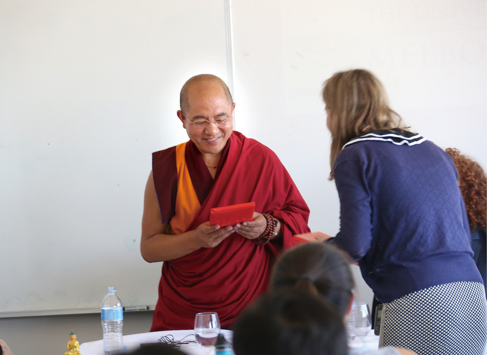
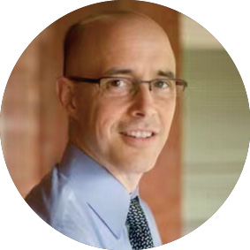
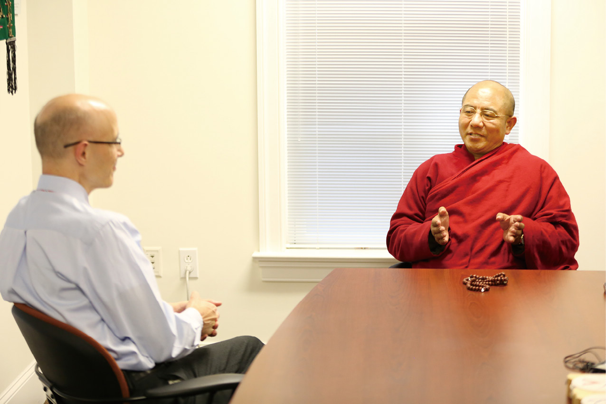
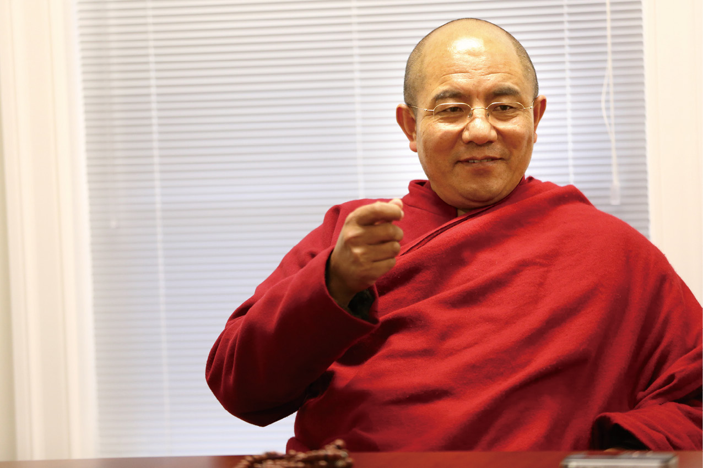
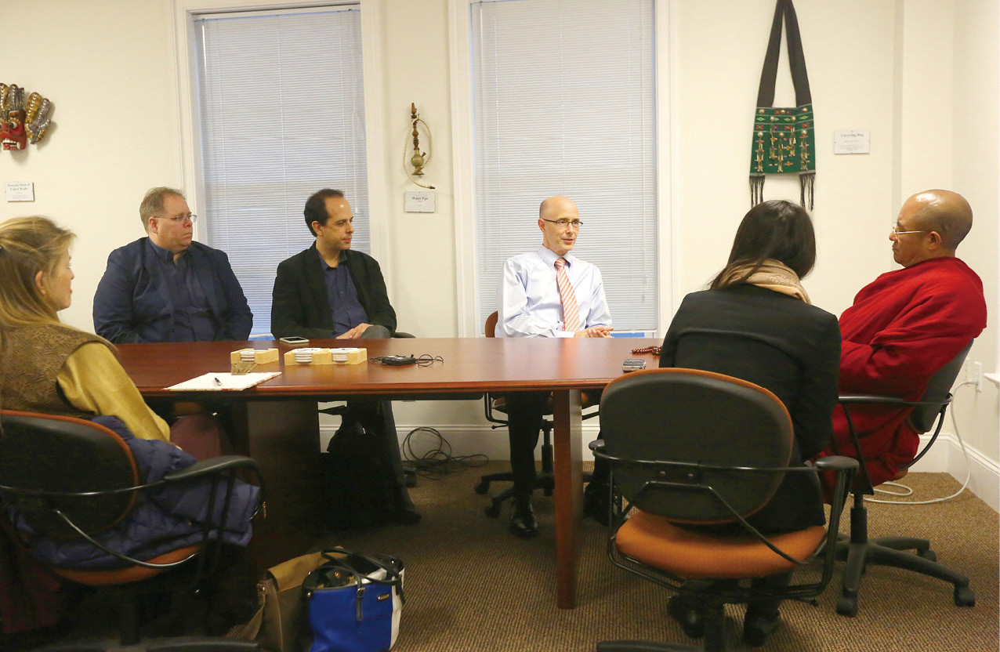

灵魂的前世今生

索达吉堪布 & 吉姆·塔克博士

弗吉尼亚大学

University of Virginia

2014/11/17

吉姆·塔克（Jim B. Tucker）

弗吉尼亚大学医学院儿童精神病学家，精神病学和神经行为科学教授。著有《生命之前的生命：对儿童前世记忆的科学调查》。他曾与伊恩·史蒂文森博士共同研究前世记忆和轮回，并在2002年后接手了伊恩·史蒂文森博士的研究项目。后者专注于亚洲案例，他的研究重心则在美国儿童。

1．寻找前世之旅

索达吉堪布：

很感谢您今天抽出时间来接待我们。知道您的时间宝贵，所以我不想占用太多。之前听说过您和伊恩·史蒂文森博士的研究，令人着迷和欣喜。您写过很多书，我也拜读过其中一些，我认为这些书很引人入胜。

一直期待能够拜访您。现在我来到了弗吉尼亚州，想听一听您的研究是如何进行的。

吉姆·塔克博士：

很荣幸见到您。您可能知道，这方面的研究已经超过五十年了。大多数时候，伊恩·史蒂文森[^1]在研究亚洲的案例，有合作伙伴帮助他寻找年幼的孩子讲述前世的经历。

近几年，我更关注美国的个案。在互联网的帮助下，现在越来越多的美国家庭联系了我们。每个案例都各不相同。但我们尝试要做到的是，尽可能详细地了解孩子们与前世相关的言谈和行为举止。

除了对前世记忆的谈论，经常还有看起来与前世相通的行为。如果前世死于暴力，或者在某种非自然死亡的个案里，超过35%的孩子表现出患有恐惧症或者陷入极度的恐惧。

我们尝试研究这类行为表现，同时将孩子们对于前世记忆的叙述一同记录存档。在可能的情况下，我们试着去验证那些记忆是否与某一个特定的亡者匹配。

很多案例，尤其是亚洲的案例，现世的家庭已经找到了前世的家庭，或者某个亡者。在这种情况下，我们会与前世的家庭见面，逐条核实小孩对于前世的记忆，以此来看这些描述与“前世之人”的重合度。

最棒的案例是，前世的人还没有被记录在案，我们记录了孩子关于前世的所有描述和行为表现，然后去寻找前世所对应的人。有时候，我们发现孩子关于前世的描述与这个前世之人相当一致，令人吃惊。

2．理性地接受前世

索达吉堪布：

我之前看过您的书，并在我的好几本书里引用过相关案例。您前后两本关于孩童前世记忆的书都十分畅销。作为藏族人，我们从小就在佛教家庭里长大，对于前世今生，大家没有任何怀疑。

我所接触的汉地人特别多，他们当中有些人有信仰，也相信前世今生；有些人则没有信仰。

我认为，像你们这样的研究方式，对当下来说非常重要。如果一个人完全不相信前世今生，您觉得最有说服力的是什么？从个人角度来讲，您在从事这个研究工作的过程中有什么发现？您自己对前世今生是什么样的感觉？

吉姆·塔克博士：

我们的研究，对于那些有一定开放性的人是有影响的。您知道，很多怀疑者甚至完全不会花时间去阅读我们的研究成果。但如果他们读了，他们也会接受这些。如果他们内心有一定的开放性，就会对这些事情有一定的接受能力，同时对自身也会产生很大影响。

一直以来，不断有人告诉我，这份研究给他们带来的影响。上个星期我遇见了一位女士，她告诉我，她的世界观因此而改变。我认为世界各地包括美国在内的很多人，都希望我们不仅仅只是有一个身体，还有心识可以延续生命。

以前是宗教为人们服务，起到这样的作用。对于当今时代的很多美国人来说，宗教信仰并不能满足他们。所以除了宗教信仰以外，应该有一种理性的存在，一种有根有据的存在，让他们去认识、了解这样的现象。

索达吉堪布：

我想问一下。据您所了解的情况，在这么长的时间里，伊恩·史蒂文森博士是以什么样的方式来进行他的研究工作？

吉姆·塔克博士：

现在跟以前是一样的。伊恩是一个从事科学研究的人，他不想把研究变得很哲学化。他并不想要说服别人，只是想把这种现象记录下来。初衷只是想让大家去认识到这么一种现象，引起一些注意，并对此进行一些思考。

伊恩并没有声称这是一个很伟大的发现或什么，只是说我提供给你们这样一个现象、这样一些数据，你们去看就可以了。他非常谨慎，从来不用“证明”这个词。

索达吉堪布：

我也注意到你们的书里，讲到很多这种现象，有各种情况，并没有刻意要去证实什么。我也不要求一定要证实什么，但你们所说的一些真实现象，是可以告诉别人的。因为你们所了解到的情况，是一种事实，而且整个研究过程也非常科学。

吉姆·塔克博士：

有些人好像一点都不怀疑地去说一个事情，或者认识一个事情，那不是我们的风格。

3．大脑死亡后，什么在延续

现场提问：

在研究的时候，您是否发现过有人前世是其他物种，比如狗啊、植物啊，或其他动物？

吉姆·塔克博士：

没有发现有人前世是七星瓢虫，开个玩笑。

这种案例非常非常少。比如说，上一世是一条蛇，当它转世变成一个人，大脑还能够有前世的记忆。与人转世成人相比，这个概率极低。可能的原因是大脑的结构改变了，记忆无法延续。

能想起前世的孩子们，平均年龄是三十五个月。一般来说，到他们六七岁的时候，就回忆不起来前世了。

索达吉堪布：

这在科学上有没有什么说法呢？为什么到了六七岁就回忆不起来？

吉姆·塔克博士：

因为在那个年龄段，大脑的变化很大。即使是自己的童年记忆，很多人到了六七岁之后也会忘记。所以我认为，在那个年龄忘记了前世也是很有道理的。当然，如果他们经常讲到前世，这种记忆就会延续得更久一些。

索达吉堪布：

在您的研究中，人前世的身体和大脑都没有了，那么延续到后世的是不是心识呢？或者你们是怎么认为的？

吉姆·塔克博士：

看起来是这样的。有一种不间断的序列性的意识，或者心识。我是这么理解的，没有超出这个范围。我觉得大脑死掉以后，肯定有一个不是物质的东西在延续。

索达吉堪布：

关于前世今生，史蒂文森博士是不是也持这个观点。前世和今生之间的关系是什么？他的书里没有讲得很清楚。

吉姆·塔克博士：

史蒂文森自己造了一个词，“Cycle Form”，即一个可以把记忆从前一世带到后一世的载体。跟灵魂类似，但不是宗教意义上的灵魂。

我现在也不是很确定，到底是有一个真正有实体的所谓载体，还是一种意识或心识延续到了下一世？

4．转世的各种情况

现场提问：

基于现有已经完成的大量人种学研究，您能大概估算出转生的间隔时间吗？比如说最短间隔、最长间隔、平均间隔时间分别是多久？

吉姆·塔克博士：

有些从死了到投生，需要四到五年；有些间隔比较短，只要十六个月。也就是说，有一些人转生的时间很短，另一些人需要的时间更长，还有些强有力的实例是五十年。

我们也不知道为什么有些案例只需要很短时间，有些则需要那么长时间。

现场提问：

有没有一些人不仅仅记得前世，还记得中阴阶段？

吉姆·塔克博士：

20%的小孩可以记起中阴阶段。我觉得可能和他们的宗教文化背景有关系。

有些美国的孩子会说他们在一个地方等着投生。在中阴阶段，他们会描述一些痛苦，比如感到很孤独，很饥饿，或者被人带着去下一世。

另外想指出一点，这些描述只是他们的记忆，不一定能代表真正的过程。如果相隔了很长时间，这种记忆也不可能很清晰。一般来说，相隔时间短，记忆会比较清晰。

这些有着前世记忆的案例里，有70%的人都是非自然死亡。很大可能就是因为他们转世间隔很短，同时记忆没有被损害，非常完整。

现场提问：

有些人并非对研究不以为然，而是真正带着批判性并涉及研究细节，他们都提出了怎样的质疑？

吉姆·塔克博士：

其实大多数时候没有案例是完美的，就像医学方面的研究也不存在完美。

以前有一些常见的批判，比如，这样的案例只在普遍信仰转世轮回的文化区域存在。现在我们知道这不是原因。大多数案例中，孩子的家人会去找到前一世的那个人。所以说，孩子都能非常清晰地记忆前世的相关内容。当然我们也记录了一些案例，前一世的人没有被找到。

最著名的一个美国案例是，二战时，一个飞行员在太平洋战死，他转世成为一个男孩，记得前世的很多细节，完全对得上。还有一个视频采访也是类似的情况，在前世的人被找到之前，这个采访如实记录了与前世的人相关的细节。

之前伊恩·史蒂文森去采访的时候会用一些翻译人员，这些翻译人员相信轮回。质疑者会认为这些翻译会使用符合轮回的说法。我觉得这不是一个公正的批评，翻译们的诚信没有问题。

索达吉堪布：

您接触的案例多不多？是不是特意去很多国家专门寻找这类案例？还是比较随意，遇到就遇到了。

吉姆·塔克博士：

开始的时候，我要去亚洲很多国家，但我最终还是决定专注于研究美国的案例。伊文·史蒂文森有两千个案例的记录。如果这两千个案例都没让大家真正关注起来并加以重视的话，那即使有更多的案例也无济于事。

在美国，通过互联网，有类似情况的家庭可以找到我们，比我们寻找他们要容易很多。

现场提问：

一个人死了之后，多个孩子声称是这个人的转世，有没有符合这种情况的案例？

吉姆·塔克博士：

有这样的案例，尤其是在印第安人部落和美国西北地区。社区里受尊敬的老人去世后，会出现这样的情况。接下来要对孩子们进行前世性格的测试。

从我们的角度来看，往往证据稀少，可信度不高，或许仅仅是小孩的父母梦到去世的人再度回来之类的。

一个人转世变成多个人的情况肯定是有的，但不是很多。可能因为一个小孩子能记得前世已经很不寻常了，两个人记得是同一个人的前世，这种就更难了。

现场提问：

我认为对于这类现象的一个解释是：意识流的延续是因为在某些情况下，某些人亡故时——类似在暴力中非自然死亡，他们的记忆通过某种媒介被延续下来了。如果这个模型成立，我会假设在这个影响下，多人继承同一个人的前世记忆的情况会更普遍一些。

吉姆·塔克博士：

是的，很多人给我写信，提出了空间记忆之类的解释理论。多数孩子确实在地理位置上，距离他们前世的那个人是相当近的。

但在我们最强有力的案例中，与地理距离相关的联系一点都没有。比如二战飞行员的案例。之前在太平洋去世的飞行员来自费城，转生的小孩来自路易斯安那州，隔得很远，一个在北边，一个在南边，看起来不可能有提前安排。

索达吉堪布：

你们有很多二战时期的案例，为什么那个时期的案例那么多？

前一段时间，我在加拿大，也听说有一个小孩，他在6岁之前能想起自己是二战时期的缅甸人。从二战到现在这么长时间了，为什么他们的记忆能延续下来，有没有研究过？

吉姆·塔克博士：

伊恩在20世纪60年代初开始做这个研究，那时距离二战的时间还不是很久。而且等伊恩开始采访的时候，那些人年纪都比较大了。

我们偶然还会听到有转世记忆的孩子说，自己前世是犹太人大屠杀[^2]的受害者。但这种案例不是很多。

5．轮回的运作方式

索达吉堪布：

您有什么问题要问我吗？

吉姆·塔克博士：

从您的信仰来说，这样的前世记忆可能与轮回有关系，那么具体是怎样运作的呢？

索达吉堪布：

前后世的问题，我觉得跟信仰没关系，但明白这个道理很有必要。不管是现在还是过去，有那么多案例证明，生命并不仅仅是由我们的大脑决定的，没有大脑却活着的人也非常多；生命也不是由身体决定的，因为即使完全失去了身体，相同的记忆还是会出现。

在一些古老的传统文化中，人死之后，他的心识，也就是你刚才说的载体，我们称之为阿赖耶识，它仍会延续流转。这个过程在佛教经论中说得非常清楚，理解起来也不是特别困难。

因此，我觉得这个问题与信仰无关。不管你有没有信仰，都会有前世后世，只不过现在很多人不了解而已。

我前段时间在加拿大的约克大学讲过前世后世。我当时说，虽然现在的主流思想不承认前世后世，就像几百年前人们普遍不承认“日心说”一样，但不承认并不能代表这不是真相。

如果不承认前世后世，也没有任何信仰，那面对全世界这么多真实案例，又该如何解释呢？科学也无法做出合理的阐述。所以我认为，大家要认真思考这个问题。

6．通过科学来证明轮回还需要很久

吉姆·塔克博士：

如果主流的科学体系能更加重视这个现象，并加以研究，那么这个设定一旦被接受，有可能对很多科学领域产生影响。

现在的科学基本上还是认为物质决定一切，不相信物质以外的存在。或者说这种唯物主义依然还是现在的主流思想。

这样的话，我们现在的这些研究案例根本没有多大用处，无法和现在的唯物主义世界观相匹配。但如果科学或者物理学能够开始认识到意识的作用，特别是物理学家们，能够承认意识与身体可以完全分开，科学领域就可以有很大的改变。

索达吉堪布：

我认为，物理学现在还没有这个能力，因为它的研究重点还是物质。与你们研究稍微接近一点的，可能是生物学。

现在的科学确实很难对意识现象做出解释。生物学也好，心理学也好，从整个科学史来看，进展非常缓慢。所以想通过科学来证明轮回，可能要等很多年。

吉姆·塔克博士：

我也希望生物学领域能够做出比较大的贡献，但是很多生物学家也是唯物主义者，或者寄希望于量子力学能够做出贡献。也许要等到我们下一世，才能看到情况的改善。

索达吉堪布：

有本书叫《生物中心主义》，作者是罗伯特·兰札博士。这本书最近在美国比较火。

他认为有五种理由可以证明我们这个世界是由心所造的。其中有一句话说：“世界一切的构造都是出于心。”所以他从生物学的角度，也可以间接地论证这个观点。

吉姆·塔克博士：

这是很有意义的一个研究。这位生物学家提出的很多观点，从根本上看还是量子力学方面的理论。可能需要多个学科共同努力，才能达到我们的目的。

索达吉堪布：

对，很好。你们的研究很有意义。现在你们有多少研究人员和项目？未来有什么发展计划？

吉姆·塔克博士：

我们是一个比较小的组，共有七个人，涉及不同的研究方面。我的工作主要专注在前世的记忆，有一些人在研究濒死体验，还有一些类似现象的研究。每个人都有不同的研究主题。

主要计划就是，继续这样做下去。通过现在所积累的案例，我个人确实很想对心识方面做更多的研究和了解。

索达吉堪布：

心识方面的知识，如果你有兴趣的话，佛教可能是最适合的。

以我多年来对佛教的研究，和心识有关的许多问题，在佛教里揭示得比较清楚，很容易解开疑惑。比如说，我们的身体只是一个外缘，它虽然对今生起一些作用，但它最主要的根本因，实际上是心识。

吉姆·塔克博士：

我赞同。

索达吉堪布：

您在书里提到，在研究调查的过程中发现一个人有前后世，很是惊讶。

当您发现案例里的受访者能够回忆前世，或是这个案例印证了前世的存在，您作为科学工作者，具体是什么样的感受？

吉姆·塔克博士：

不太知道怎么回答这个问题。特别是在美国，作为一个很平凡的人，见到的很多现象，确实并不像我所期望的那样。也许，可能，我们都有一种无明和无知。

您有没有在附近逛逛，看一看这个城市？

索达吉堪布：

看了。昨天去了学校，看了很多建筑，非常美丽。

吉姆·塔克博士：

就是天气不太好，特别是今天的天气。

索达吉堪布：

很好，非常好。这里的山，还有那个弯弯曲曲的围墙，都很好。

昨天与西然炯教授一起看到了很多建筑，风格像我们藏地，我觉得很有意思。最关键的是，这些建筑都有上百年的历史，很让人惊讶。

吉姆·塔克博士：

我也觉得这里是一个非常特别的地方。

现场提问：

当我在大学读研的时候，在图书馆里发现了伊恩的所有著作。我还记得读那些书的时候，我才23岁。

后来我去了喇荣，与其中一位大德见面，当他听到我来自弗吉尼亚州，送给我一本伊恩·史蒂文森的中文版图书。现在又听到了堪布在这里说话，我很激动。

这个世界真的很小啊，大家又聚到了一起。

索达吉堪布：

非常感谢！

吉姆·塔克博士：

不，是我感谢您！这是我的荣幸！

[^1]: 伊恩·史蒂文森（1918—2007），美国精神病学家，医学博士，弗吉尼亚大学医学院感知研究部的创始人和主任，“前世记忆”现象研究先驱。他花费40余年时间，寻访多个国家和地区，探查3000多个案例，撰写了约300篇关于轮回的论文和14本著作。2007年去世。儿童精神病学家吉姆·塔克博士继续他的工作。
[^2]: 犹太人大屠杀：holocaust，发生在20世纪30年代到40年代，纳粹对犹太人的种族清洗暴行。
