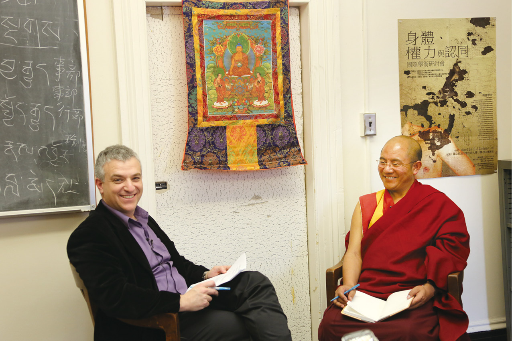
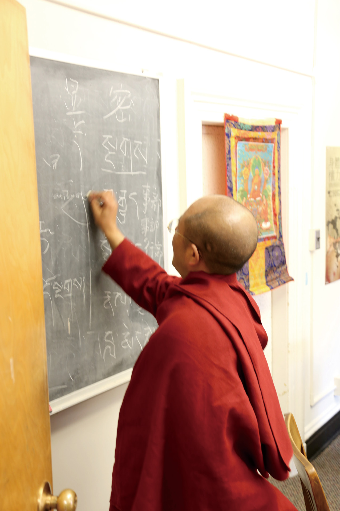
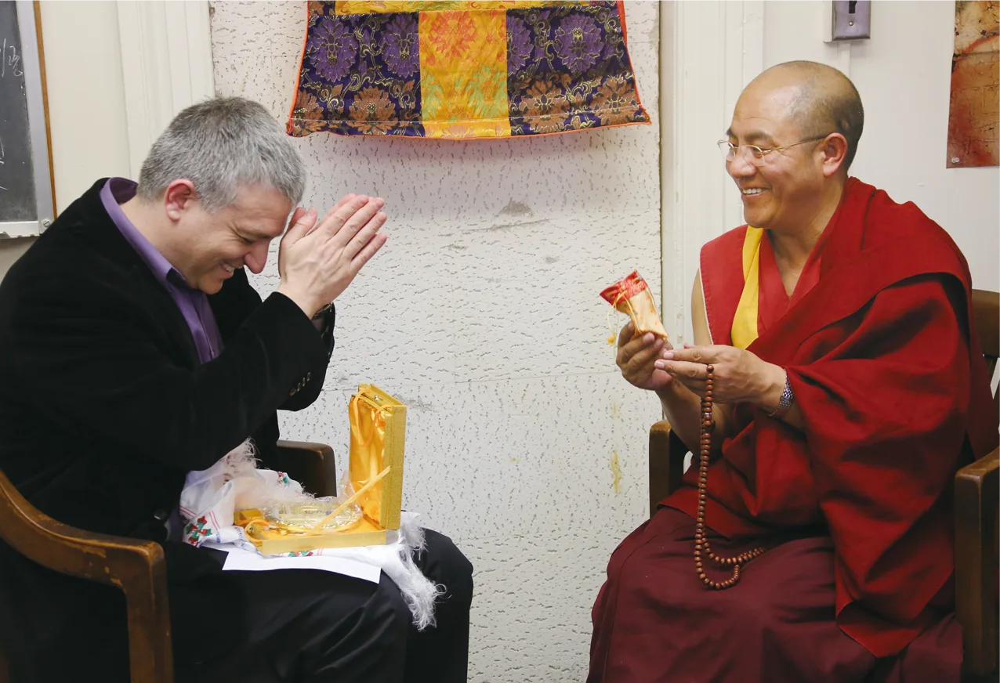

问 心

索达吉堪布 & 埃亚·阿维夫教授

乔治·华盛顿大学

George Washington University

2013/04/05

埃亚·阿维夫（Eyal Aviv）

哈佛大学宗教系博士，专攻中国宗教和佛教。美国乔治·华盛顿大学宗教系教授。致力于研究早期佛教哲学，尤其是阿毗达磨和瑜伽行传统与当代哲学之间的交叉点。兴趣领域包括心灵哲学、认知科学、伦理学和禅修实践等。思想史研究主要集中在近代宗教，尤其是近代中国佛教的复兴。

1．佛教道德标尺：刻度模糊？

埃亚·阿维夫教授：

我是埃亚·阿维夫，在乔治·华盛顿大学宗教系任教，同时也参与大学的荣誉课程项目。

我开设了一门探讨幸福的课程，正是您著述和演讲的主题。今天您也会谈到这个话题，对此非常感谢和期待。我还开设了一门关于正义和道德理论的课程，稍后想询问您一些这方面的问题。与此同时，我也教授几门佛教课程，主要关于佛教哲学和佛教伦理。

我的问题大部分来自和学生们的交流。这些问题虽然大多直接与佛教有关，但仍有些偏理论，而且有的是从西方视角出发的，并不仅仅是心识方面。很荣幸能够向您这位佛教导师请教，聆听您的观点。

去年，在我教授的佛教伦理课程中，学生们提到的最多的问题是：从早期传统到现今时代，佛教伦理教育似乎没有西方教育那么系统且与时俱进。有一位著名的佛教学者也认为，佛教与西方思想不同，没有阐释伦理的完整理论体系，包括指导人们怎么解决道德上的困境。

我想知道您对此有什么看法，与其他形式的道德理论相比，您认为佛教伦理有什么独特之处？

索达吉堪布：

今天，和教授在华盛顿大学交流，我感到非常高兴。佛教里一直有辩论和问答的传统，这样的方式尤其适合现在这个时代。

在很多宗教中，比如基督教，除了一部《圣经》之外，也没有很多指导具体行为的典籍。但是后来诸多智者对《圣经》加以解说时，会涉及一些道德规范。

佛教中，有一部《十善业道经》，很多上师也提倡将它作为基本的行为准则。藏传佛教中，麦彭仁波切所造的《君规教言论》和萨迦班智达所造的《格言宝藏论》都直接宣说了人们应该遵守的行为准则。所以，佛教中并不是没有道德规范方面的经论。

2．关于同性恋，佛陀怎么说？

埃亚·阿维夫教授：

当今时代，我们面临这么多困境，甚至每天都出现新情况。站在佛教的立场，您认为应当如何令古老的教法适应当下的现实？

比如，我们经常在课堂上讨论佛教对女性的定位。目前美国有一个很热门的争议话题，就是同性婚姻。我们知道站在佛教的立场，同性之间的性行为通常被认为是邪淫的分支。佛教需要改变这个观点吗？

索达吉堪布：

我学习佛法很长时间了，根据我的经验，关于男女平等方面，本师释迦牟尼佛很早以前就讲过，男女平等主要是指二者能平等地受戒；男女不平等主要是指二者的能力不一样。在任何佛典中，无论《甘珠尔》还是《丹珠尔》，都没有提过女性不能拥有与男性一样的权利。

当然，无论何时何地，如果过于强调权利平等，就会发现很多不平等的现象。比如，美国到现在为止，也没有出现过女性总统。

现在比较常见的同性恋问题，佛陀在经典中也提到过。如律藏中讲，众生的业力不可思议，有喜欢异性的，就会有喜欢同性的。

世界上有些国家已经认同同性婚姻，纽约政府官员还参加过同性婚礼。但也有国家认为，同性之间的婚恋是违法的。现在发生的各种事情，佛教的经典里都提到过，有些是以隐蔽的方式，有些是直接宣讲的。有关同性恋的问题，佛陀以中道的方式讲得很清楚。

埃亚·阿维夫教授：

谢谢！接着这个问题：众生的多样性是因为各自业力不同，但佛陀也教导说，有一些业力需要我们努力去改变，比如行持恶法的业力与习气。作为修行人，佛教徒应该尽力去改变这个业力的轨道。

那么，如果按照传统的教义，同性恋人士应该改变他们自身吗？还是在现代背景下，我们需要接受这种多样性？

索达吉堪布：

关于业因果，佛陀讲得非常细致。刚提到的同性恋问题，佛陀在律藏中有专门宣说。律藏最初是针对出家人制定的戒律。其中提到，两个比丘之间，如果一方爱慕另一方，这会失坏支分戒，但不会失坏根本戒。在立和破之间，佛陀把这种行为归于破，但也不会严重到堕落恶趣，或是造下他胜罪。

现在的人们，把同性恋看成很新鲜的事，而佛陀在2500多年前就已经宣说了。可能古人比较保守，不像现代人这样热衷于公开讨论。

其实，同性恋不是什么该受严惩的错误，像有些国家一度还要对同性恋者处以极刑；同时，它也不是值得赞叹的行为。总之，它不是善行而是过失，算是一个小的过失。

3．既然慈悲为怀，何故啖肉为食？

埃亚·阿维夫教授：

换一个我们都很关心的话题——素食主义。在佛教中，对于乞食的出家人，如果乞讨来的食物中包含肉类，佛陀开许他们可以吃肉。前提是确定那个动物并非为他们所杀。现今很多出家人已不再乞食，他们可以选择素食，并在佛教群体中普及这种理念。在家居士当然有更多选择。

我的问题是，考虑到佛教慈悲的理念，特别是大乘中慈悲的重要性，难道不应对动物在内的所有众生慈悲吗？佛教徒不能都成为素食主义者吗？

索达吉堪布：

您说得特别对！佛陀的教法有大乘、小乘两种，最了义的教法在大乘经典中，它是佛陀的究竟意趣。小乘教法是不了义的，有些经典开许吃三净肉，即如果没有见到动物被杀、没有听到动物被杀、不知道动物为自己所杀，那别人供养在你钵里的肉，你这个出家人可以享用。但在了义的大乘经典中，如《楞严经》《涅槃经》，佛陀曾明确开示，早年开许吃肉是不了义的，不吃众生肉才是佛的究竟意趣。

4．脑科学对话佛学：意识从哪儿来？

埃亚·阿维夫教授：

有个问题我很感兴趣，它在当下显得尤为重要。最近奥巴马总统宣布他将批准拨付研究大脑的专项基金。过去几十年，我们对人类大脑的认知远远超出过去几千年的积累。这确实是一个令人兴奋的跃进。其中很大一部分有赖于藏传僧人的参与。他们有意乐帮助我们了解大脑，愿意参与科学实验，特别是关于禅修的实验。

在哲学层面，这些研究引出一个非常有趣的问题。即随着时间的推移，我们越来越明确地发现，过去西方所认为的意识或更早人们所认为的灵魂不断被证明是由大脑产生的。就生命的能动性而言，我们仍称之为意识，因为我们能感知，能思考，能信仰。但同时我们知道它源自大脑的生理特性。

过去我们倾向于认为身体和意识各自独立存在，现在知道了这二者的关联性。当今很多哲学家和科学家，或将意识看成是大脑的副产品，在许多方面将意识等同于大脑；或认为大脑的功能之一就是产生思维。

我想请教这其中看似冲突的地方，现今所理解的意识的物质性与传统上认为二者独立存在，这两种观点之间的差异。对此佛教似乎站在中间立场，认为二者之间具有更细微的关联性。我们是否可以承许这是一种微妙的二元性？又或者佛教是否应该借鉴科学和神经科学的认知，去重新评估其传统教义？

索达吉堪布：

这个问题，短时间内想说清楚是很难的。

我们学院的慈诚罗珠堪布撰写的《前世今生论》中，收集了很多能够回忆前世的真实案例，用详尽证据证明了轮回的存在。学院的丹增活佛也撰写了一部关于大脑和神经的藏文论著，提到了密宗也有类似神经系统的描述。佛陀在续部中也有相关教言。

我简单总结一下，科学认为大脑和心识是一体的说法，是没有分清两者的区别。作为佛教徒，我们认为心识和大脑是不同的类别，大脑只是身体的组成部分，是物质性的，而心识并非如此，它是非物质性的。大脑神经虽然会影响我们的情绪和心识，两者有关联性，但并不是一体的关系，不能说心识完全是大脑的副产品，或是大脑的一种生理功能。

关于轮回和前后世，佛陀在经典中描述得很详细。心识可以超越大脑而存在，从而一世世不断地流转延续。有些案例也可以证明这一点，比如无脑人，他们生下来就有缺陷，大脑丧失了本有的功能，但依然可以存活并感知周围的一切；还有被砍掉头的鸡，在没有大脑的情况下可以存活几个月。

大脑与心识的关系，确实值得投入更多去深入研究。很高兴看到奥巴马总统支持这个项目。不过，科学家的研究往往更注重借助外在仪器进行物质上的探索，而作为佛教徒，则更关注心识非物质层面的研究。

总而言之，我们认为大脑和心识、灵魂、生命确实有关联且互相影响，但有关联并不等于心识由大脑产生，也不能说明心识和大脑是一体的。

埃亚·阿维夫教授：

谢谢！的确如您所说，这个问题需要再邀请您做一次长谈。可惜今天时间有限。现在轮到堪布提问了。

5．爱上被遗忘的珍宝——西方藏研热

索达吉堪布：

西方对于藏传佛教的研究似乎有一种兴盛的趋势。让我感兴趣的是，西方有很多学者高度重视藏传佛教，也非常尊重和欣赏藏地的传统文化。与此同时，藏地知识分子对本民族的语言文化乃至藏传佛教的传承，重视程度日渐衰落，还不如西方学界。

我的问题是，在西方的背景下，像您这样研究藏传佛教的学者或学者群体，都有哪些不同的研究模式和视角？您个人对藏传佛教的学习和修行是怎样的，我也很想知道。

埃亚·阿维夫教授：

首先，我相当赞同您所说的，西方对藏传佛教的研究有着持续增长的趋势。我个人曾经有一段时间学习佛教，目睹了这一过程。我最初在泰国学习佛教，之后又去了中国学习汉传佛教，但最终发现，我对印度佛教和藏传佛教有着极大热忱。

西方对藏传佛教的兴趣日渐浓厚，据我个人所观察到的原因是，藏传佛教对西方的哲学、宗教和科学的发展，有着丰富的贡献。比如我们刚才讨论的心识的本质，印度佛教在这方面有深入透彻的研究，之后又传到了西藏。似乎很多现代元素都与藏传佛教的主题相应。

几个世纪以来，藏传佛教一直延续着传统教法，大众对藏传佛教和藏文化都非常尊重。在西方，藏传佛教在大众心中的认知似乎是，作为一种传统教法，它能够指导人们面对现代生活的压力，指引人们找到生命的喜悦。

当西方人遇到佛教徒或藏族人，经过或简单或深入的交往之后，都会发现他们单纯、善良、慈悲和快乐。尤其在藏族僧人身上，西方人发现了这些特质。同时有很多藏族大德来到西方，就像您本人已经来过，未来还会不断到访，给许多人留下了深刻的印象。

在我看来，目前西方兴起的对于藏文化和藏传佛教的研究已进入一个相对成熟的阶段。几十年前，对于藏传佛教和藏文化的种种看法似乎有所偏颇，过于理想化，偏向于人们所希望的藏传佛教而不是其真正的样子。随着时间的推移，我们对藏传佛教的研究，逐渐转向了更加细致和深入的欣赏。

藏传佛教在西方的发展方式之一，是研究者以巨大的努力尽可能地翻译佛典。还有一种方式是，很多人文学者进入藏区，研究藏文化或藏传佛教如何深入到人们的日常生活当中。

6．幸福银行：密码有误？

索达吉堪布：

我非常认同您对藏传佛教的看法。我不太了解西方人的心理，不过我比较熟悉中国人的思维方式。藏传佛教在汉地的传播，开始是出于人们的新鲜与好奇，随着深入了解，人们发现了佛法的加持，以及给自己带来的利益，对它就能真正接受了。正如您刚才所说，藏传佛教能为人们带来幸福感。

回到我们最初的话题，我今天的演讲主题是《藏地幸福密码》，您为什么会提出关于幸福的演讲主题呢？

埃亚·阿维夫教授：

最浅显的答案是，我们每个人都想找到幸福的密码。您知道，我来自以色列，这个话题对以色列、中国乃至世界上任何一个国家来说，都很重要。作为人，我们都想获得幸福，再联系到刚才讨论的素食问题，除了人之外的每个众生也都是如此。

到底什么才能让我们真正获得幸福呢？长久以来，我们似乎陷入了一个误区，认为社会的发展会带给我们幸福。科技越发达，能帮助我们解决的问题越多，我们就会越幸福。近几十年来，科技有了前所未有的进步，人们却不禁怀疑，科技进步所带给我们的，到底是幸福还是更多的痛苦？

对于幸福这个问题的探讨，在西方历史上由来已久，从启蒙运动到现在，就连美国宪法中最主要的一条也是每个人都享有追求幸福的权利。这已经成为了这个国家的文化基因。

如今，这个问题变得更加重要。在新时代中，人们需要新的答案来面对新的挑战。

索达吉堪布：

您说还有很多问题需要交流，我也深有同感。虽然没能涉及所有话题，但这次是个很好的缘起，希望我们会再次见面，继续交流。非常欣赏您的表述和想法，这次交流让我感到非常愉快，也很有启发。

一直以来，我对学习、提问、研讨等非常感兴趣。对于真理的探讨，今天短短的时间肯定不够，将来有机会的话，希望能够再次交流，让您进一步了解藏传佛教。

埃亚·阿维夫教授：

非常感谢，希望如您所说！今天只是第一次会面，我们的第一次交流。看到您有那么多中文著作，真的是不同凡响，相信您对这些问题有更多见解。非常希望能有更多机会与您探讨。我也会阅读您的著作。再次感谢有这次机会和您交流。我感到非常荣幸！
