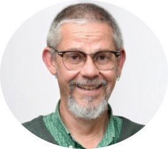
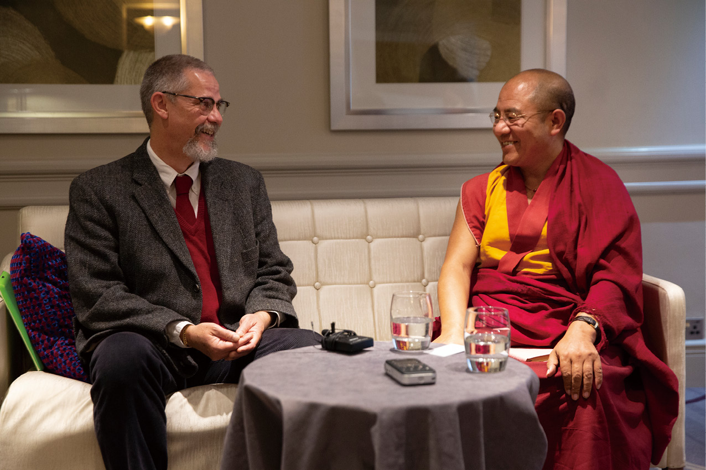
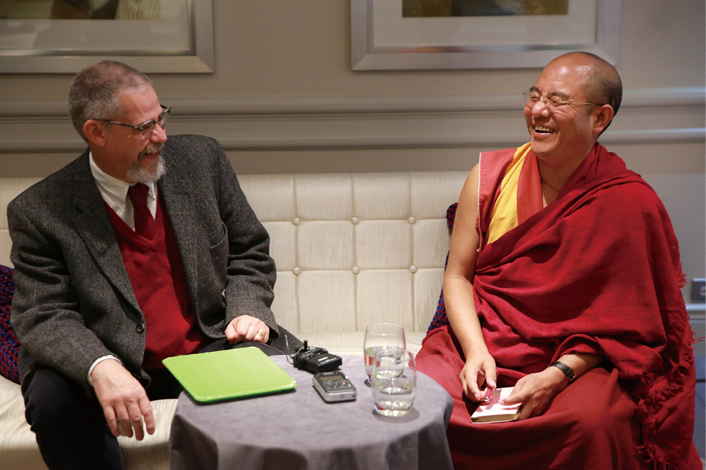

文殊菩萨的智慧宝剑

索达吉堪布 & 威廉·道格拉斯教授

阿伯丁大学

University of Aberdeen

2015/10/25

威廉·道格拉斯（William Tuladhar Douglas）

英国阿伯丁大学神学、历史和哲学学院高级研究员，教授宗教历史和人类学，苏格兰喜马拉雅研究中心主任。2015年被任命为阿伯丁大学孔子学院院长。他在亚洲进行了超过25年的实地考察，在喜马拉雅土著社区中，将佛教的伦理、修行和理论与保护生物文化多样性联系起来进行研究。

1．适合欧洲大学生的修行法门

威廉·道格拉斯教授：

对我来说，在阿伯丁大学里教授佛学非常困难。

大学本应该是学习知识的地方，但是在欧洲，大学却成了年轻学生尽情玩乐的地方。四年时光转瞬即逝，他们很快会失去学习的机会，这让我很担心。

学生们对佛法很有兴趣，也想学习佛法，比如他们会和我一起学习寂天菩萨的《入菩萨行论》。但与此同时，他们仍然在抽烟、喝酒，每周都想尝试新鲜事物。

我在想，或许可以教他们一些简单的念诵，比如观音心咒，又或者送他们一串念珠。诸如此类的方法和物品，能够滋润他们的心灵，真正地帮助到他们。希望您能在这方面给我一些建议，比如我能教的某种简单仪轨、简单的禅修方法，非常感激！

毕竟我所学到的知识，对他们来说可能过于甚深。我没办法用轻松易懂的方式教授他们，所以请您推荐一些简单的修法。

索达吉堪布：

你应该多讲一些大圆满的修法，哈哈。

威廉·道格拉斯教授：

有些学生的行为，确实就像“疯智”的成就者。但他们连成就的基本条件都还没达到。如果他们真能达到“疯智”的境界，我也很高兴。

索达吉堪布：

你们大学里的学生在学《入菩萨行论》，这是一件非常好的事。

我所在的藏地，有些学校也会开设《普贤上师言教》《入菩萨行论》的课程。可能三四年里，学生们没什么特别感觉，但当他们步入社会、走上工作岗位后，在做事情的过程中，会发现他们的人生观与其他人完全不同。

虽然有个别学生不听话，但还是希望他们能好好学习《入菩萨行论》，同时让他们念一些观音心咒、文殊心咒，也许会有帮助。从大的方面来看，传授某个实修法，他们不一定能修成，但念一些咒语，倒是可能会接受。

威廉·道格拉斯教授：

即便如此，有没有一个适合新手入门的观修方法，比如在自己面前观修一位本尊，而不是把自己观想成本尊。您能推荐一个简单有效的观修方法吗？也可以是法王晋美彭措仁波切的某个仪轨。

修行有很多不同次第，譬如事部、行部、瑜伽部、无上瑜伽、阿努瑜伽、阿底瑜伽，这是一整套修行次第。在自己面前观想一位本尊，属于比较初级的禅修方式，这种修法很适合还无法把自己观想成本尊的人。

在苏格兰桑耶林禅修中心，我从大司徒仁波切那里得到过一个非常简单的观音菩萨修法仪轨，有时我会修习那个仪轨。

我很想得到一个宁玛传承的修法，如果能得到的话，就太开心了。如果您有推荐的修法就太好了。比如昨天您传的观音菩萨修法仪轨，显然我们会这样形容：空行加持暖气未消散，因为它是直接从传承上师那里传下来的。如果您认为这个法适合修持，我就去请这个修法的仪轨。但是我不能教学生这样的修法，对他们来说，把自己观想为本尊的修法太深了，而教他们把本尊观在面前也许更适合。

索达吉堪布：

昨天的观音菩萨修法，是可以观修的；法王如意宝还有一个关于文殊菩萨的简单观修方法，等我翻译出来后提供给你。这两个修法比较简单，可以用来修持。

威廉·道格拉斯教授：

如果我的理解没错，法王晋美彭措有一整套文殊菩萨修法，囊括了从四加行一直到阿底瑜伽。十五年前，我就听说过这部法了，但是一直没有机会遇到，我很想求这部法。

小时候，当我还是个学生，就能很清晰地见到文殊菩萨了。我一直都能见到文殊菩萨，总想着该如何面对这个状态，但也一直不知道该做些什么。因此，当我听说法王晋美彭措有一整套文殊菩萨修法时，觉得真是太不可思议了。要是这里面也包括基础引导性的观修法，那实在是太有帮助了。

索达吉堪布：

晋美彭措仁波切的文殊菩萨修法，分为两种；一种是比较简单的仪轨，大学生和世间人都可以念修；还有一种是刚才你讲的，从四加行一直到大圆满最高境界。但是这种修法无法广传给一般人，因为修行者需要经过很严格的加行修持，还要灌顶。

威廉·道格拉斯教授：

我知道您说的第二种修法，这个修法我也只听过一两次，因为我知道它的力量很强大，这是我上师告诉我的。多年以来，我一直想更进一步了解这个法。刚刚也说过，我很小的时候就能清晰见到文殊菩萨，这也是我选择这个职业的一个原因。

索达吉堪布：

关于文殊菩萨的简单修法，您可以提供给学生们，应该是很适合的。

2．教授：我一生修行的感受

威廉·道格拉斯教授：

我一直会提很多问题。如果您有什么问题，我很乐意回答，只要我有能力。

索达吉堪布：

您作为一名大学教授，多年来一直从事教学工作。在这个过程中，您既接受了佛教的灌顶，也在进行禅修。我想知道您对佛学的修习进行了多少年？学佛尤其是修习藏传佛教密法之后，您的生活有什么转变？感受如何？希望您能跟大家分享一下。

威廉·道格拉斯教授：

这个问题提得很好！实话说，我不知道自己到底修行了多少年，可能至少从十二岁开始，甚至更早一点。我出生在美国加利福尼亚州，那里很有佛教氛围，很容易就接触到佛教。我还记得小时候去过日本的寺庙，敲过那里的钟，我非常喜欢那种感觉。

刚读大学时，我在生物学和佛学研究之间做了选择，对于我来说，它们是相通的。但要说起原因，那话就长了。我曾经犹豫，是否先学习梵文，之后再去研究佛经。幸运的是，我去了尼泊尔，与一位上师一起工作。他是仅存的现在还有梵文传承的金刚上师。我在那里学习并接受了一些初级的公开灌顶，比如观音菩萨灌顶等。

直到2001年，我才接受了贝诺法王的正式灌顶。那次灌顶非常神奇、非常好，也特别有加持。首先是因为灌顶所在的地点是尼泊尔的圣地——杨列雪，另外我看到很多非常厉害的堪布和仁波切也都参加了灌顶。在灌顶期间，我生起了净观，在后来的禅修中，我一直努力达到那样的境界，并尝试从净观的角度去看待事物。

修习密法至少从两个方面改变了我，一方面是信心的转变。密宗有一个重要原则：消除二元对立。虽然您没有直接明说，但您是对的，在西方很难兼顾佛法老师和佛教徒这两种身份。这两种身份的组合，会让人很难认同老师所教的内容，他们会有顾虑——老师无法保持客观的态度和距离。因此，我讲课时的言辞会很谨慎。

受了密乘戒之后，意味着我不用再纠结于如何选择，我只能以一种身份出现。这样一来，事情就变得简单了：在大学里教书是我必须要做的。因为密乘戒里说，如果有好学的学生求教，你必须要教他们，所以我就这么做了。

我和目前生活在苏格兰的来自喜马拉雅地区的人们常常一起工作。如果他们对我说：“我们需要你帮忙进行一个仪式。”我就会去找相关仪轨，然后行持。没有必要躲躲闪闪，我必须这样做。这就是在逐步消融二元对立。这是所有密宗修法的基础，我要守护这样的基本誓言，将原本分裂的两个角色更好地融合。

另一方面的转变，是我的一位尼泊尔上师促发的。他非常有智慧。他说：“要想让完整的密宗灌顶在亚洲以外的地区进行，一个大圆满的成就者必须在当地找到坛城，而且必须是真正的坛城，这样才有可能开始教授。”这对于他们的传承很重要。

这也让我对自己所居住的地方有了不同的思考。因此，现在我在很认真地研究地形，试图找出苏格兰的坛城在哪里，并且尝试把苏格兰变成一个不仅仅存在佛教中心，也存在真正意义上的佛教徒的地方。从这种意义来说，若我们要找一个真正能观想坛城的地方，要比想象的困难，花的时间也更长。

除了这两个方面，我又想到一个。如果我既是一个佛教徒，也是一位教授，我就要在这两个角色之间不停转换。我要守护密宗三昧耶戒，要兼具慈悲和无二慧，要认识五毒烦恼，那么当我必须同时扮演两个角色时，我将五毒转为道用也会越来越轻松。不管我在做什么，在教室里上课，在开会，在申请资金，在坐火车旅行……这些时刻，我都可以将五毒转为五甘露。

3．科学和佛教应该有大胆对话

索达吉堪布：

佛教诞生于2500多年前，而现在，是科学发达的21世纪。在您的研究和教学过程中，您有没有发现佛教的理念与现代科学之间存在矛盾，比如佛教的思想已经落后于科学，还是认为佛教与科学之间是相辅相成的？当我们拿佛教与科学进行对比，您有什么样的感想？

威廉·道格拉斯教授：

我刚好写了一篇论文，其主题正好与这个问题相关。这是一个很大的问题，我认为佛教与科学之间没有矛盾，任何一方都不应当畏惧另一方。

我们都知道，《俱舍论》里非常具体地描述了须弥山、四大洲以及外部环绕着铁围山。但现代科学认为这些都不存在。如果我们试图找到与佛经中的描述相应的证据，那注定会失败。

佛教的立足点在于疗愈，为病人开出药方，同时依于实证。佛教本身就是依于各种依据而建立的。如果记住了以上两点，并且获得一位具德上师的帮助，我们就能做到以诚恳的态度面对科学，引导科学了解新事物。

生物学里有一个很好的例子。西方传统思想认为，人类是唯一能够认知事物的动物。而昨天堪布在讲修菩提心时说到，一定要把所有众生当作自己的母亲。也就是说对于佛教徒而言，人类和其他物种没有差别。现在我们可以从动物行为学的研究当中得知，很多动物，例如乌鸦、猴子、章鱼都很聪明，它们都有解决问题的能力，也都有玩耍的意识。因此我们不能再说人类是唯一具有认知能力的动物。就这一点来说，佛教在2500多年前已有正确认知，并把它当作佛教科学里最基本的理念。佛教对于世界的认知是正确的，西方科学需要向其学习。

而另一方面，《俱舍论》没有提到细菌。但是现在我们知道，一个人90%基因的多样性，能从胃里的细菌得到体现，也就是说，大部分基因的多样性存在于细菌当中。这也从生物性上证实了众生的平等性。

另外，生物学也表明我们是社会性的，因此是无我的。佛教在胜义谛分析中承认无我，但只能从心理角度去分析。如果我们有足够的勇气坦诚面对真相，在阅读古老的佛教经典时就会发现，当时的人们不了解植物可以互相交流，也不了解细菌的活动。而如今我们对佛教有了更真切的认识，因为我们不仅可以通过心理学证明“人无我”的概念，还可以用生物学来证明。

每个人的体内有数百万微生物，这些微生物在体内来回不断地运动。我们的母亲将这些传给我们，我们又传给下一代，我们的存在从数量上来说如此庞大。即使从生物学的角度看，我们也从来不是独立存在的。这实在太奇妙了。这就从生物学的角度证明了佛教的一个基本教义。

如同佛学可以对科学进行指导，科学也可以带给佛教启示，双方都不必心存芥蒂。

虽然这个话题有一点敏感，但这种思考方式确实非常重要。比如在处理环境危机的问题上，我认为如果佛教可以引导施政方向，对解决环境问题会颇有帮助。对于佛教徒而言，当我们谈论到经济时，谈论的是关乎所有众生的经济，而不应该只局限于人类的范畴。当我们讨论可持续发展的话题时，也应该包括树木、微生物、鸟类等所有生命的可持续发展。虽然这样讲在某些场合可能会引起争议，但有时候我们也不得不说。

4．关于传承和教派

索达吉堪布：

您觉得藏传佛教的一些修行和理论，对于西方人有什么帮助？藏传佛教跟其他佛教教派如南传佛教、北传佛教相比，有什么不同？您为什么选择修习藏传佛教？

威廉·道格拉斯教授：

我的修行，实际上基于两个传承。既然我们谈到了藏传佛教，就不得不说一下喜马拉雅地区的佛教。这个地区梵文传承的宗派依然存在，属于金刚乘中的一支，而且和宁玛派十分相似。最早我曾跟着他们学习。

我对非大乘的佛教徒并无冒犯之意，但我认为大乘佛教是佛教存在的最合理方式，佛教必须以此作为起点。佛教最基本的利他，在大乘佛教中得以体现。大乘佛教中就包括金刚乘Vajrayana。

梵文经典中说到，根据藏文佛经，Vajrayana是大乘佛教当中特殊的一支，其传承中有特别的修行方法，这些修法的基础就是大乘佛教。Vajrayana在内观禅修方面有特殊的技巧，并仅仅在晚期的印度喜马拉雅佛教中得到了很好的发展。我认为大乘佛教体现了佛教的本怀，无我利他、圆融无二。这也应该是佛教的本来面目。

可能有些人对此会有不同的看法。我身边有很多朋友在学习南传佛教，他们的行为举止与优秀的大乘佛教徒无异，他们也非常关心身边的人，做任何事情也都是为了一切众生。尽管他们说自己不是大乘佛教徒，但并不喜欢听到别人这样说自己。

大乘佛教中的Vajrayana，在梵文传承中已经达到了极致。大圆满的大成就者以及很多传承上师，他们大多数在藏地，也有一小部分在尼泊尔。我认为Vajrayana这个传承拥有最强有力的加持，利他心的最高成就得以实现，慈悲心也体现得最圆满，因此是修行人的明智之选。

要是回到一百年前，人们经常会说这是藏传佛教、那是禅宗；几百年前，你也可以将这些教派分得很清楚；而一千年前，这样的分别根本不存在，尤其是在藏传佛教中。

宁玛派曾受到禅宗的影响，两派在一缘专注的禅修技巧方面都非常有效。现在藏传佛教与禅宗能再次开启对话，我感到非常高兴，这种对话非常有意义。与其他宗派不同，禅宗有其独特的幽默感，理解事物的角度也很特别。有时候要达到超越与证悟，可能只需要一个好的笑话。

5．宁玛大德与科学有关的著作

威廉·道格拉斯教授：

现在我的工作主要是试图找到瑜伽行中观的边界，做一些整合。比如阅读寂天论师、莲花戒论师所著的典籍。许多著名论师以及往昔印度大德们，他们同时也是哲学家，他们留下的文字综合了各派的重要内容，奠定了大乘佛教思想的基础。我正在读这些典籍，并且在寻找一些有用的内容和工具，希望与现代科学理论和生态理论相结合。

麦彭仁波切也有一些优秀的论典，但我不知道具体有哪些。您能否推荐一些我没有看过的梵文论典或是龙钦巴尊者、麦彭仁波切等大德的论典，帮助我继续研究佛教与科学这个课题，特别是在佛教和生态学的融合方面？

我不想只做那些该做的事情，而是希望从两个学科的角度严肃地进行对话。如果您能推荐一些论典，我将不胜感激。

索达吉堪布：

麦彭仁波切在医学方面的著作比较多，天文学方面也有一些，比如《时轮金刚大疏》，这是很大的一部著作。他还有一些涉及传统心理学、历算以及管理学的著作。比如《君规教言论》，内容涉及国王应该如何执政，如何治理国家，如何在民间保持信仰、鼓励高尚行为等，还涉及如何赚钱。

龙钦巴尊者的法，大部分与最高心性有关，比如《七宝藏》《四心滴》，讲的都是比较深奥的内容，少部分是关于历史和逻辑学的著作。此外在宇宙学方面，龙钦巴尊者也有一些不共的观点。他的《如意宝藏论》是一部比较全面诠释佛教的论典，包括宇宙观介绍得比较多。

我现在也在传授麦彭仁波切的《二规教言论》，它将世间法和佛教相结合，内容包括如何管理人；也涉及经济学，比如如何赚钱，但它是从内在去讲的；更重要的是，它涉及环保、心灵信仰等方面的问题。作为管理者，特别有必要学习这部论著中的一些精神。

6．在阿伯丁禅修

威廉·道格拉斯教授：

我还想问两个截然不同的问题。第一个问题问出家人可能不太合适。我在阿伯丁的工作不只是和学生打交道，还要跟很多家庭联系，也包括我自己的家庭。如果我能抽出时间或者能够说服他们一个月共修两次，对他们会很有帮助。这种情况下，您认为哪个修法是首选呢？

索达吉堪布：

最好先从寂止开始修。如果是有一些佛学基础的人，很有必要在面前观想观音菩萨或者释迦牟尼佛，并念诵相关的一些咒语。有时睁眼看看佛像，有时打坐观修，经常这样修行串习，心会得到平静。这很重要。

威廉·道格拉斯教授：

实际上我曾花了很长时间练习禅修，我应该可以教授他们基础的禅修。可能需要花一点功夫，但如果教他们端坐和专注的话，也不算难。

另一个问题是：阿伯丁这个地方很特别，我们都很喜欢这个地方，也希望您能亲自过来感受一下。这里的夏天白天很长，早上四点就可以禅修，面对天空开始冥想。但是当白天越来越短，不管我喜不喜欢，都只能在天黑的时候禅修。我不了解闭黑关的方法，在这方面，您能否传授一些简单的直指法？

索达吉堪布：

除了大圆满的一些特殊修法，比如看虚空，需要在白天进行，我们平时的一些显宗和密宗的修法都不一定非要在白天修。晚上也好，平时生活中也好，都可以观修。

我自己是这样的：作为修行人，一个是随时都要念咒语，经常用正念进行观修；第二个，经常对自己的本尊和上师祈祷；第三，只要有时间、有机缘，就打坐。打坐的环境，我觉得白天晚上没有什么差别，只要有时间就行。

这样修行成熟的时候，行住坐卧都可以进行。所以作为一个比较成熟的修行人，不管在东方还是西方，白天还是晚上，在人群中还是独自一人，不用区分环境，他都能很随意地修行。这是修行当中最重要的。

密法中有闭黑关的一些修法。比如我们宁玛巴的白玉派中就有一些直指的修法，但这是一种特殊的观修方法，现在不是特别时兴。

威廉·道格拉斯教授：

您又开始挥舞文殊智慧宝剑了！

我每天都在非常努力地护持密乘戒。堪布，我向您保证，下次无论我们在阿伯丁还是在喇荣见面，我都会不断练习我的藏语。

索达吉堪布：

我也维护我的英语。（堪布笑）

威廉·道格拉斯教授：

如果能去喇荣就太棒了，我不知道有没有机会去，听上去那是一片真正的净土。我们正在努力让阿伯丁成为净土。

索达吉堪布：

您会讲藏语吗？

威廉·道格拉斯教授：

只会一点点。以前读博士的时候，我会一些藏语，因为必须阅读很多藏文书籍。那段时间，我阅读和研究了很多麦彭仁波切、龙钦巴尊者的书。但自从我负责阿伯丁的项目之后，就没有时间去研究梵文、藏文和尼瓦尔语了。我想给自己一个承诺，今年重新开始学习藏文，当然还有普通话也要学。

7．传承的耳环

索达吉堪布：

你的耳环很好看。

威廉·道格拉斯教授：

您也想有个耳环吗？我告诉我的孩子们，如果他们是很好的佛教徒，并且好好修持密宗，我也会给他们一个这样的耳环。这是我们同属一个传承的标志。按照传承要求，我本应留一头长发，但考虑到我的职业——那样可能就无法在大学里工作了。因此我需要一些其他的标志，这个耳环就是一个标志。

索达吉堪布：

很好。象征三宝，有三个耳洞。

威廉·道格拉斯教授：

也许下一世我会成为一个出家人，也许我的孩子会成为出家人。有一个孩子有这方面的潜质，不过我也不想催他。

索达吉堪布：

对，不能催。慢慢来吧，先以学习为主。

威廉·道格拉斯教授：

现在这个社会，如果你强迫别人，他们就会反抗，你会失去一切。

我妻子那个圈子有个传统，给孩子取名的时候有一种仪式。取名时，为孩子们准备一个装满物品的盘子，孩子选中的东西代表他将来的职业。我的两个孩子选了里面最大的书，另一个孩子选了念珠。这也许意味着家里将来有两个学者和一个和尚。我们老了以后可能要挨饿了。
