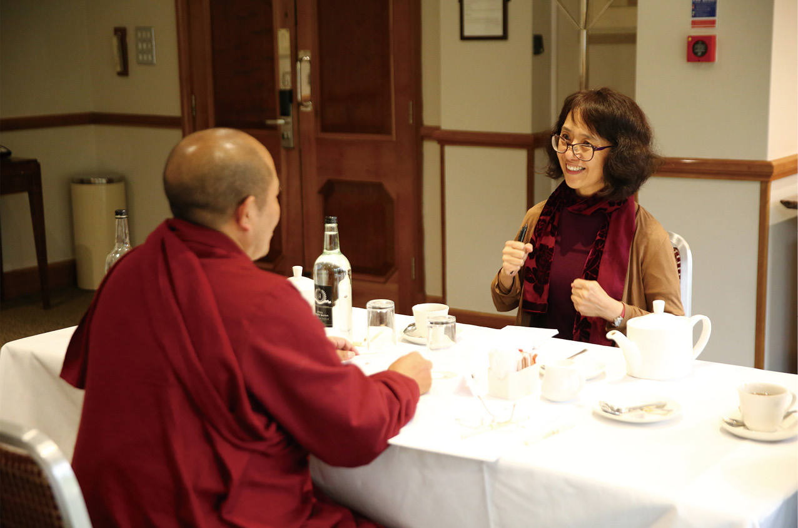
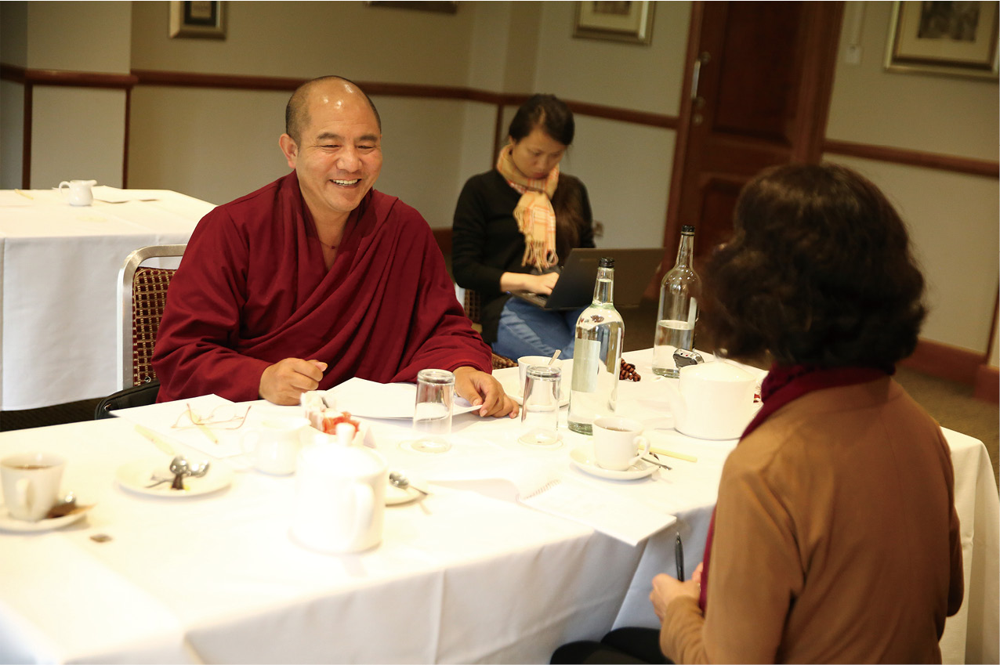
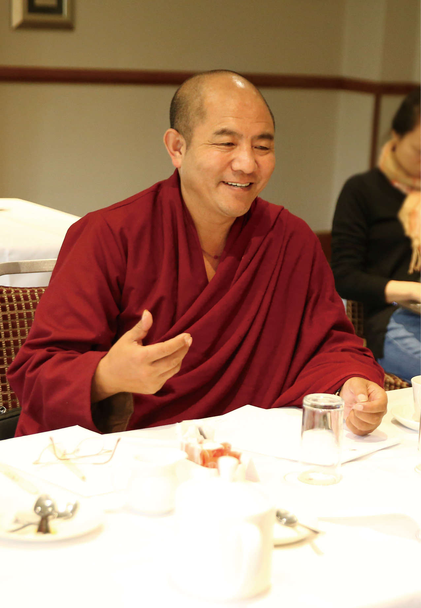
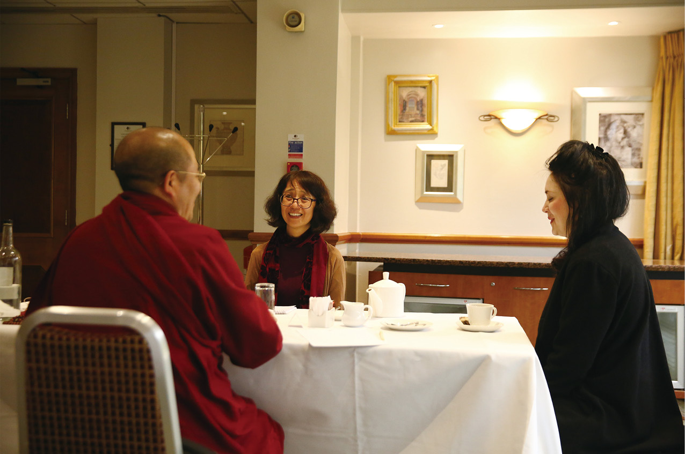
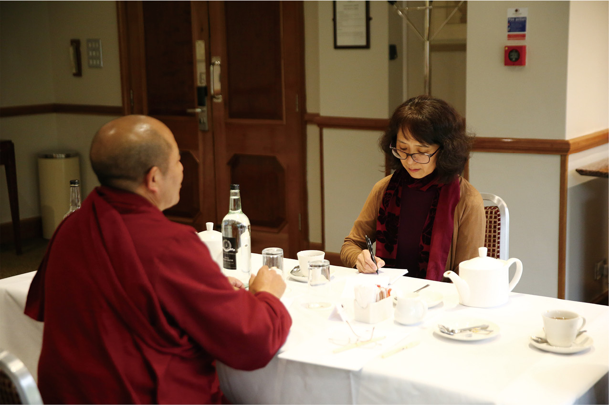

在浮躁的世界里安静地活

索达吉堪布 & 张卫教授

英国剑桥大学

University of Cambridge, UK

2015/10/18

1．自利利他的藏传佛教

张卫教授：

能不能请您介绍一下藏传佛教，好让我们有一个大概的了解。

索达吉堪布：

我认为藏传佛教是纯正的佛教。佛教最初通过巴利语传到斯里兰卡、泰国、缅甸等国家，成为南传佛教；通过汉语传到中国、日本等国家，成为北传佛教（又称汉传佛教）；通过藏语传到藏地雪域，成为藏传佛教。后来，藏传佛教的传承在全世界范围内都非常兴盛，如美国、欧洲各国，还有中国的汉地。

与其他佛教宗派相比，藏传佛教主要在以下几个方面有所不同：

首先是，它在一开始就融入了藏族文化。

其次是，它完整涵摄了三大传承的教义，既有南传佛教、汉传佛教的教义，也有藏传佛教自身的教义。

还有一点不同就是，藏传佛教会通过各种方式，如研讨、辩论等，来遣除人们内心的怀疑和疑问。这是藏传佛教不共的特点。就像现在一些大学里的研讨课程一样，对于自己不理解、想不通的地方，可以直接提出来，面对面地进行辩论和探讨。

第四是将理论和实修相结合。不能光讲理论，所学的每一个理论都要对应到实修上，从自身修持上来得以体现。

第五，藏传佛教特别强调利他，将佛学教义融入自身修持，自利利他。在一些其他传承中，可能会要求出家人在寂静的山里修行，但在藏传佛教中，学修到一定程度，要将所学为普罗大众、为社会服务。一定要去社会中，帮助他人、利益众生。

张卫教授：

您这么一说我想起来了，去西藏的时候，在一个寺庙里看到很多僧人在一起辩论，辩论得很激烈，说话很大声，脸也都是红红的。

索达吉堪布：

类似这样的辩论，也有助于改进人际关系。比如在与他人相处时，别人稍微说了一些难听的话，一般人就会觉得受不了。但藏传佛教里受过正规辩论训练的人，脾气都比较好，也不容易生气。

因为当年在辩论中，双方都会用最刺耳的语言来驳斥对方的观点，同时也要想办法用心里最深藏的智慧来加以应对。他们听过很多很尖锐的言辞，心理上经受过考验。这样来看，辩论对个人修养的提升很有帮助，也能增进人际关系的和谐。

张卫教授：

当时在西藏，看到僧人们穿着不同颜色的衣服，是不是标志着他们在学问上的不同等级？有些岁数大的僧人，穿的衣服还是比较低级的颜色；有些年轻的僧人，穿的衣服的颜色还是更资深一些的。是否可以说，不管你进入佛门时间的长短，关键还是看你个人修行的进阶程度。就像我们在大学里学习，学得好，可以提前毕业；学不好，就总在原地踏步。藏传佛教里是不是也有一个类似于学院教育的教学体系？

索达吉堪布：

对。其实藏传佛教的教学框架，与大学里的教学体系比较相似。可以说，藏传佛教的培养模式里最系统的学修框架，完全可以跟高等学府里的教学模式媲美。

2．抉择空性是最好的修行

张卫教授：

我问下一个问题。

现在的外部世界非常热衷于追求物质，很多媒体宣传也加剧了这种趋势。比如宣传富豪的排行榜，宣传那些有钱人，如歌星、影星，他们如何生活。这些都加剧了普通民众对物质的追逐与渴求。

在被外界各种声音刺激和干扰的情况下，我们应该如何修炼内心、提升自己，从而不受外界影响，明确自己生活的真正目的。想请您在这方面给予指导。

索达吉堪布：

就像您说的那样，现在的社会非常浮躁，特别重视外在的物质世界。

我在高校里遇到的教授和专家，他们的很多研究都与外部世界有关，或者是与物质财富有关。与内心世界和内在的心理方面的研究相比，大家更重视对外在世界的研究。

在目前的情况下，东西方的价值观都在不断地变化。在变化的同时，我认为，一个人的内心是独立的世界，外在也是一个独立的世界。作为人，我们需要精神的养料，但人们都只一味地追求外在物质，导致了精神与物质处于一种不平衡的状态。其实物质再怎么富裕，也满足不了精神方面的需求。

我并不是因为自己是佛教徒，就向你们鼓吹佛教。佛教里的一些禅修方法，还有一些经典里，比如《般若经》里所讲的中观空性的道理，有助于人们认识真相。中观里会讲到，不管是外世界还是内世界，都可以通过分析抉择为空性。如果真正地明白了这个道理，就会知道现在的所作所为在究竟意义上都是空性的。这就是万法的真相或者实相。

张卫教授：

《心经》里所讲的内容和您说的这个是不是类似的？

索达吉堪布：

对。我们可以说“心净国土净”。

《心经》里也讲到，色声香味触也好，眼耳鼻舌身也好，通过抉择的确可以了知它们的真相。作为一个知识分子，我觉得抉择空性是很重要的。通过了知这个道理，或者对自己的心产生一种认识的时候，向外求的念头会减少。

当然，我们活在世俗中，该争取的还是要争取，该努力的也要努力，对生活、工作的热情也不能减少。佛教强调的是，不能有过多的贪婪和追求。否则的话，短暂的人生当中，每天都是追追追，一直追到死的那一天。

张卫教授：

我觉得您说得太对了。现在我就有这种感觉，很多人包括自己已经形成了一种惯性，每天重复地生活和工作。不去思考我做的事情究竟对社会有多少贡献。我需要做这件事，只是因为这是我的工作。早晨起来过去上班，晚上回家过生活，一天天就这样重复地过去了。

很少能够静下来想一想，如果换一种生活会是什么样。或者，我是不是在用最大的潜力为社会做贡献，我的一生是不是有意义。

您刚刚说得非常重要。能够静下心来想一想，很有必要。有时候看自己就像地上的蚂蚁一样，忙忙碌碌，搬一些食物到洞里过冬，吃完了又跑出来找食物。作为人，还应该有更高的追求。

索达吉堪布：

是的，确实如此。

3．人类的未来取决于物质与精神的平衡

张卫教授：

我还有一个问题。

如今科学的发展非常迅速。记得我刚来剑桥的时候，为了往家里打一个电话，要花很多精力和费用。现在我只要把手机拿出来，就可以跟家人通上话。世界的距离变得很近，这是科学发展给我们带来的好处。但是同时我发现，科学发展也给我们带来很多麻烦。

我在想，作为一个科学家，为社会发展、科学发展所做的这些事，到底是好事还是坏事。比如通信科技的发展，刚才说的是好处，但是同时也给每个人增加了很多干扰。现在不再有人写信了，只要发电子邮件就可以。每个人都在不停地看手机，看有什么新消息，大家的注意力都放在电子社交上，要不停地回复朋友的信息。

我们的生命是有限的。有了微信之后，我每天早晨要花一个小时来处理国内发给我的各种信息，晚上回家第一件事就是赶紧去看微信，再回复。想一想每天我都要花两个小时在微信上，一生有多少时间就这么被消耗掉了。

我可以用这两个小时的时间，坐下来好好地想一想，哪怕去打打坐、静静心，对我自己，对我的身体、眼睛都更有好处。

现代科技给我们带来了诸多方便，但同时也给自然造成了很多伤害。我们的地都被挖得很空，油都开采完了。人人都开着车，资源都没有了，随之而来的环境污染，也带来了各种问题，比如食品安全问题，各地的雾霾问题，都为人们带来健康的隐患。

这些好的坏的，目前可能也是在一种失衡状态中。我个人认为，带来的坏处比好处更多。因为我们不能只顾当下，只活好自己的一辈子、这一代，我们还有我们的子孙万代。我们把资源都用完了，未来的子孙万代他们用什么呢？从这个角度上来说，我认为科学的发展带来了更多的忧，忧多于喜。

想听听堪布您的想法。

索达吉堪布：

我觉得张教授对当下的体悟蛮深的，我也有同感。

1993年，我来过欧美国家，那个时候如果需要和家里或者学院里的人联系的话，就完全没有办法，可能在五六个月的时间里，双方都联系不上。

现在就很方便，但方便的同时，我们每个人又增加了心灵的负担和时间的浪费。很多即时通信工具里的信息，回复也不好，不回复也不好。回复的话，浪费时间；没有回复的话，变成一种习惯，即时工具也不即时了。

和以前相比，现在琐碎的事情越来越多，而且又琐碎又无聊，对心灵的成长没有任何帮助。这已经形成了一种大的趋势，碎片信息的波涛已经吞没了全世界。

这样看来，现代科技给我们带来的危害确实是超过利益，我很赞同您的看法。这一点，科学家们自身也有所觉察。当年爱因斯坦的发现为核武器的研发奠定了理论基础，后来原子弹在第二次世界大战中被运用，造成了严重后果。这成了爱因斯坦一辈子最后悔的事情。

现代科技造成的各种危害和隐患，有自然环境方面的，也有食品安全方面的，但对我们影响最大的是对人们内心世界的冲击和伤害。

前两天在剑桥的演讲，本来想讲一个学术性比较强的话题，但后来我觉得学术性的话题和大部分人没什么关联。眼下人们的内心非常空虚，得抑郁症的人越来越多。这也是物质和精神不平衡的一种体现。在过去短短的时间当中，物质发展得太快了，精神方面没跟上，人们一下子孤独起来，人与人之间变得十分冷漠。

现在人们所关注和热衷的，都是一阵一阵的潮流，比如大家现在都在用微信。过一段时间，觉得不稀奇了，可能很多人就不用了。知识和技术的更替也是这样，有些知识技能，过一段时间就用不上了。当然手机和微信现在还很热，经常两个人相约一起去吃饭，在同一张桌子上，互相也不交谈，都在忙着看手机、发信息。这样的场景变得很普遍，本质上来看也没有什么意义。人与人之间的交往，人们对知识的吸收，都碎片化了。

对于商家和广告公司来说，他们就是要最大限度地吸引人们的眼球乃至内心，用各种各样的手段和花招来诱惑人们，尤其是年轻人。

古代的人，以前的知识分子学习文化知识，要看很多书，做系统、深入的研究。现在你拿起手机，开始上网，所有的时间都被侵占了。真的是特别可怕，我们的生命和时间，全部被无意义地消耗和浪费了。

张卫教授：

而且科技在不断更新，手机也在不断地更新换代，现在又推出了最新的iPhone 6。有一些软件也随之更新，要求的最低配置就是iPhone 6。我的iPhone 4已经无法使用很多App了，这就逼着你不停地追赶最新、更新。一旦推出了新机型、新功能，所有人都要跟着去学、去用。人们在这样的大趋势下，不停地追啊赶啊，也没有时间停下来，四处看一看，静心想一想。

索达吉堪布：

在我们的寺院里，有一些修行人，他们根本没有手机，也从来不上网，整天就是看书。看到他们这样清净的生活，我还是很羡慕的。虽然与外界相比，他们的物质比较贫乏，但内心很充实，充满阳光。这样的生活其实是有品质的。

现在一般人的生活状态是这样的：一方面，获取各种资讯都非常便利，仿佛全世界都在自己的手里，都被自己所掌握，想看什么书都能立刻看到；另一方面，当你正在看一本书的时候，会被各种事务和信息所干扰，比如突然就来了一个信息，不得不去回复。

外国学者：

现在有学者在对这些方面进行研究。现有的这些新的科技手段，可以让我们同时和很多人保持联系。而在此之前，我们保持联系的社交范围是比较小的，仅限于家人、同事，一些朋友，还有生活中要打交道的少数人。相应地，我们日常要处理的信息比较少，大脑所承受的压力也比较小。但是现在的情况是不管遇到什么人，都加了微信，心理上多少都会造成压力：必须回复信息，必须答复他，不然就很不礼貌……

实际上，大部分人都承受不了那么多的人际关系。正常的朋友交往，十几个、二十个、三十来个都还可以，但如果手机或者微信里的联系人突然增加到几百人乃至上千人，会造成内心的很大压力，人会变得特别浮躁。

张卫教授：

是的，除了微信，还有推特、脸书，每一个社交媒体都要关注，都要更新、回应，没完没了。时间也被切割得很碎片。

外国学者：

这一切改变来得太快了。在短短的十年中，这些社交媒体都出现了。但我们处理人际关系的方式是很多年慢慢积累出来的，其实已经跟不上外部环境的改变。

索达吉堪布：

确实如此。原本一个人的精力可以集中在一本书、一件事上，但现在他的时间和精力被分散到很多地方。这也是为什么古代的人撰写的著作往往很严谨，研究成果也很突出。和前人相比，现在剑桥大学里的老师们，还有很多科学家，各种散乱的因素都变多了。

张卫教授：

这种情况和现代技术也有关系。你会接收到更多的信息，你可以在网上阅读新发表的文章，你也可以通过网络来发表自己的文章，整个过程都缩短了，变得很快。每一件事情都要快快快，这样使劲地往前赶……

索达吉堪布：

人生仿佛一场赛跑。

张卫教授：

对，你就像被推着往前走，不可能有机会停下来。如果你想感性一点，读点书，做一些思考，对不起，你的精力根本顾不过来，太多事情需要你去照顾了。归根结底，还是科技发展得太快了。我不知道这是不是自己的偏见。

索达吉堪布：

不是偏见，这是事实。

张卫教授：

在这种环境下，能够把自己抽离出来是很重要的。

索达吉堪布：

对，有一部分时间让自己的心宁静下来，这是很重要的。

张卫教授：

由于科学的发展，对物质的追求，人们的物质和精神呈现出一种不平衡的状态，造成了世界上的种种弊病。我们未来的前景究竟会怎样，怎样才能够让人类向更好、更光明的方向发展？想听听您的见解。

索达吉堪布：

科学不断发展、不断更新，在某种意义上，全世界的人类都在面对着物质世界的巨大变化——完全不同于以往的一些变化。

来到欧洲，除了日常使用的电脑和手机之外，外在世界的变化并不大，让我很赞叹的是，大部分建筑还是三四百年前或者一百多年前的。而在其他地方，很多古老的建筑都被破坏了。我们去了欧洲的很多城市，都看不到正在修建的现象，以此来类推，内在的文化，可能保留得也很不错。

未来会怎样，科学发展给我们带来更多的是弊病还是光明呢？非常难说。我认为，人类还是需要在内心好好地掌握宗教的精神。除了极个别宗教的极端思想，各大宗教的教义都是让人内心趋向真善美。

我注意到，英国一些媒体的报道也在说，如今在英国，没有宗教信仰的人越来越多了。如果人们既没有信仰，也没有精神层面的追求，只是单纯依靠外在的物质来满足自己，很难获得快乐。也许未来的世界在物质方面的成就很辉煌，但人们的内心不一定很快乐。

近十年来，科学越来越发达，交通、通信等各方面都越来越便利，但东西方国家乃至全世界人民的幸福指数反倒越来越低了，内心的安乐和满足越来越少。如果我们不重视传统文化，不重视精神世界和内心的自我调节，很可能在物质文明空前发展的同时，会有越来越多的人陷入精神崩溃。这对整个人类社会来说，显然并不是理想的发展方向。

所谓的发展，物质和精神两者都要兼顾。如果这两者不平衡，或者只有其中的一个，那显然无法真正地获得幸福，人类未来是否光明也是一个未知数。

这几年，涌现出了很多新的通信工具和社交媒体软件，一个接一个，出现的速度特别快，一个比一个快。现在发一封邮件，连一秒钟都不需要。如果我要给你发一个文件还是别的什么，刚发完，那边就收到了，太快了。有时候觉得科学技术真的是太厉害了。但同时也要想一下，我们真正需要的是什么呢？生活的意义是什么呢？不然的话，只会越来越迷茫。

张卫教授：

所以如果人有一个精神上的追求，还是非常不一样的。

索达吉堪布：

对，是这样。

4．从生物学角度认识心识

索达吉堪布：

张教授的研究方向是生物学吧？

张卫教授：

生物化学。

索达吉堪布：

从你们学科专业的角度来看，植物的生命与动物的生命，有什么本质上的差别？我们佛教里讲植物和动物的生命，有很大的差别。比如动物有五蕴，那么我们杀一个动物，会有很大的过失，但对植物就没有这样的过失。

张卫教授：

生物从最根本上来区分，分为真核生物和原核生物。原核生物没有细胞核，比如细菌，低级的病毒等，它们的细胞是没有核的。到酵母、植物这个等级，细胞都是带核的，都是高级生物。

最近也有基因组序列分析的大工程，分析下来发现，动植物的基因水平是非常相似的。很多有功能的蛋白质存在于人、动物和酵母中，同时也存在于植物的细胞里。动植物细胞的一些基本功能元素都是一样的。但是从感觉的层级上来说，我就不太清楚了，不知道植物是不是和动物一样，有一种“感受”。我个人觉得是有的，只是我们了解得还不够。

做动物研究的研究人员，会用植物作为样本来收取信息，因为它们的细胞功能都是一样的，但是植物收集起来更容易，比用动物做样本更方便。我们的研究手段就是使用植物的细胞、果蝇的细胞。还会使用一种透明的小鱼、地下的线虫等，因为类似这样的最低等的动物繁殖得很快。以这些小的动物、植物来作为样本，进行研究，如果发现了一些功能，再上升到小鼠等动物身上，然后流转到人的身上汲取材料。从研究角度来看，动植物和人之间可以互通。

索达吉堪布：

据我所了解，心理学和其他一些学科提到心识的存在。从心识层面来看，植物和人、动物不太一样。但是从科学角度来看，对内在心识的研究并不多。比如物理学，侧重于研究外在的微尘。

个人认为，关于心识的延续和植入方面的研究应该属于生物学的范畴。因为生物学可以整体性地对动物和人的基因、身心进行研究。生物学可能比心理学更适合研究心识的本体。我看过很多西方心理学的论著和理论，都是在心识已经存在的基础上，研究其状态、情绪等，再细化到正面情绪、负面情绪，等等。而我更关注的是动物和人的心识，它们的出现和存在，是取决于哪些因缘。

不知道生物学里有没有这样的研究领域。美国有个别的科学家对这方面很感兴趣。欧洲的生物学研究里，有没有对心识的出现、植入和延续进行研究的？比如人死了以后，意识的存续，从生物学角度是如何解释的？只是断灭吗，有什么理由来佐证心识断灭了？

张卫教授：

应该有的。欧洲和西方的很多研究都要依靠具体的数据来做验证，类似于您提到的这些问题，可能现有的科学仪器不能够提供一个可靠或者有共识的结果。心识方面的研究是有的，但还没有形成一个公认的结果。

我从事的研究方向是偏微观的。您说的这个更宏观一些，所以这方面我也不是很清楚。我个人对您说的这方面研究很感兴趣，之前也有一个心识方面的研究项目，如果能有所发现，再和您交流。

索达吉堪布：

好的，非常好。

张卫教授：

今天能和您面对面地聊天，像朋友一样，感觉特别荣幸。我出国这么多年，没法照顾和帮助家人，一直以来都特别愧疚。所以今天有这么好的机会，我把家人的照片带来了，希望上师能够给予加持，愿他们平安健康。

索达吉堪布：

可以。

张卫教授：

有几张家人的照片，这一家人是我先生的亲戚，这是我的公公，他们在武汉。这一家人是我的亲戚，在北京。我希望借今天的机会，每个人都能得到您的祝福。

索达吉堪布：

你在剑桥多少年了？

张卫教授：

我是1992年过来的，二十多年了。

索达吉堪布：

以前读的是清华大学？

张卫教授：

我先生以前读的清华。我是协和医科大学，也在北京。

我们是在北京相识、结婚，然后有了女儿。女儿一岁半的时候，我过来读学位，先生在家照顾女儿。两年后他也过来读博士，我父母在北京照顾女儿。之后又过了一两年，1996年，女儿也过来了。因为五岁在这里就可以上小学了，我们就把她接过来，一家团圆了。就这样一起过了这么多年。

索达吉堪布：

很好。您的一些见解，我也很有同感。

张卫教授：

个人而言，一是希望能对社会有所贡献；另一个是希望能有自我提升，不受外界各种干扰，生活得幸福快乐。就像您说的，能够找到内心的平静。

索达吉堪布：

是的。

张卫教授：

能够做到这两点，我就很满足了。

而且您已经为我们做出了榜样：花这么多时间，每天在世界各地为大家宣讲非常有价值的思想。您星期五做的报告，我就受到了很大的启发，感到非常受益。

索达吉堪布：

当天早上我想了一下，不管东方人还是西方人，大家现在普遍关注的点还是相同的。当下人类所面临的各种问题和困境，我们其实也没法做什么实质性的事情，只能说，有些道理是明白的，可以分享。

有些事态的发展就像波涛一样，已经汹涌澎湃了，这个时候发现，虽然未来的形势比较严峻，但真正落到实操层面，是心有余而力不足了。

张卫教授：

未来有机会的话，希望能帮助更多的人。让大家在忙于物质追求的同时，也能够在精神生活方面有所提高。当然，还是先努力自我提高，再去帮助别人。

索达吉堪布：

能这样想、这样做，是很了不起的。

张卫教授：

谢谢您，占用了您太多时间，应该给其他的朋友留点机会。非常非常感谢。

索达吉堪布：

很好，特别好。（堪布笑）

张卫教授：

希望有机会再跟您见面。
