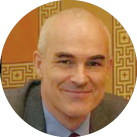
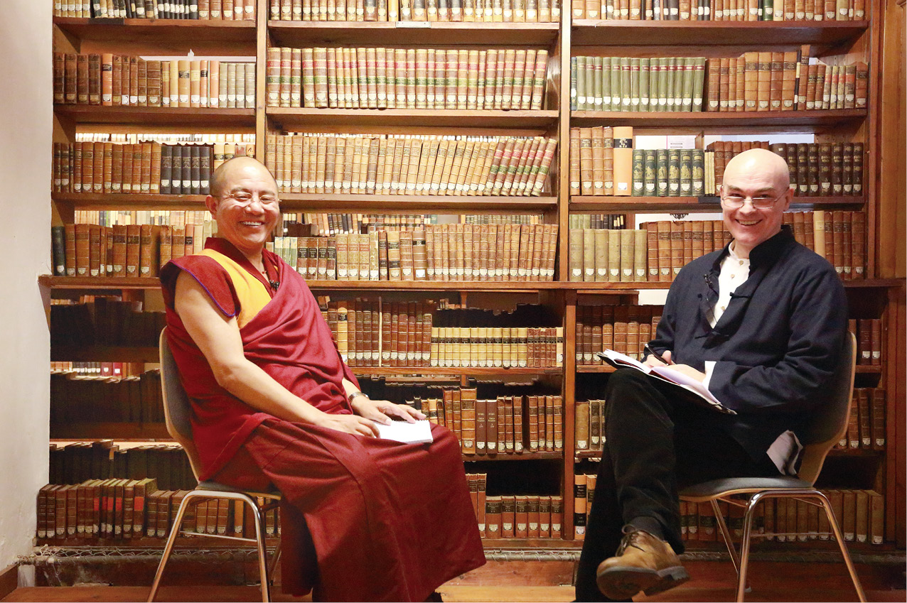
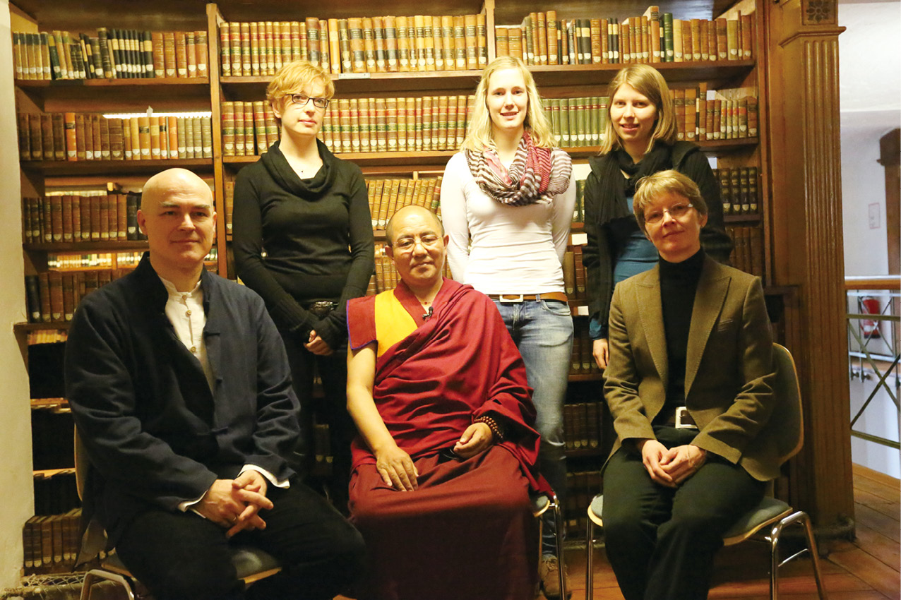

叩问我们的时代

索达吉堪布 & 施耐德教授

哥廷根大学

University of Gottingen

2013/04/12

施耐德（Dr. Axel Schneider）

汉学家，哥廷根大学中国历史与政治研究中心主任，现代东亚研究中心主任。专攻中国现代史，尤其是思想史和科学史。曾在哈佛大学、台湾政治大学和北京大学长期进行研究。于海德堡大学中国研究所工作10年，创建了莱顿大学的现代中国研究中心。

1．宗教复兴，因为我们富有却空虚

施耐德教授：

堪布您好，欢迎您到哥廷根大学来。有机会和您探讨宗教学界、汉学界以及人类学界都非常感兴趣的话题，我们感到非常荣幸。

我们昨天已经谈了宗教与现代性的关系，令欧洲学界十分惊讶的是华人世界最近的现象：过去二十年现代化快速的发展，同时宗教似乎回来了，有复兴的迹象。对于这种现象，有很多人不理解。您能不能给我们介绍一下出现这个现象的背景，为什么会这样？

索达吉堪布：

宗教复兴这个现象，无论在西方还是东方，目前来看趋势都是比较显著的。以前人们认为只要科技发达、物质富足就可以满足内心需求，但到了20世纪发现并非如此。仅仅依靠科技与物质的发展，并不能解决内心存在的种种问题。

据我观察，在中国大陆、台湾等地出现的佛教复兴、兴盛的趋势，主要是因为过去一段时间里，很多人信仰宗教的因缘不具足，现在各方面逐渐开放，由外而内，内心的束缚也渐渐放开。物质丰盛的同时，人们的心灵是空虚的，这种空虚需要一种心灵的粮食。而这种粮食，刚好可以从宗教——尤其是藏传佛教为主的佛教中找到。

我认为这是一种特殊的因缘聚合，再加上佛教的理论经得起当今科学的观察和推敲，如此就有很多年轻人和知识分子对佛教产生了极大的兴趣。我相信这个趋势是不会轻易衰退的。

2．科技时代的人们：信仰基于理智

施耐德教授：

您的观察和思考让我想到了其他问题。科学发展带来的物质富足的舒适生活，好像缺少了一种灵性的基础，缺少一种信仰。宗教的复兴很大程度是为了弥补这个缺陷，满足内心需求，让人生具备更深层次的意义。

其中的问题是，物质发展所带来的生活方式和相应的世界观、人生价值观，与宗教信仰本身是互相矛盾的。因为科学发展的前提是把所有人之外的存在都对象化，即全球资源都是人类可以操纵、可以随意改变的，结果就是现在的地球生态和一百年前完全不同了。

这种世界观的基本假设前提，就是除人之外没有其他，我们所面对的外在世界并不存在一个超越的宗教性力量。在这个世界观的前提下，科学才那么发达，物质生活才那么进步。您所说的宗教复兴能弥补物质发展带来的内心空虚，刚好与这个世界观是矛盾的。

我们无法理解正发生在中国的宗教复兴。佛教的理念有不少地方是与当代科学、现代生活有所矛盾冲突的，当然也有一些可以共存之处。您觉得中国现代化发展带来的经济模式、生活态度与宗教复兴之间，是不是有矛盾呢？

索达吉堪布：

我是这样思考的：如果我们的宗教信仰只是停留在信心的层面，那么跟物质主义为核心的意识形态之间存在一定的矛盾。因为此时的信仰只是内心一种主观的意识形态，是感性的。这两种意识形态之间必定是会有矛盾。

但是宗教不仅需要感性的信心，同时也需要理性的智慧。物质世界的发展需要智慧的指引，同时，人们在享用物质生活时，也需要用智慧加以抉择。

一般而言，宗教信仰与社会外在的物质发展之间会存在矛盾。如果对宗教的信仰还停留在一种迷信的心态，或者虽然不是真正的迷信但没有智慧摄持的一种心态，那就会和客观理性的物质发展产生矛盾冲突。

如果人们真正认知到佛教中包含的智慧，如平等观、慈悲观等的价值，那么世界上的物质越进步，就越需要这样的智慧观念。

我认为，现在中国的佛教复兴，实际上是人们找到了心灵的归宿。其中可能也存在盲目的追求，但本质上是一种智慧的抉择。这并不会对物质发展有所阻碍，或有所冲突。

3．没有信仰约束，欲望会让人类自掘坟墓

施耐德教授：

目前，物质发展带来的破坏很大。我们都希望过得很舒适，什么都想要，车子、房子、各种现代化设备……这些不是从天上掉下来的，都是我们剥削地球的自然资源得来的。

现代科技发展不但对大自然的破坏非常大，对人本身也造成了巨大的破坏。比如说，现在的经济发展方式都是以企业赚取利润为标准。企业为了赚钱、为了发展，只能一味对员工施压，造成负面影响。这种经济模式带来的物质发展，要付出的代价很高。

现代生活已经完全改变人们的目标和生活态度。我们是不是必须要靠一种灵性的力量、宗教的力量，让大家用一种谦虚的心态，过一种简单健康的生活？除此之外，对大自然的破坏与污染越来越严重，环境保护问题也越来越突显。

我觉得宗教与物质发展之间还是存在一定程度的张力和矛盾，您觉得呢？

索达吉堪布：

这种矛盾在每个时代都存在。所以，藏传佛教一直提倡秉持中道，也就是说，一个人既不要过于富裕，也不要太贫穷了。佛教知足少欲的理念，提倡人们的衣食住行能满足基本生存即可。

这样的理念与当下物质发展诉求显然是矛盾的。现在除了环境破坏之外，贫富差距进一步拉大，少数人占有了大部分财富。也就是说，世界上20%的人掌握了80%的财富。

拿美国来说，仅仅占全球6%的人口，却拥有了35%的世界财富。如果全球人类都按照美国的标准，过比较奢侈的生活，那需要五个以上的地球才能满足。甘地也曾说过：“地球只能满足人们的需求，不能满足人们的欲望。”这个道理和佛教所提倡的理念完全一样。

如果我们没有一种宗教信仰来控制自己的欲望，一味地狂热追求物质发展与进步，那么对自己、对他人、对世界、对整个地球都将是非常大的破坏和灾难。

所以我觉得，埋头追求物质高速增长的模式，对人类来说，有一种自掘坟墓的趋势。从这个层面来说，佛教的一些观点与现在物质发展之间确实存在矛盾，尤其与人类的贪婪和欲望是背道而驰的。

4．佛法：永不过时的心灵科学

施耐德教授：

我们可以再回到原先的问题，过去二十年，佛教在华人世界复兴的原因是什么呢？正如您刚才提到的，一方面是佛教可以满足人们的心灵需求。但是我们刚刚也谈到，佛教与当下的生活方式之间存在矛盾。那么您觉得那些对佛教感兴趣的人是否意识到了这一点？

索达吉堪布：

汉族人学佛的心态，我还比较了解。佛教的有些行为，和他们的生活是直接矛盾的，比如说出家或闭关，对大城市里的人来说，有一定的难度。但大多数的佛教理念，不但和他们没有矛盾，反而可以在日常生活中加以运用。当然，有些古老的传统和仪式，如果没有与时俱进，贴近现代人的心灵，就没法真正进入人们的内心，也没办法在这个时代延续下去。

我一直认为，藏传佛教是一种心灵科学，是一种关乎幸福的教育，不需要任何古老的包装，它适应于任何时代、任何社会，可以快速方便地直接运用，帮助人们减少痛苦、增长快乐。任何人都可以从中受益。

比如说，我们应该怎样看待世界？怎样看待人与人之间的关系？怎样让内心有满足感？怎样对治我们过多的欲望、嗔恨与嫉妒？对治这些不良心态之后，如何让自己心态平静……诸如此类调节心灵的方法，在任何地方推广，都很容易。

如果佛教一直是寺院里的古老仪式，那么在科技快速发展的当下，它的延续必然会受到阻碍。这个时代，人们的各种喜好，包括穿衣打扮都在快速变化，不过短短几十年，很多行为都不同了。

总的来说，佛教之所以可以紧跟时代，紧跟潮流，因为它本质上是一种不会过时的心灵教育。

施耐德教授：

一些传统仪式，更多是为人们提供一种认同的基础，找到一种令人舒服的归宿感。

您关于心灵科学的说法，我觉得很有趣。您也提到了佛教理论与科学之间的密切关系，您是否可以进一步介绍这两者之间的关系，在哪些方面佛教理论与科学之间具有共同点呢？

索达吉堪布：

我之前对佛教和科学做过一些对比。佛教经论可以说是浩如烟海，而科学也是分类繁多，十分广博，包括自然科学、社会科学等。

如果是自然科学和社会科学这些关于外部世界的研究，每个人的喜好和习性都不相同，可能有人喜欢，有人不喜欢。但如果有一种科学关乎人们内心的苦乐，关注日常行住坐卧中每一个起心动念，并能为我们的心灵带来平静，那每个人应该都会感兴趣。这也正是佛教，尤其是藏传佛教能为人们带来的利益。

不管社会哪个阶层，不管他们有没有信仰，都需要一种平静的心态。尤其是现在社会快速发展，社会氛围特别浮躁，人们面临的压力也特别大，格外需要平复内心。这种需求，恰好在佛教当中能得到满足。

所谓科学，是暂时无法推翻的一种超级知识。而佛教中有很多人人都能用上的知识和方法，其实也算是一种科学。这种心灵的科学，可以给痛苦的人们带来安慰和清凉。

为什么现在很多人乐于探索佛教，也是因为他们在其中有所获得。人们追求佛法不是盲目的，而是带着目的进来，学着学着就不愿出去了。如果佛教仅仅是一种迷信，不能带来任何利益，那么很现实的就是，很多人学了一点后，没什么收获就不会再继续了。

5．宗教：逃避现实，还是直面现实？

施耐德教授：

当下，很多人都承受不了快节奏的紧张生活，自然想寻找一个出路，寻找一个解决的方法。也许别人会说，信佛是一种逃避，选择信佛是因为个人不够优秀和强大，没能力应对社会上的竞争，没办法立足，很失败，只能躲到佛教里面。

很多人都有类似的偏见，认为佛教是一种逃避主义。我和其他朋友讨论这个问题，他们也同样认为信佛就是逃避，就是个人不够强大。我总要跟他们解释，其实你们才是逃避，你们才没有面对人生的根本问题。

您觉得要怎样解释才能说服他们，让他们理解：选择信仰佛教并不是逃避？

索达吉堪布：

在20世纪七八十年代，许多影视作品都传达了类似的观念，认为学佛出家是对现实的一种逃避。

这个社会各种各样的人都有，心态也是千差万别。必须承认，不排除一部分学佛的人是为了逃避现实，但我们不能认为学佛出家都是为了逃避现实。

在我接触过的人中，90%以上的佛教徒是因为其他原因进入佛门的。我们应该用客观的态度去评价一个问题，而不是在没有了解的情况下，用笼统的语言武断地一网打尽，这样既不科学也不客观。

就像我刚才说的，极个别人学佛是为了逃避现实，但这种逃避通常有两种结果。一种是刚开始抱着逃避的态度入佛门，后来懂了一些佛理后，不仅自己变得相当强大，甚至还能引导很多人。就像我们佛学院的个别法师，一开始对人生比较悲观，多少有些逃避，但后来通过深入学习，对佛教有了真正的认识，在某些场合可以结合自己的经历和佛教理论，有针对性地启发他人。还有一种情况，以逃避的态度入佛门后，并没有深入如海般的经藏，逃避到最后也是失败。

总的来说，信仰宗教的人不能都被视为迷信者，或是被一些陈旧思想所束缚。因为宗教信仰的背后，有着深刻的含义，在还不知道的情况下就妄下结论是不明智的，后果也不堪设想。

6．西方人学佛法——歧途之忧

施耐德教授：

您也经常到西方国家交流与讲学，您觉得佛教在西方发展的机会如何？

索达吉堪布：

佛教在西方的发展机会，我不太能确定。二十年前，我去过几个欧美国家，当时藏传佛教在西方还很少见。一方面，西方国家的人普遍比较包容，之前他们主要信仰基督教，后来很多人转而信仰藏传佛教。他们接受藏传佛教的很多大德，当然也接受汉传佛教。从这个趋势推断，依靠各种因缘，未来佛教在西方应该有发展和兴盛的机会。

另一方面，西方的佛教信仰目前仍偏重在一些形式上，没有像汉地那样进行系统的闻思修行。长此以往，即使表面上很多人皈依佛教，但精通教义的人很少，心无法融入佛教的智慧，年轻人到了一定时候，还是会把佛教当成迷信。而且，欧美人有一种顽固的先进文化优越感，很难改变。所以我不太清楚佛教在欧美国家未来的发展趋势。

我最近接触的有些学者，本来某个思想很有道理，但他们内心就是融不进去，仿佛脑子里的观念已经凝固，一直坚持自己是对的。在这种思维模式下，即使佛教再有道理、再有修证，他也不一定会承认。

施耐德教授：

我不是很理解西方国家的佛教发展。根据个人观察，除了逃避心态之外，也有一些政治原因。当然，很多人是真的对佛教感兴趣，但理解到什么程度也不确定。

经常看到一些书，写的是靠佛教来实现自我、满足自我。我觉得这和佛教的教理不太符合吧，也许是为了商业利益。

索达吉堪布：

您说的这种现象，确实与佛教的究竟教理不一致。但暂时而言，佛教中也有黄财神之类的方便法门。

现在很多人学佛是为了追求世间福报，特别喜欢发大财、保平安、求健康，这类人可以说是形象佛教徒，不算是真正的佛教徒。真正的佛教徒，应该懂得佛教的教理，自己也有所修证。

施耐德教授：

佛教在西方国家的传播，可能需要克服一些偏见，如逃避主义、政治因素，还有靠佛教来实现个人的梦想和欲望。最主要的就是要让西方国家的民众了解佛教的基本理念到底是什么。

我自己上高中时，宗教课主要讲基督教，涉及伊斯兰教时也从基督教的角度来讲，基本上不讲佛教。我孩子高中的宗教课，也没有讲到佛教。不清楚现在西方的宗教教育情况如何。这可能也是需要解决的问题。

7．德国：战后文化断层，急功近利无益

施耐德教授：

堪布您对我们这里的具体研究情况，包括我们对佛教的研究，有什么需要了解的吗？

索达吉堪布：

我之前在网上看过您的介绍，您是国际著名的历史学家。作为一个德国人，您还精通英语与汉语，汉语说得特别流利，让我非常敬佩。

我们今天交流所在的哥廷根图书馆，有四百多年的历史，里面收藏了17世纪以来的大量古籍，令人景仰。我最近在哥廷根看到很多当地建筑都有一百年以上的历史，这在其他一些地方很难见到。同时我也了解到，获得诺贝尔奖最多的是德国人。这样一个国家，既保留了古老的传统，同时在现代化进程中，科学研究方面也取得了显著发展。

我想问的是，德国采用了什么方法让新与旧并存，同时又相辅相成地向前发展？因为很多国家要么过于保守，不太开放；要么过于开放，丢失了自己的传统。

还有一个问题是，从德国人的内心来看，是不是也将老传统和新理念结合得很好？

施耐德教授：

我个人觉得德国这种新与旧的结合做得并不好。二战后，德国的科学和文化基本上形成了一个断层。现在的德国与战前的德国相比，在文化方面有很多都完全不同了。这其中当然也是有好有坏。

好的方面是，我们现在所看到的对文物的保护。这也跟战争带来的破坏有关，被破坏的东西太多了。德国比较珍贵的建筑，战后留存的不到10%，都给炸得差不多了。

当你去法兰克福、柏林这些城市，对比战前的城市照片，会意识到这些城市已经完全不一样了，大部分都是新修的、重建的。德国人之所以对文物和历史建筑保护得非常彻底，是因为留下的东西和战前比，已经不多了。这种保护有战后急需重建这个国家的目的和动机。

科学发展领域也有很大改变。战前德国的科学是非常有名的，这跟德国当时的政治没有关系，跟德国的文化、民族也没什么关系，而是跟德国的历史地位和地理位置有关系。德国从中古之后一直到第二次大战前，基本位于整个欧洲的中央，往北往南、往西往东，都要经过德国。

德国战前的文化，融合了很多德国之外的文化因素，比如融合了东欧的犹太文化，也学习了法国、英国的文化。当时的德国是一个会吸收很多外来优秀文化的国家。二战前，德国科学领域的名家也有很多。

其实有国外背景的学者不只是犹太人，比如说我研究中华民国的历史学界，两位历史学大家傅斯年和陈寅恪都曾在德国留学，他们留学的年代也就是20世纪20年代。德国柏林洪堡大学的老师，有三分之二是犹太人，战后这些犹太裔知识分子不是逃去了美国，就是已经去世了。

战后的德国，其实没办法再继承之前的科学文化传统。目前德国在自然科学方面发展得挺不错，因为经济发展需要这些科学技术。但是在人文方面就差强人意，虽不是完全与之前的传统断了，但大部分已经断得差不多了。

我觉得德国对文物、文化的保护确实蛮成功的，但是背后也有一种失败。德国战后的政治制度方面，当然是比之前好很多，但在文化方面，严格来说，是一种衰败，一种堕落。

战前德国的音乐、文学、哲学，每个领域都有很多特色与发展。现在再看，仅哲学领域就没剩几个人了。战前德国在哲学方面有很多影响很大的学说，后来都被法国的学界所继承。法国现在那些著名的哲学家和学者，像利奥塔、德里达、福柯，他们写的博士论文都是研究战前德国的哲学。

知识分子对现代生活方式的反省思潮，在战前的德国发展得很好，如胡塞尔、海德格尔、新康德主义等学派都很有影响。战后这些都中断了，统统没了。这些学派的不同理论分支，战后在法国继续发展着。

可见，两次战争所带来的文化破坏力非常巨大。也许还会有新的发展，以德国的地理位置，还有它的语言特色，还在慢慢发展一些新的东西。

战争过去了七十年，目前我还看不出德国哲学界有什么复兴的端倪和机缘，没什么成气候的新发展。战后有名的哲学家，只有伽达默尔，还有哈贝马斯，他们都是在战前受的教育。

现在德国是以经济发展为主，大学教育也好，科学研究也好，文化互动也好，很多方面最终考量的还是经济效益。这在现代生活中是很正常的现象，但是并不太好。

德国的教育在过去四五十年也走上了效率的路子，都要以效率为先，尽可能多招生、快毕业、少花钱，至于所培养出的人才怎么样，不是不考虑，而是考虑得不太充分。

比如，我们开了一门新的硕士课程，叫现代汉学，今年只有两个学生。我自己的想法和规划是，明年也许能招五个，后年招七个，大后年招八个，五年后可能就有二十多个。但学校觉得，才两个而已，不如不开这门课了。

教育不是这样做的。首先，在硕士这个层级，要物以稀为贵；其次，教育不是搞投资，今天投了钱，明天就能看到回报。教育要花时间、花心血，可能过了二十年才有所收获。用投资和回报的说法就已经不对了。当然，这个问题也不是德国特有的。

索达吉堪布：

这种现象，就是现在很多人的“快餐理念”造成的。佛教界也是如此。很多人希望在很短的时间里成名，在很短的时间里有所成就。实际上，真正要达到古代前辈那样的高境界，没有那么简单，也没有那么容易。

施耐德教授：

而且，这些问题不仅仅是那些教育部官僚的思维，我们的学生也是这样的思维。他们进入大学，发现学中文很难，无法在两三年之内学得很好——学士学位在德国的学制是三年。我常常跟他们说：“你们就学慢一点，没有关系，你就把三年拉成四年，多花一年的钱。”做学生的话，花费其实并不多，但多花一点时间可以学得比较好。他们说：“那我毕业就很老了。”我说：“你毕业只有21岁，这算老吗？”

他们还是用快速、高效的诉求来看待他们的教育。

8．每一种语言都是一种不同的世界观

索达吉堪布：

我很佩服您语言方面的能力。我平时与德国人或者英国人交流，都需要翻译，但您汉语说得那么好，我可以直接和您说汉语。

现在很多藏族的年轻人，连本族的语言都不会说了。不管是一个国家，还是一个民族，在掌握自己语言的同时，也要学习一些别的语言，这是非常有意义的。

听说您去世界各国的高校和研究机构，都会使用当地语言来做讲座，非常随喜赞叹！您是用了什么窍诀来学习各种语言的，还把它们掌握得那么好？现在很多少数民族抛弃了本族的语言文字，您对此有什么看法？

施耐德教授：

其实，很多人抛弃自己的语言，并不是自己做的决定，是环境使然。

我对中国大陆的少数民族抛弃自己的语言不是很理解，但台湾也有这样的现象。现在年轻一代的台湾原住民基本上都不怎么会讲自己的母语。这当然跟他们所面对的社会现实有关系。他们要在台湾发展，要在台湾读书、工作，都必须使用汉语。而且他们的生活方式也改变了，原先母语所包含的有些文化和人生价值观也不适应当下的生活了，所以自然而然就抛弃了母语。

我记得1995年我和太太在台湾结婚。我太太有原住民血统，我们一起去她出生、长大的那个村落，参加鲁凯族的丰年祭。有很多鲁凯族的年轻人参加这个活动。活动中需要一些年轻人爬上竹竿做的塔，戴着麦克风在上面讲几句鲁凯语。这个塔不是很稳，风吹过来就有点摇晃，当塔摇晃起来时，上面的年轻人下意识地用台语说：“好可怕！”你看他日常使用的语言是台语，在活动中讲的鲁凯语是特意学来的。其实，所谓的母语已经不是他真正的母语了。

但也不用批评他们，这就是个很自然的过程，挺可悲的。可悲在哪里？一种语言就是一种认同。当然，认同是可以改变的，没有认同也不影响舒适的生活。我认为最可悲的是，每一种语言都是一个不同的世界。同一本书，我们用不同的语言来翻译它，就变成不同的书。一种语言包含了一些不同的概念和思维模式，人类失去一种语言，就失去了一种选择。这是最可悲的。

我自己之所以学那么多外语，也是因为我的成长期正好是20世纪六七十年代，德国进入了国际化的时代，自然而然就学了很多外语。我母亲除了德语，一种外语都不会，我们这一代至少会五六种，其中两三种可以用来口头交流，另外两三种可以用来阅读。

索达吉堪布：

您会几种语言呢？

施耐德教授：

能阅读的语言是德文、英文、中文、日文、荷兰文、法文、意大利文和拉丁文。其中，法文、意大利文和拉丁文三种语言很像，从中文角度来看，其实是一种语言的地方化，不需要特别用功学习。

其实学语言也不是用功的问题，是环境使然。当然，你还是要花时间，父母需要鼓励你。但如果你没有那个语言环境，不管多么用功都没办法。我自己学习了这些语言后，就会去国外留学或者讲学。我最宝贵的心得是，每一种语言都是一种不同的世界观，这个很重要！

9．德国人：天生擅长得诺贝尔奖

索达吉堪布：

我到了哥廷根，发现这里有这么多诺贝尔奖得主。获得诺贝尔奖最多的是德国人，得奖者尤其集中在哥廷根——截至目前，哥廷根大学就出了四十五位诺贝尔奖得主。加上其他地区的德国人，包括移民到其他国家的德裔科学家，总共有200多名诺贝尔奖获得者。

我想问的是，德国人与诺贝尔组委会有什么特殊关系吗？还是德国人的智力特别卓越，远超其他国家？在全世界所有国家中，为什么德国能培养出这么多优秀人才？

施耐德教授：

整体上看，战前德国的诺贝尔奖得主更多，战后得诺贝尔奖的德国人都是在海外做研究，比如最近得奖的德国人，大概八成是在美国从事科研工作。这本身也说明战后德国本土科学研究的制度有问题。

其实我个人觉得，德国人也没什么了不起。说得好听一点，就是非常严谨；说得难听一点，就是过于死板。德国人做事确实很仔细，而且很有纪律。要做一件事就会非常投入，其他什么都不管不顾，这样的结果就是不会生活。

从德国到意大利，你会发现意大利的整体氛围比较轻松，比较舒服，德国就显得比较生硬。这是文化背景带来的影响，也是历史带来的改变。战后的德国在科研方面不如战前。
