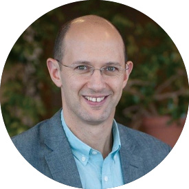
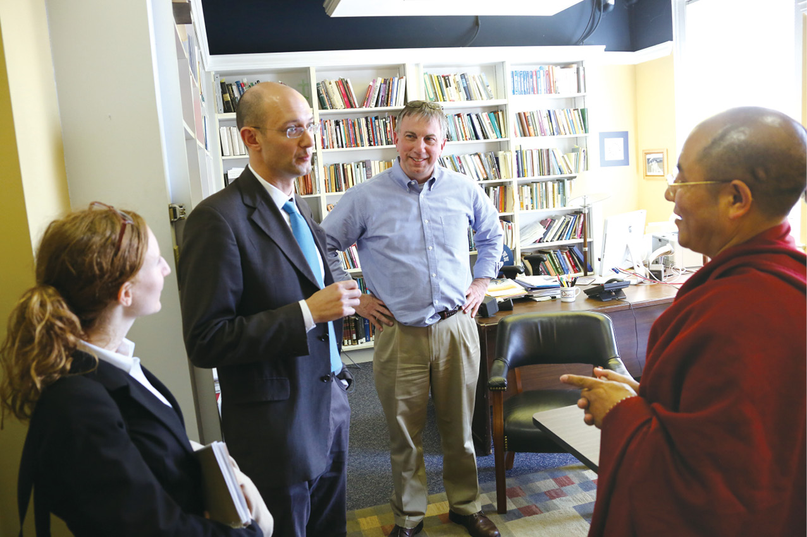
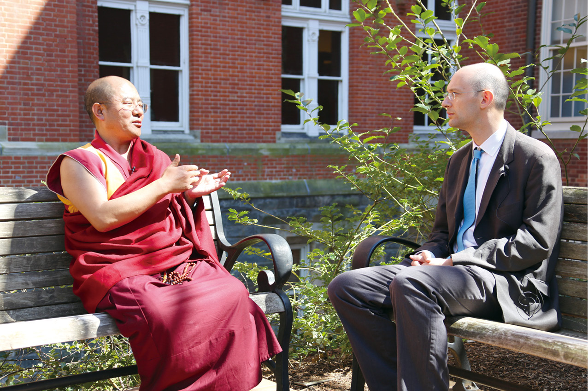
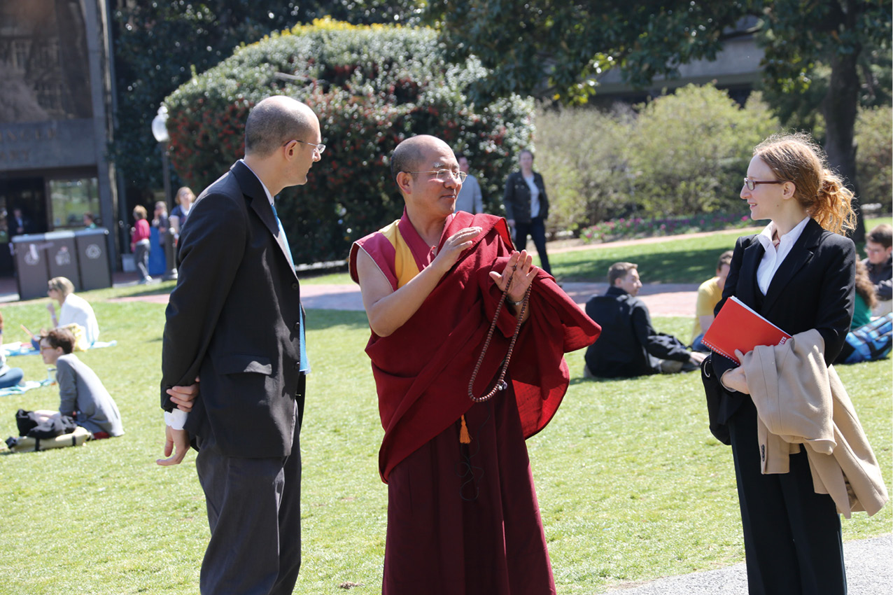
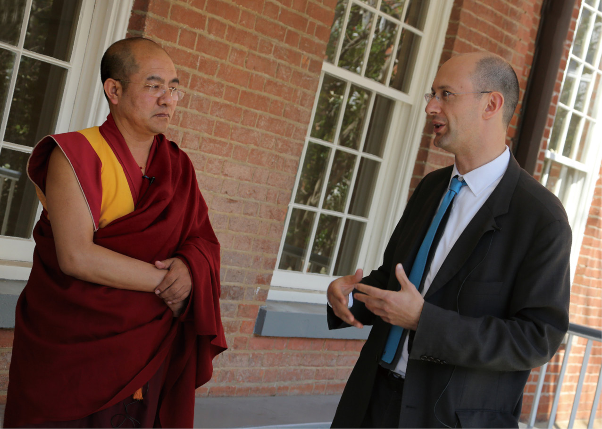

在美国大学教佛法

索达吉堪布 & 本杰明·伯根教授

乔治城大学

Georgetown University

2013/04/06

本杰明·伯根（Benjamin Bogin）

密歇根大学佛教研究博士。美国乔治城大学神学系教授，现为斯基德莫尔学院副教授兼亚洲研究中心主任。他的主要研究兴趣是藏传佛教中的自传以及佛教文化中视觉艺术、叙事和圣地的交叉关系。出版著作有：《大约尔莫瓦的光辉一生》《喜马拉雅山通道：为纪念休伯特·德克莱尔而进行的西藏和纽瓦尔研究》（合著）。

1．佛门：其实你可以求得更多

本杰明教授：

首先非常荣幸和欢喜地欢迎堪布仁波切来到乔治城大学，和我们探讨佛教以及佛法在西方的弘扬。我十分钦佩堪布在喇荣五明佛学院所开展的弘法事业。希望您这次到访能成为乔治城大学与五明佛学院之间交流的开端。

我的问题首先是关于佛教在西方的弘扬，其次是佛教的学术研究，如果有时间，最后还想问一个有关藏传佛教研究的问题。

昨天晚上，堪布仁波切演讲的题目是《藏地幸福密码》。目前在西方，有很多方法可以让人们获得快乐，比如练习瑜伽，心理咨询，或者服用抗抑郁药来缓解压力。

有时我会有一些顾虑，当佛教传播到西方时，被定位为一种获得快乐的方法，这会导致人们误解佛法的真正目的，不明白佛法的内涵是为了证得佛果和解除众生痛苦，而把佛法当作迅速获得个人快乐的方法。您怎么看待这一现象？

索达吉堪布：

不管西方还是汉地，如果像藏地那样全民信仰佛教，就不会有诸如此类的问题或疑惑。正如您所说，最初人们是把佛教当作一种遣除痛苦的方法，类似精神类药物或获得快乐的工具。但这只是属于初学者的阶段，之后要渐渐趋入佛法的学修。如果能够认真闻思和实修，就会了解佛法的甚深与广大，也会明白佛法非常殊胜。

佛法不但能解决暂时的痛苦，还能带来今生来世的利益，乃至走向真正的解脱，获得究竟的遍知佛果。当然，对于现代西方社会来说，来世和成就佛果的概念确实太高深了，我们只能先从浅显的方式入门，暂时不探讨甚深的法义。

学习的过程是很漫长的，我为汉族弟子讲课已经有二十多年了。最初他们也认为佛法很新奇，但现在也有了利他的发心，开始希求更高的成就。不仅仅是为了暂时的利益，而且是为了获得佛果。

佛法的学习不是短时间就能达成的。最初在汉地，人们求灌顶只是为了发财等目的，在西方也是如此。如果能借此逐渐趋入佛法的闻思修，您说的这些问题会得到解决。

2．问“三乘”之源

本杰明教授：

现在我们从普及佛教和广泛弘扬佛法这一主题，转到佛教的学术研究上。我开设了佛教入门课，介绍佛教的历史和思想基础。我的授课方式和美国大部分大学类似。我告诉学生们，佛教的发展有一个基础时期，其中最具代表的是巴利文的三藏经典，后来出现了大乘经典，之后在印度出现了第一部密续。

这是从历史角度来讲的佛教教法和证法的发展史，即通过不同的历史阶段来讲解和研究佛教史，这也是学术界的主流研究方法。但我知道，传统佛教认为，佛陀在同一时间教授了三乘法门。我想知道您如何看待现在这种学术观点？现代的佛教学者认为，佛教经典的发展经历了不同的历史时期，那么如何找到一种途径来圆融佛教的传统观点，即认为所有经藏都来自佛陀的真正教授？

索达吉堪布：

按照佛教的了义观点，虽然没有说法的人，但佛陀宣说佛法时，在所化众生面前会有显现。虽然是有显现，但同一时间不一定是同样的显现。

通常来说，释迦牟尼佛次第转法轮，是相应于共同乘的所化众生，所以要按共同乘的历史来讲。此外还有不共乘的内容，并不是对所有人宣说的。

现在大家共同承许的佛陀传法，最初是传小乘法，然后是大乘法，最后是大乘中的密乘，如《时轮金刚》《密集意续》等，以及不共的无上密续。按照藏传佛教记载的历史，比如敦珠法王撰写的《藏密佛教史》，先从佛陀的十二相成道开始，然后介绍二圣六庄严以及佛教在印度是如何兴盛的，随后密法渐渐传入藏地，并在藏地兴盛。在藏地，密法又分为经藏和伏藏，各自有不同的传承历史。

其实，佛陀在所化众生前的显现并不一样，但从我们人类的角度讲，是次第传法而不是同时的。所谓的同时宣说，有特定密意和不同的诠释方式。

我认为，不管学藏传佛教还是印度佛教，如果想让现代人信服，应该好好研究《藏密佛教史》，从中获得确切的证实。这本书以前有刘锐之的中文译本，文字表达比较古。后来我用了近五年的时间，用比较通俗的白话将其重新译成中文，已由西藏藏文古籍出版社出版了。

本杰明教授：

接着这个话题，我们先不谈密乘，仅仅看大乘的经典。很多大乘经典中说，释迦牟尼佛在灵鹫山或其他地方，给一部分弟子传授了大乘佛法，现有的大乘经典就是释迦牟尼佛当时传授的教法。从历史上看，大约是在公元前500年。但这些经典当时并没有出现，直到很多世纪以后才有它们的文字记录。所以大部分学者认为那些大乘经典是很久之后由某个人撰写的，大约在公元前100年或者接近公元100年的那段时间。

他们对此做了深入的研究，比如针对不同版本的《般若经》，确定它们出现的先后时间。这样基本可以确定这部经最早出现的时间。这和佛经中记载的有所不同，佛经中说这部经是在很多世纪以前，释迦牟尼佛在某个地方宣讲的。

从显宗的角度，我们应该怎么圆融这个矛盾？

索达吉堪布：

实际上，现代历史学对很多历史事件的时间并没有特别确定的说法。比如释迦牟尼佛的涅槃时间，虽然现在大家共同承许是2556年前，但也存在很多分歧。不仅是释迦牟尼佛，耶稣、孔子等先贤的很多历史时间都是众说纷纭，而且有些观点，随着学术的发展也在改变。

佛陀在讲法时没有文字记录，后来经过三次结集才有了这些教典。其中“如是我闻，一时”，并没有标明具体的某年某月某日。为什么呢？因为按大乘的观点，所谓“一时”，在不同众生面前有不同的显现，比如天人前所显现的时间就和人类不同。由于业感不同，不同时间、处所和种类的生命群体存在不同的时间感知。另外，我们人类依靠现有的技术手段，所能了知的极为有限，不要说天人当年所见我们不清楚，即便是古人所见，我们也很难了解。但现代人不承认这一点，如果不承认，那也可以按一般的观点：佛陀住世期间，有一次是这样讲的……就像人们讲述某个学者的历史，也会说“有一次他这样说过”，这也是很合理的。

仅仅一句“如是我闻，一时”就足以证明，佛陀讲过这些法，并被如实记录了。佛陀曾说，他宣讲的佛法要落在文字上，后来阿罗汉等众弟子如实做了整理。而且，佛经中记载的很多智慧，也一再被现代人所证实。

我认为，佛典结集的时间不会相隔很久，有说是七百年，有说是三百年。佛陀涅槃后，弟子们做了三次结集，但没有记录具体的年月日。不能因为是后期结集的，就认为不是真的。其实，历史上也有很多类似的情况，比如基督教的《圣经》，也没有成文的具体年月日，但基督徒们照样依此行持，并视之为标准的教义。

3．研究藏文化，“几辈子也不会无聊”

索达吉堪布：

您对藏传佛教已经学习、研究了很长时间，而且还会说藏语，我感到很高兴。您个人对藏传佛教的学习和修行是怎样的？昨天我也问了埃亚·阿维夫教授同样的问题。

之所以这么问，是因为藏地很多知识分子认为藏传佛教和藏文化在当下没有实际功用而应舍弃。所以，我想把你们的经验分享给他们。您学习藏传佛教的原因是什么，这样学习和修行对您的生活有什么利益？

本杰明教授：

客观地说，我认为研究藏传佛教有很多不同的动机，这取决于不同的研究者。如果只讨论其中的一小部分，我想有些人最初是因为与某位传授佛法的上师相遇，从而被藏传佛教的修持所吸引。藉由对藏传佛教的修持热情，他们意识到还需要更深入学习，比如学习藏语或者深入理解藏传佛教的法义。这是很多人研究藏传佛教最初的主要动力之一——对修持的兴趣。

第二个主要动机，是他们察觉到西藏拥有极为丰富而宝贵的传统文化。但是，20世纪藏文化历经巨变后，这些传统面临着遗失的危险，因此希望在它们没有彻底隐没前，尽力保存这些文化。这是他们对珍贵事物的一种情怀。

第三个，也许是最后一个动机，一些非常聪明的人，极为渴望发现一个不易枯竭的研究领域，不会令研究者感到无聊。目前的许多学科已经有成百成千的人发表了研究成果，比如对莎士比亚的研究，他的每一部戏剧作品都已经有十几本研究著作。

但我们看西藏的文献，仍有成千上万的经典尚未翻译，西藏之外的人从来没有研究过它们，这是一个巨大的研究宝藏。它的研究主题广大、甚深，人们被它所吸引，这是一个无有止境的领域，可以让人穷尽一生进行研究，甚至几辈子投入其中都不会感到无聊。很多人就是被这一点所吸引的。

就我个人而言，非常幸运，我母亲的哥哥也就是我舅舅，是创巴仁波切在美国的学生，他和仁波切关系很亲密。孩童时，我就听过舅舅和他上师的很多故事。这些故事完全不同于我世界中的其他事情，我非常着迷，时常想这位仁波切究竟是怎样的人。

长大一些后，我开始阅读创巴仁波切的书，这些书是他的学生整理出版的。我越思考那些教言，越觉得有道理，其中蕴含的智慧远超我所了解的其他任何知识。因此，我想在这方面更深入地进行学习。

上了大学后，有一阵子我感到特别困惑，不知道自己对什么感兴趣，也不知道自己想研究什么。幸运再次降临，我参加了一个国外研究项目，有一整个学期的时间研究藏学。我前往印度，和一家藏族人住在一起，开始学着说藏语，并开始真正地了解藏文化。从那时起，我的好奇心完全变成一种激情，我完全被这种想要学习藏文化的愿望吞没，我再次窥探到了它的广博。

藏传佛教和藏文化不可分割，这也促使我想要真正学习藏文，以便阅读和学习经典，并和佛法上师们交流。这就是我的初衷，并非为了学术研究，而是为了自己可以学习更多。

很多年以后，我发现自己的谋生之路，要么是在大学教授佛学，要么是在餐馆刷盘子。除此之外，再无任何擅长之处。而在这两者中，当教授无疑是个很不错的生计。

4．转世轮回——你信吗？

索达吉堪布：

非常感谢您的分享！可惜交流的时间太短暂了。

下一个问题是，现在世界上有很多人学习佛法，是出于各种各样的目的。如果要真正学习佛法，承认前后世非常重要。承认前后世的存在，通常需要很多理由。您作为佛教的修学者，应该是承认前后世的。同时作为一名大学教授，您承认前后世肯定也是有理由的，您的理由是什么？

本杰明教授：

这个问题很有趣，这当中其实包含了两个不同的问题，有必要区分开来。一个问题是，我如何在课堂上给学生们介绍和讲解轮回；另一个问题是，我本人对轮回的信仰究竟是怎样的。

在学术环境中讲授佛法，与在佛教传统环境中截然不同。因为我并不能把个人信仰带给学生。在讲解佛教的过程中，我尽可能采取准确、完整的理论方式。也就是说并非表达我的个人信仰，而是去传达现有理论和实践对于佛教的认知。我认为区分这两者非常重要。

在课堂教学中，我会尽量向学生解释，无论你是否相信轮回的存在都没有关系，这和我们的课堂教学无关。然而为了理解佛教传统，很有必要去设想一个这样的世界。在这个世界中，轮回真实不虚，轮回是这个世界的真相。

我会尽力帮助那些很难想象轮回存在的学生。我告诉他们，对于现实世界的信仰，其实也没有牢靠的基础，我们每天都会接受很多并非完全了知的事物。比如学生们一直在使用手机，但他们其实并不真正了解手机运作的科学原理，他们也无法把手机拆了再恢复原样。他们很可能无法解释拨通电话和朋友通话时究竟发生了什么。他们并不真正理解手机的工作原理，但他们一直都在使用手机，并对此毫无疑惑。我尝试用这种方式解释和类比。

在历史上，有许多佛教徒也许不知道《阿毗达磨》中有关轮回的每个细节，他们对此没有太多概念，但这并不影响他们接受轮回就是众生以及这个世界存在的真相。

我试图用各种方式让学生反观这些日常生活中的设定，以此类推，来理解在佛教文化的传统中，承认轮回的存在并不一定需要学术或科学的证明。历史上，大多数佛教徒在现实生活中对于轮回的信仰，并非基于学术理论的认知。

索达吉堪布：

其实用科学证明轮回并不难。我做了很多研究，也有一些科学证据。

本杰明教授：

谈到我本人对轮回的信仰，希望堪布仁波切可以指正我非常肤浅的佛教见解。

轮回的真实不虚，仅存在于世俗谛，而非胜义谛。所有生生死死的流转，某种程度上有点像虚幻的戏剧。而选择相信轮回的真实性，一个现实意义是它为规范个人行为提供了理论基础。其中很关键的一点是，相信任何行为都会产生果报。这个见解一定要建立在信仰轮回的基础上。

关于轮回，我知道堪布仁波切对科学证据非常重视，但对我而言，更重要的是信仰轮回能否引发更慈悲的行为，能否减轻众生的痛苦。如果答案是肯定的，我会在世俗层面上接受这个信仰。这是我的看法。

5．索达吉堪布：如果我来美国上大学

本杰明教授：

您在二十年前来过华盛顿，您对这次访问有什么感受？特别是在乔治·华盛顿大学和乔治城大学与许多师生进行交流，您有什么体会？

索达吉堪布：

我昨天去了华盛顿大学，今天是乔治城大学，参观了两所学校的建筑，还有机会跟学校的老师们展开研讨，我感到非常高兴。之所以这么高兴，首先是因为美国的很多大学，有不少人在学习和修行藏传佛教；其次，现在科学发展得非常快，科学与佛教的互相交流和学习非常重要。

来到这里，见到很多老师，学习到了很多新知识，这让我很高兴。

本杰明教授：

如果您是乔治城大学的学生，您会对哪些课程感兴趣，会主修什么专业？

索达吉堪布：

我选什么专业呢？初中毕业时，我选择的是师范专业。如果在这里读大学，也会选择将来能当老师的专业，可能会学习与佛法相关、与逻辑相关的学科。如果有这样一个专业，不仅仅能利益少数人，而是能对整个人类的心灵有所助益。

6．当代大学生与佛法：中外对比谈

本杰明教授：

堪布仁波切，我知道您去过中国许多著名高等学府进行演讲。我想了解，在当今时代，这些大学有哪些共同的关注点？如您所说，世界的联系越来越紧密。您认为您到访的美国大学和中国的大学有哪些相似之处，又有哪些差别？

索达吉堪布：

我确实去过一些大学，学生们的观点与校风、授课老师的思想等息息相关。总的来说，学校之间差别不大。至于西方的大学，我这次只待了短短两天，因为之前曾经在这里待过三个月左右，也算有所了解。但是大学学者的思想能否反映整个西方的思想，我并不确定。大体来看，不管东方还是西方，佛教确实给所有人的心灵带来了利益。很多学生和老师都可以通过修习来体验到这一点。将来我们继续共同学习的话，相信会有更进一步的认识。

本杰明教授：

很多学生并没有把佛教作为他们的主修课程。确实很少有人会真正深入研究佛教，但很多人都认为学习佛教可以帮助他们深入各种领域，比如法律、政治、商业乃至任何科学研究领域。

我想知道，在您看来，对于这些不会真正深入修持佛法而会在其他领域拓展人生的学生来说，学习佛法会给他们带来怎样的利益？

索达吉堪布：

大学是人生中非常关键的阶段，大学期间所受的教育会对人生产生深远影响。如果能学习佛教课程，是否信仰佛教并不是很重要。我觉得佛教本身就是一门科学，也是一种教育，比如佛教所讲的利他心、善心，并不是宗教性质的，而是一种道德规范。如果受过一定的佛学教育，不管是否真正信仰，不管以后从事何种工作，都会对佛教有公正客观的看法。这也是很重要的。

现在东方和西方有一些人，他们对佛教并不了解，却一直在驳斥佛教。就算在佛教徒当中，也有很多不如法的现象，这样也不合理。佛教徒要懂得如法而行，非佛教徒也不要随意驳斥真理。

我到过的很多大学，现在都开设了禅修班，这样的形式很好。学生们从小到大，一直接受的都是老师们灌输的观点，并没有太多自己的主见，这一点东方和西方皆是如此。如果老师对佛教的认知是公正合理的，在正确的指引下，这些见解会伴随学生们的一生。
