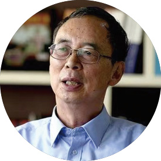
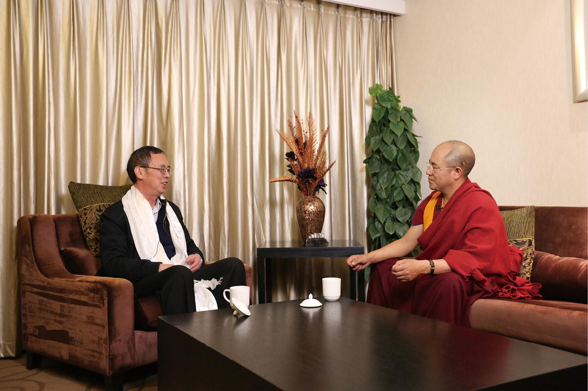
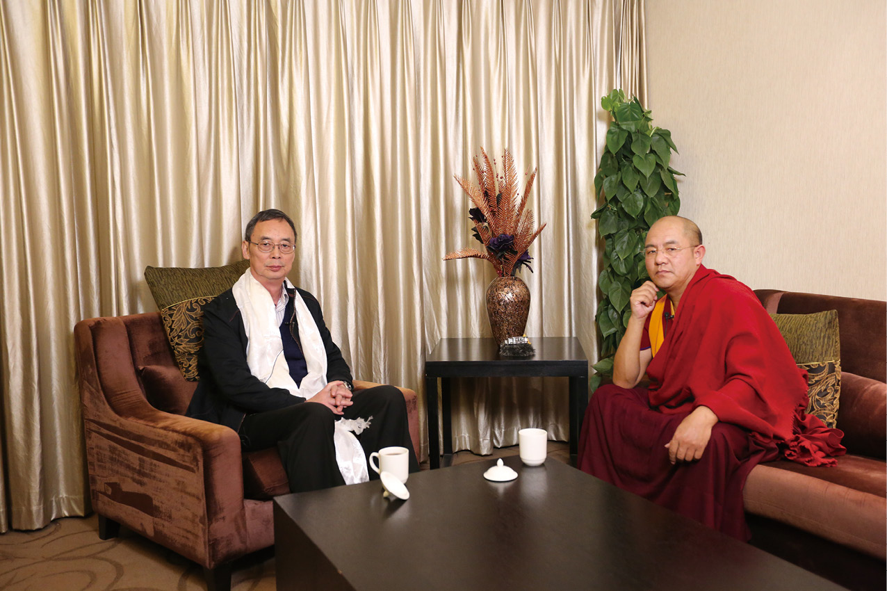

佛法与科学是殊途同归

索达吉堪布 & 朱清时教授

中国·北京

Beijing, China

2013/11/05

朱清时（Zhu Qingshi）

国际著名化学物理学家、自然科学家，中国科学院院士。曾任中国科学技术大学校长、南方科技大学创校校长。在激光光谱学、分子局域模振动、单分子化学领域，都取得了国际一流的研究成果。

1．当物理学家发现“色即是空”

索达吉堪布：

朱教授，见到您很高兴。我前几年看到您说的一句话，“科学家千辛万苦爬到山顶时，佛学大师已经在此等待多时了。”据我所知，这句话不管在学术界还是文化界，影响都非常大。

我的第一个问题是，您作为一位科学工作者，也曾多年担任大学校长，您是在什么样的背景下说出这句话的？

朱清时教授：

我十年前开始跟随南怀瑾老师学习佛学，先后学过《楞严经》《楞伽经》《瑜伽师地论》《成唯识论》。

学了这些经论后，我发现现代物理学的很多观念，实际上和佛经里的观念非常接近。这就使得我发愿写了一篇文章，叫《物理学步入禅境》。希望将现代科学里最深奥的知识讲得深入浅出，让大家能够听懂，自然而然就能发现，随着现代科学的发展，很多科学理念与佛经的重要观念，越来越接近一致了。

比如物质，过去我们都以为物质世界由一块块“砖头”组成，都是实体的。进一步分析，“砖头”越来越小，最后小到分子、原子……但再小也还是实体的小“砖头”。

现代物理学发现，将这些“砖头”一直分析下去，得到的是一种没有任何实体形状的东西。它像什么呢？像水面上的波浪，像一根弦上的振动。也就是水面上的波，或者弦上的波。

这种波不是实体，是振动的能量。能量越大，粒子的质量就越大；能量越小，粒子的质量就越小。由此而言，我们眼前的物质世界实际上就是一场大交响乐。若用佛经里的话说，它不是海洋本身，而是海洋上的波涛。

索达吉堪布：

波涛就是海洋，海洋就是波涛。色即是空，空即是色。

朱清时教授：

物理学发展到这一步，实际上已经非常清晰地将佛学所讲的宇宙本质表达出来了。

我在写这篇文章的时候，把个人所理解的科学发展的历史、物质概念的认知变化写了出来。从一开始认为物质是实体，发展到认识到物质不是实体，而是一种波、一种振动、一种能量，是没有时间、没有空间的存在。写到最后，我就产生了这种感慨：科学家千辛万苦地爬到山顶时，佛学大师早已在此等候多时了。

这句话是什么意思呢？佛学与科学一样，目的都在于认识宇宙的真理。佛学不像科学用的是做实验的方法，它靠的是禅定。

进入禅定之后，人的智慧提高了，常人百思不得其解的现象，禅定者很容易就理解了。就像孩童看到世间很多事情都会觉得稀奇古怪，不理解，但是等他长大成人后，一下子就理解了。再比如，我们眼中的世界与动物眼中的世界就不一样，动物不会理解世界为什么是这样的，但人类很容易理解。这就是智慧提高之后的结果。

佛学靠禅定认识世界，而科学认识世界的方式是通过做实验。所以科学家很辛苦，他要通过各种仪器来做实验，要通过很多判断、分析、推理，才能得出实验结果。一个一个地实验，一个一个地试，直到试出真理。

科学为了认识宇宙，一路发展演变到今天，突然发现，现代科学的认识与佛学大师通过禅定在两千多年前认识到的宇宙本质是一致的，即缘起性空。也就是，物质世界实际上是一种假象，是本体的变现。

索达吉堪布：

这句话是您做的一个总结，也可以说是您的证悟，或者说是一种深层次的智慧。虽然文字不多，但我能感觉到，其中确确实实蕴含着一种力量。当我读到它的时候就在想，您是在什么情况下，说出了如此震撼的语言？您确实是站在非常客观的立场上，发出了这样的感慨。这一点非常令人赞叹！

朱清时教授：

我是学自然科学出身，做了几十年科学研究，所以对科学方法很熟悉。学了佛学之后，我也开始了解佛学认识世界的方式。

我觉得科学的研究方法有其成功之处，比如现在世界的物质财富都是由科学方法创造的。但它也有局限性，有很多做不到的地方。科学强调“可重复性”，比如做实验，在严格的相同条件下，任何人去做，都应该得出一样的结果，这叫做“可重复”。

但是佛学正好相反，《楞严经》里有一句话叫“循业发现”，也就是遵循你的业力，你会发现一些东西，但并不是人人都能发现同样的东西。因为人与人之间的业力有差别，能够认识到的东西就有差别。这个佛学原理与科学正好相反。

学科学的人在很长时间里不理解佛学，认为佛教就是迷信，是无稽之谈，是靠不住的。他们不理解的“循业发现”其实是对的。我相信佛学与科学两者是不矛盾的，它们都在认识宇宙的真理，相辅相成，佛学可以作为科学的补充。所以，佛学不应该贬低科学，科学也不应该贬低佛学。

从佛学角度来讲，世间法都是佛法，所以科学也是佛法。爱因斯坦曾说过：“如果哪种宗教能够跟科学相辅相成，那就是佛学。”当时爱因斯坦还没有看到科学最新的发展，要是他看到了，会说得更准确。

索达吉堪布：

确实，爱因斯坦没有看到科学的最新发展，尤其是量子力学后期的发展。再加上他当时所处的时代，很多佛学经典还没有译成英文，他对佛教更深层的道理不一定有机会了解。

朱清时教授：

我看过那些译成英文的佛经，一旦翻译过去，就不行了。有很多词是无法翻译的。

索达吉堪布：

比如说“Buddha”，英译只是把梵文发音直接翻译出来，其实无法把这个词汇里最深奥的佛学含义表达出来。

朱清时教授：

是的，我看过《成唯识论》的英译本，也是一位很著名的翻译家的作品，但翻译后意思都变了，就像隔靴搔痒一样，隔了很厚的一层文化障碍。所以我相信，爱因斯坦不懂中文，不懂梵文，他无法了解这些佛经的真实含义。

比如“空”这个词，就很难翻译成英文。“空”翻译成英文，就是一无所有。

索达吉堪布：

“现即是空，空即是现”这种非常深奥、远离一切言说的境界，完全没办法表达出来。

朱清时教授：

学佛一定不能只读书，必须要亲身去实践。只有实证之后，你才能真正知道它的含义是什么。

2．佛学：似是宗教，实是科学

索达吉堪布：

我原来看过一些访谈，说您以前在青海工作。在当时的特殊环境下，您自学物理、化学、英语，后来去美国留学，回国后又成为中国科技大学的校长。以我们的眼光来看，您在专业领域所取得的成就，足以证明您是一位了不起的科学家。

我想了解一下，您是从什么时候开始进行佛学研究和修行的？现在很多人学佛出于一种迷信，比较盲目。但您作为科学工作者，相信绝不会像其他人一样简单地拜拜佛，人云亦云，随波逐流。您是以什么样的心态接受了佛教，开始了对佛教的研究或者修学？

朱清时教授：

我从小就对佛教、寺庙有着天然的热爱。这种感情没什么道理和来由，就是发自内心的热爱。我五十多岁做中科大校长时，看到了一些文章，了解到国际上有人开始研究心智科学。现代科学主要研究物质，不敢或者说回避研究人的意识。如何去研究人的意识，很可能会成为世纪之交科学发展的一个重大方向。

对我来说，当初我完全是从科学发展的角度，想去了解应该如何研究意识。这个时候，就不可避免地想要了解佛学究竟是怎样研究意识的。

我去过西藏几次，渴望从西藏的喇嘛、高僧、活佛那里了解他们是怎么看待意识的，他们能够训练意识做到什么事。

比如，我曾到过青海玉树结古镇的结古寺，寺里僧人的拙火定修得很好。每年正月十五，全寺僧人坐在湖边，将毛毯在冰水里打湿后披在身上，然后就一直打坐到把冰毯烤干。我是夏天去的，没有亲眼看见，但亲眼看过的人非常多，所以我相信这是真能做到的。

靠意识的训练就能够浑身发热，直到把冰毯烤干，这表明意识里有一些东西是科学还远远不曾了解的。这件事对我的影响很大。能够修到拙火定这种状态，让我感觉藏传佛教对意识训练的研究已经很有高度了，也确实积累了很多意识修炼方面的经验与成果。

索达吉堪布：

南怀瑾老师曾说，他在峨眉山读《大藏经》的时候，从中找到过“拙火定”的出处。

朱清时教授：

像拙火定这种修行，很值得认真研究。我一直对藏传佛教充满了崇敬之心，想要好好了解清楚。当然，我认为佛教一定要亲身实践、实修才能真正理解，而不是光听别人说或者看看书就行。我能够得到的机会很有限，了解不多。

我现在的感受是，我能走的修行之路就是把科学搞清楚，然后把科学与佛学相通的道理都说清楚。佛教修行有八万四千法门，我这个就是科学法门。也许像我们这样的人通过这个法门，会和藏传佛教的修炼者一样，达到最终极的真理。

我现在的精力，主要集中在将各种科学问题搞清楚。科学问题最忌讳的就是牵强地进行比对，那样大家都不会服气。所以一定要在真正搞懂之后，将它的原理说得很准确，这样大家才能接受。

3．薛定谔的猫，客观绕不开主观

索达吉堪布：

记得您曾在一次访谈里说，科学分为自然科学、心智科学、人类科学三类，这三类科学的代表分别是希腊文明、印度文明、中国文明。我觉得这种分析方法非常好。之前有四大文明古国的说法，但您所提出的划分方式体现了一种深刻的概括性。

比如其中的心智科学。西方心理学家荣格在读过《西藏度亡经》后，认为这本书是最高级的心理科学，他一辈子都随身带着这本书。台湾等很多地方也把心智科学称为认知科学。

佛教所讲的阿赖耶识、对心识的判断，是不是可以从这个角度去研究？我们现代自然科学和社会科学并没有特别去研究这个领域，这一领域还是相对空白的。您是不是这个意思？

朱清时教授：

科学有一个基本原则，就是可重复性原则，强调客观，或称与意识无关。科学主要研究各种客观规律。所谓客观，就是排除任何主观因素。所以科学不敢跟主观扯上关系，遇到主观因素就会逃得远远的。殊不知，主观与客观是不能分开的，很多客观因素都可能受到主观的影响。

主观如何影响客观？在量子力学之前，大家都不去思考，都觉得客观就是客观，科学只研究客观规律、客观现象。一旦你“主观”了，那你就犯错误了。

量子力学发现，在客观规律之外一定要有主观因素。量子力学中的粒子在各个地方都可能出现，也可能处于各种状态之中。至于究竟处在哪种状态，一定要用主观因素去测量它，它马上就会出现一种确定状态。

有一个著名的思想实验叫“薛定谔的猫”。一间小房间里放了一只猫，猫旁边放了一个毒气瓶，毒气瓶上面吊着一个锤子，如果锤子掉下来，毒气瓶就会被打破，毒气瓶一打破，猫就被杀死了。锤子是被什么控制呢？放射性的原子核。放射性的原子核有一半的概率放出一道射线，当然也有一半的概率不放。所以这只猫有一半的可能已经死了，也有一半的可能没有死。怎么确定这只猫是死还是活呢？只要有人进去看一下就知道了。“去看”就是人的主观意识在起作用，如果人不去看，那么这只猫始终处于既死又活的叠加状态。

这就是量子力学很著名的思想实验。大家针对这个问题，辩论到最后发现，量子力学要想成立，客观一定要跟主观结合起来。也就是说，在量子力学中，意识因素已经不能被排除。

由此我发现，当科学发展到了量子力学阶段，人的心智、意识必须被考虑进去，科学才完整。谈到科学对意识的研究，我首先是从量子力学的角度来说的。

心智科学包含的内容比较多。比如刚才提到的拙火定，能通过训练意识改变一个人的生理状态，使身体发热到能够把冰融化，把冰毯烤热、烤干。

另外在十多年前，美国也有人做过一个实验：他们邀请几十位藏传佛教的高僧打坐，并对他们的大脑状态进行监测；同时，他们又请了二十几位刚学打坐的人一起打坐，也对他们的大脑状态进行监测。实验结果表明，藏传佛教的高僧在打坐时，大脑已经发生了改变，跟普通人的大脑完全不一样了。也就是说，打坐这种修行，实际上已经让人的生理状况发生了变化。

这个实验让我认识到，意识与心智是非常值得研究的对象。也是从以上几个方面，我开始持续关注人的意识，关注心智科学、认知科学。

4．用物理学证实轮回转世

索达吉堪布：

佛教中有前世后世的说法，西方也有很多人在研究前后世，他们通过催眠等方法，使人回忆起前世。前后世的观念，在藏地受到普遍认可，但在不同环境下成长起来的新一代年轻人，大部分都不承认前后世的存在，坚定地认为人死如灯灭。

我相信意识是一直不断循环存在的，您怎么看待这个问题？

朱清时教授：

您指的是轮回转世吧？这也是我非常想搞清楚的一个问题。现代科学发展至今，物理学已经发现了类似于阿赖耶识的存在，人与万事万物都是这种存在的变现。它把我们过去、现在、未来的所有信息都储存了起来。

阿赖耶识又被称为藏识，收藏了我们的所有信息。

索达吉堪布：

对，又叫普基识，就像U盘一样收藏了我们的所有信息，也叫如来藏。

朱清时教授：

如果这个物理理论被证实，人就可以知道自己过去世的事情，也就是说，轮回转世的说法就有了依据。

如今，对轮回转世的研究，都停留在心理学家的催眠层面。通过催眠，可以使实验者回想起前几世的状态。但很多人并不认可这种研究方式，因为通过催眠术回想起来的记忆无法确认真伪，有可能只是大脑被催眠后出现的幻象。

现代自然科学发现，宇宙有一个本体，用物理学的术语来说，宇宙本体就像全息摄影的底片，所有信息都储存其中。如果有一天，人类可以直接从中提取信息，就能看到过去未来的所有事情，轮回转世也就能够被证明了。

关于轮回转世的问题，我要下功夫好好写一篇文章出来，这样大众就可以了解现代科学已经走到哪一步了。

不知道我回答了您的问题没有？

索达吉堪布：

非常好，很珍贵的回答！在这个问题上，我也希望未来大众都能认清一些真相，不要把佛教看成迷信。

如果佛教真的是迷信、真的不合理，我们也不会固执己见。但我已经研究佛教近三十年了，可以说每天都在不断学习中。在此过程中，我觉得佛教和科学在一些地方可以形成非常好的互补。正如您所说，这对大家都有非常甚深的利益。

5．朱清时：我为什么学佛

索达吉堪布：

还有一个问题想请教您。前段时间，我去了国内一所大学的马克思学院，根据校方要求，谈了马克思的宗教观。之前也拜访过德国的哥廷根大学，与一些教授进行了对话。对话时，他们表示在马克思最初的宗教观中，并没有把宗教当成毒品的说法。马克思所说的“宗教是鸦片”不是贬义词，因为当时鸦片很昂贵，被看作一种非常吸引人、能解除痛苦的安慰剂。但后来因为东正教对“十月革命”有害，恩格斯才在对宗教的表述上进行了引申，把宗教解释为毒品。受马克思宗教观的影响，再加上西方国家和中国对鸦片的印象不太好，以至于现在很多年轻人都认为宗教不合理。

我也学过一些马克思宗教观，他并没有正面反对宗教，只是否定了一些传统的约束之处。马克思在《资本论》中也说过：“人类的辩证法，到了释迦牟尼佛时期才真正落实。”所以我觉得，马克思宗教观并不像当下年轻人所认为的那样，似乎宗教都是迷信，是一种陈腐、教条、死板、颓废的东西。并不是这样的。

如果从科学角度或者从宗教学、社会学等角度出发，您怎么看待这个问题？

朱清时教授：

马克思哲学最核心的部分，就是实事求是。马克思活跃于19世纪，那个时代的科学还没有发展到现在这一步，比如唯物主义当时认为物质是实体，而现代科学已经认识到物质并不是实体。如果马克思现在还活着，相信他会形成新的、更高级的阐述。

随着现代科学的发展，认识到了这些关于宇宙的真理。这种科学的宇宙观，其实就是实事求是的马克思主义。

对我来说，佛教并不是宗教，我更倾向于将它看作一门学问，也就是佛学。佛学是认识宇宙真理的一种途径，也是一种科学。

佛教本身不讲个人崇拜，也不是麻痹人的。佛教认为每个人都是佛，只要你真正放下，不再执迷不悟，一旦开悟了，你就是佛。佛教要求人更有善心，更向善，更能牺牲自我。

但是我们不排除现在的佛教被一些不好的佛教徒染污了。释迦牟尼佛早就说过，末法时代来临的时候，真正破坏佛教的，就是这些不好的佛教徒。他们骗人、骗钱，做了很多坏事，结果使很多人对佛教产生了不好的看法。这是释迦牟尼佛早就预料到的末法时代的一种状态。但这种不如法的现象和人，要与佛教、佛学区别对待。

6．不应丢弃的传统宝藏

索达吉堪布：

我看过您之前写的文章，叫《心中的南怀瑾先生》，讲到了您与南怀瑾先生之间的渊源。看得出您们在传统文化方面有十分深入的研究，解释得也特别好。

您觉得我们的传统文化如今应该如何继承，如何弘扬？我本人虽然不是很了解汉地的传统文化，但藏地的传统文化也同样至关重要。我认为在现代社会中，既不能舍弃现代科技知识，同时也不能舍弃古代传统文化，以及其中所蕴藏的人类优秀德行。

朱清时教授：

我认为永远要珍惜传统文化，吸收其中优秀的部分，也就是真理的部分。比如中国传统文化中最有争议的是中医，中医有经络学说，但现代人通过技术手段无法在人体中找到经络的存在，于是就认定经络学说是伪科学。

实际上，我在练习打坐、入定时，当内心沉静到一定程度，的确亲身体会到经络所在的位置有酥麻感，似乎有东西在涌动。由此我意识到，中医里的经络其实是古代医师们深入禅定后感受到的，并据此绘制成图。

人体里的经络，不是一种物质载体，它没有像血管一样的管道，而是一种气，但这种气不属于物质。一般人很难想象，不属于物质的气是什么样的存在。现代科学已经告诉我们，物质世界分析到最深层次，不是物质，而是意识和物质的根源，比如阿赖耶识或如来藏。它不生不灭，也可以把它说成是一种缘起，它会在人体特定位置按照规律流动。所以我相信中医，它有它的道理。

传统文化中蕴含的宝贝、精华，不是要人盲目接受，而是需要先有人领会，再把它发掘出来。

我举一个例子，藏医里有种药叫“佐塔”。结古镇附近有一座寺庙，专门做佐塔丸子。佐塔的成分中含有水银，而水银是有剧毒的。但是佐塔的效果确实好，非常有效。

索达吉堪布：

尤其是针对中毒，确实有效果。

朱清时教授：

这就是藏地传统文化中的优秀代表。佐塔经过了很多代人的实验，大家都知道它非常有效，但是其中的道理，现在还没有人搞清楚。像这种藏药，就应该继承下去。如果无人继承，以后就没有人会做了，也就根本不可能继续发扬下去。

我去西藏，也是带着这个愿望，很想了解佐塔是怎么做出来的。后来我才知道，佐塔的制作方法是秘不外传的，它的制作过程很复杂，很费工夫，需要花很长时间，绝不是几天就能做出来的。

索达吉堪布：

西藏有两种文化非常稀有，一个是医学，一个是天文学。其实，天文学也特别难得。比如三四名喇嘛只用纸笔，不需要借助任何科学仪器，不到两个月就可以将第二年的日历全部推演出来，包括日食、月食的具体时间。

自古以来，藏历都是通过这种方式推算出来的，这也是来自释迦牟尼佛在《时轮金刚》中所宣讲的理论。我们寺院有一个天文小组，由五六个80后的年轻人组成。我之前问过他们，的确只要不到两个月时间，就能把次年的日历推算出来，很神奇。

朱清时教授：

这就是传统文化中特别优秀的部分。我觉得人应该有一个基本观念：对传统文化要敬畏，不要轻易否定自己还没有搞懂的事物。这也是一种基本态度。首先要尊重和爱护它们，再通过学习，努力搞懂它们，只有这样，我们才能够继承传统文化。

像我刚才说的佐塔，里面蕴含着非常深奥的知识。它的主要成分——汞，是剧毒重金属，但它确实能治病，而且效果也很好。我曾经要过一些佐塔的粉末，想带回去做实验。后来因为太忙，而且粉末分量太少，就没有做成实验。现在也不知道佐塔究竟是什么。

7．结语：公正对待佛学与科学

索达吉堪布：

今天我们讨论了两方面的主题，一方面是科学与佛学的关系，另一方面是传统文化。

我本人对这两个主题非常感兴趣，这几年来也做了一些相关工作。在未来短短的人生中，我也会尽力，能做多少就做多少。

希望您也能影响更多的年轻人和世间人。在佛教与科学的关系这方面，多写一些像《物理学步入禅境》这样十分有价值的文章。我认为这是非常重要的，毕竟文字可以流传千百年并一直发挥其作用。

关于科学和佛学的学习、传统文化的继承这两方面，您对现在的年轻一代有什么希望吗？

朱清时教授：

我觉得对待佛教也好、传统文化也好，都要秉持正确的态度。不要先把自己搞不懂的东西一棍子打倒，都说成是迷信或伪科学，而是要先继承过来，然后努力去理解它。

《楞严经》里有一句话，叫做“循业发现”。对于佛教与传统文化，你能理解到何种程度，往往取决于你业力的大小。要有这种思想准备，才能真正学到佛教与传统文化的精粹。

我相信，如果释迦牟尼佛活到现在，他一定会努力用现代科学语言去解释佛经，比如解释什么是阿赖耶识，什么是如来藏。这样的话，熟悉现代科学的人就很容易理解佛教思想。

我也相信，把现代科学技术学好会成为修行的一个捷径。因为如今的科学已经发展到量子物理阶段了，如果学到这里，会让你能够真正入门，同时坚定信仰、增强信心，真正学到佛学里最宝贵的理念。
