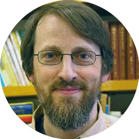
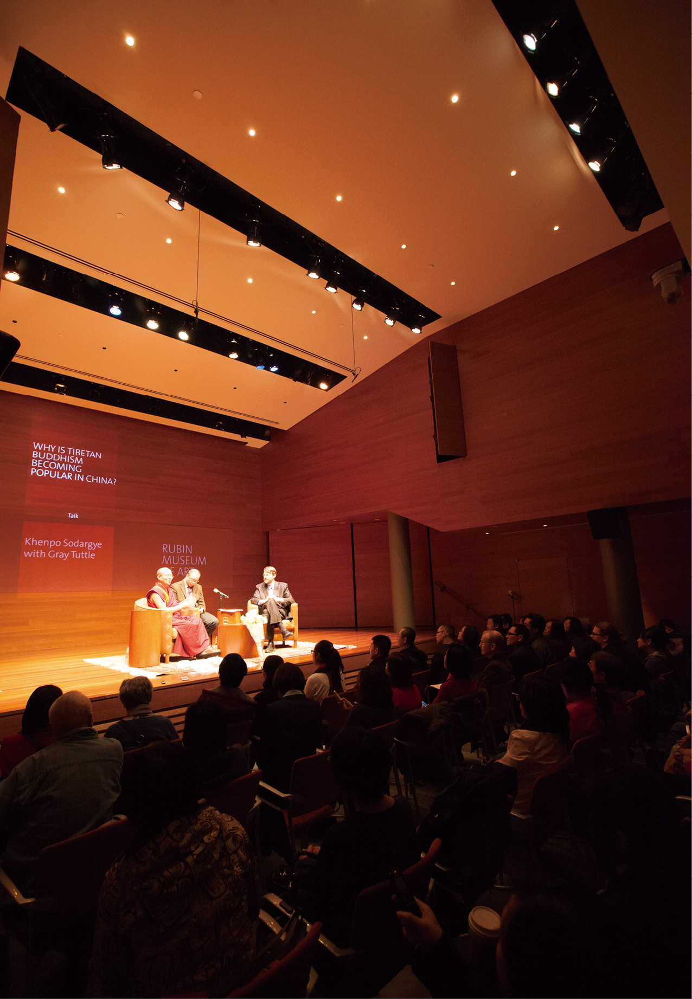
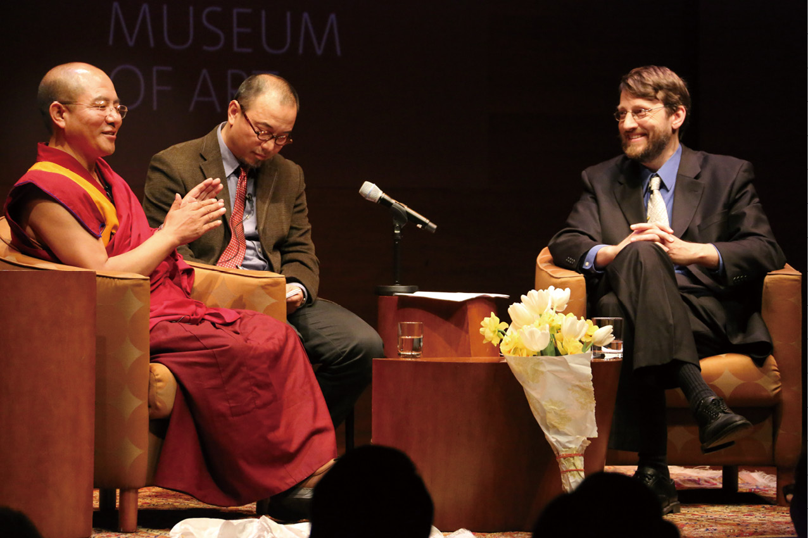

缘聚纽约谈藏密

索达吉堪布 & 滕华睿教授

哥伦比亚大学

Columbia University

2013/04/20

滕华睿（本名格雷·托特，Gray Tuttle）

哈佛大学博士，哥伦比亚大学东亚语言文化系教授，研究方向为西藏历史与宗教。出版的著作有《建构现代中国的藏传佛教徒》《西藏历史的读者》《西藏传统来源》等。

主持人：

相信在座的各位对索达吉堪布已经很熟悉了，我想简单介绍一下今晚的对谈嘉宾滕华睿教授。

滕华睿教授是哥伦比亚大学东亚语言文化系的副教授，研究现代西藏学。最近他的新书《西藏历史的读者》（The Tibetan History Reader）正式出版，并在这里做了庆祝与分享。顺便一提，这本书可以在我们楼上的书店买到。

我们很高兴他又一次来到这里，将与索达吉堪布展开一场对话，探讨藏传佛教目前在中国汉地如此兴盛的原因。这是两位思想家就当今不同民族的文化交流而展开的一场深入探讨，非常荣幸可以聆听他们的对谈。

请大家和我一起欢迎滕华睿教授和索达吉堪布！

1．是什么让他迷上了你——藏传佛教？

滕华睿教授：

感谢各位的到来。首先简单介绍一下今天的尊贵嘉宾：

索达吉堪布，出生于四川省甘孜州的炉霍县。长期在喇荣五明佛学院讲经说法，是著名的佛法导师。五明佛学院坐落于四川西北部，其创办人法王晋美彭措是公认的20世纪的伟大上师，堪布是他座下的主要弟子之一。

一直以来，索达吉堪布以弘扬藏传佛教为己任，特别是宁玛派教法，尤为精通“藏地幸福密码”，将佛教视为一门获取幸福的科学。堪布见证了藏传佛教在中国的兴起，请您为我们简单介绍一下藏传佛教在中国的传播情况。

索达吉堪布：

今天依靠殊胜的因缘，我这么一个来自藏地雪域的出家人，与哥伦比亚大学的滕华睿教授、鲁宾艺术博物馆的蒂姆先生以及在座各位，相聚在此展开思想交流。首先感谢促成了这次相聚的所有人，感谢大家。

滕华睿教授的这个问题，我也思考过很久，可能有两方面的原因。

一方面，藏传佛教目前有着完整的佛法学修体系。我之前看过法尊法师的自传和能海上师的传记。法尊法师在自传里提到，他去藏地的主要目的是想深入学习佛法，他对密宗有浓厚的兴趣，同时也是追随义净等前辈大德，继承他们的翻译事业，填补汉传佛教中的空白。尤其藏传佛教中的五明，囊括了很多世间的知识和技能，如工巧明中的天文、地理、历法，医方明中的药物学和医学，等等。这是法尊法师的求学目的。

能海上师来藏地求学的目的有些不同，他主要是想求学密法。能海上师学佛后，曾在雍和宫看到《大藏经》目录，发觉有很多没有翻译过来的密乘经论，渐渐萌生了学密法的心。刚好那时大勇法师从日本留学回来，他也认为如果学密法，藏密比东密更殊胜。后来，依种种因缘，能海上师两次入藏求学密法。就近代而言，能海上师这样一个汉族人到藏地求学，是非常了不起的。这两位前辈到藏地求学的历史，在滕华睿教授的著作《建构现代中国的藏传佛教徒》中也有提及。

西方有不少人说去西藏是一种虚无主义与空想主义。我觉得各种情况都有，有些是去学密法的，有些是去学五明的，各有各的目的和希求。但对大多数人来说，藏地还保有完整无缺的佛法传承和学修体系，这是切实可信的，并不虚无。

另一方面，当今时代，很多国家和民族的传统文化都在渐渐边缘化、学术化、课题化，藏传佛教作为一种特别古老的智慧，它独特的价值尤为突显——这门心灵科学能滋养我们匮乏的心灵。在物质极度丰盛的当下，人们更需要的是精神食粮，是心灵的粮食。

2．二十年：纽约的喇荣缘

滕华睿教授：

我也在思考，特别像法王晋美彭措这样的上师，在与汉众结缘的过程中扮演着怎样的角色。我有幸听闻了1993年法王在纽约的传法，从那时起，就持续关注佛学院的发展。

您能简单谈谈学院的基本框架吗？比如其独特的教学体系，由学院发展出的组织机构以及弘扬佛法的前景展望。还有您的“藏地幸福密码”，有哪些是从法王时代延续至今的，哪些是法王圆寂后十年当中有所变化的。

索达吉堪布：

是的，二十年前，应该是1993年，我陪上师如意宝来过美国纽约。当时我们在不同的道场中传过一些佛法，也去了全世界最高的世贸大厦。这么宏伟的建筑也是说没就没了，太无常。

前两天我在波士顿和哥伦比亚大学，遇到很多教授，他们都见过法王如意宝，往事历历在目。反倒是我自己，当年还很年轻，每天背着背包跟在法王身后，但现在对很多人和事都记不清了。通过和很多人交流，我发现他们对藏传佛教的信心和重视不是一两天的时间。二十年前，他们就在做这个领域的研究；二十年后，依然投入其中，乐此不疲。我个人而言，非常赞叹他们这种精神。

二十年前，我们在纽约建立了喇荣显密中心，后来在美国各地有了很多显密中心和菩提学会中心，一直延续至今。今天在座的很多知识分子，可能就来自不同的中心。

当初法王如意宝来到纽约时，记得《纽约世界报》还报道过法王晋美彭措是世界上最大的佛学院的院长，学院有两千多僧众，当时已经算很多了。现在的喇荣，人数更多，出家人和居士的人数都在不断增长。尤其是现在的中国，大部分人没有信仰，随着物质水平的快速提高，人们开始意识到内心的满足充实更为重要。

美国的情况也差不多。二十年前的美国，经济水平遥遥领先，但人们渐渐发觉，要在对物质和金钱的追求中找到永恒的快乐是非常难的，他们转而追寻心灵上的快乐。

不管在藏地、汉地或是世界上任何一个地区，我都会告诉大家，如果想要获得真正的幸福，需要从宗教中接受一种心灵的教育。有了它，你会发现自己无论处于何种境遇，都会很快乐。不然的话，可能在短短的时间中你会快乐，比如买房买车的愿望达成后，会很快乐；成家立业获得一点成就后，会很快乐。但随着时间流逝，这些快乐不但会消失，还会转变成痛苦的根本因。所以我觉得，心灵智慧的提升，对大家来说非常重要。

如今的喇荣五明佛学院，法王虽然圆寂了，但法王培养出来相当一批高僧大德，他们有智慧有能力，还有强烈的利他心。在这样集聚了高素质的弘法利生人才的群体中，我想佛法应该能够继续弘扬下去。

3．“藏漂”史今谈

滕华睿教授：

我对这种观点很是好奇，即藏传佛教热潮的兴起是因为人们在寻求超越物质财富之外的更有意义的生活。有一些研究认为，藏传佛教在当今中国兴盛的原因，是来自某种危机，如信仰缺失的危机等等。

堪布刚才也提到在20世纪二三十年代有一阵很强的藏传佛教热，不止吸引了像法尊和能海这样的出家人，在全国范围内也吸引了很多在家人。当时的中国，每个大城市都有佛法中心欢迎上师们到访。人们对密宗仪式和灌顶等有着强烈的兴趣，也不乏认真研习藏传佛教理论的学生。比如重庆的汉藏教理学院，就是那时太虚法师建立的一个汉藏并设、显密兼习的佛学院。

我好奇的是，在当今时代，喜爱密宗灌顶的群体和喜爱显宗的群体之间的比例是怎样的，是否保持着差不多的比例？毕竟在19世纪30年代，法尊和能海只是特例，总体来说，想学习藏传佛教乃至真正付诸行动的汉僧只是极少数。如今有许多汉族僧尼在学习藏传佛教，与之前相比您认为他们有什么不同？

索达吉堪布：

从历史上看，藏传佛教的盛行与执政者的信仰和执政策略有关，尤其是在元朝、清朝。到了近代，太虚大师和法尊法师共同建立的重庆汉藏教理学院，对于藏传佛教的传播在一段时间里起到了非常大的作用，但之后由于种种原因没能延续。

如今，藏传佛教在汉地的传播非常广泛。在学习者的群体中，一部分人是出于信心和往生极乐世界的意乐，其中有老年人，也有文化程度不太高的人；另一部分人是知识分子，我用汉语讲法的二十多年里，发现对藏传佛教感兴趣的知识分子越来越多。

十年前，我做过一个调查，采访了125位知识分子，编成一本书叫《智海浪花》[^1]。我发现，相当多的本科以上的知识分子热爱藏传佛教。除了刚才所讲的几个原因，还有一个原因就是：他们遇到的上师对佛法十分精通，上师并不只让弟子磕头念经，而是能够结合一些世间理念，运用佛教的教理使人信服。这也体现了人们对佛教教义的希求。

此外，还有一种是对清净传承的希求。藏传佛教的传承十分圆满，从佛陀时代一直传到现在。在藏地，需要有相应的传承，才有资格给他人宣讲经典。藏地之外的许多地方，这样重视传承的传统可能不复存在了。

到目前为止，在藏地的知识分子，包括在喇荣学习藏传佛教的人群中，有不少获得了博士学位，有国内的博士，也有海外的博士。这些知识分子来到藏地学习，有些选择出家，有些虽然没有出家，但还是继续待在这里。我想藏传佛教吸引他们的主要特点之一，就是具有完整的理论体系，以及密法里的一些特殊修法。

当然，也有些人是被藏地的其他特点吸引来的，比如藏地的蓝天白云、美丽风景，吸引了无数游客，也吸引了不少画家和摄影爱好者。

4．佛子吃肉——赦无罪？

滕华睿教授：

分享一下很多年前我在中国乘火车的经历。大概十五年前，我在火车上遇到一个人，他正跟随青海的一位藏传上师学习。他非常高兴能够学习藏传佛教，但欢喜的主要原因是因为他觉得自己找到了一个理想的教法：成为佛教徒的同时，还能被开许继续吃肉。他说上师教给他一个咒语能超度他吃过的所有动物。他的确认为这是藏传佛教不同于汉传佛教的地方。他就是一个普普通通的银行职员，在北京南边某处工作。

最初我在五台山遇到过修持藏传佛教的汉族僧人，他们当时住在寺院里修持藏传佛教，同时也吃素。那是我第一次遇到吃素的藏传佛教徒。

我本人已经吃素二十年了，我想知道吃素究竟起到什么作用，或者不吃肉到底有多重要？对于热爱藏传佛教的汉族弟子来说，应该怎样看待这件事？

当然，在藏族历史上，也有像夏嘎巴尊者那样著名的大师是素食者。但总体来说，他们仍属于极少数。而现在在喇荣，目前已经发起一些提倡素食的运动。那么，这是受藏族自身历史的影响，还是受汉族佛教徒的影响，或者这两方面的影响都有？

索达吉堪布：

这个问题很好！您的这段经历，我回头可以分享给汉族弟子，引以为戒。您提到的这位汉族居士的情况，可能和某些上师的言行有关。现在也有类似的情况。大多数藏传佛教的寺院里，出家人都以素食为主，但也有一些吃肉的现象。

我个人而言，十多年来一直强调吃素，原因就是我学习了汉传佛教的传统。我觉得这一传统非常符合大乘教义。后来我们也结合一些藏传佛教大德的教言，对藏地的饮食习惯做过一些分析。过去，藏地雪域的地理环境恶劣，交通不便，蔬菜供给严重不足，这是一个原因。还有一个原因可能是受到了南传佛教中吃三净肉传统的影响。

佛教最究竟的密意，还是在大乘佛教中。佛陀接近涅槃时说过，对小乘的一些开许是暂时的、不究竟的。最究竟的佛陀教法，是不吃任何众生的肉。汉传佛教中的某些传统，如果我们通过观察发现它不合理，也不会接受。但是吃素这一点，确实非常相合于大乘佛教。

如果更多的佛教徒都选择素食，不再吃肉，直接就能挽救很多众生的生命。比如一百多个人吃肉的话，一顿饭可能就要杀掉一头猪或一头牛；反之，如果这一百多人是吃素的，大家想想，日积月累，可以让多少众生免遭杀戮。

我们在佛学院也一直强调，无论汉藏，出家人最好都不要吃肉。我在讲课时说过，想听我的课就不能吃肉，否则不能听法——我用各种方式提倡吃素，现在学院内外的学员基本都吃素。

总之，汉传佛教中吃素的传统，既符合佛陀教言，又真正能利益众生，是非常有意义的。真正的大乘佛教徒，要身体力行地遵循、推广这一传统。

5．居士法师——佛教未来趋势？

滕华睿教授：

我想知道，修持藏传佛教的在家人，未来将发挥怎样的作用？法尊法师在重庆汉藏教理学院任教时，也有一些有博士学位的居士担当老师。同样，在宁玛传承中，特别是像敏珠林寺，也有在家瑜伽士讲法。他们在传承中具有极重要的地位，比如大伏藏师德达朗巴尊者。

所以我想知道，在未来，出家戒律以及不吃肉等伦理规范对领导藏传佛教群体有何重要作用？将来有没有可能以密咒士或在家男女众的身份担任一定的领导角色？

索达吉堪布：

其实佛陀曾讲过，不管出家人还是在家人，都有弘扬佛法的责任。这个说法在佛经中有，在密宗的《时轮金刚》中也有。

从藏传佛教来看，历史上一些了不起的大成就者，就是在家身份，在弘法利生方面做出了突出贡献。当然也有很多出家人。

现在从整体趋势来看，学佛的在家人越来越多，出家人的群体越来越少。尤其是身处这样的时代，灯红酒绿的物质世界令人眼花缭乱，很少人能真正选择出家并守持清净戒律。但以在家人的身份传法，佛经中对此有比较严格的要求。毕竟作为在家人，难免有工作和家庭的各种琐事，心思没有那么纯粹。

如果只是学习佛法，那不管在家、出家，谁都可以学。佛陀也是这么说的，他的教法谁都可以学。如果是去给别人传授佛法，首先自身的德行要过关，其次，自己有过系统的佛法闻思修教育，否则不允许传法。这相当于大学里的讲师或教授，需要有一定的资质才能招收学生。

现如今不管在藏地、汉地，还是其他地区，全部由出家人来传法是不现实的，需要更多的在家人、尤其是知识分子加入传法的行列。只要你对佛教、对众生有责任心，就要担负起传法的重任，力所能及地给合适的人传法。

我对在家人传法的期许是，先当辅导员，辅导和帮助初学者入门，慢慢地，再进行更高深佛法的交流和探讨。现在学佛的在家人群体非常庞大，其中不乏有智之士，希望大家积极地交流智慧，传递正能量。

总之，在家人在合情合理的情况下，每个人都要尽力地传播真理，利益他人。如此对个别群体，乃至对整个社会，都大有裨益。

6．纽约客：别样视角读藏史

索达吉堪布：

您作为一名历史学家，对藏传佛教和藏文化十分重视。我昨天在哥伦比亚大学也遇到很多教授，他们对藏文化也非常重视。

我第一个问题是，哥伦比亚大学对藏文化和藏传佛教的研究情况，大致是怎样的？第二个问题是，您个人这么多年以来，为什么这么重视藏文化并专注于此？

滕华睿教授：

哥伦比亚大学的研究情况，应该和中国研究所的模式有所不同，也不同于德国以及其他欧洲国家的模式。欧洲和中国都有关于西藏的研究项目，但我们的研究模式更适合我们自己。每个人都专注于自己所感兴趣的方向，这是很自然的。

哥伦比亚大学与众不同的地方，就是对现代西藏的研究。这种兴趣影响到整个学校。哥大有八位学者开设了有关藏文化的课程。宗教方面是瑟曼教授和他的学生，侧重于整体上研究藏传佛教，他们还致力于翻译经典，比如把整部藏传佛经翻译成英文。这项工作的意义相当深远，我对此非常钦佩。

关于现代西藏的研究方面，我们对近三四百年的西藏历史尤为热衷，主要研究这段历史的变迁。我想，这正是哥伦比亚大学在藏文化研究方面很独特的地方。

谈到我自己的兴趣，我想很可能与您的汉族弟子非常相似。刚开始是对佛教理论感兴趣，这只是个人的兴趣爱好。在我成长的那个年代，美国有许多对于西藏形势的讨论。我的情况有点特殊，我最初先学了中文。很多美国学者会先去西藏，或者去尼泊尔、印度，寻找藏传佛教的上师。我自己则是先学中文，再学习藏传佛教。

我认为当时由媒体发动的很多争论，明显有一边倒的趋势。当我去中国藏地旅行时，发现那里和西方媒体描述的并不相同，之后除了对藏传佛教感兴趣，我也开始对藏汉历史感兴趣。在媒体的描述里，当时汉地和藏地的关系似乎有些紧张，但当我研究20世纪初的历史时，发现那个时候藏汉两族和睦相处，共同合作，有非常积极的交流。

因此，我想告诉人们历史的另一种陈述，也即两个民族富有成效的交往历史。从那时起，我开始研究藏汉历史，一直追溯到清朝，我发现藏汉之间交流的历史甚至更为久远。我想，回顾这些历史，会对未来充满希望。

[^1]: 《智海浪花》上下二册内容现收录于《没什么放不下》《有什么舍不得》《幸好有烦恼》。
