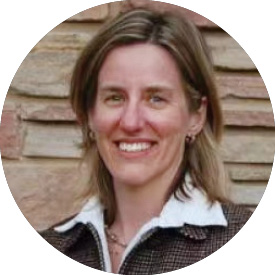
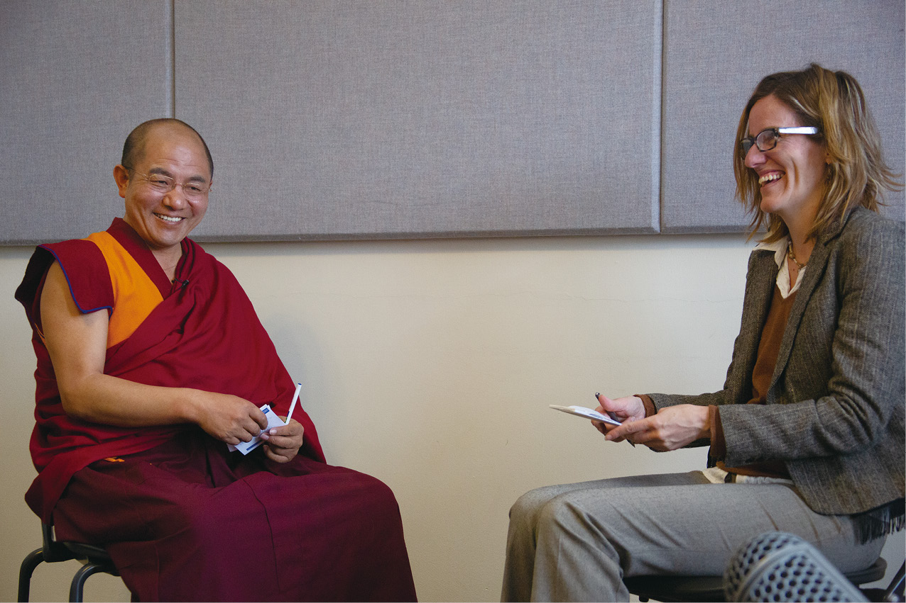

科学时代的佛教

索达吉堪布 & 皓利·盖利教授

科罗拉多大学

University of Colorado

2013/04/23

皓利·盖利（Holly Gayley）

哈佛大学博士，科罗拉多大学博尔德分校宗教研究系副教授，西藏当代佛教文学学者、翻译家。研究重点是佛教密宗中的性别、西藏的伦理改革、中国藏区佛教的复兴等。著有《一生不可分离：一对智者夫妇的生活和情书》《喇荣沟的声音：塑造二十一世纪的藏传佛教》。

1．新时代，新“十善”

皓利·盖利教授：

扎西德勒，感谢堪布今天到访科罗拉多大学，我有一些问题想请教堪布。第一个问题有关十善法。我想知道“新十善法”是什么时候制定的？是由谁提出的？

索达吉堪布：

佛经中有一部《十善业道经》，藏文中有，汉文中也有。在藏地，《十善业道经》的历史十分久远。十善，指的是制止众生身语意造恶的十种方法，也可以叫十善行为准则。国王松赞干布在《十善业道经》的基础上创立了“人规十六条”，这正符合佛经中的行为规范。

如今，喇荣以《十善业道经》为基础，相应这个时代制定了新的行为准则。里面的内容，有些与《十善业道经》相同，有些则是为了顺应时代而加上的。

皓利·盖利教授：

据我所知，诸如不杀牦牛、不抽烟喝酒、不嫖妓这些都是“新十善法”的一部分。我想知道“新十善法”对当今具体的社会问题是否有一定针对性？

索达吉堪布：

一般来说，佛教具有时代性和社会性，其教法也会相应于众生各自的需求。善业指的是他人和自己都能安乐的因，恶业指的是造成他人和自己痛苦的因。

“新十善法”所说的不吸烟、不赌博等，佛经中也指出了这些行为的过患。包括莲花生大士在内的诸多佛教上师，都开示过吸烟的过患以及为自他带来的痛苦。在佛经中，赌博是与教义相违的，它会让人散乱放纵，不能成办任何事，害处极大。

佛教教义之外，对应现在的社会，现代医学也告诉大家吸烟对肺部有害，成千上万的人因为吸烟而丧命。就算是为了健康，现代科学也认为非常有必要戒烟。赌博的情况也是这样。在我的家乡，有些人因为赌博输掉了所有的财产，甚至妻离子散，对社会也造成了极其不良的影响。

为了制止这些问题，为了整个社会的利益，出于这样的发心，我们大家再三商议，结合佛教教义，建立了“新十善法”，这在当今时代是非常有必要的。

2．吃肉：谁杀谁吃，因果有别

皓利·盖利教授：

大部分藏族人并非素食者。如果人们不吃素，同时又受持不杀生戒，发誓不把牦牛卖给屠夫，那么他们食用自家的牦牛肉，相较于去市场上购买肉制品，哪种行为的过失小一些？

我们在课堂中讨论过这些佛教道德问题，从业因果的角度来讲，哪种做法会好一些？

索达吉堪布：

十善法中不杀生这一条，目的不只是为了制定一条法规，而是要明白杀生带来的罪业和过患。为什么呢？因为任何众生都非常爱惜自己的生命。

藏族人是非常信奉佛教的。我平时经常对牧民说，除了杀牛之外，还有很多事情可以做。除了做屠夫，我们还可以耕作、经商等，像世界上很多其他民族一样，依靠自己的技能和智慧也能养活自己。

有些人说，不杀这些动物会影响经济发展。我认为，不杀它们的话，还可以有酸奶、牛奶、酥油等副产品，会带来一定的收入。如果把它们全部杀了，那才真的是毁坏了自己的资源。

“新十善法”所说的不杀生，是从众生生命的价值而言的。如果是信仰佛法的人，我们会呼吁他们不要杀生。如果不信仰佛法，我们会从资源的角度，跟他们探讨这些动物给他们生活带来的持续利益。否则，全部卖到屠宰场，一天中有上百万头牛被宰杀，多么可怕啊！

去市场上买肉制品和自己宰杀还是有差别的。从罪业的角度而言，吃肉是有罪业，但去市场上购买的肉是商品，不是单独为你而宰杀的；如果是自己宰杀，罪业更大。

3．三净肉：慈悲但不环保

皓利·盖利教授：

这就引发了一个很有趣的问题，关于佛教道德与环保理念之间的争论。一个人不想直接杀生，所以去市场买肉，实际上是一种间接杀生。但从生态环保的角度而言，在当地加工肉类更好。

如果藏族人不把牦牛卖给当地的屠宰场，也不为了自己食用而亲自宰杀牦牛，是否就意味着他们需要从其他地方购买肉类，这样就产生了“碳足迹”。这是一个有趣的矛盾，生态环保和佛教道德之间的矛盾。

索达吉堪布：

我是这样认为的，从环保角度而言，肉食对全球变暖的影响很大；从人体自身结构来说，肉食不容易消化，对人们的健康不利。因此，我们应该尽量少吃肉，最好是不吃肉。这样对人类自身和环境来说都是非常有利的。

非佛教徒当中，有很多人为了自己的健康而坚持素食。比如奥巴马总统、克林顿总统，他们也是为了健康和环保而不吃肉。我认为这是很有远见的选择。

现在藏地的肉食不一定要从汉地运进来，而且大多数藏人对肉食并没有那么大的希求，如果需要的话，能在一些小市场里买到。藏地的猪肉一直很少，可能需要从其他地方运来，但牛肉不需要，目前没有听说从汉地运来的情况。

4．佛教VS科学：相同和相异

皓利·盖利教授：

当今佛教与科学之间有所交汇，也展开了很多讨论。对您而言，佛教与科学最能说服人的相同点是什么？最本质的不同是什么？

索达吉堪布：

佛教已有2500多年的历史，而现代科学只有100多年的历史，从历史角度看，二者还是有很大差别。

现在很多人把科学视为唯一的标准，这些人被称为科学主义者。从佛法的角度来说，即使是人们都承许的观点，也要详细观察是否合理。然而，对于科学认定的观点，即便有误，大家也会普遍认同。

两者的相同之处，我认为主要是对外界的分析，宏观和微观都没太大差别。总之，在外界的安立上，两者几乎是一样的。这是我多年观察得出的结论。

对于内心的研究，尤其是心的本体方面，科学的研究成果不太明显。因为科学家更注重外在物质的研究，对内心的研究几乎是空白。心识，用科学是很难解释的，这可以说是科学的欠缺。

因此，与心有关的种种感受，幸福或痛苦，还是需要用佛教或其他宗教的观点加以解释。

5．佛教VS科学：谁识此心？

皓利·盖利教授：

在心识研究方面，科学应该向佛教学习什么？

索达吉堪布：

科学要向佛教学习的，主要是对于心与心所的研究。虽然在心理学中，也稍微涉及了一些，我也看过一些中文书籍，但总体不太满意。

唯识宗的一些论典里，讲到善的心所是怎样的，不善的心所又是怎样的。不善的心所可以分为根本烦恼、随眠烦恼。除了分类之外，还有本体和行为等。

现在高校里有很多关于心的感受方面的研究文献，我也跟很多教授讨论过。比如华中师范大学、北京师范大学，在他们研究心识的学说中，没有像佛教这样细致明确的分类。

暂时来讲，首先有必要研究心与心所；究竟来讲，要修持密宗，通过修证，真正认识自心。尤其是如果能通达大圆满法，不用依靠任何科学家的分析，不用听任何人怎么说，自己就能认识心的本来面目。这一点，我认为是佛教独具的特色。

6．穷而幸福，老而乐观

皓利·盖利教授：

当今社会，人们认为能从外境获得幸福，能通过购买各种物质而快乐起来。比如有很多女性非常注重自己容貌的美丽与穿着的时尚，但对内心的感受一无所知。

我想请教堪布，您认为佛教作为一种引导方法，该如何解决人们物质至上的问题？人们好像正在错误的地方寻找幸福。

索达吉堪布：

痛苦形形色色、多种多样，解决痛苦的方法也有很多。正如您刚才所说，从外境、从物质上是找不到幸福的，应该从内心寻找幸福。

我认为最好的方法是知足少欲。在藏地，年纪大一些的人大多十分虔诚，对物质要求不高，只要能保证基本的生活，不冷不饿，就觉得非常幸福。生活简单但内心满足，说的就是这类人。很多年轻人不是这样了，不信佛也不满足。全世界的国家中，不丹人民的幸福指数很高，他们都修持大乘佛教。这两者之间有一定的关系。

无论年轻还是年老，人们总是担忧自己容貌衰老，青春不再，或者担忧自己的财富消散，由此引发许多痛苦。学佛的人，有能力消除这些痛苦。

传统的藏族妇女对于变老这件事还是很乐观的，她们常常谈论怎样面对青春的消逝，以能面对衰老为荣。其中的关键在于经常观修无常。如果无常修得好，面对任何事，包括自他的种种变化，都能认识到一切无常，从而积极地面对和接受。

美丽的容颜是无常的，世间的任何事都是无常的。友谊破裂，被恋人抛弃，这些遭遇都令人痛苦。但如果从一开始就知道世间本不存在坚固不变的事物——真正生起这样的定解，就会极大减轻执著，更加坚强，这对大家都很有利。至少，遭遇困境时不会选择自杀。

7．佛教VS科学：身体的奥秘

皓利·盖利教授：

密续对身体有非常独特的理解，科学可以从中学到什么？

索达吉堪布：

佛法中也讲了很多气脉明点方面的原理。关于气脉，或者更深的智慧脉，科学对此几乎没有了知。但科学家对于气脉在身体的存在也有不同的解释，在一些科学著作里有所提及。佛经中讲人体里有两万一千虫，现代医学也直接证实了这一点。

我们坐禅的时候，身体的坐姿类似于金字塔，这种形态对身心健康非常有利。科学家也以金字塔为例，来说明坐禅姿势对身体的好处。除此之外，科学家从密宗角度对身体的研究，目前似乎还没有。

8．正确的方法才能深入佛法

皓利·盖利教授：

现今有很多实验对禅修者进行脑电波测试，以此来观察禅修的效果。通过这种方法，科学从佛教中学到了很多。在堪布看来，科学中有没有佛教可以借鉴的地方？

索达吉堪布：

我认为，如果科学家要研究佛教，应该按佛教的窍诀和方法来研究。比如对心识的研究，佛教有很多方法。之前我们也讨论过，学术界内很多研究佛教的老师和学生，在研究的过程中，对于自己无法理解的部分，会视为传说或神话。这种思路是不对的，依靠正确的研究方法，才可以深入佛法。

佛教徒对于科学的参考与借鉴，无论在印度还是藏地都很普遍。印度各个寺院和学校都会学习科学知识，比如天文地理，也出了很多这方面的书。在我们藏地的各个寺院，出家人和学生不光要了解心的本性，也要对科学有所了解。

从我个人来讲，十多年前写了《佛教科学论》，以科学与佛教互相圆融的方式，引用了科学的观点和佛教的观点。很多佛教徒一直在学习。

9．佛教是科学中的科学

皓利·盖利教授：

在了解科学的过程中，是否有什么科学理论或多或少改变了您对佛教的看法？

索达吉堪布：

这个倒是没有。为什么呢？我看过很多科学方面的书籍，比如量子力学、心理学等。科学往往只是对事物进行物质性的分析，给我们的生活带来很多便利，但没有进入更深的层面。

而佛教中的中观、因明等，是我们依靠凡夫的智慧根本无法揣测的。学习了以后，会觉得自己的智慧还很浅薄。

多年来，对于科学的各个领域，我一直在关注和学习，但越学越觉得，真正的佛教是科学中的科学。这并不是因为我是佛教徒就赞叹佛教，也不仅仅是口头上说说，而是发自内心的坚定的定解。

我对佛教的智慧从来没有一丝怀疑，就算有不合理的疑惑，也能依靠其他经论当下遣除。

10．“堪姆”：藏传佛教中的女性传法者

皓利·盖利教授：

昨晚我们提到了堪姆，这很让人振奋。在藏地，第一次有了女性的出家学者。

堪布提到，现在学院有54名堪姆。我想知道，她们是如何被培养的？是否会给藏地其他地方带来影响？或者说，堪姆是否会离开喇荣佛学院，去其他尼众寺院授课？

索达吉堪布：

从历史来看，堪布或堪姆都指讲法的法师，与学校里的老师、教授的意思差不多。正如老师、教授也有男女之分，堪布和堪姆的称呼不同，只是因为性别不同。

在我们学院，真正讲法的堪姆有五十多位，这些堪姆不是只有一个名义上的称呼。堪姆，指的是佛教理论学修方面的学位认定。虽然女众的智慧有高有低，但最少也要在佛学院学修12年以上，才有资格参加堪姆的评选。堪姆的考试内容以佛教理论为主，也有少部分世间知识，方式有讲考、笔考、背考等。

皓利·盖利教授：

她们平时主要做什么呢？

索达吉堪布：

一般来说，每位堪姆座下有两三百名学生，她们在佛学院的工作主要是讲经说法。现在在藏地，相比男众寺院，尼众寺院非常少。最大的尼众寺院可能是喇荣和亚青，其他寺院的尼众并不多。有些尼众较多的寺院，没有能力讲法，堪姆们就会去那里传法。

在藏族历史上，女众为信众讲法和灌顶的很少，直至今日也是如此。法王晋美彭措让门措空行母给信众灌顶，一是体现了佛教中的男女平等；二是空行母本人也非常有功德。在喇荣，无论是堪布、活佛还是一般出家人，都在门措空行母面前接受过灌顶，并依止她为金刚上师。

学院里有堪姆们讲经说法，门措上师又有这么高的地位并且为信众灌顶，所以，现在民众对女性讲法和灌顶不像以前那样轻视，都比较认可。但与堪布相比，堪姆在影响力上还是有一定差距。

11．复兴比丘尼戒

皓利·盖利教授：

现在整个佛教界出现了复兴比丘尼戒的运动。我想知道，堪布以及喇荣佛学院的立场是否也赞成恢复比丘尼戒？

索达吉堪布：

这个问题，哈佛大学的珍妮嘉措教授也很重视。我们学院的热达堪布对戒律非常精通，他正在研究如何在佛学院恢复比丘尼戒的传承。

我个人认为，近几年接受汉地比丘尼戒的传承，还是存在一定的问题。但是如果能从比丘戒传给比丘尼，然后再传给其他尼众，这样也许可以。

这件事与整个佛教界密切相关，不是我们自己做出规定和计划就可以了，还存在“能不能得戒”等很多因素，现在正在研究中。

在恢复比丘尼戒方面，我们学院会尽力而为。至于结果，现在还不是很清楚。

皓利·盖利教授：

每个人都真诚祈愿比丘尼戒能够复兴！这样女性就能完全体现佛陀的教法了。

12．伏藏：佛法也“即时更新”

索达吉堪布：

您的时间非常宝贵，能有今天这样的交流，我感到很高兴。我有几个问题，首先是，您在研究伏藏法，您是如何研究的？有什么成果？研究是出于什么样的发心？虽然汉地也有研究伏藏的学者，但还是非常少。世界上有那么多知识，您多年来一直重视伏藏的研究和学习，原因是什么呢？

皓利·盖利教授：

首先我很高兴堪布能访问科罗拉多大学，并与我们交流。有趣的是，在学术界我们习惯了采访别人，还没有被采访过。我会试着回答堪布的问题。

我认为，伏藏在宗教研究中非常重要。因为伏藏法的开启，实际上是西藏历史中的一种运作机制，令佛法教授一直保持新鲜。换句话说，它是一种革新的机制。人们通常会认为传统是非常僵化和静止的，而伏藏正体现了传统也能不断地自我更新，宗教也有跟随时代变迁的能力，能够满足当前时代的需求。所以我觉得伏藏非常有趣，也有着深远重要的意义。

总之，伏藏是藏传佛教的革新机制，不同时代总有不同的伏藏教法出现。所以，并不是说佛法从印度传入西藏后就一成不变了，总会有新的教法出现于世。

13．教授眼中的法王如意宝

索达吉堪布：

听说你正在翻译晋美彭措法王的《给21世纪藏族人的教言》。作为法王的弟子，我非常高兴也非常感谢。您翻译完大概需要多长时间？最初的发心是什么？

皓利·盖利教授：

法王十分主张传统与现代相结合，也即传统教法与当前社会问题的结合。同时，法王也表述了许多藏地值得骄傲的地方，藏民族和藏地历史都拥有让人骄傲之处。因此，我对晋美彭措法王的教言很感兴趣。

具体来说，教言中包括法王引导现代藏人如何面对社会快速发展所带来的挑战，他对佛教与科学有怎样的看法。这就是我翻译这部教言的原因。

我从2005年开始翻译，目前只完成了开头的二三十页，今年开始要继续翻译，也许得花上三四年时间。因为我手头上同时还有教学任务和其他研究项目等很多事情。

14．男女平等是大问题

索达吉堪布：

您是哈佛大学珍妮嘉措教授的学生，她非常重视男女平等。现在大家都在探讨男女平等的问题。您个人是怎么认为的？将来男女平等的发展趋势会怎样？

皓利·盖利教授：

这是个大问题。我认为相比过去，女性现在拥有很多机会，但这并不意味着平等。以大学为例，同样的工作，女性比男性收入要少，收入方面不平等。并且在家庭中，许多女性仍承担着主要家务。即便她们有工作，如果需要夫妻中的一方全职照看小孩，那一方通常是女性。所以，女性虽然有了更多机会，但男女仍旧不平等。

索达吉堪布：

美国人和藏族人的性格很像，都很直接。

15．美国大学里的佛法课

索达吉堪布：

您是社会科学领域的教授，一直以来从事藏传佛教的研究和学习，您能够讲如此流利的藏语，我感到很稀有。以教授的身份，您真实修持藏传佛教后，有什么值得欢喜的地方吗？有什么体验和觉受吗？

皓利·盖利教授：

在美国，有一种很有趣的界限：佛教的学术研究和个人修持是完全分开的。一个人可以两个都做，但不可以混杂在一起。所以我在上课的时候，不能要求学生禅修，或引导他们禅修。因为宗教信仰和国家教育是完全分开的。这是一所公立学校，不允许有宗教修持。

我有时会带学生去香巴拉法身大佛塔。在这个实地考察活动中，学生可以在舍利塔中学习如何禅修。除此之外，学术和信仰是两个截然不同的领域。二者可以同时进行，但不能混为一谈。

学生们对佛教非常感兴趣，当我教授佛教的课程时，报名的学生总会超出预期人数。我猜测，学生们是出于自身利益而对佛教感兴趣。课堂上只能向学生们介绍佛教观点，讨论佛教哲学，但不可以讨论真实的修持。学生们也很欢喜。

索达吉堪布：

不管是面对藏族学生还是美国学生，从理论层面对佛教做出完整的讲解，非常重要。我去过不少学校，有很多教授在研究藏传佛教，这本身非常好。但他们将藏传佛教的有些内容解释成传说，不知道你们是否也这样？

在美国的学校里，当讲到佛教历史时，很多人都认为其中有一些是古老的神话传说。如果老师这么认为并这么宣说了，学生们可能一辈子都会认为这就是神话传说。

神话和历史这两者有很大的差别。就算以后学生们可能不会真正去实修佛法，但从教学层面，也应该正确地讲解佛教的历史。这非常重要。

皓利·盖利教授：

当然，当然。当我们在课堂上讨论佛教哲学时，学生们都表现得很活跃，这些哲学思想会改变他们的想法。即使是“无常”“无我”这样的基础概念和话题，之前也都闻所未闻，让他们“哇”地叫出来。佛教哲学确实会对学生们产生很大影响，也让他们非常振奋。

索达吉堪布：

您有没有藏族学生？

皓利·盖利教授：

今年有一个藏族学生申请，我希望她能被录取。
