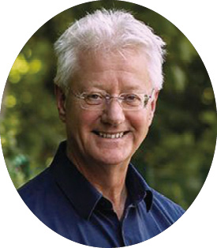
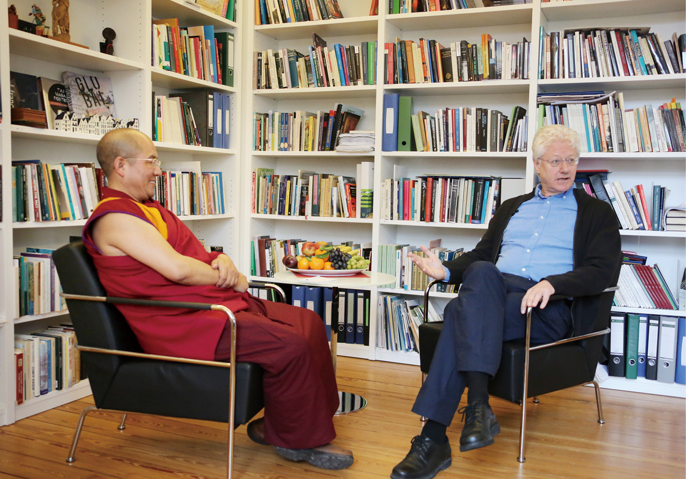
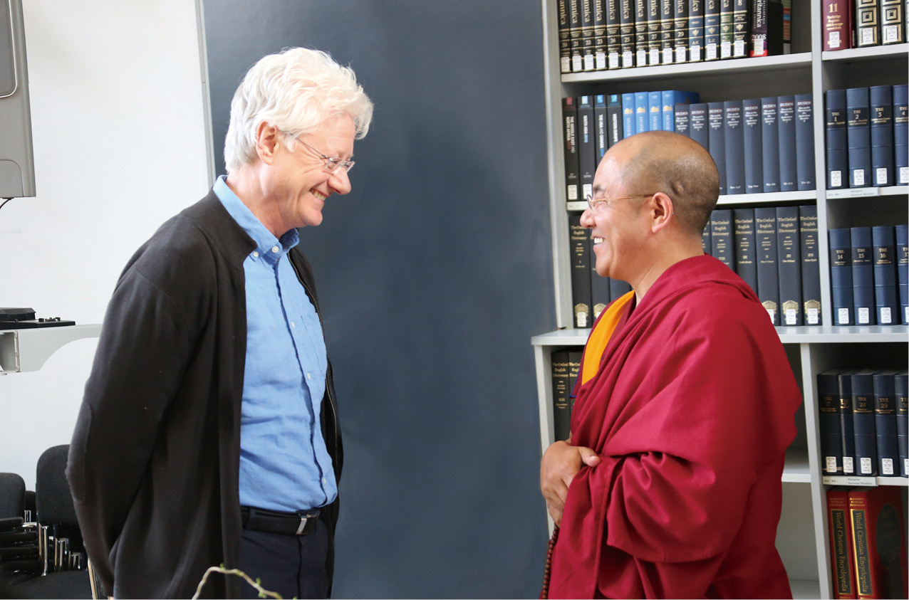

修行者说

索达吉堪布 & 范彼德教授

马普宗教与民族多元研究所

Max Planck Institute for the Study of  
Religious and Ethnic Diversity

2013/04/11

范彼德（Peter Van Der Veer）

荷兰著名学者，人类学家，荷兰皇家艺术与科学学院院士，致力于研究亚洲和欧洲的宗教和民族主义。因其对宗教的社会科学研究，获得“亨德里克·穆勒”奖。曾担任阿姆斯特丹社会科学学院和社会科学研究学院院长，以及国际亚洲研究所董事会主席，乌得勒支大学特聘教授，长期担任马普宗教与民族多元研究所所长。曾在伦敦经济学院、芝加哥大学、密歇根大学、巴黎高等研究院、普林斯顿高等研究院、宾夕法尼亚大学等国际知名大学和研究机构担任访问学者或进行教学。出版专著十几本。

1．藏传佛教，为何与众不同？

范彼德教授：

仁波切这次长途旅行来到西方，访问了美国和欧洲各国。非常欢迎您，也非常高兴能够和像您这样的藏传佛教领袖对话。

我想首先讨论一下什么是藏传佛教，藏传佛教如何有别于汉传佛教、缅甸佛教、斯里兰卡佛教和印度佛教？我们为何要把一门宗教，比如佛教，以不同民族来区分。

索达吉堪布：

很感谢教授和我探讨佛教与科学等不同领域的问题。这次我们的讨论集中在藏传佛教上。我本身长时间修学藏传佛教，同时也对世界上的各个宗教，像印度教、基督教等都特别关心。每个宗教的教义，都在引导人们向上向善、合理控制欲望等，给大家带来了特别大的利益。在那么多宗教之中，为什么西方和汉地有那么多人学习藏传佛教，形成了一种藏传佛教的热潮？我想，东西方的学者很有必要对这种现象加以研究和探讨。这对宗教研究和社会发展，都有一定意义。所以这次交流，我们重点探讨藏传佛教与其他宗教的相关性。

范彼德教授：

我认为有个问题很重要。我觉得佛教在某种环境中发展，就会带上当地的民族性和区域性特点。比如佛教在西藏扎根，就会承载西藏的文化形态。

那么藏传佛教与中国其他佛教宗派有什么关系，有哪些客观关联？中国佛教的不同宗派之间有没有交流？相比其他佛教宗派，藏传佛教给中国带来什么特别的影响？

索达吉堪布：

佛教最早来自印度，传入汉地后，与汉民族的文化相融合，就成为汉传佛教。大概在1300多年前，佛教传入藏地，跟藏文化融合一体，就成为藏传佛教。

总体来说，这两者是殊途同归的，没有什么大的差别，最后的诉求都是成佛，在此过程中要发菩提心，爱护一切众生。总的原则没有差别。

但藏传佛教还有很多汉传佛教现在已经没有的传统，比如重视传承，通过辩论来抉择见解。尤其是藏传佛教非常重视佛教理论的系统性学习和深入探索，这一点与汉传佛教以及世界其他宗教相比，确实是有特别的优势。

2．佛教：是宗教，亦是哲学

范彼德教授：

我们总会轻率地使用“宗教”一词。我们会说佛教是一个宗教，如同基督教、伊斯兰教。严格来讲，您是否认为佛教是宗教？一直有人认为佛教只是一种哲学，因为它不像基督教或伊斯兰教那样重视上帝或造物主。您对这个问题有怎样的立场？佛教到底是宗教还是哲学？

索达吉堪布：

佛教确实是世界四大宗教之一，如果说它不是宗教，也不合理。佛教有着完整的宗教仪式、仪轨和组织。以出家人为例，不同层次的出家人所受戒律和称呼都不同，在服饰上也有明确区分。

与此同时，佛教也是一种哲学。为什么呢？因为它不仅仅是宗教的意识形态或者一种人们想象中简单的世俗教条。我本身研究佛教这么长时间，从佛教的教理来看，它如同一部包罗万象的百科全书。仅仅在藏传佛教中，就包括天文、地理、人类学、社会学、心理学等各种知识理论。而且佛教对这些知识领域都有特别深的探索。

如今的世界，各种各样的事情发生时，于我个人而言，一点都不觉得奇怪。因为不管多稀奇古怪的事情，佛教里都有特别明确的说明和解释。

因此，我认为佛教既是宗教，也是哲学。从某种意义上，佛教不是单纯的宗教，也不像古希腊哲学那样是单纯的哲学，更不是狭隘的东方思想流派。佛教是一种可以与全世界的宗教、哲学完美融合的教育学。

3．人间佛教：当生活就是佛法

范彼德教授：

我想请教有关佛教现代化的问题。中国有一位著名的佛教领袖太虚大师，他试图创立“人间佛教”。在斯里兰卡，也曾有达摩波罗做过同样的事情。以我个人的理解，您也赞同人间佛教和佛教现代化。那么在藏传佛教的传统中，有哪些支持佛教现代化的观点？其他佛教领袖对此有什么批评吗？

索达吉堪布：

我个人认为，对于佛教应该从两方面来理解或者传播。

一方面，它传统的、最甚深的、原汁原味的道理，不能因时代不同、潮流不同而做出很大改变。现在有个别人对佛教的甚深理论和修证不太理解，完全是从世俗的角度，凭个人感觉去解释。这种所谓的现代化，我是不大认同的。因为佛教本身相当深奥，世间人如果不懂，用一种浅显的语言来说明它，很容易造成曲解。

另一方面，佛教应该与当代人们的生活相融合、相适应，这就是“人间佛教”的理念。前几天与我交流的滕华睿教授，在他的著作里介绍了太虚大师与藏传佛教的渊源，还有大师在汉地如何弘扬人间佛教的理念。我本人非常认可人间佛教的理念，只是要强调的是，一定要在保持佛教教义原汁原味的基础上进行弘扬。

佛教中有没有支持人间佛教的依据呢？有。比如“诸恶莫作，诸善奉行”，即一切善事都要去奉行，对人心道德向善的理论和行为都要去弘扬。就我个人来说，建校办学、赈济灾区、资助贫困大学生，这些都会亲力亲为。我们建立了一个基金会，以佛教的理念来推广教育。所以，佛教的现代化非常有必要。

当然，藏民的生活一直与佛教传统紧密结合，从小到大，宗教完全成了他们生活的一部分。所以，在藏地推广这些，要比在汉地容易得多。

4．常于闹市行，不失寂静心

范彼德教授：

根据佛教的传统戒律，佛陀要求弟子舍俗出家，居于寺院修行和做佛事，最终达到自净其意的状态。但要与世人交流，像您现在这样和我交流，游化四方、弘扬佛法，就免不了会扰乱您在寺院中的修持，扰乱您的禅修或其他修行。

所以，应该如何平衡这二者？您如何坚持传统佛教的修持，同时又在现代社会中积极入世？我想这并不容易做到。

索达吉堪布：

所谓的佛教传统，实际上有两种。一种是形式上的传统，比如身着僧袍，居于寺院，做各种佛事，等等。这些也都值得赞许，因为外在形式是内在文化的投射与延续。孔子曾说过，一旦我们遗忘了传统礼仪，礼仪背后的文化也会随之消失。所以，寺庙里的传统没有必要舍弃。

但更重要的一种传统是，通达佛教本身的深奥教义。这些道理没办法用太浅显的理念来表达和传播，很难完全世俗化。

我现在去不同的地方传播佛法，也是佛教的一种传统。佛陀时代，佛陀要求弟子们上至皇宫、下至妓院去传播教理。佛教的教理，实际上就是一种教育。

为了利益众生，不管出家人还是在家人，任何身份的佛教徒都要去社会上弘法。佛教的现代化，要保留佛教的原有教义。在不舍弃传统教理的情况下，可以去适应当代每个人的习惯和理念。

5．当修行者面对现代化浪潮

范彼德教授：

现在这个问题变成佛教和现代化是怎样的关系。很多宗教，如基督教、伊斯兰教等，不能全盘接受现代化，因为他们有着传统的思想和生活方式。他们希望保护这些传统理念，而现代化的世俗生活通常被视为一种威胁。那么现代社会或现代生活有哪些方面是藏传佛教所不能接受的？

索达吉堪布：

任何一个宗教在不同的历史时期存在，都会因为不同时期人们的习惯、生活还有爱好不断地改变。在改变的过程中，包括佛教在内的所有宗教都一定要适应当时的社会。否则的话，确实难以维持。

藏传佛教的教义对一切万法的真理有着特别细致和深入的探索，这种真理和探索的精神在任何时代都不需要改变。我也不担心未来科学技术的发展会将佛教教义和真理摧毁。

与此同时，行持和弘扬佛教的人应该与时俱进，运用现在的技术手段比如网络来推广佛教。网络为我们提供了便捷，但也会让一些佛教徒在其中迷失自己的方向。

现在来看，在传统与世俗之间，藏传佛教中有三类人：一类人非常保守，很少对外接触，也不了解现在的各种科技产品；一类人保持着原来的传统与生活状态，同时也接受现代的思想理念，并会参考科学家的思维方式，结合现代科学知识，与佛教进行对比与探讨；还有一类人基本已经放弃了佛教传统，跟随西方文化，完全世俗化。甚至在藏传佛教的出家人中，也有一部分人觉得修行没有很大的意义，索性去学校里当老师，学一些西方文化。

在这三类人中，我觉得自己是中间那一类人，既要研究和掌握古代传统文化，同时也要看到现在东西方文化和思想理念的趋势。我始终认为，不能太传统、太保守，也不能太世俗化。应该秉持中道，将两者相结合。虽然我个人很喜欢现代文明，但也很重视古代传统。

6．物质·心灵：平衡在中道

范彼德教授：

从19世纪起，世界上兴起的主流意识形态是自由主义和社会主义。前者是资本主义的基础，后者是中国、越南等国家的思想体系。这两种现代的主流思想，以宗教的观点来看，如天主教或伊斯兰教，都是被否定的，被认为是物质主义，只关乎钱与物质生活。藏传佛教如何看待这两种现代思想？

索达吉堪布：

现在提到的自由化思潮，实际上佛陀在佛经当中也讲了，自由是一切快乐的来源。无论是资本主义还是社会主义，每个人的自由心态是很重要的，值得保护。

但是从传统文化来看，也就是说从佛教传统来看，人们应遵从一种基本的为人标准，即道德规范的底线。触碰到了这个底线的话，实际上自由就已经过了线，成了一种不受控的过分状态。有一种说法叫做“自由变成流浪”。

一般而言，从藏传佛教的本义来说，对物质和心灵的重视应该是平衡的。心灵的快乐和满足也很重要，否则，物质再多，内心总是不快乐，生活也会有困难。

另一方面来说，外在的物质也很重要。没有物质资源，光依靠心灵，我们也没有办法生存在这个世界上。物质文明和精神文明要处于平衡状态，偏颇任何一方，都不能给我们带来利益。

作为藏传佛教徒，心的重要性不言而喻，我十分关心内心的来龙去脉，同时也不得不关注物质对人们和社会带来的利益和弊端。物质和心灵这两方面对于藏传佛教和藏文化来说，都是不能偏堕的。

具体到现实生活中，会有不同情况出现。正如天主教和基督教中也有类似情况，传统教徒只管在深山中闭关修行，对外界任何改变都排斥和反对。也有一些人在都市中拼命追求物质，完全忽略心灵世界。

我始终认为，我们要在物质世界和心灵世界之间找到一个比较合理的平衡点。

7．佛教也重男轻女？

范彼德教授：

现代思想中有男女平等的理念，但传统思想并不这么认为。后者认为男女之间有本质的不同，因此有男性高于女性的等级观念。我研究过的印度传统寺院中，全部是男性僧人，印度教不允许女性出家。这有悖于现代男女平等的思想。那么藏地如何看待男性和女性的地位？他们在宗教修持和宗教组织中分别扮演着什么角色？

索达吉堪布：

应该说，佛教一直提倡的平等理念，特别相应于现代人。为什么这么说呢？因为佛教当中，不管男女，都可以平等地出家，平等地受戒。只是女性出家人所受的戒律，如比丘尼戒，戒条多一点。

为什么为女性制定的戒条多，其中的原因我们也研究过。可能是相比较而言，女性的思维更为感性，情绪起伏更大，相应的烦恼也更多一些。除此之外，佛教中男女完全是平等的。不仅男女平等，所有众生在追求快乐和避开痛苦方面也完全平等。

当然，虽然原则上是讲平等，但不可能所有佛教徒都平等，男性与女性的体能、思维方式等都有一些差别。除了佛教徒，世间人的情况也是如此。放眼世界，国家元首、各个领域的佼佼者，整体来看，男性的数量还是要多一点。

我认为佛教当中完全可以说是男女平等的，而藏传佛教是印度佛教的翻版，没有变味，也是这样的。

范彼德教授：

在印度，传统寺院强调的是女性具有生育功能，不能进行禅修。坦白说，我认为很久以来，佛教中的尼众院都非常边缘化。寺院纳受尼众只是近代以来的事情。因此关于佛教当中具有男女平等的观念，我并没有完全被您说服。至少在印度完全没有这种理念，有的只是阶层理念。

天主教里的男女不平等很明显，伊斯兰教也是如此。这些主流宗教都有浓厚的阶层理念，所以我想多听一点您的看法。

索达吉堪布：

佛教当中应该没有不平等的观念。刚才也说了，不管男女，都可以平等地出家。虽然印度教中有不平等的现象，但印度教是在佛教没有出现前就存在已久，它与佛教有一定的差别。

拿我所在的佛学院来说，经由政府批准的男性出家人大约是两千多人，女性出家人有四千多人。女性出家人居多。我所接触的汉地佛教徒，也是女众更多一些。

在家的佛教徒，不管男女，都可以受居士戒。从佛教的教义中，看不出对女性有一种歧视或蔑视，或者在某些方面对她们有所遮止。

实际上，重男轻女是一种时代造就的社会传统，并不是佛教的传统。藏地也有这样的情况，以前男性在家庭里比较强势，拥有更多的权力；而女性相对弱势，更多地为男性服务和付出。现在这种传统逐渐演变成某些地方的习俗或者个别人的行为。提倡男女平等的理念还是很必要的。

单纯从佛教教义来看，我始终认为，并没有对女性的歧视和不平等对待。最多只是对个别女性的习性和烦恼有一些直接描述。

8．宗教与科学：少为人知的关联

范彼德教授：

接下来，我想问一下有关佛教和科学的问题。19世纪的主流宗教已放弃对科学知识的话语权。科学在诸如马普研究所和大学实验室等科研机构中产生，宗教只传播道德理念、道德准则，指导人们的处世行为。

当下科学和道德似乎是各自分开了。藏传佛教也是如此吗？即承认宗教事实上并不能给大众提供自然知识。

索达吉堪布：

我对现代科学与佛教之间的关系一直很感兴趣，以前也写过一本《佛教科学论》，专门就佛教的观点与现在以利益人类为目的的各种科学观念进行对比，探讨其中的异同。

作为佛教徒，对19世纪以来科学家们的发明创造和科学理念，都是认可的；作为科学界人士，对宗教里的所有真理，也不能加以否认，因为宗教当中有很多真理与科学理念完全吻合。

比如藏传佛教中的天文历算。我们学院里也有学习和研究传统历算的天文学小组。这个小组只有六个人，不借助任何科学仪器，按照《时轮金刚》的算法，用两个月左右的时间，可以推算出下一年所有的日食、月食以及其他周期和天气情况，并做出一整年的藏历。这样的传统，从过去一直延续至今。所以我想，科学和宗教之间应该有很神秘的联系。

9．科研虽重，生命弥珍

范彼德教授：

现代科学有没有哪些地方是堪布反对的，认为它违背了传统佛法？举例来说，胚胎在基因工程中的应用，很多宗教认为这是严重的道德问题。目前有一系列科学发现和科学实验遭到许多不同宗教的反对。有哪些科学实验是藏传佛教所排斥和反对的吗？

索达吉堪布：

藏传佛教的理念认为，所有的有情众生，不管人类还是动物，生命同样珍贵。使用动物的解剖实验，各种杀害动物的行为和方法，比如专门杀害动物的毁灭性设备、杀虫剂等等，这些发明创造在佛教中都不赞叹。

我们现在面临的很多问题，比如核问题，实际上是人类的作茧自缚。一些顶尖的人类智慧，反而成为人类的痛苦之因，一旦它落入心术不正之人的手中，有可能造成比两次世界大战更为惨烈的结果。

总之，凡是对生命有害、对人类有害的科学发明创造，藏传佛教都不赞叹。

10．诺贝尔奖得主的摇篮

索达吉堪布：

很高兴在这样的场合中，跟范彼德教授面对面地直接交流。我觉得这个机会很难得。据我了解，马普研究所出现过特别多的诺贝尔奖得主，甚至比一个国家的获奖者都要多得多。我一直以来的疑问是，为什么这个小小的地方有这么多人获得诺贝尔奖？

范彼德教授：

我认为其原因在于，德国是世界上第一个实现工业现代化的国家。19世纪末20世纪初，德国确实是当时最先进的现代化工业国家。同时在德国文化中一直都非常强调科学与知识，这种推崇科学的传统延续至今。整个国家对于教授、学者，对于科学思想都非常尊敬。

德国物质文明的发展和文化传统上对知识的重视，至今仍然是德国文化的主要元素。基于这两点，我认为完全可以回答您这个问题。

11．德国：“人杰”因为“地灵”？

索达吉堪布：

如您所说，德国是现代化工业的发源地，同时对知识文化又非常推崇，但其他地方也可能兼具这两种情况。我还是有一些疑惑：因为人的智慧不是仅仅依靠宣传就能从内在激发出来的，和这个地方的地缘、地貌有没有关系？就像中国经常讲风水，你们有类似的说法吗？

范彼德教授：

德国人所说的“文化”，是一个特别的概念，指在一种特定的环境中，一个民族以一种特定的社会形态生活，由此形成了民族特有的语言和习俗。从黑格尔和费希特以来，有一种观点认为地域和文化之间有一定关联。这和您的想法很接近。

但事实上，德国也发动了两次世界大战。二战结束后，德国失去了它原有的荣耀，曾经的光环转移到其他地方，比如反对君主制的地方。拥有超级力量的地方，转移到了美国的哈佛、斯坦福。而那里的社会形态，其实与哥廷根大相径庭。

思想观念源自哪里的确并不重要，但堪布的想法非常“德国式”。

索达吉堪布：

我知道科学家非常重视客观，往往从客观角度出发研究问题。但从宗教或者佛教的角度来看，不仅客观很重要，主观也同样重要。古今中外一直存在着很多从客观角度解释不清楚、解决不了的问题，具体到我们的日常生活中也是如此。您作为一位科学家，怎么看待这个问题？

范彼德教授：

我是这样思考的：对于人文科学还有我研究的社会科学来说，需要某种主观与客观的互动，这点与藏传佛教的传统相同。具体来说，研究者不能仅仅宣称某些信息只能被自己了知，而是要努力寻找那些其他人也可以了知的信息与数据。作为主体的研究者，有必要把自己所了知的信息普遍化。

但在人类学中，研究内容总与研究者自身息息相关，总有主观因素参与其中。这也是社会科学最大的问题。社会科学试图寻找客观的研究方式，但可能无法用特定的原则限定其研究方式。心理学、社会学都在进一步强化研究方式的客观性，在我的研究领域，我们也更加注重增强主观和客观的互动。

12．上海：消失的宗教场所

索达吉堪布：

我之前在网络上对范彼德教授做过一些了解。您的足迹遍布世界各个大学，对世界各种宗教都有所涉猎和研究，并做出了很大的贡献。非常随喜！同时我也看到您在上海有一些都市宗教多元化的研究项目，想请您分享一下这个项目的主要目的和最近的进展。这样的多元化，是在怎样的推动下进行的？

范彼德教授：

上海比较特殊，直至1949年，上海都是中国佛教、道教以及其他宗教的中心地带。那时上海有很多寺院、圣殿，到处都有进行宗教修持的地方，还有祖先的祠堂，祠堂周围聚居着家族群体。但现在这些完全改变了，现在在上海很难找到公共的宗教活动场所。所以我的研究课题是：它们到哪里去了。

这个问题目前看来更有意义。事实上，上海近二三十年以来一直保持对外开放，对外来者越来越开放。外来人口增长非常迅速，这些外来人群中，有些人来自藏地，有些人来自中国其他地方，同时还带来了自身的宗教信仰。那么宗教活动在哪里进行呢？这个问题其实很简单，我们想知道，在这样一个缺乏公共宗教场所的新环境里，大众如何维持自己的宗教修持？

索达吉堪布：

多元的宗教文化，我个人认为确实重要。世界上有这么多的宗教，都有自己的历史，都需要延续和发展下去。应该是这么一个原则。

13．期待——相约喇荣再“慧”晤

索达吉堪布：

马普研究所历史十分悠久，我想知道，你们之前和现在有没有佛教方面的研究项目？或者是否有将来准备纳入计划的佛教研究项目？

范彼德教授：

我们目前有一个关于台湾佛教的项目，研究“慈济”在中国的发展。同时也有郁丹博士正在研究藏传佛教在中国的发展。

我非常赞成在佛教方面展开深入研究，因为目前有关基督教在中国发展的研究已经太多了。它被视为中国的热门问题，以致研究者越来越多，但是对于佛教发展的研究还很少。我觉得这个领域同样有趣，例如藏传佛教的发展，特别是您和您的团队在中国如何弘法，让越来越多的人追随您。我很赞成展开这样的研究，深入了解您在上海、北京等地如何接触想要学佛的群体或者普通大众。这些具体是如何运作的？

索达吉堪布：

我们佛学院当中，有很多法师，我只是其中之一，其他还有很多，像慈诚罗珠堪布等等，他们对科学也非常感兴趣，而且二十多年来，一直研究汉藏佛教，很有学识。以后如果各方面的因缘具足，很希望能与你们多多交流。

喇荣五明佛学院在中国佛教界有很高的知名度，但我们对社会学、人类学以及科学方面的了解还不深入。虽然我和慈诚罗珠堪布都在研究，也研究了二十多年，也都写了相关著述，但我们很少有机会与全世界的科学家们面对面地共同探讨。以后有机会，我们也愿意提供宗教方面的各种资源进行合作。我们特别感兴趣的是，现代人类在社会、科学方面的智慧精华如何与宗教的智慧相结合，如何通过交流与研究，求同存异，取长补短。外在的物质很重要，内在的心灵也很重要，我们很希望在不同领域展开进一步的探讨。

范彼德教授：

我很赞成您的提议，希望您可以促成这件事。我本人非常愿意参访佛学院，做讲座，与大家交流。我也希望了解佛教在中国的发展状况。有了这样的共识，我非常期待展开进一步的交流合作。

索达吉堪布：

非常好！可以从郁丹教授开始，和佛学院慢慢互动起来。佛学院那边有很多藏族的师生与教授，也有很多汉地的大学生，还有不少欧美留学生回国后在学院出家。

很期待未来范彼德教授能到佛学院来看看，实地了解一下，和佛学院里的知识分子沟通、交流。这是我的一个愿望。

14．地球：多元才更美

索达吉堪布：

我想问最后一个问题。我本身修学藏传佛教已久，虽然对汉传佛教以及其他宗教也有所了解，但我对藏传佛教、藏文化非常执著，觉得是非常珍贵的思想宝库，对全人类来说都很重要。现在很多人包括一些藏族的年轻人，都不知道这些文化传统的珍贵性，甚至觉得它们没什么用，转而去希求其他的知识。

我想问的是，作为社会科学家，您对藏传佛教有什么样的看法？您对藏族年轻的知识分子有什么期许？

范彼德教授：

这是一个多元化的问题，其必要性在于不同的生命形式、不同的生活方式有必要被人类了知，这让我们有能力找到一系列问题的解决方案，包括那些目前还没发现、未来将会出现的问题。

生物学家肯定会强调动植物的多样性对于自然界的延续很有必要，而社会学家、人类学家会说文化的多样性同样必要，可以帮助我们理解不同的反应模式。

保护文化多样性，可以帮助我们面对种种已知的和未知的问题。如此所有的事情不会变得雷同。如今每个人都穿着T恤、看电视节目、开车……全球经济一体化的趋势下，这些都难以避免。但当我们谈到文化与宗教，保护这两者的多样性是非常有益的。

德国人想保护自己的文化传统，法国人想保护自己的文化传统，藏族人也应该同样致力于保护本民族的文化传统，实际上大家都面临类似的处境。客观地说，这是为保护全球文化遗产所做出的一种贡献。

再次感谢您的到来，感谢您和我的交流。与您的交流让我感到非常愉快，因为您很幽默，总能令人开怀大笑，同时又对所有问题有非常深邃的见解。您的到来对我们而言，的确是快乐的享受！
