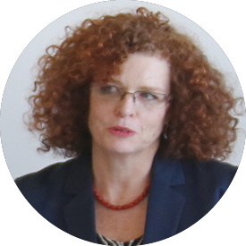
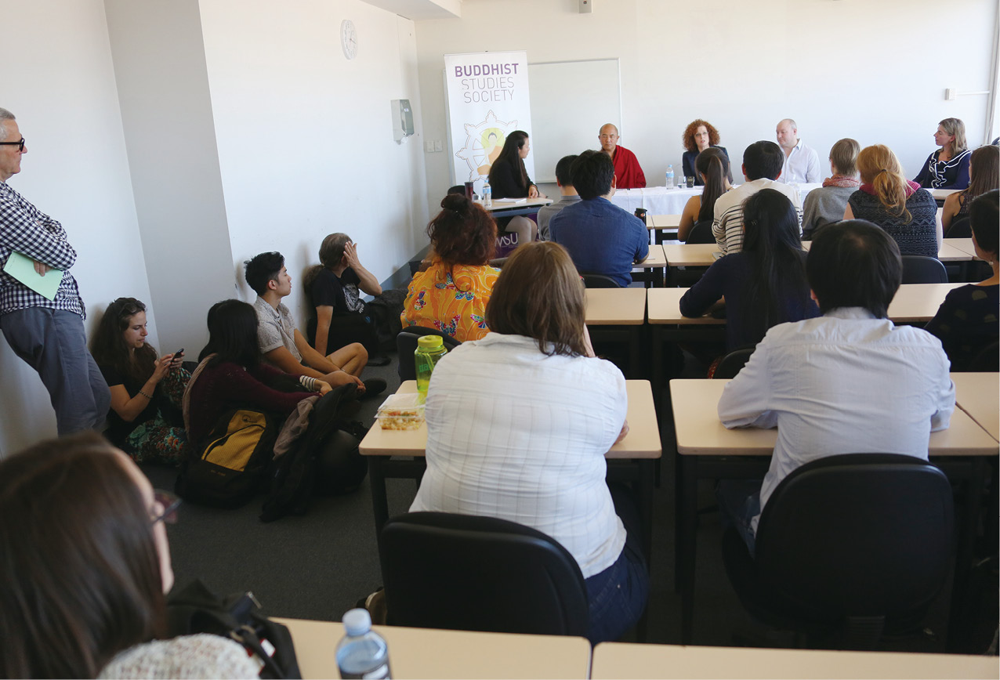
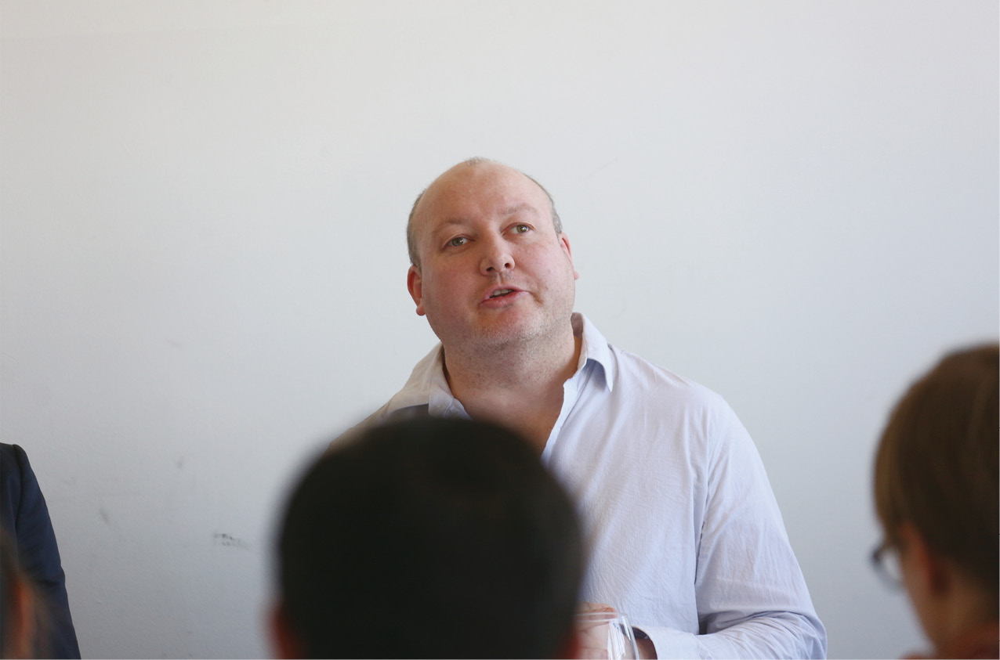
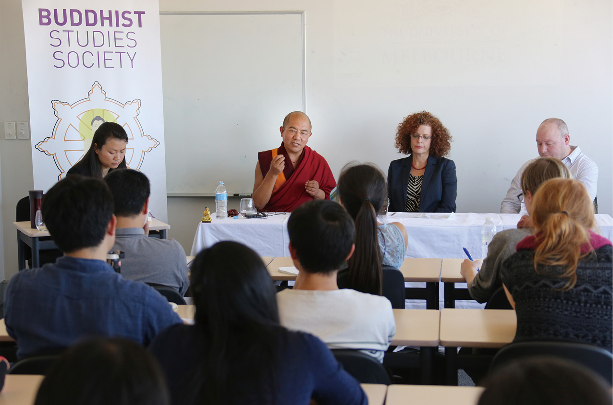
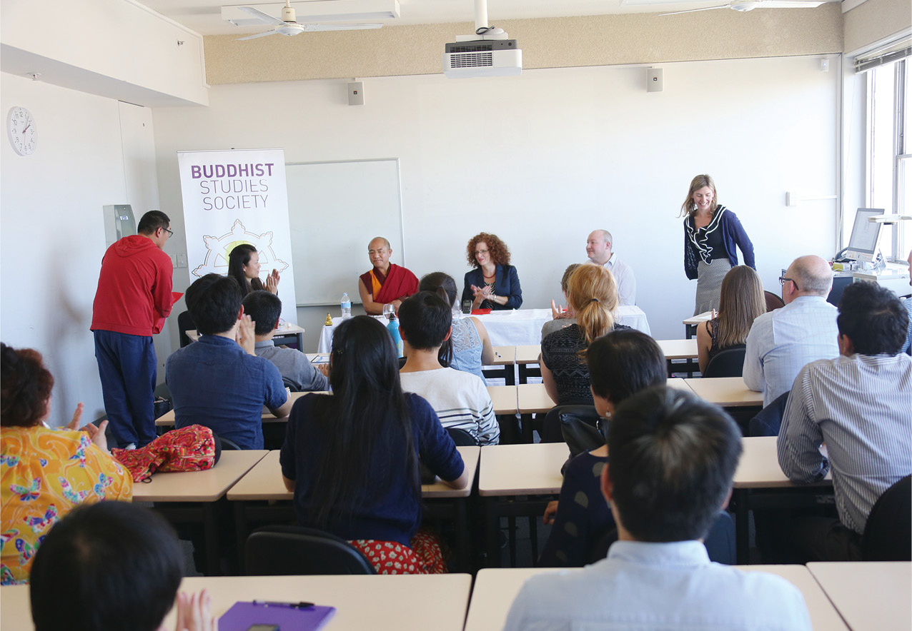

什么是佛教心理学

索达吉堪布&凯瑟琳·格雷戈里博士、  
科里·贝尔博士

澳大利亚墨尔本大学

University of Melbourne,Australia

2014/10/21

凯瑟琳·格雷戈里（Kathleen Gregory）

任职于墨尔本乐卓博大学（La Trobe University），哲学博士，心理学家，佛教修行者。

科里·贝尔（Corey Lee Bell）

在墨尔本大学亚洲研究所获得博士学位。现任悉尼科技大学澳中关系研究所研究员。佛教领域研究者，曾在中国香港、台湾等地学习和生活。

主持人：

今天非常荣幸能够邀请到索达吉堪布和凯瑟琳·格雷戈里（Kathleen Gregory）来到这里，与大家讨论佛教心理学如何提升个人生活和社会的品质。

近年来，佛教受到愈来愈多的关注，这与科技的发展是相符的，因为我们终于可以去量化佛教之道对人类幸福的利益。但究竟什么是佛教之道呢？它跟西方的临床心理学又有什么异同呢？

在西方，我们都知道觉察的重要性，也知道安于当下的益处。但从佛教的角度，只有觉察是否足以孕育出茁壮的人生，同时提升像澳大利亚和当代亚洲国家的社会品质呢？在注定是短暂的人生中，佛教如何让我们在面对困难时保持内心的平静呢？今天的座谈会将会和大家一起深入探讨以上的问题。

下面简单介绍一下参与讨论的各位嘉宾：

索达吉堪布，是世界上最大的藏传佛教学院——喇荣五明佛学院的主管法师。佛学院位于中国四川省。堪布有数百部著作，而他最广为人知的开创性工作，就是把藏文佛教经论翻译成汉文。2013年，他被中国《人物》杂志称为中国最具影响力的藏传佛教领袖。堪布现正在全球最顶尖的大学进行巡回演讲，其中包括他刚去过的耶鲁、斯坦福、普林斯顿等美国大学。

我们很荣幸能够邀请堪布来到墨尔本大学。上周日，他的公开讲座吸引了超过四百位观众。今天是个难得的机会，很幸运我们可以和堪布有更亲密的交流体验。

凯瑟琳·格雷戈里（Kathleen Gregory），是一位大学讲师和心理学家。她负责协调、组织乐卓博大学（La Trobe University）的咨询心理学硕士课程。她修习佛法大概有二十年时间，也定期在以佛教和心理学为主题的交流会和研讨会发表演讲。

科里·贝尔（Corey Lee Bell），是墨尔本大学亚洲学院的一位佛教研究者。他在大中华地区生活了几年，以翻译家、佛教学者和佛教徒的身份工作。

很幸运大家相聚在这里。我想先提问堪布来展开讨论。

请问堪布，什么是佛教心理学？它对人类社会的幸福和快乐有什么贡献？

1．佛教心理学与幸福

索达吉堪布：

我用汉语来回答。佛教心理学是对心理现象的研究，包括意识在今生的一些功能等。此外，它也是对事相的剖析。我认为，它跟西方心理学有一些不同。

现在通常认为，古代西方心理学从属于古希腊哲学。真正的现代西方心理学，是从1879年，由冯特教授（Wilhelm Wundt,1832-1920,德国心理学家）建立第一个心理学研究室开始的。

对于佛教心理学与西方心理学，我也思考了很长时间。总的来说，2500多年前的佛教心理学，对整个人类心理的作用，包括人际关系、人格，还有人心与社会之间的关系，剖析得比较多。这就是我认为的佛教心理学。

我们都知道，无论任何人，其实都在追求幸福。佛教心理学对人生的幸福能否起到作用呢？我个人认为，它在人们的现实生活中起到非常大的积极作用。

其他心理学，有理论研究，也有实际运用。佛教心理学，强调的是在生活中不断地去修行、训练。通过这些训练，心会变得非常调柔。当我们的内心比较调柔的时候，可以在生活中获得很大程度的快乐。

就像我前两天在这里说的，藏地的物质生活，可能没有你们那么富裕，但是大家可以经常找到一些快乐，人与人之间常常微笑相视，普遍没有那么紧张，比较轻松。这是因为藏地的人没有特别强烈的自私自利心。

这是一个比较明显的例子。另外还有不丹，幸福指数很高。2009年，我曾去过那里。当时我跟前一任国王——桑给旺修（འཇིགས་མེད་སེང་གེ་དབང་ཕྱུག་）谈过幸福方面的话题。由于莲花生大士很早就去过那里弘法，所以整个不丹国土有非常非常多的莲师遗迹，包括一些他示现神通的地方和印迹。

不丹各方面都和藏地很像，特别是他们也信仰藏传佛教，整个国家完全成为佛教心理学里描述的那种理想状态。当时国王也说，他们不丹人的满足感，跟其他国家的人有点不同，虽然不丹人对物质也有追求，但跟其他国家的人相比，还是有一定的差别。

所以我认为，如果懂得佛教心理学的话，人们在生活中虽然有各种追求，也寻找快乐，但是不会有那么大的压力，也不会过于紧张、焦虑，甚至恐惧。

主持人：

谢谢堪布！

刚才您提到佛教心理学在实际应用方面，既有理论，也有执行策略。

在西方，虽然我们并不总是相信超自然力量，但我们似乎被正念所吸引——它绝对是超越心理学和精神病学的方法。

凯瑟琳，作为一名佛教修行者和心理学家，您认为正念与佛教心理学有什么关系？除了正念之外，您认为佛教心理学还有哪些方面与我们的幸福有关？

凯瑟琳·格雷戈里博士：

谢谢！感谢有机会来到这里，非常荣幸。

我认为可以从几个方面去解释这个问题。其中一个方面是，西方对正念的理解比较偏重于世俗化，而并非心理学化。引入正念的思想来处理精神压力，甚至运用它来缓解身体不良症状乃至疾病等等，这些想法是一件很棒的事情。但如果通过心理学来理解正念，那会更多地指向另一种对正念的理解，即正念不只是一般性的觉察。

在心理学的框架内，因正念所强调的非判断性，所以它被视为“接受（Acceptance）”，即正念能帮助人们“接受”某种过程或情况。这些都非常有益。

如果放置在佛教的框架中，更广泛地思考正念以及它与心的关系，那么我们会开始思考正念与佛教背景相关的其他方面，以及正念如何帮助应对现代心理学。

尤其在藏传佛教中，强调正念的保持（Retent）。在这方面，正念与忆念相关，行者把注意力拉回到他所要专注的事物上。在寂止禅修时，比如说你所要专注的是你的呼吸，正念会提醒你保持注意力在呼吸上，这样你可以尝试把心安定下来，而不会被念头控制以致遗忘、分散了对呼吸的专注。这种强调忆念与遗忘的看法，让我更欣赏藏传佛教，特别是它在心识层面对修持正念的理解。

作为一名心理学家，我一直致力于处理人类的压力和痛苦。我认为，当我们将正念视为专注于记住我们要记住的、忘记我们要忘记的，那么我们便会开始思考佛教，包括所有的佛教宗派，是如何真正以此为导向的。

比如说八圣道，它真的是从实相或对事物本来面目的理解而发展出来的。这也涉及记住那个实相而不是忘记它。我们忘记了实相，生活在实相之外。我们认为可以牢牢地掌握事情，认为事情不会改变；我们总是忘记实相是无常，我们甚至忘记了从什么角度来理解我们的现实生活。

另一方面，我们记住与自己的想法有关的事情。我们往往会记住负面情绪，追忆那些对我们造成伤害的事情，等等。我们很容易便会忘记，甚至也不关注自己的心，例如忘记了什么是对我们有好处、有帮助的，同时却倾向于记住我们应该要忘记的事情。这些都与八圣道中正念和心理稳定的层面有关。

第三个层面是关于培养良好的品质。修持慈悲、关爱等等，不单能够培养出优质的品格和生活态度，也能帮助我们去忆念那些良善，使我们与它们更接近，对它们更坚定，这样我们会更容易忘记诸如嫉妒和愤怒等负面情绪。那些事情只会扰乱我们的心理。

所以，佛教讲的基本上就是心理学，除此之外没有别的了。去理解、体会佛教就是去处理我们的心理状态，同时我们的心理状态也没有离开佛教的范畴。从某种角度来看，这不仅仅是正念；但从另一种角度来看，你可以说一切都是正念。

主持人：

谢谢！听您说来，对正念的正确理解应该是更广泛的道德行为、慈悲心和……

凯瑟琳·格雷戈里博士：

和正见！

如果从忆念的角度来思考正念，那么无论是寂止修持、回想佛陀教言或者是想到慈悲，其实都是让你的心专注于某种事物或主题，这会有助你的心发展出特定的品质或属性，诸如更善解人意、更随缘、更能忆念慈悲，并在这些品质中让心更安稳。

2．人间佛教：用佛法连接大众与世间

主持人：

太精彩了！非常感谢！

科里，现在我想听您分享在人间佛教方面的研究。您能否告诉我们更多关于人间佛教的知识，还有它如何提升个人生活品质并让社会繁荣呢？

科里·贝尔博士：

在座的大部分人，也就是西方人，需要知道我们现在所认识的佛教与传统佛教是非常不同的。

我的研究兴趣主要在禅宗，也挺喜欢现代佛教的理念，它源于19世纪末的日本。可以说，一方面存在着保留了各种传统和仪式的佛教，另一方面也有我们现在所熟悉的现代佛教。后者为我们的生活带来一种无形的禅意，它的精神超越宗派群体，同时任何哲学、实践手段或研究都无法表达它究竟的价值。这样的价值的确存在，并且是理性的。

现代佛教的理念是超越社会和文化的，其中禅的精神，可以是某些哲学、宗教传统的一部分，同时也是现代人可以随时修持的。我们就是活在一个有现代佛教的社会里。

对现代佛教的批判是，它脱离了体制和文化背景。有趣的是，某些形式的现代佛教，主要是人间佛教，试图回归到体制和文化背景中。

人间佛教从何而来呢？大概是在中国清末革命期间，由太虚大师发起的。他开始把佛教现代化，就像那时的中国正在现代化一样。当时清朝正在衰落，太虚大师试图发起现代佛教，使其相合于现代化中国的新论述，而这与日本佛教的发展非常不同。

佛教的伦理规范有着久远的历史。许多学者也引述过，佛教的特别之处在于，它会在社会走向衰落时蓬勃发展。就是说，当社会出现很多问题，比如战乱时，人们无法忍受，会跟随僧众走进山里，在森林里行持打坐。这就是佛教的共性。

每个朝代末期，都有很多人到寺庙出家。近代之前，佛教和寺庙都是中国人生活的重要组成部分。中国的寺庙曾经同时容纳了数百万人，这真是太神奇了。

其中一个阶段是，从宋朝到明朝末期，即17世纪左右，社会开始崩坏，但人们追寻佛教不是为了逃避，而是把它视为儒家的代替品。在社会开始分崩离析的同时，寺院也会关注如何更新社会伦理。僧侣们会探讨这个话题。他们用什么方法呢？基本上是把个人修行和佛教禅修结合到日常生活中，如在洗碗和砍柴的时候行持佛法。

那佛教在人际关系和社会层面是如何结合的呢？这在明末时期成为焦点。另外还有一些“忠诚僧人（Loyal Monks）”，他们支持明朝朝廷，不愿看到社会的崩溃。僧人如憨山德清等，他们发展出人间佛教的根，一个关注人文事务的佛教。

其中一个例子是，当时一位僧人与一位官员之间发生的有趣的事情。这位官员最喜欢的侄子刚刚去世了。官员去了寺庙，坐在一个房间里吟诗，与僧侣们讨论月亮是圆还是弯。其中一位僧人责骂他道：“你来寺庙谈论月亮是圆还是弯，在这里吟诗，但你的侄子才刚刚在痛苦中死去，你会为此做些什么吗？”接着说：“你应该专注于你的呼吸，这样你会知道世界上所有的人都是你的侄子，或者与你的侄子一样，然后一种大慈大悲心会油然而生。”

那个时期，那些因为时局混乱而失去家园、与社会脱节的人们，在僧侣们的帮助下，回归社会，重新与他人建立联系。这与民国时期人间佛教的背景十分相似。

台湾的人间佛教已经发展得很成熟。那里有四大佛教道场——佛光山、法鼓山、中台山和慈济功德会。这些道场的影响力正扩展到中国大陆并大受欢迎。这些佛教团体的现代化也同样有趣。尽管其中包含了一些现代日本佛教的元素，但他们跟传统日本佛教的现代化并不相同。这些台湾佛教团体试图用不同的方法，将他们的成员与社会联系起来。他们的工作是多方面的，从而形成了一个生态系统。例如，慈济着重于临终关怀，他们会建医院；佛光山和法鼓山着重于教育，他们有自己的教育品牌、奖学金和大学，已经成立好几家大学了；法鼓山同时也着重于环保。我不太清楚中台山的情况。这些佛教团体也建立了和宗教有关的博物馆。

在台湾地区发展出来的人间佛教，在教义或其他方面并不是很现代，但对正在兴起的台湾社会，就它所能够发挥的重要作用而言，肯定是非常现代的。

佛教在中国有潜力，佛教可以为社会大众提供很多帮助，因为它涉及中国人团结的概念、人们在一起的概念、社区的概念，可以运用资源动员人们重新与社会建立联系并持续提供服务。

主持人：

谢谢！非常感谢您！听起来人间佛教体现了一个与大众、世间有联结的佛教，它不是无中生有的，也不是回归自然和逃避世间问题，而是切实地触及人们的生活。

3．每一次痛苦都有它的价值和意义

主持人：

索达吉堪布，我想请问您关于痛苦的问题，还有佛教中如何把生活中的痛苦转为道用。堪布写了一部畅销书叫《苦才是人生》。请问，您认为痛苦在我们这个时代是不可避免的吗？还有我们怎样从痛苦中机智地活过来？

索达吉堪布：

《苦才是人生》大概是两年前的作品吧。刚开始写的时候，只是想把自己平时的一些想法变成一本书，没想到后来还是起到比较大的作用，也比较畅销。目前为止，在汉地的影响还是可以的。

书里面主要讲的是，苦才是人生。很多人也问我：“难道人生没有快乐吗？”“人生的快乐，你们和尚看不到吗？”有很多这方面的问题。

其实人生当中的痛苦，我认为有些是可以避免的，包括我们通过教育来克服自己人生中的一些痛苦等，但有些痛苦，虽然你不愿意，却没办法改变，比如所有人都要经历的死亡、疾病等等。

佛教中有一个非常著名的词叫做“无常”。一切无常法，全部是痛苦的。我们今天拥有的青春、财富、生命，最后都会显现无常。当无常来到的时候，每个人都会失去快乐。就像有些人失去了荣华富贵，会非常痛苦。不管是东南西北的任何人，这种痛苦是你想免也免不了的。所以说人生的痛苦，有些可以减少或者甚至可以避免，但有些确实是必须接受的。大家对此先要有个思想准备，这是很重要的。

面对这种无法避免的痛苦，我们是否能够尽量让自己不受影响，甚至把人生过得更加精彩和丰富呢？实际上，是有方法的。面对人生当中的痛苦，我们可以通过四谛法找到痛苦的根源——贪嗔痴等烦恼，然后以灭除集谛的方式来修道，最后现前没有痛苦的、快乐的灭谛。以上是一种方法。但这已经是佛教中层次比较高的一种做法，大部分人可能没有太多的时间和精力去行持。

另一种方法，就是不要把生活中遇到的任何事情，当作是一种痛苦。我们应该在痛苦的背后，或者在痛苦的本体中，发现它的利益。比如今天受到了名声的打击，或者人生当中遇到特别不快乐、不顺利的事情，很多人往往把它当作是非常不愿意接受的东西。但如果换一个新的角度去观察，觉得这是对我的一个教训、对我人生的一个考验，然后从中寻找真正的快乐和价值。这就是非常好的态度。这种方法是我们一般人也能做到的。

当你在生活中不幸跌倒的时候，一方面要勇敢地站起来，另一方面要找到其中的因缘和价值。其实苦有苦的价值。虽然很多人不愿意接受生活中的痛苦，但是当我们真正用佛教的观点来解释时，其实每一次痛苦都有它的价值和意义。

还有一种方法，就是我们在感到痛苦的时候，尽量想到别人的痛苦。藏地有一个修行人，他在生病的时候，突然看到房子外面有很多更苦的人，于是他在心里面一直想：他们是多么痛苦！这个时候，自然而然，他原来带着自私的痛苦，马上就没有了。

所以说，我们的痛苦，大多数都是由对自我的强烈保护、对自我的执著而引起的。当我们想到利他或者帮助别人的时候，会发现，原来自私的心也可以绽放成利他的花。

4．抑郁症：对痛苦的执著

主持人：

谢谢堪布！

凯瑟琳，关于痛苦的话题，我想讨论一下西方形式的痛苦——抑郁。在澳大利亚，抑郁症是当今令人丧失自顾能力的最主要原因。在2030年，抑郁症将会成为全世界最大的疾病负担。也就是说，相比其他疾病，抑郁症会让全球社会付出更大的代价。作为一名心理学家和佛教徒，您认为佛教心理学能够为我们所面对的社会问题做出什么贡献呢？

凯瑟琳·格雷戈里博士：

我认为堪布的回答已经包含了所有的答案。

抑郁也是一种痛苦。堪布把痛苦分为可以避免的和不可以避免的。从临床角度理解抑郁，在某种程度上仍有其局限性，但里面有些元素一定是关于不可避免的痛苦，即在生活中，一个人对那些不可避免的痛苦可以执著到什么程度。

那我们该如何面对呢？堪布提到我们应如何看待痛苦，并且思维像抑郁症那样的痛苦对我们来说意味着什么。堪布特别谈到在更广阔的框架下，以无常来理解痛苦，特别是我们应怎样看待它们。然后我们会开始注意、正视自身与抑郁症状相关的经历。它们也在变化，不是一直都一成不变。

还有我们对抑郁症发生在自身上时的看法，尤其是在心理和治疗层面。人们更倾向于说抑郁症定义了他们，也对“我是谁”持一种笼统概括的看法；人们很容易倾向于认为，患抑郁症意味着自己有一些缺点，或者在某些方面、某种程度上做得不好。这些都与佛教中关于自我的信念密切相关。

就像堪布所说的那样，在心理层面上，我们把自己看得过于重要。我们会倾向于认为，“哦，我的善良就是我的真实面目”；同样，我们也会倾向于认为，抑郁和愤怒等负面事物才是我的真实面目。这就是我们处理自己的经验或者某种负面经验的方式。

佛教谈到空性和无我，其实是想让我们与它们的意义更接近，并且把它们融入我们的生活中。这正是佛教对我们的要求。我们不能就外在事物的空性和无我进行什么有意义的讨论，除非与自己的心理有关。

正如堪布所说，我们不想面对自己的痛苦。但我们所经历的抑郁或其他心理困扰给了我们一个很好的机会，因为这些烦恼与自己的心理有关，它们就在那里让我们审视。一般来说，我们对自身所经历的痛苦的诠释，还有我们应对痛苦的方式，都会加剧痛苦。其实这是佛教所说的可以避免的痛苦。这些都与佛教的智慧——八正道有关。

至于禅修，我们之前也谈过，你的注意力在哪里？在抑郁状态下，我们会倾向于不断忆念，即将注意力集中在抑郁上，最后便陷入了精神压力永久化的困境。这就是为什么做禅修练习会很有帮助，因为观察并意识到我们的注意力在哪里非常重要。

还有一方面是与道德有关。堪布也举了一个于佛教来说非常重要的例子，说明我们把自己的痛苦看得太个人化。这样做的时候，我们便将自己与其他人割裂开来。反之，想一想同样患有抑郁症的其他人，在他们有需要的时候祝福他们，或者对他人生起同情心，以此将我们的经历与他人联系起来。这些都是关于慈悲和慈爱的积极品质，还有对自己和其他事情培养耐性等等。最重要的就是与自己建立更真实、更慈悲的关系，这将改变我们与抑郁症的关系，甚至可能会改变我们的抑郁。这并不是一种神奇的治疗方法，从根本上说，佛教实际上是把教法融入自身，尤其是在心理方面。

主持人：

谢谢您！非常感谢您！如此说来，佛教是关于我们与自身关系的质量如何的智慧。

凯瑟琳·格雷戈里博士：

绝对是这样的，这是它的根本。如果我们因为患有抑郁症便把自己看得很低，认为自己是失败、绝望的，那么我们与自身关系的质量可想而知，我们是在虐待自己。基本上这就是我们正在做的事情，我们很容易便虐待自己。而佛教是在帮助我们更好地善待自己。

5．人间佛教与集体主义

主持人：

在我们向观众开放问答之前，我有最后一个问题要问科里。

您之前讲到，佛教如何在不同文化中传播。您在大中华区住了一段时间，您觉得澳大利亚和大中华区有什么不同？作为一名心理学家，当我谈及中国时，还会谈及亚洲有一种集体文化，即社区或群体的福祉比个人的福祉更重要。在澳大利亚，则更强调以自我为中心和个人主义。您认为两者有什么不同吗？您认为集体主义和个人主义的区分影响了佛教在中国和澳大利亚的传播方式吗？

科里·贝尔博士：

讨论集体主义和个人主义是挺有意思的。我的导师是刘易斯·梅奥（Lewis Mayo）教授。他从社会科学的角度处理问题，不认同这样的划分。也有很多人持相反的意见。当然，当你身处那些地方，会感受到两者的差别。

首先我想说明它们的区别是什么。以前我也考虑过差不多的问题，想知道集体主义和个人主义的取向有什么不同。我有一位朋友已经出家了。他是澳大利亚人，去了台湾学佛，最后在那里出家。有一次，他和一群佛教信徒去台湾非常有名的阿里山旅行。他们下午2点坐大巴，晚上9点到达山上。那个时候山上已经漆黑一片，什么也做不了了。他们吃了一顿饭，然后就休息了。第二天早上，我的朋友体力充沛，准备去看阿里山闻名的云海和风景。但他们到了外面，就坐上回家的大巴了。

我的朋友说，我们坐了7个小时的车才到达阿里山，什么都没有看到，现在就要回家了？这对他来说完全不合理，太不可思议了。这正好指出了集体主义和个人主义的不同之处。对于西方人来说，你跟团是为了去阿里山；对于很多中国人来说，你去阿里山是为了和团队在一起。这是简单理解两者差异的一种方式。

正如我之前所说，人间佛教就是基于这种将人们聚集在一起的想法。当然还有作为佛教三宝之一的僧伽概念，即达到开悟的主要条件之一是与僧团在一起。一个充满好人、好朋友的团体，这是非常重要的。

在中国台湾，我认为关键是你无法避开人群。你不能避开人群以及人们带给你的压力，因为这是一个如此拥挤的地方。中国香港和其他城市也是如此，你就是无法避开人群。

很多人，包括很多僧人，都说这是一项重要的修持。也有一些人认为你要跑到山上，或者坐在一个与世隔绝的房间里才可以修习佛法。这也很重要。但是和其他人在一起才是你修习过程中最大的考验。

就拿我个人举例，今天我必须准时到达这里，早上当我已经准备好出门的时候，我的伴侣决定要换她的衣服，所以我迟到了。这类情况很常见。人们认识到他人会影响自己的生活，摩擦是不可避免的。

佛陀涅槃后，最早的正式佛教学校之一是上座部，他们有一条最终能让你证悟的道路。这是一条宏大、漫长、复杂的道路，里面阐述了如何在不同的阶段做不同的修行，你要经过不同的阶段才能证悟。有意思的是，在第一个阶段，即僧人在没有获得更高的成就之前，他应该去给患有某些疾病的人处理伤口。他们必须去治疗那些难看、难以相处、资质恶劣、让人不愉快的人。这是他们训练的第一个阶段。基本上你要与人们更亲近，并对他们表现出慈悲心。

佛教里的一个重要教法，说到凡夫有两个欲望，一个是你想与那些给你带来快乐的事物在一起，另一个是你想远离那些让你不快乐的事物。很多时候，我们会遇到不喜欢的人，也不想花时间跟他们在一起。克服这两种欲望正是佛教修行（尤其是人间佛教）的重要部分。

主持人：

太棒了，非常感谢！现在是开放给观众的问答环节。

6．通过修行放松自己的心

观众甲：

刚才堪布提到莲花生大士在不丹时显示神通神变和做加持，不知道现代的人是否还能感受到这些神通神变的能量？

索达吉堪布：

现在的人能不能感受到呢？可能要看因缘。莲花生大士在公元8世纪左右来到藏地，这段历史有不同的文献记载。同时期他也去了不丹，为不丹整个地方做了加持。他确实在石头上留下了身体的很多印迹，藏地也有很多类似的圣迹。

莲花生大士慈悲的力量，在一些特殊的地方应该可以体现出来。至于现在能否在所有众生前显现，我觉得可能要看众生有没有诚心这一因缘。因为莲花生大士现在不在我们这个刹土，他已经前往了罗刹洲。

如果一个地方，能够有像莲花生大士那样真正有威力的人去弘扬佛法、做加持的话，我相信：在那里，人们的信仰、虔诚、智慧等等，都一定会不断地增长。但是具体的神通神变能不能现前呢？很难说清楚。

观众乙：

我想补充两点。首先，我怀疑我们是否应该用痛苦（Suffering）这个字眼。到目前为止，我们还未能把梵文准确地翻译过来。梵文中的苦（Duhkha），它的意思和我们一般所理解的痛苦很不一样。

关于人间佛教，可以追溯到公元前２世纪，当时佛教在印度北部和中部发展得很兴盛。佛教徒不仅筹募资金，也会参与本地政治。有证据显示，他们会建水坝，做水利工程，给社区捐钱，建漂亮的寺庙，等等。当地人虽然不清楚什么是佛教思想或佛教心理学，但他们会被佛教吸引，因为僧团会帮他们建立社区和家园。

凯瑟琳·格雷戈里博士：

我同意有时候我们会把苦（Duhkha）翻译为不满意（Dissatisfaction）或者不满足（Unsatisfactoriness）。但我认为，当你投入修行，并真的经验到因陷入负面心态而生的痛苦感，那就是我们自己、人类都会感受到的痛苦（Suffering）。

科里·贝尔博士：

梵文的苦（Duhkha）肯定包含痛苦（Suffering），它是更广义的不满足（Unsatisfactoriness），或者不符合个人期待的状态，等等。它的意义真的是很广的。痛苦（Suffering）没有完全囊括苦（Duhkha）的语义，但它肯定让我对苦（Duhkha）的意思有所理解。

观众丙：

刚才提到很多人都有抑郁。我可以证实这一点，因为我的朋友常常说“我很累”“我压力很大”“我很生气”，如今这些状态非常普遍。

您提到人们不把自己看成是良善的，我确实很少听到其他人说“我是个好人”“我很善良”。但其实每个人都有好的品质。当与病人或抑郁的人沟通时，您会跟他们说什么，让他们意识到自己可以重拾快乐？

凯瑟琳·格雷戈里博士：

我会说：“为什么你就是不能改变自己的心态？”

我们会选择佛教的修持并改变自己的心态。我想，必须在这方面下功夫。佛教修行始于约束。在小乘中，你要约束你的心。你要觉知，同时约束你的心不要朝着负面的方向发展。在大乘中，我们培养良好的品质，同时培养自己更积极、正面的态度。

我想我们需要放松一点。作为心理学家，我们太认真看待自己的心理状态了。我们需要放松，我们心理学化得有点心理病了。我不知道这里有多少心理学的学生，但你们现在一定要知道这一点。说实在的，我们太认真看待我们的心理学了，它其实没有那么神奇和与众不同，它甚至不是什么难题。我认为这里有一种态度，就是好奇我们的心究竟在发生什么事情，这是一个很重要的开始。

我常常说，不要把你自己变成你的研究项目。我们把自己变成研究项目，然后突然发现自己很负面，接着又要刻意提醒自己变得正面。我们总是试图超越自己、试图对我们的心保持警惕，而正是诸如此类的想法和态度让我们陷入困境。

你的问题问得很好，我们应该如何调整呢？放松一下我们的心，保持觉知。同时不要那么容易便对任何事情着迷。谢谢！

主持人：

今天的座谈会就此结束。我代表墨尔本大学和佛学会感谢索达吉堪布仁波切、凯瑟琳、科里。这是一次非常有趣的跨学科、跨文化的对话。我觉得非常有意思！
