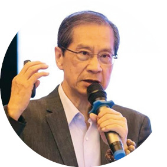
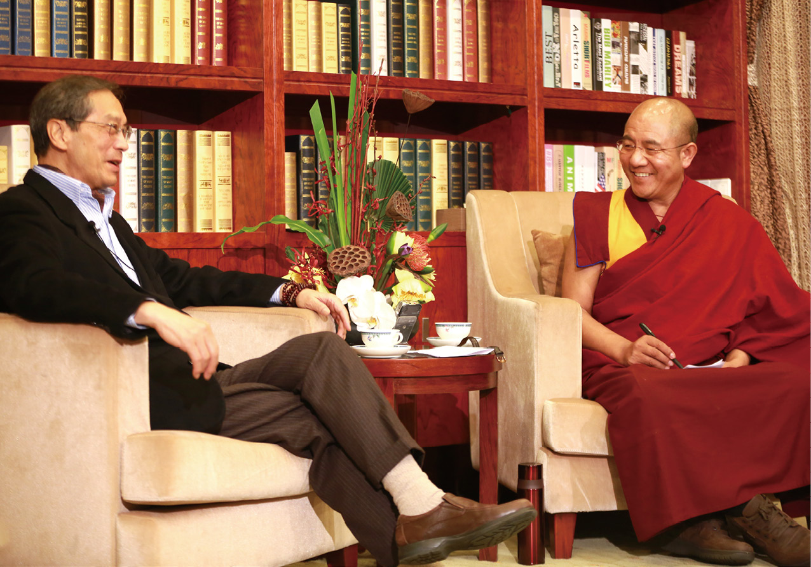
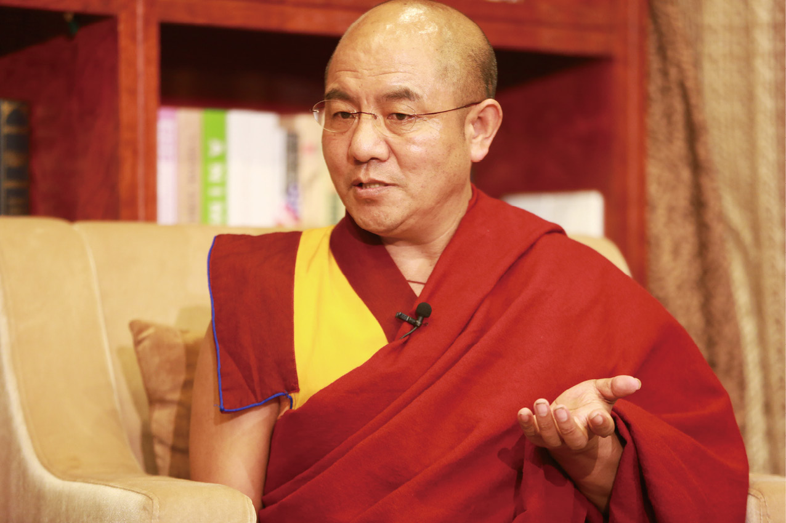

# 从大学校长到佛法传播者

索达吉堪布 & 潘宗光教授

中国·上海

Shanghai, China

2016/11/22

潘宗光（Poon Chung kwong）

国际著名化学家，英国皇家化学学会院士。大英帝国勋章获得者，金紫荆星章获得者，太平绅士。英国伦敦大学学院哲学博士和科学博士，曾任香港理工大学校长长达18年。1985年和1991年两次被提名为诺贝尔化学奖候选人。

1．极乐世界存在的科学原理

索达吉堪布：

今天特别高兴又见到了潘教授。我们之前在香港、清迈等地已经多次见面了，因为您数次参加“世界青年佛学研讨会”，为学生们做了很多科学和佛学方面的讲座，同时我们俩也有一些机会单独对话。

今天我想利用这个机会，向潘教授再做一番请教。首先，我想在科学与净土法门的关系方面提些问题。另外，现在很多企业家将禅修和佛学融入企业管理，这方面特别受关注。您也曾在不同的社会演讲中，将禅修和企业管理相结合。我们也可以谈谈这方面的内容。

您是非常著名的科学家，多次获得诺贝尔奖提名，不仅是英国皇家化学学会院士，还获得多个博士学位。这些荣誉和头衔，证明了您的智慧以及您在科学研究领域的地位。科学家要想获得这些荣誉很不容易，现在很多年轻的科学家都在努力追求这些成就。

您是名副其实的科学家，后来在进行科学工作的同时开始学习佛法。与其他科学家学习佛法不同，您是一个虔诚的佛教徒，而且对往生极乐世界很有把握。每次您做相关演讲，比如去年您在世青会的演讲，言语中都会流露出离开这个世间时往生极乐世界的强烈愿望。

现在很多人认为西方极乐世界是一种迷信说法，也认为佛教里的很多东西属于迷信。很多年轻人，包括一些有智慧的成年人，都抱持这种观点。

您既是一位科学家，也可以说是一位佛学家，您是如何融合科学研究与佛学修行的？

科学是讲求客观和实证的，非常严谨，而往生极乐世界是很抽象也很神秘的一种境界。您是通过什么动力走上了这样一条道路？

潘宗光教授：

我是科学家，肯定不会轻易迷信一个宗教。我对佛教的认同、接受与修行，经过了一段漫长时间的探讨与研究。

佛教与其他宗教并不相同。首先，佛教不相信一个主宰一切、创造一切的神。佛教的整体理论来自佛陀对宇宙本体、宇宙自然规律的充分认知。其次，佛陀发现，人类的烦恼源于经常做一些违背自然规律的事情。只要回归自然，烦恼就没有了。

举个例子，我们经常说现在雾霾很严重。雾霾是怎么来的呢？空气本来是好好的，人类吸入氧气、呼出二氧化碳，树木、森林让二氧化碳与氧气的比例保持平衡。但是人类的贪心制造了大量二氧化碳，同时还砍伐树木、森林，使得平衡被打破，导致了如今的后果。

现在我们提倡环保，就是提倡不要再排放过多的二氧化碳，也不要砍伐森林，要多种树木，等等。当我们尊重大自然的规律，能够重新回归到自然的状态，这些烦恼也就没有了。

了解之后，我们就会发现，原来佛陀教导我们的道理，包含了很多自然规律，甚至包括对整个宇宙的认识。佛陀将这些自然规律变成教材和经典，告诉我们如何遵循规律，调整自身。

现代科学家希望从科学角度了知宇宙是如何诞生的，宇宙的规律是什么。可以说，科学与佛学是从不同的渠道探索宇宙规律，两者殊途同归。从这个角度来看，佛法与科学有着相同的目标。佛教的理论、教材、经典，与现代科学完全没有冲突。

我不是在证明佛陀是否正确，但从现代科学对宇宙的认知来看，至少可以说，与佛教理论没有冲突，这其中也包括净土法门。

净土法门，是佛陀教导我们的修行法门。佛陀曾针对不同根器、不同背景的佛弟子，传授了很多道理和方法，最终目的都是让我们可以出离轮回。

在佛陀正法时代的五百年中，人们的善根普遍比较强，福报比较大，再加上佛的加持，修行佛法很容易就能得到解脱。之后一千年的像法时代，解脱就比较困难了，整个社会不再那么好，人心也慢慢没有那么纯，所以修行者有成功的，也有失败的。佛陀说，再往后一万年，到了末法时代，普通大众的根器不行，善根很弱，福报很小，共业太重，修行者的修法机会也越来越差。在这种环境下，我们要修佛法，要通过自己的努力开悟、解脱，非常非常困难。

佛陀曾说，在正法时代，佛弟子只要守戒就可以开悟；在像法时代，佛弟子只要修禅定，心安定下来，也有很大机会可以开悟；但在末法时代就不行了，仅仅依靠修禅、修戒我们无法成就，唯一可以帮助我们的方便法门就是往生净土。这些道理，佛陀讲得清清楚楚。

佛陀讲经的四十九年中，不断告诉我们往生净土的重要性。比如《华严经》中，普贤菩萨的《行愿品》里在不同阶段都讲到净土。与我们最有缘分的四位大菩萨——观世音菩萨、普贤菩萨、文殊菩萨、地藏菩萨，除了地藏菩萨的大愿很特别以外，跟我们有密切关系的观世音菩萨、非常有智慧的文殊菩萨、大行普贤菩萨都鼓励我们往生净土。

我们跟阿弥陀佛因缘很深，见面时会自然说出“阿弥陀佛、阿弥陀佛”，这说明我们心里有“阿弥陀佛”的种子。按理说，释迦牟尼佛是我们的本师，我们应该称呼的是释迦牟尼佛。但跟我们关系最密切的，却是阿弥陀佛，他与观世音菩萨同属于“西方三圣”。

我一直在思考为什么如此奇妙。从表面上来看，净土好像是一种比较迷信的说法，无法用科学解释。为什么念一句阿弥陀佛就能往生净土呢？

极乐净土本来并不存在，是法藏比丘发愿，经过漫长的修行后，从无到有地创建了这块净土，创造了这个极乐世界。

另外，净土那么远，《佛说阿弥陀经》里说，极乐世界离我们有十万亿个佛土那么远。我们可以去那么远的地方吗？

在我看来，很多知识分子不接受净土法门主要有四大问题：第一，净土真的是阿弥陀佛从无到有创造出来的吗？第二，西方极乐净土不停接引十方世界的无量众生，会不会有人满为患的问题？第三，只念一句阿弥陀佛就能往生，真的那么容易吗？第四，净土有十万亿个佛土那么远，无论坐多快的交通工具也无法到达，我们真的可以去吗？

我一直在思考这四个问题，后来发现，以现在科学家对整个宇宙的认知，这些问题与科学没有冲突，可以从科学的角度来解释这些问题。我也跟大家分享一下，希望批评净土是迷信、不科学的人可以重新思考一下。

在这四个问题中，最简单的是第三个问题：“只念阿弥陀佛就可以去净土吗？”对于这个问题，我有一个很好的例子来做比喻。

我们用电视机收看某个电视台节目的原理是什么？是电视台将自己节目的画面、音乐转化成能量波，传播到空气中。为了避免不同电视台互相干扰，每家电视台的能量波都有各自独特的频率，这个频率是这家电视台的，那个频率是那家电视台的。只要我们调整电视机的接收频率，与某家电视台的频率一致，就可以收看这家电视台的电视节目。这就是物理学所说的，通过同一个频率，能量自然就可以接收和转移。

尽管我们看不到，但现在空气中其实存在着很多不同电视台的能量波。只要我们调整好自己的电视机的频率，与某一个电视台接轨，就只会接收这个电视台的能量波，其他的能量波绝对不会形成干扰。

同理，我可以这样想：西方极乐净土是阿弥陀佛的国度，这尊佛的能量极其强大，西方极乐净土就好像一家庞大的电视台，发出的能量波可以穿越太空，也包括我们所在的地球。

我们身处的空气里，就有极乐世界的能量波存在，只要调整自己的接收能力，因缘具足，就能跟阿弥陀佛极乐净土的能量波接轨，也就是理论上的互相感应。

西方极乐世界这家电视台的频率是什么呢？我们不知道。但本师释迦牟尼佛传达了一个信息给我们：频率就是“阿弥陀佛”四个字。

“阿弥陀佛”是一种声音，声音是有频率的。因为“阿弥陀佛”是从印度的梵文音译过来的，无论你用普通话说，还是用英文说，听着略有不同，但差别不大，频率也差不多。

因此只要我们念“阿弥陀佛”，就会跟空气里极乐世界的能量波接轨。我们越多念“阿弥陀佛”，接收的能量波就会越强大，所以要不停地、专心地念，这样在我们的潜意识，也就是阿赖耶识上，接收的这种能量就会不断增加。

只要这种能量积累到一定程度，临终时当神识离开我们的身体，神识里“阿弥陀佛”的种子就会与空气中极乐世界的能量波接轨，很容易被那种强大的能量接收过去。

可见，往生净土的原理与现代科学没有冲突。

此外，我们现在经常使用电脑。你怎么开启自己的电脑？一般是通过一个密码。这个密码可能是一组文字或数字，也可以是一组声音。那么依靠“阿弥陀佛”这个声音，也会打开通往净土的大门，就好像我们用密码开启电脑一样。

所以，念一句“阿弥陀佛”，就能够跟极乐世界接轨，最终通过这个接收能力往生净土。如果我们希望到其他净土，可能要采取不同的方法，但要到极乐净土，“阿弥陀佛”就能使个人与能量场接轨。这是我的个人看法，可能不对，但起码我是这样体会的。

索达吉堪布：

潘教授所说的确实非常有意义，尤其是您的四个问题：一是极乐世界从无到有；二是那里可以接纳无数众生；三是一句“阿弥陀佛”可以往生极乐世界；四是即便距离我们如此遥远，也能通过阿弥陀佛不可思议的发愿力接引众生。

说到您所举的例子，佛教与科学一样，会以不同事物某个特点的相似性做比喻，而不需要本体与喻体从所有角度都相同。佛教不需要这样，而科学中所举的例子也很少是这样的。

我觉得这个比喻在当代，尤其在当下的网络时代非常有意义，应该引发大家对很多不可思议的道理进行深入思索。

2．我为什么念阿弥陀佛

索达吉堪布：

我想请教一下，您作为科学家，现在是否经常修行净土法门？因为有些科学家只是在理论上探索，自己不会真正实修。您是否希望往生极乐世界，并经常念佛？

潘宗光教授：

是的。很多汉传佛教徒一般对打坐、禅修很有兴趣。他们会以打坐为主要修行方式，每天打坐，希望以此修心。因为佛教中最重要的，就是通过修心达到宁静、安乐的境界。

我曾问过身边的朋友：我们为什么修佛？很多人认为修佛是为了生活可以安乐、平静、自在，希望一生快乐无忧。这样也可以。

但假如我们是相信轮回的佛教徒，那就不一样了。假如我们只有一生，那希求这一生快快乐乐就可以了；但假如存在轮回，这就不够了。我们今生作为人真的不容易，要受轮回之苦，但同时人身难得，我们也要争取在这一生尽量可以脱离轮回。

如果我们希望脱离轮回，依靠做善事、打坐修禅，行不行？这是一个问题。过去有很多人通过看佛经、修心、打坐，慢慢开悟，但对于末法时代的众生来说，佛法虽好，但我们本身根器不佳、善根不够，很难凭借个人的力量来修那么殊胜的佛法。

我过去跟很多不同的老师学习打坐，为此还去了缅甸，学南传佛教学的打坐。我一直长时间打坐，还学过道教的打坐方法，融合到自己的打坐方法里。所以其实我打坐的功夫还不错。

有一次我在打坐时，突然问了自己一个问题：我这样打坐、修行，今生可以摆脱轮回吗？自问之后，心中清清楚楚地知道答案：没有可能。

佛经里说，大乘菩萨的修行要经过五十二个阶位：十信、十住、十行、十回向，等等。从发心修行到成佛需要很漫长的时间。假如修小乘，则要经过四禅八定，从欲界到色界、无色界，但即便到第八定非想非非想处定，还是无法摆脱轮回，一直要到第九定灭尽定的阿罗汉才可以。

我潘宗光哪有能力修四禅八定，哪有能力到第八定，今生绝对没有可能。当时我就很苦恼，不知道应该怎么办。后来我突然想到，我跟观音菩萨有很深厚的缘分，从小我就信观音。都说观音菩萨救苦救难，这个苦难是指什么呢？

一般人求观音菩萨，是为了实现一些小愿望，比如求财、求子等等。这些愿望无法满足是很小的痛苦。其实人生最苦的苦是轮回之苦，最困难的难是如何摆脱轮回。

所以我认为，观音菩萨到娑婆世界救苦救难的最终目的，是帮助我们摆脱轮回。如何摆脱轮回呢？观音菩萨是西方三圣之一，他的方法是帮助我们到净土去。我又想到本师释迦牟尼佛，他在不同阶段也多次介绍过净土法门。由此我认为，净土法门可能是一条很好的出路。

我过去对净土完全不了解，也没有看过净土方面的经典。为了多了解净土法门，我开始看《净土三经》，看很多高僧大德对净土的体会等。越看越觉得这是唯一的出路。

个人力量有限，在末法时代单靠自己修行、打坐，从而获得解脱，有一定的困难。一定要依靠有强大力量的人帮助我，才可以成功。这个人是谁，他来自哪里？本师释迦牟尼佛很清楚地告诉我们，这个人就是阿弥陀佛，这个强大的他力就是阿弥陀佛大慈大悲的愿力，可以帮助我们往生净土。

之后，我就开始慢慢阅读净土经典，不断修行，念阿弥陀佛。我修习这个法门差不多有五六年了。每当我专心念阿弥陀佛，发愿去极乐世界，下意识就有种感觉：我走的路是正确的。只要坚持信念，发大愿往生，念阿弥陀佛，同时发菩提心帮助其他人一起往生净土，我相信自己终会成就。

为什么要发菩提心呢？极乐世界是非常殊胜的大乘修行道场，我们往生净土不单单是为了自己解脱，还希望能在那里增强自己的能量，再回到娑婆世界利益无量众生。这才是往生净土最主要的目标。

所以发菩提心非常重要。我的亲朋好友，他们实在有太多苦了，假如能多一个人回来帮助他们，会对他们很有益。

只要我们在轮回中，首先就要自度，不自度哪能度他？我修净土以后，整个人都有很大的改变。

索达吉堪布：

这是很好的修行方法，其实我们也修净土。虽然我们在学显宗和密宗的各种经典，但是我们的上师——法王晋美彭措，他也是发愿往生极乐世界，他的传承弟子们也希求往生极乐世界。

不管藏传佛教还是汉传佛教，我们都有往生净土的共同愿望。再加上刚才您讲的，不仅仅是独自往生，更重要的是依靠菩提心到达极乐世界，将来再回来利益众生。这样的道理，其实也是现在很多人特别需要知道的。

3．年轻人也要念佛

索达吉堪布：

汉地和藏地的部分人会认为，往生净土法是年纪大的时候才需要去修，年轻人一般都去学习其他佛法、研究科学，认为年轻时不用修行净土法门。

但我的看法是，年轻的时候，也是一个人智慧比较旺盛的时候，做任何事情都比较有力量。因为人的一生也不算很长，年轻时如果在这方面发愿，当他往生时也会很方便。

如果有些年轻人有相应的条件和机会，您会不会建议他们学习净土法门，发愿往生极乐世界？

潘宗光教授：

佛法博大精深，很多年轻人认为如果多钻研一部佛经，自己在修行上就会有成就感，或者自己在某个领域很深入，通过个人努力增进了学问，等等。但最大问题在于，在末法时代，真的很难通过这种做法摆脱轮回。

年轻人会说，我还有时间，现在不修，将来再修也没有问题。但是你要明白，人生真的无常，年轻不能保证生活中没有意外发生，不保证不生病，也不保证将来一定有修净土的机会。

所以最重要的是，一旦我们明白哪个方法能够最有效地帮助自己摆脱轮回，那么在还拥有人身时，我们就要争取每一分机会去修。

当然，假如不相信轮回那就没有办法了；假如相信轮回，我们就要明白人身难求、人生无常。我们不知道自己什么时候就会不在，既然现在还在，就不要放弃现在的机会。

年轻人可以思考一下自己念佛、学佛的最终目标是什么。假如你只希望生活得快乐、安心、安乐、自在那就算了，毕竟这是自己的选择。假如你最终希望摆脱轮回，那我建议尽早修习净土法门，早一点获得保障。一旦错过这段时间，万一将来有什么意外发生，你也就失去摆脱轮回的机会了。

索达吉堪布：

这样的佛教道理，我觉得对年轻人来说至关重要。但是现在很多学校不教导这一点，大多数年轻人忙着挣钱，忙着工作，也不去思考这个问题。

另外，在很多人的观念中，净土法门好像只是老年人才需要的修法。这一说法也值得商榷。

4．传播佛法，我有一种使命感

索达吉堪布：

您这几年去过很多大学做演讲，比如之前去了北京大学，讲过佛学和科学的对比。我看了活动的照片，台下坐得满满的。不仅仅是北大，您还去了各地很多高校，您在为这些年轻人传播科学与佛学观念时，最主要的目的是什么？最想对他们说的是什么？

您是一位科学家，同时也是佛教修行人或佛学家，有着双重身份。相比之下，我是佛教徒，可以讲佛学；科学是我的一种爱好，我没有资格专门讲科学。那么，作为有着双重身份的人，您会如何为像北大学生这样的高层知识分子群体来做演讲呢？

潘宗光教授：

我的看法是这样的：在末法时代，国内很多年轻人接触佛教的机会不多，因此对佛教不太了解，甚至会误解佛教是一种迷信的宗教，是不科学的……基于这样错误的理解，他们对佛教很抗拒。

我个人绝对相信佛教是真实的，佛法可以帮助我们生活得更完善，也是帮助我们将来摆脱轮回的唯一方法。所以我觉得自己有一种使命感，去帮助现在的年轻人，让他们明白佛教不是迷信。

具体怎么做呢？假如直接跟他们讲佛法，他们不容易接受。我相信这个时代的很多年轻人非常迷信科学，迷信科技，动辄就讲科学观。我就针对他们这个特点，跟他们讲科学，告诉他们，原来现代科学对整个宇宙的看法、认知，跟佛法非常接近。

我希望通过这个角度让他们接受，原来佛法不是不科学的，也不是他们想象中的迷信。让他们明白，佛教是所有宗教当中唯一一个不相信有一个主宰、创造一切的神。佛法的整个体系是让我们明白宇宙的本体和自然规律，并通过这种理解来帮助自己。但这一点就比较超越了，所以我主要是从现代科学的角度来宣讲佛法。

最近我为大学生们做了讲座后，发现很奇妙，很多学生过去对佛教没有兴趣，现在产生兴趣了——

索达吉堪布：

我看到他们向您提问了，举手的学生特别多。

潘宗光教授：

所以，我多讲一点就会让多一点学生有机会听闻佛法，了解到佛教不是迷信。

我最近出版了一本书，书名是《佛教与科学》。我希望这本书能多跟大学生结缘，希望他们能多看看。看完以后，起码不会说佛教不科学了。只要他们接受佛教不是不科学，也不是迷信，就可能激发出对佛教的兴趣。只要让他们走出第一步，不排斥佛法，之后再慢慢通过法师们宣讲佛法，他们就容易接受了。这样可以在他们心间种下佛教的种子。

索达吉堪布：

至少也可以排除一些误解。

潘宗光教授：

我的出发点是这样的，所以我演讲的对象，主要是大学生或者有学问的专业人士。我希望在自己的能力范围内，向他们灌输佛教科学的概念，让这个时代迷信科学的众生更容易接受佛法。我们刚才所讲的净土，很多人根本不相信，我就从科学角度来让大家理解净土。

索达吉堪布：

是的，我看到您在中国佛学院的演讲，主要也是从科学层面来讲净土，讲述科学家眼里的净土世界。

5．逆着时代的洪流

索达吉堪布：

您在香港理工大学担任校长这么长时间，作为科学家讲佛学理论，其他人会不会说您一个科学家怎么还迷信佛教，会不会对您有些诽谤或不理解？因为这个时代大家都特别推崇科学。您怎么面对这样的情况呢？

我见过很多科学家，不管他们在国内还是国外，虽然内心特别相信佛教，也在修学佛法，本身还是很好的修行人，但他们都不敢透露自己的信仰，害怕学生或者其他人对自己产生各种看法。因此，国内外很多科学家对自己的信仰是保密的。

您无论在以前担任校长时还是现在，一直公开承认自己的信仰，并且很坚定地在大众面前说“我是学净土的，我是学佛的”。您会不会因此要面对很多负面的影响和事情？

潘宗光教授：

您讲得很对。当时香港属于英国殖民地，香港政府非常提倡基督教、天主教等西方宗教，对佛教、道教不太重视。在这种情况下，香港比较好的小学、中学都是以基督教、天主教为主导。很多年轻人在这些名校读书，绝大部分都被影响成为基督教徒、天主教徒。社会上有一种普遍认知，好像佛教是一种迷信，不是知识分子应该相信的宗教。

当时，很多对佛教有兴趣的人或者佛教徒不会公开自己的信仰，怕被人家看不起，有这样的风险。我在这种环境下信佛，感受很奇妙。

我当时是香港理工大学的校长，也做过立法局议员，当时议员要做很多事情。我既然信佛，就不怕说出来，更重要的是，我要把这样一个非常好的信息传达出来，让大家都可以知道。

好在我个人有一定的成就，即便有人批评我，我也不担心。我相信我是对的。当然一开始也有人会说：“哎，你为什么信佛？”但他们的出发点不是刻意批评，而是疑惑：“你是科学家，为什么还信佛？”

当我站出来说“我是佛教徒”时，也帮助了很多其他佛教徒，他们开始说“我也是佛教徒”。

后来我发现，香港很多有学问的人也希望多了解佛法，但他们没有了解的渠道。所以二十多年前，我信佛后不久，就在香港成立了一个名叫“智度会”的小组。“智度会”即“智慧”“引度”会，也有“大智度论”的意思。

智度会每两周聚会一次，将对佛教有兴趣的香港的知识分子们聚在一起，学习、分享佛法，让有兴趣的人更多地了解佛法。这样慢慢地扩大这个平台。

索达吉堪布：

香港理工大学的佛学会，好像也是您倡议建立的？

潘宗光教授：

佛学会是我鼓励甘会长创建的。智度会当时提供了非常好的平台，让很多知识分子可以聚在一起探讨佛法。但智度会只是一个接引平台，对佛法感兴趣的人通过这个平台了解佛法之后，就可以寻找自己的师父了。智度会现在做得不错，很多人把它当成交流佛法的平台。

当时在我说了自己是佛教徒以后，知识分子中佛教的气氛慢慢浓厚了。随着香港回归，更方便了，香港信佛的人越来越多，越来越多的知识分子成为佛教徒。还有很多知识分子参加了佛教的课程。比如香港大学的佛学研究中心，很多有兴趣的人会在此读硕士课程。

当时好像我是第一个讲出自己宗教信仰的人。现在能弘法的居士也越来越多了，他们都是很有学问的知识分子，学佛的整体气氛非常好。

索达吉堪布：

按大乘佛教的观点来看，您的利他心比较重，有使命感。

今天上午，我与朱清时教授有一个对谈。他在担任南方科技大学校长的时候，公开明确地表达了佛教的一些观点。还有科学家杨振宁教授，他也在公开发表的论文中表示自己既是一个佛教徒，也是一个科学家。

同样，您也是很有代表性的。你们很勇敢地直接站出来，说出了自己的信仰，不但名誉上没有受到损害，而且在某种程度上，使得科学界、宗教界还有学术界的人士都开始关注你们，并对你们的思想进行学习和探讨。

我们佛学界也很关注，不管藏传佛教还是汉传佛教，很多人都特别关注你们，并且希望你们能到一些佛学机构进行交流。我也曾邀请过您，有机会时来我们所在的地方，与佛学界的人共同交流。

不仅佛学界特别赞叹你们，更重要的是，现在科学界的很多人也很关注。虽然当下大家会把学习佛法当作是一种热门的时尚，但在你们刚站出来的时候，上世纪七八十年代，由于受到了电影等媒体的影响——那时电视还不常见，大众对佛教有一种偏见，认为科学是正确的，而佛学是迷信。

在那个时候，你们没有考虑过个人利益和名声是否会受到损害，而是认为佛法如此殊胜，只要对众生有利，个人被诋毁也无所谓。

我们在拜访国内外很多学校时发现，有些教授和老师的思想特别保守，在一些可以探讨的事情上都特别小心，会考虑很多因素。当然这也是可以理解的。

潘宗光教授：

我们要明白，客观条件不太具足时，有些地方就不太方便出来讲佛法。

相对来讲，我比较幸运，在香港做大学校长那么多年。当时香港是英国殖民地，政府在宗教方面比较开放，我可以想讲什么就讲什么。同时我也不担心，因为自己在学术界和科学界有一点成就。

我公开自己的信仰，也相当于传达一个正面的信息，让其他老师、学者可以说，“潘教授就是这样讲的”。为他们带去一点鼓励与信心。通过一个传一个的方式，佛法宣传网就这样慢慢地建起来了。

索达吉堪布：

对，特别好！我刚才也说了，如果是一般的佛教徒讲科学和佛教之间的对比，会有人怀疑他们是不是在故意传教。但你们用科学家的身份，可以从比较公正的角度来讲。有些人就可能会产生思考：为什么科学家也会探索佛教，是不是说明我自己也需要寻找生命的真相？

潘宗光教授：

我也觉得是这样。我个人完全相信佛教是特别殊胜的，能够帮助我们生活得更好，对未来更有信心。这么好的事为什么不和更多人分享？和更多人分享了，更多人开心，这个社会也就慢慢变得更好了。

当然这是一条很漫长的路。现在末法时代众生的共业太重，我们没有能力抗拒走下坡的洪流，但只要我们多帮助一个众生，多一个众生离开这个洪流，就是好的。

6．随时死亡我也不害怕

索达吉堪布：

正如您刚才所讲，我也在想，佛教确实能改变很多人的心灵。现在是追求健康和幸福的时代，如果掌握了佛教调整心态的能力，人们就能获得很多思考的空间，对他们的人生乃至生生世世都会有很大的帮助。

前段时间您去了西安，现在也不断来往于各个城市，为大学生和社会各阶层人士宣讲科学和佛教的道理。您的原动力是不是想接引很多众生，让他们既懂得科学又明白佛教的真理？

潘宗光教授：

是的，一切都是缘分吧。

在末法时代的洪流中，如果我们碰到有缘分的众生，和他分享佛法，让他了解和修习，就可以脱离洪流。如此就能保护自己，保护最亲的人。

一个人到了某个年纪，很自然就会关注生老病死的问题，会很担心死亡。但只要我们信仰佛教，相信净土法门，就真的可以不用再担心死亡了。对死亡的恐惧会极大地减轻。

生老病死是一个循环，没完没了，只要我们相信净土，临终的时候，不再在这个娑婆世界打滚，我们会像“移民”一样，转移到另外一个世界，在另一个世界出生、修行。

那个世界的环境完全不同，所有的净土人都是大善人、大菩萨、大善知识，那里没有三恶道。在净土世界修行非常安详，非常容易成功。

人在临终时有两个选择：一个是在这个娑婆世界轮回；另一个是离开娑婆世界，到更理想的环境去。当然要选择第二个，去美好的净土世界修行。

索达吉堪布：

您害不害怕死亡呢？

潘宗光教授：

绝对不会，因为我相信净土。我相信到那个时刻，阿弥陀佛会接引我到他的刹土去，我完全不用担心。

我年纪不小了，什么时候去都可以。我现在什么都可以放下，没有任何担心。

索达吉堪布：

您会不会因为一辈子研究科学，最终选择用科学来解决生死这个大问题？还是说您会选择用佛学来解决这个问题？

潘宗光教授：

绝对不会选择科学。科学只是让我更容易接受佛法，但它不是最终目标。科学让我明白佛法不是迷信，相信佛法是有根有据的，是很科学化的。

最终能够帮助我的不是科学，是佛法。我能离开这个娑婆世界，到一个不同的美好环境下生活，靠的是佛法，靠的是净土法门。

索达吉堪布：

您是很早以前就有了这样的想法，还是最近才产生的？

潘宗光教授：

我不是在某个具体时间突然有了这种想法，是一个慢慢改变的过程。开始我是不信佛的。之前也说了，我在香港出生，读书的小学和中学是基督教学校，我根本不了解佛教，相信的是基督教、天主教。

当时我认为，佛教就是一些公公婆婆求菩萨保佑或者求别的什么。那时我只有那种概念，对佛法完全不了解。因为当时的环境就是那样，我就是在那个环境下长大的。

后来因为某个因缘，我听到人家讲佛法，才知道原来佛教是这样的。一切都是缘分吧。

我们相信缘分，相信一切都是因缘果报。假如我们相信轮回、转世投胎，就会知道肯定存在前世。可能我前世已经跟佛有密切的关系，所以这一生这枚种子才会发芽、成长，让我有机会接触到佛法。

7．用科学看轮回转世和万法唯心

索达吉堪布：

刚才您提到了前世今生，其实这也是个大问题。甚至有一些佛教徒，虽然相信佛陀，但是不承认前世后世。

原来我遇到过一个出家人，他说自己出家好多年了，但到现在还在怀疑是否真的存在前后世。我问他为什么出家，他说觉得出家是一种很寂静的生活。出家人中都有抱持这种观点的人，更何况其他人了。

对于前世后世，您作为一个科学家，不可能光凭感性来抉择，应该是有坚定的信念。那么您对前世今生的看法是什么呢？

潘宗光教授：

就因为我是科学家，我相信轮回。

为什么呢？整个宇宙的自然规律是什么？是缘起法，是因、缘、果。科学家也是讲因缘的，做任何一个科学研究，肯定要有一个主因，匹配很多不同的环境、条件，结果才能慢慢演变出来。所以，一切事情都是因、缘、果。

错综复杂的因缘导致了多姿多彩的生活，一切都是因缘果报。假如相信因缘果报，在宗教层面来说就是“善有善报，恶有恶报”。但是有些人说，看到了很多好人受苦、坏人享福，很不公平。其实，“不是不报，时辰未到”。什么叫“时辰未到”呢？就是缘分还没有到。你种了善因、恶因，但让这个因结果的缘还没有具足。

假如我们相信因缘果报，就能推断出人不应该只有一生。整个宇宙是非常讲求公平的。你看太阳给我们的温暖阳光，非常公平，不因为你富有就多给你一点，你贫穷就不给你；不因为你漂亮就多给你一点，你不漂亮就不给你。阳光是公平的，整个宇宙也是非常公平的。

假如人只有一生，就会觉得不公平。为什么有些人命运那么好，遇到的一切都是美好的，而有些人却生来就那么苦？这很不公平。但假如我们相信一切都是因缘果报，就知道我们现在所享受的一切，都是善因结的善果；所受的苦则是恶因结的恶果。我们不知道这个因是什么时候种的，可能是前世种的，现在享受到了。

只要相信因缘果报，就会知道现在我们所做的每一件事，种下的每个因，不管善恶，都会在将来某个时空，可能这一生或者后世，缘分到时，结出果来。

我们现在这一生、过去这一生、未来这一生，一切苦乐都是自作自受，这才是公平。我们现在的一切，都源于过去种下的因；未来怎么样，要看我们现在怎么做。这才是公平。

索达吉堪布：

若问前世因，今生受者是；若问后世果，今生作者是。

潘宗光教授：

是这样，这才是公平。没有一个神来主宰，让我这一生是这样的，让你这一生是那样的，那很不公平。

索达吉堪布：

虽然现在科学家对人与人之间的差异性有不同说法，比如基因学说。但是我们可以看到，即便父母和各种外缘完全一样，双胞胎的命运也不相同，他们的智慧也不同。

潘宗光教授：

很多人包括科学家，会坚持“我看不到，就不相信，我要看到了才相信”。其实我们要明白，很多事情是看不到的。我们看得到空气中的电波吗？空气中有很多不同电视台的电波存在，看得到吗？看不到，但我知道它们存在。

所以很多事情，看不到时不要否定它。当然你不用接受，但不要断然否定，保持一种不确定性。很多事情超越了我们的理解，尤其我们现在生活的世界，思维被三维空间困住了。

三维空间可以用长宽高界定，加上时间，就变成四维时空。现在很多科学家说，“我们的宇宙超越四维时空，有第五维、第六维”，但是你根本无法想象第五维是什么样。假如真的存在多维空间，现在想来不可能的很多事情，其实也是可能发生的。

多维空间带来灵活性，也带来很多可能性。本师释迦牟尼佛告诉我们，在宇宙中有十种不同的生命体，最底层的是地狱受苦的众生，接下来是饿鬼、畜生、人、阿修罗、天人、阿罗汉、菩萨、佛。但我们能看到的，只有人与畜生。有人会说，我看不到，所以我不相信。但是你看不到并不等于不存在。

我们要采取比较客观的态度，接受我们目前的科学水平就好像一个青蛙在井底下看天，只能看到很小的一片天空。井以外的地方是什么样子，它不明白。

我们作为科学家应该客观一点，不要那么肯定地说，我看不到就不相信。你可以说，“我看不到，但我不否定它”。这不等于我接受，但是起码我不否定。到将来，这些理论和见解会通过更加先进的工具得以确定。

科学家之前认为宇宙是永恒存在的，我们这些生命体生活在其中，两者之间没有直接关系。但现在的科学证明，人的意念与我们生活的现实世界是分不开的，我们的意念影响着周边世界。也就是说，我的外部世界与我的意念不能分开，而你的外部世界与你的意念也不能分开。

这意味着，你所体会的世界与我所体会的世界可能不一样，但是我不知道你的世界是什么样，你也不知道我的世界是什么样。这两个世界会有些共同点，但不是绝对一样的。因为我的标准与你的标准不一样，比如我的红色标准与你的红色标准是不一样的。

这一点目前已被很多科学研究证明了正确性。比如现在世界干细胞权威罗伯特·兰札教授提出“生物中心主义”（Biocentrism）的概念。这个概念的影响非常大。他说假如没有生命、没有意念，你的世界就不存在了。生命是创造世界的重要元素之一。

这个结论就很奇妙了。过去科学家不相信这些理论，但是现在越来越相信，我们的意念与外部世界是不能分开的。这就有点进入宗教领域的意思了。

再来听听佛教是怎么说的。佛说：一个凡夫是心随境转的；当修心到了某个境界，就算被外境干扰了，心也不会随境转；当修为到了很高层次，意念很强大，就成为境随心转；最终则是一切唯心造。佛教的这个理念与科学完全没有冲突。

随着科学越来越发达，越来越证明了佛陀的智慧有多高。佛陀在2500多年前对宇宙的认知与体会，他讲过的话，现在一步步被证明是对的。真的不可思议。

索达吉堪布：

您说得没错，的确如此。去年我在加拿大也了解了“生物中心主义”的思想。当时觉得，这个理论属于科学里的生物学领域。

今天我在上海交通大学与很多教授谈到对幸福的研究时，大多数人要么从大脑的角度去研究，要么从神经科学角度研究，要么在其他一些领域，比如人的感官方面等做研究。这些当然都可以，但最根本的应该是对心的研究。

这一点，我认为现代科学还需要进一步去探索。因为人的幸福感实际上是主观意识的一种感受，这种感受与大脑和各个神经有没有关系呢？有关系，但不是最重要的。

您明天也会在大学里做这方面主题的演讲。我今天见到了一些非常著名的科学家和大学老师，可惜他们对外在物质带来的幸福讲得比较多。

潘宗光教授：

慢慢地，会改变他们的想法。

尤其在最先进的量子力学方面，有了量子纠缠这么一个非常重要的概念。根据这个概念，我们可以梳理出很多非常重要的体会。

上个月，我们国家发射了一颗量子卫星，就是利用量子纠缠的概念造出来的。量子纠缠是一个非常重要的科学理论，对于意念的传达非常重要。

索达吉堪布：

从某种意义上说，我们祈祷时，佛陀给予加持，也可以用这个理论解释。

潘宗光教授：

可以用量子纠缠理论来体会这个感应。又好比一对双胞胎姐妹，她们冥冥中互相间会有一种很奇妙的感觉，这也是因为量子纠缠。
