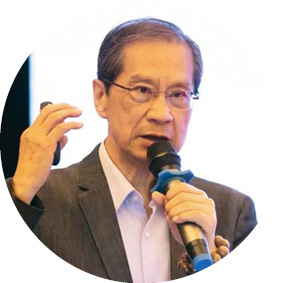
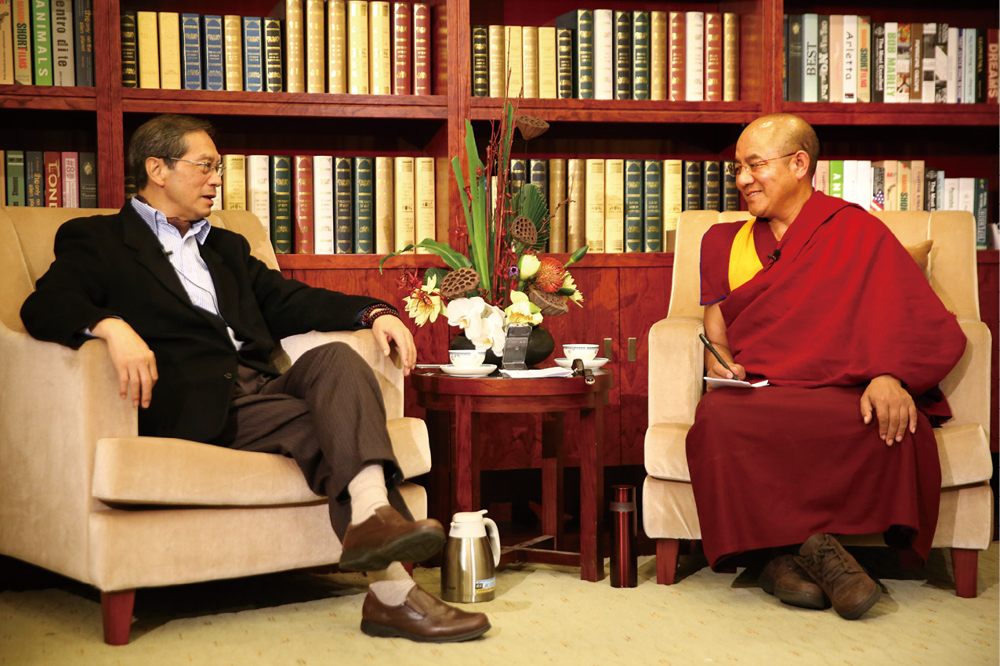
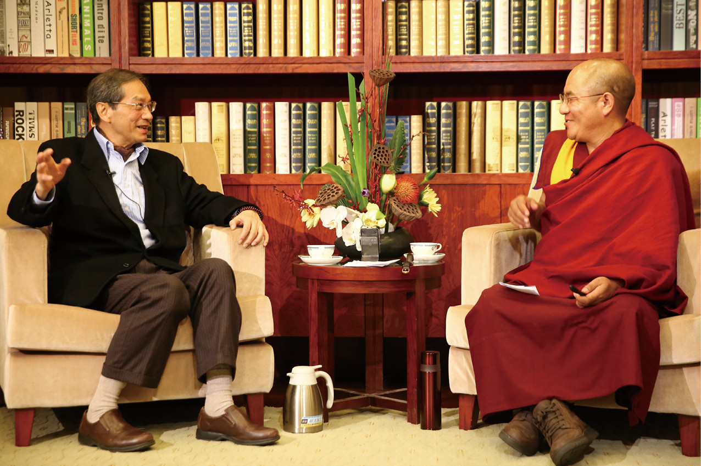

# 成功的另一种定义

索达吉堪布 & 潘宗光教授

中国·上海

Shanghai, China

2016/11/22

潘宗光（Poon Chung kwong）

国际著名化学家，英国皇家化学学会院士。大英帝国勋章获得者，金紫荆星章获得者，太平绅士。英国伦敦大学学院哲学博士和科学博士，曾任香港理工大学校长长达18年。1985年和1991年两次被提名为诺贝尔化学奖候选人。

1．开心管理学

索达吉堪布：

刚才我们对比了科学和佛学，您也表达了一些非常有意义的见解。我认为现在的年轻人特别有必要认真思考一下您所讲的道理。

现在是一个科学时代，也是一个宗教时代，全世界只有约10%的人没有信仰，90%的人则信仰不同的宗教，其中佛教徒也占有一定比例。我们今天的对话，也算是一个提醒或者建议，希望能为人们提供参考。

接下来我想和您讨论的是，当下人们特别重视的企业管理和修行的关系。

我是一个出家人，对企业管理没有多大的兴趣。前段时间，我去了南京一所学校，很多学生问我理不理财，问我会不会投资以求更多回报，当时我用不同方式做了回答。

如今是一个比较特殊的时代，通过这次美国选举也能看出一些时代的变化，以及不同于以往的思维方式。在这样的时代，包括我们佛教徒在内，大家都很关注企业家。

企业家在现在的社会影响中占了很大比例，他们创造了社会财富，无论企业规模大小，哪怕只有十几个员工，都承担了就业等社会责任，对整个社会做出了贡献。我和您一样，经常会去一些企业演讲。我对企业家群体有一些期许，也因现在经济不景气而为他们担忧。

与此同时，我考虑到另外一个问题。现在是追求经济效益最大化的时代，人类为此付出了很大代价，包括过度开发自然资源，动物的肉制品和皮制品蔓延整个市场。现在也是成功学的时代，机场里销售的图书大部分讲的是如何成功。这些都让我思考，所谓的商业模式是否合理，或者说，人类有没有必要为成功付出这么多代价。

您既是科学家，也是佛教修行人，很多人都很关注您。您觉得现在这样的商业成功模式如何？或者说，您如何看待成功的定义？

潘宗光教授：

您讲的是一个整体的管理问题。在这方面，我个人有一点经验。我做了十八年的大学校长，当时香港理工大学有一万多人，加上兼读学生就更多了。管理一所学校很不容易。因为要面对很多教授和学生，这些教授都有非常高的成就，学生们也都是很有理想的年轻人。总的来说，管理学是一门很奇妙的艺术，不只是管人那么简单。

您刚才问什么是成功。成功的定义很难说，每个人的看法都不一样，就像盲人摸象：从这个角度看，是成功；但从另一个角度来看，可能又是失败。

举一个最简单的例子：一个人做企业，赚了很多钱。从财富角度说，他很成功。但他可能为此付出了很多代价，比如健康、家庭、亲情，还有很多人都在关注他。他内心是不是真的快乐呢？表面上的一些成功不代表他就是成功人士了。

我认为，可能要通过多层面得失的总和，来判断一个人或企业是否成功。假如一家企业在商业上非常成功，每天赚取的利润逐步增长，那么可以说它对股东是有所交代的。

但是这家企业赚钱以后，是否善用了它赚来的钱？有没有回馈社会？有没有照顾好一起打拼的员工？是不是今年利润低了就靠裁员降低开支，从而提升利润？这些问题并不只是表面赚钱那么简单。

作为一个管理者，一个老板，他的成功可能在于他出色的领导方案，但谁来执行这个方案呢？是他的员工。如果每个员工都工作得非常快乐，每个员工背后的家庭就会快乐，那么十位员工背后的十个家庭都会快乐。

对老板来说，如果他属下的每个人都快乐，相当于在他的影响下整个社区都非常快乐，那这个意义已经超过了他赚钱的意义。

所以什么是成功？成功可以分为两方面来看，用现代语言来讲，就是要兼顾硬实力与软实力，两方面平衡发展，这才是成功。

那么，什么叫硬实力，什么叫软实力呢？

硬实力是指一位领导者能善用自己的聪明才智，确定企业发展的方向。他明白一切的因缘果报，并依此来制定最理想的发展方案，领导团队向前迈进，获得最好的成果。

软实力是指，领导者不但要有智慧，还要有佛教所说的慈悲心。他明白，企业的成功离不开每个员工的参与，所以要感谢员工。只要他对员工多生慈悲心，就会照顾员工的需要，明白员工是人而不是生产工具，有着人最基本的需求，如人格需求、家庭需求、个人的基本欲望，等等。如果对员工的基本需求都能照顾到，让每个员工都能开开心心地工作，员工也会更投入，对公司产生归属感。这样才能建立真正的团队精神，管理效果会更好。

具体怎么做呢？那就要看管理者如何对待员工。举个例子，假如公司赚了钱，是100%都归于投资者，还是拿出一部分作为奖金分给所有的员工？如果每个员工都能根据比例拿到一些奖金，他们会意识到，公司赚钱，个人也会得利，如此就会更愿意投入工作。

另外，我们每个人都生活在社会当中，与社会、公司无法分割。那么我们成功以后，要不要考虑回馈社会？假如一个人能够全面兼顾，同时心态比较稳定，不容易受到外界干扰，他就可以有条理地分配自己的时间，全面照顾自己的事业、健康、家庭、朋友、员工，达到个人的平衡发展，如此他才是成功的。这是我的看法。

索达吉堪布：

您刚才讲的理念很好。我们的确不能把员工看成赚钱的工具，他们都是有家庭的人。作为员工也要积极工作，如果非常懒惰，那么给他很好的待遇会导致企业亏损。

潘宗光教授：

当然，所以一定要有管理制度，做到赏罚分明。

索达吉堪布：

现在大多数人把成功定义为钱多不多。比如很多人在谈论同学情况时，如果一个同学有车、有房，收入又高，就会认为他是成功人士。但如果一个同学在学识上很不错，或在某个领域有超越贡献，大多数人都不认为这是成功。

潘宗光教授：

他们关注的多是表面上硬实力的成就。

索达吉堪布：

现在所谓的成功，好像全部安立在财富上，有钱人才能被称为成功人士。这已经成为了一种社会潮流。

潘宗光教授：

现在社会上很多表面非常成功的人，财富很多，但他们真的快乐吗？不一定。很多人是不快乐的。

比如有些人的财富太多了，他的家庭成员就会为如何分配财富而斗来斗去，斗到亲情分毫不剩，结果由法庭裁决如何分配。这样是快乐吗？

所谓成功的定义，主要依赖于你用哪个标准衡量成功。你用财富衡量，那么财富就是成功的定义；你用一个人对生活是不是满意，内心是不是开心来衡量，那么成功的定义就完全不同了。

所以要找一个平衡点，一方面要照顾到财富方面的成就，另一方面要兼顾其他方面，比如健康。假如什么都拥有，却没有健康怎么办？如果没有了家庭，跟孩子也没有机会沟通，没有了亲情，这样能算成功吗？我认为这不是真的成功。

如何才可以获得成功呢？每个人要学着修心。这就是佛教厉害的地方了，它鼓励我们修心。当我们的心能够静下来，不再向外攀缘，我们就能体会到心的安乐、自在。

现在很多企业会鼓励自己的员工进行禅修训练，帮助大家修心。只要我们修心，向外的攀缘相对就会少一点，也能启发内心的智慧与慈悲。佛教非常强调智慧与慈悲同等重要。如果企业家只讲求智慧、不提慈悲就麻烦了。

现代管理学多提倡以人为本的管理模式。从佛教角度来说，就是在用菩萨的精神做管理。

2．自在成功学

索达吉堪布：

说起管理，每个国家有自己的管理规则，每个民族也有自己的管理规则。比如我们藏地，以前人人都行持十善，在藏王赤松德赞时期，流传着很多慈悲、感人的故事。因为藏地信仰佛教，统治者以佛法治理王国，那时许多人的心灵非常快乐、宁静，生活得特别幸福。但如今我们处于经济发展的特殊时代，很多人的心非常浮躁，也快乐不起来。

上个世纪的人，生活主要围绕着家庭。而现在的人，生活主要围绕着集体，大多数人要么集中在学校里，要么集中在企业里，所以大家非常需要管理。

您在香港理工大学做了十八年校长，很不容易。我也在佛学院做了很多年管理，管理出家人和在家人。无论对内管理还是对外管理，我都会亲自参与，每天要开很多会议。

以您的个人经验，现代管理的核心是什么？管理当中的误区以及出路又在哪里？您认为现代企业应以什么方式进行管理？管理在其中又起到什么作用？

潘宗光教授：

很多管理方面的书籍，比如一些权威人士讲管理，出发点都是如何制定最好的方法来帮公司多赚钱。

但是，佛法强调的是，在管理中智慧与慈悲同等重要。也就是说，提升管理者的智慧，让公司的业绩变得更好；同时也要用慈悲心做其他应该做的事，包括如何对待员工、顾客和社会，不要欺骗顾客，等等。

在这个过程中，管理者需要照顾到方方面面，不单单是提升公司业绩这么简单。假如能从佛教角度出发，跟随佛法找到各方面的平衡点，一个成功人士不但能享受到外在成功的喜悦，也能拥有内心安乐的喜悦，这两点同等重要。现在很多成功人士只拥有外在成功带来的享受，内心却有很多苦恼，生活也非常辛苦，始终得不到安宁、自在。

我们可以自问一个问题：我们生存在这个世界上，最终的追求是什么？

名誉、财富等等，我们都带不走，最终跟随我们的是过去种下的一切善与恶的种子。最终能够走得安乐、自在，这才是更重要的。

所以我希望大家不要被眼前短暂的所谓成就影响到长远的快乐、自在。我认为这很重要。

索达吉堪布：

我读过您研究《心经》后写的《心经与现代管理》。在我看来，一般讲《心经》主要会讲抉择空性的内容，那么空性与管理这两个概念会不会有一些冲突？您想传达的理念，是不是通过佛教的方式使管理者的心静下来，然后再去管理？

潘宗光教授：

我认为不能直接跟这个时代的人讲太多佛教道理。比如跟他们说“空性”，他们不明白，也不容易接受。所以我们弘扬佛法，最重要的是用他们听得懂的语言、听得懂的案例，对他们慢慢地潜移默化。

希望他们一下子就明白“空性”等概念，是很困难的。这时我们就要用一些案例，通过案例把佛法中慈悲与智慧的信息传递给他们，慢慢地让他们接受。这是一个方便法门，可以帮助大众逐步接受佛法，提升他们的竞争能力，从而争取到更多机会。

同时培养他们的慈悲心，帮助其他员工、客户和社会。由此达到一个平衡点。从这一点出发，让他们明白，这样做，得到的不仅是财富利益，也会获得内心的安乐自在。家庭的和睦，兄妹姐妹之间的和睦，这些都非常重要。

很多所谓非常成功的有钱人，因为兄妹姐妹争家产，导致他们的家庭很不快乐。这是成功还是不成功？我不敢说。起码从这个角度出发，他们是不成功的。他们的财富可能很多，但我觉得不是成功。

成功不等于你有很多很多财富。其实一个人拥有的财富，比能满足基本需要的数量再多一点就可以了，其他是用不到的。就算你有多余的财富，也都存在银行里，你的存款数字后面有很多零而已。但你用了多少呢？很少。你却要为此付出很多代价。

我常听说，很多人身体不健康，家庭也不和谐，兄弟姐妹之间出现了很多问题。现在的时代，整个社会应如何正确地看待成功，这一点很重要。

当下每个人都认为成功的概念就是多赚钱，就是有名声、有地位。但是我们要思考一下，在争取名利的过程中，付出了什么代价，这些代价是否值得？假如给大家一个机会重新做选择，或许会有不同的想法。

3．用禅心面对成败

索达吉堪布：

现在很多企业中流行禅修。有些企业认为，禅修能提升智慧；有些认为禅修会使工作效率提高；有些认为禅修会促发灵感迸现；还有些认为，通过禅修让心态平静之后，做事情，为人处世，都会游刃有余。关于禅修的好处，有各种说法。

您对禅修也有一定的研究，那么从科学层面或佛学层面出发，您认为禅修对企业来说是否重要？

如果从科学角度出发，在企业或学校里推广禅修，是否会为人们的整个身心带来好处？是否会对他们的工作和家庭有所帮助？或对他们的事业有所提升？

潘宗光教授：

在非常忙碌的现实世界里，每个人都没有为自己留出空间，静下来做一些思考。他们一天二十四小时都在想如何赚钱，想很多很多事情，从来没有让自己的思维停下来，让自己的心静下来。这样不断地被外界干扰，就会导致看问题时经常不够客观，如此所做的决定可能不是最理想的。

我的看法是，无论你的智慧多高，都需要为自己留出一个安宁自在的空间，留出一段时间，什么也不管，让心静下来，不要向外攀缘，慢慢地专注于自己，思考一下过去所做的选择或某件事情，做得好还是不好。假如你没有空间来思考，就没有改进的机会。

具体怎么做呢？最理想的是每天用一段时间来禅修。对我而言，这种禅修并不是真正高层次的禅定，入定是很难的，主要是让心静下来、定下来，给自己一个思考的空间，能够客观看待外界事物，不要过于主观。只要你静下来了，你内心本来拥有的智慧与慈悲就会慢慢生起来。我觉得禅修很有帮助。

现代人最大的问题是，心不能安静下来，永远被外面的世界牵着走。世界让我怎么样，我就跟着怎么样。

佛教里强调，凡夫都是心随境转。通过修行禅定，希望我的心不容易被境转。当我们修到某个程度，专注力、意念更强大时，还可以影响外面的世界，变成境随心转。最终达到佛陀所说一切唯心造的境界。

所以我认为，无论我们做什么工作，在哪家企业，都要对自己公平一点，给自己一个空间，可以静下来思考，想想怎么做事情才能更加平衡地发展，而不要被外界一些负面情绪所影响。

比如我们对成败得失的看法。很多人总是说：“哎，我这么努力，却没有成功。”为此怨天尤人，心里很不舒服。我们要明白，一切都是因缘和合，无论你怎么努力，外在的缘终究是不能控制的，它的影响可能非常大，让你即便再努力也得不到希望的成果。你要是为一些不能控制的缘而不开心就不值得。

所以要这样想，只要我尽自己的努力去做好这件事就可以了。成败得失是我们所不能控制的，是很多外在因素共同影响的结果。不能说我努力了，一旦不成功，我就不开心。这种对待成功的心态并不可取。因为大家都知道，成功不是必然的，而失败也为我们带来机会，让我们重新检讨失败的原因，永远处于学习的过程中。

只要活在当下，尽自己努力做好眼下之事就好。结果成功还是失败，不是我们所能控制的。

索达吉堪布：

是的，大家首先应该有一个心理准备，成功的人也不是很多，所以不是每个人都能特别成功。

很多年轻人看到一两个成功案例，就觉得自己也有希望，实际上不一定，还有更多不成功的事例也摆在那里。

潘宗光教授：

这种案例太多了。比如很多读管理学的人，他们会收集很多案例，了解某公司如何运作，获得了巨大成功。但我们也明白，一切方法都是无常的，这个方法在他所处的情况下能成功，在我这边可能就会失败。

诸法空相，一切法都是空的，是在变动的。方法也需要根据情况不同而改变。没有一定能复制成功的案例。为什么他能成功而你会失败？因为你们的情况不一样。

索达吉堪布：

对，跟每个人的业力有一定关系。

潘宗光教授：

只要我们能够安下心，明白一切事情都是无常的；只要我们真正活在当下，尽自己努力做好眼前的事情；只要我们明白，成败得失很多时候超乎我们的控制时，我们就可以放下来，不会埋怨这个、埋怨那个。很多人看不明白，就会生烦恼。

索达吉堪布：

其实，每个人应该提前做好充分的准备：假如这件事我没有成功，要如何面对？

潘宗光教授：

老子说得对，成功的背后有危机，危机的背后有机会。问题在于你有没有智慧能在失败中看到机会。

很多人失败后只会迷茫或者埋怨，眼前的机会可能就溜走了。但只要你的心能够静下来，尽管失败，你还是能看到机会、把握机会，境遇就改变了。

有些人虽然成功了，但他十分骄傲，也不知道危机就在眼前。

索达吉堪布：

他正在做的事，让自己的未来非常危险。

潘宗光教授：

只要我们的心能随时随地安住下来，成功或失败都不会过多干扰自己。面对未来，无论危机也好，机遇也好，都能看清，从而把握机遇，避开危机。这才是最重要的。总之，需要自己的心能静下来。

禅修能帮助我们平静自己的心，不受成功或失败的影响，很好地了解前方的机会或危机。

索达吉堪布：

有些人可能没有特别去思考因缘，只是简单地把一个单纯的希望、美好的愿景，当成了自己的理想和目标。

潘宗光教授：

这是个人的愿望。尽管每个人都希望成功，但总有很多外界因素会干扰自己。

索达吉堪布：

他只是把蓝图描绘得很好，却忘记考虑中间的过程。一旦遇到障碍，就会接受不了。很多人都有这种痛苦。

4．最成功的企业家是慈善家

索达吉堪布：

我经常和一些比较成功的企业家说，企业家最成功之处，在于变成一个慈善家。做慈善不仅对他自己的家庭和员工有利，更重要的是体现了他对社会的回馈。因为他的财富实际上来自很多人。

不知道您注意到没有，前段时间的“双十一”，很多人在淘宝网买东西，这一天的销售额达到1000多亿。阿里上上下下应该会很高兴，但实体店铺等其他商业渠道，很难等到消费者上门购物。因为大部分的消费通过网络都积聚到阿里集团了。

一方面来说，这些财富是企业家获得的；但另一方面，他们是不是该拿出一部分来多做慈善？否则，一个人拥有这么多财富，很难说他是否有这么多福报支撑。

所以我认为，一个成功的企业家，也应该是一个成功的慈善家。您对此有什么看法？

潘宗光教授：

所谓成功，既要有硬实力，也要有软实力。软实力包括回馈社会的心态，这一点很重要。因为财富是有限的，你多一点，很多人就少一点。

索达吉堪布：

地球上财富只有那么多，要么在你手里，要么在我手里。如果全部在我手里，就说明很多穷人的手里没有钱了。

潘宗光教授：

只要我们有这个心态，只要我们佛教徒的智慧和慈悲永远不分开，当我们拥有财富以后，还有慈悲心回馈社会，这才是成功。

当然，具体回馈多少，要看你能力的大小。但要有这个心态：我赚钱越多，就越有能力回馈社会，帮助弱势群体，帮助有困难的人解决问题。这才是正确的。

一个人的财富越多，他能够提供的帮助就越大，效果也就越好。

所以我认为成功最终在于两个层面：一是怎样让公司不断累积业绩，获得收益；二是怎样将公司所赚的财富用于善待员工、回馈社会。让每个员工都快快乐乐，培养真正的团队精神。同时也要对客户好一点，真诚一点，不要以次充好，欺骗他们。这样才会慢慢成为一个真正的成功人士。

还有更重要的是：好好分配时间，保持身体健康，拥有家庭快乐，至亲好友一切安好。这才是成功。

5．种一个感恩的种子

索达吉堪布：

您资助过很多失学的大学生吧，现在还在继续吗？

潘宗光教授：

一点点吧。

索达吉堪布：

您是以什么心态资助的呢？因为您本身工作很辛苦，既要研究学术，还要帮助学生。

我非常认可您的做法，一个人如果能上学读书，就等于改变了他的命运。您作为学者都这样持续付出，企业家们可能更应该投入了。社会整体良好风气的形成，需要大家共同努力。其实对一些贫穷者来说，一点点的帮助，对他们都会很有意义。

潘宗光教授：

我的出发点是帮助一些现在没有能力、需要帮助的人，比如一些经济条件比较艰苦的大学生，帮助他们安心完成学业。但同时更重要的是，在帮助之余，我也在传达一个信息：现在我帮助你，并不需要你回馈我；你将来有能力的时候，也要帮助其他人。我是希望在他们的心上种下一颗种子，一颗感恩的种子。这一点最重要。

让这种想法在他心中慢慢成形：只要我成功，我就回馈社会，因为在我最困难的时候，曾经得到了别人的帮助。这颗感恩的心最珍贵。

我告诉学员，我不需要教你什么道理，因为佛法博大精深，非常复杂。你只要记住两个字就可以了：“感恩”。我觉得“感恩”这两个字不是空的，一个人真的“感恩”也不是讲出来的，而是有一颗感恩心。

假如一个人真的有感恩心，他对父母肯定孝顺，很自然就会感恩父母；有感恩心，他会尊重老师，因为老师教给他学问和智慧；有感恩心，朋友之间一定会互相帮忙，过去你帮我，现在我帮你；有感恩心，肯定会回馈社会，因为一个人的成就里有着社会上很多人的贡献和帮助。

比如读大学，学生交的学费只占大学整体开支的一小部分，其他开支要靠社会提供。另外，我们能安心生活，也是因为国家给予了强大保护，如果国家不强大，我们就会受人欺负。所以我们对国家也要有感恩心，要为国家承担自己的义务。

总的来说，只要我们真的有感恩心，就会孝顺父母，尊敬老师，对朋友讲义气，也会回馈社会，为国家承担义务。很自然地，有感恩心的人就算犯错，也不会错得离谱。

我们教学生，跟他讲一大篇道理，他听不进去，也没有兴趣听。但如果只是很简单地告诉他，要带着感恩的心做人，会比较容易让他接受。

6．佛教徒：依共修的力量进步

索达吉堪布：

您以前也曾信仰基督教，在我看来，很多基督徒在建医院、做慈善、传播爱等方面做得非常不错。

相较而言，大乘佛教要更慈悲。因为大乘佛教里的爱是包括旁生在内的所有众生。您有没有想过，大乘佛教徒在帮助他人、传播爱心等方面，应该向基督徒学习，或者说超过他们？

当然，大乘佛教有放生传统，这些方面超越基督教。但从另一些方面来说，佛教徒是不是有点自私？因为佛教徒不像基督徒，不会到处团结、共同弘扬教派精神。有些佛教徒的团体会各行其是，执著分别“这是我的上师，那是你的上师”，除了自己的上师，谁都不承认。

另外，也有极少数佛教徒在团结方面做得不太好。按理来讲，我们应该团结起来，力所能及地为社会、为人类，乃至为整个世界做一些有意义的事情。在此过程中，我认为少一点是非、多做一点事是很有必要的。但现在看来，佛教徒是不是在这方面要多学习、多进步？您有没有这种感觉，或者您如何看待这个问题？

潘宗光教授：

这个问题，我也有过很初步的思考。但是我告诉自己，我现在的修为，对佛教的体会和了解还处于很肤浅的阶段。

我不是佛，也不是菩萨，对很多事情不太了解。所以我的看法是：第一，我虽然修净土，但不可以说其他法门不如净土法门殊胜。因为修行法门主要看每个人的缘分所在。净土与我有很大的缘分，所以我修净土；假如某位朋友与禅宗有甚深的缘分，修禅宗自然没有问题。所以作为佛教徒，不应该批评其他的宗派。

每个宗派能存在到现在，必然有其优秀之处。不同宗派对不同的人有不同的感染力，能为其带来不同的好处，所以我不会说净土法门比其他法门更好，只能说净土法门很符合我的诉求，而其他法门各有各的好处。

我们不能谤佛、谤佛法。佛法都是佛陀所宣说的，佛陀宣说的一定是对的。只是这个法门，我不对机；我不对机，不代表这个法门不好，是我不好而已。

所以我非常尊重每个人的宗派，不做比较也不去批评。由此出发，推及其他宗教，我就更加不能比较了。因为我对其他宗教的了解不是很深入，他们有各自的好处，有各自的善法，也有区别于我们的不同教理。我只能说，我与佛教的缘分最深。

索达吉堪布：

我不是批评其他宗教。我认为基督教有很多好处和善举，包括建医院、做慈善，等等。他们特别擅长做这样的好事。而我们佛教虽然有这方面的举动，但相较而言，似乎比不上基督教。

潘宗光教授：

我们希望对其他宗教好的地方多多了解，思考如何吸收他们的经验，帮助我们在佛教弘扬方面做得更好。

比较著名的例子是特蕾莎修女。基督教、天主教的推广相对比较成功。有一点我觉得非常好，就是他们要求教徒每个周末一定要去教堂。所以有很多教堂，方便周围的教徒，每个星期天一家人可以去做礼拜。

这样做的好处很多，比如坚定他们对宗教的信仰，使教徒间团结得更紧密。同时将孩子带去，有少年班等教派组织帮助他们成长，用无形的力量将他们团结起来，将信仰传到下一代。

但佛教没有这种传统。在香港，我和宽运法师借观音讲堂开展周日念佛共修活动，并鼓励朋友们一同参加。我们的共修活动从每周日早9点到中午12点，前一个小时大家一起念佛，诵《佛说阿弥陀经》，后两个小时共同学习佛教的道理，然后上供。

这个共修活动每个星期天都举行，已经持续一年多了。我和宽运法师交替参加和组织，主要是带领朋友一起念佛，分享佛法理念。开始时，只有二三十个人参加，现在经常参加的已经超过一百人了。最初，很多人对佛是没有信仰的，最近我看到差不多有一半人穿着海青来参加，说明他们已经是佛教徒了。

所以我认为，只要我们能固定一个时间和场所来组织念佛共修活动，让大家可以一起共修、一起传讲和分享佛法，就会产生强大的力量。如果不做组织安排，大家就没有这个意愿。

因此，每个寺院、每个佛学院都应该安排固定时间的共修聚会，让佛教徒们可以很自然地参与其中。

索达吉堪布：

对，这也是我正在思考的。

今天的采访已接近尾声，刚才您的一些话也引发了我的思索：比如基督教为主的其他宗教，每周都会安排聚会。一是对内部教徒的团结起到非常大的作用；二是对教徒深入理解教理提供非常大的帮助；再者，周日交流时，如果发现哪位教徒家里遇到困难，还可以提供帮忙；第四，互相之间可以监督督促，比如这个礼拜谁没来，是不是散乱了，等等。

很多佛教徒也比较散漫，就像不成熟的孩子，比较调皮，不愿意好好学习。如果定期共修，散乱的情况就可以改善，这是互相监督的作用。共修还有一点好处，长期这样修学下来，我们的修行慢慢都会有所进步。否则，红尘中有各种散乱的因充斥在我们周围。

潘宗光教授：

这时功力就很重要了。

索达吉堪布：

功力的增长需要他力的支持，像共修中很多佛教徒的帮助。同时自己也要坚持，克服困难，比如自己不会开车，从家到共修处交通不方便等。

自2006年至今，我已经倡导共修十年了。现在各个城市都有佛教徒参加共修。我也特别希望趁这个机会，提醒所有的佛教徒，以后利用周末的固定时间，尽量参加共同学习。

我们佛学院每天都有课，早上有课，下午有课，晚上也有课。但大城市里的佛教徒恐怕没有这个条件，他们平时要上班，要养家糊口，要处理家务……我特别希望，大家也能像其他宗教徒一样，每周坚持共同学习。如果这周实在没时间，那就下周参加。总之，一个月至少共修两三次，这将对自己佛学素质的提升起到非常大的作用。

潘宗光教授：

还有一点很重要，每个星期天，他们去教堂，我们到寺庙聚会，希望家长带着孩子一起参加。在团体中，潜移默化地影响孩子，从小培养孩子对宗教的信仰。

索达吉堪布：

对，这个非常好。有些人认为，孩子很调皮，不要带去共修，不然会干扰别人学习。其实这个想法不对，帮孩子从小树立起正确的三观，对他的一生都很重要。

潘宗光教授：

所以我认为组织共修最重要的一个原因，是希望将信仰传达到下一代。虽然不一定都会潜移默化，但如果全家人都参加了，那我的孩子和他的孩子就会建立起朋友关系，这样影响就扩散开了。

索达吉堪布：

把孩子带到共修场合去，如果他有点调皮，大人可能会反感。但我希望大家能互相谅解。

我在藏地讲课时，如果下面有孩子哭，我会把哭声当成背景音乐。对孩子来说，现在一点也不懂佛法，但跟妈妈或爸爸一起参加过共修，等他长大了，善根可能就会渐渐成熟。

潘宗光教授：

环境对孩子的成长非常重要。如果每周末能有一两个小时在这种环境中成长，他们慢慢吸收，会很自然地种下善根。

索达吉堪布：

这就是未来的希望！
