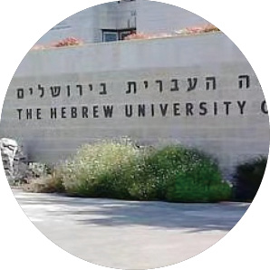
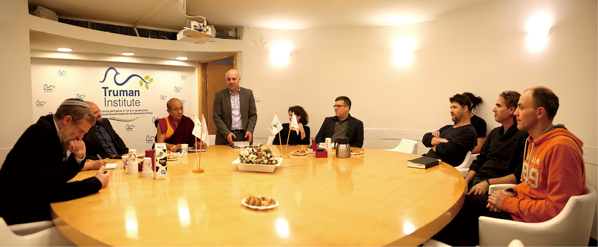
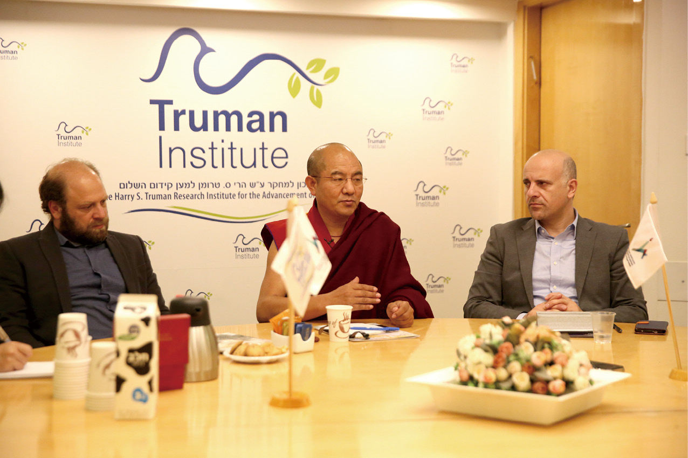

学术研究与修行体悟的关系

索达吉堪布 & 希伯来大学学者

杜鲁门研究所

Truman Institute

2017/12/18

希伯来大学（The Hebrew University of Jerusalem）

以色列领先的学术和科研机构，全球大学高研院联盟成员。始创于1918年，第一届理事会成员包括爱因斯坦、弗洛伊德等。截止2018年10月，希伯来大学的校友、教授及研究人员中，共有15位诺贝尔奖得主、2位菲尔兹奖得主、3位图灵奖得主。

1．宗教能促进世界和平

主办方：

很高兴大家相聚一堂，参加今天的座谈。今天上午我们聆听了一场非常精彩的演讲，作为活动主办方，杜鲁门研究所很是荣幸。

近两年来，宗教与和平是我们的重点研究项目之一。传统的解决方案是将宗教与需要解决的冲突分开，认为这样就万事大吉了。但我们的观点截然相反，我们认为，要解决冲突，就必须团结各宗教的领导人。目前我们也正在这么做。这次会谈也属于宗教与和平的研究范围。

接下来向大家介绍索达吉堪布仁波切。堪布是喇荣五明佛学院的管理者之一。学院位于中国四川省康区的喇荣山谷。上午堪布的演讲十分令人感动，在此我要重述一遍演讲时对于堪布的介绍。虽然是重述，但很值得。

堪布是喇荣五明佛学院的创始人法王晋美彭措仁波切的心子。法王晋美彭措仁波切是上世纪藏传佛教宁玛巴传承的重要转世活佛，是一位广受认可、令人敬仰的智者和上师。他于十四年前离开了这个世界。法王的前世是十三世达赖喇嘛的经师列绕朗巴尊者。堪布在演讲中也提到了法王的前世。实际上，公元8世纪时期，法王也是藏传佛教创始人莲花生大士的弟子。

堪布刚刚也提到，晋美彭措仁波切在朝拜许多圣地时会说“我当时也在那里”。这也是演讲中的亮点。法王去圣地朝圣时，会去一些前世他和莲师一起去过的地方，并在那里开启伏藏。

如果你们了解伏藏，就会知道伟大的莲师在藏地各处埋藏了宝藏，有的埋在岩石里，有的埋在伏藏师的心性中。当法王来到这些地方时，就会回忆起当时的场景和教言。大体上可以这么理解伏藏。伏藏对于藏传佛教具有重大意义。

在我看来，藏传佛教的这些传统都与心灵深处紧密相连。我相信大家也有相同的感受。堪布今天的演讲强调了要以新的视角去看待生命，他的角度与一般人的看法不尽相同。

堪布的演讲包含了很多内容，比如我们如何看待科学对事物的诠释，哪些是合理的，哪些不合理。拿转世来说，这是一个简单而客观的生命现象，也许我们所有人都在不断地转世中。相较于我们的日常观点，这或许是一种新的视角，先不必谈哪一方更合理。

今天我们的主要议题是，探讨学术与修行体验之间的关系。我们选择这个话题是因为佛教和学术研究虽然有很多不同点，但它们也有很多共同点：首先佛教也注重分析研究，这一点可能不同于人们对佛教的传统认知，其实佛教本身相合于学术研究。

具体来说，佛教也着重于批判性的分析。佛教的批判性针对的是：人类倾向于幻想，并且会对某种幻想赋予很大的意义。佛教非常善于分析，会对不同的事物进行分拆，逐一分析它们的因和果。由此，我们可以看出佛教十分务实，与学术研究有相似之处。

但佛教的教义强调，研究最终要用于教化人心。希望对人们的生活方式产生积极的影响和改变，希望帮助人们洞察自身的实相，认识真正的自我——自我本是不存在的，等等。

在这一点上，佛教和学术研究就很不相同了，也与我们希伯来大学的学术理念不一样。我们认为学术研究应该是客观的，学术成就也只是为了求取学术成果本身，无关其他。如果研究过程中掺杂了情绪，很可能会导致研究走向错误。这些都不同于佛教理念。

尽管在座的各位学者没有人会说自己的信仰和研究完全一致，但有可能还有其他的研究方法。在21世纪的今天，人们的生活节奏非常快，我们也许需要采取不同的思维方式或者从不同的角度来思考学术研究。因此，我们想听一听仁波切对这些问题的看法。

索达吉堪布：

很感谢杜鲁门研究所，组织了今天这次面对面的圆桌会议，让大家坐在一起，共同求知，探讨真理。不管有没有信仰，思想和习惯是否相同，在这里都可以平等地交流。今天下午我可能不会讲很多，主要想多听听大家的不同声音。

基于主办方的提问，首先我想讲一下，学术跟修行体验之间的差别。

我经常去学校和寺院，在和各种不同的人接触的过程中，有一些感受。现在学术界跟修行界似乎完全是不同体系，几乎没有交集。比如一些宗教徒对学术领域并不是很了解，甚至很排斥；而有些科研人员则把一些修行体验视作一种迷信。不管在东方还是西方，在很多领域，研究与修行完全是水火不容的感觉。

其实我认为这两者相辅相成，缺一不可。譬如说一位宗教的修行人，在修行最开始的时候，一定会经过一种非常严谨的学术观察。比如藏传佛教中就有长时间辩论的传统，通过辩论来遣除所有怀疑。否则，很多修行体验会陷入怀疑的迷雾，无法现前。

而在学术领域中，最好是研究者自身能有一些修行体验，尤其是研究宗教的学者。因为宗教里的很多东西都涉及心灵领域。我发现西方有些学者，一辈子研究宗教，却从来没有亲身行持和修行，也从来没有获得真实的体验。从专业角度来看，没有任何信仰的情况下，很多学者所从事的研究工作，不一定能找到他们所需要的真确结论。

我对你们这里的宗教研究情况不是很清楚，以色列本身有几千年的宗教底蕴，情况可能会好一些。西方的一些学者完全用一种科学领域的方法来观察宗教的各种仪式、信仰，包括心灵状态。

我觉得，如果自己不深入其中去切身体验，也没有老师引导，光是依靠文字或几本书来进行研究，结果就是学术与体验完全脱节。虽然花了很长时间，但效果不一定很明显。

在我看来，如果一个人能既有学术研究的精神，也具备一定的修行体验，这是再好不过的。即使做不到这样，也应该在研究中，将涉及主观意识领域的信仰层面的道理与客观现实中的现代科学知识结合起来，秉持互相了解、互相尊重的态度。

否则的话，就会演变成：如果我是宗教人士，我个人意识中所得到的境界很重要；如果我是科学家，我从实验室里得到的实验结果很重要。其实每个人在各自领域里都有自己的成就和体验，如果互相之间不了解，也不承认对方的成就，是不太合理的。这是我想说的第一个观点。

第二个观点是关于宗教在和平进程中的作用。现在大多数的世间人认为，宗教不但对和平进程没有很大的助益，反而会导致一些不良影响。我个人的观点与此完全相反。

这几年，我们一直在进行不同宗教之间的交流。在喇荣、香港、泰国都召开过宗教会议。会议的主题包括各个宗教对幸福的解读、对和平的解读，以及可持续发展，等等。

在这个过程中，我们认识到，从教义的角度出发，其实每个宗教都会对人类和平起到非常大的作用。只是当宗教被人纳入政治、经济、民族等不同范畴时，会被利用而变成比较狭隘的思想。

有时候我看人类历史，感觉比较血腥，自古以来，充斥着各种各样的冲突、矛盾以及由此引发的战争。但也有一些学者认为，人类的历史也是宗教的历史。

那么未来会变成什么样呢？对大多数人来说，这是一个未知数。无论如何，不管有没有信仰，我们所有人都应该为全世界的和平进程想尽一切办法，哪怕只能起到一点点作用。

相比之下，21世纪比以往任何一个世纪都更为和平。在座的各位在宗教与和平领域都有自己的思考和研究。今天有教授在问“大乘佛教与其他佛教派别有何差别”，其实大乘佛教的究竟思想，就是无私利他。

按照大乘佛教真正的利他思想，不管你有没有信仰，只要心地善良、有利他心，你所有的思想、行为和创作都会有助于人类和平。所以我认为，利他的行为，是人世间最有价值的。

还有一点想补充。不管是当下还是过去，我们对各种宣传不应该过于信赖。这些宣传，有时候可能是政治家为了实现某种目的而策划出来的；有时候，则是为了达到经济目的而加以美化的；有时候，宗教徒也会为了达到目的而展开各种带有颜色的宣传。

这些都不是真相，而是一些人为了达到自己的目的所营造出来的。这些现象在历史上一再出现，人类走到今天也应该从中吸取经验教训。

2．批判主义的利弊

主办方：

回到学术和修行关系的话题。做学术研究时，我们必须客观并具有批判性，这已经是我们后天培养的本能了。但是如果进行宗教修行，就会对宗教有主观认知，那我们还如何保持学术上的批判性？

索达吉堪布：

其实批判性思维很重要。佛教里有这么一句话：“我不站在佛教的立场，也不站在其他宗教的立场，只要符合真理，不论出自哪个宗派，我都把它当作最好的依靠处。”

因此我觉得，真正的批判性思维，在宗教当中是很重要的。如果没有批判性思维，不推翻很多陈旧的、不符合实际的观念，人类可能达不到如今的发展水平。自中世纪以来，人类在这方面有很大进展。

但现在的西方出现了过度的批判性，尤其是消费主义者，为了鼓励大家一心一意地追求财物，会否定人们心中原有的信仰和神明的存在。这种批判主义，不一定适合作为人类未来的价值观。

如今，经济领域的消费主义思想，在东西方都铺天盖地，其目的之一就是要消弭人们的传统价值观和宗教信仰，然后没有任何约束地拼命享受物质。

假如有一天，人类社会真到了消费至上的地步，那么再过几十年几百年，即使想重拾宗教或传统的一些价值观，可能也未必做得到了。也许到了那时，才真的让人感到可惜。

3．这叫盲修瞎练

希伯来大学学者：

既强调学术的客观性，又注重个人修行，这是佛教特有的吗？还是所有宗教都是这样的？如果都是如此，研究人员是否应该只研究他们自己所信仰的宗教，这样就能在研究的同时修行？

索达吉堪布：

我认为，如果每个人都有自己的信仰或修行，对自己和他人会带来很大益处。这不一定是佛教独有的理念，或者是某个宗教所独有的。就像东西方人们的生活方式各有不同，但同样能从信仰中受益。

但信仰的基础，是要有一个好的学习和研究基础。拿佛教徒来说，现在很多佛教徒的基础还没有打好就直接去修，其实是很危险的。作为一个佛教徒，既要了解宗教的教理，这有助于自己的修行；宗教信仰之外，也要了解科技时代物质世界显现的种种现象，这同样有助于自己的修行。

所以我认为，各个宗教都有各自的特点，但修行者一定要打好坚固的理论基础，掌握好相关知识。否则的话，佛教认为这叫做“盲修瞎练”。

希伯来大学学者：

起初我还挺喜欢这种主观和客观相结合的模式，这样不同的领域可以互补，比如内在和外在、宗教和学术……

但后来我不确定这种模式是否行得通，因为从佛教教义看，佛教更注重内在。事实上，所有的宗教都有自己的世界观。相比而言，犹太教更看重外在，对于犹太教教徒来说，最重要的是约束自己在世间的种种行为，而较少强调内观修持。

我是想通过这个例子说明，不同宗教有各自的世界观，而这些世界观并没有一个统一标准。目前我们的研究都集中在外在的物质层面，也许随着研究的深入，我们自身也会有所转变，希望我们的学生们可以做到。

4．信仰者的内心世界

希伯来大学学者：

这是一个比较私人的问题。在一些特定的场合下，来自异域的文化或者美学体验，会不会改变一个人原有的价值观和信仰？我自己有过这种体验，其他人应该也有吧，您是否有过这种经历呢？比如说其他宗教的仪式或体验改变了您原有的认识，让您对自己的信仰有了新的理解？

索达吉堪布：

我不是特别清楚这个问题的含义，但可以说一下我的观点。

我个人并没有过您说的这种体验。我在出家之前曾学过心理学，以及一些当时流行的辩证法和其他知识。我对心理学特别感兴趣，但是越学越迷茫。

后来学了佛以后，我看到佛教里的《上阿毗达摩》和《下阿毗达摩》（前者是大乘思想，后者是小乘思想），这两部论典对心识的分析特别透彻，也让我对心理学的理解有了很大转变。现在，我对心识的认知就是《阿毗达摩》里的观点。

我想说的是，学术界很难真正了解有信仰者的内心世界。比如一个有信仰的人，他在某处圣地或某个祷告场所，获得了一种心灵感受，而学术界通过客观事实进行研究，可能会对这种内心境界存疑。但不管学术界承认与否，这个人内心世界的改变是真实存在的。

刚才两位教授也在探讨这个问题。比如，耶路撒冷所具备的圣地加持，会让朝圣者感到特殊、神奇；还有我上午说的，莲花生大士在藏地留下的圣迹，法王晋美彭措去朝拜时，会感受到神奇的力量。对于这种特殊的力量，科学无论如何也无法给出让大家满意的合理解释。这也是学术界与我们信仰者之间不同的地方。

5．增加还是减少“我”？

希伯来大学学者：

上述讨论可以总结为两种情况，第一种是将学者分为有信仰的和没有信仰的，或者说宗教徒和非宗教徒；另一种情况则是将有信仰的宗教研究学者分为研究型和实修型。刚刚大家主要讨论的是第一种情况，但实际上也存在第二种情况。

举个例子，一个犹太教徒在做学术研究时，成功提出了一个新思想，之后发现教内的先哲们也提出过类似思想。之后他想说服自己，他所表达的就是先哲们的观点，尽管他认为在这个问题上有自己的创新。

作为宗教人士，自我是要被去除的，人们尽力将自己融入教派的传统里，而非突显个人的不同。但作为学术研究人员，重点是要创造独一无二的观点，同时也是区别于过去的观点，所以自我在此处非常关键而且必要。

我的问题是，作为宗教徒，在进行学术研究时，应该如何平衡自我与无我？这关系到一个重要问题，即宗教修行和学术研究的关系。

在刚才的讨论中，持有批判性的专家还是门外汉吗？我们试图将他们带进来，亲身参与宗教修行。但即便他们已经进入了修行，对于修行和学术的关系，还有很大的探索空间。

索达吉堪布：

我认为研究宗教的学者自身最好有信仰。如果是研究历史、经济、政治等其他领域，研究者没有信仰也可以。但若要深入心灵领域的问题，没有信仰的话会很艰难。

我这次去美国的一些学校做交流，因为藏传佛教里很多甚深的内容都与信仰关系紧密，因此他们很难真正明白。就像我现在在这里讲，大家也不一定都能听懂。

犹太教跟佛教类似，最终都会讲到“无我”。一位学者曾说：学术研究一直在增加“我”，而修道者的最高成就在于减少“我”，直至归零。这是学术与修行的一个差别。还有一个差别是，很多没有信仰的学者，根本没办法真正理解“无我”的基本道理。

另外，在藏传佛教中，有些密法是不能随便公开的。但现在一些学者认为：“我看了里面的内容，没什么特别的，不需要保密。”所以有时候双方很难沟通。

6．心的本来面目

希伯来大学学者：

我还想再问一个问题，就是您对心识是怎么理解的？如何从学术角度研究心识？如果换个角度，我们可以把学术研究看成探索精神世界的一种方法。

索达吉堪布：

过去的心不可得，因为过去已经灭了，就像种子被烧毁了一样；未来的心不可得，因为未来还没有产生；现在的心不可得，不管从颜色、形状等任何角度去观察，它都如同虚空一样。

除了过去和未来，“现在”到底指的是什么？从学术的角度来讲，“现在”这个时间概念是我们的错觉，从一秒到一亿秒，当下生，当下灭，哪个才是“现在”？所以，“现在”找不到，“现在的心”更找不到。

真正的心了不可得，这是从学术角度认识心的方法。而修行人认识心的方法，无须这么多分别和观察，自己观自己的心就知道：原来心就是它。

希伯来大学学者：

您的回答很有意思。我还想听您讲一下您在佛性方面的经验，到底是一种怎样的体验？

某种程度上，心是唯一的检验工具。但当你正在感受时，心又不存在。那在体验真相的时候，是谁在记忆，谁在感受，是我的心吗？还是其他什么？

索达吉堪布：

这种体验就像是“哑巴吃糖”，虽然自己明白，但无法用语言来说明。它是超越了有无、是非的一种境界，是真正的心的本来面目。按照佛教的说法，这种体验超离了语言、思维等一切分别。在这种境界中，你已经遣除了所有染污，获得了最真实的体验，从此以后，不会再有任何负面情绪扰乱你。即使没有完全达到这种境界，偶尔会产生一些负面情绪，它也像阳光下的水泡一样，很快就消失了。

7．犹太教也谈“无我”？

索达吉堪布：

您提到犹太教也有“无我”的说法，我想了解一下，是每个教徒都达到“无我”的境界呢，还是通过什么途径来证得“无我”？

希伯来大学学者：

传统研究的核心，不同于学术研究。传统的研究方式，是根据过去的文献提出自己的新观点，再将两者联系起来。从这点来说，学术是很客观的，但这不代表将“自我”完全去除了，否则就变得有点佛教的意味了。

世界上有很多宗教，比如犹太教、神秘主义等，他们都想要消除“自我”——当然并不是所有宗教，我也不能以偏概全。

但我想，不管什么形式的宗教研究，或者对传统的研究，和“自我”都有一定的冲撞。因为你是在借鉴过去的基础上，努力创造自己的新观点，而不是在传统中寻求新观点。

当你以为发现新观点时，事实上这个观点早已存在了。在那些已有的经典中，可以找到你自己的观点。那些看起来是全新的理论，实际上在经典里早就存在了。你为经典赋予了新视角，但它并非新的产物。因此你就不会觉得自己真厉害，已经提出了新理论。实际上，你只是用了一种新方式来呈现经典中已有的观点。

因此，对自我有一个新的概念、新的把握，就好比一种新的认知。你接纳了这个教言，真正接纳了这部经典，而不仅仅是泛泛理解。此时你不是一个旁观者，否则，你在做的就仅仅是纯学术研究。
