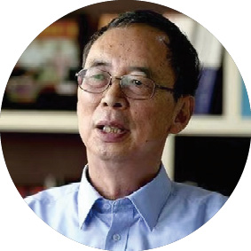
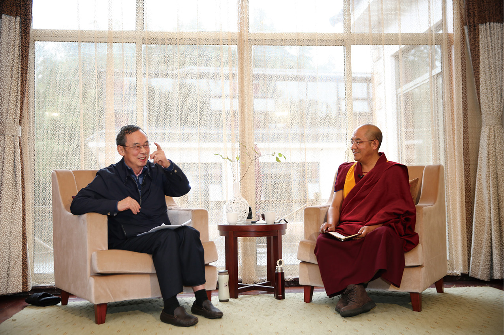
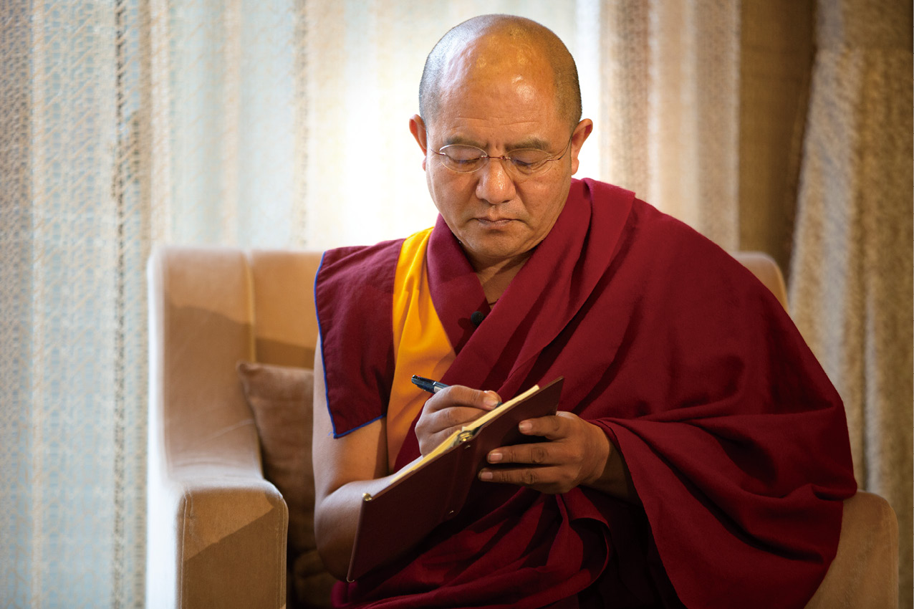

当科学与佛法不谋而合

索达吉堪布 & 朱清时教授

中国·上海

Shanghai, China

2016/11/22

朱清时（Zhu Qingshi）

国际著名化学物理学家、自然科学家，中国科学院院士。曾任中国科学技术大学校长、南方科技大学创校校长。在激光光谱学、分子局域模振动、单分子化学领域，都取得了国际一流的研究成果。

1．回归

索达吉堪布：

很高兴又有机会跟朱校长交流。您是改革开放后第一批公派去美国的留学生，1991年成为中国科学院院士，后来又当选第三世界科学院的院士。在我的印象中，院士应该是科学界最高级别的学术称号，非常少见。

我很敬佩您多年以来的科研工作，抛开您在科学界的贡献与成就不谈，现在您在佛学界的影响也很大。主要是因为您在第二届世界佛教论坛上发表的文章《物理学步入禅境》。这篇文章很有意思，我看了好几遍，也推荐给了很多人，希望佛教徒、非佛教徒都能看一看，并做些思考。可以说，您那篇文章在当下这个特殊的时代，起到了特殊的作用。

我们第一次见面时，因为对您的文章很感兴趣，问过一些问题，今天还想更多地了解一下。您作为非常著名的科学家，为什么会进入佛教领域进行研究？您个人在佛教修行和人生观方面的见解是怎样的？在很多人都不敢说出自己观点的时候，您以科学家的身份，明确表达了自己对于佛教的认识。我发自内心地觉得，佛教对您今生的影响很大，是不是这样呢？您觉得佛教对社会是否有意义呢？

朱清时教授：

我年轻时接触佛教的机会不多，但从记事以来，一直都对寺院、僧人怀有一种不一样的感情。我之所以认真学习佛法，是因为科学家的最终目的是要认识世界和人生的真相，用佛教语言来说，就是世界的实相——真实的相。

科学确实了不起，创造了现代物质文明，但现在科学家回头一看，发现科学是双刃剑，有利有弊。现在人类遇到的很多问题，都跟科学的迅速发展有关。我们不得不反思一下，世界的实相、真相究竟是什么。

科学在牛顿力学之后开始迅速发展，至今不过300年历史。而在2500多年前，众多智者——先哲佛陀、亚里士多德、柏拉图、老子、庄子相继出生，他们的理论学说至今还在深刻影响着人类社会与科学发展。

现在已有公论，将先哲们所处的时间段，称为“轴心时代”。那个时代的人智力特别高，平均智能高于现代人，创造了包括佛教在内的前所未有的精神文明。为什么呢？因为按照物竞天择、优胜劣汰的达尔文进化论学说，人类的基因一直在汰换和发展中，智能作为基因中最为重要的部分，也一直在持续演进。轴心时代之后，随着人类社会和科学的快速发展，人类不用再遵循丛林法则，基因的优胜劣汰停止了。

追溯起来，每个现代人都保留着流传下来的不利基因，智能也低于轴心时代的人类。现代人的能力强，是社会集体能力强，科技能力强。像我这样的科学家就由衷地想了解，轴心时代的诸位智者是怎么看待世界与人生的真相的。

如此回头一看，发现原来科学发展到今天，把佛陀当初发现的宇宙人生真相重新发现了一遍，科学与宗教走向了同一条路。当然，如果老子、孔子、柏拉图等智者的著作能流传至今，也会发现其中的不谋而合。

著作留下来最多的，可能就是释迦牟尼佛了，佛陀的思想通过宗教形式延续与发展。从老子到庄子的道家，没能够像佛教那么大规模地发展，但其实他们的“道”与佛法中的“法界”有相通之处。“道”听上去玄之又玄，不是物质实体，包含了所有事物的规律。

在我看来，佛法是释迦牟尼佛阐述了核心的观念，之后历代高僧大德在此基础上不断地发挥，使之越来越圆融。现在很多人去分辨经的真伪，分辨哪些是后人所造。我觉得无所谓，可以将之看作是一种集体创造，只要正确发扬了佛陀的思想就行。由此，我就对佛法越来越感兴趣。

从《物理学步入禅境》这篇文章说起，科学家在追求真理、追求真相的过程中发现，现代科学与佛法不谋而合，走上了同一条路：世界的真相，原来是缘起性空。

世人对佛法不了解，我认为有两个原因比较重要。第一个是佛法经典太多了。释迦牟尼佛圆寂之后，迦叶、阿难忆诵佛陀遗教，结集经典。从上座部的小乘佛法到龙树菩萨的大乘佛法，经典越来越多，宗派也越来越多，对于经典的解释也越来越多。

像我跟师兄学唯识，那么多名相概念，实在太难了。又比如《百法明门论》里的一百个法，又讲到三性、三境，名词很多，名词的内涵有时也大同小异，很难讲出差别。一般人很难圆融，也很难真正理解透。这方面的困惑我也很想请教堪布。

第二个原因则是佛陀曾经做过的一个预言。佛陀当时的时代是五浊恶世，当下则是末法时代。佛陀曾预言，末法时代对佛法危害最大的，是穿着僧衣的人。因为魔王波旬发毒誓，要让魔众穿上僧衣进入寺院以毁掉佛法。当下就出现了这样的情形，很多僧侣不遵守佛陀的教言，言行举止也不如法。这部分僧侣损害了整个佛教群体的形象，也造成公众对佛教产生歧见与误会。

我个人认真学习佛法之后，发现佛法的体系和思想非常清晰，比如它的基本思想就是缘起性空。像玄奘那句话，“无情世界的东西不能用每个人的心去随便改动，这是业报”，我一下子就理解了。这是我学佛法的一点感想。

人类社会进入到今天的“奇点时代”，科学发展越来越迅速，五年前我们还不会使用智能手机，现在已经机不离身了。如果我们拿着智能手机回到两三百年前，会被那时的人认为是神仙，居然可以和远在美国的人直接视频通话。不要说回到原始社会，就是一两百年前的人、五十年前的人，看到现代人的生活状态，也会觉得我们有神通。

现在也不需要死记硬背来学习了，很多信息直接上网搜索就知道了。但现代科学的高度发展，也给人类社会带来了很多问题。最近看到一个北大教授说，拥有全中国顶尖学子的北京大学，居然有30%多的学生得了“空心病”——既不知道自己为什么活着，也不知道自己要追求什么，似乎对什么都提不起兴趣。这些学生觉得一直以来都是在为家长活、为社会活，只知道埋头学习、考高分、进名校，却不知道自己的下一个目标是什么，心中满是空虚与失落。这就是物质高度发达的现代社会里普遍存在的精神问题。

索达吉堪布：

根据公安部的统计数据，每年有28万人死于自杀，其中有15万人是学生。自杀的主要原因，就是心理上的障碍与疾病。

当下这个时代，我们离不开科学发展和各种科学技术，这是肯定的，但与此同时，个人也需要依靠各种方法来调整心态，比如佛法。对此您有什么感想？

朱清时教授：

我很同意这一点。过去三百年在人类历史上是很短的一瞬间，这一瞬间的最大特点就是科技迅猛发展，物质生活迅速改善。然而，这段时间的发展中，有一个偏差被越来越放大。

三百年前的牛顿时代，甚至更早一点，在哥白尼、布鲁诺时期，宗教在社会上占压倒性优势。当时的人们崇尚宗教，打压科学，以致布鲁诺被烧死，哥白尼也在临死前才得以发表著作。科学发展起来后，人们对之前的种种记忆犹新，又走上了一条完全拒绝宗教、精神，只讲物质的路。这就变成了一种偏差，一种矫枉过正。

人不能没有精神，否则，组成人体的原子就跟土壤里的原子没有差别。“我”是一个聚合的概念，这个概念之中要包含精神，包含“我”为什么而活。而佛教正是很多人精神上的食粮。

佛教自创立以来，受过很大的冲击，比如在印度被婆罗门教徒攻击以致消亡，在中国也遭遇过多次灭佛运动。但是佛教就像水一样，看似柔弱，也从不反抗，但不管你怎么打它、压它、堵它、截它，只要有机会，它照样会流出来，这就是佛教的生命力。佛教被冲击、被打压的历史，恰恰说明了它是人们精神领域中不可或缺的。

佛陀时代的信徒其实很少，分散在各个地方，势力也很小。因此佛陀圆寂的时候，连迦叶也是一两个礼拜后才赶过来的。后来到了阿育王时代，阿育王信仰佛教，佛教才发展壮大。之后遭遇灭佛，佛教在印度基本上消失了。但佛陀的理念不会消失，到了一定时候，人们还是会选择它、喜爱它。这就是精神的力量，由此也可以看出佛法的生命力。对它的喜爱不是通过宣传或者舆论造势就能普及推广的，是完全自发的。

我最近去了藏哇寺，他们的上师在上世纪六七十年代被迫还俗，白天劳动，晚上偷偷念经，就这样度过了那段时间。现在寺院又重新发展起来了。

佛法的生命力，它对人的精神层面的作用和好处，是在2000多年的时间中慢慢显现出来的。如今人们发现，人的精神世界要完整，首先要搞清楚自己为什么而活，应当追求什么，为什么要慈悲、要向善。一味地追求物质享受只会使人走向极端。

这些年来，我之所以认真学习佛法并公开发表见解，正是因为佛法首先是中国优秀的传统文化，同时也是全人类共有的优秀传统。它的优秀是被事实证明的，被不断打压和摧毁之后，还能自我生长，甚至更为壮大。

佛教的境界，是如今科学发展到“奇点时代”，大家需要认真考虑回归的一种精神境界。当然佛法要被现代人接受，需要按照现代知识体系和认知方式，将“为什么要这样做”等问题解释清楚，让人们发自内心真正信服，而不是只告诉你“应该怎么做”，这样就变成了一种简单的说教。这也是我个人正在努力的目标。

2．用科学的实证精神修行佛法

索达吉堪布：

您以前在中国科学技术大学担任校长总共10年，后来在南方科技大学当了5年校长，也当过2年副校长。算下来，一共做了17年科技大学的校长。

我有几个问题想请教您：一是您为什么对藏传佛教这么感兴趣，为此还去了玉树、拉萨等地？第二个问题是，您出于什么原因选择了佛教？您在做科技工作的同时，没有选择其他宗教，而是一直重视佛教理论的学习与修行。科学家做选择，并不是以感情为主，也不可能单凭爱好或者想象，应该主要是依靠理性的智慧与某种有力的科学证据来说服自己。

朱清时教授：

从我1963年考上中科大的物理系，就一直与科学为伍，到现在已经五十年了。我受过的科学训练和个人的科学素养，让我在学佛法的每个时期都要找到自己能够相信的东西。

从2004年开始跟南怀瑾老师学习佛法，我就经常追问他各种尖锐的问题。我从不满足于一个圆满的故事或一种说法，而是想看看这个故事或说法背后有没有证据。

刚开始跟南老师学的是《达摩禅经》，至今受这部经的影响很深。《达摩禅经》是一部很殊胜的经典，但考虑到各种法门因人因机而设，我学完这部经之后希望学到更多，希望找到更具体一点的修行方法，更适合自己的法门。

作为科学家，选择哪一种修行方法，具体怎样修行，能够达到什么效果，我希望都有明确的标准。我学禅定之后有段时间很迷茫，不知道自己得到的境界是什么。

2000年，我去了西藏。那时我刚在中科大当校长，受到西藏大学的邀请给学生做报告。借此机会，通过西藏佛教协会与三位活佛见面，做了一番交流。我记得其中一位叫做达隆活佛。三位活佛中有一位已经还俗了，其他两位穿僧袍、说藏文。我很希望听到他们真实的修行感受，因此对这种交流特别感兴趣。对谈过后，我还就当时的观感写了一个很粗浅的对话录。

我真正被藏传佛教吸引住，是因为它有各种教法，非常细致。比如禅定，藏传佛教里叫大圆满、大手印。我收集了很多这方面的法本，最重要的一个法本是南老师得到后传下来的，讲了这个修法的各种细节，如何修气脉等，十分善巧。我觉得非常适合自己。

我特别希望有一个能抓得住的很明确的东西，即你在修什么、你的感觉到不到位，都有很明确的依据。就很像科学家的做法，一步一个脚印地修。我遇到的问题是，大家都说不要执著气脉，要把一切都空掉。但我那个时候刚起步，如果把一切都空掉，就什么都摸不着了。这个阶段我还是需要气脉这样一个能摸得到的东西。从那时起，我就开始认真地学习藏传佛教了。

藏传佛教的几种教法，如大圆满、大手印，包括觉囊派的六支瑜伽，我感觉其实都是相通的，都有气脉、明点的修法，比较起来也都大同小异。藏传佛教对我这样资质不佳的劣根者来说，很容易把握。因为法门很多，针对不同根器的修行者有不同的法门。对我这样的科学工作者，最实用的就是修行的每一步都有具体做法与标准，这样就能知道自己做得对不对、达到什么阶段了。

不久前，藏哇寺的健阳活佛请来了他的师叔，三位老人家都接近九十岁了。他们的修法很清晰、很具体。他们对我说，这种修法你只要修对了，每天都能感觉出进步；如果感觉不出，那就说明你修错了。

索达吉堪布：

您是不是每天都修行？您以前当校长时也会修行吗？

朱清时教授：

要看修行的定义是什么。我每天的休息就是禅修。无论坐着、睡觉、走路都在禅修。所以跟我太太在一起时，她老埋怨我不说话。其实我就是在禅修。现在我渐渐有了感觉，知道怎么让右脉和左脉的气在海底轮慢慢慢交汇，融入中脉。感觉特别舒服，一躺一个小时就过去了，起来后精神焕发。我知道我修的这些还很初步。

索达吉堪布：

这是一种很甚深的气脉明点修行法门。还有一些和禅宗相同的，比如密法里直指心性的修法，会更加具体。

朱清时教授：

藏传佛教里的修法的确更具体，更有次第性。

我以前不大相信观想，后来能体会到中脉和左右脉了，我突然想起大圆满里说要观想中脉是宝石蓝色，就是天青石的蓝，我就试着观想这种蓝色。正好之前我得到一尊蓝色琉璃做的药师佛像，我睡前观想，就想到这尊蓝色的佛像，一下子就感觉气很容易进入中脉了。

这种感觉很神奇。从科学角度来说，通过观想可以让大脑进入一种状态，这种状态下最容易感觉到中脉。我现在都习惯戴一条天青石手链，观想这种天青蓝，中脉很容易就有气了。

也许有人会说：“哪儿有中脉啊？解剖时根本找不到中脉。”其实我们人体周身都是神经系统，遍布神经网络，通过观想中脉可以激发脊椎相关的中枢神经网络，随之带动全身的神经系统。一旦神经系统被激发，人体周身的活力也就被激发出来了。

我自己的感受是一旦观气入中脉，就会感到脊柱中心有发热感、发胀感……总之，就是我的全身神经系统通过气脉调动脊椎中枢神经网络被激发起来了。

索达吉堪布：

感觉得到您有一些修行的境界。您现在这样修行或者发表跟佛学有关的言论，有些人会说“怎么科学家还迷信啊”，也有很多人认为佛教就是一种迷信，对此您是如何回应的呢，还是干脆不回应？

朱清时教授：

如果别人不相信，那就不说为佳。我会跟能理解佛学的人讨论讨论。

人体很复杂，其实大部分人都不太了解神经系统、神经网络方面的知识和信息。至少我知道有这么一个方法能够随时按摩脊椎附近的神经系统，让你感到很舒服，身体也能得到改善。通过观想、运气，用心和意识去按摩神经系统，激发它的潜质。观修实际上就是这样一种对心灵的按摩。而且我发现，神经系统被激发起来后，修行时很容易摆脱各种杂念。

索达吉堪布：

您在进行科学研究的同时，不仅学习、研究佛教，也在身体力行地修行，是否可以说佛教对您的一生有很大影响？

朱清时教授：

刚才也提到了，我2004年到上海拜访南怀瑾老师，从那时开始学佛的。南老师讲过几次《达摩禅经》，我跟着学，认真做记录，《达摩禅经》的法本上写满了注解。

南老师长期在讲《成唯识论》，我就跟着学。另外还跟着学过《楞严经》《瑜伽师地论》《楞伽经》。学习《瑜伽师地论》，是因为《成唯识论》的源头是它；学习《楞伽经》，则是因为它直接解释了宇宙万物是如何从心性中产生出来的。学得最多的是《成唯识论》和《达摩禅经》。

佛法难学，难就难在一定要有亲身体会。人体太复杂了，心和意识也太复杂了。人本身受到心与意识的控制，你很难借控制自己的东西去训练它，就像一个人力气再大，也没法抓着头发把自己提起来。只能说“去各自体会”。

就像左中右脉，我现在体会到了，才知道它真实存在。但这种真实不像血管那样是物质性的存在，它是一种全身神经网络的集体显现。我现在用右鼻孔吸气，能感觉到某种信号顺着右脉在流动，但科学无法解释这种信号到底是什么。有人说这是一种心理感觉。如果这种心理感觉能够使我的身体状态发生明显变化，那也很好，心理感觉本来就属于科学中的心理学范畴。

3．量子纠缠与灵魂不灭

索达吉堪布：

您除了修炼气脉外，是否会研究因果、轮回、无常、四谛等佛学内容？您现在经常外出演讲，会不会在演讲中透露您的观点呢？

朱清时教授：

当然会。我曾在恒南书院讲过一次“量子意识”，后半部分就讲到了轮回转世。我不是讲佛法的观点，而是引用国际上通行的科学说法，量子纠缠理论为佛教中的轮回转世概念提供了一种可能性。这篇演讲稿也成为我的文章中阅读量最大的一篇。后来很多人又做了整理，提炼出各种版本，都冠了我的名字，在社会上广为流传。

我先讲了意识为什么要用量子来描述，量子物理有什么特点，之后就讲到量子纠缠。现代科学家发现，大脑如果用量子纠缠的方式运行的话，灵魂一定不灭。为什么呢？因为大脑的每个行为，都通过量子纠缠储存在宇宙中的某个地方了。

索达吉堪布：

我也了解过量子纠缠理论。量子纠缠是指两个粒子之间隔有一定的距离，当一个粒子受到影响的时候，另一个粒子也会受到影响。它们之间的关联性，并不是我们的思维所能想象的。这是现代科学已经论证了的理论。

这个领域很有意思，您有没有进一步研究意识的打算？

朱清时教授：

我已经把量子纠缠和意识的关系列为当前最感兴趣的研究课题了。一般人很难理解量子纠缠。就像堪布您说的，如果两个粒子是量子纠缠的，一个粒子在地球，另一个在银河系外，那么地球上的粒子发生任何事情，银河系外的粒子都能马上感受到。所以，如果大脑用量子纠缠方式运作，那么大脑中发生的每一件事，宇宙中的某个地方马上就会知道。

量子纠缠更深刻的意义在于，它揭示出宇宙本体是一个整体，它不需要信号传播。我们所看到的单个粒子、单个人，实际上都只是整体的一个相。就像我们用不同的摄像机观察金鱼，每台摄像机观察到的金鱼，实际上只是金鱼本体的一个相。观察者会觉得不同摄像机画面里的金鱼的运动极为协调一致，好像彼此间有信号传递，但这两台摄像机相隔甚远，信号根本无法同步传递。这实际上证明了现象背后更深层次的本质，即金鱼本体存在，但我们无法直接看见本体，只能看到它的每一个相。这与佛教中提到的“法界”概念有相通之处。量子纠缠理论很可能对人类文化产生深刻的改变，而现在只是刚露出端倪。

索达吉堪布：

对，量子力学在某种意义上主要是在研究物质，但它可以延伸到生命领域。我以前请教过不少生物学家、心理学家和量子物理学家，他们会从不同层面去研究生命和意识。

但我总觉得，科学家对意识领域的研究还不够深入。正如您曾经说过：“科学家千辛万苦爬到山顶时，佛学大师早已在此等待多时了。”这里是不是主要就心识领域的研究来说，科学家还有很长的一段路要走？

现在来看，科学界对于人类内心世界的研究，能用到的手段和仪器都非常有限，还需要假以时日，才能真正对东方哲学思想和佛教里面所讲到的意识状态、心识延续等概念做出合理解释，并对意识相关的各个领域做出更清楚的阐释。

朱清时教授：

是这样的。就像我一开始所说，现代科学发展迄今只有300年历史，在人类历史上来看非常短暂。佛陀时代到现在，有2500多年了，佛教存在的时间几乎是科学发展时间的10倍。

科学刚开始发展时受到宗教打压，所以科学家们一直以来把意识和宗教排除在外，只研究客观事物。当科学发展突然进入量子物理时代，大家才发现物质世界跟意识世界无法分割，于是转而回头研究意识。

但用科学方法研究意识，会发现极为复杂。比如，研究单个粒子组成的复杂粒子系统的三体问题就很复杂了，相比之下，人体更为复杂，意识领域则复杂加倍。从理论上说，科学界可以研究意识，但还有很长的路要走。

2500多年来，佛教一直在研究意识，研究得极为深入。对意识进行研究的方法，不能用科学方法把它还原到单个粒子来研究，而是要将之作为整体，用内省、内观的方法来研究。这也是佛法的核心所在。对意识做内观式研究也属于科学范畴，因为它也需要先假设再求证，只不过证据是内证得到的。

我认为，人类在研究意识前，一定要先认真了解佛法在意识领域的研究成果，并用讲证据的方法将这些成果梳理清楚。讲证据确实是一种可行的好方法。如果不讲证据，大家可以编出很多圆融的故事；而讲证据，就需要去实践和证明，可以从很多看似圆融的故事中找出真实的部分。科学从故事角度来看往往并不圆融，比如宇宙大爆炸的故事就不圆融，但好在它做到了每推导一步都会用证据说话，这样大家才会相信。佛法对意识的研究也要进入讲证据的阶段，而不再是某个大师编个圆融的理论就可以了。

4．物质和精神如双足并进

索达吉堪布：

您说得非常好！您是当今公认的一位特殊人物，既是科学家，也是佛教研究者。我很希望我们这个时代乃至下一代的人，既懂科学，又重视精神世界。您觉得有什么办法可以让大家在接受高速发展的科学技术的同时，也不舍弃传统文化的智慧结晶？毕竟现代科学和传统文化对人类而言犹如双翅，当两翼具足的时候，才可以翱翔于智慧的蓝天。这是我的想法，您觉得呢？

朱清时教授：

您的想法是对的，我也很同意这一点！

人类发展文化，最终是为了认识宇宙和人生的真相，即佛学中所说的实相。这个认知过程，就像人走路一样，要左右脚交替前行。2500多年以来，佛法已走了很长的路；哥白尼之后，开始轮到科学迅猛发展，而对意识的研究却慢了下来，基本停滞了。

科技发展到现在，为人类带来了丰盛的物质享受，但也造成了其他弊病。就像一些大学的学生，30%多都有“空心病”。现在还出现了大量员工失业、环境污染等一系列的问题。美国出现了“特朗普现象”，这种现象的本质就是社会财富高度集中，少数富人赚钱越来越容易，而穷人越来越穷，甚至连被剥削的机会也没有了。

最近很多文章报道，美国中部众多城市经济萧条，大量民众失业，生活艰苦，而东西海岸精英们创办的公司，动辄赚几千亿美元。贫富差距等诸多社会问题，都是科技单方面高度发展给人类社会带来的巨大冲击。当科技发展到这个地步，人类是要反思了，其根本问题在于我们忽略了对精神世界的铸造。人类若要不断发展，不能单靠科技一条腿，精神作为另一条腿也必须要迈出去。

索达吉堪布：

无论在哪个时代，人类都不能太极端。要么一心追求科学发展，放弃传统文化的精髓；要么通过宗教打压科学进步。这两种情况都是极不合理的。

朱清时教授：

对，这种不合理实际上也是一种必然现象。每个发展阶段，人类只能先迈出一条腿，再迈出另一条腿。对人类来说，300年很短，只能迈一条腿。那现在是时候迈出第二条腿了，再不迈出去，人就要摔倒了。对人类社会来说也是这样。

索达吉堪布：

我再问一个问题：对于既热爱科学又把佛教当作毕生追求的这部分人士，您有什么想说的？或者您对未来的世界有什么祝愿？

朱清时教授：

我想说，人类最根本的渴望，就是认识宇宙和人生的真相。认识真相的过程，就像两条腿走路，可能一条腿暂时在前，另一条腿随后会跟上。这两条腿就是物质和精神。

科学很伟大，造就了现在的物质文明和物质享受，使人类如此强大。但我们不能单靠科学，这样人类社会要出大问题。精神世界的修炼，是我们现在必须尽快迈出的第二条腿。这条腿跟上去，人类才能站得住。

我相信佛法对人类精神世界的修炼至关重要。人类精神文明的发展需要很多人一起努力，需要很长时间。我们能够共同参与其中，能够开始做这件事，是人生幸事。

5．依佛学回答大爆炸理论的疑点

朱清时教授：

我学习佛学以来，心中一直存在一个问题，在此向您请教：佛法的核心是万法由心造，这一点从现代科学角度来看，应该如何理解？

佛陀说法以后，后人根据佛陀的思想加以发挥，提出了很多圆融的理论，各个宗派都不完全相同。这些理论非常需要跟当下科技发展积累的人类实践做比较，观察哪些理论与现代科学论证的事实相符合。这是我作为一个科学家在学习佛法时很想搞清楚的，现代人要想真的深信佛法，也需要把这些搞清楚。

我最近一直在读《大乘起信论》，这部论是马鸣菩萨所造，后来在印度失传，又由玄奘法师将其翻译回梵文。玄奘法师出国求法是为了学《瑜伽师地论》，回来后创立了法相宗。他造《成唯识论》是为了解答一个思索了很久的问题，即物质世界包括人，是怎么从心造出来的。《大乘起信论》的核心也是这个问题。

我把这个问题分成几个层次。第一个层次是“万法唯心造”里的“心”是指法界、真如或者如来藏，而科学发展到现在，也逐渐接近了“法界”这个概念。科学的最高成就在于它综合了两千年发展成果后，发现宇宙起源于一次大爆炸，之后逐渐演变出恒星、行星，其中一个行星也就是地球上出现了人类。但这一科学发现也有很大的局限，科学家不明白大爆炸之前宇宙在哪儿，是什么爆炸产生了宇宙，因为大爆炸时刻所有科学理论都失效了，无法根据后来的结果追溯过去的情况。这是科学无法回答的问题。

问题的第二个层次，“大爆炸宇宙论”发现，万事万物都是无中生有，从虚空中产生的。根据量子力学解释，虚空的能量转化为正负粒子对，进而演变出了整个物质世界。虚空的能量从哪儿来呢？科学里解释得很清楚，具体可以参考霍金的《时间简史》等书。虚空能量实际上是正能量和负能量各占一半，合起来为零。正能量是物质世界对应的能量，负能量是引力场对应的能量。但科学在此又出现了一个局限。虚空在产生物质之前，是不是什么都没有？科学家又认为不可能什么都没有，应该存在某种东西，只是我们不知道。那究竟是什么呢？

最聪明的科学家爱因斯坦有一句名言，比大家所熟知的他的诸多名言都要深刻，但很少有人引用。他说：“宇宙最不可理解的地方，就在于它竟然能够被理解。”这句话的意思是，宇宙怎么会有这么简单的规律，连我们人类都能够理解。基本粒子在虚空诞生之初就按照既定规律严格地运动，这个规律是从哪儿来的？这是科学发现的又一个更深层次的问题。

科学无法回答这三个层次的问题。一是大爆炸以前，宇宙是什么？二是虚空中产生了物质，虚空究竟是不是什么都没有？如果虚空中存在某种东西，那是什么？三是物质世界一经产生就有既定的规律准确运作，这个规律从何而来？

此时大家发现，佛学早已回答了这些问题。佛学认为，物质世界产生之前的本源是法界、真如、如来藏。从科学角度理解，法界、真如、如来藏是什么呢？

首先是虚空，其中不存在任何事物。但虚空并非一无所有，而是存在着规律，即中国传统文化里所说的“道”。明朝理学家朱熹曾说过“理在事先”，就是说道理在事物发生之初就有了。先有道理，尔后才有事物。佛学概念中的法界、真如、如来藏是否能与现代科学的认识相一致，就在于它们是否具有两个特性：一是虚空，就是空、无相，没有任何影像；二是其中有一种超级智慧，包含了所有规律，任何物质一旦产生都将按照规律运作。

以上都是科学观点。我想请教堪布，佛学里的虚空、真如、如来藏，是否跟科学认识到的世界本源的本体是一致的？

索达吉堪布：

两三年前我和您有过一场对话，也探讨了类似的话题。今天您从另一个层面来阐释科学与佛学之间的异同。

您提及的一些科学观点，关于“万法唯心造”的解释，还有“法界、真如、如来藏”的概念与现代科学观点的比较，我是这样思考的：佛学思想与现代科学在有些地方不谋而合，而另外一些地方，在佛学中可能暂时找不到明确的解释，但我们可以进一步探索。毕竟佛学经典浩如烟海，仅藏文《大藏经》就有一百多本，还有那么多论著，也许有些经典中有明确说法。

您提出的“万法唯心造”也好，“法界、真如”的原理也好，从佛学观点来看，也有几个层次的理解。

首先，是从有部和经部的观点来看。我个人觉得有部宗的《大毗婆沙论》和《俱舍论》所持的观点，跟现在的物理学、量子力学理论比较接近。有部和经部抉择一切万法，对物质世界的分析，从粗大的物质到细微的物质，再到无分微尘，就如同现代科学概念中的原子、电子、夸克等，一直这样分下去到科学目前能观察到的最小粒子。

您刚才提到“万法唯心造”的观点，佛教并不认为在大爆炸之前，由一个人或者一些人的“心”造出整个世界。根据小乘佛教观点，无始以来我们的世界经历过无数次成住坏空，即器世界不断地形成、安住、毁灭、成空，每个时期都是一大劫，四劫循环往复。科学家关注到的，只是其中一劫或者一个世界的形成过程。可见，“大爆炸宇宙论”里涉及的时间范畴，与佛教里成住坏空的时间概念还是有很大差距。

在佛教观点中，众生的业力分为共业和别业。依众生共同的业力起现，形成了当下的世界；众生因各自不同的业力起现，造就了各自的世界。富贵的人因为别业而享受奢华的生活，贫穷的人之所以穷苦，也是因为他自身的别业。如果一个城市非常富裕，则是城市里的众生共业所致；一个家庭特别富裕，也是家庭成员的共业造成的。佛教里所说的业力，很难用现代科学进行论证，因为科学只能论证出物质的形成过程。至少到目前为止，任何领域的科学对人类心灵、心识延续的探索和研究，还非常有限。这可能也是为什么汤因比博士会觉得未来人类的希望在东方，尤其在大乘佛教之中。

其次可以从唯识宗的观点来观察。您刚才提到“真如和法界是佛教认为的一切万法本来的实相”。实相在佛教中也有不同的观点加以解释。按照唯识宗的观点，本来的实相被称作圆成实，就像大海一样，从中会显现种种现象，出现依他起和遍计法。圆成实分为两种，本来清净的圆成实和种种起现的圆成实。本来清净的圆成实与如来藏是一体的，而种种起现的圆成实，则是每个众生自己的业力清净后示现的圆满成就。

按照中观名言谛的观点（中观分为二谛，即名言谛和胜义谛），法界、真如、如来藏是一切万法的本性。就像《入二谛经》里所讲的，不可言说、不可思议，远离是、非、有、无一切现象，是真正的法界。我们有时可以称法界为如来藏。如来藏从广义上、从第三转法轮的教义来讲，有时可以称为一切万法本来的实相，与真如实相完全相同。但从众生各自的佛性来说，如来藏的含义又略有不同。

我认为，科学和佛学在某种程度上是有相同之处的。但就物质世界的形成来说，佛学中“物质世界由心所造”这个观点恐怕是不对的。因为唯识宗并不是最究竟的佛教观点。

在唯识宗里，玄奘法师与安慧论师的说法也有所不同。当时安慧论师的唯识观点在藏地不断弘扬，而玄奘法师在印度那烂陀寺师从唯识宗的戒贤论师，又将唯识宗在汉地发扬光大。但他的一些观点与藏传佛教中麦彭仁波切的观点也有不同之处。

唯识宗最终承认明知的心识是一直不坏的存在，但用胜义谛的智慧来观察，任何一个不坏的东西，最后都会变成空性。空性与光明无二无别，才是佛教的最高境界，任何高僧大德证悟时都要通达这样的道理。

就此而言，唯识宗的个别观点很难立得住。“万法唯心造”的说法在月称论师的中观论典里也有，但它是唯识宗的观点，不是所有佛教宗派的观点。唯识宗经常用梦中世界来比照现实世界，两者都有外在的种种无情物，两者本质上都是众生心灵世界的投射，都是虚幻不实的。从这个层面来讲，唯识宗有非常甚深的意义。

当我们去探究世界本源时，如果认为“万法为空性”，比较适合用中观的观点去解释；如果认为“万法唯心造”，一切都是心的世界，心会影响一个人对外境的感受——外境再美好，他心里不美，那世界也是丑陋的，此时，就与唯识宗的观点比较接近；当科学家对物质世界深入观察而一一分解时，则应该结合有部宗和经部宗的观点。

所以，当佛教与科学交流时，关键在于用佛教里的哪一个观点与此科学学说相对应。因为佛学的每个观点都有不同层次的解释，科学的各种说法也是不同的，根据具体情况、具体问题来分别对应比较好。

朱清时教授：

您的解释对我很有启发。可不可以这样理解，“万法唯心造”里的“心”，不是指我们每个人的心，而是指宇宙本源是一种超级智慧？

用现代科学语言来讲，我们的物质世界很可能是超级智慧在计算机上虚拟出来的。这个超级智慧一定是空性的，因为它没有产生任何物质。我们无法想象它的存在形式，就像我们也无法想象占宇宙95%的暗物质、暗能量是怎么运行的。

再打个有点刺激的比方。人体里有很多细菌、腔肠动物，它们活得好好的，但它们也不能理解它们所处的世界是一个有智慧的人体。别以为人类很伟大，我们在地球、在宇宙中，就像细菌、腔肠动物在人体中一样。现代科学就在怀疑：说不定人类奋斗了半天才发现，自己只是宇宙中的腔肠动物。

宇宙本源，对我们人类而言就是超级智慧。与这种科学观点最接近的，就是佛学中关于真如、法界的观点。

您刚才提到的唯识宗，我注意到两个观点。一个是《华严经》里的“法性本寂无诸相，犹如虚空不分别”。“法性”就是真如法界。这个观点说的是法界本来是寂静的，没有任何相，也没有任何物质。

第二个观点来自裴休所录的唐代《断际禅师传心法要》，“不知空本无空，唯一真法界耳”“此灵觉性无始以来与虚空同寿”。第一句“不知空本无空”在说法界是空，第二句补充说“空”并非什么都没有，它是真法界，此法界里有一种灵觉性，用我们的话来说就是超级智慧，与虚空同寿。

我想请教的问题是，这里的“此灵觉性”，是不是可以对应包括了法界性智、大圆镜智、平等性智、妙观察智和成所作智的佛陀智慧？法界是不是拥有寂灭无相和具有灵觉性这两个特性？

如果上述的两个观点代表了佛学对法界的看法，那“万法唯心造”里的“心”应指法界、大心，不是指我们每个人的心，实际上阿赖耶识是大心的一个投影。这两个观点与科学对宇宙的认知非常接近了，即产生物质世界的本源，一是虚空，二是有觉性，是超级智慧。这两点综合起来，用现代科学语言表述就是，我们的宇宙本来没有任何物质，是由超级智慧虚拟出来的。其实现代科学无法判断宇宙究竟是盲目随机产生的，还是由一个超级智慧虚拟出来的。

索达吉堪布：

这个问题很有意思，也很有深度。按照《华严经》的观点，一切法本来没有所住，犹如虚空一样，本来无分别；按照断际禅师的本空观点，本来是无有的，唯一的真如法界“此灵觉性无始以来与虚空同寿”。这里实际上说出了两个要点：一是一切万法为空性，二是存在所谓的超级光明智慧。

佛教里讲缘起性空。因缘聚合时，万事万物都依各自不同因缘而显现，但这些因缘的本体是空性。因缘的空性跟缘起起现的光明，两者无离无合，一体双运。

那么，我们怎么来理解这一点呢？国外的一些影视作品，比如《黑客帝国》，虽然不能完全说明虚拟世界的根源或其中甚深的道理，但在某种意义上，也稍微接近了佛教的这些道理。我们的世界是虚拟或虚幻的，我们现在就是在如梦如幻当中，在一种明觉分中流转。

刚才您所说的两点，实际上一个是空性，一个是光明。佛教里所说的空性，并不是“杯子是空的”这种空，这是一个单空。真正的大空性，远离空、不空、空和不空两者具足、空和不空两者不具足，这叫做离四边八戏，即不来不去，不生不灭，不常不断，不一不异，不净不垢，等等。宇宙万物真正的本性就是大空性。

现在有些法师和学术界人士认为，所谓的空性，就是我们看破了世间，什么都没有了，以为这是证悟了宇宙的真相。实际上，宇宙的真相并非只有一个单单的空性在那里一直不断地存在着。

第二点，关于灵觉性。如果一个修行人觉悟到宇宙万物的真相，他会知道一切万法本来都是空性的，但空性并不是单空，还有光明觉性的部分。从修行者自心来讲，心的本体产生贪嗔痴也好，产生信心悲心也好，其本体都是空性的。但空的当下，光明分一直存在。所以，一旦修行者真正开悟了，他不但会证悟空性，还要在空性的基础上，证悟光明的部分，否则这种证悟就不究竟，他也就不具足大圆镜智、成所作智、平等性智等五种智慧。

《华严经》是从诸法实相不存在的层面出发，将空性比作虚空。13世纪的全知龙钦巴尊者在《法界宝藏论》以及很多论典中都把空性比喻成虚空，也都是从万法不存在的角度来说的。虚空里什么都没有，但法界并非一切皆空，它还有一种光明。这种光明，对无情世界或者整个大世界来讲，是一种力量，类似于现代物理学中所谓的场，或者您刚才提到的那种超级智慧。同时，这个光明部分并不是单空。如果是单空，那在什么都没有的空性中，没有理由这里产生、那里不产生。这种力量当中，包含了众生共业的力量，也包含了个人别业的力量，可以让生生世世延续不断。

《金刚经》里的“应无所住而生其心”，其中“应无所住”讲的是空性，“而生其心”讲的是光明。当光明和空性相融合，就是一个修行者开悟的时候，此时他的境界可以迸发出来。这句话看似简单，六祖惠能却因此开悟了。

有些宗教认为，世界是造物主的产物；佛教中的唯识宗认为，万法由阿赖耶或心产生，这些说法都不究竟。这个世界的本源并不是单空，也不是一种单独的力量。如果不是空性，就无法具足因缘，这种力量也无法显现。佛教说“诸法因缘生”，也是在万法都是空性的基础上，各种因缘才能得以具足。

这些因缘中，既有有形的因缘，也有无形的因缘。对于有形的因缘，比如地水火风等，科学家可能比较了解。而对于无形的因缘，如善业、恶业、众生共业等，佛教的智慧则更有优势。

朱清时教授：

总结而言，法界的两个标志就是空性和光明。我的问题，您已经基本上回答清楚了。

6．我不看月亮时，月亮存在吗

朱清时教授：

您刚才说到佛法时，不断地提到“因缘”。法界产生万物都是因缘而生，这也是佛陀的原义，即缘起性空。但因缘在科学家看来，是一个很模糊的概念。他们会细致分析：“所谓因缘，就是事物之间的关系。有因缘就是事物间产生了关系，有善缘，有恶缘。但法界中什么事物都没有，哪儿来的因缘呢？”我是这样理解的，您看对不对？

最本始的第一个因缘，是法界产生阿赖耶识，即一念无明妄念。妄念是自己想看清楚自己的样子。我当初追问南怀瑾老师，他说过这么一句话：“一念无明的本质是什么？就是法界聪明过头了，静极生动，它想看清楚自己。”这就是一个观察。一观察，就有了产生万事万物的阿赖耶识。

所以，第一个因缘实际上是观察。《楞严经》里就在说这个。我在南老师那里学的时候，追问最深的也是这个。《菩萨处胎经》第五品也说，阿赖耶识实际上是法界“心有所念，念念成形”“形形皆有识，识念极微细不可执持”。意思是说，法界就是心，法界有所念，“心有所念”就是产生妄念，之后“念念成形”，即妄念之后，逐渐产生各种有形体的东西，唯识将其称为“心影”。

这个过程也是量子物理中的“观察者效应”。爱因斯坦曾说量子物理提出了一个重要问题：在我们看月亮之前，月亮是否存在？他的意思是说，如果没有人观察这个世界，世界就不存在。观察突然使量子坍塌了，然后出现了物质世界的一切。所以第一个因缘就是，法界产生阿赖耶识。这里可以对应爱因斯坦说的那句话，“观察了，它就出来了。”

观察又是怎么来的呢？实际上宇宙有个超级智慧、大智慧，它太聪明了，静极生动，阳极生阴，它突然想看自己是什么样子，于是物质世界就出来了。

我的问题就是，佛教经典中有没有表达过类似的意思。像刚才说的《菩萨处胎经》，里面说的这些都很隐晦。“心有所念，念念成形，形形皆有识”，我用这句话来解释法界的产生，很可能是望文生义，不知道理解得对不对？佛教经典里有没有更权威的说法？

索达吉堪布：

我先补充一下关于因缘的问题。科学家通过推理、比较，会承认他们发现的有形的因缘，但会回避承认一些无形的因缘。科学家非常清楚植物生长过程中出现的各种因缘，但对一些特殊的因缘就未必了知。

比如一个家庭里出生了双胞胎，他们父母相同，其他外在因缘也一样，但一个非常聪明，一个特别笨还身患残疾。针对这种情况，科学家可能最多考虑到基因问题或者是孕育过程中出现的各种情况。佛教则会推断出其中存在着无法看见的其自身业力带来的善缘和恶缘，也就是前世的因缘。这些因缘都不会纳入科学的考量范畴。

关于您第二个问题，《菩萨处胎经》里的观点也好，爱因斯坦的观点也好，恰好说明了唯识宗的真正观点。按照唯识宗的观点，一个人来到这个世界时，会依靠心的习气现前这个世界。

以前在一些藏传佛教的辩论场，我们经常会展开类似的辩论，比如“我不在家的时候，是不是房子就没有了？”“对我而言，房子的确不存在了。但当我回家，随着习气出现，房子会再次出现。”同理，如果我没有来到这个世界，这个世界是否存在？对我而言，这个世界是不存在的。不管我转生到哪个世界，我的世界以及世界里的月亮、太阳，都要依靠我的心来显现。因此，可以说是从我们的阿赖耶中显现世界。

按照佛教观点，我们并不承认法界像人一样直接拥有智慧。它有一种力量，但并不是像人一样能辨别、能分别。法界虽然有光明的部分，但也有空性的部分、无记的部分。法界中现前的，实际上是一种真如，不动的真如。而这种不动的真如当中，可以起现器世界、有情世界、轮回与涅槃所摄的一切万事万物。

至于说“法界过于聪明”，可能是比较形象的说法，我在经典中没有看到过。所谓的证悟法界，如密宗所讲，普贤如来在基现中显现的时候，他自然而然在轮回中没有迷惑，而直接成就。所谓的法界，实际上是现空无二的大空性、不可思议的真如实相。能通达这种实相的人，都已经开悟了，而没有通达的人则会迷惑于轮回当中。

按照龙钦巴尊者的观点，法界与阿赖耶之间的关系实际上是：晚上睡觉的时候，人的五识先入于阿赖耶识，阿赖耶识再入于阿赖耶，阿赖耶最后入于法界；我们做梦的时候，则是法界当中起现阿赖耶识，在阿赖耶识的迷乱现象当中出现各种梦。人死时也是如此，意识融入阿赖耶识，阿赖耶识再融入虚空。

藏地的全知智悲光尊者（又名吉美林巴、无畏洲）强调，阿赖耶识融入的并不是虚空，因为虚空只是一个单空，没有什么可入的，融入的应该是法界。佛教里的“法界”概念，并不是其他宗教中所说的造物主，阿赖耶识也不是为它造了万物。

月称论师在《入中论》里所说的“万法唯心造”这个观点，指的是一切万法虽然依靠心的力量来显现，但并不是“心”像造物主一样，一个一个将万物造出来。依靠众生的心和无明的力量，种种现象才会起现。

如果我是动物，那么我的世界是依靠动物的无明之心来显现；如果我是人，我的人世间是依靠人类的无明之心来显现；如果我是无色界或者天界的众生，则我的世界也是依靠自心的力量显现的。

“万法唯心造”也好，“世界是由阿赖耶形成的”也好，其实都是以众生的无明和心识的力量现前了这个世界，这叫“心造”。

刚才您说的爱因斯坦的观点，很有趣。因为有些人刚学唯识宗的观点时，也有点不理解：“为什么我不在家的时候，我的房子也不存在？我没出生的时候，这个世界也不存在？”

朱清时教授：

对，爱因斯坦的这句话，非常深刻。现代物理学发现客观世界就是这样的——没有人观察的时候，它就不存在。不存在，不代表什么都没有，而是没有现前物质的相；观察时，它就会显现出来。

所以，《菩萨处胎经》里的这句“心有所念，念念成形”，与物理学里的“你不观察，它就不显现”，正好对应起来了。

7．一切和业配套

朱清时教授：

阿赖耶识是法界“心有所念”转化过来的。这种意识、所念，就是见分和相分。唯识宗认为所有识都有两个特点：一个是见分，就是想认识客体的主体，你想看看它是什么样子；另一个是相分，就是所看到的一切色法和行相。但阿赖耶识转化出来的东西中，有一些没有见分和相分，这就是无情世界，包括石头、桌椅、板凳……我们是否可以这样说：无情世界是阿赖耶识直接变现的，但它没有前七识？所以，有情众生和无情世界的区别就在于，有情众生有前七识而无情世界没有。

我长期在思考一个问题：为什么无情世界在我们有情众生看来是客观的。最近看到唯识宗玄奘法师说过的一句话：“心产生的图像，即阿赖耶识产生的这些东西，是不随心变的。”第一个“心”是阿赖耶识、大心、宇宙心；后一个心指众生的心、意识或前七识。

玄奘法师的这句话很重要。他想明白了这个问题，为什么无情世界对我们来说很客观，因为它是阿赖耶识直接变现出来的，而随后产生的七识，是我们各自的心，无法改变它。

如果玄奘法师这句话是对的，佛经经典中也有支持，那就回答了我刚刚提出的这个问题。因为我们的心、意识是跟无情世界同时产生的，我们不断向前发展，但不能改变宇宙本心变现出的东西。

索达吉堪布：

这个问题很有意思，也很有深度。我非常感兴趣，也在思考。

第一，我们观察一个事物或者一个现象，都会分成阿赖耶识的相分和见分。从“万法唯心造”层面来讲，石头、桌子、板凳、杯子等无情物，在某种意义上就是自己的心。从另一个意义上讲，心以外的无情物没有生命。那无情物和心之间的关系是怎样的？这个问题在藏传佛教里有特别明确的说明。

1912年圆寂的麦彭仁波切，是20世纪非常伟大的宁玛巴学者，他所造的论著极多，内容也广泛覆盖医学、天文以及中观、唯识等。他在《如来藏大纲狮吼论》里，就分析了如来藏和阿赖耶，其中专门讲到石头到底有没有心。麦彭仁波切说，从“万法唯心造”的角度来讲，石头是心的显现，但石头本身没有心。

13世纪伟大的全知龙钦巴尊者，在其著作《七宝藏》里提过几次：阿赖耶识分为几种，一种是原本的真实阿赖耶，与如来藏比较类似；一种叫种种习气阿赖耶，即显宗里经常讲的藏识，其上隐藏着很多善和恶的习气；还有一种叫异熟阿赖耶，桌子、板凳、石头等就属于异熟阿赖耶。

这里的异熟阿赖耶，与玄奘法师的说法是相同的。我们前世的习气导致了今生的异熟果，虽然它是阿赖耶变现的，但它是客观的无情物。就像我们梦中看到的石头、板凳等，实际上是心的一种现象，也是平时的习气显现。不管做梦还是现实，我坐在板凳上，拿着石头，此时外境的的确确存在着无情物。

所以，玄奘法师与全知龙钦巴尊者、麦彭仁波切的观点是一致的。

朱清时教授：

您的回答非常清晰。我再引申一个问题：包括石头等在内的无情世界，很可能是有情众生业报的一部分。因为一个人业报的好坏，与他所处的环境或称器世界关系匪浅。即便这个人身体再怎么完美，如果生活在荒山野岭、沙漠戈壁，也不能认为他的业报好。

考虑到无情世界是有情众生前世习气变现的，是不是可以说阿赖耶识业种显现时，除了显现有情的人身之外，还要配套显现器世界？也就是说，器世界不是单独存在的，而是与有情的业报配套出现的？

索达吉堪布：

您这一点说得很对。我们讲果报时，会将其分为异熟果、等流果、增上果、士用果四种。像等流果，又分同行等流果和感受等流果。其中同行等流果是指前世如何，今生也喜欢如何，比如前世是歌者，今生从小就喜欢唱歌。今生的爱好、习惯，完全是源自前世的习气。

刚才您提到的这种果报，叫增上果，是指造业后成熟在外境上的报应。比如一个人前世偷盗，后世就会生于环境恶劣的地方。

再举一个例子来具体说明：如果一个人前世杀生，他今生也爱杀生，这是同行等流果；他前世爱杀生，今生就会短命多病，这是感受等流果；他的异熟果是会在地狱、旁生等三恶趣中受苦，即使投生人间，也会众苦缠身；增上果与他的生活环境有关，他会投生于恶劣险峻的地方；士用果是在没有忏悔之前，这种恶业会越来越增上，犹如钱存在银行里会增加利息。

您刚才用的“配套”这个词非常好。确实是这样，器世界是根据众生业力而配套显现的。

即便是双胞胎，所处的环境也会非常不同。我认识一对双胞胎，他们俩的业力不同，使得他们自身环境与财产都有极大差别。其中一个十分富有，生活环境很舒适，另一个则特别贫穷；一个长相俊美，另一个却十分丑陋。因为他们阿赖耶上的种种习气不同，最后成熟的果报在即生中也是不同的。

所以我们经常说，今生所造的业，是在为来世做准备。来世的话，每个人的“配套”都是不一样的。

朱清时教授：

关于增上果，在什么佛教经论中可以进一步了解？

索达吉堪布：

刚才对业果的四种分析，《俱舍论》第四品中讲得特别明确。

8．云端存储连接前生后世

朱清时教授：

您多次提到阿赖耶识可以含藏种子，让种子变现。我们对种子的比喻都很理解，种子可以发芽、成长……但在业报概念中，种子到底是什么？它是怎么储存在阿赖耶识上的？阿赖耶识上是否储存有两类种子，善的种子和恶的种子？我们修行的目的，就是要把恶的种子转化掉？

从现代科学角度理解阿赖耶识，最接近的比喻可能是信息库。当我们的手机连接云端，手机上的所有资料都储存在云端的信息库了。我们的意识，所有的起心动念，就像智能手机里的资料，都储存到宇宙某个信息库（阿赖耶识）里了。

这个比喻有点简单，但大家很容易理解。

索达吉堪布：

这个比喻非常好。11世纪藏地有一位荣索班智达，他写了一部《入大乘论》。《入大乘论》里讲到，阿赖耶可以保存我们一切有漏和无漏的善与恶的种子，清净和不清净的一切。就如同您刚才所说的云端信息库，可以储存各种各样的信息，必要的时候，用手机、iPad随时连接，随时可以翻找，没有任何限制。

我们今生的肉体因为受到限制，无法去往中阴，更不用说来世了。但我们的心识可以经过中阴，流转到下一世。比如我今生是一个中国人，来世可能会变成印度人，这个印度人会有很多前世的习气。这些前世习气就是云端信息库里调用、传递出来的信息。

藏传佛教中的一些伏藏大师和高僧大德，他们即生中没怎么修学，却有很多功德自然涌现。曾在五台山修行的憨山大师，有一次他随手翻阅了几页诗，结果文字诗句便如泉涌，灵感无法遏制，顷刻间已做几十首诗。他当下意识到这对修行有障碍，就强行入定，不继续写下去。这种情况应该也是阿赖耶流露出的习气所致。在当下的信息时代，信息库这个比喻真的非常恰当。

9．成佛后是什么样？

朱清时教授：

佛法修行的最终目的是解脱，解脱就是脱离轮回、回归法界。但如果法界众生都没有我执，那回归法界有什么好处呢？

以我们自身为例，从科学视角看，我们的身体都由原子组成，组成人体的原子与其他原子之所以不同，正是因为“我执”的存在，“我”才是“我”。如果没有了“我执”，没有了第八识，组成“我”的原子虽然没有消失，却与组成土壤的原子别无二致了。

同样，一个修行人，如果最终破除我执、脱离轮回，回归到真如海，不就相当于组成身体的原子与组成土壤的原子一样了？那么回归到真如海以后，“我”还存不存在？怎么看待回归真如海这件事？

反过来思考，佛学经典中的很多解释都认为，第七识和我执是一切罪恶的根源。但如果没有我执，“我”就不存在了。

我这样理解不知道对不对。第八识是阿赖耶识，宇宙万事万物有一个共同的阿赖耶识。过去我们常用一个比喻，把阿赖耶识比作大海，每个众生比作大海中的一个气泡或者一朵浪花。这个比喻很生动，但会引导人进入一个误区，就是认为我们每个人的阿赖耶识，实际上是大海这个阿赖耶识中的一小部分。

这个比喻的合理性在于，它让轮回转世有所依，但也存在矛盾。如果宇宙万事万物有一个共有的阿赖耶识，而每个人的阿赖耶识又是这个共有阿赖耶识的一小部分，那么一小部分就等于共有。

我现在才意识到，每个人的阿赖耶识或第八识可能应该看作是共有阿赖耶识的一个投影、一个相。还是之前那个比喻，有一个大鱼缸，里面有一条大金鱼游来游去，鱼缸外布置了一圈，用很多台摄像机从不同角度拍摄金鱼。你在每台摄像机的屏幕上都能看到一条不同的金鱼在游动。看上去有很多条金鱼，以不同的轨迹、规律在游动，我们以为这就是我们所看到的世界了，执著于我们看到的相。但实际上，每一个相都是共有阿赖耶的一个影像或者化身罢了。

这样来说，每个人的阿赖耶经过净化后回归共有阿赖耶，但阿赖耶并没有消失。如果阿赖耶回归后消失了，法界中怎么还会有那么多不同个性的佛和菩萨呢？

我想问的是，是不是法界中众生各自的个性还在，而个性是不受第八识限制的？其实我的问题是针对佛法修行的最终目标，这个目标要让大家真正地信服和向往。修行的最好结果是回归法界，但如果“我”消失于法界中了，那解脱还有什么意义呢？

索达吉堪布：

这个问题非常好，它其中还藏了很多小问题。

第一个问题，我们修行的目的是消除我执，断除轮回，获得佛果。获得佛果以后，“我执”没有了，“我”泯灭了，修行人最终回归真如法界海。

那么修行的意义究竟是什么？的确很多人有过这种想法。这个问题问的是我们是否有必要为断除我执而修行。我认为有必要。为什么呢？因为人和其他众生在轮回中最大的痛苦都是因我执而产生的。在我们没有断除我执、没有通达无我空性之前，始终得不到解脱，会一直在轮回里漂泊、流转。

一旦我们得到解脱，我执被断除，会不会就像种子融入大地，再也没有什么可实现的价值，“我”变得没有意义了？实际上并不是这样的。一地到十地之间的菩萨没有“我执”，但他们有很大的价值，可以去度化无量众生，同时也没有任何痛苦。更重要的是，完全断除我执、拔除一切习气，就能获得佛的成就。

佛通彻万法一切真相，不仅不会消失，还可以转法轮，无数佛在无数世界用自己证悟的道理，帮助无数众生远离痛苦、获得证悟。佛也并非真的灭度，三千大千世界中仍然有佛的报身和种种化身，比如在地狱道、旁生道、人道中都有佛的化身，他可以幻化成一切。

如果一个人真正通达了佛的境界，证悟之后，并不会因为“我执”的消失而消失，他仍可以在世间实现自己的价值，同时给身边有缘的无量众生带来福祉。

另一个问题是您刚才提到的阿赖耶。中观宗的某些经典，比如月称论师的《入中论》里将阿赖耶比喻成大海，将世界比喻成大海的浪花。但实际上，我们不承认有一个大的共有阿赖耶创造了万物。

《大乘密严经》以及汉传佛教某些经典里有“佛说如来藏，以为阿赖耶，恶慧不能知”的说法，指的是从广义上讲，整个真如世界可以被称为阿赖耶。但一般的凡夫众生，并不知道这个世界是由自己迷乱的心显现出来的。

唯识宗承认每个众生都有自己的阿赖耶，但并不承认有一个共同的阿赖耶。假如共同的阿赖耶真的存在，那么它是什么时候形成的，又藏在哪里？它是何时开始造万物的？如果是它造了万物，它是有意识地造、无意识地造，还是在无缘当中造的呢？这样分析下去就有点无解了。

但我们可以说，众生在通达一切万法、归入真如大海之前，都有各自心的阿赖耶。阿赖耶与如来藏实际上还是有一定的差别。如来藏是常有的，是无为法，无论有没有成佛，它都像虚空一样从来没有变迁。而阿赖耶在显现上是不断变化的。龙钦巴尊者有一部叫《句义宝藏论》的著作，里面将如来藏与阿赖耶之间各种不同的差别讲得比较清楚。

在了知这一点之后，我们可以承认每个众生有自己的阿赖耶，这个阿赖耶可以起现各自的迷乱世界，或者储存、隐藏各自的善恶种子，将来也可以依靠它来轮回转世和延续心识。但对共同阿赖耶的存在，以唯识宗的观点也很难解释清楚。

我们在讲三种法相时曾以大海和虚空为喻。有些人认为，阿赖耶像大虚空，而每个人自己的阿赖耶就像小瓶子里的虚空一样，一旦小瓶子破了，里面的小虚空就会融入大虚空。这种说法与其他宗教里的说法有点类似。

从法界层面讲，每个众生的阿赖耶有没有真如法性的本性呢？是有的。从胜义角度，我们承认每个众生都有一个真如、如来藏或者与世界真如相同的本体。但从名言角度，按个体来分的话，每个众生的阿赖耶是分开的，只有分开了，每个众生看到的世界才是自心所造。

“万法唯心造”的道理，现在很多年轻人都不懂，但真相确实是这样。比如一个人，他是好人还是坏人，主要取决于他的心。对他的判断也完全是从心出发的主观感受。如果在物质实有的层面存在“好”和“坏”的话，那所有的人在判断这个人是好还是坏时，答案应该是统一的。因为他的“好”与“坏”是客观存在的，而不是以心来造的。但现实中每个人的心都有不同的感受与评价，有些人说好，有些人说不好，还有些人说中等，差别非常大。

再比如，同样是水，人类会被淹死，鱼就不会；火也是如此，人类接触火会被烧伤，但很多动物不但不会被烧伤，甚至可以在火中生存。所以我们很难找到一个事物本体上真正实有。几乎所有的情况下，都是因人而异，因心不同而异。所以在现实生活中，我们可以说“万法唯心造”。

我们刚才讨论的摄像机和金鱼的比喻，见仁见智，有很多不同的观点，但归根结底都是我们自心的幻化。如果不是自心幻化，那所有人之间不应该有任何观念上的分歧。正因为每个人的观点和得到的信息不同，在同一件人事的判断上，才会千差万别。就像我刚才说的判断一个人是“好”还是“坏”的例子，十个人去做判断，获取的信息不同，给出的评价也各不相同。在这个问题上，唯识宗的观点跟现在的一些价值观差别很大。

朱清时教授：

我把问题尖锐化，简单来说：在法界里，如何区别释迦佛和弥勒佛？如果他们不存在我执，怎么会有“我是释迦佛，他是弥勒佛”这种自我感觉？

推演起来就是，每个人要轮回转世，每个人的个性都在阿赖耶识上，他们互相之间是如何区分的？那个时候还有个性吗？

刚才您举了一个例子：每个人就像小瓶子里的虚空，瓶子一打破，融入大的虚空时，小瓶子虚空的个性就不存在了。回到刚才的问题，一切都融入法界大虚空里，怎么去分辨释迦佛和弥勒佛？没有“我执”和“我”之后，为什么还会存在一个个互相区别的个体？

索达吉堪布：

很好的问题。密宗的续部中有一句话：“一切诸佛在法界中是一体的。”也就是说无论弥勒佛、释迦牟尼佛，还是燃灯佛，在法界中都是一体的，但是每个如来会有各自的显现。虽然他们没有“我执”，但他们的事业、愿力与刹土，都是分开的。

可以说，诸佛之间有分别，但是这种分别并非由我执来分别。例如，世间也有在不执著自我、完全利他的驱使下创办的不同学校。虽然阿弥陀佛、弥勒佛和释迦牟尼佛各自的刹土在本源法界中是一体的，他们所证悟的智慧也没有高下之分，但是因为前世愿力不同——长达三个阿僧祇劫的愿力，释迦牟尼佛最后创造的刹土与阿弥陀佛创造的刹土，在众生面前是可以各自显现的。

《佛说秘密不可思议经》和《大宝积经》中都阐述过这个道理。如来的功德，包括他们身体、语言与智慧的不可思议，对凡夫来讲，就好像盲人摸象一样，很难真正了知。但我们可以大概了知，佛的相好圆满、智慧圆满、事业圆满，等等。

虽然在法界中，诸佛的境界一样，但因为他们在前世因地时，发愿的力量不同，因此可以在各个世界化现出各自的清净刹土。同时，他们为成熟有情所幻化出的显现也是无量无边的。正如《现观庄严论》里讲到，佛陀以二十七种事业来利益有情。

也许我们会疑惑，如果没有我执，他们会不会像浪花融入大海或者像小虚空融入大虚空。实际上，这些比喻是从证悟的角度描述的。但证悟之后的情况，并非如虚空一样融入一体，然后无法从虚空中拔出。

修行者完全觉悟后，以智慧的缘起力，会在众生面前实现自己的价值。从胜义角度，在实相义上，佛陀证入法界时，完全是超离一切言思的境界。但在显现上，当众生的善缘与佛前世的因缘成熟，各种因缘具足的情况下，佛可以在众生界中显现种种化身，利乐有情。

朱清时教授：

您说的这些，与我刚才提到的现代物理学的理解统一起来了。金鱼和摄像机的例子也许有点过于简单。实际上，现代物理学家认为宇宙很可能是一个全息摄影，是以大量干涉条纹、信息海洋在不同角度，以不同方法，投影出的影像。

法界也是如此。法界里的诸佛是一体的，但由于前世愿力、众生缘起的不同，在各个世界中投影出不同化身。我希望能够解释清楚的是，现代物理学发现，宇宙本体如果是整体的，那么我们每个人的个性、特征，“我”之所以是不同的“我”，实际上只是投影的方法不同所导致的。
