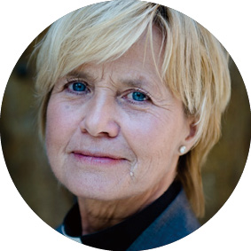
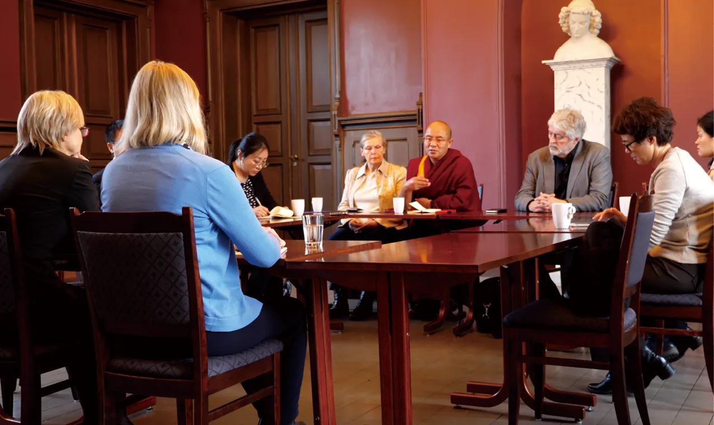

为和平

索达吉堪布 & 格拉萨斯主教

挪威·奥斯陆

Oslo,Norway

2017/12/04

安妮·梅·格拉萨斯（Anne May Grasaas）

自2013年起在奥斯陆担任教区主任。奥斯陆地区署理主教，奥斯陆大教堂院长。

1．佛教与基督教有很多相同点

格拉萨斯主教：

现在这个时节，我们教会称之为“圣灵降临节”，这是一年中很特殊的一个节日。很高兴能在这个节日和您见面。

之前他们曾问我想和您聊什么话题。实际上，我们对您的一些看法很感兴趣：首先是您对佛教和基督教之间关系的看法，希望您能从精神生活方面的角度谈一谈；此外，我们很想知道，针对当今社会的诸多问题，如和平、环境等方面，您觉得佛教和基督教应如何合作？

上网搜索了您的相关信息，我发现您正是回答这些问题的最佳人选，所以很期待您的回答。

在您回答之前，我还想告诉您，年轻时因为工作，我去过很多地方，比如斯里兰卡、泰国、中国、日本等。在此期间，我遇到过很多佛教徒，时至今日，佛教徒和他们的生活给我留下了深刻印象。

如今作为奥斯陆教区执行主教和院长，我开始关注很多方面，比如精神生活、理性逻辑、社会责任以及这三者间的关系。在挪威，通常人们不会特别重视精神生活，但我很想在这个领域深入探讨一下，因此非常期待听一听您的观点。

索达吉堪布：

首先我想表达对主教的感谢。很高兴我们有这样一个当面交流的机会。

您刚才提出的问题，也是我多年来关注的焦点。就这些问题，我简单地回答一下。

佛教与基督教之间是否有相同的地方？我认为相同之处有很多：第一，不管基督教也好，佛教也好，教徒内心都有个依靠处，比如佛教徒内心会祈祷佛，基督徒则会祈祷上帝。第二，众生在俗世间造了很多罪，无论如何，都需要有所忏悔。虽然佛教和基督教在忏悔方式上不一定相同，但大家都在罪业和忏悔方面有一些认知。第三，更重要的是在慈悲心方面，不仅要懂得自己，更要去帮助世人。佛教中最殊胜的大乘佛教，其一切教义就是要帮助世间苦难的众生。

关于您的第二个问题，我认为基督教与佛教，或者与其他宗教的合作，将在和平、环保等方面发挥巨大作用。

据现在的各种统计显示，全世界七十多亿人口中，接近六十亿人有自己的宗教信仰。如果这些人能够一起努力，应该会对世界和平、人与自然和谐共处等产生正面影响。

和基督教相比，佛教徒的数量没有那么多，体系没有那么庞大，在国际上也没有那么大的影响力。但基督教和佛教都很古老，有两千多年的历史，同时也非常适合当今时代。古代的一些宗教理念，比如爱自然、爱和平等比较积极的能量，当今社会依然非常需要。

如今正处于科技越来越发达的时代，人们的不安全感也越来越强，随之出现了各种负面心态，如担忧、恐惧等。在这种时刻，我认为全世界各大宗教应该联合起来，去直面当前人们正面临的种种问题。

刚才讲到，当下很多年轻人的精神领域非常匮乏，对此我也深有感触，科技越发达，很多人越迷茫。据说挪威人各方面都非常幸福，但如果涉及精神领域，难免也会有很多痛苦。这时候我们发现，来自信仰的力量特别重要。

这两天，我与身边的两位朋友有过一些简单交流，大家都感觉，要想得到心灵上的享受和满足，光依靠物质是非常困难的，有钱和有地位都不能带来心灵的满足。而在这一点上，宗教的作用非常突出。

我发起的“世界青年佛学研讨会”到今年已经是第七年了，每年我们都会邀请各个宗教的代表，谈谈自己对幸福、和平等问题的看法。每到这种时刻，我就会有很多感受，对自己将来做事也有很大帮助。

格拉萨斯主教：

谢谢，我非常认同您的观点。就您所提到的三个方面，佛教与基督教确实有共同之处。

首先正如您所说，两大宗教都承认皈依处的重要性。但在当今工业现代化的世界里，人们通常认为那很幼稚，他们会说：“我们不需要什么皈依处。”

其次，对基督徒而言，清除罪障非常重要。尽管我们学了一套神学理论并认为在宗教中寻找到了庇护，但是上帝无法拯救不自救之人，更何况我们都是有罪之人。放眼整个世界，人们都在造恶业，到处都是罪人，我们需要净化罪业。

最后，您还提到我们应当心怀慈悲。这么看来，我们确实有很多共同点。

现在我的问题是这样的：您给予了他人很多心灵方面的引导，或者说人们会向您寻求心灵方面的引导。去年我们也在这方面做了一些尝试，从对牧师的职业素养培训开始。

人们一直被引导要去理性思维，而信仰通常属于比较隐私的部分。所以当人们在日常生活中需要去皈依上帝，或其他在我们之上的神，或者认识到自己是罪人，有罪业需要净化，并希求得到慈爱之心，那么此时我们需要的不仅仅是神学理论。撇开理论，人们也需要从心灵层面去实践信仰。

当我用谷歌地图搜索，看到了您所在的佛教中心，那也是您为众生指引精神道路的地方，景象十分宏伟，给我留下了深刻印象。您能否与我们分享一些心灵引导方面的经验呢？

索达吉堪布：

我个人最重要的方式，就是为大家讲课，除此之外也没有更多方法。

在提倡宗教的时候，要重视教育。宗教也好，修行也好，只有信仰是不够的，平时还需要多学习。当然，如果仅仅只有学习，最后就会变成学术研究。从事学术研究的人，往往对神学、宗教不是特别认同。见解陷入这样的误区，还是很可怕的。

我本人比较倾向于既要有研究，又要有信仰。如果没有深入学习和研究，对于科技时代的众生，尤其是年轻人，宗教很难有说服力，他们也不会接受。但如果只了解知识层面的信息，就想让自心与宗教里信仰的力量相结合，也是非常困难的。

所以，我们经常强调“知行合一”。也就是说，将广闻博学的理论知识与实际修持相结合。不管在汉地还是藏地，我基本上都会秉持这个原则。既要懂得自宗的教义和一些现代科学知识，也要跟自己的宗教信仰相结合，同时每个人都有一点修证或者至少有一些体验。

格拉萨斯主教：

您提到的这一点很关键，我很认同您的思维方式。

基督教历史上关于灵性的记录中，也谈到了这一点。在一些神父的记载中说道：“如果你接纳内在的圣灵，那就能在正确的道路上走很远，也会让你获得充满身心的能量。”所以先驱者们都尝试着去驾驭圣灵，并将这些方法写下来。

在基督教的信仰中，将上帝、圣灵与自身之间的关系，视为父子关系。显然这是正确的，历史也是这样记载的。因此大家应该承认圣灵的存在。

所以我认为，思维方式至关重要。我们都需要去相信信仰本身，明白什么是真正的信仰，并且也要知道在信仰中存在一个基础，那就是需要真正接纳圣灵。

在基督教的教义中，圣灵是三位一体的上帝中的第三位格[^1]。基督徒认为，人们本身已经具有圣灵，也正因为如此，我们能够与上帝建立联系。

我想强调的是，我们要虔诚信仰伟大的神，同时我们也要努力地学习。

2．为什么佛教徒自愿被拘束？

格拉萨斯主教：

当我第一次遇到佛教徒、读到佛教经典时，我发现佛教的戒律很难守持。当然，受持戒律十分重要。您也知道挪威是全世界上最幸福的地方，挪威人不喜欢受约束，相反，他们喜欢无拘无束。我和其他一些基督徒也是如此。

您觉得是什么促使佛教徒自愿受持这种森严的戒律呢？

索达吉堪布：

世界上每个宗教都有自己的规则，这种规则就叫做戒律。按照佛教教义，戒律可分为很多不同的层次，其中最基础的是四根本戒。

对一些在家人来说，戒律并不算严格。出家人的层次比较高，相应所受的戒律会更严格。不同层次的佛教徒，要受持不同的戒律。

佛教的戒律，就像开车时要遵守的交通规则，是帮我们抵达目的地的一种方法。如果人们过于自由，身心就会过于放纵。有种说法是：“从长远来看，过度的自由，就是不自由。”佛典中也说，戒律就像清凉的净水、芬芳的旃檀，会让自己的身心得到满足。这是佛教中对戒律的比喻。

以前我了解过基督教的一些戒律，如不杀人、不欺诈、不邪淫、不偷盗。虽然各个宗教的提法有所不同，但对比下来会发现，当今社会需要遵循的一些基本底线和规则，与各个宗教的戒律有相通之处。

拿佛教的四根本戒来说，和其他宗教相比，基督教的戒律与佛教更为相似。

2．来挪威是我的梦想

格拉萨斯主教：

这次时间不太凑巧，因为下周六和周日，挪威要举行诺贝尔和平奖的颁奖典礼，今年的获奖者会来到奥斯陆。当晚，我们将在一个教堂中心举行一个神职性质的颁奖仪式，对这些和平奖获得者进行表彰。

索达吉堪布：

二十多年前，我就被诺贝尔和平奖所吸引，一直想到挪威来，哪怕看一下也觉得非常有意义。

从全世界来看，一百多年来，一直提倡和平而且有这么大影响力的国家，也只有挪威了。这次亲自来挪威，我觉得实现了多年来的梦想。

我个人对人类的和平事业做不了什么。去年我们在泰国举办的佛教论坛，主题就是世界和平，算是尽了一点微薄之力，也不算大的贡献。

到了挪威之后，感觉的确很不一样。这里对全世界和平真正做出了贡献，因此我内心非常欢喜。这里的宗教人士和当地的环境、文化，也让我感受到了在其他地方感受不到的氛围。

3．宗教和平的窍诀

格拉萨斯主教：

和您交谈十分愉快，您的发言和所做的事情对我们很有启发性。还有刚才没聊到的部分，您有什么想分享和提问的？

索达吉堪布：

去诺贝尔和平中心的那天，是我人生中很有意义的一天。也许你们住在这里，没有这种感觉。就像拉萨的布达拉宫旁边有一尊著名的觉沃佛像，藏地其他地方的佛教徒都特别崇拜它，经常一路磕头前去朝拜，但拉萨当地人就没有特别的感觉。诺贝尔和平中心对我们这些外来者而言，就是这样一个非常神圣的地方。我在其他地方很少买纪念品，但第一天去和平中心就买了很多。

多年来你们一直在这里倡导和平，我也算是一个提倡和平的普通佛教徒。基督教也好，其他宗教也好，您觉得将来在维护世界和平方面要发挥哪些作用？宗教间的和平共处，宗教与社会的和平相处，在这些方面，基督教和佛教应该扮演什么样的角色？您对佛教徒或者基督教本身，有什么建议或者倡议吗？

格拉萨斯主教：

这是一个很重大的问题。首先我想说，我们在本地做的最重要工作，就是促进相互了解和尊重。比如在奥斯陆有许多种族和宗教团体，为此，我们有一个论坛叫做“生命价值合作委员会”。在论坛中，会有类似我们今天会晤谈到的一些议题。另外，论坛中的本地基督徒和穆斯林还建立了联络小组。让不同宗教的领导互相交流也十分重要，这也为其他教堂以及基层宗教社团的互相接触树立了典范。

和平不仅是一种选择，和平是由大家共同创造的。我相信您也认同这一点。和平就是大家和睦相处，并且每天将这种精神运用到朋友之间、社团之间、家庭之间、教会之间以及宗教团体之间。

作为教会的一个领导人，与奥斯陆的其他宗教及非宗教领导人和睦相处，是我的一项重要使命。当城市陷入局势紧张的时刻，领导人之间就可以互相沟通。

以穆罕默德漫画事件为例，丹麦《日德兰邮报》首先刊登了十二幅讽刺伊斯兰教先知的漫画，之后地区报纸、基督教报纸以及欧洲很多国家的报纸都进行转载，最后整个事件大爆发。暴乱在世界各地蔓延，如挪威、瑞士等都被波及，到处都弥漫着恐慌。为此，各界领导人齐聚奥斯陆，一起探讨如何避免暴乱扩大。

促成会议的根本原因，就在于大家互相认识。这一点在当下依然不变：互相了解是争取和平最重要的一环。

我还想提两件事。第一，世界范围内的极端主义思想造成了大量恐怖袭击。我认为打击极端组织对争取大的和平也非常重要。比如现在许多挪威人因为ISIS（“伊斯兰国”极端组织）的行为，对伊斯兰教和其他宗教都感到恐惧。他们中的一些人甚至不想和宗教有任何联系，因为这会使他们联想到极端组织。

所以我们必须在这方面努力，使人们区分清楚精神层面的戒律和极端行为。做到这一点有时候是很困难的，但这也是我工作的一部分。

第二就是祈祷，为世界和平而祈祷。

索达吉堪布：

我也认为各宗教之间应该发自内心地互相沟通、互相学习、互相了解。如果不同宗教的人始终把自己框在一个小圈子里，认为自己只属于某某宗教，就太狭隘了。

在自己的信仰和身份不变的前提下，大家完全可以融入社会的大家庭中。当我们真正互相学习的时候，一定会产生一些意想不到的感受。

在这个时代，不同宗教的领袖非常有必要进行面对面的交流。就像您刚才举的例子，不同宗教的领导人通过沟通化解了冲突。

我觉得这是一个非常好的建议。其实很多宗教徒在自己的圈子里地位和威望很高，如果他们可以互相认识并互相学习，效果一定很好。

4．我们的责任

索达吉堪布：

拿佛教来说，这几年寺院里的出家人越来越少，这种现象非常明显。我去泰国的时候，得知他们之前全国有六十万僧人，现在只剩不到三十万，人数下降了一半。

多年前我去过荷兰和英国，那时候各地有很多教堂，也有大量信徒，但现在不少地方准备把教堂卖出去。我在美国看到的情况也一样，美国也有很多教堂已租给一些公司，用作他途，甚至卖掉了。这让我意识到基督徒的人数也在减少。

目前汉传佛教的很多寺院趋向商业化，寺院里没有太多出家人，也没有传播佛法的教义。这也让我比较担心。

现在消费主义文化盛行，通过各种广告吸引眼球，传播全新的价值观，取代了人们心中的传统信仰。宗教本身并不善于做宣传、打广告，所以在这样的时代中，再过一二十年，我们的宗教徒会不会变成凤毛麟角？这也许是我个人的担忧，但也是我们不得不关心的事情。在这方面您有什么看法？

格拉萨斯主教：

对您的担忧我很有同感，但同时我也抱有希望。因为对于上帝以及一些超越生命存在的体验，让我们明白生命本就如此。我们从哪里来，最终也要回归那里。当我们打开自心，虔诚信仰神灵时，个体与社会就会有非比寻常的事情发生。

宗教推广方面，我们也在努力，以后应该能做得更好。比如我们在对挪威教堂做持续推广，也努力理解Facebook和Instagram等各种社交网络和渠道是如何运作的。我个人的想法是：我们会试着使用这些推广渠道，虽然并不擅长，但会去尝试，也会寻求帮助。

我始终认为，最重要的是，要认真对待自己的信仰，无论对挪威基督教会而言，还是对其他宗教来说。如果连我们自己都不相信神的存在，推广并不能真正帮到我们。只有相信，才有广而告之的必要，我们一定不能忘记这一点。

今天所有谈话的重心，都落在您和我的责任上。就是要继续我们目前的工作，试着深入并与同伴分享，同时将之传授给后人，发扬光大。

在我看来，发展宗教的主要原则就是：通过人与人的沟通来进行。

5．挪威人真的幸福吗？

索达吉堪布：

很多资料显示，挪威是幸福指数最高的国家。刚才我说起这一点时，主教也赞同地点了点头。或许很多人认为，你们挪威人是世界上最幸福的。但前两天我与很多人接触时，发现他们也不是很快乐。

作为宗教人士，我认为幸福不一定要通过指数让别人知道，而要通过个人内心的宁静或是证悟来判断。

我好奇的是，挪威被称为全球最幸福的国家，但到了这里，为什么我感受到的与在世界上其他地方类似呢？

格拉萨斯主教：

首先，我必须说明，幸福指数只是一种象征，它代表人们对挪威的生活抱持感恩之心。我们有民主制度，大多数人有工作，有房子，也有足够的食物，而且人们所拥有的多于所需要的。

以我个人为例，我有一个35岁的女儿，她的智力有点迟钝。如果我们生活在挪威之外的其他国家，生活就要困难很多。因此我非常感恩，我觉得这一切都是上帝的礼物。要学会感恩这一切。

另外，幸福不是凭空出现的。我知道许多有钱人都非常孤独，在我看来，孤独是这个国家一个非常大的问题，因为它与幸福背道而驰。我们可以在独处的同时感受幸福，但没办法在孤独的同时感受幸福。

正如今天我们所谈到的，必须在自身之外找到一个皈依处。这是很实际的，不虚幻，也不是错觉，而是通过经历和体验可以真切感受到的。我认为这样才可以得到幸福。

我曾经在一些非常贫穷的国家，看到那里的人们很幸福。当然，我不希望那个国家一直贫穷，也想做点什么能使他们富足起来。但贫穷和幸福不完全对立，我在他们身上看到了幸福。所以我认同您的观点。

此外，挪威还有一个很大的问题，就是人们在物质上已经十分富足，更需要的是内心的幸福，而不是指数上的幸福。这是一个挑战，因为人们不轻易触碰自己内心最深处的想法。当人们整天忙于各种琐事时，就会误以为自己是幸福的。但是，当人们开始思考时，就会听到内心的声音：我们究竟是谁？我们真正需要的是什么？

这也是我们今天所谈的话题。

非常感谢您！能在这里见到您，我觉得非常荣幸。千言万语汇成一句话：愿上帝保佑您！

[^1]: 三位一体：谓上帝只有一个，但包括圣父、圣子耶稣基督和圣灵三个位格。三者虽位格有别，而本质绝无分别。
