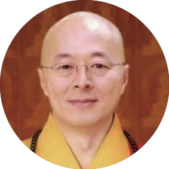
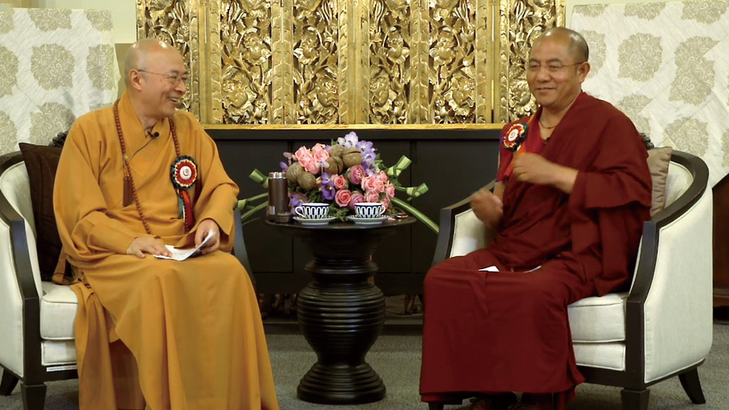
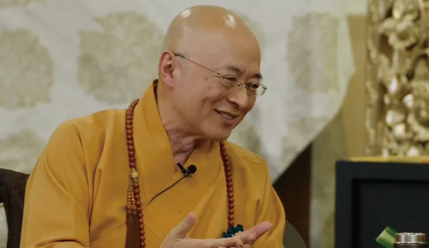

浮世修行

索达吉堪布 & 海涛法师

泰国·清迈

Chiang Mai, Thailand

2017/07/30

释海涛（Master HaiTao）

出生于台湾高雄，生命电视股份有限公司董事长。他不断通过电视、广播、讲座和传授八关斋戒、护生放生等活动来培养社会大众对正信佛教的认知。近年来，致力于拥护佛教各个宗派。

1．为什么建“世青会”

海涛法师：

今天非常荣幸，能够跟尊贵的索达吉堪布坐在一起。也很感恩堪布慈悲邀请生命电视台和台里很多法师参加由堪布主导的第七届“世界青年佛学研讨会”（以下简称“世青会”）。

这两天下来，我觉得堪布就像母亲一样，一直在为这些年轻人寻找让他们快乐幸福的方法和适合他们的修行方式。就像一个老母亲在配菜、煮菜，只要孩子们高兴，她就算没吃饭也很快乐。

我想请教一个问题，世青会是一个针对年轻人创立的国际佛教平台，聚集了世界各地的学佛者参与其中。堪布希望这个平台对这些年轻的佛教徒未来产生什么样的影响与作用？

索达吉堪布：

这次能邀请到海涛法师和生命电视台的很多法师，我们组委会所有成员都感到非常荣幸。

我想世青会是一个很好的平台，因为南传佛教、藏传佛教、汉传佛教都有代表参与其中。这个平台的宗旨是开放、包容、求真、利他。我们建立世青会的初衷是，希望很多年轻人不要走太多弯路，不要到了白发苍苍才开始寻觅自己的信仰和修行的道路，那实在是太可惜了。

当然，世青会也会邀请不同宗教的人士、没有信仰的人参加，他们来自不同国家，讲不同的语言，以自己的方式追寻内心的宁静。每年大会上都有十几种语言交流，如法语、英语、日语、德语、泰语等，还有不同文化和智慧之间的碰撞。

对一个年轻人，尤其是比较封闭的年轻人来说，一方面，他们能在这里看到更广阔的世界，看到其他年轻人求真的精神和他们所找到的幸福之路，自己的内心可能会因此变得更加开放，为他们未来的生活带来一些帮助。

另一方面，世青会也邀请到了很多像海涛法师一样全球闻名的高僧大德，请他们为年轻人讲一些佛法，谈谈应该如何面对自己的生活、家庭和工作等。

如今世青会是第七届了。有很多年轻人，之前特别排斥佛教，对父母的信仰特别反感，在参加过一次世青会之后，他们的傲慢心好像减弱了。以前他们认为佛教是迷信，参加之后至少知道，原来父母学佛并不是没有道理的。这样看来，世青会可能会对不信佛的年轻人起到一些作用，产生不同的影响。

2．家庭、工作、修行都兼顾

海涛法师：

这一届世青会，您提出的分主题之一是“生活佛教”。佛法融入生活很重要，因为我发觉现在很多学佛的人，特别是密乘修行人，功课很多，比如要修加行，要修十万拜忏等。但在现实生活中，他们时时忙于工作，如果是女性还要照顾家庭。如何兼顾修行与生活，对此您有什么看法？

索达吉堪布：

这个问题非常好。的确，现在的修行人，一方面要关心修行，另一方面也要顾好家庭、工作，保障好自己的人生。尤其在当下，每个人的日常生活都特别忙碌，每天看手机、用电脑，坐地铁上下班，要做很多很多事情。当方方面面的问题搅在一起，有些人可能很痛苦：“我是一个佛教徒，既要修很多法，又要照顾家庭、努力工作，应该怎么平衡呢？”

其实“生活佛教”的要求不高，每个人都可以在生活中轻松融入自己的信仰。原来有些人认为，佛教只关心生死问题，比如人死了以后要给他念佛，除此之外什么都不管。实际上不是这样，在日常的行住坐卧中都可以用上佛法。比如说，我们经常提倡，坐车去上班的路上可以念“嗡玛呢巴美吽”，做各种工作时也可以边做边念咒。在藏地，人们经常这样修行。您对这一点也非常清楚。

信仰佛教并不是要求非得关上房门，一定要闭关实修。你在上班的时候，在家里炒菜的时候，在做任何一件事的时候，都可以融入信仰。念阿弥陀佛，参话头，思考佛教理论……这些都可以融到你的生活中，并真正运用起来。

对现代人来说，将生活和修行完全分开是很难的。这个时代，竞争越来越激烈，生活节奏越来越快，你有家庭也有工作，如果不能把佛教融到生活中，恐怕这个世间很难找到真正的修行人。

其实修行人有两个责任，一个是家庭的责任，一个是修行的责任。如果再多的话，还有工作的责任。因此，每个修行人都是双重身份或多重身份。我希望大家能做到佛教与生活不分离，在兼顾好生活的同时，也不要忘记修行的责任。

3．藏传汉传，各有修行特色

海涛法师：

我是在汉传佛教的环境里长大的。相比而言，藏传佛教明显更倾向于慧学，功课很多，比如加行、灌顶、闭关……在汉传佛教中，我们当初出家时所受的教育是：“你刚出家，不能去读佛学院，必须在寺庙生活几年，从中找到诀窍，生起出离心。”接下来，如果你愿意去服务大众，有悲心了，老和尚还会继续观察，从生活上看。假如也做得很稳了，他才会叫你去读书。不然老和尚会说一句话：“蛇喝水变毒。”也就是，如果不知道学佛动机正确与否，你就去读佛经，读再多，也可能倒过来批判佛教。

我们也见过台湾很多学者会用他认证的思想去批判佛教的对错，甚至对藏传佛教抱持一个自己的看法。正因为这样，我跑了很多汉传的寺庙，他们都倾向于这样的教育观点。有的老和尚说，我怕送他们去佛学院，回来以后都不念佛了。也就是说，担心他们的思想会有所改变。

我认为，所谓生活佛教，就是不离开佛教理念，并应用在生活中。所以我们提出了一个“半工半读”的概念。比如我师父跟我说，一天闻思修不要超过两个小时，但你必须把佛法用在日常生活中。而且师父也会观察你，看你走路、洗碗、接电话，待人接物，跟你所学的出离心、大悲心是不是一致。他会观察得非常细致，看你的所修是不是像禅一样，融入生活里。

有些人很喜欢读书，他就一直读一直深入；有些人则是在生活上很认真；当然有些人是两边都不行。我个人的想法是，汉传佛教的经典博大精深，闭关五年乃至十年都看不完，因为需要逐字逐字去思维，就像我们一个字一个字地解读《心经》。

藏传佛教里，因为祖师大德的慈悲，佛教经典的精髓已被整理成很好的修行次第。比如《菩提道次第广论》《普贤上师言教》，提供了非常好的修行纲领。

这样看来，似乎汉传佛教比较重视在生活中修行，藏传佛教则重于闻思修、闭关。但现在很多藏传佛教的修行人遇到一个困境：功课太多做不完，做多了还会导致离婚。因为天天忙着修行，无法兼顾生活，配偶就会抗议。

我现在也一直在研究这个问题：愿意修学佛法很好，但如何找到与生活的平衡点？

目前我对有这些困扰的修行人说：佛教的理论我们都知道了，像出离心、大悲心、菩提心、空性……现在要将这些理论融入生活。开车是修行，走路也是修行。比如当你开车时，清楚地观一切如梦如幻，同时又不离开大悲心；路过的每一部车、每一个路人、每一个商店，都祈愿他们能够得到世俗的圆满，未来能够生起菩提心。在开车过程中，一直如此保持正念。就像念阿弥陀佛，念的数量不重要，重要的是你是否具有像阿弥陀佛一样爱护周围人、事、物的心态。念“嗡玛呢巴美吽”也是一样。

有些人真的完全没办法闻思修，他也会因此感觉惭愧。但这样的人也能用快速把握纲领的方法，进入佛法的次第。他会觉得自己很安稳，产生了悲心，对生死也有了一点觉悟，可能已经抓到了重点。他会认为：“我很认真地念佛，不执著世间，只是尽力承担世间的责任，当死亡来临，我能够往生净土，就算合格毕业了。”就这一点来说，汉族人好像比较简单，观念上也比较单纯，能够往生净土就可以了。

现在汉传佛教的修行特点，偏向将佛法融入生活，而藏传佛教则偏向闻思修，两种修行各有特色。您有很多汉族弟子，又有很好的引导方法，所以我们这次也是特意来向您学习，了解和观察汉族弟子修学藏传佛教的效果。

汉传佛教中，观察一个人的修行境界，不管他修行了几年，就通过一些日常行为，比如看他如何端茶、走路，就知道他修到什么阶段。如果他连一本书都拿不好，茶杯也不会用，吃完饭桌子也不去收，老和尚就会说：“这个人不行，这是读书人，不是修行人。”他不管你读过多少佛学经典，强调的是生活中的修行。

我印象中，藏传佛教比较强调弟子的闻思修，会问这个课程学完没有，次第到哪里了？我认为这两种修行方式现在可能有必要结合起来。

还有一个问题是关于手机的使用，刚刚您也提到了。我们曾培养了四十位小沙弥，本来禁止他们看手机，后来允许他们看以后，三分之二的人还俗了。泰国目前也遇到了这个问题，他们有四十万出家人，本来规定不允许使用手机，结果年轻沙弥提出抗议。开放了手机之后，出家人少了四分之一。他们现在也在想该如何解决这个问题。您对年轻人特别是学佛人使用手机有什么建议？

索达吉堪布：

您的第一个问题是，关于藏传佛教和汉传佛教的异同。出于历史原因和长久以来民族观念不同，藏传佛教和汉传佛教在某些方面的确存在不同。

就我个人而言，从1987年到今年，为汉族弟子辅导、翻译、讲课已经整整三十年了，对藏地和汉地的修行方法都有些了解。但对西方的思维方式还不是特别熟悉，他们又是另一种方式。

藏传佛教与汉传佛教如今非常融洽，一方面是因为汉地有很多比较开放的高僧大德，他们对藏传佛教、南传佛教非常包容，另一方面在汉传佛教内部，各教派如禅宗、华严宗、净土宗之间也都互相尊重。与二三十年前相比，现在我们拥有良好的交流空间与机缘，而在此之前，藏传佛教有些保守的老和尚，不仅对汉传佛教比较排斥，藏传佛教内部各派，比如格鲁派、萨迦派、宁玛派之间也不容易沟通。如今这些距离、隔阂已逐渐消失。

这一点，我也特别感谢很多像海涛法师这样具有远见的法师们多年来的努力。我并不是在说客套话，也没有必要这样做。大家能够互相理解和互相学习，是非常重要的。释迦牟尼佛的教法在不同地域和不同民族流传的过程中，分别融入了当地的生活、习惯和传统，从而形成了不同教派。如今不同的佛教传承之间有相当多的融合之处，这一点非常令人高兴。

目前，藏地也有理论派和实修派。理论派每天都在学习，比如辩论或闻思，但他们中的一些人连扫地、洗衣等基本生活技能都不太会。汉地经常把这类人称为书呆子——书读得很好，但在做人方面或人际交往方面的能力比较差。其实这类人在藏传佛教中也不受欢迎，尽管他们理论学得很好，也很会讲，但在跟人接触时就会出问题，比较麻烦。加上他们本身也不注重实修，有点类似当下学术界的一些人，总是依靠自己的分别念判断事物。这样的修行人，我们不大赞叹。

实际上，佛教徒应该既有理论作为后盾——否则容易生起邪见、产生怀疑而退失信心，同时也要像汉传佛教一样重视实修，坚持早晚功课、日常念佛参禅等，这是非常重要的。

我认为，学佛和做人要结合起来，理论和修行也要结合起来。有些人学佛学得很好，但跟家人关系不好，跟所有亲戚朋友都闹矛盾，这样很不好。另外，佛教徒也要学会融入生活、融入社会，否则学佛之后与外界格格不入，对家人造成很大伤害，给整个社会带来负面影响，那就不要妄谈自己的修行有多好了。

当然，学佛不一定非要出家。对于要求出家的人，我会让他不要激动，先好好观察一下。不然，家中的孩子、父母、配偶没有得到安顿的话，他们也会很可怜。一旦因缘真的成熟了，出家这件事挡也挡不住，但在此之前，不能因为一时冲动而马上放下一切。家庭对一个人来说特别重要，如果给家人造成了伤害，对自他都不是什么好事。所以出家前一定要慎重考虑。

至于您的第二个问题，的确，现在很多出家人因为使用手机，修行受到了极大影响。我们佛学院的理事会也为此开过很多会，试图把僧众的手机收上来。但现在这个时代，网络已是铺天盖地，收手机的意义也不大，很可能我们收掉一个，他会再买一个藏起来。除了手机之外，还有很多外在的诱惑，对出家人来说，现在护持净戒的难度越来越大。

不仅是出家人，在家人也一样受到手机影响。以前很多在家修行人会念咒语、看书，但现在都是边学佛边玩手机，而手机里的大多数信息不一定很真实。

所以，特别感谢生命电视台这么多年来一直为大家提供正能量。在这个时代，佛教以这种方式出现，应该是非常明智的选择。

4．这个世界诱惑太多

海涛法师：

一个学佛的人，现在要面对科学的发展，要面对物质生活和社会的进步，要面对各种欲望……这些变成了我们必须要面对的现实。

逃避并不能解决问题，因为整个社会都在被这些困扰，而大乘佛教就是要解决社会问题的。对此，我个人的想法是，虽然玩手机的沙弥们还俗了，但至少我们知道问题出在哪里，他们自己也知道：问题就在于没有办法抗拒诱惑。

莲花生大士曾说过，当飞机出现，末法时代到来，此时只能祈请莲师的加持。曾有很多家长跟我说：“师父，您救救我儿子！他‘中毒’了，现在拜手机为宗教了，怎么办？”我的回复是：“什么方法都没用，除非你每天跟着他、陪着他，他也不见得要听你的。现在你只能祈请莲花生大士加持，祈请观音菩萨加持。”这是我的看法。

即便我的一些徒弟沉迷于手机，我也不可能要求他们把手机拿来检查。学佛是自发的，我们又不是军队。我只能说：“祈求三宝加持你，你可以看手机，但不要被诱惑了。如果你被诱惑了，希望你将来有恢复的机会。”现在做错没关系，将来不要再错。

这个世界变成了一个诱惑很大的世界：女人很性感，手机越来越智能……社会给每个人带来了压力，让人们希求成功，连修行都有了互相攀比的趋势：我比你成功，我的寺庙比你的大，我的信徒比你多……在这种趋势下，我提出一句话：“身如乞丐，心如黄金。”我一直告诉自己，我要像乞丐一样。因为诱惑无处不在。

事实上，年轻人是愿意修行的。他听到佛法后会说：“好啊师父，我要出家！”但结果是没多久他就去结婚了，因为因缘到了，感情的罗曼蒂克来了，他没办法抗拒。

堪布，以您三十年来的经验，年轻人处理感情问题时，或者他们在出家和在家之间挣扎时，应该怎么办？

索达吉堪布：

就像您说的一样，有些人出家之后，表面上好像烦恼和痛苦都没有了，但实际上并不是这样。

我所在的佛学院，出家人非常多，现在也有五六千人。有些人以前生活非常复杂，嗔恨心很大，贪心也很重，选择出家之后，他们完全离开了红尘，离开了诱惑，离开了世间亲怨，少了烦恼，变得特别清净，长期遵循简单的生活方式。但也有一些人，当时劝他不要出家，他非要出家，结果不到一个月就还俗了。也有这样的现象。

所以，我觉得在家人先不要忙着出家，要去观察：一旦自己真正出家了，到底会不会退转？如果总是变来变去，短暂的人生中，扮演很多角色也不庄严。当然，有时候因缘来了，自己也不一定挡得住，这就是佛教常说的违缘。还有一些修行人，刚开始信心特别大，后来慢慢对师父不恭敬，经常与道友吵架，最后自己的道心也会退失。

一位哲学家曾说，存在即合理。我们不可能遮止所有的非法。本师释迦牟尼佛的时代都不行，何况是现在这个诱惑大、变化快的时代了。作为真正的学佛者，作为现在的修行人，我们要不断地闻思，不断地保持利他心，同时还要经常进行自我观察。

藏地的麦彭仁波切说过，纵然这个世界遍满恶人，我们也要秉持高尚的行为。确实，如果我们很真诚地祈祷莲花生大士、观音菩萨，祈祷自己的传承上师，这些负面力量很快会转为正面。

这一点，我自己有亲身感受。三十年里，我遇到过这样那样的很多事情，能走到今天，跟自己坚定的心有一定关系，但更重要的是，我经常真诚地祈祷诸佛菩萨，无形中给自己一种力量。

希望大家也能经常祈祷，依此会使自己的愿望得以实现。当然，我们不能只靠祈祷来完成所有事情，自己也要努力。无论你是出家人还是在家人，都不能忘记自己对社会的责任。

我特别佩服您的一些做法，既坚定又谨慎。之前我看过您的法讯，发现您的弘法日程安排得特别紧，今天在马来西亚，明天又在另一个国家，经常在各国之间飞来飞去。这种弘法强度，是普通人难以想象的，希望后学者也能生起这样的利他精神。

藏传佛教里有小擦擦的说法，也就是从模子里倒出的小佛像，会印有模子上的所有花纹。作为弟子，也要如此随学上师的所有功德。现在大部分人很难有机会依止上师，有了这样的因缘时，一定要随学上师身上的悲心、智慧、力量。

5．怎么样做事

海涛法师：

您提到我经常跑来跑去地弘法。事实上，这是我个人、也是我师父为我选择的一种修行方法。

我本来选择待在佛学院，我师公甚至要培养我做院长，但我发觉，这样对自己的帮助不大。于是师父告诉我第二种修行方法：先把佛教的知见建立好，等到不会退转了，就要到红尘里去翻滚。他要求我跑遍全世界，而且做每一件事情都只做两年，做到核心就不能再做下去，再做下去怕我会有执著。

我大概跑了二十五年，但不是每位修行者都要像我一样在红尘里打转。因为如果你也去跑，抵挡不住诱惑，很容易就退转了。

可能是我个人的因缘吧，我必须面对一些很痛苦的事，就像您所说的“苦才是人生”。我认为，修习大乘佛教，特别是密乘，就是要在最痛苦的境遇里保持正念，将逆境转为修道的助缘和资粮。

刚刚讲到男女的问题，我最近也有所体悟。我现在年纪已经算大了，但是在外面跑，下面的女众信徒，会用各种方法对你抛媚眼。这不是她的错，只是她的习性如此。我怎么去面对呢？最近才体悟到原来佛陀说的最好。佛说你一定要把她当作自己的母亲，哪怕这个“母亲”才二十几岁，你还是不能把她看作女孩。

所以我现在觉得，母亲跟情人的差别只在一刹那，作为情人的男人女人与父亲母亲的差别，就在佛魔一念间。如果你不去碰触，就不知道自己有没有修成。所以在碰触这个的时候，要保持正念，要祈请上师的加持，“嗡玛呢巴美吽”，真实把她当作母亲去对待。

禅就是不断串习、变得熟悉的一个过程。我们要告诉自己，她是妈妈、他是爸爸……不能通过她的外表、眼神去看待对方。我认为，要强迫自己串习、形成这个习惯。我们以自己的妈妈作为对境，就像因果七要一样，知母、念恩、报恩、慈心、悲心、利他心、菩提心，然后还要为她发愿。

我现在属于这种在世间跑的状态。就我个人而言，发愿来世最好从小出家，藏文、巴利文统统都会。我这辈子和您不一样，我是半路出家，35岁才出家，之前结婚、生小孩、做事业……好事、坏事都干了，没办法像您这样从小在上师的带领下，在一个好的环境中修习佛法。就像别人在讲英文时，我们坐在那里就会很自卑，因为英文不好。所以我只能用多元的生活理念去碰触佛教，在不离众生苦的基础上去了解佛法。

另外，大乘佛教的目的是服务众生。我想您一定比我更有心得。比如举办规模这么大的世青会，其中要用到很多人。我们会希望他们有能力成办这件事，但这种能力又不能脱离佛法的基本理论，比如能力不能超过慈悲心。所以我现在得出一个结论：宁可具备足够的悲心、道德感，也不希望能力超出悲心的范围。因为当你的能力超出这个范围时，很可能会伤害佛教。

作为大乘佛教，特别是金刚乘的修行人，我们也不能一直沉浸于学佛很快乐的境界中。就像弥勒菩萨所说：“不懂世间法，非名为菩萨。”当我们回到世间，成办世间事，就是在实践禅修。我至今还在研究这一点。

很多人都知道我去亲近大宝法王。他是个年轻人，组织一场那么大的法会，我以为他身边会有很多能力强的秘书在帮他，但是并没有，从头到尾都是他一个人成办的。三更半夜，大家都睡觉了，他还在一一确认法会的各种细节：这个佛像对吗，那个音响行吗……

我曾问过他，他的态度是：对于教法和证法，需要闻思修或者闭关，但也要用在做事上，把事情做好。

大宝法王曾策划过一个以米拉日巴尊者为主角的话剧。从头到尾，编剧、导演都是他一个人，他要花很多很多时间做这件事。他跟我说，他没有读过佛学院，现在也没办法，必须很认真地把这些事情做圆满。

有一次，他正在为您写长寿祈请文，中文有拿不准的时候，他会问问我，要怎么表达。对大宝法王来说，他没办法像其他人一样闭关修行，但是他用世间法来修，这么复杂，压力这么大。

他跟我说：“有一天真想自杀，但是不行，我不能死。在我想要自杀的那一刻，我看到了释迦牟尼佛，于是我就安心了。”意思是说，那一刻他知道自己的修行方向是对的。

还有一次，一位出家人让他闭关三年零三个月，但他说，闭关两个月就好了，世间这么苦。当然，换作是他，两个月就可以，可能别人需要闭关三年零三个月。

再比如对我而言，上师要求我做十万拜。我说：“上师，我现在事情太多了，没办法做到。”上师就会说：“那就一千拜。”他会因材施教。最近上师又提出一个方法，如果没办法做完十万拜，至少这个月都要很认真地礼忏。就是说，不一样的人会有不一样的修行方式。

我也发觉，我亲近这么多位高僧大德，每一位都处在学习的状态。真理是永恒的，但遇到事情怎么处理，要观察当下的因缘，我们也没有办法，不知道结果会是什么。

我很想请教您，因为您现在也是在面向整个世界，包括学院、社会、信徒……还要拿出很多精力去成办各种佛行事业。您是怎样去拿捏和处理的呢？

索达吉堪布：

我个人而言，确实也在不断学习。无论我在佛学院还是外出，主要都是讲经说法，只有极少数时间，自己在寺院里闭关。其实我很想闭关一段时间，只是一直空不出时间。

我跟您的感受比较一致。到了我这样的年龄，确实对外出观光旅游没有兴趣，在其他地方待着也觉得无聊。没有上课的时候，身体经常不好；只要上课，身体就好像一直能承受。不知道这是一种什么力量。每个星期天，没有课的那一天，全身都痛，星期一开始，身体就恢复了。

在我看来，作为佛教徒，的确需要通过学习来了解世间人的心态、社会的状况，包括现在世间的各种变化，尤其是像人工智能这种会导致社会变动的高科技。

在过去，大概需要一千年或五百年，社会才能发生一个大的变化，但现在，也许几个月、几十天，整个世界的生活方式就天翻地覆了。这个时候，我们佛教徒也要好好思考，不然整个世界都变了，我们还一直守在那里，守株待兔，是肯定不行的。我们更要了解社会、融入社会，认清当下的各种现象，这很重要。

同时在这个过程中，最关键的就是，我们自己要稳重，做任何一件事情，要有始有终地坚持下去。现在的年轻人，喜欢做很多事，做做这个、做做那个，有各种创意，但真正能坚持下来的很少。只要遇到一些违缘，他们就不再前进，永远地退失了。

修行也好，做世间法也好，乃至做个小项目，都要有一颗坚定的心。除非实在走投无路了，不得不选择放弃，在此之前，我们的心一定要坚定不移。

前一段时间，我在五台山讲过“三颗心”。首先，佛教徒要有一颗服务的心承侍别人。并不是占有或统治他人，而是应该对一切众生，包括其他教派的信仰者和所有没有信仰的人，以一种服务的心来承侍。

其次，要用一颗低调的心来做事。也许到了一定时候，有些事不一定能继续。我们要不断地转换思路、改变方法，努力克服困难。

最后，还需要以一颗坚强的心来弘法利生。我翻阅过很多历史书籍，前辈高僧大德在弘法利生时都遇到过各种障碍和困难，不管汉传佛教、藏传佛教还是印度佛教都是如此，他们在弘法利生的过程中非常辛苦。如果真是一个成功的人，就会非常坚强。所以我们也要用一颗坚强的心来面对世间。

其实如果内心获得了自在，修行人应该是很快乐的。世人认为的很多痛苦与困境，在修行人来看，并不把它当成一回事。

6．建一所国际性佛学院

海涛法师：

我经常讲一句话，“努力的生命最美丽”，我从您身上就看到了努力、努力、努力。我也常讲“不进则退”，不努力就会掉下去，所以只有一条路可以走。就像密乘，要么成佛，要么下地狱，没有第三条路可以走。精进于经教乃至闭关，精进于度众生，精进于在生活里修行佛法、体悟佛法，都可以，但是一定要精进！

就像刚刚您所说，只要停下来就会生病，一上讲台什么病都没有了。意思是说，我们上台的时候，会很精进地推广佛法、讲解佛法、实践佛法，那个时候就可能有加持力，可以消业障。甚至心灵的力量会超过肉体的力量。

特别在当今末法时代，如果我们不够精进，没有南传佛教中的决意波罗蜜——就是决定了，打死也不改变的意思，可能会找一百个理由退转了。

之前听您说，因为法王如意宝的一句话，您把三十年都奉献给了汉族修行人。我也看到很多青年学子提到您就会掉眼泪，认为您就像妈妈一样。为什么？因为有了您的教育，他们终于得到了佛法的恩惠和佛教的传承。

如果一个人有上师、有母亲，那就是最幸福的人；一个人没有了上师，没有了母亲，他就是最可怜的孤儿。

现在学佛的年轻人，特别是知识分子，在这方面有所欠缺。台湾人有句话，“读书越多的人越没感情”，这一点是比较恐怖的。因为没有感情就没有悲心，没有悲心的话，懂再多也只能形成一种对立、批判式的思维，没有法喜，会很痛苦。

这两天跟您聊天，谈到一个构想，就是创建一所国际佛学院。现在学习佛教已经不分宗派了，小乘、大乘、密乘都要学习，出离心、大悲心、菩提心都要修习。都说南传断贪、北传断嗔、密乘断痴，我们要修绝对的清净观。

那么如何让一个修学者更好地修学佛法精髓？特别是很多海内外的年轻人，他们很想精进修行，但没办法整年都修行，一年中可以拿出两个月或三个月来修学，像结夏安居一样。他们希望了解不离社会的修行方法，获得三乘的精髓。他们不见得要修十万拜忏，或者把《大藏经》全部看完，但我们可以请很多上师、法师传给他们佛法的精髓。就像索甲仁波切一辈子的修行精髓，多听就可以得到，就能用在自己的生活上，甚至未来帮助他们出家。

这种超越宗教范围的国际性佛学院，既不标榜藏传也不标榜汉传或南传，也不分禅宗、密宗，而是传授包括佛法在内的世间所有善法。哪怕是企业家或医学专家，都要邀请过来，因为我们的动机是学习他们服务众生的能力。

我的这个想法，很希望能看到堪布加以实践。因为您这边青年学子众多，形成了很好的向心力，他们也愿意精进学修。我想请您开示这方面的想法。

索达吉堪布：

您这个建议确实非常好。其实任何高僧大德都有可能跟常人所见、所想的不大相符。前辈大德当时所做的一些抉择、判断，或者他们对某个佛教组织的定位，可能要到后来才会发现其中的意义。您提出这个想法，我也非常有兴趣。

其实在法王晋美彭措圆寂前，我们佛学院也有一个国际学经堂，因为法王在世时已有这种远见。法王虽然身处山沟，但见识非常不凡。比如当年去五台山与汉族弟子结缘，这种做法就与很多藏族老一辈出家人的观念非常相违。后来法王去美国、去印度，与国际的思维方式接轨，也跟一些老修行人的传统思维不同。现在看来，这是非常重要的突破。

我们佛学院有南传佛教、汉传佛教、藏传佛教的不同佛堂。当时法王建造这种国际性综合佛堂时，很多人批评说：“这样做的话，佛教不同宗派就混为一谈了。”但是现在来看，我们确实只有这条路可走。尤其是现在信息如此发达，如果我们以狭隘的思维死守自己的“地盘”，最后失败的就是自己。

每一个宗教、每一个佛教团体，都要尽可能地与科学相结合，因为现在科学已成为这个世界的“宗教”。我看到各个宗教也在用各种方式去切合科学，还有很多有智慧的教派，也在走与以往不同的路。

我们佛教徒的首要选择，就是互相团结，不是做表面功夫，而是发自内心地、真诚地互相学习和互相了解。我们应该经常共同召开平等的会议，创造一些交流平台。还要利用现在的媒介手段，利用现代各种方便法，向大众传播比较轻松、开放的佛教思想。

同时，我们需要建立南传佛教、汉传佛教、藏传佛教全部具足的国际性佛学院。其实在中国大陆，有一些名义上的类似机构，但后来可能没法办下去。我们很希望未来各种软硬件条件都具备，因缘具足，向这方面努力推进。

海涛法师：

我要祈请各位广修功德，回向索达吉堪布，愿堪布的心愿能够成就。因为这个世界上能够承担起重任且不退转的上师，太少太少。所谓的“物以稀为贵”。

像我总是把自己定位为半在家、半出家，因为我是半路出家，所以我有一半的工作是护持三宝，另外一半只能在知见上保持正确，如此而已。

因为我没办法深入地闻思修，就像现在，我想要闭关，要把《大智度论》看完，要把《般若经》再看一遍，都没有时间、没有办法达成。

无论如何还是那句话：“努力的生命最美丽。”因为修行也不仅是这一世，对我们来讲是一世、一世又一世。

就我个人的想法，我要保留的是一份愿力。因为死亡是必然的，什么时候死也不知道，但至少这个愿下辈子还可以继续，不离菩提心地继续、继续……

7．关于放生

海涛法师：

大家都知道我很喜欢放生护生，在全世界都做。我们现在在缅甸建了一个占地三千亩的全世界最大的护生园，救护牛马等动物。其次，我很喜欢做施食和烟供。

为什么做这两件事？因为我觉得这是修悲心的很好的方便法门。对个人而言，你为众生提供了帮助。

但现在放生的障碍真的很大，台湾也有这个问题。之前我去加拿大，曾经发生过一件事：我们一位法师把两条鱼放生到一个湖里，结果当地政府花了五十万加币把整个湖的水清空，所有鱼都转移出来，把这两条鱼找出来送到别的地方，然后再把原来的水和鱼放回去。这个过程一定会死一些鱼，但当地政府认为这才叫解决了生态问题。对佛教而言，我们认为生态是众生平等，吃肉才是破坏生态。但是在世间，没法这么说。

我很想祈请堪布慈悲，为这些很愿意放生却遇到重重障碍、快退转的信徒做一些加持。我也知道您有时候会提到施食鬼道，念“嗡啊吽”“嗡玛呢巴美吽”就可以充满悲心地给予众生帮助。

我觉得自己这几年在做放生护生的工作，比如布施面包时都很有力量，也很有心得。在不离悲心的情况下，思维空性也会更好。所以要请您再加持加持，也给我们一些关于放生、施食以及烟供的建议。

索达吉堪布：

放生、烟供非常重要。不管什么人，只要内在真正有悲心，外在行为就能体现出来，而不只是口头上说说。

以前我每年都放生，一直坚持了二十多年。因为时间和条件的限制，这几年放生比较少。我们会把一些放生款分到全国各地，要求在一百日内，大家都参与到放生中来。我特别希望大家了知，生命的珍贵是任何事物都无法替代的，动物的生命如此，人类的生命也是如此。

我特别赞同您亲身参与大规模的放生活动，我也会经常求三宝加持，祝您一切都如愿以偿。当然大陆眼下面临同样的问题，放生越来越不方便，各种障碍也越来越多。

所以在未来，我们要用符合生态的科学态度去放生。此外，佛教徒组织放生时，不能加入各种个人宣传。有些人会借用放生做很多不如法的事。这是我们在放生过程中需要注意的。

8．对佛教徒的叮嘱与期望

海涛法师：

最后我想请教堪布：大乘佛教最重要的戒律是慈悲心、菩提心。我会要求自己一定要做到，就算做不好，也至少把它当成目标。

请您为我们讲一下，不分在家、出家，如何才能保持无我利他的菩提心？特别是对在家人来说，用什么方法可以比较快？

索达吉堪布：

这一点确实很重要。汉传佛教和藏传佛教都属于大乘佛教，如果没有利他心，根本谈不上是大乘。著名的阿底峡尊者也曾说过，大乘和小乘之间的区别，就在于有没有菩提心。

我认为，所有大乘的出家人、在家人都要尽量断除自私自利。当然，一下子完全断除是不可能的，但只要我们的所作所为对众生有利，都要尽量去参与。

尤其是作为在家人，现在学佛的压力比较大，但不能退失，一定要坚强，不要找很多似是而非的理由。有些人不想学佛时，会说“我很忙”“我家人反对”“我最近心情不好”“工作压力比较大，时间太紧了”……有各种各样的借口。但作为真正的修行人，这些都是可以面对的。我们再忙，也不一定有海涛法师那样忙；我们遇到的阻碍再大，也不一定有前辈大德遇到的那么大。

所以我认为，作为在家人，对佛法的修习一定要长期坚持下去。不仅是今生当中，还要延续到生生世世。我们一定要有针对来世的发愿，这样会产生很强大的力量。

不能只做表面上的佛教徒，没有激情，没有感觉，越来越退失，越来越淡化，变得特别冷漠。这样不是很好。佛教徒不能太热情了，太热情的话，可能很难持久；但也不能太冷淡了，没有感情，没有同情，没有悲心，没有信心，这样到了最后，跟普通人也没有什么差别。

我们一定要想到众生。如果自己能坚定地修行，又能经常帮助他人，哪怕身边一个人遇到困难时，我们施以援手，即使无法提供实质的帮助，也可以用温和的语言来安慰他。这就是菩提心的行为，这也是大悲心的行为。

不一定非要把一个众生度到极乐世界去，这个责任太重了，也不一定现实。我和海涛法师，我们发了菩提心之后，哪怕再累，还是会努力做对众生有利的事。包括今天，开了一天的世青会，现在已接近半夜12点了，我们还在尽量地录制节目。

我们发自内心地、从骨子里有一股强大的意愿，特别希望佛教的智慧和慈悲被更多人懂得，让很多人身心上的疲劳、焦虑慢慢消失，并最终得到真正的智慧，找到人生的真相。我觉得这样非常有意义。

海涛法师：

好！最后我们来回向。愿以此功德——随喜我们堪布发菩提心、事业的功德；随喜喇荣五明佛学院所有实修的功德；随喜第七届世青会的各种功德以及所有善业的功德。愿以此功德，庄严佛净土，上报四重恩，下济三途苦，若有见闻者，悉发菩提心，尽此一报身，同生极乐国。愿堪布身体健康、弘法无碍。阿弥陀佛！

索达吉堪布：

阿弥陀佛！
