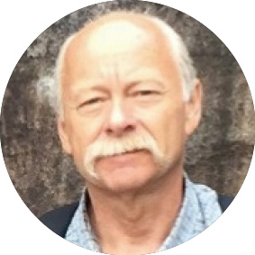
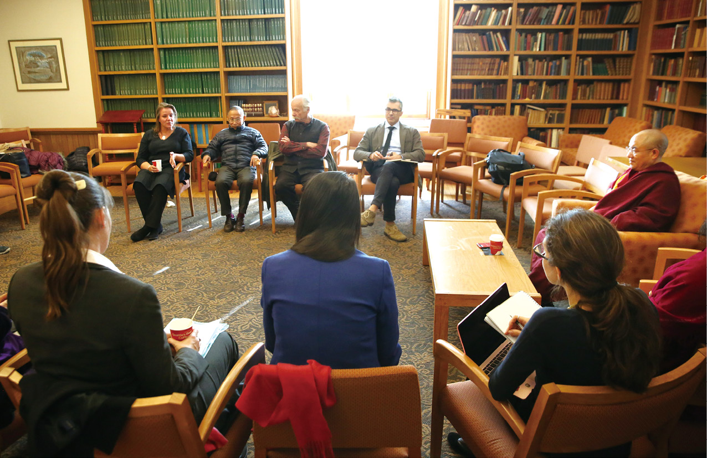
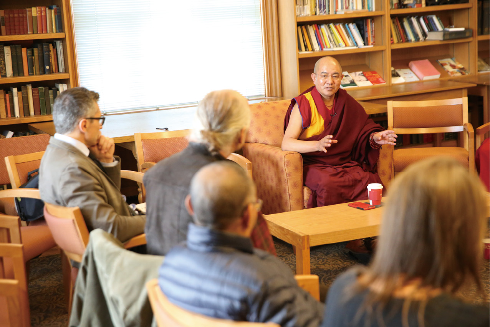
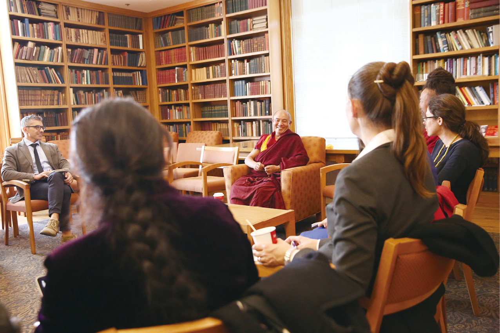
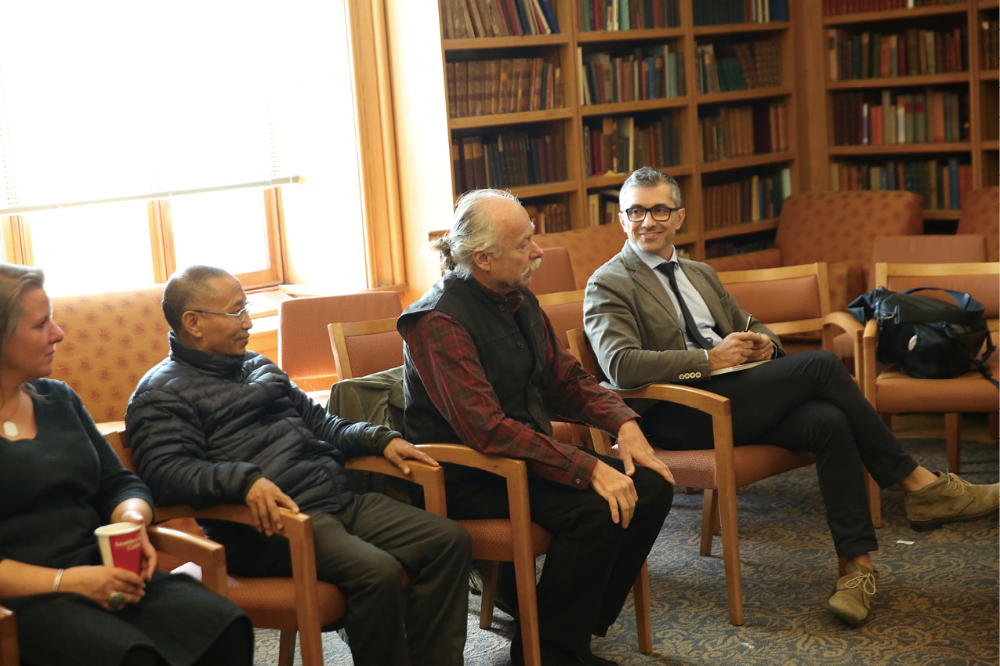
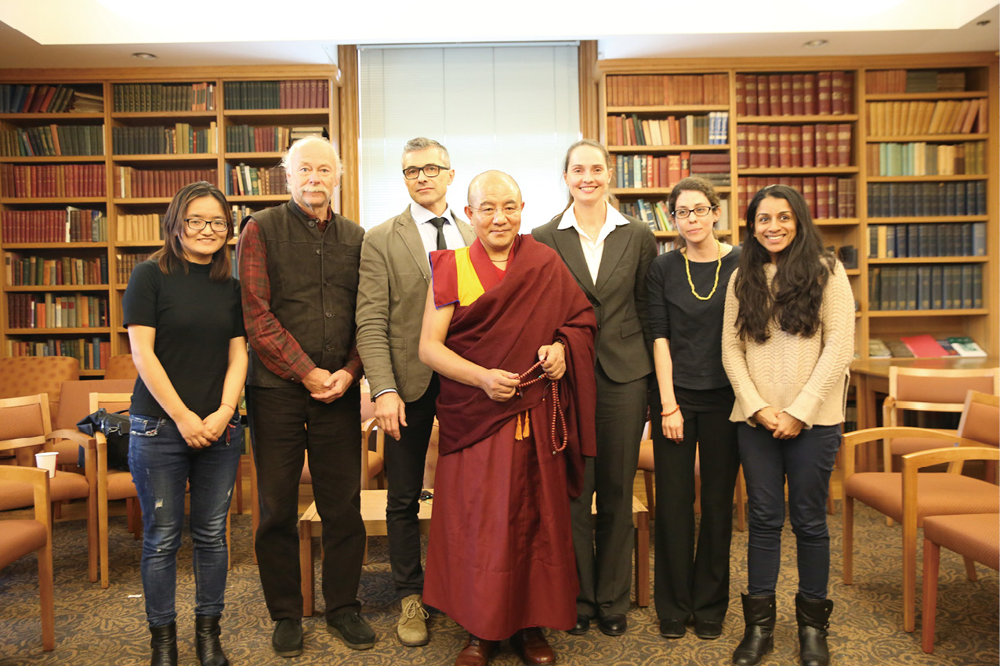

藏传佛教的艺术与教育

索达吉堪布 & 芝加哥西北大学师生

芝加哥西北大学

Northwestern University in Chicago

2017/10/31

萨拉·雅各比（Sarah Jacoby）

耶鲁大学博士，美国西北大学宗教学教授。研究亚洲宗教，专攻藏传佛教。出版专著《爱与解脱：藏传佛教智者色拉康卓的自传体叙事》。

林罗思（Rob Linrothe）

芝加哥大学艺术史博士。美国西北大学艺术史系教授兼系主任。

1．关于开光

萨拉教授（主持人）：

今天上午，我们非常荣幸地聆听了堪布的演讲，加深了我们对佛教以及藏地的了解。面对苦苦思索着现代社会人生意义的我们，堪布阐释了藏地传统宗教的多姿多彩。

下午，研究藏文化的学者们集聚一堂，也都准备了一些问题。希望各位在提问之前介绍一下自己的身份、研究方向以及目前在西北大学的职位，以便堪布对您有所了解。

另外，如果堪布愿意的话，也可以就我们在大学研究藏传佛教的情况提出问题。这将是一场放松的对话，我想一定也会很精彩。

林罗思教授：

我是西北大学艺术史系的教授，是一名老师，也是艺术史学家。

我的问题是关于西藏艺术。据我所知，西藏的唐卡和雕塑都是需要开光的，那么壁画是否也需要开光？如果它们也需要开光，要用镜子或其他物品吗？具体的开光过程是怎样的？

索达吉堪布：

我们西藏的壁画，还有经堂里的艺术画作，实际上都属于唐卡的范围。经堂绘画有很多，比如经堂门口的四大天王像和六道轮回图，经堂内部的传承上师像和释迦牟尼佛生平故事的壁画，等等。这些画作的绘制，一方面有庄严经堂的美观作用，另一方面对信众有加持作用。

经堂里的画作完成时，都会举行开光仪式。有些仪轨需要用到镜子，从清净刹土中迎请佛菩萨，然后通过镜子的因缘把加持融入佛像。祈祷文中也会说：将来乃至经堂没有毁坏之前，这些画作要像真正的佛菩萨那样来加持众生；即使这个经堂已经毁坏，乃至画作的土粉没有毁坏之前，其加持也会一直住世。

一般来说，藏地的经堂开光时，对所有的画作和塑像都要开光，同时大家要恭敬顶礼、祈祷。尤其有的经堂里面，八大菩萨和传承上师的像都有，就更需要开光了，开光后得到的加持是不同的。

开光有一些不同的仪轨。贡智·云丹嘉措的著作中，有一个比较广的仪轨。全知麦彭仁波切也有一些仪轨，相对比较略。在法王晋美彭措的著作里，还有一些更略的仪轨。

总之，各个教派有不同的开光仪轨，依靠这些仪轨来开光都是可以的。如果因缘实在不具足，也可以念七遍缘起咒，做一个简单的仪式来开光。

藏地有些佛教大德经常说：没有开光之前，比如你在画画时，稍微有点踩踏，应该不要紧；但开完光以后，最好不要踩踏，也不要染污。因为此时佛菩萨已真正融入佛像中了。这是一种缘起法。

2．喇荣的艺术课

萨拉教授（主持人）：

既然谈到了艺术，下一个就该轮到维迪亚那了。请向堪布简单介绍下您感兴趣的领域以及为什么来参加此次会谈，然后提出您的问题。

维迪亚那：

扎西德勒！我是西北大学艺术史系在读的二年级研究生。刚才提问的林罗思教授是我的老师。

我对西藏艺术以及西藏艺术史很感兴趣。我的问题是关于喇荣的艺术作品，还有在寺院和佛学院里的相关教育。在僧团里，艺术教育的状况是怎样的？

索达吉堪布：

喇荣没有单独的艺术专业，不像学校里有艺术方面的专业和班级。但我们经常会邀请一些艺术人才，尤其是佛教方面的，进行学习与交流。

前段时间，我们邀请了其他寺院的一些僧人，请他们用酥油制作艺术品。他们可以用酥油做成佛像、坛城，以及八吉祥、各种花等供品。每年的法王涅槃纪念法会，我们都要做“上师供”。为了准备这类特殊的法会，我们会把各个寺院里有特殊手艺的人请过来，花两三个月时间制作各种艺术品。相当于做一个艺术展览了。

艺术方面还包括佛像和佛塔的雕刻、观音心咒的雕刻等。

除此之外，还有佛教歌舞方面的艺术，比如金刚歌和金刚舞。这是佛教中特殊的舞蹈和音乐，会用到一些特殊的乐器。

在我们喇荣，以佛法的学习、修行为主，没有特别多的艺术科目。艺术不是主科，是副科。

3．现代化的僧团教育

安东尼亚：

我是研究东亚艺术的学者，主要研究西藏，最近在写一本有关东藏地区僧团文化的书，如喇荣、亚青等。我尤为关注僧团教育以及这些僧团在当代中国所体现的佛教意义。

我想请问仁波切，您能不能给我们讲一讲喇荣僧团教学的事情，这一定非常有意思，大家也可以放松一下。

喇荣因开设丰富多彩且专业性极强的课程而广为人知，比如戒律、密法、大圆满实修等。同时喇荣又以其现代化教学而闻名。我还想听您介绍一下，喇荣的现代化教学是如何进行的，与以往的传统教学有何区别？

索达吉堪布：

我去很多学校的时候，经常被问到与喇荣有关的问题。有一段时间，晚上睡觉前，耳边都回荡着“喇荣、喇荣”的声音。慈诚罗珠堪布有一次去美国，很多学校也一直在问喇荣的事情。后来他告诉我，他也有这种感觉。

其实喇荣的历史不长，到今年只有37年。但在短短的时间中，它发展得比较快。一直以来，喇荣对戒律很重视，对传统的僧众学修很重视。

进入到20世纪，传统教育确实跟这个时代有一些冲突。前段时间，喇荣的教务科要求僧众把手机上交，不然很多人天天玩手机。可见，传统教育被电子产品影响了，跟时代有了冲突。也有很多人反对这种做法，认为没收手机后，查资料和学习不方便。法师在传法的时候，弟子们录制也不方便。

不过，冲突之外也有便利。喇荣用网络、直播、微信公众号等一些平台，可以比较容易地传播佛法。

今天上午我也说了，现在喇荣学习的内容，传统部分足够多，但对世间的学问，如社会学、自然科学等，了解得还不够。

总的来说，喇荣是一个专业性比较强的佛学院。佛学院主要以佛学为主，其他的学习作为辅助。喇荣着重培养的人才，主要是显宗五部大论、密宗续部方面的。

在培养人才的过程中，与现代社会没有本质冲突。内容上没有冲突，但是方式上经常在调整。

4．我们寺院的特色

萨拉教授（主持人）：

我补充问一下，相比该地区其他寺院的教学，喇荣的教学有什么特色？

索达吉堪布：

藏传佛教中佛学院的教育，大致是相同的，着重学习显宗和密宗的教义。喇荣跟其他地方有一点不同，就是会针对周边的在家群体开展“扫盲”活动。

一般情况下，藏地寺院的僧众会修行、辩论、念经，但对周围的老百姓，佛教道理传播得不多。就是开法会的时候，给他们灌个顶；做佛事的时候，让他们参加。

喇荣从法王晋美彭措开始，要求从几个方面来推广佛法和佛教教育。推广的方式，一方面是每年喇荣开法会时，有针对在家人的讲经说法。另一方面，我们每年会派很多法师到各个地方，给在家人讲一些佛教道理。也讲环保，讲卫生常识，如预防各种疾病的知识。尤其到了冬天，喇荣的很多法师、堪布都会出去，去周边的村落、县城，为老百姓讲经说法。

喇荣除了内部的法会和修行以外，与其他寺院最大的不同点，可能就是对周边老百姓的责任感了。

由于藏地历来的传统，只有寺院里有修行和学习，而在家人的群体中，除了念佛，学佛法的氛围并不是很浓。喇荣不管是堪布、法师还是普通的僧人，都有一种责任感，要去自己的家乡给在家人讲一些课。去的时候，哪怕只有几个人，也要给他们讲一些佛法和世间的道理。

因此，喇荣对周边很多地方的影响比较大，对此有赞叹的，也有提意见的。赞叹的人认为，喇荣出来的僧人为我们讲佛法，带领大家行善断恶，非常有意义。但也有一些寺院的出家人说：“喇荣开始控制我们的行为，不让吃肉，让我们的老百姓如何如何……”有些是他们确实没办法接受的。有些是因为当一个寺院的影响比较大的时候，其他寺院一直以来的地位受到影响，个别僧人心里有点不爽快。我们发现，对喇荣看不惯的人也比较多。

5．那些“堪姆”

希拉旺姆：

我目前在西北大学就读博士一年级，来这里不到两个月。我现在对藏传佛教，尤其对尼姑和喇荣很感兴趣。

西方对藏传佛教感兴趣的人，最近都在谈论格西玛的学位。他们说，这是藏传历史上，第一次让尼姑受到高等教育。但是据我所知，喇荣在上世纪80年代就已经有了堪姆的学位。

我想问的是，现在喇荣堪姆的人数和状态，她们每天的活动，她们所起的作用。还有，她们的课程跟男众僧人是一样的吗？附近民众是否会区别对待堪布和堪姆？她们得到堪姆的学位后，会选择做什么？比如去其他寺院教书之类的……

索达吉堪布：

从藏地历史上看，喇荣的女众出家人算是比较多。尤其是现在，喇荣和亚青是女众出家人最多的两个地方。

我去过汉地很多城市，女众出家人比较多的寺院，有一个在五台山，大概七百多人。而其他地方，这么多的女众出家人集聚在一起比较少见。

关于堪姆和格西玛。格西玛，是格鲁派中女众修行人最高的地位。堪姆，是授予女众出家人在佛法理论学修方面的一种学位。在喇荣，法王如意宝住世时已举办过好几次颁发堪姆学位的仪式。具体时间，我记得不是很清楚。前年我在加拿大的一个学校做演讲时，特意研究了一下。法王在世时，有两三次是亲自发堪姆证书的。法王圆寂之后，学院也举行过几次。

喇荣授予堪姆学位，是从上世纪80年代末开始，刚开始只有几个人，后来越来越多。在学院，我主要给汉族出家人讲课。汉族的出家女众当中，也有得到堪姆学位的。我那天统计了一下，有五十多位汉族的出家女众得过堪姆学位。学院里藏族堪姆的人数，我不是特别清楚，应该比这更多，具体是觉姆的教务处在管。据我所知，藏族堪姆中，今年正在带班的，好像有107位。还有一部分堪姆虽然得了学位，但还没有正式讲课，相当于实习老师。

最初的时候，堪姆和堪布在很多方面都有点不同，包括学位的获取标准。当时法王也说过，一开始对堪姆的要求并不是那么高。而现在，女众教务处有一系列评选堪姆的考核方法，包括考察学习成绩，观察她们的戒律、人格、心态，等等。拿成绩来说，学院里的出家人，每年有每年的成绩，每个月有每个月的成绩，乃至每天有每天的成绩，还有讲考、笔试等各种成绩，如此日积月累。对于我管理的汉族僧众来说，也是如此。当然也有一些特意为汉族僧众制定的规定和原则。

在学院内部讲经说法，堪姆和堪布没有区别。比如说男众这边，由堪布们讲五部大论；女众那边的堪姆们也是如此。有些讲俱舍，有些讲因明，有些讲般若、中观和戒律。除此之外，还会讲一些佛教基础知识、修行法，如《入行论》等。今年的课程有密法，有堪姆讲《大幻化网》，和堪布在学院内部课程的讲授，基本上是相同的。

虽然这几年，堪姆们也经常给周边的老百姓讲经说法，但影响力没有堪布们大。这可能是藏地的历史原因。

学院的极乐法会，参加的人很多，经常有两三万人，每年都有很多堪布负责讲法。去年的极乐法会，有两位堪姆，仁增秋珍和拉吉，她们两个为大家讲法，得到了很不错的评价和普遍认可。大家都觉得和听堪布们讲法是一样的。

堪姆们还会去一些女众寺院讲经说法。去年年底，学院做总结时，派往其他地方讲经说法的堪姆有37位，其中以女众寺院为主。当然，整体而言，藏地的女众寺院还是比较少，没有男众寺院多。

总的说来，堪姆们得到学位之后，有些是去别的寺院讲经说法；有些仍然留在学院中，在其他堪布或堪姆那里继续学习。

6．出家人写什么诗？

米兰达：

大家好，我是宗教研究系二年级的博士生，正在学习佛教方面的课程。萨拉教授是我的导师。我对西藏现代文学非常感兴趣，尤其是西藏女诗人的作品中所呈现的宗教和社会方面的话题。

此外，我也非常关注自上世纪80年代以来西藏文学的发展。听说现在越来越多的年轻僧人在写诗，有自由体诗和古典诗歌。我很好奇喇荣是不是也存在这种现象。有很多僧人在写诗吗？他们一般都写些什么？对于这些僧人来说，他们重点关注的主题和对象是什么？我还听说喇荣也出版过一些诗歌集，很想知道出版著作对僧人们来说很重要吗？谢谢您。

索达吉堪布：

现在确实藏地的很多年轻人特别喜欢写诗歌。藏地历史上有很好的诗歌，仓央嘉措的诗歌影响了很多人。藏地的诗歌创作方面，有一本专著叫《诗镜》，最早是从印度翻译过来的。我以前在师范学校里面学过，现在的学校里也会教授相关课程。

喇荣也有专门的诗学班，学习诗歌写作。女众有一些人的诗歌写得不错。也有一些出家人写爱情诗歌。去年学院的教务处提出，出家人的身份特殊，爱情题材的诗歌写得多了，影响不好。当然他们在表达上并没有那么外露，只是整体趋势偏向情感题材，毕竟现在的世界是比较开放的，也是丰富多彩的。

我看到的诗歌，有去年女众编写的纪念法王如意宝的诗歌集，有男众写的赞叹佛菩萨的诗歌，还有一些其他的个人作品。有些喇嘛去不同地方朝山，成都、宁夏、拉萨，他们将整个过程，还有在不同环境下做的事情，坐火车、喝咖啡……全部都写下来。看了之后，觉得有些诗歌很抒情，也很有意义。

以前法王晋美彭措经常要求弟子写一些诗。当年去五台山时，上师也让大家写诗。那一天是藏历六月初四，释迦牟尼佛初转法轮日，我也写了一首诗[^1]，还念给上师和僧众听了，后来连自己都忘了这件事。

算起来已经过去30年了。去年去五台山的时候，我对大家说：“有一首诗是我30年前写的，刚写完就在法王面前念过。这么多年过去了，没有一个人看过、听过，今年我再念一遍。”

现在很多年轻人不是这样的，他们写了诗，马上到成都去印出来。一个月当中，写完、印完、发给大家，速度很快。喇荣有些年轻的作者，写了诗，把自己的照片在电脑上美化一下，放进书里，再卖给大家。大家都觉得这个作者长得不错，至于文笔和内容，也许是自己的，也许是参考别人的。

藏地还有一些人，除了会写传统的诗歌，还受西方浪漫主义的影响，会写各种不同风格的诗歌。

萨拉教授（主持人）：

堪布，您提到了觉姆们编写的纪念法王如意宝的诗歌集，还有喇嘛外出游玩写的一些诗歌。不知道觉姆们写的这些诗歌是否出版了，可以供我们参阅吗？还有您30年前在五台山写的诗是否出版了，我们可以阅读这些诗歌吗？

索达吉堪布：

觉姆的诗歌有一些在内部出版了，喇嘛写的诗歌，大部分也是在学院内部流通。我写的诗没有出版，版权在我手里。因为只有颂词，没办法出版。

7．利美是慈悲和包容

尼斯达：

我是西北大学二年级的学生，萨拉教授是我的导师。我研究的方向是利美运动，也就是19世纪发起于东藏地区的无宗派运动。

我想请您解释一下利美运动的理念和实施，以及如今喇荣的利美现状。

索达吉堪布：

利美是蒋扬钦哲旺波、贡智·云丹嘉措、华智仁波切非常重视和强调的理念，同时他们也倡导了利美运动。

总体上说，喇荣是一个非常开放包容的佛学院。为了体现利美精神，上师在学院的标志性建筑——大幻化网坛城中，不但设有藏地各大教派的佛堂，如格鲁、萨迦、宁玛，觉囊、噶举、苯波等，还设有南传佛教、汉传佛教的不同佛堂。

所以，喇荣可以接受所有宗派的教义。但是在自宗的研习当中，也秉持自己的风格，密法以宁玛巴为主。

这就好比现在西方的学校，大家普遍学习科学理念，但每个学校也有各自的特色专业和研究方向，有自己的不共之处。

所谓利美，指包容所有的宗派。喇荣既有利美的一面，在修行和传承上也有不同于其他宗派的特殊之处。

尼斯达：

我想请您具体解释一下利美运动的理念以及行为。

索达吉堪布：

我认为，对利美的理解，有狭义和广义两种。

从广义来说，是对世界上各个宗教、各个教派，都有一颗包容的心。就像大乘佛教，对所有众生都不排斥，都用慈悲心来爱护。这是广义上的利美，也就是不偏堕主义。有了这样的见解，行为上也跟随见解去行持，就是利美的行为。

从狭义来说，有文化上的利美、科学上的利美、宗教上的利美……

我不是特别清楚你所谓的利美跟我的理解是不是相同。如果是无偏堕主义，我觉得在目前人类社会所有的不偏堕主义中，大乘佛教的思想可能是辐射最广的。其他的宗教思想都只关注人，将动物排除在外，或者只关注自己的民族，只关注自己的信众，这些都不是利美。

真正的利美，是大乘佛教的见解。

8．一门课改变一生

萨拉教授（主持人）：

目前为止，一直是我们向堪布发问。关于我们学校正在进行的藏传佛教研究，堪布有什么问题想问吗？另外，对于我们的研究重点或研究方法，您能否提供一些建议？

索达吉堪布：

我问几个问题。首先请教萨拉教授：作为西方人，您精通藏语，又研究藏传佛教这么多年，我很好奇，为什么您对藏传佛教这么感兴趣？在这个过程中，对您个人而言，有什么样的收获和利益？

萨拉教授：

很难解释我为什么会被佛教吸引。实际上，第一次遇到佛教是我在读本科的时候，当时我19岁。我在耶鲁大学选修了印度佛教史的课程。课上，教授用梵文解释了“真如”，它指事物的本来面目，佛陀宣讲了事物的本来面目。我把这些记在了笔记本上。

我对这些非常着迷，尤其当老师讲到佛陀所宣讲的无常、苦、无我。我想，“就是这样，这些的确是真的”。根本上来说，最初吸引我的、最令我着迷的就是佛法。佛法深深地打动了我，我想这其中肯定有很多值得学习的。

20年过去了，我仍然在不断地学习，如果尽其一生都能学习藏传佛教，是一件非常美好的事情。因为我无法彻底通达佛法，我需要永不停息地学习。获得博士学位并不是终点，而是一个更加深入学习的开端。

佛教深深吸引我的原因，在于它教会了我很多。比如人为什么会痛苦，如何不再自私自利地活着。我会尽量地将这些教言融入自心。

此外，我对藏文化也很感兴趣。我被藏文学、藏语以及藏地历史深深吸引着。所以，不仅仅是藏地的佛法，还有属于藏地的智慧魅力都令我十分着迷。

索达吉堪布：

为了“报答”你们，每个问我问题的人，我都问你们一个问题。你们简单回答就可以。我先问她，你最喜欢的诗歌是什么？为什么？

米兰达：

我喜欢上的第一首诗，是艾略特的《阿尔弗瑞德·普鲁弗洛克的情歌》。我想这是那个年代大多数大学生都听过的一首诗，而且很多人把它当作英文诗歌的入门。这首诗的风格比较灰暗和嘲讽，它也是我想背下来的第一首诗。

索达吉堪布：

我问一下这位教授，您对藏传佛教的唐卡艺术有什么样的看法？有哪些建议？

林罗思教授：

我非常钦佩唐卡艺术，在不断变革和发展中，它的制作仍不失其根本宗旨。同样，佛陀出现于世的根本意义，经过诸多世纪一直延续至今。同时每个宗教以及不同的传承流派，在不同的时代也都在发展，并形成了各自独有的特色。

9．不会说藏语的藏族人

索达吉堪布：

作为西方人，你们学习藏族的语言，而且说得特别好。但国外的很多藏族人，现在反而不太会藏语和藏文，一代一代下去，最后只会说英语。国内的藏族人，也有很多不太会说藏语，只会说其他民族的语言。这种情况越来越严重，我个人心里比较着急，但也没什么办法。

虽然很多西方人注重藏地的文化，认可其中的意义，甚至花一辈子的时间做研究，但我们本民族的人却不太争气。您怎么看待这个现象，这是一个时代的趋势吗？有什么办法可以挽回？

林罗思教授：

据我所知，慈诚罗珠堪布正在想办法提供一些教材，比如教学手册、词典等，以便在藏地推广更加标准化的藏语。慈诚罗珠堪布在藏地组织了一个由僧众组成的学习小组，其中都是拥有着高学历的僧人，还有藏族学者。主要是为了编辑出版一些书籍，来帮助藏人不断地完善藏语。

在我看来有一个挑战，就是汉语学习带来的影响。这一点您可能也很清楚。在中国，汉语的学习非常重要，这也给藏语的发展以及藏语专业化和学术化带来了不便。因为汉语占据了主要地位，很多藏人会投入大量时间学习汉语，这样才能获得更多的工作机会。

但需要提到的一点是，我也遇到一些藏地的年轻人，他们非常认真，语言能力很好，同时能熟练掌握汉、藏、英三门语言。这样的年轻人越来越多了。我觉得这些年轻一代回到藏地，会用新的方式和途径来传承藏语以及发扬藏语，同时也会带去新的理念。这样一来，我们可以借助新式藏语来更专业、更学术地探讨各个学科。

解决这个问题的方法可能有很多，这是我最先想到的一点，希望能有所帮助。

萨拉教授：

这里容我再补充一点。我认为藏语的传承及学习需要投入大量的人力和物力，这不是依靠个人能力可以做到的，需要机构和社会团体的广泛参与。

比如，为了让学生将全部精力投入到学习中，我们会给他们提供一些奖学金。否则的话，他们可能会因为去打工赚钱而不能来上课，无法投入学习。

我自己也是这样，为了凑足学费申请了各种公立和私人的资助以及奖学金。其实在高校里，几乎每个人都会这样做。

所以，语言的保护需要社会各个机构、大学、城市以及城镇的共同努力。这其实是一个体制问题，单靠个人的意志和努力是远远不够的。

[^1]: 《无等大恩文殊怙主上师如意宝晋美彭措祈祷文》（索达吉堪布著）：顶礼文殊菩萨！语日轮照心间莲，语天女戏喉乳海，三传上师住顶垫，皈处总集摩尼知。您乃三时佛化身，动心六十梵音语，普天无缘大悲心，加持成熟吾三门。愿生生世水晶串，誓言丝线善妙穿，精进利益群生时，不离欢喜摄我等。清净戒律嫩白莲，未遭堕罪垢霜害，明耀妙慧艳花蕊，与文殊怙您同缘。佛说四谛法轮日，神州弘法圆满时，祈请文殊上师尊，长久安住文殊座。如此祈祷妙音赞，文殊幻化净土中，语自在现上师时，善缘弟子设喜宴。您深教言一句价，遍满虚空之黄金，供云海献不可量，世出世恩何以报？教法证法莲闭时，文殊勇识三密日，雪域金山上升起，祈祷开教莲苑尊。佛法透明水晶镜，沾染恶世破戒垢，纯净三戒白绸拭，祈祷再弘佛教尊。讲经善缘自召集，辩论非见自远去，著论诗词自流露，祈祷具智三德尊。智慧洞察诸所知，严谨远离细堕罪，贤善呵护诸苍生，祈祷圆圣三德尊。以闻圆满教理力，以思吸取诸真义，修行觉相本任运，祈祷成就三德尊。于无等恩慈师前，我无财富之供养，亦无辛勤敬承侍，唯以净心献颂赞。此文，火兔年（公元一九八七年）六月初四佛初转法轮之吉日于汉地五台山南台静处清凉石寺，僧人索达吉恭敬奉上。善哉！愿一切吉祥！
