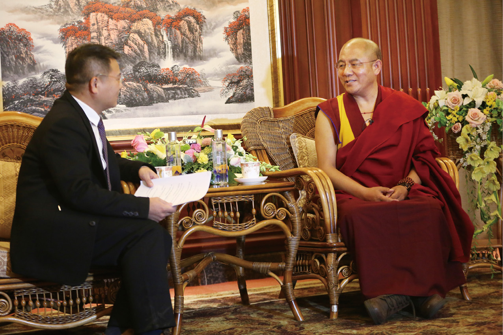

兴衰的幻剧

索达吉堪布 & 阎雨院长

北京大学

Peking University

2016/11/06

阎雨（Yan Yu）

知名文化学者，管理哲学博士、博士后。北京大学政府管理与产业发展研究院执行院长，北京大学政府管理研究中心执行主任，北京大学传统文化与现代管理基金管委会副主任。在国内外期刊发表论文近百篇，著有《禅与现代管理》《中国管理C模式》《文明三部曲》等。在众多高校、企业和政府讲授管理学，受众面极广。

1．辉煌，逃不出无常的网

阎雨院长：

堪布是德高望重的大德高僧，此次来到北京大学讲学，我们有机会亲近上师，感到非常荣幸。

我们做学术研究，也会在宗教文化领域进行一些考察与交流。但我们的视角与宗教人士有所不同：一是我们的研究是出于学术需要；二是我们的学科属于社会学科，而社会学科的特点就是服务于社会的意见、服务于社会的实践。

在科研工作中，我们产生了一些困惑，这些困惑仅从学术角度去考量，可能有一定的困难。比如在做文化研究时，我们一直认为文化资源越丰富，发展文化产业的条件越充分。但实际上，埃及、印度以及两河流域的一些国家，甚至包括玛雅文化的所在地——墨西哥，这些国家的文明都非常厚重，但同时它们的现代化程度相对来说比较低，文化产业的发展也没有形成体量上的优势。

不知道堪布您如何看待这个问题？

索达吉堪布：

首先，很高兴见到院长。我们的角色不同，因此，从多维度层面对社会学、宗教学、哲学进行研究时，双方既存在很多共同点，也有不同之处。

您刚才提到的玛雅文化，还有四大文明古国流传下来的文化，如今看来，有些已销声匿迹，基本上连影子也没有了。我也曾经去过其中一些地方，比如埃及，那里基本上只有在海洋和沙漠里才残存了一些文化碎片。

埃及文明和玛雅文明历史极为悠久。比如属于印第安人的玛雅文明，诞生于公元前1500年，而埃及文明的历史则有一万年和五千年两种说法。

如此悠久的文明会逐渐消失，我认为有两种原因。一是任何国家的文明或者文化，都有一个兴衰的过程。这就是佛教所说的万法无常，全世界的文明都会经历这个过程。当今世界现存的各国文明，也都逃不开这样的无常之网。

第二个原因是，一个国家的存亡，与当时的国际关系有着直接联系。我发现，历史上很多国家都是被其他民族和国家侵吞、毁灭的。

阎雨院长：

我们之前一直为中华民族的崛起而斗争，为中华文明的厚重绵长感到骄傲。到了埃及之后发现，埃及文明的历史更加悠久。我们有五千年历史，埃及有七千年，而且都是有案可考、有史可查的。这样一个古老的文明，还有印度文明、玛雅文明，它们曾经的辉煌都让我们叹为观止。

印度文明曾经中断过，但后来得到了继承和发展，埃及文明和玛雅文明则已经完全中断了。中华文明是唯一没有间断的。这也让我们思考，是什么内在因素决定着一个国家的兴衰，又决定着一个民族文化的兴替？是什么力量能让一种文化绵延不绝、长盛不衰？

索达吉堪布：

实际上，中华文明积淀下来的传统文化，如今在某种程度上已经削弱了很多，比如儒家的孝道等。只不过跟埃及文明比起来，还是值得欣慰的。

正如刚才所说，我认为原因一是在于国家之间的战乱，二是在于人们对传统价值观的忽视。尤其当多数人对新事物产生兴趣、对古文明产生厌恶心时，传统文化就面临着被淘汰的命运，最终会在历史长河中彻底消失。一个文明能否留存，与后人的价值观以及对它的重视程度有一定关系。

相比之下，我认为中国算是对自己的文明和传统文化非常重视的了。

阎雨院长：

这是不是跟文明的包容程度有关系？

索达吉堪布：

也可以这么说。但具有强包容性的埃及文明，在世界上流传很多年后，仍然因为种种因缘被毁灭了。

2．文明的冲突，历史与隐忧

阎雨院长：

不同特征的文化之间可能会产生冲突，同源的文化也可能会产生冲突。比如犹太教、基督教和伊斯兰教，它们是同宗同源的，但从历史乃至现状来看，它们之间的冲突可能也是最激烈的。从十字军东征到现在整个中东政局的变动都可以看出这一点。

像犹太教、伊斯兰教和基督教这样的文化，未来能不能真正解决它们的冲突，实现圆融相处呢？美国著名学者塞缪尔·亨廷顿写过一本书，叫《文明的冲突》。他认为未来世界的冲突不再以意识形态为主，甚至也不是以经济冲突为主，而是以文化冲突为主。

按照他的观点，如果未来各种文化无法圆融存在，彼此无法和解，那么这种冲突可能会伴随人类始终。

索达吉堪布：

我也看过亨廷顿先生的一些学说。他认为未来完全以文化冲突为主，我觉得也不见得。

因为从历史来看，不管是基督教还是伊斯兰教，宗教之间所发生的战争与冲突，跟社会意识形态有密切关系，也与政治、经济有关。若我们追溯历史就会发现，单纯的文化冲突是非常罕见的。希望它们将来完全融合一体，我认为有一定的困难。

表面上看来，它们都承认上帝、主，同源同根，有类似的历史原型。但到了非洲、中东或者欧洲，你能感觉到它们之间的冲突，其实与社会意识形态密不可分。

这些宗教的教育，尤其是伊斯兰教，带有很多社会学和意识形态的教育。在这种教育下，培养出来很多人。未来如果产生冲突，恐怕不能完全说是文化冲突。

我们非常担心未来。很多学者也认为，未来的社会不一定是基督教社会，很有可能是伊斯兰教社会。

阎雨院长：

对，这种情况已经初见端倪。现在欧洲有大量伊斯兰移民，他们的生育率很高，一个家庭有七八个孩子，而欧洲原有的生育率只有1.1或1.2。

即便在同一个国家，比如以色列，国民都信奉犹太教，但犹太教又分很多派别。如保守的哈瑞迪派，这个派别的家庭生七个孩子都是少的，生九个或十个孩子很正常，而普通的犹太人家庭只生一两个孩子。这些人到十四五岁就不读书了，完全回到旧约时代先人的那种生活状态。

所以我就在思考，宗教应该怎样自我审视。因为用历史的眼光看，任何一种文化包括宗教，若不进行自我融合、自我创新，就可能从先进走向落后。

索达吉堪布：

根据人类历史的发展来看，有两种可能。

有些宗教的势力比较强大，可利用的人力、财力等资源比较丰富，就像现在的伊斯兰教，它在中东的石油产业比较发达。宗教背后如果有特别强大的经济支持，这个宗教有可能更加兴盛。但如果就此认为它能统治世界和整个人类，还是有一定的困难。

英国、法国这几年涌入了大量移民，产生了很多问题，很多其他欧洲国家现在也有类似的危机感。在我们外人看来，也的确如此。因为这些移民的宗教意识非常强，对自己同胞的态度也比较特殊。在这种情况下，确实会给移民国家带来很多隐忧。

还有一种可能是这个宗教不一定灭亡，当它与政治相结合，当权者可能会利用宗教，并用宗教来进行自我包装。此时的宗教就不再是单纯的宗教形态了。

阎雨院长：

伊斯兰教于7世纪崛起时，政教合一还是一种先进的体制。当时欧洲面临着中世纪的黑暗，而伊斯兰教则属于一种先进文化，相对来说是包容、和平的，当然这种和平是狭义的。但总的来说，那个时期它还算是先进的。

索达吉堪布：

其实那个时期的政教合一，很多都是把宗教和政治包装在一起，从而发生了大量冲突和战争。

阎雨院长：

沙漠深处一个人口不过百万的民族，竟然能够在世界崛起！

索达吉堪布：

对。

阎雨院长：

但是他们现在面临这样的状况，不进行自我审视是不行的。当然他们也改革了，但在改革中受挫，受挫之后，又回到内心封闭的状态。

他们甚至认为，现在整个中东面临的状况，就是因为违背了安拉的意志，还是应该回到安拉的教诲，回到《古兰经》的经文里。

这就形成了一个悖论，哲学上叫二律背反。一方面，社会在向前迅速地发展；另一方面，因为赶不上发展的进程，于是就要拼命回到过去时代。这的确带来了一个很大的困惑。

我想佛教的包容、圆融以及自我创新，对于其他宗教来说，可能是一个很好的借鉴。从这个角度来看，中华文化也是如此。中华文化之所以绵延不绝，有各方面的因素，其中佛教的融入是一个很大的因素。可以说，佛教延续了中华文化的慧命，对儒家和道家也有全新的提升。当然，儒道两家对佛教也有一种补充。

3．谈谈人间佛教

阎雨院长：

太虚大师曾提出过“人生佛教”，后来在台湾延续发展成“人间佛教”。将“人间佛教”践行得最好、最充分的也是台湾。台湾的几大山头，像佛光山、法鼓山、中台禅寺、慈济会，我都去了，也与各位大德做过交流，还有幸被安排分别与星云大师和惟觉长老会面和交流。

回到大陆后，我曾经在国家宗教会议上提出，台湾的“人间佛教”运动对社会的融合、文化的融合，特别是对社会不同群体和不同阶层的和解，起到了非常关键的作用。作为宗教界人士，您如何看待“人间佛教”运动？

索达吉堪布：

台湾的“人间佛教”，是从太虚大师的“人生佛教”这一观念延续下来的。我觉得“人间佛教”这个概念确实非常好，它以通俗易懂的语言来表达佛教方方面面的道理。正因为如此，星云大师以及台湾四大山头的弘法利生事业非常广大，台湾相当多的民众接受了佛法。

从佛教专业角度来讲，在寺院或者道场，还需要对佛教进行更深入的学习和实修，这也是非常重要的。

虽然我们现在也在提倡“生活佛教”的概念，使佛教变得生活化，希望佛教的慈悲、感恩、利他等理念可以应用在生活的各种场景和场合中，但我们同时也要强调：佛教的甚深智慧不能丢失。

如果我们过于低俗化、世间化，很可能会忽略掉佛教中很深奥的精华部分。所以我们在弘扬“人间佛教”的同时，更要在寺院和研究佛教的专业人士中强调，不要丢失佛教的甚深道理。

阎雨院长：

对，这就是手段和目的的区别。“人间佛教”可能只是一种手段而不是最终目的，目的是希望大众更加深入地学习佛法。大陆也有一些道场在学习“人间佛教”，但是如果学得过头了，就会本末倒置。

索达吉堪布：

如果将佛教完全低俗化，佛教的本质就会被忽视。而一些不属于佛教“诸恶莫作、诸善奉行”的内容，则会以佛教的名义出现在世间。

4．藏密热潮

阎雨院长：

这几年，内地民众对藏传佛教非常好奇，甚至非常神往。很多内地的学者、企业家去藏地学习藏传佛教，这种情形已经在内地形成一股潮流了。实际上早在上世纪60年代，欧美等地也兴起了藏传佛教热。

您怎么看待内地将藏传佛教当成精神追求的这种现象？

索达吉堪布：

确实，自上世纪八九十年代以来，藏传佛教在内地比较兴盛。这样的藏传佛教热在欧美等地从上世纪六十年代延续到今天，经久不衰。

前两天，我在脸书上与一位作者对话，他是《世界上最幸福的人》的作者。他也说到，藏传佛教能在欧美掀起这么久的热潮，对西方而言，是难以想象的。

现在汉地的藏传佛教热，我也思考了其中的原因。

与藏地各个寺院相比，汉地寺院虽然也有讲经说法的安排，但相对较少。很多年轻人，尤其是知识分子，这些有一定文化和学历的人，经过观察和深思熟虑，决定选择藏传佛教。

虽然其中也可能有人云亦云的随波逐流者，但对大部分人来说，学习藏传佛教应该是一个理性的选择。因为藏传佛教在心灵疏导方面，与其他宗派不同，有很多窍诀性和理论性的内容。

阎雨院长：

内地很多人对藏传佛教很向往，但有一些学者对藏传佛教的修行法门会有不同的理解，比如双运。在佛教或者藏传佛教中，它是一个修行法门吗？还是一个很重要的必须要经过的修行阶段呢？

若说它是一个修行阶段，那我问句外行话：如果不用这种法门，我们能不能达到这样一个阶段？有没有可能成佛？成佛是不是必须要经过这个阶段？

索达吉堪布：

实际上，藏传佛教里的双运、降伏，表面上看来，可能与佛教尤其是显宗的教义不太相合，但其究竟意义在显宗当中也是有的。

比如显宗的《不可思议解脱经》和《大宝积经》里都有关于降伏的内容。如大悲商主杀短矛黑人的故事中，杀生不但没有产生障碍，反而积累了资粮；再如星宿婆罗门的故事，表面上他行了邪淫之事，实际上不但没有破戒，反而积累了资粮。这些都是汉地流行的佛经中的观点。可见，显宗也存在着双运的内容。

在密宗中，也可以不修行双运、降伏，而是依靠大圆满等法门直接获得解脱。

我们现在也能观察到，藏传佛教的每一个寺院，都没有说高僧大德必须要依靠双运、降伏等法门获得成就。很多修行者也可以通过清净的别解脱行为修行并成就。这一点，通过观察各个寺院出家人的行为就可以了解。

但是佛教里的确有这种神秘的修行法门，而且不仅在藏传佛教中，实际上在汉传佛教的历史或者显宗经典里，也隐含了这些内容。唐密里也有很多这方面的经典。

阎雨院长：

是的，我特别去查阅了唐密，他们确实有这样的修行法门，但在显宗里我们的确很少看到。这个教义最开始来自婆罗门的一种修行法门吗？

索达吉堪布：

不是婆罗门的法门，完全是佛教的修行法门。虽然在名称上也有“瑜伽”，但婆罗门法门的内容包括续部的名称和意义，都与佛教不相同。

现在有些人认为，佛教的这种修行法门是受婆罗门教的影响，其实这是没有经过详细研究的说法而已。

5．法无高下，显密圆融

阎雨院长：

现在内地很多修行人认为，藏传佛教的金刚乘高于显宗法乘，他们这个认知对吗？

索达吉堪布：

从究竟意义而言，实际上每一个法都可以依靠它来成就。对于有缘分的人来说，显宗的法可以成就，密宗的法也可以成就。但是从某种窍诀的直接意义来说，也可以认为不同的法门，针对性不同。

比如禅宗大德认为禅宗观点跟其他教派有所不同，净土宗认为念佛法门跟其他教派有所不同，藏传密教同样认为它的修法有自己的特点。

每个人的根基不同，如果根基与密宗有缘，那么密宗对他而言就应该是世界上最好的法；如果与密宗无缘，那么显宗的法对他来说就是最高的法。

阎雨院长：

是不是应该说每个人的根基不同，法本身并无高下之分。

索达吉堪布：

可以这么说，从究竟意义而言，法无高下。

阎雨院长：

您对于内地修行人修行藏传密宗有什么建议吗？或者您能给他们一些点拨吗？

索达吉堪布：

我觉得不管学密宗也好，学显宗也好，首先都应该打好理论基础。如果没有理论基础，学佛很可能就是纸上谈兵、冰上建筑。打好理论基础之后再修行，这一点很重要。

第二点，修习密宗的人不能排斥显宗。藏传佛教的修行者没有一个只修密宗不学显宗的，都是显密双修。同时我也希望，只修显宗的个别汉地修行人，也应该正面理解藏传密宗的甚深意义。否则，只听一些表面言辞就轻易诽谤、误解密宗的话，对自己也不会有利。

因为藏传密宗并不是很容易就能驳斥的，它有非常深奥的意义。即使有人想驳斥、否定它，也应该先花一定的时间好好去研究，这样才能真正了解它究竟是怎样的。

阎雨院长：

非常好，大堪布。最后一个问题：您平时的弘法事业非常繁重，为何还要抽出时间到高校做诸如人际关系、人生管理方面的弘法呢？您的初衷是什么？

索达吉堪布：

其实我并没有特意要来高校，大多数时候我会去一些监狱或者企业。凡是有因缘的地方，我都会去跟他们做交流和沟通。

这次交流，我自己很感兴趣，之前看过你写的《禅与现代管理》，非常好，你们也会研究佛教——

阎雨院长：

我们也亲近佛教。

索达吉堪布：

作为高校的学者和领导，你们会对佛教、其他宗教和世间先进的学术领域进行研究。我们有时也有机会跟很多高校的师生交流彼此的理念和想法。同时，我自己也想不断学习，因此会跟很多人会面，从中可以学到一些世间的管理方法。

作为出家人，我们不会去经营和管理企业，但我们关注的是世间人，也关注对人心的管理。

阎雨院长：

非常感谢大师慈悲，来到北大为我们导航思想、启迪心灵。因为时间关系，我们就请教到这里。
