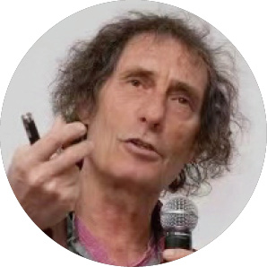
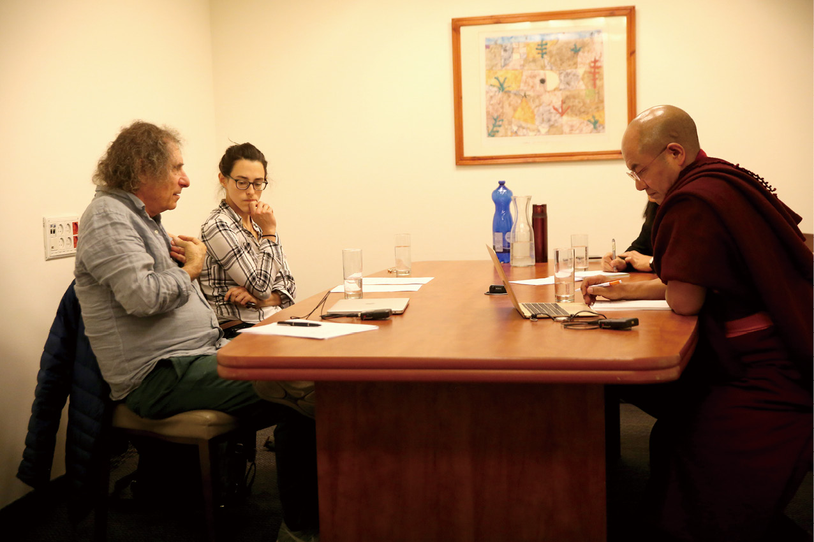
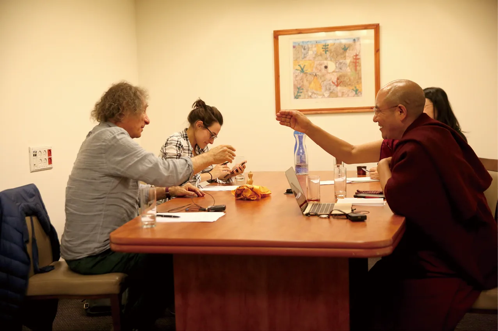
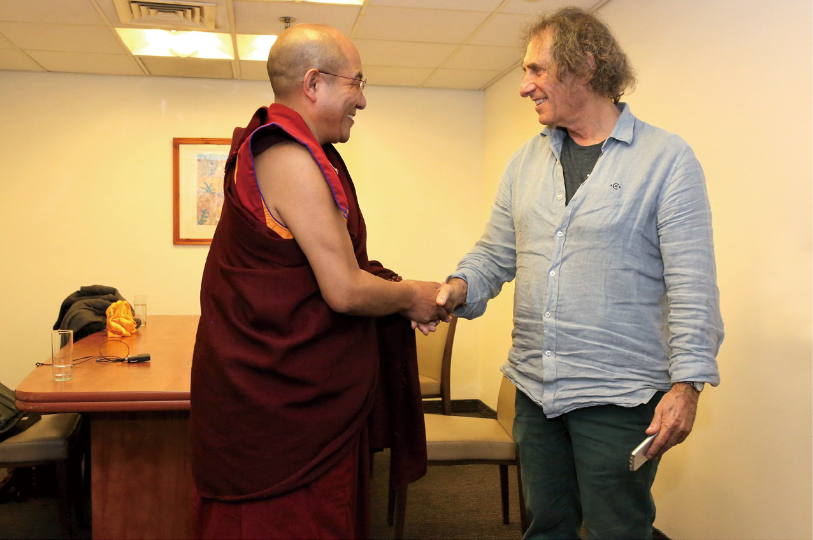

心域无疆

索达吉堪布 &伊丹·赛杰夫教授

以色列希伯来大学

The Hebrew University of Jerusalem

2017/12/22

伊丹·赛杰夫（Idan Segev）

著名神经科学家，以色列希伯来大学计算神经科学教授。其研究论文和著作多次获得各类奖项。他的研究团队利用计算和理论工具研究神经元。对艺术、宗教与大脑之间的联系有着浓厚兴趣。

1．机器娃娃的灵魂

索达吉堪布：

非常感谢您在百忙之中抽空做这次交流。我是第一次来到这所学校，借此机会想和这里的学者做一些思想上的碰撞。

我是一个佛教徒，出家三十多年了。近年来，科学被拿来与佛学心灵领域做比较，对此我也比较感兴趣。我了解到您在科研领域做出过很多贡献，希望就这些方面谈谈各自的看法。

我是藏族人，我的上师让我为汉族弟子讲课。刚开始的二十年左右，讲的纯粹是佛教内容，后十年则更关注佛法与现代心理学、神经学等领域的交互关联，在讲课中也运用了现代网络工具。与此同时，我接触了大量科学家，尤其在科学前沿领域有研究的相关人士。我很想从科学与佛教相结合的角度，为人们带来更好的学习体验，而不仅仅是佛教内在的修炼。稍后我们可以就一些共同话题，从神经学与佛学两个层面做一些交流。

我看过您的公开演讲，也读过您发表的文章。中国很多年轻人在思考您的科学理论，由此，我想先从神经科学谈起。从上个时代到现在，人们掌握这门科学的时间并不长，但它给我们的生活带来了很多改变。在您看来，神经科学对我们的社会以及整个世界有什么影响？

伊丹·赛杰夫教授：

在进入正题之前，我想简单说两句。首先非常感谢您的到来，像这样科学家与宗教人士面对面的会晤并不常见。虽然我之前也有过几次类似的经历，但都不是今天这样的正式会谈。此次会谈对我和我女儿来讲十分特别，所以非常感谢您的邀请。

我们也是抱着学习的心态，想知道从您的角度如何看待事物，比如您是如何看待意识的？也想了解您在其他领域的探索，比如您如何看待精神灵性？对此我也正在学习中。这也是一个相互学习的过程。

另外，我认为这次的会谈非常适时，不仅对整个科学领域，对脑科学领域更是如此。现在的脑科学研究明确显示，我们需要扩大视野。

以往脑科学的研究重点，大部分都放在单纯的生物学领域，也就是传统领域。科学家只根据生物现象来研究大脑。而在过去的20到40年之间，神经学家们通过计算和测量逐渐明白，如果仅仅单向地从生物学的角度进行研究，科学是无法真正了解大脑的。所以我和同事们希望借此机会拓展我们对脑科学的认知。

总而言之，过去人们会说，认知心理学不属于物理层面，这两个领域应当独立研究各自的部分。物理学家、生物学家、认知科学家以及工程师、哲学家，都应该只研究自己的领域。

但如今这一套行不通了。在新世纪的今天，我们需要突破，要用多学科的知识来研究大脑，也就是要集合诸如艺术、宗教以及许多其他领域共同研究大脑。

之前这些领域之间很少有沟通，所以我们设想建立一个中心，让宗教人士、艺术家、科学家一起探讨研究，从而打破对大脑研究领域陈旧、狭隘的看法。如果我们能够做到这一点，那将会是一个巨大的成就。与堪布的此次对话，也是我拓展研究领域的一次尝试。

索达吉堪布：

我也很有同感，人类的意识结构、认知结构非常庞大，通过单一的生物学、物理学等学科去研究的话，恐怕很难触及真相。仅仅是一个人的行为、心理所起的作用，甚至身心上发生的奇迹，都很难解释清楚。

我始终觉得，无论科学界还是宗教界，相关人士都有必要更深层地运用生物学、神经学、物理学、认知科学等的最新研究成果，再与各种宗教古老的原始教义相结合，也许我们会得到与以往有所不同的发现。

比如我想喝一杯水，佛教并不认为是大脑最先开始运作的，所有的行为首先都从意识中来：“我想喝这杯水。”然后意识通过眼识、耳识、鼻识等五根识去摄取这个外境。之后，再由意识进行取舍，而五根识没有真正的分别念。整个过程相当于照相机先拍摄外境，然后由人在拍出来的照片中进行选择。同样，我们的眼识“拍”下来这么多杯水，再用意识而不是大脑来分析要喝的这一杯。如果能就这个问题的细微方面进行探讨，很可能会得到前所未有的结论。

总之，佛教认为意识是一切的主导。可惜的是，到目前为止，还没有一种科学仪器或科学手段能够揭示它的本体，以及它和许多行为之间的关系。

伊丹·赛杰夫教授：

您这个观点很有意思。在接下来的谈话中，我们希望听到您的更多分享。我女儿诺拉也很想知道您是怎么看待意识的。

如果只是从科学角度来探讨——当然我并不是说科学能够解释一切，但无可避免地，总会出现问题需要探讨。比如要研究一个现象，比如我现在做的这个动作，您认为这是由意识支配的吗？

非常低等的动物也会做出判断，比如向左转、向右转，这里有什么、那里有什么……也许您也会用意识来解释动物表现出来的一些基本行为？

从某种定义而言，生命就意味着各种行为的发生，意味着选择向左转还是向右转，逃跑还是留下，等等。那么单细胞生物或者更小的微生物是否具有意识呢？这也是一个值得探讨的问题。

从科学角度出发，我们会思考这些问题能否通过实验来证明。假设有一种物体，它凌驾于大脑机能之上，那么我们如何证明它的存在，还是说它只存在于信仰当中？您能像科学家做实验那样用某种方式来证明吗？

一个科学家会说：“好，我们来看这个大脑。”他会锁定大脑的某个特定区域，一块很小的区域，只要刺激这个区域就能让人陷入昏迷。医院中也经常发生类似的情况，比如给一个人做麻醉，他就失去了意识。这就是通过化学反应改变大脑的活动。

今天的科学手段可以做到局部麻醉。以小白鼠为例，小白鼠的大脑有一块很小的区域，只要在这个区域注射麻药，它马上就会失去意识。这看起来就是物理现象，因为无论小白鼠处于清醒状态还是昏迷状态，都取决于其非常具体的脑部活动。

特定的区域负责特定的活动，刺激特定区域就有意识，抑制特定区域就没有意识，那为什么还认为意识存在于大脑之外呢？我能向您展示科学家可以操控意识的不同状态，并说明发生了什么。关于这个问题，我们可以进行探讨。

再举个例子，现在我是清醒的，我在说话，您也认为我是清醒的，但我也可以处于其他状态，比如我在睡觉，或者我服用了麻醉剂……我的意识状态的改变都源于可操控的大脑活动，那为什么不认为是大脑在操控一切呢？为什么说这不是单纯的物理反应呢？

索达吉堪布：

这个问题在佛教中说得很清楚：不管我们昏厥也好，被麻醉也好，处于禅定中也好，或者处于天界里意识非常细微的状态也好，这些时刻并不是没有意识的。

有一种动物叫旱獭，它在三个月的时间里，可以做到没有一点粗大的分别念，但它不是没有意识。

无论依靠药物还是自身的修行，都是通过一种方式让自己的念头不动摇，这时意识处于非常细微的状态，但并没有断。一旦麻醉药失效或者从禅定中出来，意识就会起现。

佛教的《俱舍论》中讲到了意识的五种状态，包括禅定、麻醉、睡眠。睡眠中的酣睡正是意识沉到最深层的状态，但在睡眠时，还有一种迷乱的意识，也是在动摇。所以在现实中，有时候意识只是没有动摇，并不是不存在。

另一方面，用科学仪器测不出来的东西，不代表不存在。比如世界上存在着很多暗物质，这是任何科学仪器都测不出来的，但并不能说它不存在。

伊丹·赛杰夫教授：

我想澄清一下，我没有否认意识的存在，至少我并不否认意识作为一种概念而存在。我只是想问，意识是不是由大脑所产生的一种物理现象，所以我们才可以操控它？就像刚才说的，用麻醉剂这种化学方式来控制意识。还是说您认为灵魂是存在的？如果是这样，那要如何证明这种超越大脑机制的存在、超越了不同意识状态的存在？

可能之前我关于昏迷的表达不太清晰，我并不是说彻底没有意识，而是说虽然看不到，但是有残存的意识。

另一方面，我也不是说科学已经理解了意识。或许科学永远无法理解意识，因为大脑的活动相当复杂，有着数以百万计的神经元在运行。我们没有办法对此下定论，也无法了知。不过以后却不一定，也许将来意识的概念都不复存在。

意识可能只是我们用来表述未知事物的一种方式，所以我不否认意识这个概念的存在。我有意识，您也有意识，我们都承认这一点。我只是想问，意识是不是一种物理现象，是不是由大脑的计算得出的？

另外，您如何看待低等动物也具有意识？正如之前所说，很多行为猴子可以做，老鼠也可以做，它们知道去拿、去摘、去尝、去吃东西，它们还会过马路，能够做各种选择。所以我们确定它们是有意识的，而我也是有意识的，这是有理由的。

但我不清楚您是否认为所有生命都具有意识。我并不是说意识不存在，我只是想弄明白，是不是有某种东西超越了物理层面，而又存在于所有的生命体中？

索达吉堪布：

很有意思。我始终认为，我们在研究意识的过程中，无论从神经学还是从生物学层面，很有必要专注于意识本身。

佛教中讲到了意识的本体、来源、延续的过程及其不同作用等，对意识解释得十分细致。如果这方面的道理能与现代神经科学相结合，可能会很好。

我不太认同所有意识的来源是各种神经元。如果是这样，当一个人死亡时，组成肉体的种种物质元素，包括神经元依然是存在的，但此时他没有意识了。

如果承认意识可以单独存在，就会知道它有很强的延续性。世间有很多前世后世存在的证据，假如你不承认前后世，可以去了解一下。比如一些人能回忆起前世，其中有科学家，也有无信仰者。

如果我们不承认意识的延续性，那仅仅在是不是依靠物质产生心识这个问题上，解释起来都很困难。

所以我认为，意识并不是超越了物质，它们是两种不同的元素。佛教认为，心识的产生依赖于十二种因缘，物质则由自己的外在因缘而产生。物质对心识会产生一定的作用，比如通过刺激让它产生快乐，甚至剧烈地干扰它。

另外，佛教认为低等动物也有意识。它也想喝水，也有苦乐，实际上和人类一样有感知、有取舍。只不过它比较愚笨，不像人类这样有智慧。因此，佛教认为动物的生命与人类的一样，都是有价值的。

伊丹·赛杰夫教授：

您说得很对，我同意。作为科学家，现在唯一可以肯定的是，我们要去寻找其中的关联性，这也是我的朋友们去研究意识的原因。

比如克里斯托弗先生，正在研究生理与意识之间的关系——为什么在这种状态下，你会有这个行为；在另一种状态下，比如坐禅，你又表现出另一种行为。他们正在按照科学的方法，研究具体行为与意识之间的各种关系。当然，现阶段还没有得出确定的结论。

您也知道，其中存在一个核心难点：不但要解释它们之间的关系，还要解释这种很清晰、很主观的感受。比如我现在处于清醒状态，可以感知身边发生的事情，这很主观。这种主观感受我们每个人都能体会到，但科学或许永远无法解释这一点。但不管怎么样，科学仍在努力寻找感受和行为的关联性，毕竟它们之间的关联很明显。

正如您所说，大脑的活动与意识或者感受有一定的相关性。但是感受本身超出了科学测量的范畴，所以我不认为科学能够解释主观感受。比如我现在感到疼痛，那就会有一个相应的大脑活动与我的痛觉对应。但我现在体验的疼痛是别人感受不到的，这只是我个人的主观感受。

我不知道现阶段的科学仪器能否研究这种主观感受，我也不知道将来我们能否弄明白。也许这是佛教可以介入的领域，或许我们可以通过禅修等方法来研究意识。稍后我们可以探讨一下，如何借助佛教的认知来进一步展开沟通，向科学界提出更好、更清晰的理念。

另外，我承认就意识和生物学而言，科学有它的局限性。我们只谈到了它们相关联的一部分，根本没有涉及意识本身。对于这些，目前科学束手无策。

伊丹·赛杰夫教授的女儿：

我可以问堪布一个问题吗？对于大脑与意识之间的关系或者如何理解意识，您认为科学能够做些什么？或者说，从科学角度而不是佛学角度，我们如何才能更好地理解意识？

索达吉堪布：

这个问题我也在思考。大概十年前，我写过一本书叫《佛教科学论》，里面就提到过这个问题。

实际上，现有的科学技术和方法，在研究意识上有一定的局限性。因为科学本身也在不断否定前人的观点，科学家也承认自己还在研究的路上，并不是所有真理都被研究清楚了。这是一方面。

另一方面，西方科学家历来的做法是，先提出一种假设，再依靠各种仪器进行试验，最后做出判断、得出结论。是这样一种研究过程。

但意识的某些原理，实际上可以通过推测来了知。每个人都有自己延续的意识，按佛教的说法，业力、感受、觉知这些一直不断地存在着。如果完全依靠科学的方式来证明这种存在，我认为有一定的困难。我看到很多科学家在研究意识时，只停留在物质的层面，比如生物学家研究的是意识的生物载体，心理学家研究的是感受载体，神经学家研究的是神经元。但物质与心识是完全不同的存在。

佛教认为，心识没有颜色、没有形状，也没有本体。每个人有各自不同的心识载体。佛教和其他宗教都有一套研究意识的方法，如果不通过它，只依靠现代科技，可能会走一些弯路。现代科学对心识还需要进一步了解。

伊丹·赛杰夫教授：

我有一个相关的问题。从理论来说，假如现在我在您面前用纯物质组装出一个机器娃娃，它可以做各种动作，比如拥抱、打招呼等。然后这个机器娃娃长大了，他会说：“我有意识，我能感受，我痛苦，我快乐，我想要说话……”他就这样活生生地站在您面前。

虽然这件事目前还无法实现，但假如可以实现，这个机器娃娃还只是一台机器吗？还是说在某个阶段，会有其他东西的介入，比如这台物质制造的机器后来产生了意识？如果这个假设成立，您怎么看？科学暂时无法解释。

索达吉堪布：

佛教对意识的介入早有研究。佛教认为生命有胎生、湿生、化生、卵生四种产生方式。一旦外在因缘具足，莲花中会出现化生的婴儿，潮湿的粪里会出现湿生的众生。

刚才您提到用物质组装出一个娃娃，如果科学家真能操控意识，将其植入其中，那您的说法是成立的。但我们也看到，很多科学家进行了类似的实验，到目前为止也没有成功过。

佛教中说，心识在寻找父母的过程中，具体要植入哪对父母的身体，需要依靠相关的因缘。虽然我们可以做各种假设，但这些确实无法实现，时至今日，科学家也没办法用意识制造出真正的生命。

按照佛教的观点，心识会自己去寻找所要投生的身体，我们肉眼看不见的大量意识体，正在寻找他们下一世的载体。这种情况特别多。在这方面，佛教有比较明确的答案。

2．为真理而跨界

伊丹·赛杰夫教授：

您所提的看法，我认为是对的。就目前水平而言，仅靠科学尚不足以了解意识以及其他层面。所以您说我们要融合不同的知识，比如将科学与佛学相融合。

但您认为要怎样融合才能进一步将两者联系起来？特别是您之前写过有关佛教与科学的书，那么在实际操作层面，两者该如何融合？

索达吉堪布：

我写《佛教科学论》主要是因为，上世纪七八十年代，很多人认为佛教是迷信，因此，我着重引用了一些科学家的话语，让大家了解他们是如何看待佛教的，其中包括大科学家爱因斯坦、1950年诺贝尔文学奖得主罗素、极度推崇《西藏度亡经》的心理学家荣格。但这本书没有将重点放在心识的研究上，如果您想了解相关知识，可以看看《瑜伽师地论》以及唯识宗、密宗的一些观点。这次我与西方科学家交流时，也向他们提出了这个建议。

实际上，人的意识构成极为复杂。它虽不像大脑一样存在物质结构，但包括了各种细微的分别念，这在“心王”与“心所”中讲得非常详细。

因此，佛教经论中对心识的阐释，科学家可以学习与借鉴。因为除了眼睛所见的试验以外，还有很多理论描述了无形的心识，我们从中能找到很多依据。

伊丹·赛杰夫教授：

您谈到了关键点，我们可以继续就这个话题深入交流。

确实，科学现在仅仅在研究物质。物质之外的其他层面，为了方便辨别，我们称之为心。其实叫什么都可以，问题在于有没有办法将两者联系起来，还是说它们就是独立的个体，像一个东西叠加在另一个东西上面。

我们能否通过某种工具或者方法来研究心识，比如禅修、佛法等。如果可以的话，科学家就能从中学到很多。另外，我们能否使用科学的方法来更好地了解意识呢？毕竟心识并非物质，而科学只局限于研究物质层面。从一开始，科学就被局限了。

同时，作为科学家，我们缺乏与其他领域人士的沟通。当然我们可以拓展自己的知识面，就像堪布您也可以更多地了解大脑。但这两者之间是否具有某种关联，以便我们通过一个来了解另一个？反之亦然。如果它们是完全分开的，那就没有谈论的必要了。

索达吉堪布：

大脑与心识之间有一定的联系。佛教认为，心识是独立存在的，但物质会对它起作用。尤其是大脑，对心识有非常大的作用，一旦大脑出问题，发生一些意外，就会直接影响此人的心智。当然，如果由此认定心识完全受大脑控制，也不合理。

以前有些人做过心脏移植手术。虽然心脏不存在大脑的神经元，不应该有记忆功能，但一些人做完手术后，性格变得与心脏的前主人一模一样，甚至还能回忆起前主人生前的各种事情。

密宗认为，心识是无形的，它有时依靠大脑，有时依靠心脏。如果我们不承认心识独立存在，而认为它完全依赖于大脑，这种现象很难解释。

佛教认为，众生心识的根本因，就是自己的心，身体对它可以产生影响。以一棵树为例，土壤对它有间接的作用，会影响它结出来的果实甜度，但这是外界的作用，而不是根本因。树的种子才是根本因。外在的物质有各自的种子，我们的心识也有自己的种子。如果不承认这一点，只依靠身体来证明心识的存在，很多事情就无法成立。

哲学思想中的还原论，可以将一个非常复杂的系统分解成不同部分的组合，然后再对简化后的不同部分进行分析，得出一个整体性的看法。对于心识来说，也可以运用还原论将其分解到最根本最简单的形式。从这个角度分析，或许可以对意识的不同层次，及其运作的复杂性做出解释和说明。因为心识非常复杂，按照佛教观点，它可以分为六种：眼识、耳识、鼻识、舌识、身识、意识，每一种识又有很多不同分类，其根本是意识或者阿赖耶识。

如果把心识以还原论进行分解，从神经科学的角度进行研究，您觉得可行吗？以还原论的方式，您怎么看待意识？

伊丹·赛杰夫教授：

您说得对，确实存在这个问题。科学正在尝试着降低事物的复杂性，在这个过程中，也许会忽略重要的细节，但我们可能会捕捉到现象的本质。如果简化做得很好，那就是物理学的成功。但是大脑本身并不简单，而且在简化的过程中，可能会丢失未知的重要细节。

不管怎么说，我们发现了一个核心问题。您也说物质和意识必然是有联系的，虽然意识或者佛教所说的心识，与物质是有关联的，但目前只谈到了它们的相关性，还有一些我不太理解的部分。更高层次的，是从宗教或者灵性角度，通过个人的经验去感知意识。如果要将物质与意识这两者结合，我觉得很困难。

同时我也深有体会，科学有其局限性，如此说来，或许科学应该直接放弃，将这个领域直接交给宗教。但是从另一方面来说，我觉得像今天这样的座谈，目的就是要找到一些重要的联系，然后在此基础上推进我们对意识的了解。我们每个人都有意识，这对每个人来说都很重要。

但目前在科学研究上无法推进，我还是不清楚应该用什么方法才能将佛教的知识运用到科研上，也不知道如何通过我们的合作超越科学的局限性，去更好地理解意识现象。

现在的科学被研究工具和旧有概念限制住了。我们要不要超越自身的局限，要不要进行新的实验，要不要把佛法引入教学、引入科研，帮助我们做出更好的实验？毕竟我们一直被传统的科研方式所困，要突破它做出新的东西不是那么容易，而且我也不知道该从哪里着手。

只通过现有的科学方法进行研究，可能是比较局限的，而在现有基础上将科学和宗教融合起来会非常有趣，而且能令人大开眼界。我指的是从科研角度出发，大家一起合作，以取得突破性的进展。

当然，也许可行，也许不行。可能佛教徒仍停留在佛教界，科学家仍停留在科学领域，但我们双方都在试着去理解现象的本质。我们运用我们的工具，他们运用他们的工具，发挥各自的所长，同步进行研究。有没有这种可能呢？我不知道。我很想找一个共同的方法来推进这个领域的研究，但是我还没想好具体要怎么做，也许堪布您会有一些不错的想法。

索达吉堪布：

其实对意识的认知，佛教中有一些非常明确的说明。科学界会采用对比或比较式的研究方法，但即使用这种方法，现在科学家对意识也研究得并不充分，或者说不太了解。所谓心识、根识、无分别的意识、有分别的意识，都是佛教里很简单的基础概念。但当我们遇到一些科学家，包括心理学家，他们对这些都不太明白。

如果想研究意识，一方面，需要利用科学的观点和仪器；另一方面，也需要与一些古典上的记录进行对比，并了解从古至今的一些修行人，他们对此有着深刻的体验。以上几方面要结合起来。

我的观点是，进行研究不一定非要用工具，通过合理的推理来进行论证，也是一种方法。

我坚定地认为，宗教、艺术对科学的帮助很重要。爱因斯坦有一句名言：“所有的宗教、艺术和科学，都是生长在同一棵树上的枝叶。人类对这三方面的追求，都是为了使生命从单纯的物质世界里提升，而达到自由。”科学、艺术、宗教是相辅相成、缺一不可的。在我看来，现在的科学家只停留在科学的枝叶上，并不认可宗教和艺术；有些宗教人士只停留在宗教的枝叶上，对其他两者也不认可。如果割裂了这三者，世界上很多问题无法解释。虽然现在所有人都认可科学，但仍有很多科学无法解释的现象，需要依靠主观的艺术和宗教来说明。

另外，我想问一下，您之前曾在不同场合发表过一些言论，也有一些研究论文，讲了在研究中趋向于佛教的一些观点。具体是哪些观点呢？

伊丹·赛杰夫教授：

虽然不知道您对我那些论文的看法，我试着回答一下。

说实话，我对佛教不是很了解，虽说在女儿的影响下，我也接触了一点点，比如禅修——耶路撒冷有一位教禅修的老师，我每周都去上课。以后我应该会更多接触这方面的知识。

我的很多言论，归功于我女儿，她给了我一个新的视角。她也是一位科学家，但她的视角更全面，在很多方面影响了我。从某种意义上讲，今天我在这里，也是出于这种影响。

听了堪布您的开示之后，我认为自己应该在这方面多看书，多学习。我对您非常赞叹，因为您投入那么多时间学习、研究这些古老知识，并通过进一步的修行真正通达了它。

拿意识的分类来说。因为您系统性学过意识方面的知识，了解意识的分类和特点；和实验室的科研人员相比，您对内观和修行也有丰富的经验，完全通达了大脑的各种活动状态，或者说意识的不同状态。这对科研一定会有帮助，也有助于我们更好地观察特定的实验。

比如人体进行各种活动时，可以相应记录大脑在不同状态下的生理数据，虽然我们做不到比分析关系更高层次的研究，至少我们可以把这种关联细化。

有了其他领域的协助，能够丰富我们目前有限的认知，更好地进行科学研究。因为现有的科学很难辨别意识的不同状态，所以能辨别它们的人可以帮到我们。

目前堪布所掌握的不同层次的意识方面的知识，可能已经远远超过科学的认知。基于此，我相信我们的合作一定会有丰硕的成果。今天的交流卓有成效，这是一方面。

另一方面，您的话也启发了我。通过禅修，您是否产生了不同的感受？作为科学家，我也在禅修，尝试体验不同的状态，但目前我对这些还不是很熟悉。我想以后要多花些时间修行，这样也许会激发我的创造力。

有一个问题是每个科学家都要面对的，就是他必须打破自己所熟知的区域，例如朋友圈、研究领域等。也许通过禅修可以到达一个全新的领域，从而在科学研究上有所创新，我是这么想的，但不是很确定。

毕竟对我以及其他科研者而言，修行并非是我们所熟知的领域，也许可以提高我在许多领域的创造力，包括科研创新能力。比如通过禅修来提升意识状态，让自己更放松，带来新的灵感，等等。

总之，我们需要去突破，去寻找科学的突破口，尤其是在脑科学方面。这次互动也许能给我带来新的启发，让我拥有更多创造力。

索达吉堪布：

很好，今天我对这场交流很有感觉，非常感谢！

说实话，科学属于学术研究领域，禅修则是一种体验。学与修在某种意义上有共同点，但在一些领域还是存在区别。因为禅修要持续进入一种非常寂静的状态，才能对禅的境界有所体认，所以科学界对心的研究，不能仅局限于文字、学术，还应该自己去亲身感受，这样也许会有所突破。

现在很多科学家都很重视禅修，此外，不少世间名人也是如此。像乔布斯，他说自己的很多灵感来自禅修。《未来简史》的作者尤瓦尔·赫拉利在后记也写到，此书的很多灵感来自他的禅修。

藏传佛教的很多大德，通过长时间禅修，最后智慧会爆发性地流露，这并不是一种依靠分别念进行的反复操作、反复苦行。通过修行，到了一定时候，就可以认识心的本来面目、世间万物的真相。

在这种时候，不管你讲多少理论，都不如自己观心更有突破性。我个人认为，学和修如果相结合，成果会更加明显。缺少禅修，仅靠文字与推测的话，有些事情永远也触及不到。

我以前遇到过一位科学家，他认为禅修在心智科学中是最超前的方法。我完全认可这种观点。因为我们的世界既是物质世界也是精神世界，其中物质世界可以通过实验来了解，但精神世界，如果不通过禅修，可能永远都没办法认清。

一旦我们开始修行，到了一定的时候，实际上自己就会非常清楚。

伊丹·赛杰夫教授：

我想从个人经验，谈一谈想法。

我非常同意您的观点，科学确实缺失了一些关键部分。而且大家都知道，科研活动几乎不允许掺杂直觉的、情感的、非理性的、非逻辑的感性成分。所谓的灵感或情绪，这些在科研中是不被允许和认可的。

过去几年间，我接触过一些艺术家，因为我想将艺术与科学融合起来。我举办了一些周末沙龙，让艺术家与科学家一同探讨他们的创作过程，比如他们的灵感起源，他们如何看待自己的创作过程。看看能不能将两种语言、两种文化融合起来。

这一沙龙的起源，要追溯到十年前。当时我注意到一些艺术家的反应，发现他们十分注重内心的直觉感受，也很善于去感知直觉发生的整个过程。他们会让自己去释放情绪，甚至当场大哭。听到他们讨论自己的艺术创作时，对我而言是全新的体验。

在与他们交流的过程中，看他们当场大哭，听他们说一些回忆，看他们将个人体验运用到绘画创作中……感觉像是他们给我上了一课。这种艺术家的个性创作过程，在科学中基本上是不被允许的。

所以我非常同意您的观点，这会增强科学的创造性，同时加强个人在研究过程中的情感认知和自我参与度。

比如当我产生一些想法时，当我和别人讨论科学时，我作为个体也可以参与其中。当我参与研究过程时，不单单是我的大脑，而是一个完整的我，包括我的情感、意识，都会参与其中。

如果我能够做到这些，这不仅有利于自己，也有利于我的学生们。我想这种经历会让研究变得更丰富。

因此，我完全同意您的观点。从前我们忽略了这一点，现在一些科学家也在尝试着这样去做，他们在教书的同时，也在举办一些类似的活动。

科学本身具有很大的局限性。当然我们不否定科学本身的美丽，科学带给我们的奇迹，比如医学、机械等，但现在我想强调的是，通过禅修、通过内观，我会成为一个更完整的个体，而不是只注重理性的我或者研究科学的我。这也是我寻求不同领域之间互相融合的原因。

您建议我去体验情绪的部分，这绝对是值得研究的一环。

索达吉堪布：

有一种说法：只在大脑里记住，然后从口中说出的，是一种大脑性知识；不仅在大脑里记住，心里也不断串习，将心和行为融为一体，这种知识会落到实处。

我也明白，现在各个研究机构、大学里的研究所，一旦涉及宗教或艺术，不管对研究来说，还是对研究者来说，都有一定的局限。

这种情况，全世界基本都一样：在科研领域和学校的课堂上，宗教仪式和宗教修行是不被允许的。但如果无法在宗教或艺术的领域里践行，我们的人生不够完整，也很乏味。

伊丹·赛杰夫教授：

我个人非常赞同。以后如果有什么需要合作，我也非常乐意。

如果有可能，您也觉得合适，我们应该进一步合作，地点就在我刚才带您去参观的新研究中心。

我非常希望能够找到解决方法，也相信我们肯定可以解决这个问题。我们有一个非常有天赋的学生研究团队，他们非常聪明，当然他们中的大部分并没有接触过我们刚刚所谈到的知识，但他们会试着去了解，学习用新的角度去看待事物。不仅是拥有健康的生活，还要在自己的研究领域发掘真正的自己，发掘出更多未知的可能。

如果可以的话，我想邀请堪布来我们的研究中心密集授课一周，授课内容由您决定，我安排学生们参加。对大家来说，这将是一次很特别的体验。这对于年轻人来说，也会有很大的吸引力。如果堪布您能同意，那就太棒了！

我们都知道，对于世界的了解，比如人类的处境、生命，现有的科研方式和科学研究本身都有很多局限性。到时候的授课还可以加入一些其他领域的科技类内容。

当然这还有一段时间，新研究中心还有几个月才落成，那时我们就可以再讨论一些新的发展方向。

索达吉堪布：

应该没有问题，我很乐意。我个人而言，没有别的希求，只希望人们对心灵、对科学和宗教等，能有更深入的研究，归根结底要探求一种真理。

虽然从中国来这里很远，但我也不会怕麻烦，很乐意接受您的邀请。之前还对以色列这边有所误会，有点担心，真的到了这里之后，发现并不是那样。了解到这里在科学方面的创意，我非常羡慕，也觉得很有必要在心灵探索方面进行一些合作。希望我们的合作对人类来说，会是一盏小小的灯火，可以传递一点力所能及的光明。

伊丹·赛杰夫教授：

太好了！

