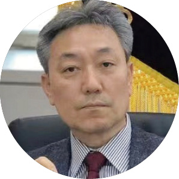

这是最坏的时代   
这是最好的时代

索达吉堪布 &申昌镐教授

中国·上海

Korea University

2019/01/20

申昌镐（Sin Chang Ho）

教育哲学专业博士，韩国高丽大学教育学系教授，高丽大学教育问题研究所所长，韩中哲学会会长，韩国教育哲学学会会长。开展过许多关于东方哲学和文化对教育影响的研究项目。韩文版《能断：金刚经给你强大》译者。

1．藏传佛教的五大特色

索达吉堪布：

很高兴与您在上海这个大都市第一次见面，这是个很好的缘起。如果没有这样一种因缘，大家也不可能遇见。希望这种因缘能够推动我们，未来有更多交流和互相学习的机会，以此能够帮助很多人。

我是个藏族人，信仰藏传佛教，但对韩国这块土地及文化也很感兴趣。

申昌镐教授：

现在韩国人对藏地的关注度越来越高。特别是年轻人认为，藏地非常神秘，令人敬畏。同时，人们希望从中获得精神慰藉。藏地高原令人惊叹的宁静和神秘可以净化人们的心灵。

索达吉堪布：

韩国对传统的保护和韩国人的传统理念，让我很有感触。像我们藏地，现在一些传统和理念已经失坏，年轻一代没有继承下来。而韩国还保存着很多传统文化和知识，我对此非常尊重。

二十多年前，有些韩国的修行人来过我们学院，待了一段时间。我想，我们之间的因缘一直是存在的。

申昌镐教授：

韩国有很多学子，还有看您书籍的广大读者群，希望您把这次访谈看作是我代表他们在提问，也希望您能面向这个广泛的群体给予教导。非常感谢！

第一个问题是关于藏传佛教的特色。在历史上，韩国佛教受中国佛教，特别是中国大乘佛教的影响很深，由此韩国的禅宗得以成长、壮大。比较而言，韩国佛教并没有受到印度原始佛教和藏传佛教的太多影响。所以，韩国对藏传佛教的特点和修行优势不太了解。希望有多年传法和实修经验的堪布您，能将藏传佛教的修行特点和优势，为韩国的学人进行简单说明。

索达吉堪布：

感谢申教授提出的问题。其实，问题的存在，可以成为双方互相学习和思考的因缘。不管我回答得怎么样，希望能给大家一些启发。

据我所知，如今在韩国，虽然也有藏传佛教和南传佛教，但不是很兴盛。下面我讲一下藏传佛教与其他佛教的差别，或者说它的特色。

其实，藏传佛教与韩国的大乘佛教、汉地的大乘佛教，几乎没什么差别。譬如，汉传佛教中禅宗的修行方法、传播的教理及其开悟途径，与藏传佛教中的密法完全可以相应。只不过文字表达方式不同而已。

前几年我讲过汉传佛教的《六祖坛经》，它与藏传佛教中的《禅定休息》在很多方面是完全一致的。

刚才提到南传佛教在韩国也不多，实际上，大乘佛教的基础是南传佛教，所以我相信韩国佛教可以接受南传佛教的教义——虽然未必会出现出家人托钵化缘的现象。我们皈依三宝、受居士戒，这些基本上都是南传佛教的教义。

申昌镐教授：

在韩国，《金刚经》是第一部传入的佛教经典，《六祖坛经》也是韩国禅宗常用的一部典籍。正如刚刚您提到的，这与中国的情况非常类似。

索达吉堪布：

藏传佛教的教义，其实融合了大乘佛教、南传佛教，它有这么几个特点。

第一个特点：藏传佛教有非常清净的传承。任何一个法，如果知道它是如何从最早的上师那里一步步传下来的，那么这个学派的传承就非常严谨。在藏地，一部法如果没有传承，就不能为别人直接传讲，最多只能辅导。可以说，藏传佛教整个传承的严谨性，在其他教派中比较罕见。

第二个特点：藏传佛教不仅对学习理论非常重视，对真修实证也同样重视。藏传佛教中所讲的菩提心或空性见，最后都要落到实修上。

第三个特点：藏传佛教强调辩论的重要性。在每一座寺院，学习佛法时都会安排辩论，就像大学里的学术研讨一样。老师与学生之间，学生与学生之间，会就一些法义进行激烈的辩论和深度的探讨，从而抉择见解的含义。这可能是与其他教派不共的地方。

第四个特点：藏传佛教非常重视尊敬老师的传统。这一点与西方学校不同，西方的学生和老师像朋友一样相处，藏传佛教不太赞同这一点。在藏地，学生对老师、子女对父母、晚辈对长辈，都会非常地尊重。藏传佛教很重视这样的传统。

第五个特点：藏传佛教中强调闻思修行。即先要在老师那里听闻佛法，听闻之后进行思考、分析、辩论等，这叫做闻思；然后是修行，根据自己所理解的法义进行实修。

藏传佛教包括的范围比较广，有适合在家人的理论和修法；也有适合出家人的特别修法；还有一种特殊的修行人，半出家半在家，与日本的一些情况比较类似，与汉传佛教和南传佛教有所不同。虽然这种修行人有些地方可能不太如法，但毕竟寺院和当地已形成了这样的习俗，所以大多数藏族人和修行人也会尊重这样的传统。总的来说，藏传佛教比其他教派要包容一点。

如今在韩国和中国，藏传佛教很受欢迎，尤其是大学里的老师和学生，都特别愿意接受藏传佛教。其中原因就是它不是只讲理论，还会提供很大的思维空间，可以一起辩论和探讨。同时在修行方面，藏传各个教派也有不同的修法，比如观想佛、念咒语、观空性、修菩提心等，修行法门比较丰富。相比南传佛教侧重于修苦集灭道、观释迦牟尼佛，根基千差万别的众生更喜欢学修藏传佛教。

我觉得，韩国和中国的很多年轻人，在思维、审美等方面比较类似。如果信仰上有合适的选择，大家都愿意去接受。

就大的方面而言，藏传佛教与南传佛教、汉传佛教没有差别。从最初的皈依三宝、中间的积资净障，到最后的度众生，都是大同小异。只不过不同地方的传统不同，一些理论的侧重点不同。

藏传佛教也特别重视您译成韩文的《金刚经》。在藏地，家家户户都喜欢读诵这部经。以前可能是信息闭塞，各地之间不那么互通，而当今时代非常开放，好东西更容易被传播和接受。

申昌镐教授：

您提到藏传佛教的传承很清净，也继承了佛教很多优秀传统。在当下的韩国佛教中，这些特征大部分已经消失，或者因为现代化而改变了。所以在教育方法和师生关系等层面，有许多地方需要向藏传佛教学习。

索达吉堪布：

希望大家来学藏传佛教。如果你喜欢一些仪式，比如念咒、顶礼，也是可以的。但更重要的是，藏传佛教有很系统的学修次第，而且理论性很强。

在目前，理论的学习更为重要。如果只学一些简单仪式，只凭感性生起信心，自己的选择很容易改变。但若有了理论基础，就不容易变来变去了。

无论在哪个国家，大家都应该用理性的智慧去认识佛教，去认识藏传佛教。这种智慧在任何时候都不会轻易改变。因此从长远来看，希望大家通过学习法本上的道理，打下稳固的理论基础。

藏传佛教也有念诵咒语的法门和行为，这也是佛教的一部分，但最关键的，还是刚才讲的闻思修行。

申昌镐教授：

您刚才讲了很多重要的修学基础，但目前韩国的年轻人和佛教界，更倾向于感性学修，态度不诚恳。很多东西坍塌了。

索达吉堪布：

这种感性学修，在汉传佛教的初学者中也有。很多居士起初特别狂热，但这种信心不会长久，因为他们不懂一些根本问题。这样到了一定时候，自己就会生邪见，学修无法圆满。

所以我建议，学佛一开始要打好理论基础，之后才会比较踏实。虽然这样做很难，要学一些甚深的道理，但如果没有这个基础，只靠感性的话，几年后修行的热度就没有了。这从很多人的经历中也看得出来。

2．为什么不说“乐才是人生”？

申昌镐教授：

佛教通常以“苦”为重心来宣讲佛理，能不能以更有意思的方式来宣讲呢？比如侧重于“乐”？

为什么这么说呢？刚刚您讲到，修行的话，打好理论基础很重要。但在韩国，大部分人更倾向于享乐，只想做自己喜欢的事。一边在讲“苦”，一边又希望享乐。如何才能正确地生活，可能会成为很多人的疑惑。为什么人生是痛苦的？为何不能是快乐的呢？

索达吉堪布：

这个问题很好，很有趣。我写过一本书叫《苦才是人生》，也有很多人问我：“为什么不叫《乐才是人生》？”其实，佛教并不是不承认快乐，佛教也经常讲如何追求人生的快乐。

但人生为什么是苦呢？每个人生到这个世界上，都不是笑着来的，刚落地就哇哇大哭。出生时的苦，是人生一苦。

人离开这个世间时，也不是高高兴兴的，而是流着泪依依不舍，家人们也都特别伤心。这也是人生一苦。

佛教有一部著名论典叫《中观四百论》，其中说到：万法皆无常，只要是无常的，就是苦的。也就是说，只要有变化，就会带来痛苦。比如感情也好、青春也好，很多都在变化，有变化肯定会痛苦。所以，人生的底色以苦为主，其中虽有快乐，但不是特别多。

在城市里，常听很多人抱怨：“我现在很忙，心情不好，身体不好……”人只要活着，就会有这样那样的哭诉。所以佛教讲苦比较多。

最常见的苦，是会变化的苦，佛教称之为变苦或坏苦。还有一种行苦，表面上看不出来，但它的性质是苦，是引发下一个痛苦的因。比如我今天的行为、发生的事情看不出是苦，但未来会导致我受苦。

总的来看，人生以苦为多。所以佛教讲苦，也是就多数而言的。

3．用21世纪的眼光看佛教

申昌镐教授：

佛教的教理和修行会给很多人带来精神的慰藉和内心的幸福，可以帮助我们超越混乱的世间，使内心获得平静。还有很多人认为，佛教修行会给世界带来帮助。作为觉悟者的您，对此怎么看呢？

索达吉堪布：

不管佛教还是其他宗教，都对人类社会的发展做出过很大贡献。因为每一个宗教都有上千年历史，能在这么长的历史中延续下来而没有湮灭，说明这些宗教对人类有利。

就佛教而言，2500多年前，它是当时最好的心灵科学，同时在物质文明方面也有阐释。以21世纪人类的眼光来看，会发现佛教的很多内容历久弥新。不管从心理学、医学，还是微观科学、宏观科学的角度去研究佛教，得出的结论都非常令人震撼。

一般而言，2000多年前的东西，放在现在不会那么先进。但佛教中不管是《金刚经》，还是其他佛教经典，对万物的剖析，现在看来也非常透彻。

所以，在人类历史上，佛教对心灵的提升和净化，起到了无可替代的作用。佛教经论浩如烟海，单单是《金刚经》《楞严经》《华严经》这几部经，就对现代人产生了巨大的影响。如果我们去学习每一部经论的思想，那获得的利益更是难以想象。

我个人而言，30多年来一直不断学习佛经和论典，越学越能体会到佛法的深与广。有时候觉得，纵然再过2000年，现代科学技术不一定能延续和保存，但佛法对于内心世界的研究，永远都不会过时。它不仅是2000多年前的心灵科学，也是2000多年后的心灵科学。

爱因斯坦曾说：“如果世界上有宗教不与科学相违，每次的科学发现都能够验证，这个宗教就是佛教。”佛教徒讲这样的话，别人会认为是在自我吹嘘，但科学家也这么认为的话，大家就应该沉下心多观察一下了。

申昌镐教授：

看得出来，堪布的思想相当开放、包容。非常感谢！回到韩国之后，我也会进一步学习佛法，并研究一下心理学。

4．大学，学了四年还是玩了四年？

申昌镐教授：

刚才您给予了很多佛教方面的知识和指导。现在，希望您对大学生、学者以及研究群体再给予一些指导。

现在的大学生比较感性，追求享乐，忘记了自己的责任和本分。比如学生本该好好学习，但他们大部分时间都在玩。同样，教授们本该专注于研究工作，但他们大部分时间在享乐。这样的现象非常普遍。

索达吉堪布：

不仅仅是现在，每个时代、每个地方都有一些不符合期待的事。我们会发现，每个时代都有父母抱怨孩子不争气，包括我们的父母也总抱怨我们这一代如何差劲，而我们这一代又对下一代不满——正如教授所说，该做的事情都不做。

主要原因可能是，我们所处的网络时代，带来了庞大的信息量。以师生关系为例，过去学生对老师很恭敬，因为老师是知识领域的权威。但现在只要打开手机，不用等老师上课，所需的知识在手机里就找得到。结果是，学生经常不满意老师的讲课。

此外，一些老师对自己的本职工作，也不是特别负责任。其中原因可能是时代带来的各种压力，当然，这种压力也与人的贪欲有关。比如不管是老师还是其他人，大家需要的都特别多，有了一辆车，还想要第二辆，希望车越高级越好。此时人心被欲望所驱使，自然不满足于本职工作。总体而言，我们这个时代确实比较浮躁。

昨天我在上海交通大学，谈到了生命的价值。我建议大家多做点有意义的事，这样自己不会痛苦，反而会活得很快乐。反之，如果你一味追求快乐，结果不一定会真正快乐，还有可能把最宝贵的东西弄丢了。

这方面，西方专家学者要稍微好一点，他们对自己的专业一直保持着兴趣与热情。而我们亚洲人，尤其是韩国人、中国人，对财富非常重视。通过媒体也会发现，很多人的眼里只有钱，如此一来，教育就会出现偏差。

所以，我们在培养学生的时候，要多传达正确的价值观。虽然不一定能扭转这个时代的趋势，但这是我们的责任。

申昌镐教授：

堪布的回答真的特别谦虚。

索达吉堪布：

您的问题很有时代感，让我想起了一些现状。

5．爱学习，开心，想得开

申昌镐教授：

请问，如果不从修行者的角度，您作为学者，是抱着怎样的态度去学习的？您自身的学习重点在哪方面？在勇猛精进的过程中，您有什么样的感触？

如果您可以给予简单回答，也许会为现在的很多学者树立一个好榜样。

索达吉堪布：

我不算是真正的学者，但我在学习上还是比较投入的。多年来，我一直对学问很感兴趣，不仅是佛教领域，还有各种世间学问。所以我去学校交流时，经常会在不同专业的老师面前，潜心聆听他们介绍各自领域的知识，比如心理学、生物学等。甚至建筑学、金融学这些，我有时候也会听一听。

当然，我主要的专业研究是翻译。二十多年来，我一直专注在翻译领域，从没有放下来。以后也希望尽量地去做翻译。我很想在短暂的生命当中，将一些非常珍贵的藏传佛教经论译成中文，这可能会对世界有一点意义。

前两天我看到一条新闻说，中国人现在遍于全球，只要集聚了五百人以上的地方，就会有中国餐厅。所以，如果将藏文经论翻译成中文，也许会让很多人从中获得利益。

在翻译的过程中，我遇到的最大困难就是时间不够用。其他世间的各种障碍，对我来说，都没什么。别人对我的赞叹，我不太在乎；别人对我的诽谤，我也无所谓。可能每个人的性格不一样吧，我在这个方面不太在意。

我平时的心态还算比较好，不管遇到什么事情，都不会特别着急、难过。有些人常说，某件事是他人生中最大的障碍，但对我而言好像不算什么，什么事我都比较想得开。有些人说自己得抑郁症时，我还感觉很稀有，不知道为什么会这样。当然这也不好说，说不定以后我也会得抑郁症。

申昌镐教授：

在这一点上，我也比较相似。读了您所著的《能断：金刚经给你强大》之后，我个人认为，您是这个时代最伟大的佛学家。我在翻译这本书时，有一个地方让我印象深刻。

现有的藏文版《金刚经》和中文版《金刚经》有不同之处，一些疏漏的地方，两个版本要全部读过才会知道。而现在一部分学者，只看过某一个版本就片面主张这是最全面、最正确的。您在书里提到：要比较多个版本才能得出正确的结论。这是让我印象非常深刻的一点。作为学者，这个部分是不应该忽略的。

6．年轻人，你何去何从

申昌镐教授：

目前，计算机技术革命使科学技术不断进步。在这个过程中，中国、韩国等地的年轻人都受益匪浅，他们做着与上一代人不同的人生梦。

那么新一代的年轻人，以怎样的姿态才能更有价值地生活呢？请您对这些后学者在做人的品德方面给予一些智慧教言。

索达吉堪布：

如今的时代，与以往任何时代都不同。一方面，物质非常丰富，交通和讯息非常方便，但人心的确比较浮躁，尤其是年轻一代。他们和我们这一代相比，有很多优势，因为他们最了解这个时代。他们所说的语言、所做的事情，我们这一代都不太懂。

这个时代变化太快了。有个成语叫“日新月异”，在古代这是不可能的，古人的很多生活方式，可以延续几百年。但现在不一样了，真是日日新、月月异。比如一台电脑，几个月之后，软件和硬件就会全部更新。年轻人特别适应这个时代，他们的心也能紧跟时代的变化，有自己的一种生活方式。而我们，既跟不上他们的技术，也跟不上他们的变化。

对新一代年轻人要说些什么呢？最重要的是告诉他们，自己的传统不能丢。就像现在的藏地，年轻人放弃了自己的信仰、对父母的尊重……其实人类既不能放弃过去，也要对未来有所思考。但现在的年轻人只注重眼前的事情，只着重于现在，所谓的现在也只着重于金钱。这样的话，人就比较肤浅简单，很多人生问题无法妥善地解决。

虽然年轻人掌握的知识比我们多，但他们欠缺的是人生的智慧和道德；我们这代人在道德方面还可以，但是缺乏现代技术。在这种情况下，大学老师要着重告诉学生们：人生需要的不仅仅是金钱，也不仅仅是知识。

如果直接给年轻人讲传统文化，他们不一定会接受。因为他们的世界里，基本没有所谓的传统。但我们可以告诉他们，人生有很多坎坷，当你遇到过不去的逆缘时，可以从传统文化的历史和哲学中寻找到解决方法。尤其当你步入社会找不到工作时，只懂现代技术是行不通的，这个时候，一些蕴藏着智慧的人生哲理可以帮助你。

作为老师，从这个层面讲给年轻人听的话，也许他们更容易接受。否则，直接让他去读古代圣贤的书，他会觉得现在的世界又不是古代，为什么要看古人写的书？其实，在解决一些人生问题时，传统文化的智慧对他们有很大帮助。现在很多年轻人看起来特别优秀，但心灵却极为脆弱，遇到一点点违缘时，要么自杀了，要么抑郁了。最主要的原因就是，他们所学的知识、技术没有与人生经历相结合。

申昌镐教授：

如今，韩国虽然还保存着传统文化、礼仪习俗等，但在年轻一代的身上，很多都已经遗失了。包括我在内的韩国老师们，对这种现状也有很多担忧。

7．最好的时代，最坏的时代

申昌镐教授：

21世纪的人类社会，科学技术革命在很多领域获得了超乎想象的进步。但与此同时，自杀、青少年问题等不幸和黑暗面也非常多。在地域、宗教、人种等方面跟过去有很大不同，人和人之间的冲突和斗争也日趋严重。

面对复杂的人类社会状况，我们怎样才能走向光明的未来？应该追求怎样的生活？希望您能给一些教言，非常感谢！

索达吉堪布：

您的每一个问题，听起来很简单，但里面有很多甚深的意义。有些问题，我只回答了一部分，并没有涉及全部，所以有些地方不一定令人满意。

正如狄更斯所说，这是一个最坏的时代，也是一个最好的时代。如今的时代，似乎每天都在上演各种黑暗的事情，有时候这与媒体有一定关系。

我不知道韩国的情况怎么样。在中国，媒体尤其喜欢报道一些负面新闻，比如医患矛盾。其实，他们报道的只是个案，个别患者和个别医生之间的冲突、残杀，任何一个时代都有可能发生。但一经媒体夸大之后，就给大众带来了错觉，似乎所有医生和患者之间的关系都如此紧张。媒体为了流量和业绩，很喜欢博人眼球、夸大一番，如此一来，人们就会觉得整个时代都没希望了。

当今时代，实际上有很多便利之处。当我们弘扬一些正确理念时，会有与以往不同的网络平台，非常方便。比如，我可以上网宣讲佛法，以直播或微信公众号的方式，短时间内将其传播给很多人，这是过去任何时代都没办法实现的。

所以，这个时代具有两面性，也有很多好的地方。在很多大学里，学者的研究、学生的求学，都受惠于现代网络技术。将技术用于好的一面，是很有意义的。因此，我们对当下和未来，应该采用一分为二的视角来观察。

历史学家汤因比在他的著作《展望21世纪》里说过：“拯救21世纪人类社会的，只有孔孟之道和大乘佛法。”我知道您对儒教的研究非常深。的确，孔孟之道在指导我们处世为人方面非常重要，因此要不断弘扬。此外，还有大乘佛法的利他思想，对当代人来说也极为重要。

我认为，这个时代比较特殊，也出现了一些特殊的技术和工具，在协助沟通等积极方面提供了很多机会。

申昌镐教授：

刚才您提到了大乘佛法。我认为在学校里学习的儒家思想，也倡导为他人着想，这与大乘利他心有相似的地方。

索达吉堪布：

儒家在为人处世方面阐释得很清楚，包括个人教养、人格培养、善待亲友等。而在对全人类奉献方面，大乘佛法将道理讲得比较清楚。

所以，如果你对全球众生都有关爱心，可以学习大乘佛法；如果要维护自己的国家、自己的民族、自己的家庭，学习儒家思想很重要。在提升物质文明方面，新的科学技术非常关键；在探索内心世界方面，佛教的心理学很重要。我们的人生是多维度、多面向的，有时候需要根据不同的特点，学习不同的知识。

申昌镐教授：

在韩国，心理学也称为“关于心的学习”。

索达吉堪布：

藏文中称之为“心界”，也是“心的学习”。

申昌镐教授：

今天非常感谢堪布，为我们提供了一个长时间交流的机会。从佛教到人生智慧，您用比喻和事例进行了具体说明，非常令人惊叹。这些内容会对韩国人有实际的帮助。对于您深广的知识面，我个人十分感动，也从中学到了很多，非常感谢！

8．礼仪的背后

翻译：

在我看来，韩国人遵守的礼仪有时会把自己框起来。比如在听老师讲课时，因为要遵守礼仪，他们会一动不动，非常束缚自己。还有在公共场所，他们认为如果乱动或者做自己的事情，就会影响别人。所以他们会这样一直约束自己。

我想问一下您对这个现象的看法。造成这种情况，是因为他们真的很有礼貌，过于关心他人，还是过于关注自己的形象呢？

索达吉堪布：

您是从中国去韩国的吧？其实，他们的一些行为看起来是约束，事实上并非如此，它有它的价值。比如有些人不懂我们出家人的规矩，觉得出家人很受约束。但实际上，懂得其中道理的人，不仅不会把它看成约束，还会认识到戒律背后的价值。

当然，由于受到西方文化的冲击，很多年轻人不一定能接受这种行为。但每个国家、每个民族的文化，都有其历史渊源，我们外来人在没有真正进入这个世界时，是没有资格评价的。

我没有去过韩国，但看过日本人的一些行为，比如特别准时、特别守规矩，等等。我认为这些行为体现了他们的素质，说明他们很有原则。

翻译：

特别感恩上师对我这种偏见的分析。这的确是我自己的一种偏见。

索达吉堪布：

无论去任何地方，只有深入了解了，才会知道一些表面现象背后的原因。孔子说过，礼仪的背后有文化的价值。我也一直是这样认为的，任何地方的礼仪，背后都有其历史和文化的积淀。
