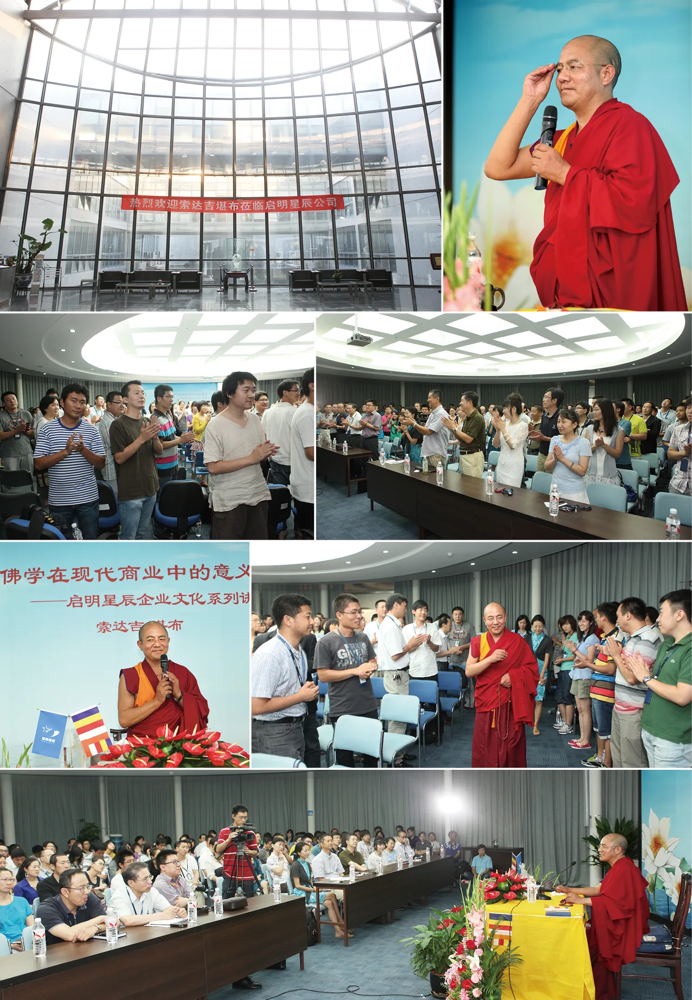
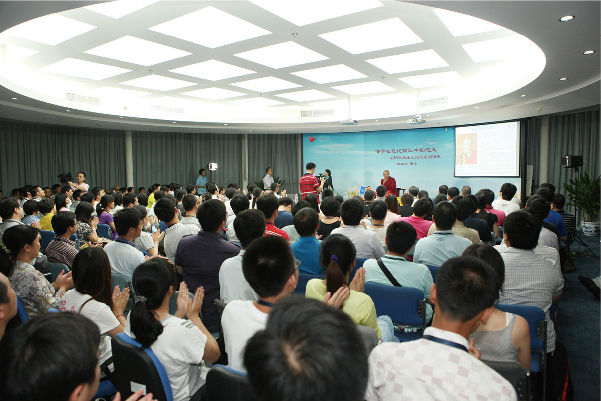
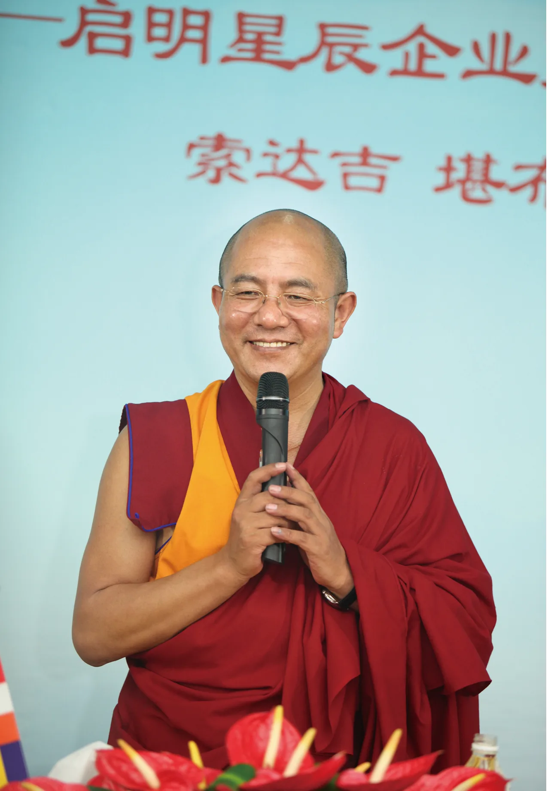
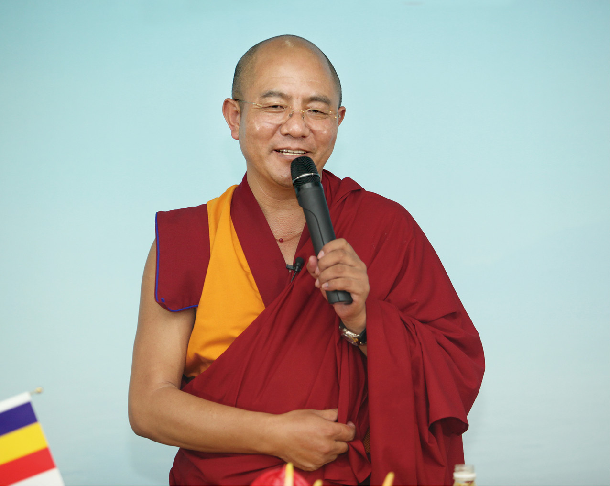
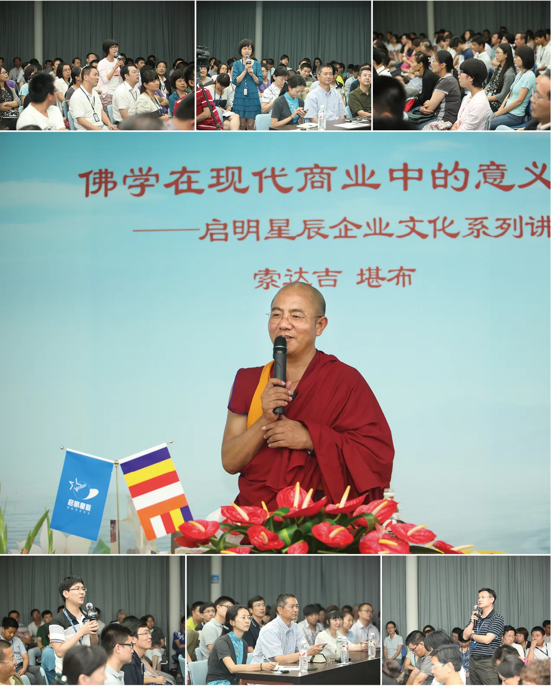
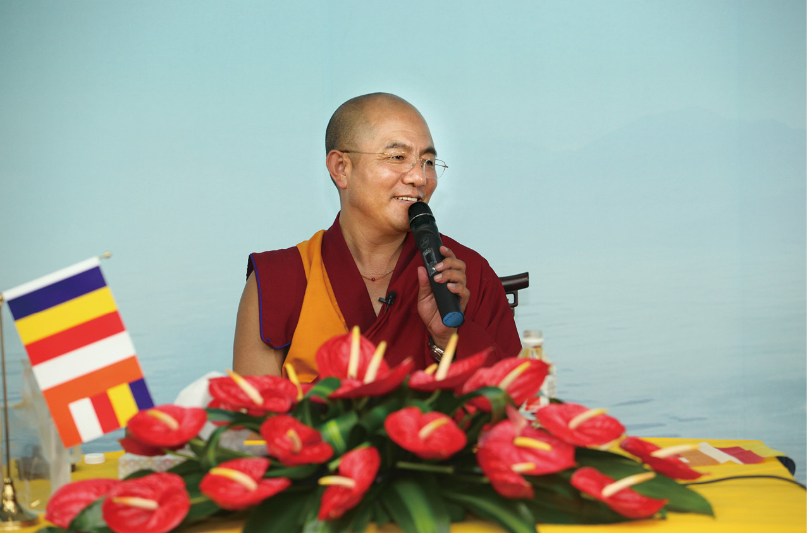
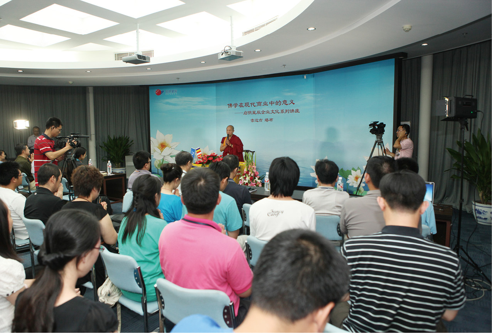
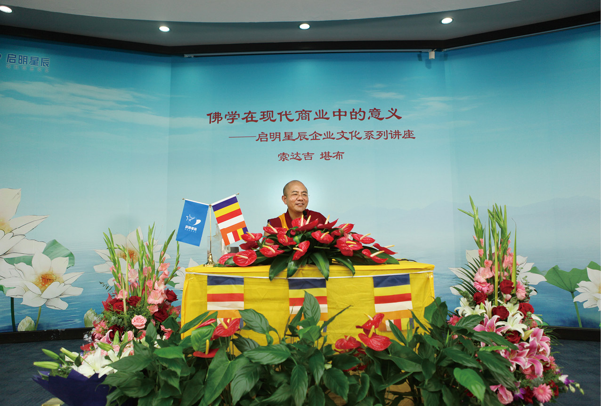

境界最高的佛教徒，  
一般都在红尘里，在各行各业中，  
以自己的语言和行为奉献社会、利益众生。

第08场

北京启明星辰

Venustech Group, Beijing

中国·北京

2012 / 7 / 16

## 佛学在现代商业中的意义

## Significance of Buddhism in Modern Business

今天很高兴与“启明星辰”的各位一起分享心得。这次我与大家交流的话题是，佛教文化对现代商业的意义或作用。

在座有些人士可能想，佛教作为一种宗教，可以保佑人们升官、发财、家庭平安，但它对商业会起什么作用呢？更何况，佛教常教人看破、放下，某种意义上，这与商业的理念完全相反。

## 认清表相，才能见真相

其实，这种想法是对佛教不了解所致。若以系统全面、贯穿历史的方式了解佛教，这些疑惑就会自然化解。

佛教绝非有些人所描述的封建迷信，而是极具科学性的世界性宗教。无论从智慧，还是悲心等各方面考量，佛教教义在世界所有思想中都首屈一指。纵观古今，社会各界很多举足轻重的人物，在研究佛教之后，都一致认为佛教的思想博大精深、至高无上。

历史上，成千上万人都通过学修佛教，获得了一种超然的境界；现如今，很多人也依靠佛教，获得了一种特殊的力量；相信在未来，受益于佛教的人也将比比皆是。

希望在座的知识分子们，最好能对佛教教义先做一个正面的了解，然后运用自己的智慧观察分析。

佛教的教义是什么呢？大家可能听过“诸恶莫作，诸善奉行，自净其意，是诸佛教”这句话。这就是佛教的教义，意思是，尽量不做一切恶事，尽量行持一切善法，调伏自己的内心，这就是佛教。

很多人认为，佛教是指寺院、佛像，或者剃光头的和尚。其实，这些只是佛教的部分象征或代表，真正的佛教，是一个非常崇高的教育体系。如果把佛教思想融入我们的生命中，每个人的思想、行为等各方面，都会有很大的转变和提升。

大家都知道，“文化大革命”造成了中国文化的断层，加之里里外外各种因缘，致使当代中国人，尤其70后、80后，对佛教的本来面目一无所知，甚至产生了很多误解。在很多人眼中，信佛等同于迷信。实际上，这样定义佛教既不公正，也不客观。佛教的本来面目到底什么样？对人类社会有贡献，还是没有贡献？了解之后就会一清二楚。

虽然，我不敢保证所有的佛教徒都学得很好、行为如理如法，但至少相当一部分是真正的修行人，他们无论从人生定位，还是身体力行等各方面看，都远远超过了世间上有些道貌岸然的人。

## “不信”是正确的选择吗？

我觉得，当今社会非常需要佛教的精神。不管什么人，如果能将佛教的理论、修行体系贯穿于生活，会使自己的价值观、人生观得到很大提升，同时对自己不会有任何副作用。

今天这里很多人都不是佛教徒，其实，是不是佛教徒或其他宗教徒并不要紧，因为信仰是自由的。不过，认为自己不信任何宗教非常了不起，这种想法可能不一定合理。为什么呢？

首先，你并不了解佛教到底是怎样的一门学问，在不了解的情况下就排斥拒绝，很容易故步自封。

其次，如果每个人都没有宗教信仰，整个社会将变成什么样呢？可以想象，人们的内心肯定会被金钱、地位、名声等各种欲望充满。其实对于财富等根深蒂固的执著，或者说崇拜，实际也是一种信仰，然而，这种信仰却会使人心腐化、世风日下。

再者，自己的心如果完全依托于外在的事物，很容易受到无常的打击。因为按照佛教观点，一切万法都是无常的。

乍听起来，很多人都觉得这种说法不合理，因为在自己的五官前，万事万物明明真实、坚固地存在，怎么能说它们变化无常呢？

其实，通过深入观察、思维，就能了知万法的这种无常性。我们可以回顾历史，二战以后，日本经济飞速发展，顶峰时期，GDP一度达到美国的71%，然而后来经济却每况愈下，一蹶不振。美国的经济总量虽然排世界第一，但也经常受到金融风暴的冲击，很多中小企业纷纷倒闭，悲苦之声不绝于耳。

人类现已迈入了21世纪。在未来，物质文明也许还有一点发展余地，也许已经呈现下滑趋势。中国的未来会怎么样？谁都难以预测。

同样，我们每个人的财富、名声、地位，也都如同空中的浮云、夏天的彩虹一般瞬息万变，可能转瞬间就会化成泡影，消失得无影无踪。

这就是佛教所说的无常之理。很希望大家能够认真思考一下这个道理。

## 夺不走的财富，值得你拥有

那该如何应对无常呢？需要佛教的心灵教育。只有心灵的财富，才是任何外力都夺不走、毁不了的财富。所以，人的一生不能只考量外在的物质价值，更需要提升自身的精神修养。

然而现代社会，大多数人最关注的是物质财富，在竭力追求的时候，忽略了珍贵的精神财富。有些人虽然关注到自己的精神层面，却没有找到正确的提升方法。可以说，这是当代人的一种贫穷。

物质丰富多彩，精神空虚贫乏，是现代人的特点。这种失衡，致使人的内心非常脆弱，一点点刺激和痛苦都难以承受。现今，越来越多人自杀的原因也在于此。所以，物质和精神必须同时提升，不相舍离。

但可惜的是，现在很多人都不知道什么才是精神财富，不知道自己来到世间到底为了什么。他们从小到大接受的理念大多是，要家庭幸福、要积累财富、要事业有成……在这种只强调自我、只重视物质的理念下长大，很多人的世界里除了自己以外，没有别人；眼里除了名利以外，没有其他。

如果把人生目标锁定在财富、地位等外在的事物上，忽略了自身的精神世界，这样的人生是脆弱而苍白的。因为，外在的一切无一不是无常，一旦无常降临，生命若没有精神力量的支撑，很快就会枯萎凋零。

要想生命之树长青，必须开启内在的精神力量。怎样开启呢？佛陀告诉我们：应该常怀一颗善心，尊重和帮助一切生命，去除自私自利的心，这是所有快乐的主因。

如果我们持续朝着这个方向努力，不但能促使各种善缘积聚，不断充盈自己的生命，还能推动所求诸事自然圆满。

## 不以一时论人生

有些人可能不承认，觉得自己帮助别人，别人也不一定帮自己，甚至不会领情。在当今物欲横流的社会，很多淳朴善良的人都找不到出路，而不择手段的人，反而有各种发展机会，就像很多影片刻画的那样。

现在社会的舆论导向，的确在很多方面引导人心向恶。这使得很多人相信，只有自私自利、尔虞我诈，才有发展和成功的机会。

前一段时间，我听一些年轻人讲，他们虽然口头上讲学雷锋、做好事，但从自己的家庭、单位等各方面观察，做好事的人不一定得好报，而许多做坏事的人，不但资源丰富，事业也很成功。由此他们判断，善良的人不适应现代社会，会受到歧视和不公平的对待。

我对他们说：虽然以短浅的目光看，做好事或许暂时得不到什么，但实际上，很多善缘并非我们肉眼可见，经过一个孕育过程后，善果就会不虚现前；做坏事的人，虽然暂时春风得意，但时间不可能长久，最终必将自尝苦果。

## 因果，是大自然的潜规则

有些人可能想：所谓因果关系只是佛教徒承认的，我才不信呢。我也经常听人说：你们佛教说，善有善报，恶有恶报……

根据一些资料显示，目前中国已登记的佛教徒大约有一亿左右。认为因果规律只有这一亿佛教徒才会感受，其他不信佛的人不会感受，这种想法完全是错误的。

不论佛教是否强调，不论自己是否相信，因果规律都会在每个人身上发挥作用，因为它是客观存在的自然规律。倘若做坏事，迟早都会感受苦果；如若发善心、做好事，早晚都会感受乐果。这就像把良药和毒药的种子分别种在地里，最后会长出截然不同的果实一样。世人也常说：“种瓜得瓜，种豆得豆。”

发生在美国的一件往事，就能说明这个道理。第二次世界大战之后，法国、英国、美国、苏联和中国等国家经过协商，决定成立一个维护世界和平安全、协调重要事务的国际性组织——联合国。

联合国成立之初，因为经费有限，连在美国修建总部的土地都无法获得。消息传出后，美国的洛克菲勒家族经过一番商议，出资870万美元在纽约买下了一块土地，然后以一美元的价格卖给了联合国。与此同时，还买下了联合国周边的大片土地。

洛克菲勒家族的此举，受到了当时很多美国富豪的嘲笑。他们不理解，为什么洛克菲勒家族会做这笔巨亏的买卖，将自己辛辛苦苦赚来的钱拱手送人？这有什么意义呢？但后来的事完全出乎他们意料，联合国总部建立之后，随着国际影响力越来越大，其周围的地价随之飙升。曼哈顿地区也得到了大力发展，很快成为全球经济与金融中心，华尔街也由此诞生。由于联合国周边的土地已归属洛克菲勒家族所有，这让洛克菲勒家族赚得盆满钵盈。

一个人布施，表面看是在帮助别人，自己不免有些损失，但实际上，福报却会悄然地聚拢到你身边，这是大自然的客观规律。

这种规律，也可以通过一个比喻来说明：夜幕降临后，一个盲人提着灯笼在路上走，有人觉得奇怪，问他：“你自己又看不见，为什么提个灯笼走路呢？这样多不方便啊？”盲人回答：“虽然我自己看不见，但灯笼的光却可以让别人看清道路，这样帮助别人的同时，也可以防止别人撞到我，保护了我自己。”

## 因果不在天边，而在身边

我们对因果研究过很长时间，应该说非常公正、深入，并且考察过很多真实案例。在这方面，大家可能很少思考，因为从小到大一直接受一种特定的教育，观念始终被束缚着，没有思考的机会。其实，如果你们对身边的人、事、物详细观察，佛教所说的轮回、因果之理应该不难理解。

比如，过去每个家庭都有好几个孩子，这些孩子在长相、身高、性格、智慧等方面，有时差异非常大。他们长大以后，在工作能力、物质财富、社会地位等方面，也通常迥然各异。为什么父母一样，孩子的状况却差别如此大呢？又如，同样是人类，为什么有些人生来长着三只手臂，有些人出生时双臂就残缺，有些人天生只有一只眼睛，有些人先天腿部有残疾……通过人身体的这些差异，也不得不承认因果的存在。

每个人在自己的前世，或者前世的前世，做过很多善事和恶事，这些善恶业很大程度上决定了自己今生的命运。我们经常看到，两个人在人生起点、所处环境等各方面资源差不多的情况下，一人发展非常顺利，最后功成名就，另一人却霉运不断，最终一事无成。这说明他们前世的因缘不相同，在我们所见的背后，还有一种神秘、深奥的因果律在发挥作用。

## 揭开“因果律”的神秘面纱

因果关系是怎么来的呢？是不是所谓的上帝或天神，特意给自己安排的呢？当然不是。如果是的话，造物者是根据什么来安排这么多众生的千万差别呢？根本解释不清。只有用因缘法则，才能透彻解析生长在同一世界、同一民族、同一家庭的人，命运、爱好和思想等却迥然有别的原因。

佛教把因果规律分析得非常清楚，将它归纳为四种：异熟果、等流果、增上果和士用果。

1．异熟果，是指众生根据自身烦恼的严重程度，以及善恶动机的大小，来世或转生人天善趣，或堕入旁生、饿鬼等恶趣，感受善恶趣之果。

2．等流果，分为同行等流果和感受等流果。

有些人从小就喜欢看书，有些人天生擅长跳舞，有些人生来一副热心肠，喜欢帮助别人，有些人从小就心术不正，经常胡作非为……大家想过这是为什么吗？佛教解释得非常清楚，这是同行等流果，也即前世喜欢做什么，今生依靠这种惯性，也会有相同的喜好，造相同的业。

感受等流果，是指今生所感受的快乐和痛苦，是由前世所造相应之善恶业所致。比如，有的人得了很严重的病，虽然他今生没造过生病的因，但因为前世杀过生，这些杀业在他今生的身体上也会成熟。

3．增上果，是指成熟在外境上的果报。有些人居住的地方景色优美、气候宜人，非常惬意舒适；有些人无论生活环境，还是住房条件都十分恶劣，常常感觉压抑沮丧，这些都是增上果。

4．士用果，是指我们所造的善恶业，不但生生世世辗转不息，还会随着时间日益增上。

如果懂得了这四种果，对于很多现象，比如，有些人上半生贫穷潦倒、下半生兴旺发达等等，都可以分析得清清楚楚。希望大家能经常思维业因果的道理，这样很多疑惑就会自然解开。

## 爱自己，就为自己做长远投资

世界上每个人都关心自己、爱自己。不爱自己的人应该是极少的。佛告诉我们：“若人自爱己，应修诸善业。”一个人若真爱自己，就应该修习善法。为什么呢？因为生命是无限的，人的来世、来世的来世的的确确存在，而只有修习善法，才能让来世快乐幸福。

关于人有前后世的问题，很多人只是不了解或不承认而已。实际上，现在很多科学家都予以了肯定，并举出了大量证据证明，比如催眠回忆前世、濒死体验等等，这方面的案例和证据多不胜数。在诸多证据面前，如果仍然不加思考而一味否定，是对自己最大的不负责任。

现在很多人奉行享乐主义，认为人只有一世，一世不过百年，自己一定要及时享乐。他们的这种想法是由社会环境、教育等很多因素造成的。我和很多汉族人交流时，产生的第一个念头往往是“他们可能不知道自己有前世后世吧”，这也是最令我痛心的一件事。

表面上看，大家都是有智慧、有能力的成功人士，自身的造诣和事业的成就令很多人羡慕。但从另一个角度看，只拥有这些也没什么值得骄傲的。因为，作为有智慧的人类，如果只知道自己有今世，而不知道自己有来世，是一个非常大的缺憾。

这种不知道，是本来没有而不知道，还是真实存在而不知道？这个问题值得每个人深思。我曾问过一些人为什么不承认前世后世？他们都给不出合理的理由。有些人由于各种原因，干脆避而不谈。

很多人都在为自己的将来做打算，但对自己死后会怎样却漠不关心，这种观念不得不说是一种愚痴。这相当于只关心自己的今天，而不关心自己的明天，或者只关心年轻时的自己，而不关心年老时的自己一样。

我很想提醒大家，虽然今生家庭、事业方面的很多事需要关注，但更重要的是，应关注自己死后灵魂将去往何处，来生将会怎样。一定要明白，自己的灵魂并不会随着肉体的坏灭而消失，而是随着今生所造的善恶业不断流转于世间。来世的苦与乐，完全掌握在现在自己的手里。

## 因果迟迟未到，但绝不会缺席

很多人不相信善有善报、恶有恶报，经常问我：“如果真有善恶报应，那某某人干坏事，为什么没受报？某某人干好事，为何还要受苦呢？”

其实这很好解释，佛教的因果观并不是说，今天造了善恶业，明天马上就会有报应。世间任何一种因果，都需要一个成熟的过程。比如，一个孩子需要苦读十几年，才能考上大学，不可能他今天读书，明天就能上大学；农民春天种庄稼，到了秋天才会收获；专家今天立了一个科研项目，很久之后，才能取得成果。

同样，一个人造了善恶业，有些会在今生成熟，有些会在来世成熟，有些则在很多生世之后才会显现。很多人因为不懂佛法，才会有各种疑惑和误解。

希望大家能够相信因果、相信人有前后世。如果把佛教的这些理念真正融入生活，不仅今世会快乐，生生世世都会与快乐同行。

当然，这并不是说，学佛以后永远不会老、不会病、不会死。佛教修行人照样有生老病死，但学佛会让我们用一种正确、智慧的善妙方法，面对生老病死。

知道这种方法非常重要，然而，现在很多人根本不愿提及老病死的痛苦，认为很不吉祥。如果一直这样回避，一旦果报现前，自己就会束手无策，痛苦万分，甚至做出不明智的行为。所以，提前做好准备，运用佛教的方法调整心态非常有必要。

## 最好的活法：克己和利他的统一

可能大家最关心的，还是今生怎样获得幸福。很多人觉得只要有了足够的金钱、很高的地位、美满的家庭，就能幸福。其实这也不一定，如果内心没有满足感，不懂得奉献，即使已经拥有了一切，快乐照样会缺席。

比如，一位官员当上市长就会快乐吗？不一定，他也许奢望成为国家主席，认为那才算功成名就；一名商人有了百万资产就会快乐吗？也不一定，他可能觉得坐拥百亿资产，甚至成为全国首富，才算实现人生理想。

人的欲望永无止境，一旦被满足，就会马上膨胀。有一辆自行车时，想买一辆轿车；一旦拥有之后，又觉得不够档次，心心念念想有一辆高档轿车……以前住普通楼房时，心想“在高档小区买套房子该多好啊”；买到之后，又会想“居住在别墅里才算幸福人生”；有了别墅之后，又希望在美国、加拿大各买一套……人生短短几十年，如果一直这样痴迷地追逐着，永远不可能幸福。这样的人生到底有意义，还是无意义呢？

人生真正的意义是什么呢？我觉得，从自身来讲，要有一种满足感，克欲律己；对所有生命，要有一种责任感，行善利他。能够做到这两点，才是有意义的人生。

有一个故事：一天，三位年轻人来到无德禅师面前请求开示，以解除心中的烦恼，获得快乐。

无德禅师问：“你们说说，有了什么才能快乐呢？”

第一个人说：“我有了名誉之后，就有了一切，那时就会快乐。”第二个人说：“我有了爱情，就有了快乐。”第三个人说：“我有了财富，就能快乐。”

无德禅师说：“即使你们得到这些，也不一定会快乐。如果它们是快乐的因，为什么有的人有了名誉还很烦恼？有了爱情还很痛苦？有了财富仍然闷闷不乐呢？”

三人无言以答，求禅师开示。

禅师说：“你们必须改变生活的观念和态度，生活本身才会有所变化。名誉要服务于大众，爱情要奉献于他人，金钱要布施于穷人，这种生活，才是真正快乐的生活。”

在无德禅师的开导下，三人最终找到了快乐的方法。

现在很多年轻人利他意识非常弱，认为这些都是佛教徒的迷信，或者个别人受挫后的一种不正常表现，有很多诸如此类的想法。其实，在我们的社会中，自古以来，利他都是一种值得提倡、极其珍贵的理念。

我刚才看到这里的宣传栏上有一些爱心活动的照片，心里很高兴，大家这样捐钱捐物的活动仪式非常好。孔子说：“不学礼，无以立。”任何地方只要有一种仪式，其相应的精神本质也会存在。

一个企业若能自上而下传递一种奉献精神，并配以爱心的仪式，就能构建起良好的企业文化。企业文化比利润等其他方面更为重要。因为，企业有了自己的文化之后，就有了自我修复、自我提升的能力，由此才能更健康、长久地发展。

## 出世不离世，入尘不染尘

有些人可能想：佛教提倡的奉献精神，肯定有积极作用，但要求我们有种满足感，降低欲望，可能会对企业发展不利吧，如果大家都无欲无求，企业怎么发展，怎么赚钱呢？

其实，佛在《阿含经》《杂阿含经》《善生经》等许多经典中，都对此讲得非常清楚，佛教并不反对世间人积极地从事农业、牧业、商业等行业，因为人需要生存。所以，企业赚钱是天经地义的事，如果没有利润，任何企业或群体都无法生存。不过，一定要取之有道，不能以非法的手段赢取暴利。

现在很多人都对佛教徒有种误解，认为所谓的佛教徒，要么是寺院里剃着光头、整天参禅念佛的出家人，要么是穿着海青、经常游走于各个道场的居士，而那些研究佛学经典、喜欢佛教思想的知识分子或者其他各界人士，并不是佛教徒。

其实，境界最高的佛教徒一般都在红尘里，在各行各业中，以自己的语言和行为奉献社会、利益众生。不仅现在如此，佛陀住世时同样如此，当时佛陀的弟子中有很多家财万贯的大商主，如给孤独长者，也有一些大权在握的国王，如未生怨王。当时，很多国王都用佛法治理国家，众多大施主倾力相助，他们对佛教的弘扬和发展，做出了巨大贡献。

现在很多人一提到佛教，就想到“离尘避世”，这其实是受了错误的引导。我常对一些导演和演员讲，影视剧中时常出现某个人在社会上走投无路后，才到寺院出家的情节，这很容易引起大众对出家人的误解。实际上，自古以来，帝王将相、各界成功人士，出家或在家修行的例子不胜枚举，佛教并非人们所认为的那样消极。

## “佛脚”值得一抱

不过，有时我又想，一个人如果在社会上四处碰壁、万念俱灰，当他进入寺院学习佛法之后，便可以把心态调整过来，重启一种生命力，这个时候，他会获得一种真正的快乐。很多影片不是也有这样的情节吗？一个人在寺院修行一段时间后，对人生真正有所认识，之后他选择重新进入社会，实现了自我的价值。

这也说明，当我们遭受痛苦，走投无路的时候，佛教会为我们指明一条光明的道路。很多人年轻的时候，或者各方面较顺利的时候，根本想不到佛法，而当感情失败、家庭不和，或者事业下滑之际，才会想：“噢，要不要去寺院念个经，求佛菩萨保佑一下啊？”人一般都是这样，快乐时想不起自己的怙主，痛苦时才会临时抱佛脚。

当然，佛陀有不可思议的力量，只要祈求都会得到加持，但佛能帮你几分，还要看你有几分信心。

人生之路与苦相伴，难免会有荆棘与坎坷。希望大家能尽量系统地学一些佛法，让自己在人生观、价值观和生命观等方方面面，建立起一种新的理念，这样才能泰然处之，安然前行。这种理念的价值和意义，远远超过了金钱和地位。同样，企业在追求成功的路途中，也离不开这种精神内涵。

佛教所讲的精神内涵到底是什么呢？它是对三宝的信心、对众生的悲心，以及看透世间的智慧。

## 稻盛和夫的佛系人生

佛教的精神内涵，并不会对一个人的事业、前途和命运产生负面的影响。现在很多人既是事业方面的成功人士，也是虔诚的佛教徒。比如，被季羡林盛赞的日本人——稻盛和夫，他不但是一名成功的企业家，也是一位虔诚的佛教徒。

在座很多人可能都知道，日本商界有“四大圣人”的说法，他们分别是松下、索尼、本田和京瓷的创始人。因为他们奇迹般成功地经营企业，改变了日本的经济，故被誉为“四大圣人”。

稻盛和夫是京瓷的创始人，我看过他的一些书。他的经营理念或者说价值观是什么呢？是利他、利己，即利益他人就是利益自己。大家可能想不到，他每次接手一家企业之前，心里首先想的是：“我能否帮到别人？如果能以此帮到别人，就可以接手。”

2010年，亚洲规模第一、世界第三的日本航空公司濒临破产，之前一年，该公司亏损高达1800亿日元。当时，已经78岁的稻盛和夫受日本政府邀请，以零薪酬出任日航的总裁。经过他400多天的整顿，日航奇迹般地起死回生，并逐渐扭亏为盈而成为全球利润第一的航空公司。他后来对记者说，自己接手日航，完全出于一种利他心。他曾反反复复观察自己，当确信自己真的是为了利益他众，没有半点私心之后，才开始接手。后来，他经常受邀来中国交流、演讲。

稻盛和夫有过短期出家的经历，因为他认为，人生要有一个规划，应分为三个阶段：第一个阶段20年，是从诞生起到独立迈步人生这个时期；第二个阶段是从20岁到60岁的40年，这是悉心钻研、奋发努力，为世人、为社会做贡献的时期；第三个阶段是从60岁开始的20年，这是为迎接死亡做准备的时期。

按照这种规划，他在65岁的时候急流勇退，将苦心经营的一切全部放下，剃度出家，专心修行。后来他回忆说，出家后需要每天托钵化缘。有一天，他头戴斗笠，身披袈裟，赤脚穿着草鞋，在初冬的寒风中，挨家挨户化缘。连续数小时的行走，令他疲惫不堪。黄昏时分，他拖着疲惫的身躯步履蹒跚地往回走，路经一个公园时，一位正在打扫公园的老妇人走到他面前，轻轻地把500日元硬币放进了他的化缘袋中，并嘱咐他买点吃的。那一瞬间，他感觉到一种从未体验过的感动贯穿了全身，心中充满了难以名状的幸福感。

这位老妇人看上去并不富裕，但给他500日元却没有丝毫犹豫，而且表情是那么慈善，不见一丝傲气。这样一颗美好、纯净的心，让稻盛和夫真切体味到了佛的慈爱。

他认为，这位老妇人的行为虽然只是一件小事，却显示了人的思想行为中至善至美的一面。这种自然的德行，教他懂得了“利他心”的真髓。让他明白了，当一个人正在遭受痛苦的时候，如果有人发善心帮他解除痛苦，这是世上最宝贵的精神。自此，他更加重视慈善事业，热衷帮助他人。

我觉得，稻盛和夫的利他精神，确实值得我们思考。

## 信佛的“附加值”

不管大家做企业，还是从事其他行业，如果把佛教思想看作一种文化，并把这种文化融入自己的生活，不但不会对自己有任何危害，还会在精神上、行为上，赢得别人的认可与信任。

有了信任，就有了事业发展的通行证。前不久我去了一趟香港，发现香港有些学校的选人方式比较特别。他们在聘用财务人员时，一般都会选择有宗教信仰的人，感觉这样有种安全感，否则便有点不放心，因为他们觉得现在不崇拜金钱的人是很少的。所以，有时候，信仰宗教也可以获得别人的信任，消除他人的疑虑。

当时有些教授对我说：“香港虽然回归很多年了，但与大陆的有些理念还是大相径庭。”我问：“有哪些不同呢？”他们说：“在大陆，如果一个人有宗教信仰，人们都觉得他是不是精神有问题？或者受了什么刺激？很多人都对宗教徒比较担忧。而在香港，一个人如果有宗教信仰，很容易获得别人的信任，包括财务在内的很多重要事务，都会优先考虑让他来管。”这也说明，香港和大陆在传统价值观方面，还有很多交流的余地。

## 幸福密码，你掌握了吗？

我说这些，并不是提倡每个人必须信佛，因为信仰与否是个人的自由。就像刚才提到的稻盛和夫，他自己是一名虔诚的佛教徒，但从未要求自己的员工必须信佛。

我想提倡什么呢？希望大家，一定要相信因果，相信善有善报，恶有恶报，同时，尽量多做一些利他的事，不要为了希求自利整天损害别人。如果对别人不管不顾，最终，自己也会被身边所有人抛弃。

此外，也希望大家对很多事情不要太过执著。城市里的人每天为了家庭、事业奔波忙碌，常常感觉“压力山大”。压力来自何处呢？主要来自执著。执念越深，压力越大，不断给自己施压的结果，就是把自己压垮。我非常羡慕藏地有些修行人，虽然他们生活条件很一般，只能算吃得饱、穿得暖，但内心却悠然自在，没有什么压力和痛苦。

过度的执著最终能换得什么呢？只有失落。因为随着自己年龄越来越大，你会发现，外在的一切，包括健康、事业、爱人、子女等等，都在渐渐离你而去。我经常看到，很多汉地老人都被孤独、痛苦的阴影笼罩，眼中充满了绝望。然而，藏地老人却完全不同，他们因为信仰佛教，内心有一种归属感，慈悲的脸庞上经常洋溢着幸福的微笑。

佛教的调心方法，完全可以使我们从压力、痛苦中解脱。它可以让浮躁的心安静下来，使疲倦的心得到休息，将怨恨的情绪化为慈悲，把盲目的执著转为智慧……最后，心就会处于一种安宁、祥和的境界中，体味到真正的幸福。

## 身在红尘，也可以学佛修行

应该怎样学习佛法呢？我想，对于大多数人来讲，要完全看破红尘，到寂静寺院一心修行并不现实，因为还要肩负家庭和社会的责任。其实，只要经常接触一些养心的佛教知识，就可以轻松面对各种压力。这时，尽管外面依旧车水马龙、纷扰喧嚣，充满了冲突与竞争，但自己的心却不再容易烦乱，随时随地都能静下来。这种静心的妙药，在佛教中不难得到。

很多藏传佛教的高僧大德，经常去美国、加拿大等西方国家弘扬佛法。以前，我随同我的上师——法王如意宝去美国弘法的时候，发现当时美国很多成功人士都在学修佛法。虽然他们早已实现了财富自由，衣食无忧，但却急需精神食粮来解决内心的饥渴。他们得到上师的教言之后，便依之实修，最后获得了真正的快乐。在国外这样的人非常多。

同样，大家与藏传或汉传佛教结上善缘之后，兼顾家庭和事业的同时，也可以有学修佛法的机会。

## 转换心境，快乐自来

其实，每个人学不学佛是自己的事，与别人关系不大。有成千上万人学佛，我当然很随喜；一个人都不学，对我也没什么影响。但对你们个人而言，与佛法擦肩而过，的确损失很大。

在讲求速度和效率的21世纪，人们生活节奏越来越快，工作压力越来越大。此时，如果信仰佛教，或者运用佛教的方法调整内心，即使身体再忙、再累，内心也会从容淡定，把一切视作一种享受。

比如，很多时候，员工都认为自己在给老板打工，老板会认为员工是为了工资而工作。其实这两种心态都不正确。如果员工把企业当成自己的企业，工作目的是使企业发展壮大，以帮助更多的生命，这样每天上班就成了一件既享受又有意义的事。如果老板把员工当成自己的家人，盈利是为了使所有家人乃至一切众生生活幸福，这样经营企业就有了非凡的意义。

如果一个企业的文化中，蕴含了团队精神和利他理念，领导和员工不但不会有压力，反而会充满动力。尤其以“利他”为企业的核心价值观时，一切努力都会变得有意义，工作也会成为一件乐事。

## 不读佛书，难知世间至真

希望大家能趁着自己现在精力旺、记性好的时候，对佛教有一个正面的了解。如果到了老态龙钟之时，想了解也可能力不从心了。

你可以以信仰的方式接受，成为一名真正的佛教徒，也可以暂时不信仰，从理论的角度研究学习。这时，虽然你不是一名佛教徒，但会清楚地知道，在这个世界上，的确存在一门能解开所有宇宙奥秘的甚深理论。

佛教思想是人间稀有难得的珍宝，无论在广度上还是深度上，都无人能及。现代科学越发展，越能证明佛法的正确性，也越接近佛教所说的真理。

大约2500年前左右，人类开启了最早的文明时代。当时东方文化中的佛教思想，一跃登上了人类思想的巅峰。那时西方哲学家，如柏拉图、亚里士多德等尚未出世，即使后来西方哲学发展兴盛，佛教思想仍然令他们望尘莫及。即使在科技高度发达的现在，佛教思想也让众多科学家肃然起敬。因为，他们经过多年苦心研究，才创立了量子力学等理论，然却惊讶地发现，释迦牟尼佛早在2500多年以前，就已经把这些道理讲得清清楚楚，所讲不但与最新的科学理念完全吻合，还有很多超胜之处。

我从小就对佛法很感兴趣，可以说一辈子都在研究佛教，翻阅过很多经论。我发现，凡是美好的事物，佛教都有提倡，比如，教导人们怎样获得智慧、爱心、平等心、孝心，这样的文字在佛经中随处可见；反之，对人类社会、对身体、心灵等有害的思想，佛教都会严厉遮止。到目前为止，我在佛经当中没有找到一个宣扬不利思想的文字。

## 始于自觉，终于自悟

我并非糊弄大家，而是发自内心地觉得，佛教这么崇高的思想不应该被忽略。很多人的内心都快干涸了，急需要佛法甘霖的滋润，然而他们却不愿去尝试，这就如同一个人已经饥肠辘辘，美味佳肴就摆在身边而不愿意品尝一般。有时我会感到十分可惜。

很希望大家在有时间、有兴趣，各方面因缘具足的时候，能翻阅一些佛教的经论。如果生起了信心和欢喜心，想更上一层楼，可以实践佛教的修证。

修证的境界并非语言所能表达，当你真正体味之后，对世间的任何俗物都不会再留恋，因为这时内心的胜境，远远超越了一切尘世美景。当然，这只是极个别证悟者的境界。

事实上，佛教的一切修证，最终都要归于利益众生。佛教的精髓归纳起来就是“利他”两字。佛陀成佛之后，除了利他以外，没有其他事业。

所以，任何人，在任何场合行利他之事，就是佛教最高精神的一种体现。

现场互动

问：今天见到索达吉上师非常高兴。佛法书里常对善、恶、美、丑进行描述，请问这代表的是一种概念，还是一种执念？在不同时期、不同环境，人们对善、恶、美、丑经常有不同的解读，请问该如何看待这种变化？

堪布：佛教所讲的善恶、美丑，可以从两个层面解释：

一是按照佛教最究竟的教义，从本质、空性的层面观察，善恶、美丑、黑白、高低等一切万法皆为空性，正如《金刚经》所说：“凡所有相，皆是虚妄。”

这不仅仅是佛陀的教言，我们自己真正用智慧去寻找，也不可能得到。比如你刚才说，在不同时期、不同环境，我们会对善恶、美丑有不同的解读，这正说明了它们只是一种虚幻的概念，并没有真实的本体。

二是从世俗的角度解释，在尚未达到这么高境界的普通人面前，苦乐、善恶、高低和美丑等一切不平等的法都是存在的。在佛教里面，这叫做世俗谛。

在最高境界当中，即从胜义角度观察，善恶、美丑等都是平等的，皆是空性的缘故，当然，在没达到这种境界之前，善恶、美丑等所表达的意义各不相同，不能混为一谈。

问：尊敬的堪布，见到您非常高兴！佛教讲，修行一定要有出离心，请问，像我们这样的上班族，如何在工作中既保持一颗出离心，又不影响工作呢？

堪布：佛教一直强调，在家修行人不能随随便便放弃对家庭、工作和社会的责任。

出离心有很多层次。想生起初级的出离心，需要了知轮回的痛苦。为何说轮回是痛苦呢？因为万法皆无常，“无常定有损，有损则非乐”。包括我们快乐的感受，也不离这种无常变化，比如，有的人刚得到名声地位时喜不自胜，但不久之后，这种喜悦就消失无踪了；又如，一个游客刚住进一家宾馆觉得很舒服，但过几天就没什么感觉了。

从道理上明白了万法皆苦、三界轮回没有什么可贪执的，这是初级的出离心。这种出离心并不稳固，在尚未完全放弃对世间的执著之前，该上班要上班，该工作要工作，该行持的善法不能间断。

有些人刚接触佛法时内心特别激动、着急，好像什么都不在乎了，对家人、工作不管不顾。我比较反对这种做法，经常对佛教徒讲：如果刚生起相似的出离心，就急着把世间的一切全部放下，不久之后，各种压力就会扑面而来，这时，可能反而会把修行全部放弃。这种做法并不可取。

佛陀住世时期，很多人既是虔诚的佛教徒，又兼顾家庭、工作等各个方面。大家也应如此，作为在家修行人，在不违背因果的前提下，对于该做的事、该尽的责任，都应该认真努力地完成，与此同时，尽量断除强烈的贪著。

有了初级出离心的基础，再经过十年八年的闻思修行，随着出离心慢慢稳固、增上，你对很多问题自然就会做出明智的抉择。

问：非常感谢堪布的教诲。刚才听您说红尘当中也有佛，佛教并非只鼓励出世，同样认可入世，我感到特别欣慰。我想请教一个问题，佛陀教导人们多行善，多去爱人、帮助人，但在滚滚红尘中，我们常会遇到一些不好的事情。比如，我在公司做前端销售工作，时常要面对一些官员的寻租行为，而自己为了做成订单，甚至希望他们去寻租。我作为一个有心向佛的人，内心经常为此受到煎熬。请问上师，我该如何解决这个问题？

堪布：佛教有一种说法：心善无罪。我们做任何事情都应该把握原则，过程中，尽量不伤害任何一个众生。不过，现在社会竞争十分激烈，做事过程中难免会有一些不如法之处。如果觉得自己的所做违背了因果，有一些罪过，可以从内心进行忏悔。

藏传佛教一位伟大的上师说过：人活在世界上，没有一点罪过的饮食是得不到的，因为，获取任何饮食的过程中，都会涉及很多罪业。实际上，不仅是获取饮食，在获取穿的、用的，包括做生意、开工厂的过程中，都可能涉及一系列不良的运作。

为何这么说呢？仔细观察就会发现，农民种庄稼需要翻土、耕种、洒农药，这会杀害很多小虫；牧民挤牛奶卖钱，小牛会因为食物不足而受到伤害……我们吃的每一道菜，貌似清净、无有染著，而实际并非如此。一丝恶业都没有的饮食，整个世间都寻觅不到。正因为轮回中充满了痛苦的因，故说轮回皆苦。

既然如此，我们该怎么办呢？这位上师说：只要对众生的身体、生命等没有直接危害，正常的工作和事业都可以做。有些人明明知道地沟油对人的健康危害极大，却一直生产销售，这种行为肯定要制止。除此之外，正常做生意、交易等都是可以的。万一过程中有一些罪过，按照佛教的方法，通过念百字明和金刚萨埵心咒等，就可以忏悔清净。

问：堪布您好，见到您非常激动！我有一个困惑，人们常说“人在江湖，身不由己”，每个人必然要融入社会，否则就会被淘汰。但是，现在社会错综复杂，除非像终南山的隐士一样避世修行，否则，根本无法做到六根清净。虽然佛教说“佛法无边”，但我作为一个平凡人，经常感觉，佛法在面对现实的时候也很无奈。我想请教您怎样看待这个问题？

堪布：我觉得佛教修行人，尤其是在家人，没有必要像终南山隐士一样避世，也不必对此向往。我曾看过一本书，里面介绍了一位五六十年代的终南山隐士，他闭关了五十多年。后来，一位台湾记者采访了他。采访时记者提到毛泽东主席，他问：“你说的毛泽东是什么人啊？”我看到这段文字时很惊讶，可能他闭关这五十多年，从来不与任何人接触吧。

我认为，作为现代知识分子或技术人员，厌烦社会、离尘避世没有任何必要。很多人认为，人在落魄的时候才会学佛；走投无路的时候才会出家；学了佛，就必须彻底看破、放下。其实，持这种观点只是不了解佛教而已。大乘佛教提倡的是入世，因为大乘佛教徒要肩负弘法利生的责任。从某种意义上讲，我们的责任比一般在家人还大。

现代社会确实错综复杂，身在其中很容易受到染污，但如果通过学佛获得了一种智慧力和慈悲力，就能善于取舍、自利利他，即不但能遵循因果法则使自己趋利避害，还可以对人类社会做出很多贡献。

可能有些人想：“我现在只是做着本小利薄的小生意，离成功还有一段距离，等我什么时候成功了，再为社会做事吧。”其实在我看来，每个人都可以是成功者，因为一个人不论所做的事情大小，只要能调整自己的心念，将一种高尚的意义融入其中，他就是一名成功者。为了实现这一目标，我们在积极面对社会的同时，也要认真地观察自心。

一直以来，我们的心都跟随时代的浪潮起起伏伏，不但找不到当下的定位，对自己从哪里来、往哪里去，更是茫然不知。每天都是上班、下班、吃饭、看手机、睡觉……在这样周而复始的生活中，一辈子就昏昏然过去了。

要想使自己今生过得有意义，不再茫然，首先要发起一颗善心，然后应身体力行地关爱他人、关心社会，这样就能逐渐理解佛教所说“佛法无边、众生无边”的意义。

问：我想请教您三个问题：一、请问修佛、学佛、悟佛这三者，是否都是了解佛法的方式？二、这三种方式有高下、快慢之分，还是说为了求解脱，不必在乎形式本身？三、我个人感觉，无论是修佛，还是学佛，都会涉及到精力、时间和秉性等问题，如果我坚持用悟的方式见性成佛，是否可行？

堪布：佛教的教育讲究一种次第，首先需要学佛，然后应该修佛，修到一定时候可以悟佛。有些人只是学，了解一下，不愿去修；有些人不但学，还继续修；有些人修了之后，已经真正悟出了佛教的精髓义——慈悲和智慧。

所以，佛教徒表面看差不多，但对教义的理解、修行和感悟不一定相同。包括我们出家人的群体，表面看都穿着袈裟、剃着光头，但实际上，内心的境界有着不同的层次。

这种差异缘于前世的串习和今生的努力，有些人因为前世修过，所以今生悟道特别快；有些人依靠今生的勤奋努力，最后也契入了佛教的最高境界。

问：刚才您讲了稻盛和夫运用佛学理念经营企业的故事。我想，京瓷能成为世界500强企业，其发展肯定离不开技术创新。我是一家技术型公司的开发人员，很想知道佛教的哪些智慧，对我的技术创新和发展会有帮助？请您简单介绍一下好吗。

堪布：佛教讲的智慧和慈悲，主要基于内心的开发，而技术创新，主要是外在物质层面的安立。

通过佛教的内观修行，很多潜藏于我们内心、自己本具的能力都可以开发出来，而这些是自己以前从未见过、根本做不到的。比如，我们受到别人打骂时，一般都会生起嗔恨心，但依靠佛教的智慧和方便，内心的安忍力就能开发出来，将嗔心平息，这应该也是一种创新。这种安忍力，使我们在任何时候都能坚强。

佛教中讲了很多开发自心潜能的方法。自古至今，无数修行人依此开启心性之后，不但能从容地面对痛苦，还获得了神通等超胜的能力。

在科学技术方面，佛教也做了直接或间接的宣讲，如佛陀对时间、物质、宇宙、医学等都有深入细致的描述，可以说，佛教的智慧涵摄了宇宙万物的一切真相。怎么涵摄的呢？比如，当今时代网络科技十分发达，但以佛陀所说“一即是多，多即是一”的道理，便可把它囊括其中。

当然，佛陀对物质层面并未做过多阐述，而是着重宣讲了心灵的真相，因为，人们的痛苦主要源于内心，依靠物质层面的科学是无法根除的。就像网络公司的新技术、电子公司的新科技等，只能给人们带来暂时的愉悦，无法真正解除他们内心的痛苦。只有依靠佛教的修心方法，才能使众生真正离苦得乐。

问：医生说我的颈椎、腰椎、胸椎都不好，我治了一年多也不见好转。我以前没学佛的时候，因为不懂因果，造了堕胎的罪业。有人说，我现在的病可能是堕胎的果报。请您慈悲开示，我现在怎样做才能消除这一罪业，化解这个恶缘？

堪布：我以前脊椎、腰椎也特别不好，在十多年中，饱受病痛的折磨，但这几年基本都好了。

身体得病主要有两种原因：一是前世的业力；二是今生的外缘。我以前脊椎疼得难忍时，经常想，这肯定是自己前世害过众生的果报。我在电视上看过西班牙斗牛士把剑插在牛背上的景象，看后心里很难过，觉得自己以前是不是当过西班牙人害过牛，今生才会这么痛苦啊？经常这样想可以激励自己不断忏悔。经过十多年的忏悔，我的病不知不觉就好了。

当然，如果自己前世造了特别严重的罪业，通过念经、做一些善事，也不一定能完全好，但如果不是很严重，或者只是一种外缘导致的疾病，通过放生、念咒语等方式把业消尽之后，自然就会好的。

问：尊敬的上师，您一直站着很辛苦，请坐下来歇一会儿吧。我对藏传佛教比较感兴趣，想请教您一个问题，很多人都说现在是末法时代，但我对“末法时代”的概念不太理解。

堪布：很多人所说的“末法时代”，只是一个统称，真正末法形象期的五百年还没有到。因为，释迦牟尼佛的教法至少住世五千年，按照斯里兰卡大众部的算法，今年是佛历2556年，以此推算，佛法至少还会住世两千四百多年，因此，现在还不算真正的末法。真正的末法，是最后的五百年形象期。

之所以现在人们常提“末法”这个词，是因为，现今虽然佛法完好无损地留存于世，但人们的见解非常恶劣，烦恼特别深重。从广义上讲，确实可以称为末法。

问：我最近遇到很多不顺心的事，致使负面情绪不断增长，突破了自己的临界点之后，爆发出很大的嗔恨心。我现在非常后悔。请问，怎样才能提升自己的心力，不再被负面情绪牵着鼻子走？

堪布：我们在修行过程中，经常会遇到这种情况。藏传佛教常把修行比喻成一条遥远的路，在长途跋涉的过程中，会经过开阔平坦的草原，也会经过布满荆棘的山路。作为修行人，遭遇逆境时一定要不断提醒自己，不管遇到什么，都不能乱了心绪、失了正念。

当被嗔恨心控制的时候，我建议大家采用《入菩萨行论·安忍品》中的窍诀加以对治。这些窍诀非常管用，比如，当自己对怨敌、同事生起嗔心的时候，可以观察，自己为什么生嗔心？生嗔心到底有没有意义？

《安忍品》中还讲：“若事尚可改，云何不欢喜，若已不济事，忧恼有何益？”意思是，如果事情尚有扭转的余地，为何不欢喜而要生气呢？倘若事情已无法补救，忧恼、生气又有什么益处呢？《安忍品》中有很多诸如此类的推理，这对调整心态非常管用。

另外，龙猛菩萨的《亲友书》中也有很多珍贵的教言，如云：“如是无等忍苦行，汝莫令嗔有机乘，断嗔获得不退果，此乃佛陀亲口说。”意思是，在所有的苦行中，安忍最难做到，不能让嗔恨有机可乘，应始终以正知正念摄持。一旦生起嗔恨心，应马上想到佛陀的教言：“诸比丘，断除嗔恨，汝将成就不退果。”

当然，大家不一定非要成为一名修行人，但如果能了解一些佛教知识，经常翻阅佛教的书籍，对自己的生活、工作、心态等，都会非常有益。

问：我平时逛商场或在街上走的时候，经常遇到很多乞讨的人，这时我心里会很纠结，不知道自己到底该不该布施。因为其中一些人可能的确需要帮助，但也不乏有些身体健康、以此为职业的骗子。佛教讲因果不虚，也提倡利他。如果我通过布施利益了这些职业乞丐，是否助长了他们的恶行，引发了更坏的结果呢？以后我遇到这种情况，该怎么办好？

堪布：不仅是你，我也经常遇到这样的事。在佛学院附近，有时会有一些特别年轻的乞丐，他们如果到外面打工，根本不需要靠乞讨过生活。有时我不给他们钱，劝他们说：“出去打工吧，一天挣一百块钱肯定没问题，不要这样乞讨。”但有时又觉得，这样做好像丧失了自己的布施心，所以也会勉强给。

佛陀告诉我们，做任何事情都要用智慧取舍。如果以智慧观察，这个人的确可怜无助，最好还是布施，即使最后发现他不是真乞丐，而是装可怜骗自己，也不能后悔。如果这个人看起来假的成分比较多，不一定真可怜，不给也是可以的。因为佛教并没有说，明明知道一个人行骗，也必须满足他。

不过，有的人因为自己舍不得施舍，就把所有乞丐都视作骗子。其实这也不一定，有些人确实没有生存能力，非常可怜无助。

所以，遇到这个问题时，应该以智慧一分为二地看待。

有时在路上，我们不仅会遇到乞丐，也会遇到各种需要帮助的人。前一段时间，我与一位长居瑞士的佛教徒见面，他对我说，不久前，他和儿子回到了阔别二十年的中国，有一天他们正坐车去往一处，突然看到路边有一位老妇人正推着一辆沉重的三轮车艰难地爬坡，由于车子太重，她看起来特别吃力，非常可怜。可是，周围却没有一个人向她伸出援手。后来，他和儿子帮她把车推过了坡路。他流着泪对我说：“没想到国内现在道德败坏到这种程度，如果在瑞士，一个人这么可怜，周围的人绝对不会袖手旁观。”

在国内，很多人都觉得不帮忙很正常：我走我自己的路，她推不动车是她的事。但这位佛教徒按照西方人的理念和价值观衡量，觉得这种现象非常不可思议。我当时反思了一下，觉得我们在社会道德方面，确实需要思考。

问：我在学佛的过程中，对一些现象感到十分困惑。现在，人们去一些大小寺院，或者佛教名山烧香拜佛的成本越来越高，不仅有“进山费”“三六九高香”等，甚至一些看上去修行不错的高僧，也通过某种语言诱导你消费。我想请教您，该如何看待这种现象？

堪布：这些现象确实使很多人对佛教产生了误解。包括关于四大名山已经上市或正在争取上市的传闻，很多人都议论纷纷。对于这些现象，我思考分析过，也直接或间接打听过。

佛教内部有极少数宗教人士，由于对佛教的教义不是很了解，所以把金碧辉煌的道场建筑，或者旺盛的香火，当成了佛法兴盛的标志。你刚才讲的个别寺院卖高香的现象，就是少数佛教徒不懂佛教教法、证法的一种行为表现。

不过，这只占极少数，大多数现象其实都与佛教徒无关。比如，峨眉山1997年上市，普陀山和五台山也准备上市，这些都是当地政府、旅游局，或者一些股份公司的操作。当地寺院的住持对此很无奈，无辜背负恶名，但也无力阻止。

可能大家也看过一些相关的采访报道，当地寺院的大德对于所谓的上市，都表示出强烈不满。因为，佛教是一种非常高尚、甚深的精神，若与商业、金钱混为一谈，佛教的价值必定会降低。佛教徒虽然不愿见到这种现象，但在商业浪潮之下实在无力改变，最后只能成为牺牲品。

真正的佛教是一种教育，这种教育需要在寺院中进行。如果寺院没有佛法的教育，它只能算是一种建筑。虽然供奉佛像有很大功德，但寺院最根本的作用并未真正体现出来，就像一所大学如果没有教育，就体现不出大学的价值，只是几座建筑物而已。

现如今，汉传佛教在很多方面受到了冲击，危机重重。里面的问题比较复杂，有些时候寺院方是无辜的，有些时候是由无知造成的。大家在了解的时候，需要用智慧加以分析。

问：佛教讲了八苦：生、老、病、死、爱别离、怨憎会、求不得、五阴炽盛。对此我有两个问题：一是“求不得苦”一直困扰着我，有时明知一些东西得不到，但就是放不下，实在无法释怀的时候，会逼着自己暂时不想，但一段时间之后又会开始执著。第二个问题是，我不知道什么是“五阴炽盛苦”，请上师指导。

堪布：对于人类的痛苦，佛教分析得非常透彻。人类有三种根本苦——苦苦、变苦、行苦，从中又分出八种分支苦。我们一一思维之后，就会知道，人类的确有这么多痛苦。

“求不得苦”是八分支苦中的一种，很多人都对这种苦深有感触。有些人希求地位，但迟迟得不到晋升；有些人渴求财富，但一直不能如愿；有些人想得到喜欢的人，却始终追求不到……

得不到时暂时放下来，不一定能断掉自己的执念。要想彻底放下，需要一种智慧。

比如，实在得不到财富或地位时，应该想：要想得偿所愿，肯定需要各种因缘，若因缘不具足，怎样求也是枉然的。如今，自己仅具有渴求的心态，而不具足其他因缘，这应该是自己前世没有修福，没造过这方面的因导致的。如果这样，今生再怎么求也不可能得到，就像农民如果没在地里撒种子，即使再努力耕耘、灌溉，最终也得不到庄稼……道理上明白之后，我们就不是暂时放下，而是随缘放下了。

如果懂得了因果，生活中的很多困惑都会自然开解；如果不懂因果，很多事情都会成为囚禁你的枷锁。

第二个问题，所谓“五阴炽盛苦”，是五蕴皆苦的意思。人的身心是由色、受、想、行、识五蕴组成，表面上看，依靠五蕴可以产生快乐，但实际上，只要具有五蕴，痛苦就会接连不断地出现。为什么呢？

因为，贪嗔痴等一切烦恼都由五蕴产生，而有了烦恼，就会有痛苦。此外，前一刹那五蕴是后一刹那五蕴的因，相续接连不断，刹那生灭变化。由于五蕴具有这种无常变化的自性，所以刚才还好好的，一会儿可能就会变坏，变坏肯定就会产生痛苦。比如，今天一家人本来开开心心的，但因为一点小事就吵了起来，最后不欢而散。可见，只要有五蕴，必然就会有痛苦。

问：请问从佛学的角度怎样看待积极和消极，主动和被动？

堪布：我觉得看待任何一件事，首先，一定要有正确的知见，这一点很重要。

有些人认为，佛教徒对社会抱有一种消极的态度，但我并不认可这种观点。当然，不排除佛教徒中有个别人确实对社会失去信心，态度消极，但大部分佛教徒并非如此，因为，佛教真正的思想是积极向上的一种智慧。以佛教观点看，对任何有意义的事情，都应该以勤奋、无畏的态度积极成办。

有些人之所以消极，是因为无法达成自己设定的目标，自信心受到打击，从此失去了积极性。其实，无论遇到什么困难和挫折，都应该勇敢地面对，不能心灰意冷、止步不前，否则会错失很多机会。

对于同一件事，以积极和消极两种不同的心态来面对，会导致截然不同的结果。人的一生是由一件件小事串联而成，一生如何，取决于当下对待每件事的态度。

问：请问，带业往生是否还需要受这个业？另外，今天这里有些朋友想皈依，不知您能否为我们皈依？7月23日是您的生日，在此祝您生日快乐，愿您长久住世，法体安康，法轮常转。

堪布：“带业往生”是佛教，尤其汉传佛教比较强调的。我今年刚好讲完“净土五经”。这五部经典是《阿弥陀经》、《无量寿经》、《观经》、《普贤行愿品》和《大势至圆通章》。我前几年发愿在有生之年讲一遍净土宗的“五经一论”，现在“五经”已经讲完了，“一论”（《往生论》）暂时还没有讲。

在这个过程中，我翻阅了很多汉地净土宗大德的开示录和书钞，发现，藏传佛教中关于往生极乐世界的道理与汉传佛教所讲的，意义上完全相合。

可不可以带业往生呢？可以带业往生。往生到极乐世界之后，依靠阿弥陀佛的威神力、不可思议的发心加持力，以及自己的信心力，我们原有的业，很快就会奇迹般地消除。

关于业消失之后，是否还要感受业果痛苦的问题，相关经典中没有明显说明。但我认为，往生到极乐世界以后，随着诸业奇迹般地消失，自己很快就能获得解脱。这种业果感受应该是无形的。

关于皈依的问题，以前我在不同场合都说过，我只是作为代表为大家念一些皈依偈，皈依与否随大家自己的心愿，因为信仰是自由的，我们不会勉强任何人。

如果心里想皈依三宝，我念诵皈依偈的时候，你就在心里默默发愿皈依。当然，并不是皈依我，按照佛教观点严格来讲，应该“依法不依人”。因为，佛法僧三宝永远存在，如果皈依人，当他离开世间之后，你的皈依对境如果也随之消失就不太好了。所以，皈依佛法僧比较保险，内心会获得一种永久的安慰。

皈依的时候不用合掌，也无需做任何特殊的行为，我念三遍皈依偈的时候，如果想皈依，就在心里意念皈依三宝，这样在别人不知道的情况下，自己就已经成了三宝弟子；如果暂时不想皈依，也是完全可以的。

下面我念诵三遍皈依偈，同时为大家念一下七佛的名号。你们听到声音之后，相续中会种下善根，依靠这种加持力，将来不会堕入恶趣。

（堪布为大家传授皈依）
