为什么贪污腐败现象屡禁不止？  
为什么自私自利、不知感恩的人越来越多？

第06场

重庆企业

Chongqing Enterprise

中国·重庆

2012 / 7 / 3

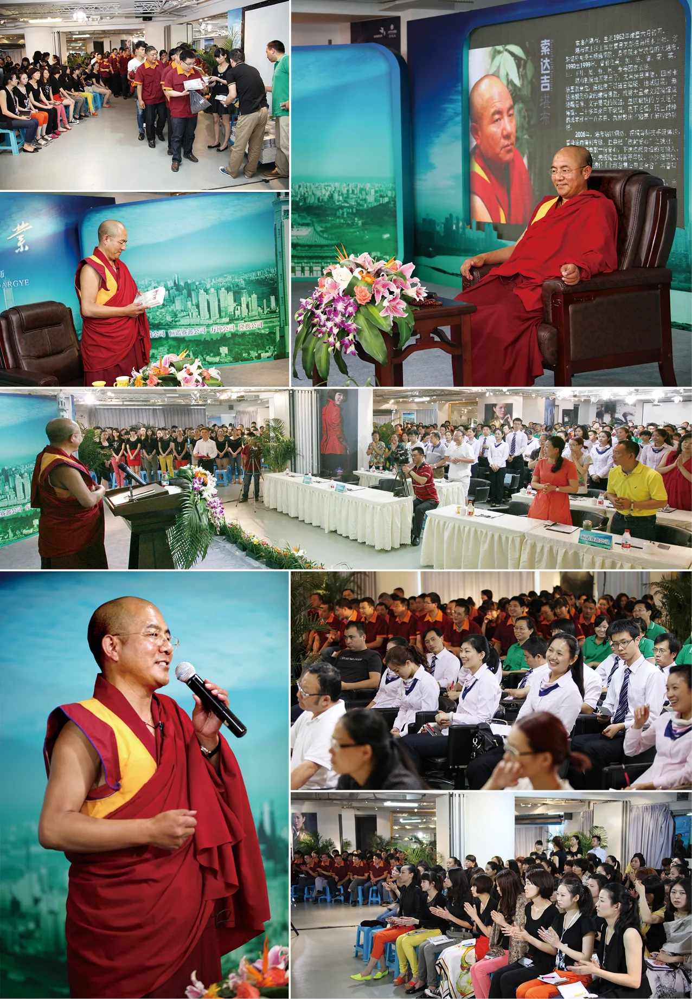

## 善与事业

## Virtues and Business

主持人：

各位上午好，今天我们聚集一堂，对“善与事业”之间的关系和相互作用进行探讨和交流。这次能邀请到索达吉堪布为我们做开示，可以说是我们莫大的荣幸和福报。

索达吉堪布依止法王如意宝晋美彭措为根本上师，堪布现任喇荣五明佛学院汉僧部的主管。他不仅精通佛法，而且洞悉世间万法，在国内外享有极高的知名度。

朋友们，让我们怀着无比崇敬的心情，以热烈的掌声，欢迎索达吉堪布——

大家好！今天很高兴与几家公司的董事长、高层领导以及其他成员，共同探讨“善与事业”之间的关系。

作为佛教出家人，我对“善与事业”的话题很感兴趣。刚才听了各公司代表分享的观点与心得，我感触颇深。在座很多人都非常年轻，思想活跃。

在21世纪的今天，当很多人把金钱作为衡量人生价值的标准、社会道德严重下滑的时候，我们在此共同学习、研讨善与事业的关系，我觉得非常有意义。

## 初印象，未必靠谱

也许有些人会想：出家人不是应该待在寺院诵经念佛吗？为何来此与我们一起探讨企业方面的话题呢？

在很多人的观念中，所谓出家人，必须待在寺院诵经念佛、参禅打坐、不问世事，否则就是不务正业；所谓佛教，只是少数老年人的精神寄托，年轻人有很多梦想要追求，没必要研究佛教的遁世精神。

其实，这是对佛教和出家人的一种误解，这种误解与电影、电视等媒体的宣传和中国现代的历史有很大关系。

很希望大家，能先对佛教有一个正面的认识。不要看到电视、电影里虚构的“一个人在生活上走投无路，最后心灰意冷遁入空门”这样的情节，就想当然地把出家人定义成生活和事业的失败者。这种想法是对佛教和出家人的误解。影视作品这样演绎，其实是在传布一种谬论。

如果能正面了解佛教，就会逐渐消除这种误解。下面，我先简单介绍一下佛教。

佛教分为小乘和大乘。目前，小乘佛教主要弘传于斯里兰卡、缅甸、泰国等南亚或东南亚的国家和地区，他是以获得自我解脱为宗旨。大乘佛教与之不同，强调的是自度度他，而且不止救度人类，还以救度所有的生命为己任。因此，大乘修行人需要积极入世，只有入世，才能将这种精神付诸实践，弘扬于世。

刚才交流的时候，有人提到了佛教的慈悲。在很多人的心目中，慈悲等同于心地善良。其实两者不能完全划等号，因为慈悲有着更深、更广的精神内涵。

## 是“迷信”，还是“迷不信”？

有些人认为佛教徒很迷信，其实，佛教并不倡导迷信，而是提倡智信。佛教的道理并非囿于一种教条，而是能经得起一切观察。

当今时代，科学技术迅猛发展，但一些顶尖科学家却不约而同将目光聚焦于佛教。因为他们惊奇地发现，他们经过艰苦研究所得出的理论，在佛教中早就讲得清清楚楚。可以说，佛教完全能经得起科学的观察。

1950年诺贝尔文学奖得主——英国人罗素，是20世纪最伟大的哲学家之一。他一辈子研究哲学和各种宗教，最终得出结论说：“世界上所有宗教中，我所赞成的是佛教。”此外，还有很多文人、政界人士等，如鲁迅先生、联合国秘书长潘基文等，都赞叹过佛教的精神。

在国内，很多人一听说对方是佛教徒，第一反应就是“你也信这一套啊”，好像对方已经生无可恋或者走火入魔了一样。这种没经过观察研究，便随同大众认为佛教是迷信的做法，希望大家不要跟随，因为人云亦云并非智者，盲目地否定或者接受，都存在严重的弊端。

当然，这种误解也情有可原。因为“文化大革命”运动，包括儒家在内的传统文化受到了很大冲击。记得我小时候，学校领导经常组织我们“批林批孔”。

当把传统文化彻底批完之后，人们心里剩下了什么呢？七八十年代以后出生的人，心里装的大都是票子、房子、车子……鲜少知道怎样立身处世，怎样修心养德。

人活在世间，很需要有一种信仰，因为信仰可以规范、约束自己的身心，进而起到保护作用。如果什么都不信，就会像有些唯物论者一样，否定人有前后世，否定善有善报，恶有恶报，这样一来，很可能无恶不作。

现今，为什么贪污腐败现象屡禁不止？为什么自私自利、不知感恩的人越来越多？这都是社会导向出了问题。所以，很希望企业能够重视善的文化、善的教育。

## 源头之处，必有交融

对于今天“善与事业”的主题，在座每一位都有自己的思考。我觉得，要想懂得善与事业对自己今生来世的究竟意义，最好从佛教层面探讨。

当然，这样的交流不会对大家有任何损害，只会让你们更加认识自己。也许有些人还会在心态上、见解上或者行为上有一些提升，由此改变自己的生命轨迹。

所谓事业，一般是指具有一定规模、符合相关规则、对人类和社会有一定贡献的经常性社会活动。比如，今天到场的四大公司，都有自己的目标、精神、模式和规范；世界五百强企业，虽然业务遍布世界各地，但各有统一的宗旨、管理和运营模式，所有的大小企业，都对社会和人类有一定贡献，这叫做世间的事业。

佛教的事业如何定义呢？为了自己出离轮回而闻思修行，这是小乘佛教徒的事业；在力所能及的情况下，帮助包括动物在内的一切众生解除痛苦、获得安乐，这是大乘佛教徒的事业。这两种都属于佛教的事业。

我本人虽然没搞过企业，但一直从事佛教事业。从利益他众和奉献社会等大的方面讲，我们的事业也算大同小异。

## 善文化，使心回归本源

每个企业的发展目标、运营方式和遵循标准各不相同，但优秀的企业却有一个共同点，即富有责任感。它们会对员工、社会、国家，乃至整个人类负起一种责任。这不仅仅是物质层面的责任，更是一种善的精神体现。

要想成为这样优秀的企业，不仅要组织技术和营销等培训以提高业绩，更需要开展“善”为主题的文化培训来提升人心。

为什么要做“善文化”培训呢？因为每个人都本具一颗善心，这样的善心永远不会失去，只是很多人缺乏途径和方法将其开发出来。印度伟大的思想家甘地认为：善是人的本性，不能认为个别人的恶劣行为会染污所有的人。就像一滴污水不会染污整个大海一样。

作为企业的管理者，必然要面对形形色色的人，其中有好人，也不乏坏人。在这个过程中，不能因为个别人的恶劣行径，就对所有员工失去信心。无论遇到什么挫折都能坦然面对，并始终传递善的精神，这才是真正的勇者。

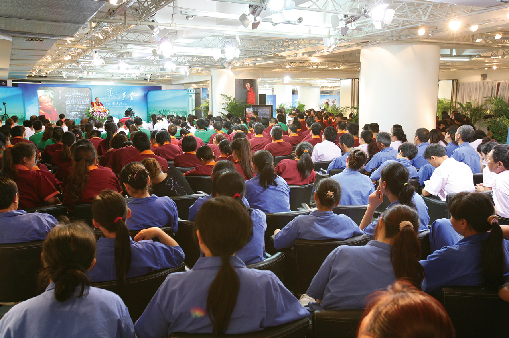

## 善文化的力量，超乎你想象

希望在场的领导们，都能把“善文化”逐渐融入自己的企业，使之成为企业的灵魂。如果在一个企业内部，善的文化香飘四溢，负面情绪就会慢慢散去，整个氛围将会变得融洽和谐。

可惜现在有些企业正好相反，领导天天呵斥员工，员工当面不敢说什么，背后却不停抱怨、诋毁，这使得整个氛围变得乌烟瘴气，形成一种恶性循环。

大家能在一起共事，佛教认为这是一种缘分，彼此应该珍惜。作为成功的企业家，应对自己的员工负起责任，不能在员工价值高的时候利用，价值低了就随意裁掉，这是不讲良心的表现。作为员工，应与企业同甘共苦，不能在企业效益好的时候紧密相随，效益差了便弃之而去。

大家都知道，马云的事业非常成功。他手下有一批人十几年来一直追随他，即使别的公司高薪聘请，他们也不为所动。为什么呢？因为马云与他们彼此信任、相互关爱，之间形成了一种吸引力。在佛教看来，这种吸引力源自相互的善待。

其实，任何一家企业，都承载了所有员工的目标与理想。不能认为企业的最终目标，只是通过资本运作获取利润。虽然获利很重要，因为员工要生活、要养家糊口，肯定需要钱。但除了物质之外，他们还有精神层面的需求，而这必须通过学习和实践“善文化”才能实现。很多时候，这比金钱更重要。

我以前去过一些企业，这些企业不仅与所有员工分享利润，还经常举办一些有意义的活动，启迪人心、导人向善。通过学习有价值的理念，很多员工的人生观都得以转变。

在座各位如果也能在自己的企业当中，定期或不定期地组织员工学习一些真善美的道理，相信很多事情都能顺利成办。

## 善恶是一种力，也遵守能量守恒定律

宇宙就像一面巨大的回音壁，你付出的所有善，经过它的反射扩散，会不断地传递回来，一丝一毫不会空耗，慢慢地，终将成就自身的所愿。反之，如果你四处发散恶意，也许暂时看不到恶果，但它们终将返回原点，毁掉你一切的美好。

有一个真实的故事，一名男孩刚满14岁的时候，父亲就因病去世了，他为了赡养母亲、抚育弟妹，毅然开始了学徒和打工的生活。十七岁那年，他到一家五金厂应聘销售员职位。面试的时候由于紧张，他对公司经理提的很多问题，都回答不出。从对方的表情中，他感知到这次自己没有希望了。

当他起身离开的时候，手被旁边椅子上露出的一个钉子刺破了。他马上用一块镇纸石把钉子敲进去，然后用手摸了一下，确认钉子不会再刺到人之后，才捂着自己受伤的手离开。当时，这名少年原本可以直接离开，不管这件事，可是他担心钉子会伤到其他人，所以才有了刚才的一幕。

他离开后不久，公司负责人就让他回去，并告诉他被录用了。他高兴地问及原因，负责人答道：“爱心是人生的通行证，你以后一定会成为一名出色的销售员。”

此后，他便把自己的爱心融入工作中，融入与同事的交往中。他把爱视作生命的主题，通过不断努力，最后成为这家公司的销售大王。有了一定资源之后，他创立了自己的公司，经过多年苦心经营，他的公司现已发展成世界屈指可数的跨国集团。

他经常在员工大会上强调：爱是工作和生活的力量源泉，有了爱心，什么事都可以做到，可以理解别人，可以对社会、集团、家庭贡献自己的一分光和热……

这个人是谁呢？他就是李嘉诚。

李嘉诚的事业始于一个很低的职位，当时自身学历也不高，但他没有像有些人那样自艾自怨，而是依靠自己内在的品格和不懈的努力，一步一步取得了如今的成绩。

我认为，一个人的品格比学历更重要。我去很多学校交流的时候，一般都会强调先做人，再做事。如果连人都做不好，做事是无法成功的。很多高校毕业生虽然学识不错，但由于自私自利、恃才傲物，或者脾气暴躁等原因，待人处世非常差，进入社会后四处碰壁。现今这种现象比比皆是。

不管是什么学历的人，不管是佛教徒还是非佛教徒，都不能缺少善良的品格。如果常怀一颗善心，所见、所闻、所感的一切，都将善妙美好；如果内心被恶念占据，自己的整个世界都会暗淡无光。佛经对“心善一切善，心恶一切恶”的道理，做了很深入的分析。

## 用佛法的镜子，照照自心

在座很多人可能觉得自己挺善良，因为从没做过大的坏事。不过，这只是一种自我感觉，因为到底什么是善，什么是恶，该以什么标准界定善和恶，大部分人都没有认真思考过。

对于善和恶，佛教从不同层次给出了完美的解析。作为普通在家人，至少也要断除十不善业，行持十善法。十种善法是做人的基本标准，如果能行持，就说明你很善良。大家可以对照、衡量一下自己。

十善业可以从身善、语善和心善三个方面分析。

## 三种身善法，还你一身清净

身体方面有三种善法：不杀生、不偷盗、不邪淫。

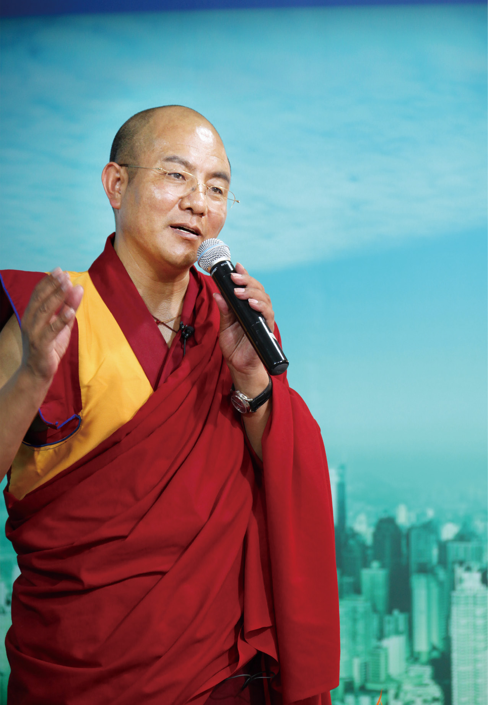

### 一、不杀生

所谓不杀生，狭义讲是指不杀人，这一点大多数人都能做到；广义讲，包括蚊虫等动物在内的所有生命，都不能杀害，这方面很多人都没有做到。佛教强调的是，不能杀害任何一个众生。

有些自诩善良的人，见到苍蝇蚊子就“啪”地一下打死。这样对弱小生命随意杀害的行为，能算善的行为吗？

可能有人想，这些蚊虫的生命很低贱，杀它们没有什么吧？其实不应这么想。美国南北战争之前，黑人被视为物品而不是人，任由主人肆意打杀。当时人类处于非常不文明、不平等的时期，才会做出如此残忍的事情。反观现在，很多人对待动物不也是这样吗？

动物与人类从生命的角度讲，是平等的。很多人因为没有受过这方面的教育，从未认真思考过这个问题。如果深入观察就会知道，蚂蚁、蚊虫、牛羊等一切众生，和人一样害怕死亡，只是不会说人话而已。

尤其是，现在堕胎现象特别严重，很多人抱着只要不受法律惩罚就没事的态度，断然剥夺了一个孩子的生命，这其实是非常残忍的。

如果残害众生的生命，确实会遭受报应。虽然不一定马上受报，但在未来的生生世世中，彼此会互相残杀，冤冤相报，循环不息。

希望大家以后能尽量断除杀生，否则，很难称得上是善人。

### 二、不偷盗

一般人理解的偷盗，局限于小贼偷东西或强盗抢劫财物等行为。这里所说的偷盗范围比较广，凡是采用不正当手段，把本不属于自己的财物据为己有的行为，都算是偷盗。

比如，从个人方面讲，通过开假发票等不正当手段，侵占他人、集体或单位的大小财物；从企业角度讲，通过走私、逃税、行贿受贿等非法手段牟取利润，这些都属于偷盗。

如果一个人恪守原则、心地善良，尽管做企业养这么多员工压力很大，但仍会通过正当途径做生意。大家想一想，为什么我们现在吃的食物、喝的饮料甚至治病的药品，频频出现问题？就是因为很多企业主没有控制好自己的心，见利忘义。原本可以生产出很好的产品，但为了谋求更多的利润，就在各方面做手脚，这是对人类极不负责任的一种行为。有些企业家也讲：速度和质量成反比，利润和良心成反比。

如果他们从小就接受了善的教育，肯定不会做这样损人利己的事，我们也会生活得很安心，不会像现在一样吃什么都忐忑不安、担心里面有这样那样的毒……

总之，作为企业的领导和高管，以正当的手段谋求财富非常重要，自己的良心上一定要过得去。

### 三、不邪淫

在家人需要组建合法的家庭。但有些在家人，尤其一些有钱、有地位、有颜值的人，经常会做一些不利于家庭和睦的行为。这不但容易导致家庭破裂，也严重染污了社会的风气。

中国传统的夫妻相处之道，讲求真诚相待、相濡以沫，即使关系不好，也鲜有互相报复、彼此欺骗的现象。改革开放以后，由于受到西方不良风气的影响，现今，一个人出轨不但觉得正常，甚至视作一种光荣。

如果长此以往，中国也会像西方国家一样离婚率居高不下。一个家庭如果支离破碎，不仅大人会痛苦，孩子也会深受其害。单亲家庭的孩子很容易出现焦虑、自卑等心理问题，如果没能走出心理阴影，一生都会活在痛苦之中。

断绝了上述行为，佛教称之为不邪淫。这对于家庭生活非常重要。

以上所说的不杀生、不偷盗、不邪淫，是身体方面三个善的标准，佛教对此研究得非常透彻。

一个人如果断除了杀、盗、淫，不但身体清净无染，还会感得善妙的果报。不杀生，会感得健康长寿的果报，人们也会因为你的慈悲而愿意接近你；不偷盗，会感得受用圆满的果报，单位也会因为你的廉洁而重用你；不邪淫，会感得家庭和睦的果报，家人会因为你的忠诚而不离不弃。

企业在选拔员工的时候，如果一个人身体具足了这三个条件，就值得信赖。

## 四种语善法，让你语出不凡

语言方面有四种善法：不妄语、不两舌、不粗语、不绮语。

### 一、不妄语

现代社会人们说妄语的情况比较严重。作为企业管理者，这方面可能经常触犯。比如，某产品的成本原本只有十几元，自己却告诉别人几十元甚至上百元；做广告的时候经常凭空捏造、夸大其词。人与人之间也常常如此，把没有的东西说成有，不好的东西说成好……有些人已经习以为常了，把说妄语当作自己的特长，自诩为口才好的表现。

虽然为了经营企业，有时很难避免，但也应该尽量注意，因为说妄语的过失非常大。你说一次妄语，一旦被对方识破，对方就会“一朝被蛇咬，十年怕井绳”。以后听到你话的第一反应就是：“会不会又骗我啊？”即使以后你再诚心以待，对方也会心存芥蒂，怀疑你的动机。

希望大家，无论经营管理企业，还是在任何群体中生活，一定要注意不说妄语，尽量做到有一说一、有二说二。

世界各地很多企业都对说妄语非常忌讳，有什么问题一定要摆在明面说清楚。尽管这样交流容易出现分歧，但不会失信于人，相较于满嘴花言巧语、当面一套背后一套要好得多。被人骗的感觉很不好，每个人应该都深有体会。

### 二、不两舌

两舌意指挑拨离间。有些人当面离间，即当着双方的面说挑拨关系的话；有些当面不敢说，背后搬弄是非，“我那天听到，某某人要把你开除，他说你……”

人与人之间应该和睦相处，挑拨离间会破坏内部的团结。很多单位都有人因此被开除，由于管不住自己的嘴，最后不得不承受苦果。大家一定要断除两舌，该说的时候如理如实地说，没有必要在背后说是道非。

### 三、不粗语

意即不说脏话、难听的话。有些企业很讲文明，上上下下所有员工都注重文明用语，也没有给人取外号的现象。但有些企业并非如此，一些大小领导不但整天骂人，还喜欢用“小眼睛”“大鼻子”“大个子”“小个子”之类的绰号称呼别人，这种管理方式非但不善巧，还容易造成恶劣的后果。

管理企业的过程中，该批评的当然要批评，但一定要杜绝骂人的行为。既做到言之有理，又不失去语言文明，这才是高水平的管理。

### 四、不绮语

有些人整天喋喋不休，但讲的都是一些无稽之谈或闲言碎语。这种行为也需要断除。

如果企业的所有人，都能行持语言方面的四种善法，对企业的团结和合、健康发展会起到很大的作用。

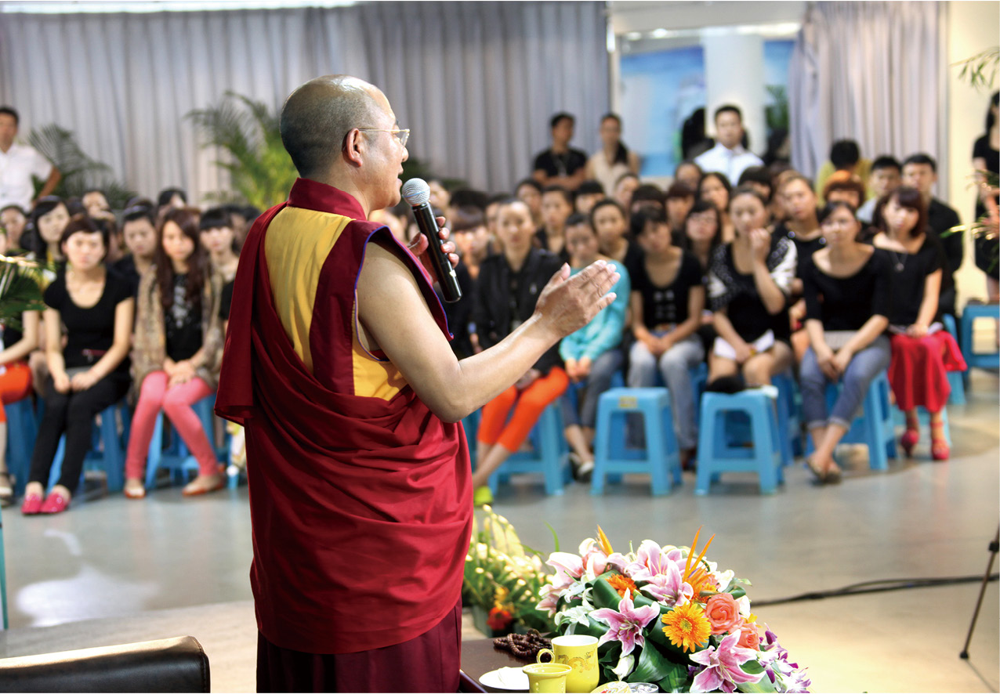

## 三种意善法，令你心正气和

最后是心方面的三种善法：不贪、不嗔、不邪见。

### 一、不贪

贪财、贪人、贪地位、贪名声等等，都属于贪心的范畴。

要想完全断掉贪心非常困难，但应尽量控制，不能任由其膨胀。因为欲壑难填，自己月薪五千时，想得到一万；有了一万之后，又想得到两万……如果没有满足感，即使年薪达到一百万，还是觉得不够。

无止境的贪欲，最终会把自己引入深渊。我们经常看到，有些人为了达成目标而拼命工作，结果不久之后身体就亮了红灯，最终人财两空，以悲剧收场。

何时有满足感，财富便已具足。有了满足感，幸福才不会延期。

### 二、无嗔

有句古训说：“小人气大，君子量大。”小人的脾气特别大，君子的心量很宽广。在座个别人可能脾气也不好，经常爱生气。有时，别人的话稍微不合心意，甚至自己还没听清楚，就马上流露出怒意。平时，与周围的人也经常吵架。

这种心态应该尽量制止，因为嗔心的危害非常大，佛经中讲，产生一刹那嗔恨心，能摧毁自己多生累劫的善根、福报和功德。

### 三、不邪见

什么是邪见呢？本来善有善报、恶有恶报，因果、前后世和六道轮回都真实存在。可是，有些人对这些道理不但一无所知，还妄加否定，这就是邪见。

有些人经常说：“我才不信人有前后世呢。”很多唯物论者都将唯物论视为一种宗教，因为他们觉得“不相信”也是一种信仰。在座有的人可能也认为，自己的“不相信”很了不起，宗教徒的“相信”很愚痴。

事实上，这种想法并不合理，因为相信者有相信它的充分理由和依据。现今，世界各领域的学者专家，通过科学实验、理论推导等各种方式，已经验证了佛教的道理。而不信者所谓的“不相信”，只是自己不了解、未研究而已，有什么真实的理由和依据呢？如果有理由而不相信，请把理由摆出来；如果无理由而不相信，那叫做“迷不信”。

以前后世为例，我接触过很多生命科学领域的专家，他们经过多年研究已经确信，科学能证实人有前世后世。面对这一事实，如果自己既拿不出可靠证据反驳，又不肯相信，坚持认为佛教的观点不合理，这就是邪见。

现在很多年轻人持一堆邪见，单以自己的感觉来评判某事。实际上，没有任何理由就轻易否定，是一种愚痴的表现。就像一个人从没听过某公司，就说这家公司不存在；从没了解过某种科技，就断定这项科技不能实现。

在藏地一些偏远牧区，牧民们整天与牦牛为伴，从不与外界接触。对他们而言，世间的高科技产品、城市的企业集团等都是天方夜谭。即使有人告诉他们，有些人也不肯相信。这种不相信是正确的知见吗？稍有见识的人都知道，这只是孤陋寡闻、故步自封而已。

其实，对于佛教的前后世、业因果等道理，我也不是马上就相信的，而是经过长达几十年的潜心研究以后，才确信无疑。对于古今有些思想家、理论家不信前后世的说法，我都专门研究过，到目前为止，他们都未举出任何例证或可靠的依据来证明。

无论何种身份的人，要想否定前后世，必须有充分的依据才合理。如果没有任何依据，就断然否定人有前世后世，这对于具有高等智慧的人类来讲，是非常可悲的。

也许有人问：你说前后世存在，有没有实例证明呢？当然有，无论在物理学、生命学等科学领域，还是在佛教内部，或者在生活之中，这样的例证多不胜数。在我翻译或撰写的书籍当中，列举了很多。今天短短的时间当中，没办法细讲。

尽管前后世存在的道理，以现代科学完全可以印证，但可惜的是，很多人依然不肯承认。人生不过百年，七八十岁的时候已经糊里糊涂了。如果到了垂暮之年，对自己的后世仍然一无所知，那未来还有希望吗？希望大家一定要知道，人不仅只有今世，还有无数个后世。

作为万物之灵的人类，眼光应长远一点，不能鼠目寸光；学识要丰富一点，不能寡闻少见；视角要高一点，不能坐井观天。这样，才不会做出很多愚痴、恶劣、对自他有害的事。

## 邪命养活，会使生命贬值

希望大家都能尽量地、尽快地把自己的下半生转到有意义的善法方面，在有生之年，树立起正确的事业观和人生观。

当然，在座各位都需要养家糊口，想要像出家人一样，杜绝一切恶事，一心念佛、行善也不现实。但做一个善良的在家人应该不是很困难。古人说“君子爱财，取之有道”，通过自己的劳动和智慧，得到相应的回报，受用凭良心得到的财富才会心安。

我觉得，一个人在世上生存，最好精通一种学问；如果不具学问，可以依靠一种技术；如果没有技术，就做体力劳动。如果正常途径都不依靠，而是通过邪命来养活，确实没有什么意义。

也许有人想：我又不是佛教徒，没有这种信仰。

信不信佛当然是自由的，我只是敲一个警钟，希望大家用智慧观察一下佛所说的道理。人类自身潜藏着很多奥秘，我们因被无明遮障，只能看到事物简单、浅显的一面，所见所感不一定是真实的。

希望在座各位能明白，事业成功与否，不能仅用金钱来衡量。虽然有些人认为，财富与事业成正比，但我认为，一个人最重要的是慈悲、智慧等精神财富，因为，人一旦缺失了内在的精神财富，生命层次就会变得很低，当灵魂下行之后，迎接自己的将是无尽的痛苦。

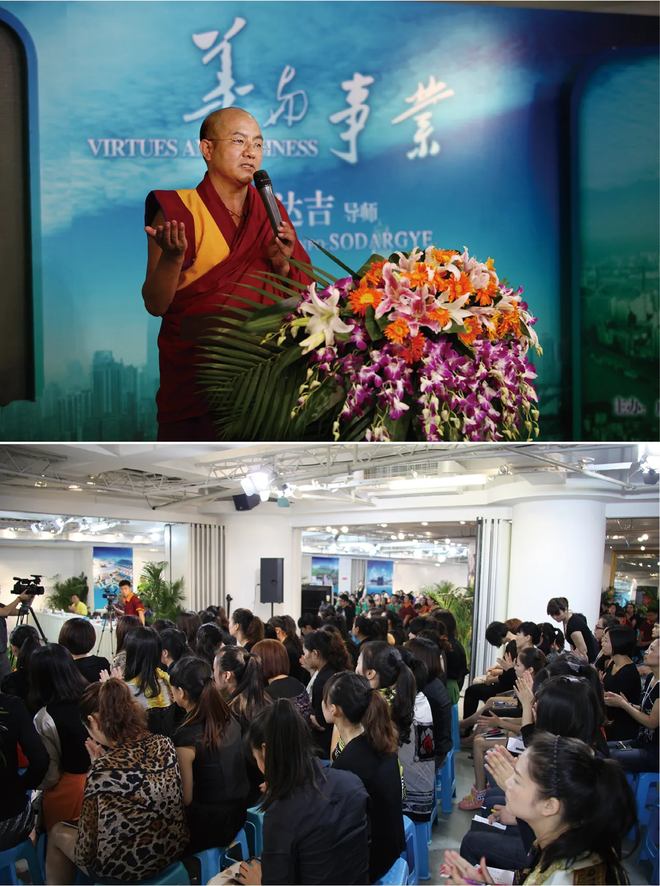

## 永不失去的财富，才值得全力追求

外在的财富再多、地位再高、眷属再亲，都只是暂时的。有些在自己仍健在的时候，就会离开自己，即使没有离开，自己离开世间的时候，也带不走一丝一毫。

二十世纪八九十年代，萨达姆执政时期受到很多人拥戴，然而最后，当他被美国判处死刑的时候，以前支持他的很多人却乐见其成。去年，苹果公司的老总乔布斯病逝，享年56岁。虽然他的科技发明、财富名声等各方面都卓越不凡，但最后，所有的一切也只能留在人间。

可见，金钱、地位、眷属等，都生不带来、死不带去。当我们离开世间的那一刻，这些都变得无足轻重。

有些人觉得：我正值青春年华，死亡离自己还很远呢，现在好好享受最重要，不必想那么远吧。

实际上，在人生的旅途中，我们自认为不可能的事时常发生。死亡也是如此，经常会不期而至，突然降临。任何人都无法确定自己到底能活多久。

当自己离开世间的时候，平时所珍爱的财产、喜欢的人、贪著的名声地位、欣赏的美景等等一切美好，当下都会失去，自己只能两手空空，独自一人前往不曾相信的一个又一个后世。这时能护佑自己的，唯有今生所造的各种善业，它们会跟随自己生生世世，不离不弃。“善有善报，恶有恶报”是佛陀以智慧眼发现的世间真相。

有些人可能疑惑：如果真的善恶有报，为什么有的人乐善好施，却一生不顺；有的人作恶多端，反而诸事圆满呢？如何解释这种善人遭殃、恶人得意的现象？

这其实较容易解释，果报成熟需要一个过程，并不是现在种下善根，马上就会成熟。就像农民春天耕耘，秋天才能收获一样，一个人今生做了善事，有些善果下一世成熟，有些则是多生以后才能成熟，如果对境特别殊胜，也有今生成熟的情况。

因果的道理非常深细，我们不能把它粗浅化、简单化。否则，对善与事业关系的认识，就会比较模糊。

希望通过今天的交流，每个人的内心都会有一些转变。至少从现在开始能认真想一想，人到底有没有前世后世？行持善法真的是一种迷信吗？大家可以反观一下自心，也可以多了解一下世界各地发生的真实案例，或者研究一下佛教的教义，看看佛教是如何帮助众人改变命运的。通过这些方法，就会逐渐明白佛教的道理。

## 快乐之道，在于调心

现在很多人认为，事业成功后有了钱才会快乐。其实这也不一定。我遇到过很多老板，他们都觉得随着事业越做越大，压力和烦恼越来越重，自己离幸福好像反而远了。他们有时会活在恐慌当中，患得患失；有时会活在渴求当中，焦躁不安……这些心态剥夺了他们的幸福感。

如果内心没有一种信仰，长此以往，确实容易产生空虚、焦躁等负面情绪。如果内心有一种信仰支持，就会用挣来的钱做各种善事，这样不仅帮助了很多人，还为自己积累了精神财富。这时，满足感和幸福感自然就会盈满内心，这种快乐用多少金钱都无法替代。

安德鲁·卡耐基在《财富的福音》中说：他小时候生活很苦，是一位善良的退伍军人让他有了读书的机会。后来，卡耐基成为美国慈善事业的开创者，将毕生的大部分财富奉献给社会，帮助了世界上很多处于困境的人。他说：“在巨富中死去，是一种耻辱。”

当然，做慈善不一定非要像卡耐基那样付出很多钱。在没有吝啬心的情况下，对别人表达出一种善意，就属于慈善。刚才有人也说，哪怕用工资的百分之一，甚至更少，都是可以的。李连杰运作的“壹基金”，也不需要参与者付出很多钱，更重要的是让人们树立起慈善理念。

事实上，做慈善不一定非要捐钱。捐钱只是一种表面行为，最根本的是捐钱的动机，即自己的心念。心如果是善，可以用很多方法和形式做善事，比如，用一个微笑、一句爱语、一个善行等等。人们常说“日行一善”，今天自己怀有一颗善心，也叫一种慈善。也可以说，行善最重要的是对善法的理解。这方面的道理，佛教讲得非常清楚。

所以，这种快乐不管是谁，不管有钱没钱，都可以享受，在佛教当中，这种精神无处不在。

## 做一个具足双目的明眼人

今天我们没有交流如何赚钱、怎样管理企业或维护家庭等问题，因为这些方面很多人都是专家，用不着我这个外行人来讲。我今天分享的是多数人从未了解过的内容，即善恶因果、前世后世真实存在。希望能对大家有所启发。

《鸯觉经》里以比喻的方式讲了三种人——盲人、独眼人和具足双目者。有些人连积累财富的概念都没有，更别说行善积德了，他们每天只想吃吃喝喝，日子过得浑浑噩噩，这种人就如同盲人；有些人只喜欢积累财富，而不会积累福德，不愿为社会作贡献，这种人好似独眼人；还有一些人，既会积累财富，又能明辨善恶、善待生命，把财富回馈给社会的各个层面，这种人就如同具足双目的健全人。

希望在座各位都能成为具足双目的人。而要想双目健全，首先要使自己善良起来，然后，应把“善文化”弘扬出去，传递给更多人。

## 感恩，是幸福的起点

怎样使自己善良起来呢？善心来自感恩心。如果心中充满感恩，善念就会自然萌发。因此，培养一颗感恩心非常重要。

怎样培养呢？作为领导，需要感恩所有的下属，因为没有他们的支持与付出，任何企业都无法生存；作为员工，也要感恩领导，没有领导给予机会、栽培教诲，自己不一定能过上现今的生活……

若能对周围的一切都心怀感恩，不仅家庭会和睦、集体会团结，整个社会也会盈满祥和之气；如果内心充满怨恨，不但自己活得很痛苦，也会给身边的人带来烦恼。

非常希望大家，能用佛教的真理认识善与事业之间的关系，将善文化传递出去！

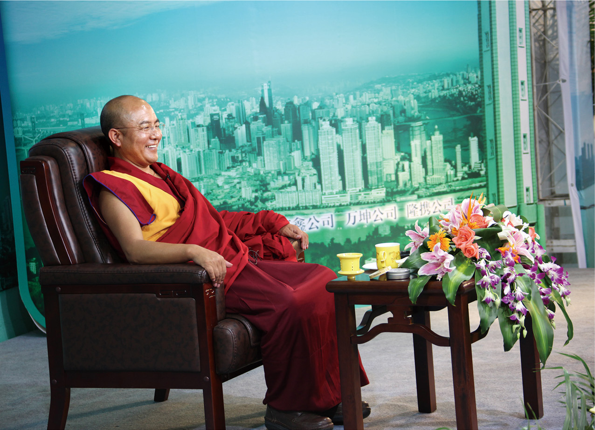

现场互动

问：我来自万坤公司，我虽然在生活和工作中实实在在做人、兢兢业业做事，但却经常遇到各种麻烦，老是有很多烦心事。请问，这是什么原因造成的？

堪布：其实不仅是你，很多认认真真、勤勤恳恳做事的老实人，在生活或工作中都会遇到各种不顺心的事。

虽然在座有些人同属一家公司，穿着同样的工作服，待遇也基本差不多，但由于每个人前世所造的善恶业不同，所以，在相貌、生活状况、心理状况等各方面会有很大差异。比如，一个家庭的两兄弟，虽然二人的父母都一样，但很多方面却截然不同：一个高大魁梧，一个身材瘦小；一个性格开朗，一个性情内向；一个事业成功，一个一事无成。这背后与业因果有着密切的关系。

每个人今生遇到的事，与自己的前世有关；后世遇到的事，与今世有关；上半生的为人处事，会影响到下半生。世界上很多智者都认为，佛教的因果观是人类最好的道德规范和准则。

所以，当面对各种不如意的时候，在不抱怨、随缘的同时，一定要继续努力。只要凭良心诚实地做事，最终一定会成熟快乐的善果。

问：我来自隆携公司，想请教师父一个问题。我们都知道，事业如果向好发展，能为行善提供更多助缘，反之，行善也能为事业发展提供更多助力。请问，如果事业发展好了，是否一定要做善事？或者说，是不是不做善事，事业就不能成就呢？

堪布：事业与行善的确有一定关系。做善事，会对事业的稳定、发展有直接或间接的帮助；做恶事，则会对事业造成很多负面影响。

有的人因为前世做过善事，果报在今世成熟，所以他今生的事业发展顺利，如日方升。但如果他今生造作了很多恶业，暂时可能看不出影响，貌似未来可期，但实际已经前途暗淡，好景不长了。就像一个人吃了毒药，毒性未发作时，感觉好像没什么，但当毒性扩散至全身之后，就无药可救了。

现今，很多官员通过贪污受贿发了财，没被发现之前，他们过得逍遥自在，可一旦罪行暴露，就会瞬间沦为阶下囚。如果罪行在今生没有暴露，恶果将在来世加倍奉还。

希望大家都能成为有智慧、有良心的人，以善为基准来运营企业，这才会对自他真正有利。

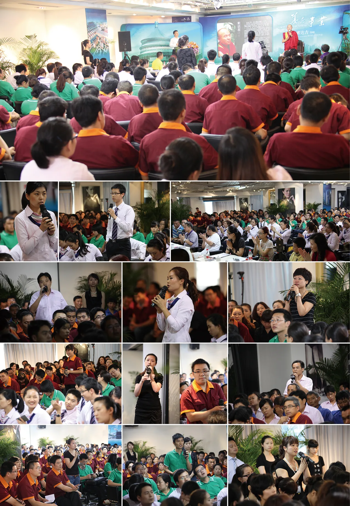

当然，事业发展的因缘非常复杂，甚深的因果，唯有佛陀才能完全了知。我不敢保证每个人现在做善事，事业马上就能蒸蒸日上。但我觉得，一个人如果能对企业、对人类、对所有生命负责，做一个心地善良的人，就做好了今生最重要的事业。

问：我来自庄虹公司。在现实社会中，我们经常会面对很多诱惑，请问如何在面对诱惑的同时，保持与生俱来的善良本性？

堪布：这位先生问得很好。在当今社会，尤其城市当中，蛊惑人心的诱惑多不胜数，而启发善心的因缘却少之又少。这导致很多人内心浮躁、烦恼深重。尤其很多年轻人，他们表面看光鲜亮丽，实则内心非常脆弱，充满了焦虑和迷茫。

一个人如果没有正确的信仰，缺乏良好的素养，哪怕一件很小的事，也会对他造成很大打击。现在很多城市人都得了这种“脆弱病”。藏地虽然没有大城市先进的硬件设施，生活条件比较艰苦，但人们的心理承受能力却很强。为什么呢？因为藏民都有信仰，这种信仰，让他们保持了内心的平和与喜乐。

很多城市人，虽然开着豪车、住着豪宅，物质生活水平比较高，然而，精神世界却非常贫瘠。这使得他们把一切都寄托在感情、事业、地位等外在的事物上，一旦这些方面受挫，内心就会马上崩塌，做出一些不理智行为，甚至把自己逼上绝路。

我尤其担心年轻人，他们随着年龄的增长，都要面临复杂的家庭关系、激烈的职场竞争等各种压力。到那时，烦恼和痛苦只有自己知道，正如古人云：“如人饮水，冷暖自知。”现在的年轻人都是独生子，几乎肩负着整个家庭的压力，如果内心没有信仰力量的支撑，到时可能很难应对。

所以，充实自己的精神世界，寻找一种真正的信仰，是非常有必要的。佛教的慈悲理念，正是让内心坚强、快乐的一剂妙药。

很希望在座的企业管理者们，能经常为员工提供“过滤心灵”“提升心灵”的机会。我见过有些企业会定期举办禅修、念经等活动。这可以使人的内心安静下来，不会整天被眼花缭乱的外界所转。老子说“五色令人目盲”，老子时代的“五色”还不算繁乱，现如今，如果我们整天玩手机、看电脑，真的会变成“盲人”。

作为人类，除了领受外界的浮华以外，还可以品味内心的清宁，我们为何不享受一下这种清欢呢？大家可以在半小时内关闭手机，静下心来慢慢思维，渐渐地，就能看清真实的自己。这时便会发现：自己的欲望和痛苦是多么虚幻不实，生命如此短暂，为这些浪费生命又是多么不值，应该为生命减负，珍惜当下……

在面对社会的各种诱惑时，依靠佛教的这种禅修方法，就可以保持内心的纯然本性。坚持内观一段时间之后，生活就会慢慢有起色，内心也会快乐自在。

此外，采用念经的方法也很好。云南有一家企业，组织员工每天一起念诵《心经》。在朗朗的诵经声中，员工心中的各种杂念、痛苦都会渐渐平息。这就是他们每天享受的一种企业文化。

问：我的问题基于两个背景：一是自古以来，中华民族就有“心诚则灵”的说法；二是现如今，听说中国的四大佛山都在争取上市。我对此比较困惑，寺院本是清净之地，能净化人的心灵，成为心灵的依托，由此吸引了很多善男信女前去朝拜。然而如今，这些佛山却借此争取更多的物质利益。请问，面对这种矛盾现象，去佛山和寺庙朝拜还有意义吗？

堪布：城市里的人每天习惯性地上班、工作、下班，有时身心会非常疲累。在周末或空闲时，到清净的寺院去看一看，调节一下心态还是很有必要的。如果条件允许，可以到藏地看看蓝天、白云。我听很多年轻人说，他们一到藏地这样美丽、宁静、悠然的环境中，积于内心的各种痛苦就自然而然消失了。

现今，以四大佛教名山为主的很多寺院都在搞开发。作为一名佛教徒，我的观点是，佛教寺院最好不要与旅游开发等商业活动混为一谈。

寺院本是学修和弘扬佛法的场所。依靠佛教慈悲和智慧的教育，人们可以实现以幸福为主的理想。我们喇荣五明佛学院，每天都有成百上千人前来朝拜，学院的高僧大德们多多少少都会为他们讲一些佛教的真理，这使很多人茫然而来，释然而归。大家哪怕一周只听一堂佛法课，也会对生命有更深刻的认识，对人生有更合理的定位。

现在汉地有些寺院与旅游局、地产开发商等单位合作。很多时候，寺院住持也无可奈何，因为里面的关系比较复杂，并非他们所能左右。但把寺院打造成旅游开发区确实不合理，因为旅游景点只是供人休闲、拍照、游玩的地方，而寺院应是讲经传法，让善男信女真正了解佛教真理的净地。

人在世间生活，虽然物质财富不可或缺，尤其在大城市，没有钱寸步难行，但更需要一种精神食粮。这种精神食粮，在寺院或隐居山林的修行人那里才能得到。历史上，很多汉地寺院都有讲经说法的活动，引导信众断恶修善、提升智慧。非常希望汉地寺院能继承这一传统，这对众生会有极大的利益。

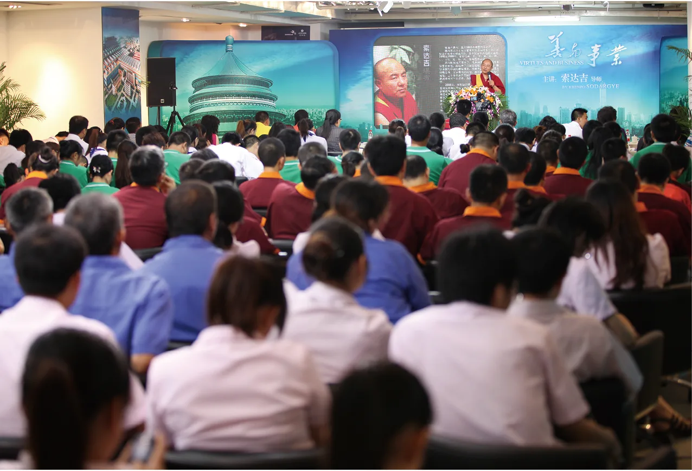

问：我是从事销售工作的，对于佛法的很多理念，我虽然在道理上比较明白，但在工作和生活中受到情绪等因素的影响之后，很容易心情浮躁、茫然无措，有时连最根本的信念也会动摇。请师父开示，我用怎样的方式，才能真正理解佛法的意义？如何清理思绪，转换心境，积极地面对工作和生活？

堪布：一个人不管从事什么工作，都会经历一些痛苦和磨难，这是很正常的。希望在座的年轻人不要把人生想得太美好，否则，很容易因达不到预期而心生烦恼。应该知道，苦才是人生的底色。如果认清了这一点，以后无论遇到怎样的挫折，都可以坚强地面对。

一个人要想做好工作，根本之处是要有团队精神。任何企业都很看重这一点。做事的时候，不能认为公司属于别人，发不发展与己无关，自己只是一个打工的，这种想法会极大地消减工作积极性。虽然完全视公司为自己的家，对很多人来讲有一定困难，但应尽量把公司比作自己的家，把公司所有人想成自己的家人。如果有这样一种大我的精神，抱怨和痛苦就很容易减轻。

现今，国内外非常成功的企业，都拥有一支强大的团队。之所以强大，是因为团队内部具有很强的凝聚力和向心力。

今天到场的公司都有各自的标志、规范和服装。这说明每家公司都是一个集体，是一家人，这并非口头上说说而已。今天主持人多次说：四个公司是一家。但我想，公司与公司之间存在同行竞争、纠纷等情况可能很难避免，但一个公司上上下下的人员确实应该亲如一家，每个人应凭良心负起各自的责任。

很多人对团队精神认识得比较肤浅，一心只为自己活，只看重眼前的薪资待遇。在这种心态下，无论工作还是为人处世等，肯定做不好。

俞敏洪说过一句话：“教育的中心思想就是三个要素：爱自己、爱别人、爱自然。”我觉得这句话也可以这样解释：一个人要爱自己，先要爱自己的集体；要爱集体，就要爱集体所在的自然环境。如果进一步，用爱心拥抱整个世界，一切矛盾都会冰消瓦解，这样一来，因微不足道的事而抱怨的情绪，自然也会消于无形。

很多人都对工资待遇不满，其实这种不满大多是比较而产生的。比如，一个人本来没觉得三千月薪少，但当知道同事每月挣四千，比自己多的时候，不满的情绪就滋生了。很多时候，人与人一攀比，就会生出很多抱怨和痛苦。要想缓解这种痛苦，需要内心的自我调节。从某个角度讲，企业对员工的心理培训比技术培训更为重要。

我发现在座很多人都特别有礼貌，中国传统文化讲究礼节，这一点你们做得非常好。现在很多人都忽略了礼节，其实礼节非常重要，它可以反映出一个人的内心。如果不讲礼节，说明恭敬心和尊重心不够。

在一个企业当中，如果推行这种传统文化，彼此尊重、互相关爱，逐渐就会形成一股强大的凝聚力。这样每个人的内心也会变得慈爱、包容。

问：我和我的很多朋友都信仰佛教，很希望把佛教真善美的理念，在自己身边传扬开来。请问，如何才能做到在一个不学佛的圈子里，既能保持佛弟子的本真，又能随顺团队的主流观念？

堪布：好的环境对一个人非常重要。有时我在城市里住了一段时间之后，就会感觉自己善心的温度好像有所下降，这时，我会尽快跑回山里。山里有寂静的环境、志同道合的道友，这些对修行有很大帮助。

人在尚未到达很高境界时，很容易受到环境的影响，正所谓“近朱者赤，近墨者黑”。当然，你们生活工作的环境里，可能大多数人都没有信仰，你们也无法脱离这个社会，但在红尘中一定要保持自己纯真、清净的心。若能一直坚定自己的信仰，就是世间最勇猛者。

《二规教言论》中说：“虽此大地满恶人，然自当持高尚行。”意思是，虽然现在品行恶劣的人处处皆是，但自己也要如莲花般出淤泥而不染，秉持佛法和世法的高尚行为。

现在大部分信佛的人，只是到寺院烧香拜佛、祈福求安。事实上，佛教真正的慈悲理念，是要唤醒我们的慈悲心，并把慈悲融入点点滴滴的行为中，进而帮助所有的生命离苦得乐。虽然这样的境界很多人暂时达不到，但至少应该承认，佛教的慈悲理念，是人类、动物，乃至所有生命恒时需要的，永远不会被时代所淘汰。

佛教距今已有2500多年，在漫长的人类历史长河中，涌现过无数杰出的科学家、哲学家和思想家，他们提出了各种各样的理论，但没有一种能够撼动佛教。

如果我们真正懂得了佛教的慈悲与智慧，对自己的人生有百益而无一害。相较于世人珍视的感情、名声或财物，佛教的精神更具有价值和意义，因为它会陪伴我们生生世世。

总之，在任何环境中，首先要善于保护自己这颗珍贵的善心，与此同时，要力所能及地帮助身边的人。他们被你的善心触动之后，慢慢就会接受佛教的理念。

问：当今社会，有太多奸商赚得金盆钵满；有太多贪官飞黄腾达，但他们靠的并不是善，这与我们今天的主题好像不很相符。请问如何理解这种现象？

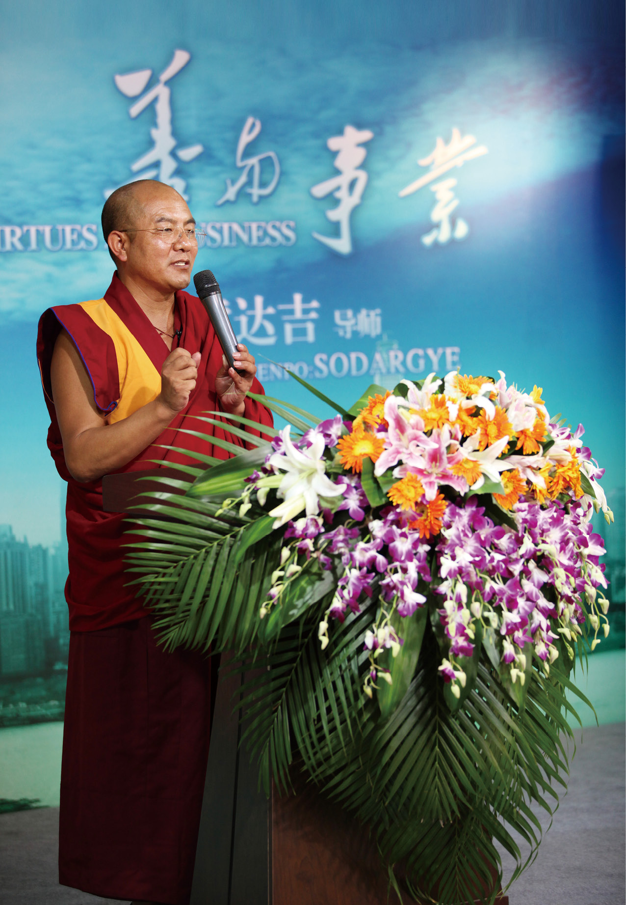

堪布：我今天上一堂课所讲的内容，基本上间接回答了你的问题。

对于很多商界或政界的成功人士，尽管我们看不出他们今生做过什么善事，但也没有理由断定他们前世一定没做过善事。《佛说业报差别经》中云：“若有众生，值善知识，多修施业，遇良福田，以是因缘，巨富饶财……”经中还讲了很多获得财富的修福方法。

在座各位如果没有福报，不可能进入现在的公司。同样，世间任何一个有权、有势、有智慧、有才华的人，都有其各自的因缘，世间没有无缘无故的事，因果是绝对不虚的。

为什么有些人今生又会做一些不好的事呢？这是由他们今生当中不善的念头引发的。

很希望大家以后能了解一下佛教的因果观。所谓因果观，若深讲，的确深奥难测；若浅说，也浅显易懂，像《百业经》《贤愚经》里的故事，看了很容易明白。如果不把这些故事当成神话，而是从正面理解，并依此调整自己的心行，命运就会得以转变。这时，无法理解的事，都能理解了；所有的疑惑，都会迎刃而解。

在懂因果的人眼里，很多事都不足为奇，但若不懂因果，就会觉得难以理解，心中打出无数个问号。如果一直得不到答案，就会陷入迷茫和困惑当中。

人类需要承认因果规则，否则，很多事情都解释不清。我们可以想一想，在自己的亲朋好友当中，有些人智慧不错，也非常努力，但怎样也无法得到预期的回报，而有些智慧一般的人，却轻而易举就获得了自己想要的一切。如果不知三世因果，仅从今世观察，根本解释不清这些现象。

大家有空可以到寺院请几本佛书。刚看的时候，心里可能会有很多疑问，这时，可以找一些佛教大德或者研究佛学的知识分子交流一下，也可以采用藏传佛教辩论的方法，廓清心中的迷雾。

我在个别大学讲过：如果有人对佛教产生了怀疑，我建议他找一位翻译，然后去藏地佛学院与出家人辩论。这样他心中“因果不合理”等诸多疑团，很快就可以解开。

今天时间较短，我不可能解除大家心中所有的疑惑。就像很难让一个没学过物理的人，马上理解相对论一样。但只要大家有兴趣学习佛法，在认知的过程中，智慧一定会日臻成熟的。

问：今天来此之前，我的心情非常沉重，因为在昨天，我生命中一位很重要的朋友离开了。她与我同龄，也是28岁，有一个两岁的小孩。今年四月份，她感觉身体有些不适，检查之后竟然得了很严重的病。亲人怕她伤心一直隐瞒着，她直到去世的前两天才知道自己真实的状况。

我之前也不知道，昨天突然听到噩耗时，我整个人都崩溃了，因为从小到大，自己从来没有经历过这样可怕的事。从昨天到现在，我的眼泪一直止不住，最让我不能释怀的是，年轻的她离开得太仓促了。

不过，刚才听了上师的讲座，尤其听到您讲前世今生的时候，我忽然有点释怀了。我现在真心觉得，人的一生的确会遇到很多不可预知、无可奈何的事情，这时尤其需要用信仰的力量支撑自己。

我的家人都是佛教徒，我本人虽然也信佛，但对佛教的道理理解得非常浅。经过这件事，我觉得人生真的很无常，生命转瞬即逝，如果没有信仰，自己很难应对这种无常变化。

我想请教上师，作为一名年轻人，如果想要接触佛教、学习佛教的思想，应该怎样做起？

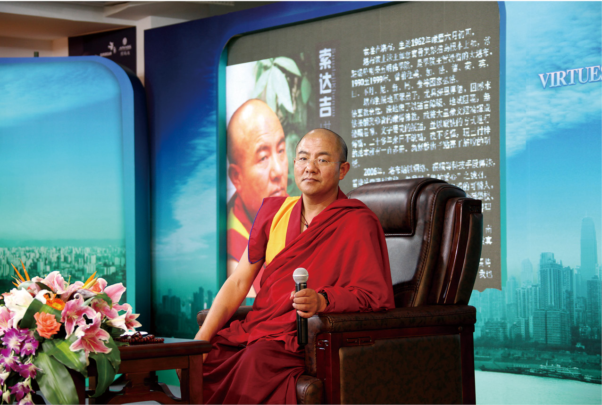

堪布：你说的事情的确让人心情沉重。每个人听了之后，心里应该都会有一些感触。

其实，生病、死亡等痛苦，在每个人的身上都会发生。谁都不想生病，但疾病却经常不期而至；谁也不愿死亡，但每个人终有一天会离开世间，有些人也许还能活几十年，有些可能在一两年内就会离开。

你朋友这件事尽管很突然，但以佛教的观点看，也是正常的，因为一个人再年轻，生活再美满，也不能摆脱命运的无常。而当离开的时候，自己所爱的人、所积累的财产等一切美好，都不得不放弃。

这些苦大家应该都不陌生，因为平时通过网络、电视、电影等媒体，或者身边人的遭遇，都见到过。然而，大家是否认真思维过，一旦这些痛苦发生在自己的身上，自己究竟该怎样面对？希望在座每一位都能认真思考一下这个问题，因为这些苦每个人都必定要经历，它们与自己息息相关。

特别希望，大家趁着自己现在身体还健康、生活尚平稳的时候，对佛教的死亡无常、生老病死苦等道理有所认识。佛陀早已把这些讲得清清楚楚，并且宣讲了对治的方法。

很多佛教徒因为早已认识了这些苦，有了充分的心理准备，所以，面对疾病、死亡的时候淡定自若，就像一名士兵提前反复进行了作战训练，一旦敌人出现，马上就能克敌于无形。很多信佛的老太太，虽然没有多少文化，但死的时候非常安详。

相反，很多著名的科学家、哲学家，如牛顿、哥白尼、亚里士多德、尼采等，虽然具有丰富的世间学问，但因为缺乏这方面的教育，生病、死亡的时候与普通人一样悲惨、痛苦。

希望通过今天的交流，大家能对佛法有一个正面的认识。当然，从我个人而言，的确不敢说修得很好，但从小就对佛法特别感兴趣，一直学习和串习。所以，很喜欢与大家分享。

我在喇荣五明佛学院的时候，每天要给一千多人上课。这次我出来之前，有些法师对我说：“你不应该外出讲课，学院这么多人都听不到课了。”我说：“城市里的很多人内心都非常痛苦，如果让他们懂得佛教的道理，哪怕只有十几个人能认识佛教的真理，也是非常值得的。学院有其他法师可以代课，但外面的人却很难接触到佛法。”

生活在城市里的人，虽然物质生活比较富足，但精神生活却往往欠缺，这导致他们在遭遇家庭、感情、身体、工作等方面的变故时，内心很难承受，有些人最后绝望地选择了自杀。中国每年这么多人自杀，原因就在于没有调整好自己的心。前一段时间我去了几所大学，当时我对学生们讲：希望你们以后不管遭遇什么，都不要选择自杀，因为这是最不负责任的一种行为。

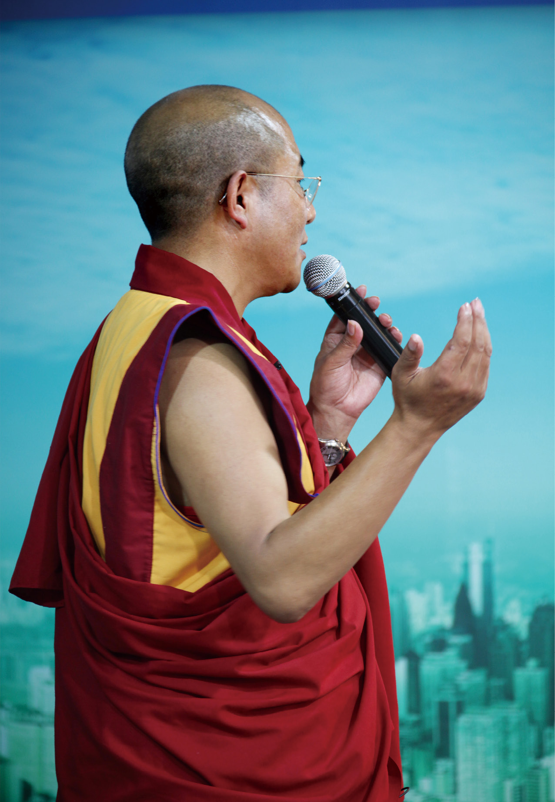

特别希望在座各位，能对佛教无常、轮回痛苦的道理有所了解，这对自己非常重要。

此外，佛教因果方面的道理，也很有必要了解。你的朋友如果生前造的恶业比较多，在未来生命的旅程中，将会接连感受痛苦；如果造的善业比较多，来世就会快乐无忧。当然，你也可以通过念经、放生或做其他善事帮助她，这并不是迷信。

问：今天听了您的讲座很受启发。我觉得，对企业而言，收入来自社会，因而有责任回馈社会。企业除了依法纳税以外，确实应该做得更多。以我们隆携公司来说，我们会经常看望一些孤寡老人，送一些日常用品等，也会帮他们做一些事情。

但对于个人而言，我认为，最大的善行是不给身边人增加负担，自己好好活的同时，把该尽的义务落到实处，比如孝敬父母或者照顾身边的人。您觉得我这种观点正确吗？

堪布：我觉得，对于个人而言，在不给身边人增加负担、尽到义务的同时，最好也能做一些其他善事，利益更多的生命。如果以对家人、亲友负责为由，放弃了做其他善事的机会，不一定很合理。

其实，自己在外面做一些善事，对家庭应该不会有不良的影响。如果没对家庭造成很大压力，又未超出自己的能力范围，完全可以去做。

做慈善的时候，调整好心态非常重要。现在有些人做慈善，认为是自己在施与别人恩惠。事实上，一个人做慈善给的并不多，得到的却很多。比如，去看望孤寡老人或者扶贫的时候，如果想：通过这一活动，自己不但体验到了不同的人生，而且善心也得到了提升，所以非常感恩……这样思维之后，就能断除很多布施的违品。

有些人做善事是有条件的。心里总在盘算：“对方以后会不会报答我呢？这些善行能使我将来得到怎样的好报呢？……”事实上，大乘佛教提倡无条件地奉献，无私奉献才最可贵。

如果做善事附带条件，这样的心态不但平庸，而且容易引生烦恼。比如，你帮老板或同事做事之后，如果心里一直希求得到赞叹或奖励，一旦没被满足，就会心生烦恼。如果发自内心、无条件地帮助他们，就不会在乎是否为人所知，也不会考虑自己的得失，这样不但自己快乐，好运也会不请自来。

此外，把善行贯穿人生的始终，也非常重要。不管做任何善事，不管是企业组织做，还是个人自己做，最好保持一种长期性、习惯性的心态和行为。

以前，李连杰接受记者采访时说：“中国慈善公益尚处于美国上世纪80年代水平。要赶上美国的水平，至少需要30年的时间。”篮球明星姚明说：“在国外做慈善，习惯成自然，就像喝水一样平常……”

现今，很多中国人还没养成做善事的习惯。有些人甚至会在别人做善事的时候指指点点、吹毛求疵：“他是不是精神有问题啊？”“他这么做肯定有什么目的！”……事实上，对于别人的善行，我们不应妄加评论，而要真心随喜。如果机缘合适，自己又有这方面的能力，最好也能参与其中。

我前面讲过，捐钱固然是慈善的一部分，但最关键的是心要善。真正的慈善是指心，如果心善，一切行为自然善妙，这样随时随地都有行善的机会；如果心不善，即使在别人的强迫或推动下捐了一些钱，也只是做表面文章。所以，一个人心善最重要，并非只有富人才能做慈善，没有钱同样可以广行善法。

问：《三字经》中说：“人之初，性本善。”虽然道理上我们都明白，但在面对“财色名食睡”的时候，却往往抵不住诱惑。请问，怎样做才能不偏离主题，不忘回归自心的路？

堪布：刚才有位先生也问“如何面对社会的各种诱惑”，你们俩的问题应该大同小异。

在现今物欲泛滥、多元化的社会中，诱惑的力量非常强，虽然人性最初本善，但后来很容易被环境污染。这个时候，需要经常看一些古圣先贤的书，比如，宣讲佛教和儒教思想的书籍等。孔子云：“朝闻道，夕死可矣。”如果早日明白了世间真理，死也会没有遗憾。

现在很多年轻人都不喜欢学习，其实，不断学习非常重要。年轻人在未来会遇到各种机会，不一定永远待在一个固定的岗位上，现在就应该为此做好准备，持续地为自己充电。

此外，学习也可以提高自己的德行。《周易》中说：“君子以厚德载物。”一个人只有完善了自己的品德，才能在各方面得以全面发展。希望不仅年轻人，包括老年人在内的所有人，都能经常学习一些中国传统文化，或者其他对身心有益的知识，这样自己的德行才不会缺损。

通过这样不断学习，自己的行为、语言和思维会越来越接近真理，接近圣者的智慧。随着身语意的不断完善，人生也会渐渐趋于圆满。

当今时代，很多人都不以德行，而是以金钱来衡量一切，这导致了世风日下、人心不古。身处这样的社会，希望大家一定要守护好自心。最好的守护方法，就是学习圣贤们的教言，然后落实到自己的身体、语言和心念当中。

希望在座各位都能爱上学习，用益于道德修养的知识来庄严自己。企业最好能为大家营造一种共同学习的氛围，这么做非常有意义。

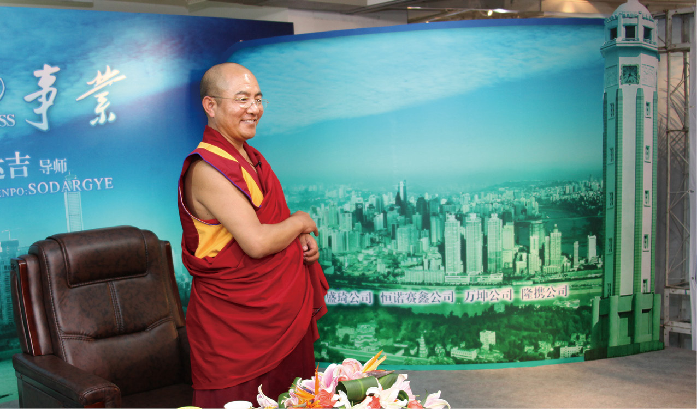

问：我们很多人都是为了生活每天打拼的上班族。您刚才提到的“壹基金”等慈善机构，都是一些成功人士在有了一定经济基础之后才创办的。我想请问，我们先行善好，还是先把工作做好，成功以后再行善比较好？

堪布：在我看来，你们每个人都是成功人士，否则，就不可能有今天的一切。否定自己现在的成功，而寄希望于以后的成功，就错过了现在的美好时光。

“壹基金”有十几位主要成员，很多人我都认识。其中有些人也认为自己并不成功，希望以后成功。可见，人的愿望是无止境的。我想，很多人即使像李连杰一样成为“壹基金”的创始人，可能还会觉得自己有待成功。

刚才讲过，所谓行善，首先要怀有一颗善心，然后在行为上尽量行持善法。所以，不一定捐很多钱、做轰轰烈烈的事才算行善，只要心存善念，即使点滴之处给予别人帮助，也是在行持善法。

做善事不能一拖再拖，否则就错失了很多机会。我觉得，一个人真正的成功，是能抓住机遇行持善法。

此外，我也想提醒大家，行善的对象不应仅仅局限于人类，世间所有的万物生灵，都需要我们用一颗善心去对待。

问：我们通常对事业、金钱、权力和爱情非常执著。因为执著，很多时候明明知道不可为，却仍要坚持做。请问怎样才能让自己不执著呢？

堪布：佛教一直强调“不执著”，但作为在家人，一般很难达到这种境界。尽管你们目前还难以做到不执著，但应该有所节制，不能过于执著。否则，痛苦就会接踵而至。

对金钱过于执著，会做出很多恶劣的事；对感情太过执著，会把自己弄得遍体鳞伤。无论对什么，追求得太过，就会逐渐失去理智而陷入一种痴狂，最终引发很多不良的后果。就像一个追逐彩虹的小孩，无论他怎样拼命奔跑，渴望抓住，最终也一无所得，收获的只有疲累和哀伤。

其实，我们每个人已经拥有了很多，对自己拥有的一切有一种满足感，才会获得幸福感。我经常想，人固然需要在各方面努力争取，但如果实在无法实现，最好的解决方法就是随缘。

我在人生当中，对“随缘”和“争取”这两者，把握得还算比较平衡。如果有演讲等任何弘法利生的机会，我会积极地争取；过程中遇到违缘，我会坚强地应对；如果实在无法解决，没有任何希望了，我也不会垂头丧气地倒下去，而会坚强地站起来，继续往前走。

很多人都把自己的人生格局定得过于狭窄。有些人非常执著感情，一旦感情失败，就觉得活着没意义。其实，人的感情又不是只能维系在一人身上，为何不给自己多些机会呢？有些人被公司辞退后，就觉得走投无路，其实，世间又不是只有一家公司，除此之外还有很多公司可以选择。

希望大家任何时候都不要绝望，人生并非只有一条路，这条路走不通可以换另一条。更何况，不管是感情不顺，还是事业受挫，人生的每一个十字路口，都是一个转换、提升的契机。如果一直执著不可挽回的事物，为此伤心痛苦，是非常不值得的。若以豁达之心看待世间万物，随缘精进，就会活得轻松自在。

问：今天听了您的开示，感悟良多。现在我们知道，人生有很多条路，一切都有因有果，人应该怀有一颗善心，踏踏实实地过一生。我想请问，什么是真正的善？怎样做才能达到这种善？

堪布：关于什么是善，每个人都有自己的理解。在我看来，真正的善，是佛教所提倡的无私地利益一切生命，让所有众生离苦得乐。这是最伟大、最高尚的一种善。

佛教倡导人们发愿往生极乐世界，那往生是为了什么呢？并非为了自己去极乐世界好好享受，而是为了使自己早日成佛，最好地利益众生。很多人都不明白这个道理，只为求自己快乐、自己解脱，这种心念其实是一种自我的束缚。

佛教最高的修行，是帮助所有众生离苦得乐，这才是最大的善。古往今来，很多高僧大德虽然拥有享受世出世间快乐的机会，但却丝毫不贪图这些享受，一心想着怎样帮助更多生命从痛苦的枷锁中解脱出来，他们将自己的一生都倾注在这一伟大的事业上。

所以，真正的善是无私、无条件的利他。一个人不论什么身份，不论是否有信仰，只要是无私地帮助别人，这种精神就非常伟大。行持真正的善，唯从利他出发。

主持人：

今天的问答就到这里，最后，有请上师为我们做一个总结。

今天很高兴与这么多老菩萨、年轻菩萨一起分享、交流。本来上午活动的时间比较长，但因为很开心，所以觉得时间过得特别快。

在生活和工作中，每个人都难免会有压力和痛苦，非常希望大家能通过一些方法调整自心，使内心变得清净、善良，这样离幸福才不会很远。

前不久，我写了一本《苦才是人生》的书。很多人认为不应该这么说，应改为“幸福才是人生”。但我想，现在吹捧“人生是幸福”的书特别多，如果很多人受此影响而认为人生本该很幸福，那么，当自己在生活中屡屡遭受挫折、难以达成愿望的时候，内心就会非常痛苦。所以，正确认识人生非常重要。只有明白了苦才是人生的底色，才能找到真正的幸福。

每个人都希望幸福，但依靠财富、地位等外在事物产生的幸福感，都是短暂而无常的，只有通过开启内在智慧获得的幸福，才会永久恒常。而这种智慧，通过学习佛法、内观自心才能产生。

非常感谢今天在场的各位，尤其是工作人员。谢谢大家。

主持人：

请朋友们全体起立，让我们再次感恩堪布慈悲和智慧的开示。祈愿堪布法体康健，长久住世，广转法轮！
