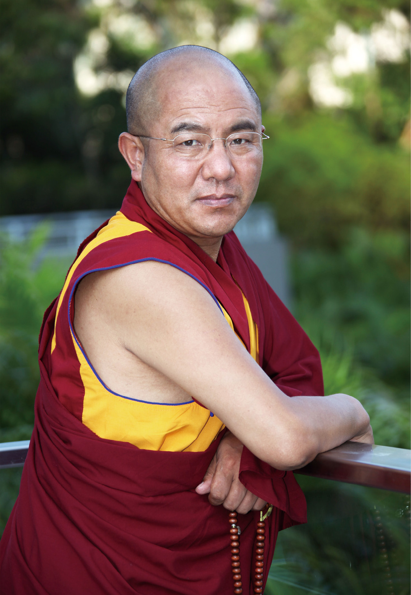
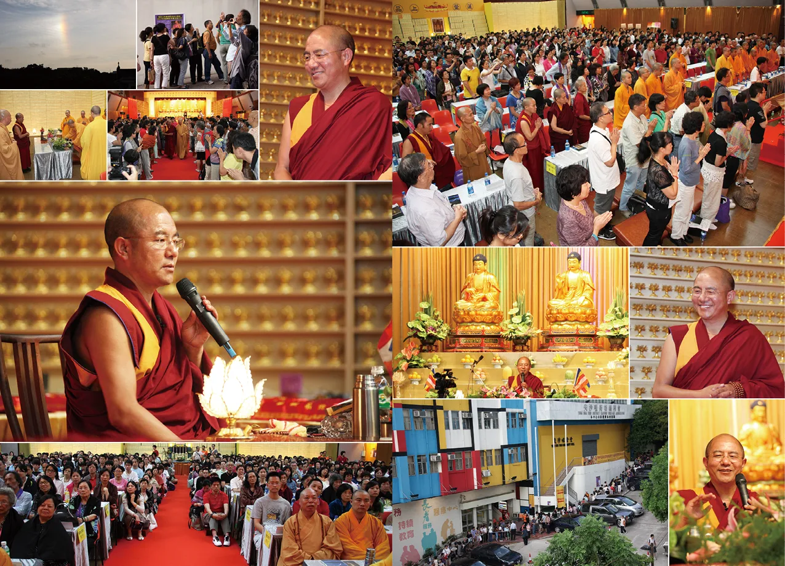
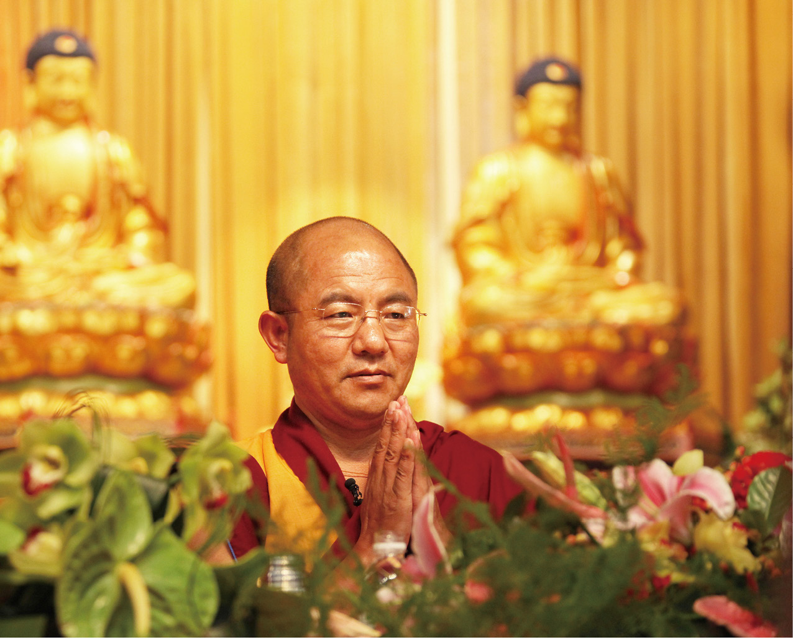
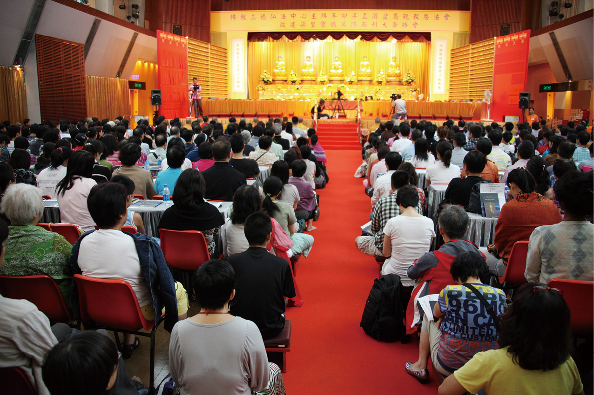
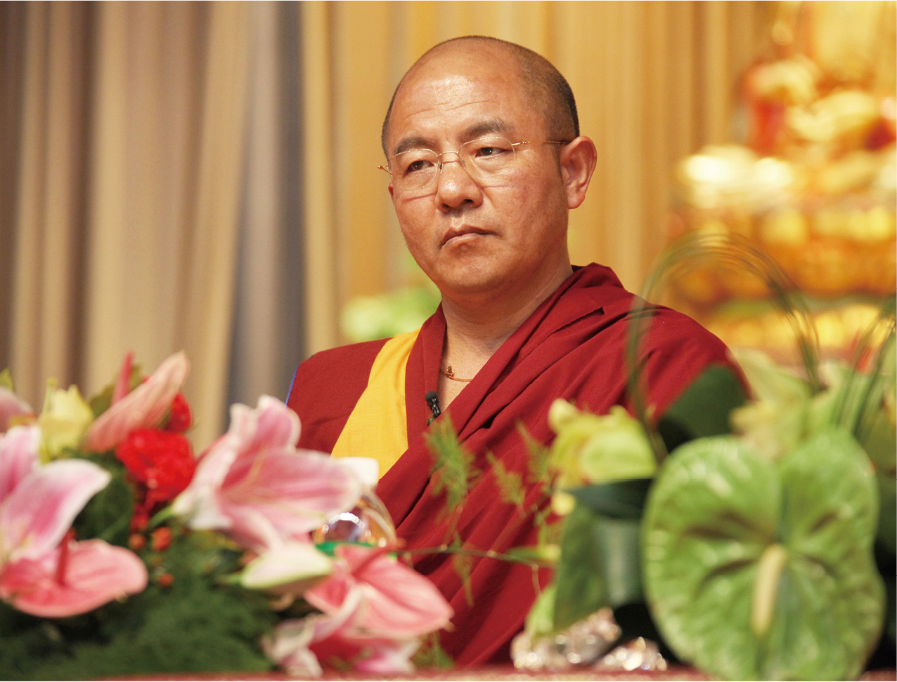
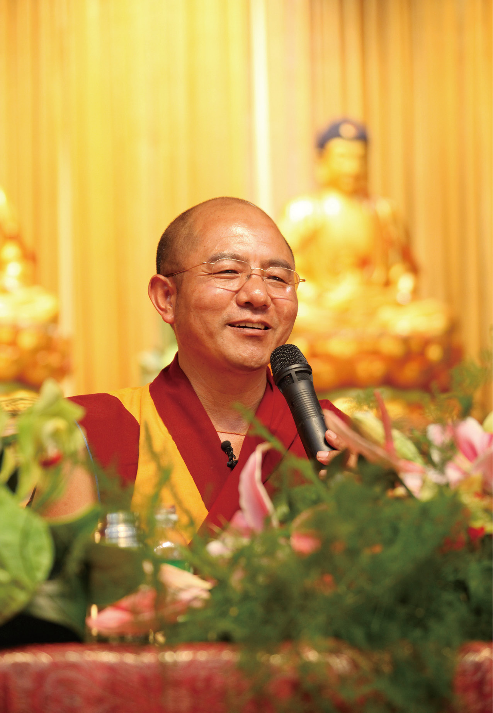
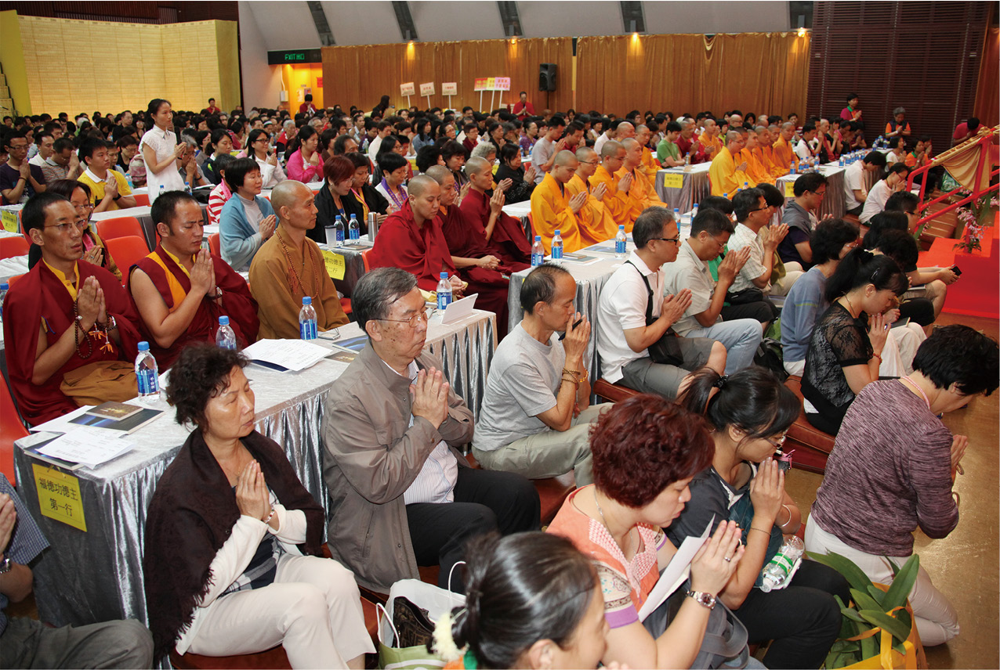
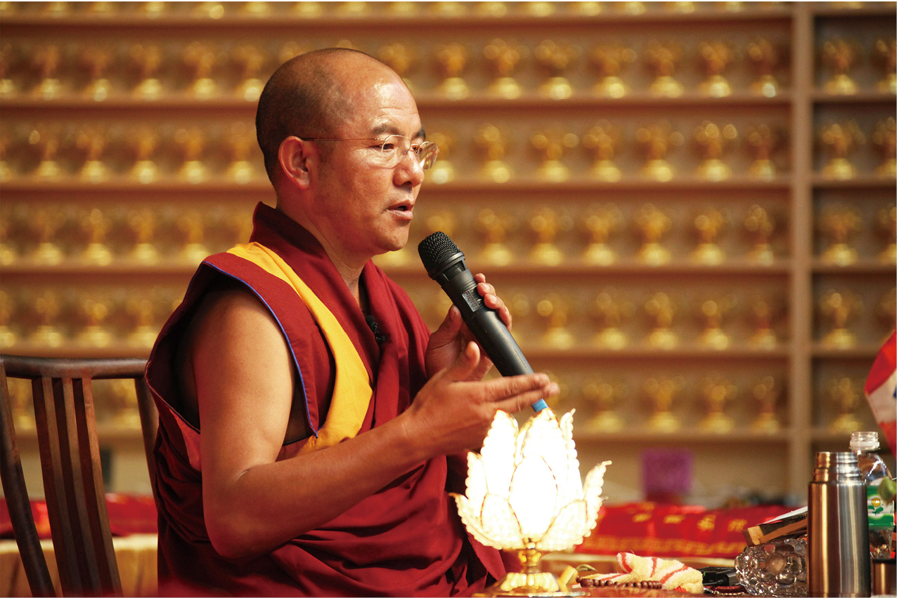

无论是你极为执著的感情，还是特别向往的荣华富贵，都不可能永远不变。

第05场

香港三德弘法中心

Hong Kong Buddhist Tri Virtues Advocate Centre

中国·香港

2011 / 7 / 31

## 浅谈佛教无常观

## A Brief Introduction on Impermanence

尊敬的各位法师、各位佛友：

晚上好！今天我们聚集在三德弘法中心，谈一谈佛教的无常观。

## 一、观修无常的重要性

无常，在每个人每天的生活中，都扮演着重要角色。对于经常观修的人来讲，无常实际上并不遥远，从身边发生的每一件事情中，都可以找到它的影子。所以，我们懂得无常、观修无常极为关键，它是一切修法的重中之重。

《涅槃经》中云：“一切众生迹中，象迹为上；是无常想亦复如是，于诸想中最为第一。”意思是说，在一切众生的脚印中，大象的脚印是最好的，同样，在所有思维观想中，观修无常最为殊胜。此外，佛陀在其他经典中还说：对舍利子、目犍连那样的一百位圣众作大供养，不如刹那忆念无常的功德大[^1]。

既然观修无常如此重要，在座各位都是学佛的，那对佛教这个最根本的窍诀，就不能掉以轻心、随意忽略了。

其实，我们周围发生的一切，都是开示无常的善知识。记得在1993年，法王如意宝来香港给大家传过“普巴金刚”（又名“项袋金刚橛”）、“文殊大圆满”的灌顶，而如今，上师已经示现了圆寂；当时白玉中心有一位秋扎喇嘛，前两天我到香港时，听说他老人家也圆寂了；当时贝诺法王还健在，而现在也圆寂了；还有，最近藏地的阿秋法王也圆寂了……这些都说明什么呢？高僧大德们尚且会示现无常，我们这些凡夫人就更不用说了。

今天在座的各位，再过二三十年，肯定会纷纷离开世间，而且一百年之后，我们绝对会一个不留，这是人生的必然规律。因此，希望大家通过认识无常，能断除对现世的执著。宗喀巴大师在《三主要道论》中也讲过，观修人身难得、寿命无常，可以断除对今生的贪恋；观修轮回过患、因果不虚，则可断除对来世的耽执[^2]。若能彻底断除这些执著，才能依次生起出离心、菩提心，成为真正的修行人。

你们有些人可能皈依佛门很多年了，有些则是刚刚皈依，还不知道什么叫无常观。但不管你知道也好、不知道也罢，无常都是世间的真理，是谁也改变不了的客观规律。

## 二、无常的具体体现

佛教中的无常，主要体现在四个方面，即我们常说的“无常四际”——“积际必尽，高际必堕，聚际必散，生际必死。”这四点，很多佛教徒都会讲，但不知道你们观修过没有。如果没有的话，那只是一种文字上的了解，其甚深涵义却很难以挖掘。

这“无常四际”，实际上在我们生活中随时都可以体现：许多人一辈子辛辛苦苦积累的财富，到头来却全部耗尽；有些高楼大厦非常雄伟，结果却一下子坍塌，像美国世贸中心110层的双子大厦，遭受恐怖袭击后，一号楼倒塌仅用了10秒钟，２号楼也仅用了８秒钟，这么高的建筑物，尚且难抵无常的摧毁，其他建筑物就更不用说了；还有些人原本高高在上、不可一世，过了几年以后却身败名裂；人只要有生，就必定有死，有些是年轻时死，有些是壮年时死，有些是老年时死，有些是突然暴死，死期虽然不定，但都难免“死路一条”。即使很多人渴望长生不老，这方面秦始皇堪为典范，但他最后也是49岁就撒手人寰。

既然万法皆无恒常性，那对现在拥有的一切非常耽著，又有什么意义呢？若能明白这个道理，对生活、修行就会有很大帮助。否则，对无常一点认识也没有的话，修什么都容易成为人天福报之因。

现在的香港，跟十年前比起来，在建筑方面、物质方面，可谓突飞猛进、日新月异，但在佛法的学修上，似乎没有一些前所未有的进步。很多人十年前就喜欢求灌顶，拜佛只求发财升官、平安健康，十年后好像仍是如此。其实佛教的根本，并不是求一些世间法，否则就跟其他宗教、世间理论没有两样了。那么，我们学佛的目的是什么呢？是看到三界众生非常痛苦，在这个轮回中，苦占绝大多数、乐只有极少数，故希望拔除自他一切众生的痛苦。

而根除痛苦的方法，唯一在佛教中才有。为什么呢？因为只有佛陀才具有十力、四无畏、十八不共法。就如同爱因斯坦发现相对论、诺贝尔发明炸药，依靠的是一种不共的智慧，同样，本师释迦牟尼佛也是依靠不共的殊胜功德，才发现众生以无明而流转轮回，只有断除了无明，才能彻底获得快乐。所以，若想让一切众生离苦得乐，就必须依靠佛教中的“内明学”。

因此，我希望在座的佛教徒，尤其是一些年轻人，学佛不能只为求福报，求佛保佑自己身体健康、家庭和合、财源滚滚、官运亨通……其实，就算佛陀加持你得到了这些，人生只有几十年，为了追求这短暂的快乐而耗尽一辈子，值不值得呢？所以，作为一个佛教徒，理应为了今世和来世而修行、为了自己和他人而修行。如果没有这样，那根本方向就搞错了。

《诸法集要经》中讲过：“有为皆无常，如水泡非久，应当行善行，为二世饶益。”这个教证我特别喜欢。世间上的任何有为法，不管是器世界的、有情世界的，没有一个能恒常存在，全部都是无常的，像水泡一样会迅速破灭。无论是你极为执著的感情，还是特别向往的荣华富贵，都不可能永远不变。到了一定的时候，因缘一旦散了，果自然也就没有了。

或许有人认为：“既然万法都是无常的，生命过不了多久也就灭了，那我们应该及时行乐，没必要去管太多。”这种想法不正确。生命跟身体完全不相同，尽管我们的身体会死亡，但生命却会一直延续下去，迁流不断地形成后世。

曾有一个人用比喻，说明了后世的存在，我觉得他讲得很好。比方说，我用手机拨一个人的电话号码，拨通了以后，我对着手机说话，声波即刻被转化为电波，然后通过卫星传递，将此传送到对方的接收器中，再把电波转为声波，对方就可以听到我的声音了。

同样，我们今生的身体死去时，生命便会与之分离，变成一种意识形态的中阴身，在中阴界中照样存在，就像声波转化为电波一样。然后过了一段时间，犹如电波再转为声波一样，中阴身再投生为下一个身体，跟身体结合起来。在这期间，尽管有段时间并没有身体，但生命却一直没有消亡。懂得了这一点后，就会明白众生周而复始地流转轮回，死后并不会一了百了。

当然，在座的有些人，可能因为世间教育的影响，对生命的永恒存在，有点半信半疑，这对你的修行会有很大危害。因此，我提醒大家：一定要“学习”佛法！当你学得越来越多，怀疑、邪见才会越来越少，信心和智慧也会与日俱增。

## 三、怎样理解生命无常

观修生命无常，实际上有非常大的功德。即使你修不了很多法，天天观这个也特别好。以前汉传佛教的印光法师，就在自己的佛堂里，挂了一个大大的“死”字，以此念念不忘死亡，时时提醒自己生命无常。

藏传佛教中也有一位伟大的上师，有个弟子请求他传最殊胜的法，他一开始没有传。结果那个人再三请求，上师就拉着他的手，诚恳地说：“我也会死，你也会死！”——或许有些居士听了，不以为然：“这哪是什么大法？上师您应该给我加持一下，给我灌个最高最高的顶，这才是真正的法。‘我也会死，你也会死’，这个我也懂，不用您来传。如果这是法的话，上师您坐在这儿，我可以给您传。”

然而，那个弟子的信心很足，觉得：“上师讲得确实有道理。上师总有一天会圆寂，我也总有一天会死，死的时候，连这个身体都带不走，更何况是其他东西了？所以，我一定要好好修无常，舍弃今生。”于是他精进地修持此法，终于获得了成就。

但我们很多人，却并没有这种观念。现在我到一些大城市里，从不少人的言谈举止中，经常感到他们没有修过无常，这一点相当遗憾。我自己虽不敢说修得非常好，但不管是到哪里去，始终都有种无常的感觉。就算平时要出门，也自然而然生起一种念头：“这应该是最后一次出门，应该不会回来吧？”十年前我就是这样，现在也仍是如此。

比如说，我这次离开香港后，就觉得是永远离开了，以后不会再来了。这是自己多年来修无常的一种串习，平时不管做任何事情，都会觉得“这是最后一次”。但我也不会因此而消极，反而会更加积极，努力把每件事情做好。

所以，我们佛教徒不能因为一切是无常的，就什么都不管了；因为生起了出离心，看到轮回太痛苦，就什么都不做了。这种消极的态度，是不合理的——怎么你们香港没有时间概念呢？现在过了半个小时，还一个一个不断地来。在我们藏地，大家对听法还是很重视的，七点钟开始的话，七点钟就全部到了。呵呵，你们香港太自由了，太自由有时候也不好。没事，来吧，你自由地来、自由地去，也可以。

今天我讲的内容不多，还要讲一点点。其实我也没什么可讲的，假如你们有缘的话，听一句“我也会死，你也会死”，也会得到利益；如果没有信心，我声嘶力竭地“哇哇哇”叫半天，你也会觉得这个人夸夸其谈，不知道到底在说什么。

以前上师如意宝来这里传法时，很多人只能听懂广东话，对我们说的话都不太懂。当时我们只好请了一位翻译，等法王讲完一些内容后，我先译成汉语，他再译成广东话。不过，这次看你们的表情，基本上很多人都听懂了。所以说，你们的语言和习惯也是无常的。

今天我们在这里交流，非常感谢三德弘法中心的净雄大和尚，以及诸位僧众的安排！大家都很辛苦，为我们创造这样一种学习的机会。其实，真正从佛教的教义上讲，哪怕我们能共同学习一堂课，机会也是来之不易。像我刚才讲的“积际必尽，高际必堕”这个偈颂，是释迦牟尼佛因地时身上挖了一千个洞，才得来的正法[^3]。我们如今不需要这样的苦行，就能轻而易举地得到，这也是各位的福报所感。

## 四、当前佛教徒存在的问题

现在不管是哪里的佛教道场，香港的也好、汉地的也好、藏地的也好、其他国家和地区的也好，互相团结都非常重要。假如每个上师的弟子之间大小战争不断，这对整个佛教来讲，是一种损害、一种打击，除此之外，绝不可能带来任何利益。

上个世纪以前，战争是解决矛盾的主要途径，而今全世界已经成了“地球村”，国家与国家之间也秉持着求同存异、友好往来的原则，我们佛教团体就更不应该彼此不和了。要知道，不管是南传佛教、藏传佛教、汉传佛教，都是释迦牟尼佛传下来的法，干嘛非要争个我高你低呢？假如佛教内部都不团结，我们今后是不会有进步、有发展的。

其实，香港、台湾的佛教非常开放，也有很大的发展空间。许多高僧经常在这里举办大型法会，不管是哪个教派的，我个人都非常随喜，至少这可以让很多人跟佛教结上善缘。

昨天，我朝拜了香港最大的佛像，那里有很多游客，有些是以好奇心去的，因为这曾被誉为“亚洲第一大佛”；有些不是因为信仰，纯粹是去观光旅游的。但不管是什么样的人，只要眼睛看到了释迦牟尼佛的像，就会种下解脱的善根。所以，自古以来很多真正的大德，一直在通过不同的方式，让众生与佛结上善缘。对此，我们都值得随喜！

同时，在这个过程中，不管汉传佛教也好、藏传佛教也好，难免有个别人鱼目混珠，借用佛教的形象欺骗信众。对此大家一定要擦亮双眼，认认真真去观察，否则，刚开始时若不观察，到最后定会后悔莫及。

现在有些人的行为，对佛教造成很不好的影响，这是非常令人痛心的。当然，这只是他个人的问题，并不是佛教的过失，对此大家一定要分清楚。比如，有些人打着藏传佛教的旗号，给大家灌顶、传法，然后搞一些不如法的行为。不少人就认为藏传佛教是这样，其实事实并非如此。你们不管是哪一个人，如果去藏传佛教的教义中寻找，是找不到这些过失的。

因此，我们佛教徒的行为，一定要对佛教负责、对众生负责、对上师负责。尤其是钱财方面的化缘，对佛教不一定有利。毕竟很多人对财富特别执著，一提起钱，他们脸色都变了，所以，佛教若只代表化缘，那是不会有什么前途的。

作为佛教徒，我们追求的不是别的，而应该是解脱。假如你真的有了无常观，对世间财富并不会特别希求。记得《正法念处经》中有一个教证说：“色种姓财富，及以诸乐具，一切皆无常，智者不应信。”这个讲得非常好！真正有智慧的人，对美色、钱财、享乐、豪宅等，根本不会贪著。因为这些都是无常的，跟解脱比起来不值一提。所以，古往今来许多高僧大德，可以把这些统统看破、放下。包括现在很多在家人，修行到了一定时候，也知道追求身外之物没什么实义，那希求解脱的出家人就更不用说了。

因此，有些佛教徒对自己的行为，应该注意。否则，你对佛教没有做什么贡献，反而起到破坏作用的话，这是非常不合理的。希望在座的很多佛友，也想一想自己应该怎么样弘扬佛教？若要荷担如来家业，就应当时时护念众生的心，他们对佛教不理解的、容易诽谤误会的，自己就要尽量断除。

这方面，你们每个人都有责任，并不单是我们出家人或某个上师的事情。今天在座的都是佛教徒，你们也可以看一看身边的基督教徒对自己的宗教是怎样维护的？他们平时的所作所为，都会顾及自己的道场、自己的信仰，而我们为什么缺少一种凝聚力呢？

所以，大家不管是汉传、南传、藏传的弟子，都应该为佛教的未来着想，为弘扬佛法而共同努力。佛法中绝对有遣除一切痛苦的智慧、利益一切众生的大悲，这从任何一部经论中都可以找到。但现在很多佛教徒，却把这些高高的法，用低低的行为来表现，这是相当可惜的。

如今不少人特别喜欢求密法，目的是什么呢？就是想自己发财、健健康康。其实，有了这种发心的话，修再高的密法也不是密法。往昔阿底峡尊者有个弟子是修喜金刚的，结果他却修偏了，堕入了小乘的灭定。这是为什么呢？就是因为他发心不正，以此背离了密宗的境界。所以，判断一个人的修行是好是坏，并不在于他到底修了什么，而要看他的发心如何。

现在很多人，理论基础太差了，系统闻思也不够，这样一来，对佛教的广大甚深没有正确认识，只是表面上念念经、磕磕头、烧烧香、拜拜佛，那即使皈依了很多年，也不会有一点进步。

要知道，真正的佛教就是智慧和大悲，若想掌握它的精髓，必须要通过系统学习。如今很多年轻人，智慧非常不错，对三宝也很虔诚，作功德、开法会十分积极，但对于佛教的真理，他们既不想听，也不想讲。甚至有人还说，学这些理论会增长分别念，对解脱有障碍。其实，释迦牟尼佛传下来的经典、龙猛菩萨传下来的论典，再怎么样也不会障碍解脱，这一点你大可放心。有些人根本搞不懂什么对解脱有障碍，实际上，你如果什么理论都不学，修行只是盲修瞎炼，这才真正是解脱的大障。

有些人皈依十年八年了，成天在上师面前求灌顶，但一次加行也没修过。尤其是香港这里比较自由，传法、灌顶的广告宣传随处可见，有些学密宗的人得过无数次灌顶了，但只是整天念念咒，从来也不知道要守誓言，一说要系统学习就兴趣索然，这是很大的一个问题。

如果你们像藏族人一样，从小就生长在佛教家庭里，就算没有很高的智慧，自己的信仰也会比较稳固。可现在这样的社会中，人们的分别念错综复杂，假如你不懂佛教的道理，过段时间信心就很容易退失，到时候你什么都抓不住，内心会非常迷茫。但若对佛法有过系统的闻思，一旦你对佛教不理解了，正见马上就能摧毁你的怀疑，这是特别重要的！

## 五、用无常观引导自己真实修行

对我们每个人来讲，观无常是修行的根本，《开启修心门扉》中讲了很多这方面的窍诀。莲花生大士在一个教言中，也以比喻阐述了相关的道理：就像一个人不慎坠落悬崖，慌乱中抓住了崖壁的一把草。他紧抓不放，往下望去，是万丈深渊。这时出现一只白老鼠，叼走一棵草；又出来一只黑色的老鼠，叼走一棵草，两只老鼠就这样轮番叼，他手中的草越来越少。正在这时，他看到旁边有棵果树，树上长满了水果，他津津有味品尝着水果的甜美，完全忘记了自己身处险境。

这个比喻是什么意思呢？我们的寿命就像是那把草；黑白两只老鼠，比喻白天和黑夜，它让我们的寿命不断减少；身边的水果比喻世间的名闻利养；而身下的万丈悬崖比喻死后的三恶趣。简单来说，我们的寿命眼看就要走到尽头，倘若一味沉迷在妙欲的点滴快乐中，那么一旦生命彻底结束，等待自己的就只有一条路——堕入三恶趣。

然而，许多人并不知道这一点。有些老年人明明活不了很久，最多二三十年就会离开人间，他却像还能再活一百年一样，忙着为未来作各种打算；有些年轻人认为自己身强力壮，用不着去想死亡，却不明白“黄泉路上无老少”，死亡突如其来就会降临。

这个世界上，每分每秒都有许多人死亡，有些是横死，有些是自杀，有些是病死……所以，死亡离我们并不遥远，它随时随地都会出现。然而，世间人对“死”字特别忌讳，平时连提都不愿提。不像我们佛教徒，一直把死亡无常当修行的动力，就像米拉日巴尊者，最初害怕死亡而去山里修行，最后因此而获得了无生无死的把握，纵然死亡来临也丝毫无惧。

佛教中也有很多老修行人，一辈子都在观生命无常：“当我死时怎么办？我突然得了绝症该怎么办？我出门翻车了该怎么办？……”经常这样想的话，提前会有一些准备。而世间人，包括不少明星、领导，平时对死亡根本不去想，一旦无常落到了头上，只能哭哭啼啼、万般不舍地撒手而去。

所以，你们作为佛教徒，一定要学习佛教的教义。否则，只办个皈依证，有时间就念念佛，但很多道理都不懂的话，那就太表面了。大家至少也应当每天修一下死亡无常，这个若能修得很好，对行持善法自然有一种无声的劝导：“我不能天天懈怠、天天散乱，无常来了怎么办？我还是要多造善业、多积功德！”

因此，在所有的法中，修无常是最重要的。以前很多大德也说了，倘若你无常修得好，修其他法自然不成问题；假如无常修得不好，即使你得了密宗最高的法，也不一定对解脱有利。

值得一提的是，现在很多人认为，藏传佛教就叫“密宗”，汉传叫“显宗”，好像台湾、香港都这么叫，二十年来一直如此。其实这是错误的，藏传佛教的噶举派、格鲁派、觉囊派、宁玛派、萨迦派，都非常强调显密兼修，就算你走遍整个藏地，也找不到一个教派只修密宗而不修显宗。同样，把汉传佛教称为“显宗”也不对。你们看看汉地寺院的早晚课诵，里面的楞严咒、大悲咒、往生咒等，都是密宗的咒语。除了这些以外，密宗也没什么更密的东西了。

也许有人认为：“密宗要求灌顶才能看有些法本，显宗就不需要如此。”其实，这也是一种孤陋寡闻。显宗的有些出家戒律，对一般在家人也需要保密，不允许随便翻阅。所以，保密并不是密宗才独有的。

此外，有些人一看到藏地穿红色僧衣的，就说他们是“喇嘛教”，这种称呼也有失偏颇。“喇嘛”是上师的意思，藏传佛教中的修行人，并非个个都是上师。同样，有些人看到汉地出家人就叫“和尚”，这也不是特别贴切。“和尚”本是一种尊称，要修行很好、德高望重的才能称得上，并不是人人都能叫的。所以，我们出家人有出家人的称呼，但可能因为历史的原因，后人把这些就当成一般出家人的称呼了。

我昨天在中文大学，看到有些学生在研究生论文、博士论文中，提到了很多佛教名词。当时我就提醒他们：“以后如果写佛教方面的文章，最好不要太骄傲，以为看了一两本书就足够了……”现在很多学者经常如此，有了这样那样的头衔之后，只翻了几本佛教的书，就开始指指点点、信口开河，这是非常不合理的。

昨天有个人讲“如来藏”时，认为如来藏就是如来的心脏，讲得特别奇怪。后来我跟他吃饭时，一个同学对他说：“你以后不要这么讲，在佛教专业人士看来，如来藏不像你解释得这么简单。”但他一直坚持这就是如来藏，是佛陀的教法。现在很多人凭自己的想象去理解佛教，然后再一传十、十传百，带来很多负面影响。因此，在座每个佛教徒，都应该有弘扬正法的责任。

同时，我们生命是无常的，今生遇到这么殊胜的佛法，并不是无缘无故，而是多生累世的福报。有了这样的因缘时，大家不能明日复明日，觉得“我现在才30岁，等60岁再修吧”，这种想法特别可笑。到底死亡和明天哪个先到来？谁也不敢保证。所以，大家应当有无常的概念，以此鞭策自己尽快修行，不要再浪费这个人身了。

如今，我们有缘学习佛教中无常、无我、大悲心、菩提心等教义，确实非常非常幸运。我们身边有很多人，每天都在造恶业，一生也没有遇到这么好的法，所以大家要珍惜这种机会，一方面要学习佛法，同时也要好好修行。若能这样，你就会明白“色无常，无常即苦，苦即非我”的道理，证悟空性也不会很困难。

此外，倘若对无常有所认识，那我们生活中无论发生什么，也有坦然面对的能力。刚才我遇到一个人，她听说老公有外遇，就专门从汉地飞到香港，在七十多公里以外的地方，准备抓她的老公。她心里特别特别痛苦，说她老公以前很疼她，现在却变成了这样，问我应该怎么办。我只能告诉她：“万法都是无常的，他过去对你好，现在对你不好，这就是无常。而你的话，很可能现在贪执他，但过一段时间彻底失望了，不但不再爱他，甚至想杀了他。所以，有了无常的话，什么不可能的都会成为可能，你也用不着太执著……”

其实，不但人心会变，万事万物也莫不如此，一切都没什么可信的，不管是房屋也好、财产也好，包括自己的身体，这些都逃不出无常的范畴。现在有些人因为自己老了，头发越来越白了，皱纹越来越多了，牙齿也一颗一颗脱落了，就心急如焚，想方设法利用现代科技，在自己身上修修补补，企图挽留住青春的脚步。但即便如此，无常的痕迹也不可能被全部擦掉。

因此，大家一定要了解万法无常的道理，这样不但对生活很有帮助，对修行更有极大的促进，它能让我们真正生起出离心，最终证悟无我的境界，进而摆脱轮回的束缚。

现在很多佛教徒，只追求一些表面上的善行，若是念念经、放放生，这方面大家都很热情，但从根本上断除“我”的话，许多人都不在乎。要知道，我们来一次人间不容易，学一次佛法也不容易，假如没有依此而解决最关键的生死大事，那以后还要轮回多久才能遇到这样的佛法？这是不得不考虑的一个问题。

所以，学佛不能停在特别肤浅的层面上，毕竟做慈善、搞些简单仪式、表面上帮助别人，这在其他宗教中也有。佛教中不但有这些，还能让我们通过修行，认识心的本来面目，彻底解决生死大事。因此，希望在座的佛教徒，在这方面更应该关心！

现场互动

问：我来自香港大学，是一位佛法的初学者。最近发生的温州动车事故非常轰动，如果以佛法的观点来解释，那些在事故中遇难的人，可能是前世的业力现前。那么，我们佛教徒在这样的事件中，应该扮演什么样的社会角色？

堪布：这次温州发生的事故，死了接近40个人，在我们的眼中，这也体现了一切都是无常的。

作为佛教徒，这时候一定要表现出利他的精神。如果你有能力，则应从各方面施以援手；没有能力的话，至少各个佛教团体也要组织起来，祈求三宝加持一切生者、亡者，这样的话，存亡都会获得非常大的利益。

以后，人类肯定还会发生各种天灾人祸。我们作为佛教徒，每次遇到这样的灾难时，应该有一种帮助社会的意识。当然，近几年来，许多佛教团体在这方面，确实也做得越来越好了。

问：我是香港大学的博士生，原来在内地是儿科医生。这些年不知道为什么，自闭症的孩子越来越多，我这几年也一直在从事这方面的工作。特别多的家长面对这样的孩子时，压力非常大，有些人认为是自己造了什么孽，所以报应到了孩子身上。我也是一个佛弟子，那么在遇到这种情况时，应该从哪方面正确引导他们呢？

堪布：怎么样面对自闭症、忧郁症的问题，前段时间我在佛学院专门讲过一堂课，引用了佛教和现代医学的一些观点，方便时你可以上网看一下[^4]。

现在自闭症的孩子越来越多，外在的原因，主要是父母对孩子的关心不够，只是把孩子交给学校，从来也不重视良好的家庭教育。这样的话，许多孩子就没有安全感，只好经常去一些网吧，沉浸在虚幻的世界里。到了一定的时候，他们找不到真实的感觉，与现实的距离越来越远，最后就把自己完全封闭起来了。当然，最根本的原因，还是孩子自己前世的业障。同时，父母如果往昔造了一些恶业，今生中也会感召这样的后代。

你能从事这样的工作，我个人还是非常随喜。如今这个社会，大多数人从学校毕业之后，只想着自己找工作、自己发财，一旦成了企业家或有能力的人，又总盘算着尽可能多地霸占资源，对社会关心的可谓寥寥无几。要知道，现今人们的生活压力越来越大，身边的老弱病残也越来越多，假如人人都只顾自己，那社会迟早会陷入瘫痪的。因此，关心这个社会，对我们每个人来讲都义不容辞！

问：现在信基督教的，远比信佛教的多。国内基督徒的增长速度，也比佛教快得多，尤其在大学生等知识分子中。请问，这是否因为佛教的因果比较严厉，三恶道比较可怕，而令他人宁愿选其他的宗教？

堪布：因果是一个客观规律，不管你信不信佛教，只要造了恶业，就肯定要感受恶果，如同你种下毒药的种子，就会长出毒药的果树一样。这是必然的一种规律，并不是佛教独有的，只不过佛教如实揭示了它的真相而已。

至于基督教的增长快速，也是有一定原因的。一方面它在以美国为主的西方国家非常普遍，包括总统在内都信仰基督教，因此，它的力量十分强大。再者，基督徒有一种共同的责任感。我去过内地的很多大学，看到好多佛教徒只修自己的，有些念阿弥陀佛，有些修禅宗，有些修大圆满，从来也不关心佛教的发展。而基督教的学生和老师，在各个学校里，每天都想办法弘扬他们的教义。

再加上现在的汉地，很多人内心是“空的”，没有宗教信仰，但人要想生存的话，又需要一种信仰，所以，大多数人就选择了基督教。汉地曾有一份报告说：基督教打算利用50年的时间，将汉地城市80%[^5]的人都变成基督徒。相比之下，我们佛教徒大多只想着自己解脱，从来也没有考虑过佛教的未来。

当然，我们并不是要跟基督教争什么。但佛教的教义如此殊胜，我们作为佛教徒，在大学里、其他群体中，尽量让更多的人接触佛教、了解佛教，以此给他们种下善根，也是很有必要的。大家若能将大乘佛教的慈悲与智慧弘扬人间，这对每个众生的今生来世，必定会有不可估量的利益。

问：我正在学习您讲的《般若摄颂》。请问，证悟空性和利益众生这两者之间，有怎样一种关联呢？

堪布：很多上师在教言里都讲了：如果你证悟了空性，自然而然会想去利益众生；而若想真正地利益众生，也只有证悟了空性才能实现。

任何一位高僧大德，一旦证悟了空性，就不可能独自享用这种境界，而会想把它传给无数人。所以，利益众生与证悟空性是一种相辅相成的关系。

问1：我来自深圳，在网上看到您来香港开示，就特意带全家人过来了。今晚听了您的开示，非常非常开心，也非常激动。我有一个问题是：从2006年开始，我就在网上听您的法，不知道通过光碟听法，能不能得到您的传承呢？

堪布：一般来讲，传承分为两种：有一种传承必须要口耳相传，依靠光碟得的话，有一定困难；还有一种是，如果你有信心的话，通过光碟也可以获得传承的加持。

以前上师如意宝去美国时，第二世敦珠法王已经圆寂了。当时，上师看到敦珠法王“观音菩萨灌顶”的录像，说：“我对敦珠法王有很大的信心，这辈子虽然没机会亲自依止他，但我想通过录像也可以获得灌顶。”于是我们在场的人全部跪着合掌，接受了这个灌顶，最后一起作了回向。要知道，上师对传承的要求非常严格，假如这种方式没有一点缘起和加持，他老人家是不会这样做的。

所以在某种程度上，通过现在的网络也好、光碟也好，只要你真正有信心，在虚拟世界中也可以获得相应的加持。

昨天，香港中文大学有一个英国人，他就讲了虚拟世界的作用。他说：“如果有机会，能面对面是最好的，所以，我这次专程从英国飞过来，参加这个学术研讨会。但没有这种机会的话，大家在网络中也可以营造一个虚拟世界。现在全世界的人都可以进入这个世界，有些人干坏事，有些人做善事，每个人借此都能达到自己的目标……”

我觉得他讲得特别好！我们作为佛教徒，如果有机会的话，可以亲自依止法师听法；但若没有机会，也可以在一个共同愿望的摄持下，利用现在的网络科技，尽量行持善法、不造恶业。这也相当于释迦牟尼佛传法时，人、天不同的众生都可以接受一样。这也是三宝的加持，所以，从自身的加持来讲，应该可以获得一定的传承。

问2：因为带了家人来，他们没有现场皈依过，我能不能求一个皈依？

堪布：皈依的话也可以。如果在座的人已经皈依过，就用不着重新皈依，也不必担心自己会变成其他上师的皈依弟子。因为我从来都劝大家皈依三宝，而不是皈依我自己。

皈依三宝的时候，我给大家念三遍皈依偈，你心中可以发愿：“从今天起，我皈依佛、皈依法、皈依僧。”以前你皈依若只为了自己解脱，那从现在开始，应该改成为了利益一切众生而皈依，这也可以增上皈依的功德。

下面我念皈依偈，你们可以自己观想——

（堪布用藏语念皈依偈与佛号等……）

问：我刚从香港中文大学的新闻系毕业，现在在做记者。我每天会看《普贤上师言教》，第一次看时，觉得无常真是这个样子，内心很震撼。第二次看，还是震撼。后来看得越来越多了，自己却好像越来越麻木了。请上师开示，是因为弟子善根不足、烦恼深重，还是无常需要一些修法呢？

此外，我前段时间去温州参见一位上师，上师说了一句话：“无常就是这个世界的客观规律。”那为什么还要去修呢？

堪布：虽然它是一个客观规律，但很多人都不懂，整天把“无常”执著为“常有”。如果没有修的话，不管是出家人、在家人，修什么法都不会成功的，这一点我有特别深的感受。

那天听说这个弘法中心让我来讲无常，尽管我在各个地方讲过很多次了，但还是十分欢喜。我想：“讲一点无常，还是很有必要的。哪怕能让一个人生起无常的感觉，从此之后对他修法有点利益，我来到这里也是有意义的。”

当然，只明白了无常的道理还不够，假如从来都不去串习的话，道理是道理，你是你，很多道理对你还是用处不大。所以，我非常希望大家能观修一些无常法，具体窍诀在《大圆满前行》《心性休息三处三善引导文》中都有。其实，藏汉两地的很多大德都会观修无常，所以这方面的修法相当多。如果没有生起无常观，无著菩萨也说了，修行就会产生懈怠，始终都明日复明日，觉得以后再修也可以。

你作为一名新闻工作者，实际上随时随地都可以发现无常的踪迹。我经常会看一些新闻，目的不是了解国家大事，而是对自己观修无常很有帮助，自然而然就会鞭策自己不能散乱。记得法王如意宝以前写过一个《无常道歌》，里面就讲了，假如我们真有智慧，那么世间发生的一切，都可以看成是诠释无常的书籍[^6]。有了这种无常观的话，不论你遇到什么事，都可以成为自己修行的动力。

问：我有位不信佛的亲友，忽然之间得了癌症，如何以佛教去利益他呢？

堪布：看他能不能接受佛教的一些理念。如果能的话，最好给他念些阿弥陀佛的名号、释迦牟尼佛的名号，或者让他自己诵一些咒语，与佛教结上善缘。除此之外，可能也没有别的办法了。

如果他实在不能接受，不愿意信仰佛教，那我们可以默默地给他回向，甚至临终时在他耳边念些佛号，这也能起到一定的作用。

问：我是香港大学教育心理学的学生。我希望以后能利益很多小朋友和年轻人，现在也一直在学习您传讲的佛法，除此之外，最重要的还需要学些什么呢？

堪布：你想利益他们的话，一方面可以教些佛教中慈悲观、菩提心的理念，从小就培养他们的利他心，以及对佛教的正确认识。

同时，现在汉地很多人不重视传统文化。其实《弟子规》《千字文》等中，讲了许多为人处世的道理。你可以教给孩子们，这对他们的今后肯定会有利益。

如今很多孩子和年轻人，对什么都没有感恩心，即使是对自己有恩的人，也不懂得说一声“谢谢”，这是一个大问题。同时，最关键的是什么呢？就是要培养他们的善心。心善的话，一切都会善；心不善的话，一切都会不善。倘若我心里没有善念，即使形象上是个出家人，今天在这里讲得天花乱坠，也只是一种虚伪的表演，对别人不会有多大利益。所以，心善真的特别重要，希望很多孩子从小就能有一种良好的教育环境。

问：我是香港城市大学会计系的，现在已经毕业了。我是个佛教徒，刚才听您说基督徒对自己的宗教很负责任，他们势力也很大，我身边的同事、老板很多都是基督教的。请问，我们怎么样才能把佛教徒联合起来，将如此殊胜的佛教智慧弘扬出去呢？

堪布：对这个问题，我也思考过。在汉地，现在很多因缘和机会都不错，要想弘扬佛教的话，首先我们佛教内部要团结起来。刚才我跟净雄大和尚也商量了，以后我们在香港可以开一些圆桌会议，将汉传佛教、南传佛教、藏传佛教的各大教派联合起来，大家和睦相处，都不为宣传自己，也不图任何利益，只是纯粹想无偏地弘扬佛教。在这个过程中，我们不但要为佛教的未来考虑，荷担如来家业，同时对社会现存的问题，比如环保、生态、教育、卫生等，也应该想办法略尽一份绵力。

同时，我们还可以邀请知识界、文艺界、学术界的人士参与，大家可从不同的角度提出建议，群策群力。我们有这样一种发心，以后如果有因缘的话……不知道能否成功。

当今社会的整体结构，是官、商、学三足鼎立。官界的话，一些领导若是佛教徒，则应利用自己的权势，正确引导很多人。但现在很多领导可能不太敢，害怕砸了自己的金饭碗。其实你如果真正弘扬佛教，始终为众生着想，饭碗肯定越来越牢固，不会打烂的。至于商界，现在也有不少企业家，用自己的财力、实力，一直在宣扬佛教的精神。还有学术界，可以利用自己的影响力，净化大众人心。

当然，官员参与的话，可能有一定的难度。但至少我们佛教徒，尤其是一些高僧大德之间，可以共同商量，看以后怎么把佛教的智慧融入这个社会。若能如此，对全人类、乃至所有众生，定会带来无比的利益。

所以，我们每个人在有生之年，不能只想自我发展。其实，你一个人就算拥有再多的财富、再好的智慧，却没有用来利益众生的话，这也没有多大意义。我们应该站得高一点、看得远一点，这样佛教才会有利他的空间，才会有广泛弘扬的机会。

问：前几天听说阿秋喇嘛圆寂了，告诉我这个消息的师兄痛哭流涕，我当时就劝他：“我们也应该发愿像这些高僧大德一样来利益众生。”我发现我嘴巴挺会说的，但我可能还没有这样发愿。请上师开示，如果我也想成为这样的高僧大德来度化众生，应该怎么做呢？

堪布：今天有媒体采访我时，问我一生中最大的痛苦是什么？我想了半天，也没有想起什么大痛苦。但后来我想起来了：根本上师法王如意宝的圆寂，是我一生中最大的痛苦！平时我失去一些亲人，在记忆中倒没有把它当作痛苦。但对我们佛教徒来讲，最有恩德的上师如果离世了，肯定非常非常痛苦，因为佛法方面的恩德，跟世间的恩德完全不能相比。这方面，每个修行人应该都深有体会。

当然，你的发愿非常好。我们每个人不能把自己想得特别渺小，一定要发大愿。愿大，力就大，这样才能利益更多的众生。但具体应该怎么做？这跟你前世的发愿、今生的因缘，以及众生的善缘都有关，需要具足各方面的条件。因此，你最好是先闻思修行，再慢慢来行持善法、利益众生。

法师问1：上师您好！很惭愧，我想问一个问题，但又不知道该不该问。我们佛家讲万法缘起、缘起摄诸法，缘起是个什么法？

堪布：我们佛教讲缘起，这也是跟其他宗教不同的地方。释迦牟尼佛当年说“诸法因缘生，诸法因缘灭”，并将此传给了弟子马胜、舍利子、目犍连等，其实这就是缘起法的精髓。

当然，缘起法是特别深奥的。为此，宗喀巴大师专门造过一部《缘起赞》。以前我把它翻译出来了，前不久在学院给汉僧们讲过一遍。在讲的过程中，我深深感到，释迦牟尼佛真的特别伟大，缘起观真的特别殊胜。但可惜的是，现在很多人并没有完全认识它的真正涵义。

要知道，在这个世界上，释迦牟尼佛是最伟大、最了不起的，为什么呢？最主要的原因，就是他宣说了四谛法门、缘起法门。这二者实际上是万物的真理，谁能揭示出来，谁就可以称为佛陀。

所以，我非常希望在座的佛教徒，首先应该系统地闻思佛法，尤其是大乘的空性和大悲。不然，你只看了一两本经书，甚至连一两本经书都不看，反而去看世间人乱写的书，看完以后就自以为通达佛教了，这是根本行不通的。

佛教特别博大精深，如果没有长期、有次第地学习，是很难一窥其门径的。只有真正学习了，并对此产生了稳固的定解，你才有能力弘法利生。所以，我们作为佛教徒，系统学习特别特别重要！

问2：我们跟异教徒交往的过程中，应当怎么样去跟他们相处呢？

堪布：我们对异教徒并不排斥，以后有机会的话，还可以邀请基督教、道教等其他宗教开圆桌会议。大家在各自不同的生活领域里，弘扬各自的法，彼此应该有一种包容心。我们不能因为自己是佛教徒，就非要跟他们抢位置，这是没有必要的。我们的原则是互相尊重、互相了解、互相学习，同时发扬自己的优越性。各宗教之间敌对排斥的时代，早在20世纪就已经结束了，我们现在，应该是一种互利共存的时代。

在这个时候，我们作为佛教徒，若想弘扬自己的法，就一定要先了解自己的教义。说实话，你们这边的有些人，在学习方面还有进步的空间和余地。我看到北京、成都、广州的有些知识分子，他们学得相当好，我跟他们交流的过程中，有时候都特别赞叹。他们也学得非常认真，不是听一两堂课、受一个灌顶就满足了。

因此，佛教徒的整体水平一定要提高。只有当你真正感受到佛陀的大慈大悲，以及不可思议的境界，你才会有弘法利生的勇气。也只有这样，我们才能想出一些更好的主意，为整个世界的和平、为全体人类的幸福，做出更大的贡献。

问：我是香港大学的学生，也是一名佛弟子，现就职于香港大学。近年来，我们一直从事帮助内地残障儿童及其家庭的相关工作。内地的残障儿童约有817万人，他们的家庭承受着巨大的经济压力和心理压力，非常需要支援。请问，我们应该如何运用佛法去更好地帮助这个群体呢？

堪布：香港大学有许多信仰佛教的教授，我也认识一些；还有相当一部分学佛的学生，非常随喜你们对社会的关心！

现在内地确实有很多残障儿童，若想完全解决他们的问题，可能有一定的困难。但我们可以通过各种平台，尽己所能地为他们做些有意义的事情。

作为一个学生，在大学就有想帮助别人的心，这是相当难得的。如今汉地、藏地的好多大学里，也有特别多的大学生，利他心非常强烈。不过，我担心的是，你们到了社会上，成家立业以后，这种纯洁的心会不会慢慢就淡化了？

我这并不是杞人忧天，其实这种现象也不在少数。有些人刚从大学毕业时，豪情万丈、壮志满怀，一心想要帮助这个社会，可是用不了多久，自己结婚生子以后，原来的利他心就转移了，全部被系在家庭这个圈子里了。

所以，我希望很多大学生，且不说今后能做多少，至少应先保护好这颗利他心。你们的未来，就是这个社会的未来，哪怕一个人有这种利他心，对社会也会起到很大的作用。大家可以看看周围，如果一个企业家有利他心，对社会能起到怎样的推动？如果一个大德有社会责任感，他一生中又能帮助多少人？

当然，让我来指定怎样帮助那些残障儿童，才能完全解除他们的痛苦，我也很难说出一个“放之四海而皆准”的具体方法。虽然我建立了一个基金会，通过各种途径想帮助别人，但能力也是有限的。不过，只要大家有了这一颗心，就能衍生出大乘的利他行为，它可以在社会各个角落放出光芒，为整个人类带来温暖和安乐。

主持人：

让我们再次以热烈的掌声，感谢索达吉堪布！

现在有请我们的净雄法师上台，为这次传法圆满作一个总结——

净雄法师结语：

大家晚上好！首先我代表三德弘法中心，感恩索达吉堪布这次从百忙中抽出宝贵时间，在今晚的两个小时中，给我们作了这么好的开示。

在半个月前，堪布还没有来香港时，他们拿了两个题目让我挑，一个是“显密圆融”，一个就是今晚讲的“无常观”。我想了一下，在香港这个社会，无常观对我们来说，是最有现实意义的。因为香港是一个美食天堂，是一个购物天堂，很多众生都迷失在各种物欲之中，不知方向。所以，今晚大家听了索达吉堪布的开示，应该上了一节很现实的社会课。你们都法喜充满吧？（热烈鼓掌）

还有令我想不到的是，今天晚上我非常激动。因为在香港，大家都是非常忙的，能有这么多信徒发心来听法，是相当罕见的。我曾经也组织过多次讲经法会，来的都是寥寥无几，上不了100人，所以我都失去信心了。这次看到我们堪布的法缘这么殊胜，最后的问答环节中，大部分都是大学的年轻学子，我从中也看到了佛法的希望。

刚才在提问的过程中，很多信众都提到了，佛教现在为什么没有发展好？这跟我们每个人的发心大不大有关。如果我们都能学堪布这种为法忘躯的精神，我想用不了10年，佛教就非常有希望了。当然，这也要靠大家的努力，你们有没有信心啊？（大家回答：有！）

下午4点多堪布来的时候，我们在隔壁的会议室，用了一个多钟头的时间，一直在探讨佛教的未来何去何从。所幸的是，今天听到在座这么多学子如此发心，我想香港的佛教确实还有很大的发展空间。如果大家能够团结起来，不分彼此，不要有我见、山头主义、长者情结，大家都看在佛陀的教义上努力的话，佛教必定会后后胜于前前。

因为明天还有法会，今天堪布也这么辛苦，我就不多说了。希望大家把堪布今天晚上所讲的，好好记住。这个记住的话，你们就能发大心了！

[^1]: 《毗奈耶经》云：“我之眷属中，犹如妙瓶者，比丘舍利子，及目犍连等，于如是百人，供斋与供物，不如一刹那，忆念有为法，为无常殊胜。”
[^2]: 《三主要道论》云：“人身难得寿无常，修此可断今生执；无欺业果轮回苦，修此可断后世执。”
[^3]: 《释尊广传·寻法品》中：释迦牟尼佛于久远之前，为国王甘谢讷巴乐时，四处寻求正法饶益众生。有一婆罗门说自己有正法，但要想获得法，须在身上挖一千个洞，插入千根灯芯做成一千盏灯，点燃后才可传授佛法。国王欣然答应，挖肉做成千灯之后，婆罗门传给他：“积际必尽，高际必堕，聚际必散，生际必死。”
[^4]: 详见智悲佛网《心灵从沉睡中苏醒》一文。
[^5]: 也有说是70%。
[^6]: 《无常道歌》云：“若能观想一切内外法，乃为指示寿命无常书。”
