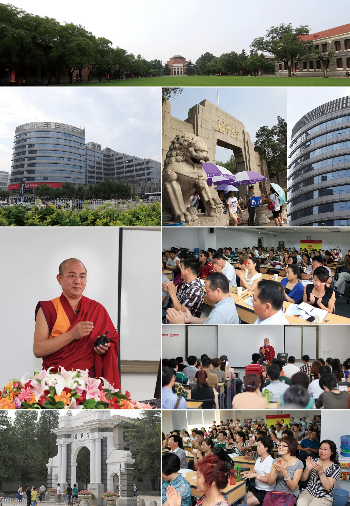
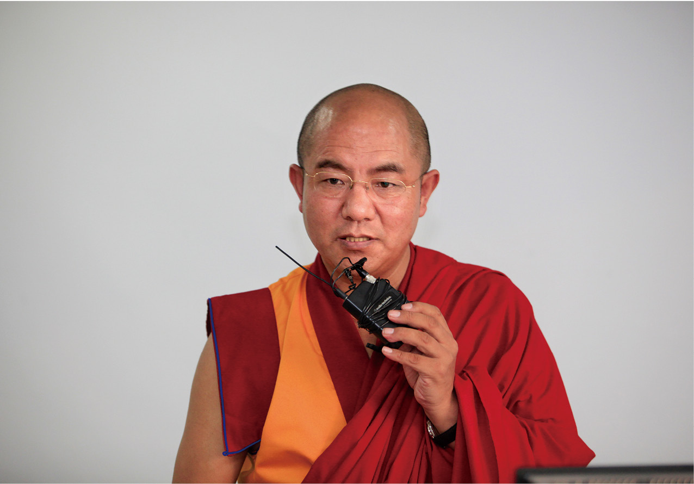
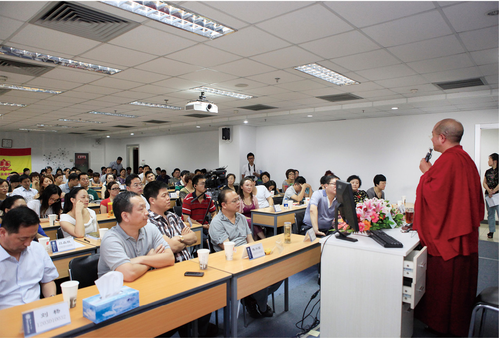
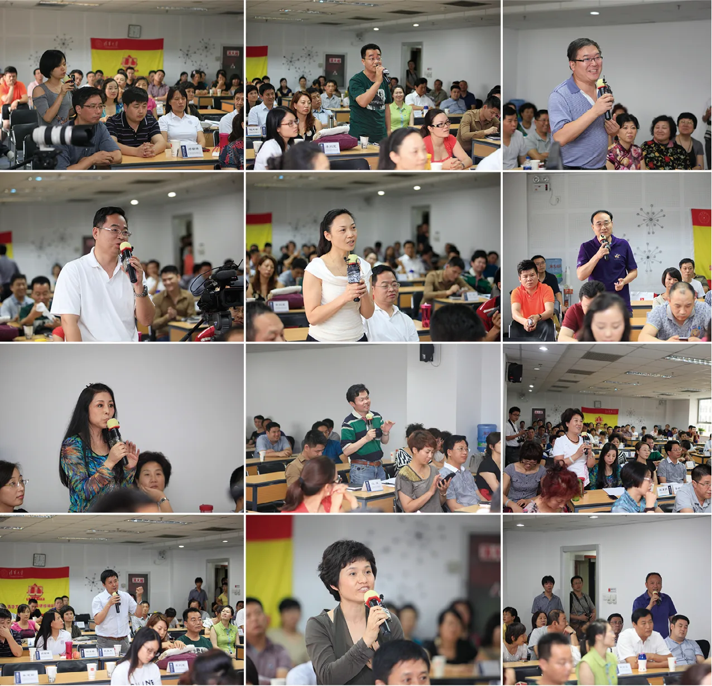
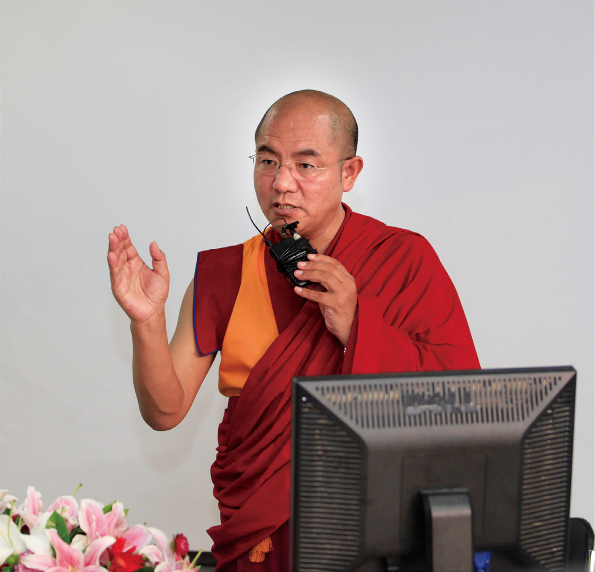
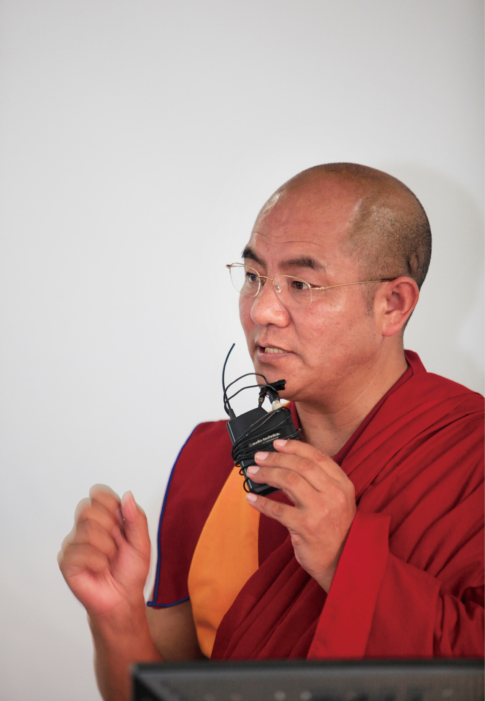

佛法能真正解决自己的人生难题。  
而且很多时候，效果甚至超乎他们的意料。

第07场

清华大学总裁讲堂

CEO Class, SEM Tsinghua University

中国·北京

2012 / 7 / 11

## 觉悟的智慧 灵魂的洗涤

## Buddhism and Business Ethics

主持人：

大家下午好。我想在座很多人都接触过佛教，比如，很多人的车里都挂着佛像，手上都戴着佛珠，但我们真正了解多少佛教呢？也许知道的并不多。

今天为什么讲佛教的话题呢？因为近几年来，社会上发生了很多令人不愉快的事，尤其与我们生活息息相关的衣食住行等方面，出现了诸多堪忧的现象。在座各位应该都是讲究生活品质的人，想必也会对此深感不安。这种现象是怎么形成的呢？应该是良心、责任的缺失。现今，很多公众人物都站了出来，呼吁人们常存善心、坚守责任，更呼吁人们树立信仰。

上个月，我们举办了一次很有意思的讲座，讲者是一位经济学家。当时他对我说：“雪涵，你知道吗？我现在已经不讲宏观经济了，而是讲经济与信仰。”如果大家对这个话题感兴趣，可以搜一下《有教堂的市场经济与无教堂的市场经济》这篇文章。

这样的话题、这样的现象，让每个人不得不扪心自问，到底我们要呼唤自心，还是要仰仗道德？何去何从，现在还不得而知。

为了解开心中的疑惑，今天，我们很荣幸邀请到索达吉堪布。希望透过今天的讲座，堪布能够告诉大家，一直以来非常神秘的佛教到底讲了什么，更希望能通过佛教的智慧，点亮我们的人生。

下面，让我们以掌声欢迎索达吉堪布——

今天我们能相聚在清华大学总裁讲堂，一起分享心得、共同交流，应该说很有缘分。

校方希望这次交流“大乘佛教智慧”的话题，同时讨论一下企业对于社会的责任。坦率地说，对于大乘佛教，我虽然不敢说精通，但也研究了很长时间，而在企业管理方面，我并不是内行。不过我想，管理佛教团队与管理企业应该也有相似之处。我提供一些佛教的理念，希望能对大家有一点启发。

## 佛教与管理，相通相融

近三十年来，我一直带领佛教团队。佛教团队在运作模式方面与现代企业有很大不同，此外，我们提供给人们的是无形的智慧，这与现代企业提供给消费者有形的商品，也有所不同。不过，在人员管理以及最终利益他众的宗旨方面，两者也有相同之处。因此，我经常会学一些企业管理方面的知识。

我们的佛教团队现今的发展状况，在座各位不一定很清楚。若用你们的话讲，我们在全国各地乃至全球，应该是以“连锁店”的方式存在。为人们提供什么呢？提供一种非营利的佛教智慧产品。发展得怎么样呢？目前为止，还算不错。

在这个过程中，我个人有很多体会和感悟。今天有缘与在座高层次、有一定水平的人士交流，相信会碰撞出很多智慧的火花。

## 佛教，值得学习吗？

在座有些人对佛教比较了解，有些只是懵懵懂懂。我觉得，无论是不是佛教徒，在当今这个物质文明发达、科技快速发展的特殊时代，了解一些佛教的思想，都是很有必要的。

昨天，我跟清华的老师们私下聊天。有人说：“不一定非要了解或接受佛教吧，每个宗教的教徒都认为自己的宗教最好，就像每家企业都宣传自己的产品如何好、自己如何成功一样。”

我回答说：“佛教并不提倡或要求很多人必须接受，即便释迦牟尼佛住世的时候，印度不信佛教的人也非常多，信佛教的只占少数。佛教自印度诞生以来，从未强迫过任何一个人学佛。”

在座很多人可能也没有宗教信仰。其实，有信仰也可以，没有信仰也可以，关键问题是，我们虽然生于现代社会，却无法解释很多神秘、不可思议的现象，更无处寻找正确的答案。这些藏于内心深处的谜题，经常令我们陷入迷茫。我想，不管是企业家、知识分子，还是其他各界人士，最好不要忽略自心的这些疑问，应该不断探索，直至找出真正的答案。

如果大家在任何一个宗教中，找到了一些可信的答案，并且对自己的身心有益，选择接受是很自然的事。如果一味地排斥和抗拒，不一定是明智的选择。

人的一生，会遇到生、老、病、死、爱别离等众多痛苦，它们纷至沓来，常令人苦不堪言。这些苦痛，相信在座很多人都深有体会。表面上看，我们总裁班的学员一个比一个成功，不管从长相、财富、智慧、才华等各方面看都很优秀。虽然大家的成功相时时流露，但自己的内心真的快乐吗？所谓幸福指数，是否随着成功而增上了呢？扪心自问之后，每个人都很清楚。

古时候虽然物质条件没有现在好，人过着非常简单的生活，但这种简单，却让内心少了许多不必要的烦恼，为幸福腾出了时间和空间。

刚才坐车过来的时候，我说：“这里很热啊，还是住在山谷里面好。”虽然城市里的条件优越，但我还是愿意回到山谷，因为在那里生活简单，内心清净，不容易产生烦恼。

我旁边的人说：“这里是热啊，热是由烦恼造成的。”的确如此，大家虽然在城市里有车、有房、有事业，但内心的痛苦、烦恼也随之增多了。这时，我们究竟该怎样应对呢？

其实，佛教早已给出了解决方案，如人身难得的道理。所谓人身难得，并不是说得一个人身非常难，而是说真正醒悟的人身非常难得。大部分人活了一辈子，痛苦了一辈子，执迷不悟的原因，就在于始终把妄想执为真实。如果懂了人身难得，就会重新审视、定位自己，而不会一味地盲目下去。

所以，非常希望大家能对佛教有一些了解。下面我简单介绍一下佛教。

## 佛教不是形象，而是智悲

现今，佛教有三大传承体系：藏传、南传和北传（又称汉传佛教），遍及全球的佛教都可以涵括其中。按照发心不同，佛教又分为大乘和小乘。倡导人们放弃自己的利益，帮助所有的生命，是大乘佛教的理念。

不管是出家人，还是企业家，任何人只要心中常怀一颗利益众生的心，他的相续中就具有了大乘佛教的精神。比如，在经营企业的过程中，如果时时都把别人或其他生命放在第一位，在这种理念下运作，就是大乘佛教的精神。

大乘佛教既是一种智慧，也是一种大慈大悲心。因此，一个人外在的行为如何，不一定很重要，最重要的是他内在的精神。

佛法分为教法和证法。所谓教法，是指与《大藏经》有关的语言、文字、法本、传承等；所谓证法，是指我们对教法意义的感悟。

有些人对佛教的理解很简单，认为佛像、寺院或出家人就是佛教。其实，佛教是一种教育，也是一种智慧。如果得到了这种智慧，并且有所感悟，才算真正受持了佛法。

所谓寺院，是佛教所在的道场，里面一定要有闻思修行，即要有佛教的教育。如果一座寺院只有金碧辉煌的建筑，而没有佛法教育，就失去了佛教道场的本质。就像清华大学如果只有庄严的教学楼，而没有教学内涵，那高校的本质就已经失去了。现在很多人都没搞清这一点。

有人可能想，既然如此，到寺院拜佛、烧香、供灯、供僧等有没有用呢？当然是有用的，这样做肯定会得到一些加持，但最关键的还是要领会佛教所说的道理。

最近，关于“四大名山上市”的新闻成了热门话题，很多人都对此感到不解，觉得出家人怎么也搞起经济了呢？

我觉得，这件事与各大名山的寺院住持不一定有直接关系。他们应该也不愿意，既无奈，又无辜。自古以来，四大名山的高僧大德们修证如何，读过《高僧传》的人都很清楚。

此事很可能是旅游开发等部门促成的。现在是商业时代，很多人都想以佛教的名义大搞经济。当地寺院的住持可能没有能力阻挡他们，最后不得不接受。合作之后，寺院得到的只是一些虚名而已。

真正的佛教与金钱无关。当然，并不是说寺院一点钱都不能碰，很多时候，金钱也可以用来利益众生。

现在不少人对佛教产生误解，一定程度上也缘于媒体。很多媒体，并没有把佛教的本来面目展现在人们面前，而是用一些表面化的事物，或者极个别人的言行来代表佛教。实际上，在潜心研究佛教的人眼里，这些根本不能代表佛教，大乘佛教真正的内涵是广博而深奥的，并非那么简单。

今天，用一堂课的时间，我不可能讲得完所有大乘佛教的教义，更何况还要结合企业管理来讲。所以今天我只能把大乘佛教的一些主要理念介绍给大家。

## 理性学佛，才能触动心灵更深处

不知大家是否看过一本叫《僧侣与哲学家》的书。这本书非常出名，记录了一对法国父子的对话。

儿子名叫马修·理查德，曾是一位生物学博士，后来出家为僧。他的父亲是法国非常著名的一位哲学家，母亲是一个伟大的艺术家，舅舅是一位航天家。一家人曾定居巴黎，与很多著名的学者都有密切交往。

马修·理查德以前在巴黎大学读博士，跟随导师（诺贝尔生物医学奖得主法兰索瓦·雅各布）从事分子生物学最尖端的研究。读书期间，他看了一部介绍藏传佛教的幻灯片，惊奇地发现，尽管西藏经济条件极度落后，但每个人的眼中却都流露着一种慈悲和安宁的神情，在生活中，人们都奉行着一种利他、奉献、平等的理念。马修对此非常好奇，萌发了到喜马拉雅山麓一探究竟的念头。

之后不久，他便远赴喜马拉雅山，希望探求古老的藏传佛教智慧。他在那里待了一段时间之后，回到巴黎对父母说：“我置身喜马拉雅山的时候，心境变得格外宁静，忘却了尘世的一切喧嚣，现在即使回到巴黎，那里的一切仍然历历在目，一直萦绕在心头。所以，我的缘分应该是去喜马拉雅山出家。”经过父母同意之后，他一拿到博士学位便到喜马拉雅山出家为僧，自此长期定居在那里。

在马修出家满二十年的时候，他与父亲进行了为期十天的对话。父亲站在哲学家的立场，马修则以藏传佛教修行人的身份，双方进行了一次哲学和佛教之间的碰撞。

现今，很多知识分子和成功人士，都是通过缜密的逻辑思维来分析佛教的教理，这是一种较客观的认知方式。如果单从表相或个别出家人的行为来了解佛教，恐怕并不合理。就如想要了解一所大学的教育，应该基于一种严谨的逻辑来分析该校所授课程的内容是否合理，而不应以学校的建筑或个别学生的行为来衡量。

在藏传佛教当中，大乘佛教纯正的理念一直完好无损地保存着。不过，今天短短的一堂课，我很难为大家淋漓尽致地道出。如果有人感兴趣，以后可以亲自去藏地的寺院或佛学院考察学习。当真正了解了大乘佛教的利他心对个人、家庭，乃至社会起到的作用之后，也许你的内心会发生一些改变，对于以前困惑的事情，也会逐渐了悟、通达。

## 莫负韶华，莫负此生

佛经里讲过这样一个故事：古印度有一个叫憍萨罗国的国家，国王叫做波斯匿王。有一次，波斯匿王率领军队和眷属浩浩荡荡地外出巡游，这时，迎面缓缓走来一位八十多岁白发苍苍的老人。国王看他这么老却孤独一人，便好奇地问：“你现在多少岁了？”老人回答：“我现在四岁了。”国王听后惊讶地说：“你明明已是老年人了，怎会只有四岁呢？”老人解释说：“我听闻佛法、了悟真理、得到智慧的时间只有四年，而此前的人生，都是在一种不知取舍的茫然中度过，现在想起来非常后悔，因此，我真正的生命只有四年。”

我对此感同身受，也觉得学佛之后，自己才真正认识了人生。现今，在知识分子和成功人士的群体中，学佛的人越来越多。他们之所以热衷佛教，也是因为学佛以后，佛法能真正解决自己的人生难题。而且很多时候，效果甚至超乎他们的意料。

## 工作是修行，企业是道场

怎样才能把佛教思想运用到企业管理当中呢？

在企业团队的运作方面，很多人都是专家，应该不用我来讲。我想传达的是什么呢？希望大家在管理的时候，不要仅限于财富方面的付出，更要有一种精神上的付出，因为对于员工和消费者而言，精神价值要超胜于物质产品。

我看到很多成功的企业都有自己的企业文化，他们对员工不仅给予金钱、利润等物质回馈，更付出了一份爱心，传递出一种利他精神。其实，这种利他精神，正是企业成功的一个重要秘诀。

怎样传递这种利他精神呢？可以采用大乘菩萨摄受众生的四种方法——布施、爱语、同事和利行，此四摄法非常适用于现代企业管理。

对比企业来说，“布施”是企业的一项目标；“爱语”是企业的一种文化；“同事”是企业的一份责任；“利行”是企业的一个成果。

若能完全实施这四种方法，企业成功的概率将会大幅提升。即使由于因缘不具足，最终失败了，自己也不会因此留下任何污点，一生也了无遗憾。

## 施受同体，给即是得

四摄法的第一个是“布施”。什么是布施呢？大家都熟悉“舍得”这个词，布施就是其中的“舍”。

也许有人想：我的企业正在起步，远远不够壮大，现在布施恐怕还不行。其实，对金钱越舍不得，就越会被它束缚，最后往往求而不得；如果有一种广大、慷慨的布施精神，财富反而不求自得。

有些企业家为了追求利润最大化，尽量克扣员工的工资，尽量减少商品的成本。其实这种方法并不可取，因为从长远发展来看，一个企业只有比较合理地给予，才会得到稳定而持久的回馈，这是一种必然的因果规律。

在很多成功企业家的人生理念中，做人做事的目标，并非仅仅为了自己或家人积累庞大的财富，而是为了负起对员工和社会的责任。

我见过一些信奉佛教的企业家，他们虽然早已拥有了丰厚的资产，完全可以一辈子逍遥自在地修行，不必再辛辛苦苦地工作，但因为放不下自己的员工，所以还在一直努力着。他们担心如果自己歇下来，独自去修行，那些一直跟随自己的员工就会下岗，这样实在于心不忍。有时他们也会问我：自己到底该怎样抉择才好？我一般都会劝他们说：还是继续管理企业，帮助下面的员工吧，毕竟现阶段，中国的企业管理还未迈入非常有序的法制化时代。

中国原本是一个农业大国，经过短短的三四十年发展，现已变成了工业大国。如今，很多农田都慢慢变成了开发区。国家将来的发展状况，大体也能预见，很可能会逐渐成为一个非常强大的商业国家。到那时，大中小企业就会成为国家的中坚力量。如果这时企业普遍缺乏给予精神，没有良好的文化，那整个国家和民众会变成什么样呢？

在座各位都身在浪潮之中，对此也应有所思考。人如果没有思考，只看现在一帆风顺的表象，一旦遇到不测风云，将会很难应对。

需要思考什么呢？应该思考，企业将来怎样才能形成一种良性循环。

我觉得要想达成这一点，首先需要善待自己的员工。在对待员工方面，女性领导人稍微好一点，她们比较细心、体贴，很多男性领导人都有点粗心大意。如果主要领导不关爱员工，下面各主管对员工的照顾也会缺失，因为这种“风气”也具有一种传染性。

从佛教角度讲，不关爱员工的领导是不太称职的。我本人管理佛教团队多年，虽然有时因身体不好也有疏忽的情况，但一般来讲，都会尽可能地照顾到下面每一个人。

当然，要完全做到的确很困难，尤其人特别多的时候，但也应该尽力而为。因为，团队中的每个人都付出了自己的力量，都是大家庭中的一员。如果对他们漠不关心，作为领导肯定有过失。

这样的帮助和照顾，就是一种布施。作为一名企业家，如果有能力，就尽量回馈社会、帮助更多众生；如果能力有限，照顾身边的几个人也是可以的；哪怕你在生命的长路中只帮到一个人，也很有意义。

我资助过一些大学生，他们毕业找到工作之后，一般都会给我发信息表示感谢，说如果没有我的帮助，他们不会有今天。每次收到这样的信息，我都会高兴半天，觉得自己当初这样做是正确的。虽然以我现在的能力，只能帮助一二百人，但他们每个人的境遇却自此改变，找到工作之后，一辈子就脱离了贫困。

我帮他们的时候，从来没想过自己老了或者有困难的时候，他们可能会帮我，只是觉得自己现在有这种资源和能力，哪怕只在短暂的三四年中，帮到身边的几个人，人生也会变得有意义。

每个人的身边，都会有一些需要帮助的人。我们忽视的东西对于那些需要的人来讲，可能至关重要。希望大家在这方面能多加关注。

## 爱，需要说出来

四摄法的第二个是“爱语”。一个人如果有发自内心的慈悲，就会自然说出一些文明、动听的语言。

有些企业的团队组建可谓一片混乱，不仅没有正式的组织架构，更缺乏一种文明建设。作为一个企业，至少要有一种精神口号。在口号的凝聚和感召下，大家会同心协力完成共同的事业。运用好语言的力量，对团队的发展会有很大助益。

世界著名的演说家、教育家卡耐基，在很小的时候母亲就去世了，由于缺乏管束，他成了大家眼中非常淘气的坏男孩。

在他9岁的时候，父亲娶了继母。当继母第一次见到卡耐基的时候，父亲就指着卡耐基告诉她：“他可是全镇最坏的男孩，简直叫人防不胜防。第二天他就会用石头来扔你，你一定要注意啊，做最坏的打算……”然而，继母却带着微笑走到卡耐基面前，摸着他的头，温柔地说：“他不是全镇最坏的男孩，而是很聪明、很善良的男孩，只是他还没有找到发泄热忱的地方而已。”

她的这句话，不但使少年卡耐基建立起了生活的勇气，而且成了激励他一生的动力，激发出他无穷的智慧。自此之后，卡耐基踏上了用语言智慧改变他人命运的人生之路，在日后帮助了千千万万人，成为一位享誉世界的成功学大师。

可见，爱语具有一种神奇的力量。一个企业或团队要想成功，非常关键的一点，即要有一种彰显文明、饱含爱心的语言。不仅对于企业，对任何人来讲，爱语都不可缺少。

## 风雨路，并肩行

四摄的第三法是“同事”。一般来讲，成功的企业家会积极参与企业的每一个重要决策，并且以身作则。如果不与大家一起共事，只是高高在上地发号施令，有时很难明辨利害、正确取舍，最终导致事情做得不圆满。

大家都知道国美电器的创始人黄光裕，他在2004年就登上了中国内地首富的宝座，2008年身家已达430亿元人民币，然而不久之后，他却锒铛入狱。

他的整个经历，一方面体现了佛教所说的无常之理，从首富沦为阶下囚，只需短短一夜间；另一方面，也说明了因果不虚的道理，一个人千万不要做违背良心的事，否则，迟早都会感受苦果。

从另一个角度讲，他走到这一步，也是因为独断独行、不与大家共事、缺乏监督造成的。刚开始，他只是做了一些违背良心的事，但未被及时发现、制止，随着状况不断恶化，最后陷入不可救药的局面。

在经营企业的过程中，有时一个不明智的抉择，就会使自己坠入痛苦的深渊。如果与大家一起共事、商议，就能及时发现利弊、善加取舍，防患于未然。

## 爱，需要用行动证明

四摄法的最后一个是“利行”，即不仅仅怀有一颗善心，还会以实际行动帮助他人，这是大乘佛教的精髓所在。

在座有些人可能觉得，这是佛菩萨的事，自己肯定做不到。这种想法与我们所受的教育和经历有一定关系。其实，“利行”做起来并没有想象中那样难，只要朝此方向不断努力，做事的时候经常提醒自己：我这么做是为了利益企业、员工、消费者……一段时间之后，就会习惯成自然。

无论做任何一件事，都应该发善心、循正道。古人云：“君子爱财，取之有道。”佛经也讲：“宁可贫贱修诸善法，不处富贵而行恶业。”任何时候，都不要用低劣的手段积累财富，否则，不但整天心神不安，还会最终身陷囹圄。

总而言之，按照佛教的理念，每个人选择人生道路的时候，应该以利他为前提；如果损人利己，终将吞下自酿的苦果。

## 遵循因果，创造命中的“必然”

有人可能想：既然如此，为什么有些企业道德缺失，却经营得不错呢？

事实上，它们已经走到了悬崖的边缘，一夜之间就可能破产倒闭。现代人的内心非常脆弱，到时这些企业家能否承受这些失败很难说。一旦做出不明智的行为——选择自杀，是非常可惜的。

人的一生，需要坦荡做人，坦荡做事。怎样才能做到坦荡呢？佛陀告诉我们，一定要遵循因果，相信善有善报、恶有恶报，因为这是大千世界的自然法则。

有些人可能想：因果关系在哪儿呢？我怎么看不见？

所谓因果关系，并非像刀割破手指马上会流血那样，有了因立即产生果，但到了一定时候，即因缘具足时，果必定会现前。就像金翅鸟翱翔于天空的时候，它的影子隐没不现，而一旦下落，影子就会立即现前。又如种在地里的种子，正在萌芽的时候，谁都发现不了，但因缘成熟之后，种子就会开花结果。

同样，如果采取一些非正当的手段经营企业，就如同饮鸩止渴一样，虽然暂时眼前一片静好，但迟早都要感受难忍的苦果，这是一个必然的规律。

如果大家能花一些时间研究佛教的经论，就能完全明白因果的道理，知道它是一种自然规律，谁都无法控制、无法改变。

虽然因果规律无法改变，但如果遵循因果，则能改变自己的命运。改变的方法在很多佛经中都有宣讲，应该不难找到。

## 人生不必绕弯路

自古以来，古圣先贤对命运有各种诠释。按照孔夫子的说法：“吾十有五而志于学，三十而立，四十而不惑，五十而知天命，六十而耳顺，七十而从心所欲不逾矩”。

对于这句话，人们一般都这样理解：十五岁开始立志学习，经过十五年苦读，到了三十岁，所学的知识可以确立起人生方向；到了四十岁，对于人生的很多道理已能透彻了知，因为没有疑惑，故内心没有动摇或犹豫；五十岁时已知天命，即知道了人生很多事都是命中注定，并非自己能够掌控；到了六十岁，对于所有的苦乐、各种语言，都能顺然接受；到了七十岁，可以随心所欲而不违越规矩。

按照孔子的观点，人到五十岁以后，才能真正了悟人生。不过我认为，如果认真研学佛教的经论，早在50岁之前，比如十几岁、二十几岁、三十几岁的时候，就可以真正了解人生，免走很多弯路。很多佛教徒在二三十岁的时候，就对人生有了很深的感悟。

非常希望大家能看一下佛经所讲的因果、无常、慈悲心等道理，若理解之后进一步运用在企业管理当中，对自他都会有很大的利益。

人生之路既平淡，又曲折。希望大家，在成功、快乐的时候，不要忘记身边还有很多人需要帮助；在失意、痛苦的时候，不要忘记命运之帆是由自己掌控，只要顺应因果，坚持行善，未来之路必定光明无限。

内心始终怀有一种使命感和责任感，这就是成功的人生。

现场互动

主持人：

接下来是与堪布互动的环节。大家如果想对佛教有所了解，或者想做跨文化交流的研究，今天是一个很好的机会。

问1：感谢大师今天的演讲。以前我经常去寺庙拜佛，也经常帮助身边的人，但有些人却不愿接受我的帮助，这让我非常困惑。事实上，我是真心真意想帮他们，并没想以后索取什么。他们这种反应弄得我很尴尬，不知在座的老板们是否也遇到过这种情况？

主持人：你帮助的对象是哪些呢？

问2：我一般会帮助身边的朋友，有时对陌生人，比如走路时看到有些人很可怜，也会给予帮助。

堪布：这种情况应该只是极少数。在生活中，希望得到帮助的人其实特别多，你可能还没找到真正处于困境的人。大家帮助的对象，最好是最困难、最痛苦的人，把自己的钱用在刀刃上，真正做到雪中送炭，这样自己也会感到欣慰。

如果不太了解对方是否需要，也不一定非要去帮。佛教中说：对方不愿接受帮助的时候，不必勉强。

如果对方拒绝了自己的好意，内心也不要纠结，只要自己发心清净，没有附带任何条件，别人接不接受只是一种因缘。简单想，事情就简单了。

问：我想请教大师两个问题：一、应该如何解读佛教所讲的“有”和“无”？二、关于欲望方面，我的观点是，人应该有欲望，因为有欲望才会乐于助人，有欲望才能使自己进步，进而推动社会发展。但佛教强调的是“无欲则刚”，请问对此应该怎样理解？

堪布：关于“有”和“无”的关系，佛教有不同层次的解释方法。

从简单层面讲，正常的眼耳鼻舌身前所显现的法，称之为“有”。如果眼睛或耳朵等有问题，看到或听到很多迷乱的东西，这些不叫真正的“有”。反之，如果在正常的五官和身体前得不到，称之为“无”。这是一般世间人“有”和“无”的概念。

进一步观察时，所谓的显现，不管是心里的显现，还是外境的显现，都称之为“有”；而显现的本质则是“无”。就像物理学家已经发现，表面看，瓶子是一个物体；观察之后，它是由无数微粒组成；继续探究后，所谓的微粒根本得不到。由此可见，“有”和“无”可以在一个本体上存在。关于有和无，佛教的中观和《俱舍论》有不同承许。

深入了解佛教之后就会知道，一切万法“有”和“无”的本体都无法真正建立，因为有、无只是我们的分别念，即一种边见戏论。佛教的中观宗经常讲破四边：有不成立，观待有的无也不成立，由此，有无二俱和有无二非也不能成立。

第二个问题，我们需不需要欲望呢？按照佛教的观点，达到最高境界时，任何欲望都不需要，但现阶段，希求正常发展的欲望还是需要的。

事实上，物质的发展不一定随着欲望而不断提升。因为除极少数人以外，大多数人的欲望都无有止境，有了一辆家用车，还想买辆高档车；有了一套楼房，还想买套别墅；在中国有房还不行，还想在美国或加拿大买一套……如果外在的物质能随着内心的欲望而不断提升，它也会多得无有止境，而实际并非如此。

一个人一旦被欲望操控，就会在其驱使下疲于奔命，直至精疲力竭、身心俱毁。什么时候有了满足感，才会停下狂奔的脚步，看到周围的美景，享受已有的幸福。

世人所说的发展，一般是从物质角度讲的，而佛教强调的发展，则是指心灵的发展。修行到最后，心灵会达到一种无欲无求的状态，这是心灵与物质之间的平衡点。在这种境界中，实际已经得到了一切。

问：刚才听雪部长说，唐玄奘去印度取经之后，将很多佛经译成了汉文，您也将很多藏文佛经译成了汉文。请问佛教有这么多经典，里面讲了些什么内容呢？请您大体为我们说一说好吗，否则，我们一直懵懵懂懂的，不知道佛教到底说了什么。

堪布：我虽然把一些藏文佛经译成了汉文，但我的翻译不要说和玄奘大师相比，可能连一般人的水平都不如。我之所以翻译佛经，是因为自己对此很感兴趣，觉得佛经所讲的道理非常殊胜，希望更多人了解。

释迦牟尼佛一生说法49年，依此结集并流传至今的经书共有一百多函。里面不仅讲了心灵科学、天文地理等世间知识，更重要的是，宣讲了如何让众生断除痛苦、永远快乐的方法。

很希望大家能抽出一些时间，认真学学佛法。因为很多人的内心都充满了焦虑和痛苦，而对于如何离苦，佛经早已讲得清清楚楚。明白这些道理之后，内心就会豁然开朗，不禁感叹：原来如此！

我以前在校读书的时候，也有很多烦恼解不开，学习佛法之后，烦恼变得越来越少。我心里不禁感慨：如果每个人都能早点知道佛法的道理该多好啊！

佛经讲了些什么呢？概括而言，主要讲了戒、定、慧。戒，是规范人的身体、语言和意念；定，是使内心安定下来，获得清净；慧，是用智慧取舍因果、了知万法的真相。三藏十二部的主要内容，都以戒定慧为主。

在短短的时间里，我不可能说出全部的道理。希望大家至少能学一部佛经，如《金刚经》《六祖坛经》《妙法莲华经》《华严经》等。

受到现代社会大环境影响，每个人都忙忙碌碌、劳其一生，最终却不一定能换得幸福。学习佛法之后，我们会用另一种眼光看人生，以另一种价值观世界，换另一种心境去生活，这个时候，快乐反而不请自来。

问：现在很多企业家都热衷辟谷和禅修。我想请教您两个问题：一、辟谷时需要几天不吃饭，它的科学性在哪里？二、我曾经做过为期三天的辟谷，饿的时候可以吃一颗新疆大枣，但嘴里如果不念经，很快就会饿得受不了，坚持不下去。请问念经就不饿的科学原理是什么？

堪布：历史上确有辟谷的修法。20世纪的时候，我家乡就有一个辟谷六年的真实案例：有位叫扎阳的修行人，一次他去喜马拉雅山，看到山上有两位僧人正在闭关，后来，扎阳辗转去了印度并在那里待了六年。回来之后，他惊奇地发现，那两位僧人还在山上闭关。整整六年间，两人一直没有吃饭。之后，扎阳把这两位僧人迎请到了我们寺院。我们寺院以前有一位伏藏大师，他也有一个辟谷的专修法，非常灵验。

1988年的时候我去过一座寺院，里面有位格鲁派的出家人也在修辟谷，已经一个月没有吃饭了，他身边的人见证了整个过程。刚开始，他会吃一点小丸子，即一种很小的甘露丸，后来就什么都不吃了。

怎样理解辟谷的科学性呢？实际上，这是通过禅修的力量实现的。佛经说，很多天界都没有人间这种有形的食物，那些天人是以禅乐为食，即依靠禅定的力量而食。

现在人们所修的辟谷，有些是依靠禅定的力量，有些是依靠咒语的力量。刚才你也说，没念咒的时候饿得受不了，念了之后就能缓解饥饿，这也证明咒语具有一种力量。

有些人看到别人念阿弥陀佛、观音心咒或金刚萨埵心咒，便会笑他们迷信。其实，这是不懂道理的外行表现。就像不懂中医的外国人，看见药剂师配中药，心里会想：煮这些草来喝有什么用啊？有时因为不理解还会加以诽谤。

佛教中有很多不可思议的神秘力量，它们主要来自咒语、禅定和前辈大德们的加持。依靠这些力量，自己可以不吃饭、不生贪心、不生痛苦等等。比如，在城市里生活，各种压力都会扑面而来，长此以往，自己就会陷于一种焦虑的状态。如果去寂静寺院待几天，心就会慢慢静下来，这时很多事情都能应对自如，这就是佛教所说的力量。

问：今天非常荣幸能够听到您的演讲。我想请教几个问题：什么才能称之为信仰？什么样的人才能称之为有信仰的人？现在信佛、去寺院烧香拜佛的人很多，但大部分人都是带着一种欲求——希望佛菩萨帮助自己，而不是通过每天做什么事来表明自己是一个有信仰的人。我想知道，信仰的准则是什么？现在社会大众需要怎样的信仰？

堪布：信仰有很多分类，有金钱的信仰、物质的信仰，也有宗教的信仰，广义讲，对人生方方面面的追求，都可以称之为信仰。

佛教的信仰，依信心的不同可分为三种：最初阶段，叫做清净信；中间阶段，叫做欲乐信；最后阶段，叫做不退转信。

什么是清净信呢？有些人一见到佛像，就莫名生起欢喜心，觉得非常庄严神圣，情不自禁就想顶礼膜拜、烧香供养，这种信心就是清净信。

因为佛菩萨具有甚深广大的智悲力量，所以，我们烧香拜佛肯定有功德。此外，只要自己没有特殊的障碍，佛菩萨必定会满我们的愿。就像我们去求世间一位高层领导，如果他确实有这方面的能力，心也特别善良，如果没有特殊情况，一定会帮我们解决困难。

所谓欲乐信，是指进入佛门之后，通过学习佛法，对佛陀的智慧和佛法的真理已经逐渐信服，并开始断恶行善。

不退转信，是指通过长期闻思修行，最后，内心深处对佛法生起了稳固的信解。这是一种真正的、理性的信心，而非盲目的信心。

现在大多数人，包括一些商界人士，到寺院烧香拜佛都属于第一种信心——清净信。这种信心并不稳固，随时会退失。为什么呢？因为信得没有理由，只是因为产生了好感而相信，最后，有可能变成一种迷信。

如果通过几年、十几年学习佛法，深刻认识到，佛陀真正揭示了宇宙万法的真相，这样的觉悟者世间绝无仅有，自己一定要虔诚皈依三宝……有了这种理性的信心，自己才不会退转。

很希望大家对佛教生起理性的信心。梁启超先生说：“佛教是智信，不是迷信……”要想开启智慧，获得智信，一定要深入经教。每个人对佛教产生哪种信仰，完全靠自己。

问：智慧和知识一般被视为两个概念。有人说，智慧是天生的，也有人说，智慧可以后天学得。请问我们从佛教里得到的是智慧，还是知识呢？

堪布：佛教认为，智慧有两种：俱生智慧和教育而生的智慧。从娘胎出来就具有的智慧，是俱生智慧；通过后天学习产生的智慧，是教育的智慧。

人与人之间的俱生智慧差异很大，有些人从小就很聪明，在文学、艺术等方面具有很高的天赋；有些人从小就很愚笨，很多方面再怎么学也难以提高。这是什么原因呢？这与他们前世习气的串习密切相关。

所谓知识，也可以从两个层面分析：一是外境方面的知识；二是自身心灵方面的知识。后者可以与智慧互通。

还有一种说法：知识，是指世间人所通达的知识；智慧，是指依靠宗教的教育所产生的一种如法取舍之心识。

问：非常感谢清华大学给我们这样一个机会，能够亲眼见到堪布，亲耳聆听堪布的开示。我有两个问题请教堪布：一、在修行过程中，我觉得自己现在进一步生起慈悲心好像遇到了障碍，请您给予一些具体指导；二、对于居士在家做烟供，您持什么看法？

堪布：慈悲心对于每个人而言非常重要。人的慈悲对象不一定相同，有些人只限于自己的父母、孩子等亲人，对他们特别疼爱，对其他人不一定有慈悲心；有些人不仅限于家人，对所有人类都能生起慈悲心，但对除人类以外的动物等，不一定有慈悲心；有些人不仅限于人类，对所有的生命，都能生起极大的悲悯之心。

要想培养自己的大悲心，首先，应该用温暖的爱心拥抱所有生命。生命是无价的，我们爱护自己的生命超过一切，其他众生也同样如此。所以，当任何众生遭受痛苦的时候，我们都应想尽一切办法救他们出离苦海。

此外，通过反反复复闻思大乘佛法、阅读前辈高僧大德的稀有传记、经常观修大乘菩提心的功德等方法，也可以慢慢培养出广大的慈悲心。

现在有些居士在家做烟供，这样很好，因为烟供可以利益很多鬼神和过早死亡的灵魂，也可以遣除人和非人带来的各种违缘。

当今时代，很多人除了物质和金钱以外，什么都不信，这是非常可怕的现象。中国传统文化讲究礼仪和规范，教导人们要有上下、左右、天地、尊卑等观念。古人对此尤为重视，对于眼睛可见之物，他们固然承认；对于眼睛不可见、心里无法想的事物，他们也不会断然否认，至少会对神秘的事物怀有一颗敬畏之心。

然而，现代人完全不同，因为从小在无神论的教育下成长，所以除了承认眼见为实以外，其他什么都不承认。这样封闭狭隘的观念，不仅会阻塞自己的心灵，也妨碍了整个人类的进步。

大家做烟供的时候，首先要发菩提心，心里应想：愿所有可怜的众生，都能依此暂时获得快乐，究竟获得解脱。之后念诵一些相关的仪轨和咒语，最后别忘了认真回向。这样做烟施，不仅会使自己家庭平安、工作顺利，对其他方面也会起到很好的作用。

问：我本人没有宗教信仰，但我不反对任何一种宗教，因为觉得一个好的宗教可以让人有敬畏之心，这样可以抑制恶法，发扬善法。不过，有件事让我有点困惑，想请教您。我老公请了一个佛龛放在家里，我每次经过的时候，内心都无法放松坦然，有时甚至会产生郁闷的情绪。这种情结直到现在也挥之不去。我不知道自己为什么会有这种心结？请问怎样做才能释然？

堪布：这应该有两种可能：一种可能，这是你暂时的一种困惑，慢慢地，自心就会转变，可能到了一定时候，你也会开始拜佛龛里的佛像。还有一种可能，就是你对它比较执著。不论执著什么、不论执著的好坏，人一旦对某个事物有较坚固的执著，比如对金钱、朋友或事业等特别执著，它们就会一直萦绕在自己的心头。如果是这种情况，就需要调整自心。

有的时候，我们也需要反思一下自己对待信仰的态度。人有没有信仰都可以，因为信仰是自由的，但最好不要认为，自己没有信仰很伟大、很高尚，这种态度不一定合理。

当然，我们一直处在这样的社会，自小接受无神论的教育，有这种心态也是正常的。但作为有智慧的人，有时也需要思考，自己不信仰的心态，到底合理还是不合理？如果不合理，为何不做调整呢？

我个人觉得，人如果没有信仰，尤其不相信前世后世存在，确实有点目光短浅。原因很简单，如果认为人除了今生几十年以外，根本没有前世后世，那理由是什么呢？无论你怎样思考，也不可能举出来，因为，现今世界上包括科学家在内的任何人，都无法证明前世后世不存在。

一个人如果有了信仰，依靠宗教教义的魅力，就能逐渐打开自己的智慧，以更高的视角观世界、看人生。这时才会明白，自己原来的所思所想、所言所行，并不真正符合客观的规律。

问：感谢您对我们的点拨。我是做化妆品行业的。作为一个四十岁的女人，我经常对自己未来的人生之路感到困惑，不知道怎样走才能过得更快乐、更幸福。

堪布：我现在已经五十岁了，五十岁以后该怎样过，我自己还不知道。（众笑）

其实，我们对未来要发生的事，都茫然不知；以后自己会变成什么样，也无从知晓。有些人好运接连不断，事业非常成功；有些人遭遇各种违缘，事业逐渐衰落；有些人自认为前途渺茫，但转瞬之间就时来运转……人生的际遇的确各种各样。

虽然人的未来有各种可能性，但这不是很关键，我觉得最关键的是，自己一定要坚守住三点：

一、不管遇到什么情况，都要守住底线——不害包括人类在内的任何生命。

二、不管陷于什么困境，内心都要坚强。现在很多人承受能力特别差，尤其年轻一代，稍微有点磕磕碰碰，就绝望得想自杀，这是非常不理智的。

三、努力进取的同时，也要做最坏打算，万一发生了什么，自己要有应对计划。我每次出门前都会想：这次出去万一死了，会怎么样……也许你们觉得，“这样想没有必要吧，很不吉祥呀”。其实，如果在很多方面事先做一些防备，当违缘真的出现时，对自己而言，违缘就会变成一种指示和机会。

希望大家无论面对任何事情，都能具有一种勇气，在具有良知和不失坚强的心态下，持续前进。

问：请问舍利子是什么？它是怎样形成的？

堪布：舍利子有很多种，比如五彩舍利、金刚舍利、全身舍利等。据相关资料介绍，修行人如果生前行持了戒定慧等诸多善法，他圆寂之后，身体就会出现各种稀有的舍利。

前一段时间，本焕老和尚圆寂了，世寿106岁。荼毗（火化）之后出现了很多舍利，这些舍利或晶莹剔透，或五彩斑斓，形状各异，大小不一，令世人惊叹。

想用科学或其他方法解释此现象，是非常困难的。按照佛经的说法，一个人如果行持善法的功德量特别大，他往生之后，身体就会变成五色舍利。历代许多高僧大德或修行者，包括一些念阿弥陀佛的老太太，圆寂之后常会留下一些舍利。不过，现在也有一些假舍利，不一定是真正的舍利。

问1：寺院里供奉着各式各样的菩萨塑像，这些菩萨真的存在吗？有人说，孩子考大学时，要到五台山求文殊菩萨。还有人说，到什么日子就该求哪一位菩萨。请您解释一下其中的渊源好吗？

堪布：菩萨是真实存在的，就像孔子、孟子都是历史上真实出现过的人物，后来才有了他们的塑像。

问2：那如来佛祖真的存在吗？

堪布：释迦牟尼佛也是真实的历史人物，观音菩萨和文殊菩萨都在释迦牟尼佛时代出现过。后来，诸佛菩萨是依靠塑像等各种幻化的方式度化众生。

如果真心祈求佛菩萨保佑，必定会得到加持。比如，在观音道场祈求生起悲心、在普贤道场发普贤大愿、在文殊道场祈求开启智慧，到了一定时候，确实能如愿以偿，这一点绝对不虚。

当然，想得到佛菩萨的加持，也要有信心的前提，如果一点信心都没有，只是故意试探，也不一定能满愿。不过，只要祈求了，肯定对自己有利。

问：尊敬的大师您好，我想请教两个问题：一、请问藏地具体在哪里？我刚才上网查了一下，没有查到。二、现在内地很多寺院商业气息都很浓，请大师推荐一些能让人真正认识佛教的寺院。

堪布：“藏地”分布比较广，四川、云南、甘肃、青海这四省共有十个藏族自治州，这些藏族自治州都属于藏地。具体来讲，青海有六个（海北、黄南、海南、果洛、玉树、海西），甘肃有甘南，云南有迪庆，四川有甘孜和阿坝。此外，整个西藏自治区也属于藏地。

我在汉地接触过济群法师，他在苏州有一个佛教道场，里面经常讲经说法。我很希望汉地寺院能经常组织一些介绍佛教的常规活动。有些善根深厚的人很想正面了解佛教，但却因为没有契入的机缘，多次与佛法失之交臂，这是非常可惜的。

其实，现在通过很多其他途径也可以学佛。我觉得，如今学佛的最好方法是在网上听受佛教课。很多法师的网络开示都主要针对在家人。我们也在努力通过智悲佛网等各种渠道，把佛法的真理传递给大家。

虽然去寺院烧香拜佛非常好，但我想，作为企业家或知识分子，最好能了解一下佛教的智慧和慈悲。这不仅对你们现在的生活、家庭、事业有利，对未来如何面对疾病和死亡，也至关重要。可以说，学佛对于自己的今生来世都深具现实意义。

问：刚才您多次提到前生和来世，所以我很想请教一下，我怎样才能知道自己的前生是什么？来世怎么样？我是否可以用今生来规划来生呢？

堪布：这位先生问得很好。要想完全知道自己的前生有一定困难。为什么呢？佛经讲，人在入胎之后，由于胎障的遮蔽，会忘失自己前世的所有记忆。但想不起不等于没有，就像我们出生时的经历，虽然自己现在想不起来，但肯定是存在的。

尽管我们记不起自己的前世，但前世的情况却可以大致推测出来。佛经讲，可以根据自己今生的情况来推测前世。如果现在快乐幸福，说明自己前世造过很多善业；如果现在痛苦不堪，说明自己前世造过不少恶业。

要想规划自己的来世也有办法。我刚才再三强调，大家无论做企业，还是搞任何事业，良心上千万不能违越道德底线，应怀着一颗善心来做。如果今生造了很多福德，来世自己不管转生成什么众生，都会快乐无忧；如果今生无恶不作，以杀生、偷盗等不正当的行为谋生，来世必定会痛苦万分。

如果想进一步了解前后世的道理，可以看一些相关的书籍。我翻译过一本叫《前世今生论》的书，它是由非常著名的学者慈诚罗珠堪布所著，里面讲了很多科学和佛教论证前后世存在的道理。美国弗吉尼亚大学的吉姆·塔克教授，写过一本《当你的小孩想起前世》的书。该书在美国轰动一时，非常出名，记录了来自全世界2500个真实回忆前世的案例。

在座很多人都对“人有前世后世”的说法感到稀奇。其实这并不是什么奇事，只是大家从未接触了解过而已，世间有无数案例都能证明人确实存在前世后世。很多人不愿意相信，更不愿意承认，但这说明不了任何问题，因为谁都举不出前世后世不存在的真实依据。

如果能从正面了解这些书中的案例和道理，就会相信前世和后世的确存在。不知道人有前世后世，是人类认知中最大的一个盲区。

在讲座临近结束的时候，我非常希望，在座每一位至少也要知道自己有前世和后世。如果不承认，就应举出有力的证据加以反驳；如若举不出，那认真思考一下就是有必要的。

实际上，关于前后世存在的问题，并不是用短短的时间，想出一个相似的理由，就能否定得了的。我们也是研究了很长时间，翻阅过大量的相关论著，最后才认定前后世的存在。

我觉得，现代人最需要建立的观念，就是相信前后世和业因果，相信之后，自然而然就会善良、快乐起来。

问：我想请教大师两个问题：一、请问藏传佛教和汉传佛教有什么区别？二、现代人有很多烦恼，经常感到苦闷压抑。有时我会去寺庙逛一逛，感受一下净土的气息。我很想学佛，但不知怎样入门，该看哪些书？

堪布：藏传佛教和汉传佛教大体上没有什么差别。因为，两者都承认最初发菩提心、中间积累资粮、最后成佛。只不过，两者的文化背景有所不同。

释迦牟尼佛的教法最初源于印度，后来传入了藏地这片神圣的土地，并与藏地文化逐渐融合。经过后人不断弘扬之后，形成了藏传佛教。印度佛法传入汉地的因缘，最早始于汉代竺法兰等人在洛阳白马寺传法、译经。自此，佛法便在汉地与汉文化融合一体而弘扬开来，形成了汉传佛教。可见，藏传佛教和汉传佛教都源于印度的教法，这方面没有什么差别。

不过，不同民族会有不同的文化和生活习惯，故而，两者也有一些不同。比如，藏传佛教特别强调和提倡辩论，也重视在寺院里讲经说法，而汉传佛教历来重视吃素，也重视供花、供灯、庄严寺院等等。除了这些与文化背景相关的细节略有不同外，关于佛教中的三藏和根本理念，都是完全相同的。

第二个问题，在座各位如果想了解佛教，可以看一些佛教方面的书籍。我翻译并宣讲过一本叫《大圆满前行》的书，还讲过《入菩萨行论》。这两部论包含了研学佛法不可或缺的内容。大家也可以学一些汉传佛教较重视的经典，如《金刚经》、《妙法莲华经》和《阿弥陀经》等。不过，初学者直接读经，想真正读懂里面的意思，可能有点困难。如果不懂，我建议看一下慈诚罗珠堪布著的《慧灯之光》，里面的内容通俗易懂，网上也可以下载。学习之后，会对佛教有一个概括性的认识。

问：我小的时候，家人总爱找人算命，预测我们的未来。算命人是依据生辰八字来测的，请问为什么要依据生辰八字？

堪布：汉地古代先贤有很多这方面的著述，比如《易经》等。藏地也有这方面的研究，在藏王松赞干布时代就有算命和打卦。

事实上，把人体的构造与五行相结合，并对大自然有一定研究之后，的确可以直接算出人的未来命运。这种预测方法的灵魂和核心，是一种缘起力。也就是说，当因缘具足时，未来的很多事情都可以显现。比如，藏地有一种“圆光”的修法，修行者可以依靠观察圆光的影像，看到未来发生的事情，非常不可思议。

不过，现在很多寺院门口自称会算命的人，都带有种种目的，算得可能不一定准。我觉得，对于这些事情，不能全信，也不能完全排斥，两种态度都过于极端，最好有选择地了解。

主持人：

非常感谢堪布今天的开示，也非常感谢在座各位的参与，这次的讲座到此结束。让我们用掌声感恩堪布！
