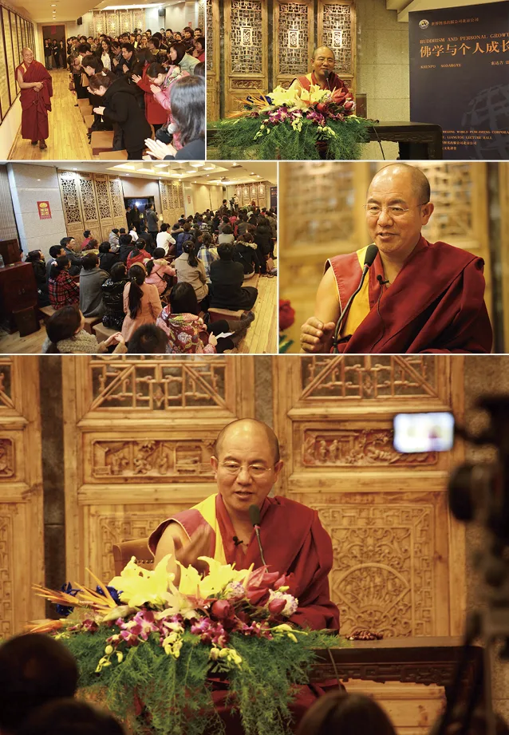
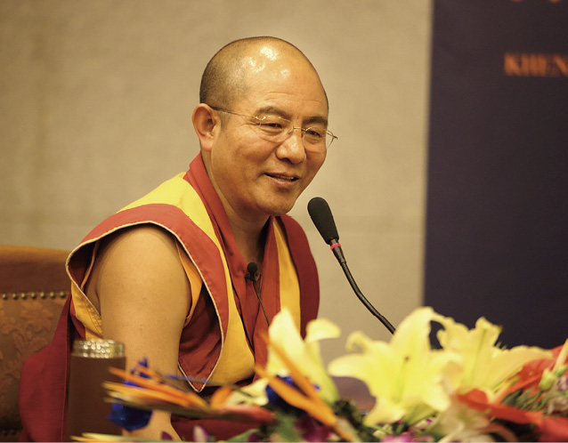
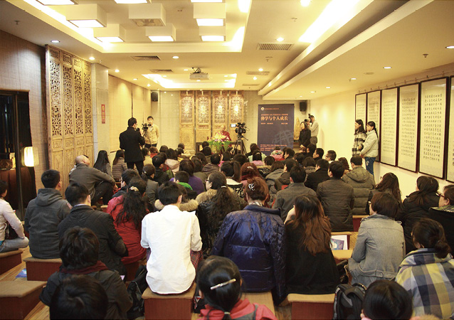
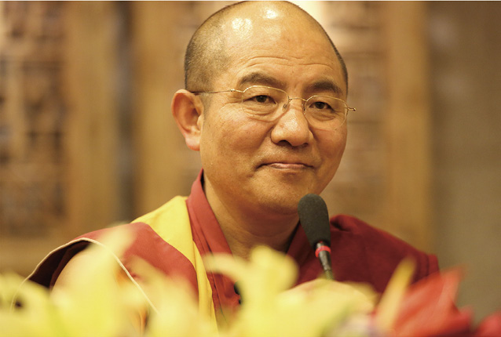
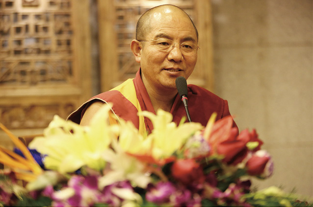
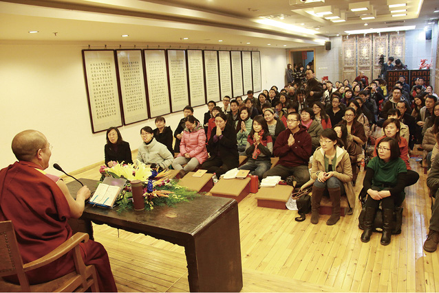
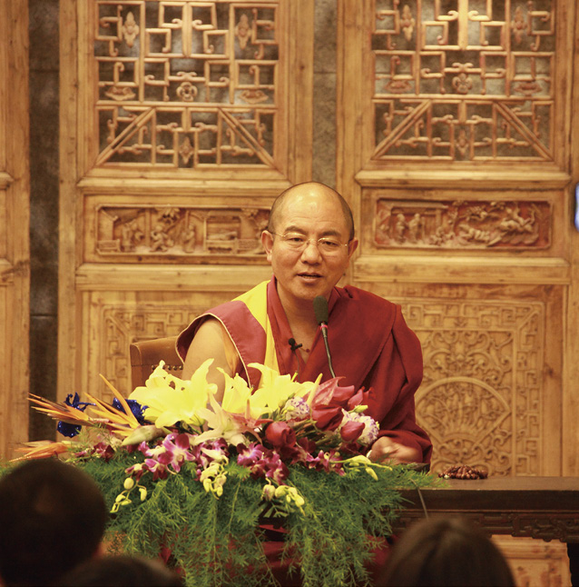
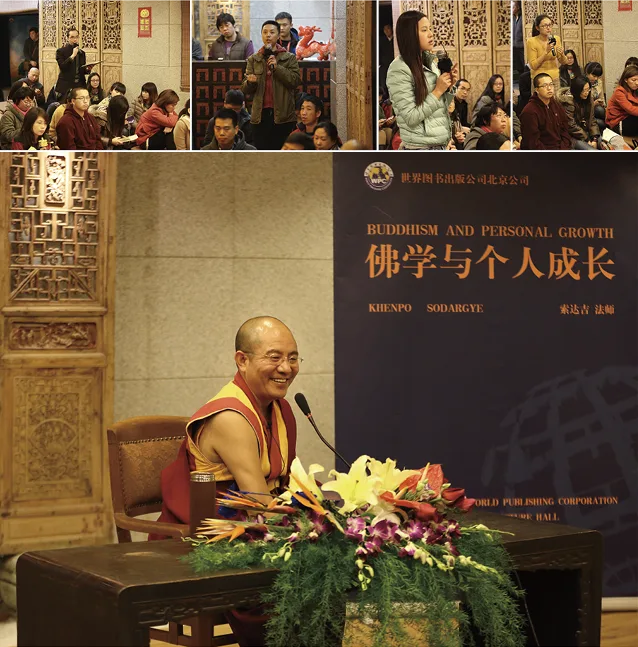
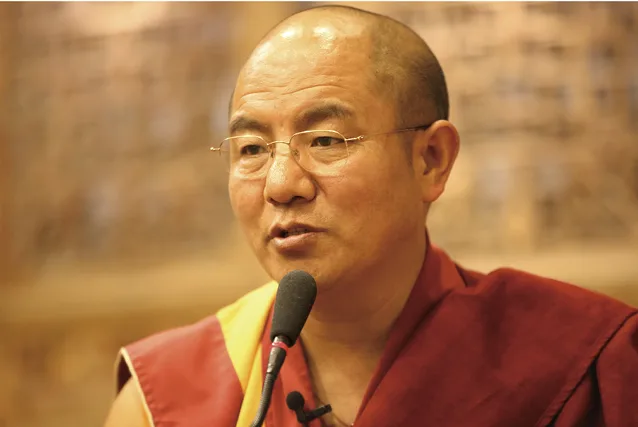

诺贝尔医学奖的获得者  
卡欧尔说：“祈祷是产生最强大力量的一种方式。”

第09场

北京世界图书出版公司

World Publishing Corporation, Beijing

中国·北京

2013 / 3 / 6

## 佛学与个人成长

## Buddhism and Personal Growth

主持人：

大家好，我是北京世界图书出版公司的总编辑。今天是我们公司“心理学沙龙”的一次特别活动。

“心理学沙龙”已经开展两年了，两年以来，沙龙举办过各种讲座。近一年来，通过与沙龙参与者的沟通，我发现有很多对心理学感兴趣的朋友，也对佛学很有兴趣，希望了解一些佛学教义。因此，我们通过这些朋友，费尽周折，联系到了非常著名的、藏传佛教的高僧大德索达吉堪布，请他来给我们做一次演讲。

这两年在做出版的过程中，我感觉到，对藏传佛教感兴趣的读者越来越多。虽然大家对佛教很感兴趣，但对佛教知识了解得不多，尤其对藏传佛教更是知之甚少。因此，很荣幸能够请到像索达吉堪布这样的高僧大德，为我们传播藏传佛教的真知灼见。相信诸位一定会收获良多，因此希望大家可以珍惜这次难得的机会。

接下来有请索达吉堪布演讲——

今天交流的主题是“佛学与个人成长”。

刚才总编辑讲了，我是一个学习藏传佛教的人。但今天要讲的，不一定全部是藏传佛教的内容，但都与佛教有关。这次我受邀来到这里，感到非常荣幸，希望给大家带来一次难忘的智慧碰撞。

## 寻找心灵的皈依处

今天在座的各位，大多是年轻人。虽然不是所有人都有信仰，但从人类总体的角度来讲，个人成长与宗教信仰有一定的关系。其实，在这个地球上，大多数人是有信仰的。我以前看过一个报告，是2006年的数据，当时全球人口的数量还不到七十亿。报告中说，在全世界范围内，没有信仰的人大约有七亿七千多万，而有信仰的人有五十多亿。

如果这个统计准确，根据具信仰人数的比例，按中国有十三多亿人来计算，可以得出一个结论——在中国有信仰的人是比较多的。但也有一种可能，像中国、非洲等一些地方，具信仰人数的比例不能按照全球比例来算。在全球有信仰的五十多亿人当中，有人信仰佛教，有人信仰伊斯兰教，也有人信仰基督教、天主教、东正教等其他宗教。

总的来说，人类的成长，与宗教信仰有非常密切的关系。一个有信仰的人，至少有寄托、有依靠，内心有归属感。

今天在座的年轻人，如果你们仍然在人生的十字路口徘徊不定，对信仰半信半疑，我希望你们能寻找到心灵的皈依处，这样你们的人生会更加有意义，会散发出更加耀眼的光芒。

## 你真的成熟吗？

人生的成长，有心理的成长，也有生理的成长。有些人可能生理成熟了，但心理却比较幼稚；而有些人心理相当成熟，但生理还没完全成熟。以上两种情况，在佛教历史中都出现过。

先讲一个生理成熟但心理没成熟的公案：印度曾有一位特别著名的国王，叫做波斯匿王，一次出行时，他看到一位白发苍苍、老态龙钟的老人，他问老人：“您多少岁了？年龄应该不小了吧。”老人回答：“我刚好四岁。”国王感觉很奇怪：“为什么是四岁呢？”老人说：“我在佛陀面前听闻真理还不到四年，接触万法实相的时间还很短，所以在心理成长上，我的年龄只有四岁。”

有些人遇到真理的时候，年龄已经很大了，人生的心灵成长从这时才开始。我也遇到过这样的人，他们经常说：“我之前二三十年的人生，都没有太大意义。这几年皈依佛门，开始系统闻思修行佛法，人生才真正有了意义和归属感。”道理确实是这样。不能因为一个人是大学生，或者已经参加工作，就断定他的心理完全成熟。

在佛教的历史中，有一位非常伟大的菩萨，叫做龙猛菩萨，他以芒果做比，来描述人的成熟度。有些人外表成熟、内心不成熟，有些人内心成熟、外表不成熟，有些人内外都不成熟，还有些人内外都成熟，有这四种人。

有些人从表面看很成熟，但深入了解之后，发现他的内在完全不成熟。而有些人表面看不太成熟，但其实他的智慧、心态都非常成熟。佛教中就有这样的公案，说是有一位国王，出行时遇见一个沙弥——所谓沙弥，指的是小出家人。国王向这个小沙弥礼拜，然后跟他说：“因为你是出家人，所以我以恭敬心向你顶礼。但像我这样尊贵的国王向你顶礼，让别人知道了不太好，所以你最好不要告诉别人。”结果没想到的是，小沙弥随即示现神通，进入国王面前的一个小瓶子里，之后又从瓶子里出来，说道：“我今天显现神通进出瓶子，也希望你不要告诉别人。”这时国王才意识到，小沙弥虽然年龄小，身体也未长成，但他的智慧、神变、能力都非常成熟，不禁感慨道：“沙弥虽小，但可度人；王子虽小，但可杀人；龙子虽小，但可降雨。”

通过此类公案，我们能够明了，有些人无论做什么事情，思维非常多元化，对真理能够接受，有理性，也有感性；而有些人人生过半，对真理还比较陌生，甚至一窍不通。

## 因果的春种秋收

无论在任何环境、任何群体当中，希望各位对佛、法、僧三宝，尽量有虔诚的信心，这非常重要。而且大家都应该遵守、也不得不遵守因果规律。一些年轻人，对因缘、果报知之甚少，甚至不懂“善有善报、恶有恶报”的道理。即使有些人稍微了解过这些道理，串习得也不多。但事实上，我们一定要取舍因果，这对每个人来说都至关重要。

可能有些人会认为：“在佛教教义中，这样不行，那样也不行，太麻烦。”但实际上，佛教的存在并非为了制定规章制度，而是为了给想要顺利度过一生的人，揭示应有的合理行为。因为不合理的行为，会让你的人生之路充满坎坷，难以前行。就像开车要遵守交通规则一样，如果没有遵守，就无法到达目的地，而且在行驶的过程当中，也会对他人造成不良影响。

佛教中说“好人有好报、恶人有恶报”，有些人会有疑问：“有些人做善事，但还会遇到困难、感受痛苦，而有些人无恶不作，却鲜少遭到恶报。这是什么原因呢？”对此，我在不同场合也开示过，虽然善有善报、恶有恶报，但果报并非当下成熟，好比农民种庄稼，春天播种，秋天才收获，不是春天刚播种就收获。所以，果报的成熟，需要一定的时间，还需要能成熟的因缘，这一点大家要明白。

## 愚人智者

人有善恶之别，也有智愚之别。在南传佛教的《愚人智者经》中说，人以愚者、智者而别，不过，这部经典好像在大乘经典中没有。经中所谓的愚者是指什么样的人呢？是指心生恶念、口说恶语、行为造恶之人。这样的人被称为愚者，而智者的心行则与之相反。

在世间，有些人说话不文明，常说别人的过失，甚至恶口骂人。也有些人常常在心里产生贪心、嗔心、痴心等各种恶念，进而由恶念的驱使，造作行为上的恶业。

最近有一则新闻，你们可能也听过，说是长春有一个盗车贼，把不到两个月的孩子埋在雪里致死。一开始，这个人只是因为贪心作祟，想偷别人的车：“车门开着，钥匙又没拿，如果我马上把车开走，应该没人发现。”随后他开车上了高速公路，将近一个小时之后，他突然听到后座有孩子在哭，内心顿时充满恐惧，生起了极大的嗔恨心——他害怕被发现，就把孩子杀害了。这样的嗔心，其实是一种愚痴。

最后他自首了，一审被判死刑。其实，悲剧的发生，往往都是因为一念之差。由贪婪的驱使，他在短短一个小时当中，就犯下严重的错误。一开始他只是想不劳而获，可最后却害人性命，自己也将失去最宝贵的生命。即使他最终没有被执行死刑，他的余生也将陷于悔恨之中。网上有很多人骂他，盼着他被处以死刑。但如果他就这样死去，也会非常可怜，因为他将在轮回中感受巨大的痛苦。

有些人由无明、愚痴、贪婪所驱使，犯下无法弥补的错误，过后才追悔莫及。有些错误可以弥补，有些错误却无法挽回。也许，每个人都有过类似的经历。而这些错误，皆由未能约束身语意所致。美国之前也有过类似的案件，不过孩子没有死，被有信仰的人带回给了父母。

## 破迷妙声

我看过余秋雨的一篇文章，叫做《庙宇》，收录在《文化苦旅》当中。余秋雨小的时候，被一个帮会中人绑架过。当时，他的家人一直追绑匪，最后绑匪走投无路躲进了寺院。绑匪一听到僧众的念经声，心立刻寂静下来，心态也发生转变，很快就把孩子送回家了。

去过寺院的人应该也有类似感受，比如进入寺院之前，你可能有恶心，或者带有逃避的心态，但感受到寺院、僧众的加持，或者听到念经的声音，心立刻就清净了，有很多这样的情况。

大多数藏族人常常拿着念珠，尤其是稍微年长的人更是如此。手持念珠代表着什么呢？一方面，是忏悔自己无始以来的罪障，另一方面，是让自己的心灵得到净化。持咒念经不仅是体现信仰的一种方式，它也能对调伏相续起到非常大的作用。

在藏传佛教的传统中，让心清净的方法之一，就是不断地念咒语。比如你想开显大悲心，悲悯所有众生，要经常念观音菩萨心咒“嗡玛呢巴美吽舍”；如果希望开启智慧，对经典论典、世出世间的道理不忘失，要念诵文殊菩萨心咒“嗡阿Ra巴匝那德”；如果你想在很短的时间中，以最快的速度、最有效率的方式成办事情，要多念度母心咒“嗡达热德达热德热娑哈”；如果你在承办任何事情的过程当中，遇到了一些磨难、障碍、违缘，要念莲花生大士心咒“嗡啊吽班匝儿格热巴玛色德吽”；如果你即将离世，并希望安详地往生极乐刹土，要念阿弥陀佛心咒“嗡阿弥得瓦阿耶色德吽舍”……很多像这样的咒语，都有着不可思议的功德和力量。

有些人可能会想：“为什么‘嗡玛呢巴美吽’这六个字有这么大的力量呢？”其实这是一种法性的规律，即法尔理，也叫做自然规律。比如有些药，只是很小的一片——但即便是小小的止痛片，也具备即时止痛的能力。而在草药当中，有可以止血的草药，也有可以治疗疾病的草药。不懂药的人会觉得很奇怪，同样都是药草或药片，为什么某种药可以治疗某种病，而其他药却没办法治疗呢？这是因为每种药、每样事物、每句咒语的力量都不同，就好比同样是说话，国王和平民语言的分量肯定不一样。圣旨在一个国家的作用，是一般人的语言比不了的。同理，咒语有诸佛菩萨的加持，因此具有殊胜的功德和作用。对此，有许多道理可以展开讲，但对于刚接触佛法的人来说，不需要了解得太深。

## 三界之中，以心为主

现代科学证明，通过祈祷和念咒，确实可以获得加持。我看过一本书叫《内科医学档案》，书中说美国哈佛大学对2055人做过一个调查，目的是研究祈祷对改善病情的作用。经过深入细致的调查，有69%的人表示，通过祈祷，自身的病情大有好转。

诺贝尔医学奖的获得者卡欧尔，也曾在报告中说：“祈祷是产生最强大力量的一种方式。”因此，如果我们在寺院当中，在佛菩萨面前，用非常虔诚、恭敬、清净的心进行祈祷，各种痛苦、烦恼都可以遣除。

在生活中，有些人经常会有一些问题。在感情、婚姻、家庭以及工作中，会遇到一些难以解决的事情。这个时候，你可以到寺院里去，在佛菩萨面前供香、供灯，以诚恳的心、恭敬的行为来祈祷和许愿。这样一来，除了前世不可逆转的业以外，其他事情都可以改变。祈祷的心非常重要，《心地观经》中也讲：“三界之中，以心为主。”在整个三界当中，心非常重要，如果心清净，那么一切都会变得清净。

有一位学者也曾说：“当心平静的时候，才能感受到外界的美丽。”我也有同感。如果照相机、摄像机的镜头没擦干净，即使外境再怎么美丽，我们也拍不出来。同样的道理，如果心态不好，即使外境再绚烂多彩，我们也感受不到。比如，你跟家人吵架，或者工作上遇到不顺心的事，导致内心极其烦躁、忧愁，这时即使欣赏美丽的风景，也感受不到美，即使享用美味佳肴，也品尝不到美味。这与自己的心态有非常大的关系。

## 十地菩萨尚以咒护持，何况凡夫？

人生的苦与乐本来就是交替而生的，要走过人生的旅程，的确需要勇气和智慧。以我个人的观点来看，这样的智慧大多来源于佛教。佛教包罗万象，无所不涵，涉及一切世出世间的道理，对此，大家需要有一些了解。而且科学证明，通过念咒、祈祷，身心会有所改变，对于这一点，诺贝尔医学奖得主也予以承认。

有些佛教徒，认为自己的根基很不错，学过空性法门、接触过密法，因此不需要持咒；还有些佛教徒，认为念一句“阿弥陀佛”就够了，也不需要持咒。有这种想法的人，要观察自己的根器到底如何。持咒和念经，不只是初学者的功课，有一定境界的人也不能舍弃。

不知你们是否看过《金光明经》，经言：“十地菩萨尚以咒护持，何况凡夫？”在佛教当中，一地到十地菩萨的境界是很高的，但即便是十地菩萨，也要以咒语护持自他，更何况是凡夫人？我遇到的一些人，他们认为学过中观空性的道理之后，每天看一些《六祖坛经》、中观、因明的法义就可以了。在他们看来，用念珠持咒是老年人的行为，而年轻人，尤其是大学生、知识分子，不需要念咒语。这种想法是不合理的。有这样的想法，是因为不懂咒语的功德。一旦懂得持咒的功德，学识再渊博的人，一生都不会中断持咒。藏传佛教的许多大德，包括上师法王如意宝，一生都持咒不辍。法王如意宝一生念了九亿咒语，其中有些咒语很长，有些咒语只有一个字。在他的一生中，只要有空闲就念咒，我也经常看到他在念。

藏地的很多修行人，无论是出家人，还是在家人，手上都拿着念珠。但在其他地方，尤其是一些城市里，个别佛教徒对持咒、念经不太重视。我希望真正的修行人，对此应该重视。

当你身边的人生病或者感到痛苦时，无论你是出家人还是居士，都可以通过持咒来加持他。有些人认为只有上师、活佛、出家人才可以加持别人，居士或世间人没有资格，实际上并非如此，只要有一颗善心，任何人都可以为别人做加持。

在藏传佛教的历史中，有一位伟大的上师，叫做阿底峡尊者。有一次尊者手痛，于是请他的弟子仲敦巴做加持，弟子问上师缘由，上师说：“你的心地很善良，所以需要你为我疼痛的手做加持。”

从传统上讲，上师给弟子做加持是没问题的，但弟子给上师做加持，恐怕很多佛教徒都无法认可：“哪有弟子给上师加持的，应该上师给弟子加持！”实际上，如果上师的心地不善良，心态不好，上师也没有资格做加持；如果弟子的心很好，弟子也可以时时刻刻加持上师，这没有什么不合理的。

平时在生活当中，如果身边有一些病人、可怜的人，你也可以给他们做加持。《药师经》中说，对没有虫的水念药师咒108遍做加持，之后让病人喝下，除前世非常严重的业之外，这样的水对遣除其他业障都有功效，疾病也有痊愈的可能。所以，大家对咒语的加持力一定要了解。

## 闻思不是吃止痛片

听闻佛法的时候，应当发愿永久摄持其中的教义，即使无法做到，至少也要在一生中，记住这些道理，这一点很重要。

有个别佛教徒，今天听某个上师开示，明天听某个佛学博士开示，听过后也没有内化为自己的所学。这种所谓的学习，就像吃止痛片一样，效果只是暂时的。之前在其他场合，我也用过这个比喻。今天你吃止痛片，会有一些作用，明天不吃，效果就没了，但学习不应该这样。如果听到一个真理，就应该永远铭记于心，像我认识的一些老修行人，他们年轻时听过的道理，八九十岁还记得。

在学习的过程中，大家应该正确认识真理，这一点很重要。有些人认为，佛教的道理太高深、太玄妙，凡夫俗子没办法理解，因此一再把佛教世俗化，甚至低俗化，这是不合理的。虽然佛教可以与时俱进，以便世间有情从不同角度理解佛法，但从究竟层面来讲，真理永远是真理，不可能自降高度。

有一个关于孟子的故事，你们或许也听过。孟子有一个弟子叫公孙丑，他向孟子提出一个请求：“您所讲的道，非常深奥、也非常完美，它像天一样高远，但一般人很难接受。因此，道是否可以降低层次，以便世人接受？”孟子回答道：“所谓的道，无法降低层次。因此，我们应想尽一切办法，尽量提高见解，以期与道融为一体。”

这个故事所揭示的道理，对佛教也适用。现在很多人喜欢“人间佛教”，我也承认它很好，但如果以人间佛教的名义，降低真理的层次，甚至误认为真理与世间观点无别，那么真理就失去了作为真理的意义。因此，想了解佛教、追寻真理的人，应当想尽一切办法，将贪、嗔、痴、慢、嫉妒等不良心态遣除，并尽最大努力提升智慧与悲心。

## 生无信仰心，恒被他笑具

佛教是一种能够净化人心的教育。佛经的内容涉及身口意的净化，以及戒杀、盗、淫、妄、酒的基础戒律，也就是五戒。如果一个世间人能够遵守五戒的要求，大家都会认为他是一个好人。其实，佛教中的理论，并不是限制性和教条性的，它完全符合人类社会的发展需要，也相合于个人进步的理念与行为。

我们应该了解信仰的价值，但现实中，大家却很难理解为什么需要信仰。我昨天跟学校的老师、同学进行了交流，通过交流发现，如果一个人有佛教信仰，许多人都会不理解。当然，这种情况也情有可原。

但社会也在逐渐改变，人们发现，有信仰的人非常可靠，而一些没有信仰的人，由于没有任何约束，让人难以放心，甚至心生恐惧。因此，我相信未来会迎来人类认同信仰的时代。

《辞海》《词源》在解释“信仰”时，多引用《法苑珠林》中的“生无信仰心，恒被他笑具”，意思是说，如果人没有信仰，将恒常被别人讥笑。虽然这是一个不争的事实，但现在体现得还不够明显，我相信未来会慢慢改变。因此，对各位来说，在人生中，寻找一个信仰非常重要，甚至可以说，这比什么都重要。

在年轻时，如果没有找到信仰，没有信仰的智慧，等年老时，悔之晚矣。而一旦拥有信仰，欲望、痛苦都会减轻。佛在《遗教经》中说：“欲望多的人，苦恼也多，因为他索求的多；而欲望少的人，索求的也少，痛苦、过患自然减少。”

## 具信仰者有痛苦吗？

有信仰的人有没有痛苦呢？也有痛苦。那有没有生死轮回呢？也有生死轮回。但有信仰的人，在考虑事情的时候，确实跟别人的心态不一样。我以前去过玉树的地震灾区，对此有一些体会。虽然地震夺去了很多人的生命，但幸存下来的人，基本不需要心理医生，这是为什么呢？因为玉树地区的人大多有信仰，信心也很大，所以面对这样的灾难，他们完全有能力承受。听说其他灾区有想轻生的幸存者，但玉树灾区基本没有这样的人。

## 若人自爱己，应修诸善业

人类谋求发展，需要足够的物质资源。而对个体来说，需要跟上人类进步的步伐，这的确很重要。但更重要的是什么呢？是我们的内心要保持平静，减少一些欲望。否则，人们的欲望过度膨胀，在欲望的驱使下无恶不作，造成的后果是我们都不愿意看到的。

像北京等一些地方，空气、水、食品等均受到不同程度的污染。前一段时间，有一个企业家说自己从来没有这么高兴过。这是为什么呢？因为空气一旦污染，会影响北京的所有人，包括一些特权阶级。从佛教的角度讲，其实没有必要幸灾乐祸，因为特权阶级的人也是人。而且就算他们无法呼吸到新鲜空气，我们又能得到什么呢？所以这种心态是不可取的。

医学家对人类未来的生活做过预测，认为对人类生命最严重的威胁，来自三大癌症——肝癌、胃癌以及肺癌。由于饮用不洁净的水、食用不健康的食品等，致使患肝癌的病人日益增多；而空气的污染，则增加了患肺癌的概率。听说如果在北京患上呼吸道疾病，是不太容易治愈的。我不清楚这是不是真的，不过我现在没什么症状，以后可以去试一试（众笑）。至于胃癌，饮食的问题应该是诱因之一。由于欲望的驱使，一些工厂生产的食品会有一些问题。其实，本来很多人都觉得工厂主很了不起，也很羡慕这个职位。但如果工厂主利欲熏心，危害大众的身体健康，造成的后果也很严重。

听说北京在开奥运会的时候，一个月里都是蓝天，这得益于当时的规定——所有工厂须暂时关闭或迁至城外，奥运会闭幕后，再恢复正常生产。在当今时代，人们对空气、水、食物等，有一种前所未有的不安。这是因为很多人自我膨胀，以自私自利的心态做事，造成利他心的缺失。人们所需要的，是大乘佛教所提倡的自利利他的精神——在基本能维持生活的前提下，尽力帮助所有人。但真正这样去做的人，有多少呢？很难说。

有些人一旦有机会，宁可害人，也要自我发展，不惜一切代价追名逐利，以期独自占有、享用更多的财富。长此以往，社会将如何发展，大家也应该清楚。

从表面上看，现在比任何一个时代，生活得都好，饮食丰富、衣着华丽，坐高档轿车、住高楼大厦……人们大多在感慨世界的日新月异，物质的极大丰富、科技的突破性发展，为前之时代所不及。但另一方面，人类道德下滑、慈悲心退失的现象日益严重，甚至不断出现害人害己的恶性事件。而这些事件在古代几乎闻所未闻。尤其是现在，人类制造出的各种食物、产品，如果没有检验部门的严格把关，任其流入市场很可能会害人无数。这导致人类在吃穿住行甚至是呼吸等各方面，都缺乏安全感。其实，这些问题并非由外星人或其他物种所造成，而是源于人类的“自掘坟墓”——人类不但给自己的生存制造了诸多不安因素，也给整个地球带来了不利影响。

身处这个时代，人们的欲望越来越大，对奢侈品的需求也越来越多。而在我的孩童时代，拥有一个玩具就很满足，对一张水果糖纸都很珍视，可以用它玩半天。我的家乡在很偏僻的地方，过年时很难得到几颗水果糖，所以，一旦获得一颗糖，我就会把它视如珍宝。当时水果糖好像卖一毛钱十个，在我们这群孩子里，如果谁过年时能得到一颗水果糖，大家都舍不得吃，要放上半天，等最后吃完了，再把包装纸当玩具，还能玩很久。

反观现在，很多父母从小就溺爱孩子，孩子对吃好穿好也感觉理所应当。在学校的环境里，孩子的要求更是越来越高，要穿名牌、用高档的东西。孩子长大成人之后，对生活的需求会更多，生活标准也会更高。如果生活标准很高，人的欲望无有止境，就很容易陷入苦恼，甚至会因此做出不如法的行为。

有些人做过很多违背天道、人道的事情，这与道德教育的缺失、传统文化的衰落有直接关系。通过学习，大家都应该知道要做一个善人、做一些善事。如果常常行善，即使没有天天祈祷，没有想尽办法追求快乐，也一定会感到快乐。有一个做过坏事的人问佛陀：“我干了坏事，祈祷神还有没有用处？”佛陀没有直接回答他，而是用一个比喻来为他说明：“如果你把石头放在水里，祈祷神明让石头不要沉下去，有没有用处？他回答说：“祈祷神也没有用，石头还是会沉下去。”佛陀继续问：“如果你把油倒在水面上，通过祈祷神会不会让油沉下去呢？”他说不会的。于是佛陀为他开示：“如果我们做了善事，就像把油倒在水上一样，油始终会浮在水面上；如果做了恶事，则像把石头放在水上，石头会直接沉下去——任何行为的果报迟早都会成熟。”这个公案是在《中阿含经》里讲的。

在《杂阿含经》中还有相关教证：“若人自爱己，应修诸善业，速疾能获得，种种诸快乐。”如果我们造了种种善业，快乐的因缘终将聚合，迟早会获得一切快乐。其实，作为佛教徒、作为有信仰的人，内心应该是快乐的。

## 如何面对死亡？

佛教中有很多常人难以想象、无法用语言描述的成就与感应，它能给予我们面对痛苦的能力和勇气。不仅如此，通过修行佛法，还能获得生死自在的境界——自古以来有很多修行人都获得了这样的成就。

人类最害怕生病与死亡，尤其对终将离世这件事，我们都心存恐惧。有些人甚至不敢提起死亡，如果不得不提及，就用其他语言搪塞过去。按照佛教的理念，对死亡要提前进行妥善安排。在藏传佛教的传统中，自古以来有很多这样的事例。有些开悟者，不但自己获得了成就，家人也有证得清净果位的成就者。

唐朝道一禅师的弟子庞蕴居士，是非常了不起的成就者，其亲眷也以不同形象示现往生。庞蕴居士的修行境界很高，他把所有钱扔进海里并说道：“世人多重金，我爱刹那静。金多乱人心，静见真如性。”意思是说，世人大多重视金钱，而金钱很容易令人浮躁，他还是喜欢安住于片刻的宁静，这样才可以现见真如本性。

在往生的前几天，他向家人透露了自己将在某天中午往生的消息。在往生的当天，庞蕴居士让女儿灵照到外面看看到没到中午，但女儿不想让父亲这么早就往生，所以说还没到。庞蕴居士不相信，于是自己到外面看了看。其实，灵照也是生死自在的修行人，趁父亲出去的时候，她坐在父亲的位置上往生了。庞蕴居士回来一看，女儿已经先往生了，就只好随后的七天里帮女儿处理了后事。

后来，庞蕴居士以卧式往生。他的妻子听说女儿坐着往生，丈夫卧着往生，就把这件事告诉儿子：“你的父亲和姐姐都已经往生了。”当时儿子在田里锄草，听后说：“既然他们是坐着或卧着走的，那我就站着走吧！”之后他手里拿着农具，站在农田里往生了。母亲见状，心想：“你们都走了，只留下我一个。我走的时候，要用跟你们不一样的方式。”

她把家人的后事全部处理完，就念了一个偈颂：“坐卧立化未为奇，不及庞婆撒手归，双手拨开无缝石，不留踪迹与人知。”意思是说，我家有人是坐着往生的，有人是卧着往生的，还有人是站着往生的，但这些都不稀有，等我往生的时候，要把没有缝隙的石头打开，一点痕迹都不留地离开人间。念完偈颂，她随即打开一个没有缝隙的石头进入其中，连头发和指甲都没有留下。

这是真实的案例，不是神话故事。看过《高僧传》之后，大家就会知道这些大德的事迹在历史上是真实存在的。其实，藏地也有这样的记录，在“文革”时期，有些修行人直接飞往清净刹土；有些人获得虹身成就，头发、指甲都没有留下，或只留下一点点毛发。

## 总结与寄语

各种示现都表明，佛法的力量超越了人们平庸的想象，的确不可思议。在现代的某些教育中，宗教被视为麻醉品与精神鸦片，这样的观点很不合理。

现在在国际上，大家普遍对宗教有所了解，尤其是对佛教有了一些正确的认识。2009年，佛教被评为“世界最佳宗教”，这是为什么呢？一是佛教从来没有以自己的名义发动过战争，没有做出故意损害生命的行为；二是佛教是经得起科学验证的真理。

佛教深广的道理，在今天短短的时间当中，很难全部开显，包括藏传佛教在内的所有佛教派别，其甚深、广大的道理都难以说尽，所以我今天讲的内容，只是起到一个抛砖引玉的作用。

我想跟大家强调的是，人身是非常难得的，因此在获得人身时，要去了解佛教真理，并把它运用在生活当中。在人生中践行佛法，可以减轻自己的压力和烦恼，也可以为全人类、全世界，做出一定贡献。每个人都可以对自己的家人、身边的人产生影响。

一般来说，如果自己的心很善良，周围人也会变得善良；如果自己的心行不善，成为传播不善的因，最终也会给世界带来不吉祥。因此，每个人都有责任去成为一个心善之人。心善之人如一盏明灯，可以遣除自己周围的黑暗；若将明灯传递，一传十、十传百，最终便可以照亮整个世界。

现场互动

问：一直很期待参与今天的见面会。今天跟我一起来这里的几位师兄，都读过您编著的《智海浪花》[^1]。我们非常期待多了解一下喇荣五明佛学院的情况，想暑假的时候去参访学习。

堪布：其实，通过网络也能了解喇荣五明佛学院。它是在1980年，由法王如意宝晋美彭措创办的，如今在藏传佛教当中，是规模最大、人数最多的一所佛学院。

它跟其他一些佛学院，尤其是汉地的佛学院比起来，生活条件要差一些，但学习的氛围、环境的加持力、对人心转变的力量却有不共之处。大约在二十年前，我在向美国学友介绍学院时，也说过这样的话：“喇荣有一种不可思议的吸引力，我相信这种吸引力会持续很久。”二十年后的今天，我仍然是这样认为的。虽然学院的生活条件不太好，但确实有一种吸引力。尤其是对知识分子的吸引力更为不共，我相信未来会有很多国家的知识分子，通过学院的平台，去正面了解佛教，并从中得到真正的智慧。

问：我初学佛教，刚刚皈依，一直很关注六道轮回和地狱的问题，过年时还为地藏殿做了很多灯。但我对地狱的信解，还不是很深刻。对此，我也问过很多法师，请他们做过一些开示，并希望通过修学，对地藏菩萨、十殿阎王、地狱有所了解。请问，您是通过什么方式认识到确实有六道轮回和地狱的呢？是否可以和我们分享一下？

堪布：其实《地藏经》中有对于地狱景象的描写。在汉地的一些地狱游记里，也讲述了游历地狱的经过。对寒地狱、热地狱、孤独地狱、近边地狱等地狱，在不同经论当中，有不同的描述。

我对地狱的存在深信不疑，因为佛陀以金刚语确认了六道轮回、包括地狱的存在。佛陀的金刚语，对以目可见的人道、旁生道的规律进行了无欺描述，那么，以因明的逻辑推理可以推出，佛陀所描述的眼睛无法看到的世界，也必定是真实的。而且，自古以来，许多成就者对地狱的景象都有非常详细的记录。如果你想真正了解地狱、饿鬼、旁生的寿命以及他们的痛苦等，一定要系统闻思相关内容，这样才能明白其中的意义。

问：现在汉传和藏传佛教中都讲“人人心中都有佛性”，但我最近在看的《瑜伽师地论》中讲，人分两种，有种性和无种性，无种性的人永远都不能成佛，所以我不知道如何理解这个问题。另外，我身边有一些人，包括我的好朋友，他们完全不信佛，甚至谤佛，他们算不算是无种姓的人？我对他们不恭敬佛陀的心行非常担心，怎样循序渐进地帮助他们，让他们慢慢地去尊重佛、信仰佛呢？

堪布：无种性的说法在佛教当中是不了义的，也就是说，这个观点并不究竟。你刚才提到的人，他们的邪见很深，业力很重，虽然他们也有佛性如来藏，但暂时无法显发，所以好像是无种性一样。在很多大乘经论中，对此也有说明：所谓的无种性，是针对业力非常深重的人来说的，这些众生的解脱和成佛遥遥无期——由于时间过于漫长，因此以否定词“无”来加以说明。就像经济条件特别差的人，人们会说他“一分钱都没有”，使用这样夸张的表达。

想要帮助业力十分深重的人，暂时有一定的困难，但也可以试着跟这些人讲道理，就像佛陀为不同众生宣讲八万四千法门一样。如果他们想要推翻这些真理，也不具备能力。不仅是他们，古今中外无数的学者、智者，对佛陀的教义都无法推翻。但如果他们一直对佛教心存偏见，就会诽谤真理。因而在短时间内，不一定能引导他们做出改变，但最终也会有为他们拨开迷雾的机会。

问：在我来这里的路上，坐地铁时看到了很多宣传标语。在现在的宣传中，经常能看到“正能量”这个词。在闻思大乘佛法时，我们也学习过发菩提心的内容。发菩提心和拥有正能量，在内涵上是不是有相同的地方？

堪布：现在不仅在地铁上会有这样的宣传，在网络上、出版物中，都经常提到“正能量”。其实，这里的“正能量”，指的是我们的智慧、勇气、利他心等。而所谓的菩提心，其真正涵义是指，在自己获得圆满佛果的同时，也让一切众生获得同样的断证功德，即断除一切障碍，证悟圆满智慧。

所以，“正能量”从深度和广度上，与菩提心相比，还是有比较大的差距。不过，从智慧与勇气等角度，“正能量”也可以相似地解释为菩提心。

问：我的职业是心理治疗。佛陀悟道后，在鹿野苑初转法轮，为五贤者宣讲苦集灭道四圣谛，揭示了烦恼产生的原因及息灭烦恼的方法。所以我想请您谈一谈，我们如何息灭内心的烦恼与痛苦？

堪布：您说话的声音比较小，所有人听的时候需要很专注，注意力集中。我要不要用一样的音量来回答？（众笑）开玩笑的。

佛陀在印度鹿野苑初转法轮时，宣讲了苦、集、灭、道，即苦与苦的根源、苦的断除方法以及断除苦之后的结果。这对修行来说非常重要。

人们的很多痛苦，源于对生活的要求越来越高，内心争强好胜。别人拥有的东西，自己得不到，就成了痛苦。比如，别人有一辆车，我也想要这辆车，这辆车就成了我的痛苦；别人有一栋房子，我也想要这栋房子，房子就成了我的痛苦。因此，沦为房奴、车奴，完全是由于个人欲望的驱使——看似是别人带来的痛苦，其实是自己造成的。内心的执著就是烦恼的根源。

找到根源之后，选择以什么方式来断除烦恼尤为重要。佛陀初转法轮的教导，对我们的修行有很大启发。我特别希望在座的年轻人，如果有时间，要多翻阅《阿含经》《百业经》这样的经典。我本人也经常从经典中汲取智慧，在生活中遇到困难和痛苦时，我会读一读《入菩萨行论》。

问：凡夫生活在俗世中，总免不了被种种烦恼困扰。所以我想请教，您是如何保持内心的清净、宁静与祥和的？

堪布：其实，我也是有时能调整好，有时调整不好。不过，我对佛教智慧的信心始终如一。

我非常喜欢跟大家交流佛法，二十多年来也一直在这样做。对我来说，能够学习和运用佛法的智慧，是一生当中最开心、最享受的事情，因为佛教的智慧是无与伦比的珍宝。而且，它确实能给我们带来改变。寂天论师所造的《入菩萨行论》，有一千多个偈颂，如果能系统去学习它，对调整心态会有很大帮助。我在学习之后，心态的确有很大改变。我所做的事情，无论成功还是失败，所受到的待遇，无论是被歧视还是恭敬，我都可以通过佛法的智慧调整自己的心。

现在的年轻人，应该有一种坚强的心态。当然，人不可能无缘无故就变得坚强，需要通过学习来改变自己的相续。运动员要经过千锤百炼，才能练就强健的体魄，拥有矫健的身姿。同样的道理，心也要通过磨炼，才能在令人烦躁的世界中，自如应对各种压力。

问：我是一名虔诚的佛教徒，已经跟随我的上师学习了十多年了。我的职业是心理咨询师，在生活和工作中，总会有人因为心理问题向我求助。其实我自己也有很多烦恼和痛苦。以我个人的经验，在处理心理问题时，心理疗法的见效比较快，所以我想问的是：应该完全以修习佛法令自己成长，还是也可以用一些心理疗法，来帮助自己在目前阶段的成长？

堪布：无论是通过佛法或心理疗法，来解决自身的烦恼和痛苦，都需要修行。我学佛比较久了，从出家到现在已将近三十年。我始终认为，心灵的成长需要依靠长期的修行——要修持空性、利他慈悲心等。也可以通过念诵咒语、经文等各种方法，令内心的烦恼、杂念逐渐减少，智慧、利他心慢慢增长。虽然我们不是具足智悲的成就者，但也可以通过精进，令自己不断成长。就像世间老师，如果非常精进，通过长期积累经验，自身的修养、教学水平都会有一定提升。

为实现个人成长，首先要严格要求自己，否则过了多久，也不会有进步。通过个人成长，再帮助他人成长。不过，在佛门和心理咨询行业，都难免出现误人子弟的现象。我以前看过一则新闻，有一位心理咨询师，从业十多年，一直为他人提供心理咨询，为很多人遣除内心的痛苦，但在自己遇到巨大痛苦的时候，却选择了自杀。能教导别人却无法遣除自己内心痛苦的人，无论是在修行人中，还是在世间人当中，都是存在的。

问：怎样运用自己学到的佛法，以合适的方式帮助别人？因为在工作场合中，不方便直接讲佛法或教人念咒语。

堪布：利他是一个长期的过程。自己平时可以为他人宣讲佛法，但不要强迫对方念咒语或遵循某种仪式。其实，在某种意义上，仪式没有也可以，只要能让他人解开心结，并从佛法中获得智慧，这才是至关重要的。所以，刚才在演讲的最后，我也提出这样一个希望——每一个人，在社会的大群体中，都要肩负起帮助他人的责任。

我们身边的人，可能对心灵疗法一无所知，一直陷于心灵的困境中，始终被小事所困扰。我遇到很多年轻人，由于对感情的执著、对地位的追求，心生苦恼。在这时，如果我们为他稍微开解一下，他或许便能豁然开朗，自在洒脱地生活。因此，帮助他人调伏内心、开显智慧，比财富上的资助更为有力。

大多数人，认为只有给予受助者几万人民币，才是一种帮助。但实际上，真正能帮助一个人的，是心灵上的帮助。世间的许多人，虽然拥有丰足的物质财富，但内心却非常贫穷，因此，他们的心田需要智慧雨露的滋养。

问：我接触佛法已有十年，受益匪浅，法喜不断增上，但也遇到了一些困惑。现在有很多人，对佛教信仰不理解，我的客户、朋友就是如此。我手上戴着一串佛珠，他们就会问我：“你是不是信佛？”我承认之后，他们又问：“你这么年轻为什么要信佛？”还有很多四五十岁的人会问我：“你以前是不是受过什么伤害？”我否认说：“没有，因缘到了就学佛了，而且佛法非常殊胜。”但即使解释了，他们还是会觉得，我现在的生活很好，没有必要学佛。可能是我自己的智慧不够，无法向他们解释清楚，所以我想向上师请教，如果再遇到这样的问题，我该如何回答？再比如，我在社交场合中，会坚持自己的原则，吃素、不沾染酒色，所以就被认作异类，我应该怎么办呢？

堪布：我也能理解他们的疑惑。刚才讲了，在中国，没有信仰的人占大多数，你的经历，也是社会风气的一种体现。我在微博上发过一个故事：一位大学生登上火车，见一老人手执念珠念念有词。学生问：“你还信这过时的东西？”老人说：“我信。”学生说：“去了解了解科学对此的解释吧。”老人回答：“我不懂这方面的科学。”学生说：“请留下地址，我寄些书给你看。”老人递上一张名片，学生接过一看，脸一下子就红了。名片上写着——路易士·巴斯德，巴黎科学研究院院长。

现在有很多人认为，拿念珠、看佛书、吃素、去寺院，是不正常的，这也与七八十年代影视媒体的导向有关。在这些电影宣传中，人们在生活中遭受苦难时，才会选择去寺院。因此，在很多人的观念里，只有在走投无路时才会去出家，出家以后要拿念珠、转经轮……总之，是因为精神有问题或生活有困难才选择这条路的。这是一些人的偏见。但我相信，这些偏见终有一日会被打破。

无论他人如何评价佛教，我个人认为真正的佛教是非常科学的。对于这样的真理，每当遇到旁人的不理解甚至是非议，我们更需要向他们显露一些智慧，要用真理去说服他们。刚开始时，或许他们无法正确认识佛教，但逐渐会发现，自己的认知是一种偏见，最后也会信仰佛教，加入学习真理的群体中来。

问：我是世界图书公司的编辑，关注藏传佛教很多年了。关于佛教，有一个争论是“佛教是有神论还是无神论”。在我看来，佛教是一种特殊的生命哲学。虽然佛教世界里也有神，但佛教中的神只是一般意义上的神，并非作为世界起源的精神实体，不是世界的创世者或万物命运的主宰者。

我认为在某种意义上，佛教主张的是业力创世——由个体把握自己的命运、个人命运遵循善恶因果。如果佛教中有所谓的命运监督者，我认为指的就是因果律——在宇宙中，众生的命运皆为自作自受。所以，我认为佛教的内核，应该与无神论更为接近。您对这个问题怎么看？现在有一些大德，也认为佛教是无神论。但这有可能是为了迎合当下的意识形态，为了藏传佛教发展得更好的一种方便说法。所以我想听听您的高见。

堪布：我们不应该用某种单一的标准来判断佛教是有神论还是无神论。为什么这样说呢？因为所谓的“有神论”，其定义与基督教对“神”的认知类似，他们认为上帝是万能的神，是万物的创造者。而所谓的“无神论”，一般指的是唯物主义的观点。但实际上，佛教的观点不符合这两者中的任何一者。

在佛教抉择空性的教义中，其观点是无眼耳鼻舌身意，从苦谛乃至一切智智之间的万法都是空性，对其真实存在均不予承认。所以，胜义中不会承认有所谓的“神”。而在抉择世俗谛，即抉择世俗现象时，佛教也承认上有天堂、下有地狱，但这里所承许的“神”，只不过是天道众生而已。因此，在佛教的某些观点中，显现上也承认有神。即便如此，也无法以有神或无神来概括佛教的观点。所以，我们需要一分为二地看待这个问题。

问：怎样理解与周围人的因缘关系？比如自己和亲人、朋友、单位同事的因缘。

堪布：佛陀曾在经中讲过，因缘太过甚深，需要以尽所有智和如所有智才能无碍了知。一个人前生后世的因缘，以及与别人之间的因缘，有些是前世一起造善业而结下的善缘，有些是前世共同造恶业而结下的恶缘。所以，对于错综复杂的因缘，即使进行观察，也难以了知。

大多数情况下，我们所做的都只是一种推测。比如，如果在座的人都很快乐，可以推测出是前世或今生种下了善的种子；如果是感受痛苦或其他情况，我们也可以就此进行推测。

问：学佛最后追求的是成佛，但如果暂时达不到这个目的，我们也会继续学佛。那么，学佛对脱离六道轮回有什么作用呢？

堪布：在大乘佛教中，发菩提心的终极目标，是让一切众生成佛，当然其中也包括让自己成佛。在未成佛之前，生生世世都要行持善法。即使我们仍在六道轮回中流转，但只要发愿乃至成佛之间一直利益众生，这种心的力量就不可思议。因此，大家在寺院或值遇非常殊胜的对境时，一定要祈祷和发愿。

一方面，可以发暂时的人天善愿，比如身体健康、生活安乐、家庭和睦等，而另一方面，要发愿乃至成佛之间，生生世世利益天下一切众生，让他们离苦得乐。这样的发愿无形无相，却拥有强大的力量，因此非常重要。

问：我个人感觉，人的善恶像一种能量，善是一种能量，恶也是一种能量。宇宙会把每个人的能量“记录”下来，因此“善有善报，恶有恶报”。这种能量将一直存在于宇宙之中，不知道这样的想法有没有道理？

堪布：善恶因果是世间的一种规律，源于心的力量，也可外化为物质的力量。在佛经中，把善和恶比喻成药和毒，药有药的能力，毒有毒的能力，种下药的种子会生出妙药，种下毒的种子会生出毒物。起心动念也是如此，如果生起善念，会带来快乐，如果生起恶念，会带来痛苦。因此，当修行人产生恶念时，要尽量调伏自己的烦恼。如果心念实在难以转变，就需要通过念咒语来忏悔，并逐渐净化心相续，直至不再生起恶念。

问：我是一个影视工作者，也是一名佛教徒。我有一个困惑，虽然我很虔诚，但由于经常出差，没办法随身携带佛堂以作供养。所以，出门在外时，如果只念咒语，或者经常看堪布推荐的几本书，是否可以？还是需要把佛像、唐卡带在身上，加持力才比较大？

堪布：这个问题很好，因为这不仅是你一个人的疑惑，也是很多人想问的问题。出差无法随身携带佛堂，大家都能理解，因为出门的时候，不可能还把佛堂装在包里。当然也有一个方法，可以相似地做到这一点。我其实也经常外出，每次出去的时候，都会随身带一尊小小的释迦牟尼佛像。入住后，把佛像放在床前。

这样一尊佛像，就是所有佛菩萨与上师的总集，你可以用它观修，也可以把它直接观为释迦牟尼佛。所以，即使你没办法把佛堂搬到出差的地方，也可以有作为供养、顶礼、祈祷的对境。再带一些佛珠、经书，这是佛教徒应该带的。尤其是对于自认为很虔诚的人，更要常常带着佛经。

问：一个人的惑见很重，念什么咒或怎么修学可以对治？

堪布：首先在这里说一下，今天晚上听讲座的，听说有四百多人，后来这边的管理人员，婉转拒绝了一些人的申请，所以也请相关负责人告诉报名者这边的情况，并希望得到他们的理解。其实，如果场地等各方面条件允许，大家都来这里共同探讨一些问题，没什么不可以的。但这次是担心人太多会出现违缘，主办单位会有诸多不便，因此，希望大家通过各种途径互相转告。虽然我也很想见所有报名的道友，但由于种种原因，这样的机会只能推迟到下一次了。

你刚才说的惑见，通过念药师咒来加持是最管用的。

问：由惑见而生的嗔恨会不断增长。自己以前的嗔恨心似乎没有现在这么重，所以想请问嗔恨心如何对治？

堪布：通过修慈悲心，可以断除嗔恨，这一点很重要。

问：学佛以后懂得了要善待众生，尤其是对家人、孩子、父母都要这样去做。但一个人的能力很弱、身体不好，还自己带了两个很小的孩子，在生活中面对很多现实的问题时，真的会感觉力不从心，会很累、很痛苦。内心也会很挣扎，因为还是想要带好孩子，处理好生活，处理好很多事情和问题，那么这个时候应该用什么力量来支撑？这样的力量从哪里来？如何能够做到不留遗憾？比如说对于孩子的教育、健康成长不留遗憾。

堪布：其实，现在的世间中，有很多人都是力不从心地生活着，面对老人、孩子以及家人的种种，常常生起很多烦恼，甚至还有可能会遭遇一些不合理的对待等等。在这个时候，无论你是一位母亲，还是一个什么身份的人，都一定要有自我的成长，保持自我的独立。

昨天我去财经大学的时候，有一位老师说她的孩子在加拿大，孩子给她打电话时经常说：“妈妈，你要学会独立啊！”其实按理来讲，应该是母亲对孩子说要学会独立，但现在反而是孩子跟母亲说。这里要表达的意思是，每一个人，无论是母亲、父亲，还是什么身份的人，在复杂的生活当中，自己都需要有坚强的意志。如果没有坚强的意志，在面对社会中各种事情的时候，就会遇到一些困难。社会中发生的事情，有些是讲道理的，有些是不讲道理的，有些对自己来说是助缘，有些是逆缘……对于各种各样的情况，如果可以运用佛教中的智慧与慈悲，自己拥有坚强的意志，那么身处任何地方、处理任何事情都应该没问题。

我以前看过虚云老和尚的传记，他在朝拜五台山的时候，即使睡在棺材上，住在破庙里，也无有畏惧。《心经》里说：“心无挂碍，无挂碍故，无有恐怖，远离颠倒梦想。”因为无有恐怖，而远离颠倒梦想。如果心中没有挂碍，外在的一切事情，我们都可以驾驭。

问：在做事情或者念咒之前，我会发菩提心，希望一切众生都能与佛结缘，能够获得究竟的安乐与佛果。我发的菩提心，真的可以对众生有利益吗？

堪布：无论做任何善事，动机都很重要，不仅佛教这样强调，基督教和其他宗教也这样强调。按照大乘佛教的观点，做任何善事，哪怕是日常琐事，都应该有良好的动机。比如，今天我只是去上班、出差，或者做世间的工作，我都希望自己今天的行为对整个世界、对所有众生有帮助。

听说最近在一部电影里提到：“你的生命不单单是你一个人的，应该是很多人的。”也就是说，在全世界范围内，人与人的生命是相互联结的。每一个人现在所做的善事或恶事，都会成为人类未来生活的因。这样的观念，应该存在于每个人的心中，为什么呢？因为在做任何事情的时候，我们都会念及其他众生的福祉。比如早上起来时，可以发愿：“我今天所做的一切事情，要尽量对世界、对人类乃至对所有众生有意义。”晚上临睡前要回向，回向今天自己所做的所有事情都可以帮助一切众生。

问：我睡眠不太好，可能要躺一两个小时才能入睡。在这段时间里，我可以做一些什么，比如可以念什么咒或者做一些什么观想，可以不浪费这段时间？

堪布：关于睡眠的问题，前一段时间也有个人跟我说：“我睡眠不太好，很痛苦。”然后我就跟他说：“睡眠不好也不要太痛苦，睡不着的时候可以看书，也可以念咒语、观想。如果心态还是不太好，可以想一想那些根本无法好好睡觉的人。”我听人说过，在一些监狱里，晚上要睡在水泥地上，没有被子可以盖，房间里也是臭气熏天，性格不好的犯人还会互相殴打……所以监狱里的众生，只有在别人不打他的时候，才能睡好。他们的睡眠环境如此不堪，却还能睡得很香，那为什么我们有这么好的床、这么好的睡眠条件却还睡不好？

据我个人的经验，自他交换的观修对睡眠很有帮助。当然，念咒语、行持善法，也是很好的方法。总而言之，当我们的心可以平静下来的时候，做任何事情的状态都会很好；相反，如果始终都是思前想后，那么无论是入睡，还是白天工作，都无法有一颗清净的心，做任何事情都难以成办。因此，在佛教当中，在做事之前，经常是先祈祷，先净化自己的心，然后再去做事，这样对自己有利，也能为其他众生带去快乐。

主持人：

今天的活动本来有四百多人报名，但由于场地等各方面的条件有限，很遗憾许多朋友无法到场。今天能到场的朋友，我觉得都很幸运。我们在现场得到了上师这么多的开示，相信这些开示对各位会有所帮助。与此同时，大家也都感受到了上师的加持。非常感恩上师，请大家用热烈的掌声对上师表示感谢！

[^1]: 《智海浪花》上下二册内容现收录于《没什么放不下》《有什么舍不得》《幸好有烦恼》。
