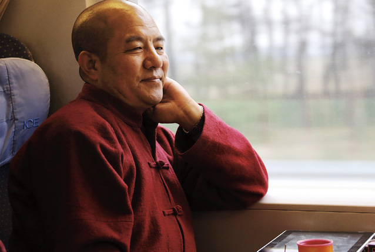
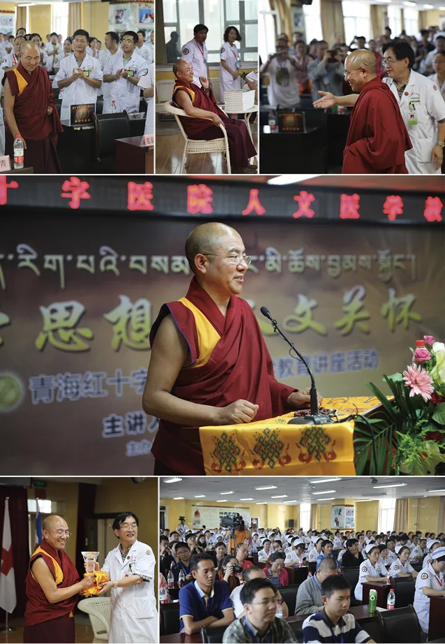
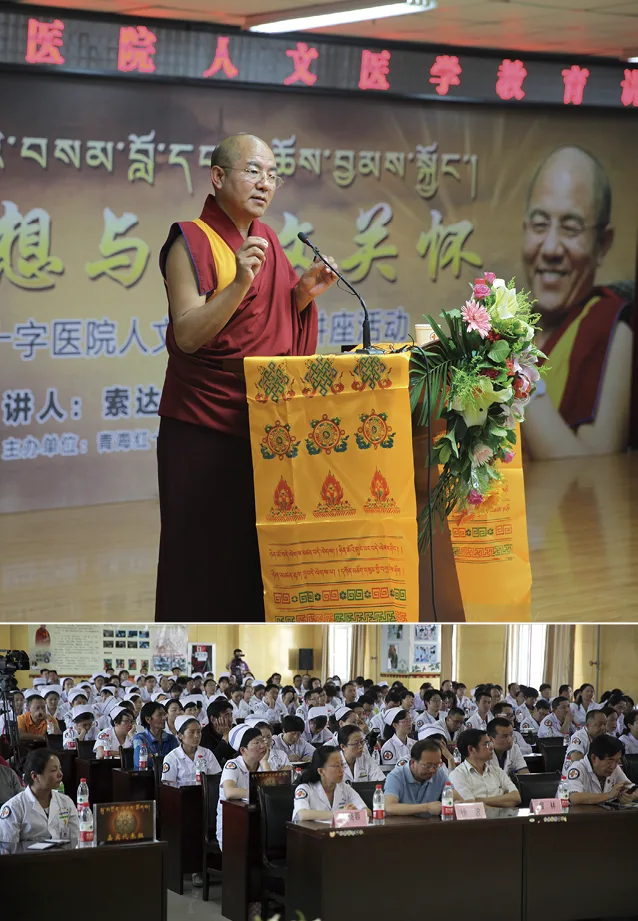
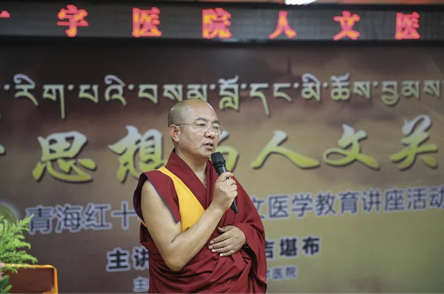
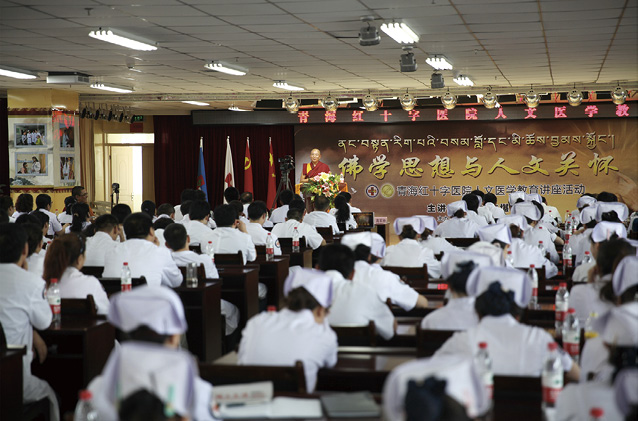
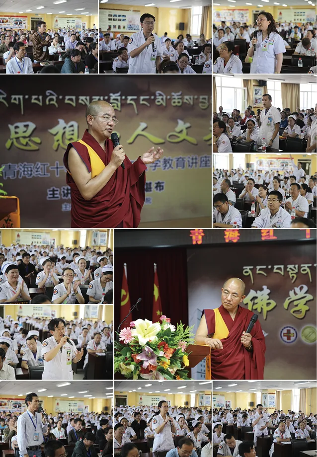
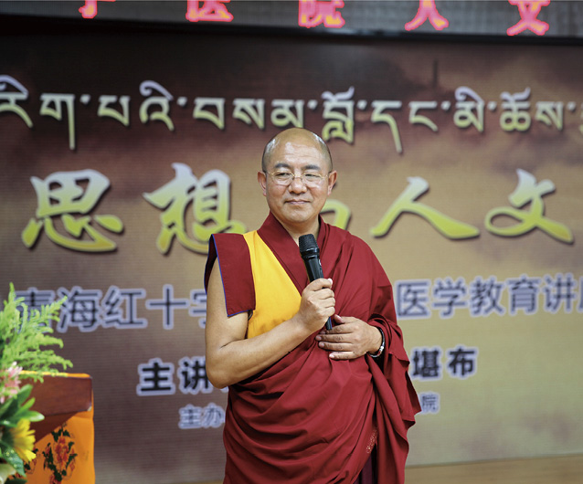
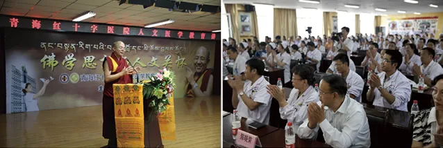

21世纪的人类，  
难免只是在自作聪明——每天只知道追求金钱，  
对其他事情毫不关心。

第11场

青海红十字医院

Qinghai Red Cross Hospital

中国·青海

2013 / 7 / 13

## 佛学思想与人文关怀

## Buddhism and Humanistic Care

主持人：

大家下午好！

今天我们在这里举办“青海红十字医院人文医学教育活动”，暨“佛学思想与人文关怀讲座”。医学体系引入佛学理念后，在人类养生、保健、康复、诊疗、增长信心等方面，都显示出了积极的影响力。因此，研究、弘扬佛学文化，探索佛学与医学文化的关系，建立新时期社会、心理、生物领域的新型医学，对于进一步促进社会和谐、民族和谐、宗教和谐、医患和谐起到了积极作用。为此，我们特别邀请到了喇荣五明佛学院的索达吉堪布，来进行人文医学教育专题的讲座。现在，大家欢迎索达吉仁波切——

尊敬的院长、在座的各位，今天很高兴来到青海红十字医院，与各位医生以及其他来宾一起交流。我曾经听说，这座红十字医院非常特殊。尤其是作为一个佛教人士，我对这里很感兴趣，因为这里有佛教的殿堂，还有基督教、伊斯兰教的祈祷室。因此，患者和遭遇苦难的人们，即使信仰不同，也都能在这里找到治愈心灵的方法，得到内心的宁静。

今天交流的主题是“佛教思想与人文关怀”。就我个人而言，已经从事佛教事业很多年了，所以对这个主题非常感兴趣。我对在座的每个人都非常尊敬，因为医务人员从事的是救死扶伤的职业，非常神圣、崇高。大家都在与生命打交道，而世界上最可贵的就是人的生命，所谓“人命关天”。关乎人类生命的职业，是非常神圣与珍贵的，从事这样的职业非常光荣。所以，我真的认为在座的各位，都非常伟大。

## 即使没有信仰也要有爱

接下来，我们要去思维什么是佛教思想，什么是人文关怀。去年，中国第一位诺贝尔文学奖得主莫言，在瑞典进行了获奖致辞，他在介绍获奖著作《生死疲劳》时曾说：“虽然我对佛教理论不甚精通，但我认为佛教的基本思想，或者说它所传递的真实宇宙意识，都表达了世人的纷争是毫无意义的，在这样至高的眼界下，世人显得非常可悲。”他提到，佛教的思想是宇宙、人生的真理——作为中国有史以来唯一获得诺贝尔文学奖的人，以他的智慧来分析和观察，得到了这样的结论。其实，今天在座的所有知识分子，也不得不关心这件事情——佛教思想对当前社会能起到怎样的关怀作用？如何开显慈悲为怀的本义？大家可以有这方面的思考。

在座的人，不一定要信仰佛教，但每个人的内心都应该有爱。在佛教中，对“爱”有非常详细的阐述，讲得相当透彻。就我个人而言，近三十年来，几乎用自己所有的时间和精力来学习佛法。虽然这种学习谈不上是研究，但我一直在坚持。在学习的过程当中，我经常感觉到，任何一个人，如果能对佛学有一些认识和感悟，生活中各种各样的问题都可以迎刃而解。因此，每当听到与宗教有关的内容时，千万不能嗤之以鼻或者不屑一顾。

## 吾应除他苦，他苦如自苦

在这个世界上，需要有关怀、关爱，不仅人类需要关怀，甚至一个很微小的生命，也需要大家的呵护，每个人对此都有责任。大家对患者、病人肯定都很关心，这一点我非常清楚。但对于微小的生命，我们是否有同样的关爱呢？我们应该也关爱它们。其中的原因，佛教中有一句很著名的偈颂，叫做“吾应除他苦，他苦如自苦”。这是什么意思呢？我们有责任，为世间所有有苦乐感受的众生，遣除身体和心理上的痛苦。因为任何一个众生，他的痛苦与我的痛苦是一样的。刚听到这句话的时候，或许你不一定能够感同身受，甚至会想：“为什么他的痛苦要我来遣除，他的痛苦是他自己的，我为什么要帮他？”但扪心自问，或静下心来再去思维的时候，就能明白，实际上任何一个众生的痛苦，都值得大家努力去遣除。我们更不能践踏别人的生命，也不应该夺走他人的快乐。

中国著名的文学家苏东坡，与他的一位朋友谢景温一起赶路。他们边走边聊，有说有笑，突然有一个黑影从树上坠落下来——是一只受伤的黑色百灵鸟。苏东坡准备把鸟捡起来，但谢景温不屑一顾地说：“不要耽误我们赶路。”他一边说，一边用脚踩这只小鸟。苏东坡心里有疑惑，也很纠结，一路上一言不发。而谢景温一路高谈阔论，指点江山，说说笑笑，毫无悔意。

后来，苏东坡与谢景温断绝了朋友关系。苏东坡的一位友人问他为什么这样做，他说：“践踏生命的人，不应该成为我的朋友。”友人有点不理解，便追问：“为什么因为他踩死一只鸟，就不能跟他做朋友？”苏东坡说：“因为从他的行为可以看出，一旦他得了势、有了权力，对人命是不会放在眼里的，很有可能会做出损人害己、祸国殃民的事。”果不其然，后来谢景温晋升为一名大臣，杀害了无数生命，就连苏东坡也差点被他的属下所害。这时，那位友人才明白，苏东坡确实很有远见。

从这个例子可以看出，无论是医生、护士，还是其他任何一个人，如果心里没有慈悲的理念、没有关爱之心，即使从表面看很成功，有学问、有知识、有水平，也没有什么了不起。

## 医德内化于心

现在，各种各样、方方面面的社会问题纷至沓来，比如，食品安全问题层出不穷；有很多大学教授，把主要精力放在做生意上，基本不给学生上课，这是我昨天听一些大学老师反映的；当今时代，在个别医院中，偶尔也会有不愉快的事情发生，有些医生对病人不负责任，有些护士在医德方面不太理想。其实这些情况反映出的，是教育的缺失，甚至是道德的沦丧，所以确实需要改善、提升。

如果无法改善，那么这个社会到底是在进步还是后退，也很难说。社会的物质水平的确有大幅提升，原来没有车，现在有车了，原来没有高楼，现在有高楼了。但在物质进步的背后，如果没有内心的提升，外在物质世界再如何发展，对人类也不一定真正有利。

我特别希望，我们的医生、护士在与病人交往的过程中，有一颗关爱的心。你的态度、行为，哪怕是一句言语、一个举动，对病人来说都非常重要。因为作为病人，他所有的一切，甚至连最珍贵的生命，都交付在你的手上。

在利益的驱使下，乱象不时涌现——有些是人为的，有些是其他因缘导致的。而对于每个人来说，应该观察一下自己的心行，是否给社会带来了不利影响。

这几年我的身体稍微好了一些。以前身体不好的时候，各地的好医院、普通医院我都去过。每次去检查或治疗的时候，在我的内心当中，对护士——身着白色服装的白衣天使们，都非常尊敬、随顺。其中的原因是什么呢？因为有一种想求助的心，我的疾病依靠她们的职业技能，确实能够好转，每个患者应该都有这种感受。但如果护士给病人留下了不好的印象，病人也很难忘记。

十多年前，我的身体非常不好，但没有中断翻译工作。当时在厦门的一所医院住了大约两个月，还带了一个小喇嘛。这期间有一个医生对我特别好。

当时医院的条件并不是很好，而且有一个护士对我的态度很恶劣，不知道是什么原因。我有一本书叫《旅途脚印》，里面也提到过她。她每次给病人打针，都气势汹汹，所以每当我听到她的脚步声，都很害怕。她来了之后，“啪”地把针头一甩，我就很紧张。其实不仅仅是我，周围五六个病房的患者，一听到她的脚步声都很紧张。她在场的时候，谁也不敢说她的坏话，大家都一本正经地坐着，等她走了以后，大家都开始指指点点。另一个医生帮她解释说：“她最近跟男朋友的关系不好，所以很生气，就把气都出在了你们身上。”但我当时觉得这个说法不太准确，因为我在那里住了将近六十天，她每天的态度都是这样。她休息的时间很少，所以基本每次都是她来打针，有一位很好的医生却很少来。

我对这件事的印象还是比较深，大概是去年，我去厦门大学做讲座，路过这家医院的时候，还回忆起了这件事。虽然这是十多年前的事（住院是在2002年），但她所有的动作，说话的语气，我全部都记得。因此，站在一个病人的立场，我呼吁医务工作者要具备医德。

当然，每个人都有发脾气的时候，也都会有一些嗔恨心。大家不是菩萨，不可能一直都心平气和，但也不能怨气太多，更不能把自己的情绪施加给病人。这是我作为一个患者的心里话。

医德确实很重要。但如果具备医德只停留在文字上，成为用来约束从业者的规章制度，那么这是远远不够的。其实，医德应该内化在心里。如果心中有佛教所讲的“善有善报、恶有恶报”的理念，对前后世、业因果的存在有一种敬畏，这样一来，身语意会更加清净，伦理道德水平也一定会提升。

在科技不断发展的当下，对人文道德的关注更需要加强。其中，关爱他人之心是最不可缺少的，甚至在某种意义上，它的价值已经超越了人类世界的任何创意与发现。不知道你们是否看过《爱因斯坦谈人生》这本书，是高志凯翻译的。我早前看过，里面有一段话：“仅靠知识和技艺不足以让人类过上幸福而有尊严的生活。人类完全有理由把高尚道德标准的践行者置于客观真理的发现者之上。在我看来，佛陀、摩西、耶稣的贡献比所有才智之士加在一起的贡献还要大。”

我看到这段话的时候，感受很深。它的意思是说，客观真理的发现者，比如牛顿、哥白尼、爱迪生等，确实对人类有非常大的贡献，电灯、飞机等依靠他们的发明创造才出现于世。但如果人类只注重科技进步，忽视道德提升、正确价值观的树立以及爱的教育……那么这个社会将变成什么样子，大家应该非常清楚。

我们要有帮助他人遣除痛苦的发心，这一点非常重要。尤其作为一名医生，更应如此。我问过一些医生：“开刀的时候感觉怎么样？”有一位医生跟我说：“刚开始的时候，觉得这个病人很可怜，但随着时间的推移，就没感觉了，好像跟裁衣服没什么两样，这就是职业病。”

有些时候，如果没有慈悲心，可能会做出很多违背良心的事。无论你是什么身份的人，这样做都是不合理的。对于医务工作者来说，为了更好地治病救人，首先需要进行道德教育。

道德教育应该从两方面来开展，第一，至少要做一个好人。至于什么样的人是好人，当然有非常多的标准。第二，参考佛教的标准，要断除杀、盗、淫、妄的恶行，这是佛教的基本原则。也许有些人会说：“佛教怎么有这么多这样或那样的约束？”其实这不能叫约束，它本质上是衡量人品的标准。很多人对佛教不了解，才误认为佛教里有许多约束。当你真正去了解，会发现并不是这样。

## 身心治疗并行

心理的调整应该依靠佛教的智慧。当我们遇到痛苦的时候，要借助信仰的力量，为心理带来安慰，安抚自己的情绪，这应该是最好的办法。我也特别真诚地劝请大家，要帮助病患进行心理调整。患者是一个特殊的弱势群体，即使患病前他是领导、富豪，但一旦生病，他也像被关在监狱里的犯人，几乎失去了身心一切力量。

作为医生，如果只是对患者的身体进行治疗，我觉得还不够，应该同时对他的心理进行调理。古希腊哲学家柏拉图曾说：“医生所犯的最大错误，就是只治疗身体而不治疗心灵。”我自己也觉得这一点很关键，因为身心是无法真正分开的。

## 职业道德与责任的反思

医务人员的身边会有许多可怜的人，他们会向你寻求帮助。你对他们的身心健康负有责任，所以要有耐心、有责任心、有爱心。具备这几种心，有助于帮助患者治愈疾病。所谓责任心，一方面是对自己负责任，对自己的职业、工作负责，这是很重要的；另一方面，也是对病人负责。

现在，有很多对病人不负责任的现象，有些是医院的问题，有些是个别医生的问题。我去过很多地方，在一些医院，患者的病本来不严重，但医院不仅没有帮患者减轻病情，反而通过各种方式使病情加重。实际上，不只是医院里有诸如此类的问题，在社会的方方面面，都有类似的问题，甚至在佛教中也是如此。按照佛陀的开示，出家人身着僧服，本应是智者，所行之事神圣而高尚，但如今，有个别人利用佛教的装束、名头，在汉地各处骗取信徒钱财，这种现象不容乐观。

无论是身着白色服装的你们，还是身穿红色僧服的我，都有各自的本职工作。在各行各业当中，有没有非常了不起的、为人类社会做出贡献的人呢？其实有相当多。但也有依靠个人的职业身份做出不善行为的人，不但自己犯了错误，也对人类整体造成不良影响。尤其是作为一个出家人，如果用邪道引导众生、误人子弟，会毁坏众生的慧命。而作为白衣天使，如果医德缺失，会造成对他人生命的伤害，甚至会让人丢失最宝贵的生命。所以，我们的职业，一个关乎生命，一个关乎慧命，而生命与慧命对一切众生来说，都非常重要。

这些问题值得大家深深思考，为什么呢？因为现状就是如此，在各个行业当中都有不讲德行、只讲钱财的现象——人们把赚钱作为幸福的来源。如果对钱没有看破，或者说对钱没有一种理性的态度，所有的伦理道德都有可能被毁坏。长此以往，在社会的“大染缸”中，具有真善美的人会越来越少。

爱因斯坦在1938年，给五千年后的人类写了一封信，这封信的字数不是很多。在信的结尾他谈到：“在未来的人类当中，真正有智力、有水平、有爱心的人很少，而智力低下、道德败坏的人会越来越多。”从这封信问世到现在，时间还不算太久，因此很难窥探到他所说的遥远的未来。但我们也了解到，不仅爱因斯坦有这样的推测，藏传佛教中的莲花生大士以及许多高僧大德，都有类似的预言。

## 什么是幸福的真正来源？

就目前来看，产生种种问题的根源，主要是人们以金钱为导向的价值观。其实，金钱不一定能带来真正的幸福和快乐。

1988年4月，哥伦比亚大学的一位哲学博士，写了一篇论文，叫做《人的幸福感取决于什么》，他对这个论题进行了研究。美国对博士论文的要求非常严格，因此他在研究的过程当中，进行了严谨的调查。他随机发放了一万份问卷给各行各业的人，在问卷中让大家对自己的幸福程度进行评估，并设置了五个选项：非常幸福、幸福、一般、痛苦、非常痛苦。

最终他回收了五千二百多份有效问卷，在这些问卷当中，认为自己非常幸福的只有121人。之后他又对这121个人进行了分析，想要了解为什么他们觉得自己非常幸福。其中，有50个人是事业有成者，各方面都很优秀，有钱有势；而余下的71人各有不同，有些是农民，有些是一般的职员，有些甚至是乞丐。但这些人有一个共同点，就是他们有满足感，而且内心平静，虽然拥有的物质不一定很丰富，但懂得知足。通过分析，这位博士得出的结论是，人类幸福感的产生有两个重要因素：第一，与事业成功、财富积累有关；第二，与平静、少欲知足的心态有关。

二十多年后，在2009年的时候，他想知道这121个人现在如何，就再次联系了他们。对于这次的调查结果，他又进行了分析，之前因为事业成功而感觉非常幸福的50个人，有些人现在过得并不幸福。一些人虽然更有钱了，但内心反而更痛苦了；还有一些人因为世事无常，事业受挫，也变得不幸福；现在仍然认为自己很幸福的人，只有9个。至于当初的71个平凡者，仍然健在的有69人，尽管他们的人生有很多变化，但除个别人之外，他们的心情还是很平和。即使其中一些人变得富有了，但依旧平静、知足。

通过这一次调查，他最终得出了怎样的结论呢？真正能提升幸福感的，其实并不是物质，因为物质所带来的幸福并不长久。长久的幸福与快乐依赖于我们的心，正如佛教中所讲的一句话：“知足之人，虽卧地上，犹为安乐[^1]。”知足常乐的人，即使没有什么资具，睡在地上，也依然很快乐。

我见过真正幸福的人，在牧民、农民当中都有，他们有自己的信仰，自由自在，充满幸福感。而有些人，生活在城市当中，拥有高级轿车与住房，各方面条件都很好，但压力非常大，心里很痛苦、很纠结，一直被各种各样的事情、内心的压力所折磨。因此，现在的人们也不得不承认，我们所追求的金钱，实际上并不是幸福的真正来源，对于这一点，大家需要重新思考一下。否则，21世纪的人类，难免只是在自作聪明——每天只知道追求金钱，对其他事情毫不关心。

其实，大家也能发现，很多人谈论的话题，无非是有没有钱、有没有地位。除此之外，古代先贤所讲的心中的良知、悲心、关爱心等，并没有成为他们心中至高无上的追求。如果再这样下去，虽然高楼大厦越建越高，但人类心灵的高度却难再提升。而物质的大厦再高，也不一定能带来真正的幸福。

那么，内心真正的幸福是如何体现的呢？简单来说，需要有一种满足感。如果有了满足感，我们做事情的时候，就能够心平气和地去完成。因此，你所做的事情，对人类会有贡献，也能给自己带来许许多多的快乐。我并不需要为佛教打广告，这么讲的原因是我本人认为，佛教的慈悲、利他之心，对我们确实非常重要。对于有生命的个体，我们应该不讲任何条件地施以援手。

## 佛陀最赞叹的职业

医生是非常伟大的职业，从佛教的观点来看，世间中最好的职业就是医生。我以前翻译过一本书，叫做《释迦牟尼佛广传》，大概三十多万字，其中有一个故事，给我留下了深刻的印象。释迦牟尼佛在因地时，曾有一世是一位叫做革夏巴的国王，他曾这样思维：如果当国王，可能会为了保护自己的国家而发动战争，自相续生起傲慢心，造很多业；如果做商人，可能会欺骗许多人；如果做农民，生活可能会比较辛苦。那么，他认为在所有的职业当中，哪一个最好呢？他认为医生是最好的，自己也发愿要当医生。

我小时候也想过要当医生。初中毕业时，我还没有要报考医学专业的概念，但我有一个亲戚，是非常著名的藏医，他说：“如果你考学没考上，我可以好好教一教你学习藏医，藏医当中有很多知识。”所以我就不太想去考试，在考中专的时候，故意没有好好写，自认为没有考好，心里还挺高兴。因为当时我已经决定当一位民间医生，如果考不上，就能顺理成章了。可惜后来还是收到了录取通知书，无奈之下去上了中专。虽然我此生没有当医生的福报，但大乘佛教中的确讲过，医生是值得发愿从事的职业。

不知道大家是否看过《入菩萨行论》，它是印度的寂天菩萨所造。在藏地，这部论典可以说是家喻户晓，基本所有大乘佛教徒都了解。在各个寺院当中，没有一个不学《入行论》的。其实，在汉地，这部论典也很出名。其中说道：“乃至众生疾，尚未疗愈前，愿为医与药，并作看护士。”意思是什么呢？在所有众生的疾病没有治愈之前，我发愿当医生、护士，或者直接变成药，来利益一切众生。对这个发愿文，我很有感触。

虽然即生当中我没有福气当医生，但后世还是很想成为一名普普通通的医生——不需要很出名，因为出名以后会很麻烦，做普通医生就知足了。哪怕一天只能救一个病人，减轻他身体和心灵的痛苦，这也是世间最有价值的事情。

## 永不消逝的价值

我刚才也提到，把众生的痛苦与我的快乐互相交换，用现代话来说，这叫做换位思考。这样的思考体现了一个人的高尚人格，普通人很难做到。

《入菩萨行论》的作者寂天论师，他也说过：“首当勤观修，自他本平等。”自己和他人本来就是平等的，哪方面平等呢？在求乐避苦方面——躲避一切痛苦、希求一切快乐这个愿望面前，所有众生是完全平等的。这一点对大家来说，或许是个新的认知，之前从来没有想过。现在社会上普遍的价值观是让自己快乐，为了维护自己，什么事情都可以做。很少有人为了维护他人、帮助他人，而付出一切。

这也是为什么说大乘佛教在如今的社会当中，是一种很崇高的精神。只要人类存在，大乘佛教利他理念的价值就不会消亡。不过，利他思想的价值，在很多群体当中，暂时还没有体现出来。相反，现在的价值观，对利己很重视：“我要帮助我的亲人、跟我熟识的人，或者跟我有生意往来的人。”很多人认为这样的帮助才是理所当然的。跟我没有任何关系的人，即使我能无条件地帮他，我也会怀疑自己的精神是不是有问题，因为天下有那么多人，我怎么帮得了——这是现在很多人的观念。但以智慧去分析的时候，会发现这其实是一种颠倒的价值观。

佛教现世以来，在两千五百多年的历史长河中，虽然利他的典籍并非保存得完好无损，但这种理念的魅力和力量却越来越显著。其中的原因是什么呢？因为利他的价值观，在这个世界上，本来就极为重要。对每一个人来说，对钱财的希求心越少越好，利他心越多越好。假如追求钱财的心越来越迫切，人心就会越来越堕落。

有这样一个故事：一个人救了一位富翁，富翁想报答他，就给了他两个选择：第一，现在把自己家产的五分之一分给他，金额是两百万；第二，十年后将自己财产的二十分之一分给他。施救者是一个平凡的渔夫，听到这些话之后，心里一直在想：“如果我现在不拿这些钱，太可惜了。但如果我现在就拿，也很可惜。”他左右为难，一直在焦虑。后来他因一次出海不幸遇难，最终也没有拿到这笔钱。

现在有很多人也是这样，被金钱、名声、世间的各种俗事诱惑，内心摇摆不定。这时，我们一定要沉稳。那么，要怎样拥有沉稳、淡定的心态呢？要具备正确的价值观，明了自己到底需要什么样的生活。实际上，有吃、有穿，可以满足基本生活条件即可，并不需要过度竞争。别人有车，我不一定要有车，别人住别墅，我不一定也要住。

之前去德国时，我发现德国人的生活理念很好，在生活当中，他们不惯于谈论金钱，一个总是谈钱的人，在他们看来是没有水平的。他们更乐于谈论一些工作上的问题、人类互相关爱的话题等等。如果你在他们面前，谈论家里有没有车、有没有房子一类的话题，他们会觉得你有问题，因为这些都是私人问题，个人的家产跟别人又有什么关系。他们对物质财富不太攀比，有些人有车，有些人没车，大家都不去谈论，不会有人希望通过交谈知道别人到底有没有车。反观我们所处的环境，有些时候，不是自己很需要的东西，也会碍于面子盲目消费，心想：“为什么跟我地位同等的人有，我却没有？”有很多这样的念头。

总之，大家要有正确的理念。文学家狄更斯曾经说：“一个健全的心态，比一百种智慧更有力量。”我非常认同他的这句话。所以希望在座的所有人，都能拥有健康的心态。一旦拥有健康的心态，会觉得外面的世界很美丽，每个人自身的光芒也能够散发出来，这是非常有意义的。最后，希望大家用自己的智慧、爱心帮助身边所有的人。

现场互动

主持人：

感谢索达吉堪布的精彩演讲。堪布将佛教文化博大精深的理念，与人文医学有机结合，对如何将其应用于临床治疗与关怀进行了开示。堪布的演讲让我们领略到佛教“诸恶莫作，众善奉行”的大义，让我们明了要以理性与智慧进行抉择，并对事物的发展进行观察。让我们再次以热烈的掌声，感谢索达吉堪布的精彩演讲！

接下来，堪布有一个小时的时间，与在座的医务人员和各位嘉宾进行交流，请大家积极踊跃地发言。

问：刚才您提到柏拉图的一个观点——身心健康。现在医学的观点也是这样，健康有两方面，身体健康和心理健康。但现实中，有很多患者即使身体已康复，心理却还是很脆弱。如何让他们获得健康而强大的内心？

堪布：身心健康是很重要的，尤其是心理的健康。因此，对于佛教中的一些调心方法，应该要重视，否则，对一些患者的心理问题，很难进行疏导。最近的医学报告显示，世界上因癌症死亡的人越来越多，癌症与内心的忧郁、困惑、恐惧有关，同时，也与饮食、外在的环境等有关。有很多医学专家认为，难以调伏的内心，心理的忧郁，与患癌症有很大关系。

因此，在治疗过程中，心理的调整是至关重要的。我们可以在宗教中，找到调整内心的方法，比如佛教所提倡的“诸恶莫作，众善奉行，自净其意”，就是这样的方法，其中“自净其意”就是调伏内心。

问：虽然现在的医学很发达，但面对很多疾病还是无能为力，所以医生经常要面对死亡，我们要如何看待和面对死亡？

堪布：医生如何面对死亡、如何调心，其实需要进行训练。对于这个问题，我推荐一本书，叫做《西藏生死书》，也可以参考《慧灯之光》中的一部分内容。如果医生可以按照书中的内容去训练，在面对自他的疾病和死亡时，就会有应对的能力。

问：刚才您说内心的平静很重要，我觉得内心的平静就是我心中的佛，但在这个纷繁的世界中，诱惑真的很多，所以想请问如何用简单的方法抵御诱惑？

堪布：我认为对治诱惑的最佳方法就是禅修。在美国，有很多医院和学校都在倡导禅修。如何禅修呢？可以在心里观想释迦牟尼佛，这样可以每天保持内心的平静。大家每天早上都要洗脸、刷牙，这是对身体的清洁与修整，但却很少清洁内心的杂念与尘垢。

早上起床之后，可以通过禅修，平静一下自己的心，调伏自己的贪心、嗔心等不良心态，即使只安住五分钟、十分钟，也像进行了一次心灵的沐浴。晚上在睡觉前禅修，可以帮助你遣除白天生起的各种烦恼，平静地入眠，梦境也会很吉祥。禅修作为一种调整内心的方法，在佛教中相当重要。在其他宗教当中，也有各自的禅修方法。

作为一名医生，自己的身心要健康，否则，自己都是病人，怎样对他人施救呢？因此，首先要保证自己的身心健康，之后才能对患者进行有效的治疗。

问：在当今社会，道德的缺失越来越明显，医患矛盾也日益增多。所以想请教您，在追求利益最大化的环境中，您是怎么看待医患矛盾的？

堪布：医患矛盾比较普遍，跟现代人的心态有一定的关系，21世纪的人与古代人相比，在心态上比较开放、追求自由，甚至有一些吹毛求疵。而且，我们也不得不承认，作为院方或医生，确实也有一些责任。最近新闻中报道了流浪儿童不幸去世的事件，此类事件的发生与多方有关，但向哪方追责还要具体观察。同样的道理，对于医患矛盾，也要具体问题具体分析。

无论是患者还是院方，都应该具备良心与道德。作为患者，应该对医生、医院有一种信任，这是最起码的。如果没有信任，就会像藏文俗语中所说：“一切显现都变成魔的世界。”本来，为你治疗的医生已竭尽全力，但由于你的疑心太重，反而认为所有人都在害你，这属于患者个人的问题。所以在原则上，大家要有良知，这非常重要。如果自己没有违背良心，即使别人不满意、抱怨，甚至与你产生矛盾，自己也会问心无愧。

想要彻底解决医患矛盾，有一定的困难，而且未来的形势更是不容乐观。尤其是在现在的教育制度下，很多人只是为了分数而学习，把考试成绩作为唯一的评判标准，所以很难学到做人的准则、关爱他人的理念。这些孩子长大之后，其中大多数人的所作所为，都会以自我为中心，把个人利益放在第一位，会很自然地做出违背道德的事，人与人之间的矛盾也随之产生。从约束自己的角度来看，如果能凭良心做事，无论遇到什么情况，自己也不会有太大烦恼。

问：当今世界的宗教问题，逐渐成为一个世界性的问题。从佛教的角度，我们应该怎样面对这样的现象？

堪布：世界上有各种各样的宗教，宗教对人类社会的和平与团结、人类的和谐共存，起到了非常大的作用。最近，我们在香港有一个会议，宗旨是促进各宗教的共同学习、合作与团结，与会者包括了八大宗教的代表。八大宗教虽然有各自不同的理念，但都对人类社会做出了贡献。

宗教与宗教之间，应该团结，互相学习、尊重、理解。与此同时，宗教徒与非宗教徒之间，也要加强联系，建立团结合作的关系。我本人的理念就是这样，宗教徒之间要互相学习，非宗教徒对宗教也要学习，在互相学习的基础上，找到适合每个宗教发展的道路。

宗教与人类的关系尤为密切，英国著名历史学家汤恩比博士曾说：“如果我们去观察人类的历史，实际上它是一个宗教的历史。我认为任何朝代、任何国家，从本质上来说，都无法完全脱离宗教的概念。”当我们追溯人类历史的开端，会发现宗教的痕迹难以磨灭，因此，人类的存在无法与宗教割裂。虽然宗教与宗教之间存在差异，但每个宗教都有其存在的原因、价值与意义，所以，对它们进行学习是很重要的。

问：现在的物质世界越来越发达，追求物质利益的热情也越来越高涨，但无法忽视的是，仍然有很多贫穷的地区、群体和民族。我们要如何才能找到物质利益和精神需求之间的平衡点？

堪布：现在的物质越来越发达，精神和物质之间的平衡点确实不容易找到。我刚才也讲过，人们看重物质、对精神世界不太重视的现象非常普遍。我们可以反观一下自己的心，在一天二十四个小时当中，或者说在八个小时的上班时间里，你的首要目标是什么，是为了物质还是精神？相信大家也知道答案。

不过，也有很多地方，物质条件不太好，但心灵很富足。昨天我遇到一位老师，他之前在法国留学，本来想留在那里，但最后还是回到自己的家乡——藏地一个比较偏远的地方，在那里教英语。他这样做，一方面可以帮助孩子们，另一方面，自己的身心也可以不被尘世的诱惑所染。对此我很认同。

边远地区的人总认为城市里生活很幸福，而很多城市里的人，则认为生活在边远的地方很轻松、很快乐。为什么呢？因为边远地区的人，有心灵的财富，而城市里的人，大多只有物质财富。对于很多人来说，物质财富与心灵财富难以兼得，如果拥有了一个，就会失去另一个。所以，在大多数情况下，需要看自己的选择。如果想真正找到它们之间的平衡点，就要懂得两者的价值以及它们之间的关系。

院长问：僧人的持戒与俗人的持戒有什么不同？若是持戒，首先要戒杀，我们怎样处理戒杀与保证身体营养之间的关系？比如，在高原地区要吃肉，不吃肉身体受不了，而且千百年来，藏区也一直都吃肉，那么现在如何来解决这个问题？

另外，吃肉是杀生吗？如果不吃肉，人类要如何生存，所以吃还是不吃？不吃的话身体不行，还会影响整个民族的身体素质；如果吃的话，又会杀生。怎么解决这个问题？

堪布：院长提的问题很好，这也是目前大家比较关注的。第一个问题，出家人与在家人之间，是有一些戒律上的差别，出家人的戒律有沙弥戒、比丘戒、比丘尼戒等，沙弥戒有10条，比丘戒有250条，比丘尼戒有348条。虽然这些戒条比较多，但其实是对个人言行更高层次的规范，并不是控制和约束。

杀害众生，比如牦牛，还有其它动物，在大乘佛教和小乘佛教当中，都是严格禁止的，所以还是不要去杀生。而不杀生的理由，是因为无论是人，还是动物，都是非常珍贵的生命，如果为了吃一口肉，就要众生付出最珍贵的生命，从良心上来讲，是说不通的，因此佛教不提倡杀生。

那么，人类是否会因此缺乏营养而伤害身体呢？对于这个问题，有很多不同的说法。但就我个人而言，还是要站在吃素的立场上，为什么呢？这是因为，虽然从表面看来，吃肉对身体好，但实际上，高血压等很多疾病的出现，都与食肉有关，一些动物身上也带有致癌病毒等。另外，动物被杀时，因恐惧而产生的毒素，也会影响我们的健康，食肉会给身体带来一定程度的负担……总之，许多疾病的来源就是肉食。以诸如此类的原因，即使是没有任何信仰的医学家、科学家，很多也都是素食者，比如爱因斯坦、爱迪生等。包括现在的一些政界人士，像美国前总统克林顿、奥巴马也都是素食者，而且奥巴马全家都吃素——他们有些是为了环保，有些是为了健康。

在高原地区，不吃肉对身体好、还是吃肉对身体好？绝对是不吃肉对身体好。为什么呢？因为现在有很多营养学专家，认为人的身体结构，其实不适合吃肉，对于这一点，你们很多医学专家也应该清楚。人的消化系统与豺狼等猛兽不同，猛兽的肠胃结构适应于吃肉的习性，消化肉食很容易，但对人体结构来说，消化肉食并不容易，这是吃肉对身体不好的一个原因。

另外一个原因，反过来讲，吃素是有助于身体健康的。有些人可能会怀疑，吃素是不是对身体很不好呢？实际上并不是。其实，在高原上，植物类食物的营养要远远超过肉食的营养，我经常开玩笑说：“人吃牦牛的肉，那牦牛吃的是什么呢？牦牛吃的是草，完全是吃素的。人吃猪肉，那猪吃什么呢？猪也不吃肉，是吃素的。”在人类眼中，动物的身体很有营养，这些营养的来源是什么呢？来源于植物。实际上，有一些植物的蛋白质含量高于肉食。

而且，就目前的状况来看，包括禽流感在内的很多疾病都来源于肉食，因此，吃素不仅仅在宗教中具有意义，站在客观的角度，在健康层面，断除杀生也同样非常有必要。食肉会让我们的身体感到沉重，甚至造成血管堵塞，引发非常严重的疾病，因此在瑞典、丹麦、不丹、印度尼西亚等国家，有许多专家都是素食主义者。从这一点我们也能看出，素食主义对人类的健康有很大益处，所以即使不谈信仰，不谈佛教，只是从人体健康的角度出发，我也给很多人建议过要长期吃素。如果不能长期吃素，也尽量少吃肉，否则确实会增加身体的负担，这是从营养学的角度来分析的。

主持人：

院长还有提问吗？刚才堪布说了可以辩论。

院长：刚才堪布谈到了吃素，现在世界上的确有很多人在吃素，但吃素还是需要有一定的条件。比如汉传佛教，僧人肯定都是吃素的，因为从古到今一直是这样。但藏地，千百年来，从活佛、僧人到老百姓都是吃肉的，因为地区不一样，饮食结构也不一样。为什么说高原地区高寒呢？因为需要的热量比较多，营养要够。

我个人感觉在我们藏区，跟汉地不同的是，可补充的素食品种非常单一，所以如果只吃素食，很可能会影响身体健康。为什么这么说呢？因为在医学中，已经发现只吃素的人，有贫血的现象，身体素质不好，甚至有的妇女在怀孕之后，出现胎死宫内的现象，这种情况的发生率是比较高的。所以我在思考，汉传佛教跟藏传佛教，在饮食结构上有没有区别，或者说它们的要求有没有不同。

之前我们也举办过一个相关的论坛，学习了一些内容。佛教从印度传过来的时候，说可以吃三净肉，避免自己杀生，就可以吃。那么现在到底还提倡不提倡吃三净肉？当然，患高血压、高血脂等疾病的人，有些的确是因为肉吃多了——什么都要掌握一个度，吃多了肯定会得病。相比而言，在汉传佛教弘扬的地区，食物比较丰富，素食品种有很多选择，在那里吃素是很好的。我是这样认为的。

堪布：院长是从医学角度来分析的，有它的道理。在小乘佛教当中，虽然刚开始对三净肉有开许，但释迦牟尼佛在临近涅槃的时候，道出了真相，《涅槃经》和《楞严经》中都有提及：最初佛开许吃三净肉，只是为了引导某类众生趋入佛道，但实际上，享用肉食会有很大的罪过。我也翻阅了很多藏传佛教和汉传佛教的典籍，确实，从原则上讲，佛是不开许吃三净肉的。

在藏传佛教中，无论是高僧大德还是老百姓，历来确实有吃肉的习惯。但是，这样的习惯，并不值得赞同。所以在藏传佛教中，即使刚开始的时候会有吃肉的现象，但后来也渐渐变为吃素了。一方面是因为了解到汉传佛教吃素的优点，进行了学习，另一方面也是因为大乘佛教本身，包括在藏传佛教的经典中，吃肉并不被开许。考虑到吃肉的习惯并不符合教义，因此，藏传佛教的信众也渐渐有了吃素的习惯。但可能还有个别人，甚至是高僧大德，还在吃肉，这其中也许有密意或者特殊必要，这一点我很难判断。但对于一般人，从佛教的慈悲观来讲，最好不要吃肉，这是很重要的。

当然，在一些特殊情况下，比如说有些病人严重贫血，也可以特别开许他们吃肉，包括曾经吃素的人也可以开许。比如之前有些吃素的人，对我说他现在严重缺血，医生建议他吃肉，那么，即使他已经戒肉了，但医生这样建议的话，治疗期间可能还是要吃肉。佛陀曾对病人开许过一些戒条，所以我们对有严重缺血等特殊情况的病人，也可以有特殊开许。

但除此类特殊情况外，无论信仰藏传佛教，还是汉传佛教，都应该尽量吃素。其实在这方面，藏传佛教是很想学习汉传佛教的，因为从梁武帝时代开始到现在，汉传佛教一直有着吃素的优良传统。所以，藏传佛教的寺院如果可以尽量吃素，大德们也应该以身作则，尽量减少或者最好不吃肉，那么，从慈悲对待生命、对生命负责的角度来讲，有着非常重大的意义。

问：现在医患矛盾这么大，工作压力也很大。我们作为医护工作者，要如何理解工作中的幸福和快乐？

堪布：其实，对有些人来说，压力并没有那么大，既然生存在这个世界上，要做一些事情是理所当然的。你所说的压力很大，可能就是早上八点上班，晚上六点下班，对于这样的工作作息，如果身体没有严重疾病，应该是可以做到的。

世间其他一些职业的工作者，比如工人、农民，他们每天也要工作这么长时间，也很劳累，最后也能获得相应的报酬。如果能把工作当作一种享受、一种快乐，就谈不上是压力。如果你把上班当作一种压力，恐怕每天都是愁眉苦脸的，不一定会开心；如果你把上班当作自己最喜欢、最有意义的事，在态度上做出改变，上班应该是很快乐的。

其实除工作和家庭的责任以外，大家没有更多的压力。如果是山崩塌了，需要一直撑着，这样的压力确实很大，就像世间有一种说法，叫做“压力山大”。如果自心的力量更加强大，所感受到的压力就会相应减轻。因此，大家不要把工作当作一种压力、一种负担，应该把它当作一种享受、一种快乐——去接纳它，不用逃避。就像你很讨厌一个人，为了不见到他，要一直躲避，这样很痛苦。如果你能直接面对问题，或许问题反而会迎刃而解。所以，工作态度的转变很重要。如果能够转变态度，像你这样的年轻人，每天上班、照顾家庭，应该都没问题，这是70多亿人都要做的事情，算不上是压力，我是这样认为的。

问：我是特需病房的医生。作为一名医务工作者，经常会面对病人的生老病死。在长期的临床工作中，我们发现，有宗教信仰的患者，比如说基督教徒或者佛教徒，在面对死亡的时候，他们的表现不同于常人，非常从容、坦然，不像常人一般恐惧。我想向堪布请教一下，站在佛教的立场上，是如何解析死亡的？人的生命是永恒的吗？有来生吗？

堪布：你说的确实有道理，因为有宗教信仰的人，在活着的时候，都会有一定的训练。比如在佛教当中，修行者在了知人有生老病死的痛苦之后，在身体健康时会进行观想的修行。如果生病了，则要练习将痛苦转为道用，还要学习在接近死亡时如何去面对，包括要熟知死亡过程中的各种相状等等，这些在佛经中都叙述得非常圆满、清晰。就像一个战士，在还没有上战场之前，要有一定的培训，等真的上了战场，跟从来没有培训过的人相比，他的动作会娴熟很多。

同样的道理，没有任何信仰的人，在面对痛苦和死亡时，会感觉措手不及。包括很多世界著名的文学家、学者、智者，在面临死亡之际都极为痛苦。但一些有信仰的老年人，哪怕是文盲，在死亡降临的时候，都很自在、从容、洒脱，这就是宗教信仰的力量，这种力量非常重要。

在学习佛法的过程中，我们一定要了解前后世的存在。其实，佛教并不是让大家盲目地去相信，而是希望大家运用科学、哲学去验证，最终再得出结果。比如，通过逻辑论证，可以证明人的后世是存在的。如果论证之后你还无法承认，那只能说明你暂时还没有弄懂。对于前后世的成立，可以举出很多理由，我在其他讲座中也讲过，今天在这里不展开。

我特别希望在座的人，可以通过自己的观察，确信前生后世的存在。如果认为“人只有这一世”，目光短浅，那很可能什么恶业都敢造，非常危险。

问：对病人的临终关怀应该如何进行？院长经常倡导要对病人进行临终关怀，所以我想了解一下，从佛教的角度出发，我们应该如何去做？

堪布：关于临终关怀，刚开始的时候我也讲了，你们医院有佛堂、祷告室，这对病人来讲是非常有必要的，尤其是对即将面临死亡的人来说，这是一种精神上的安慰。我们现在很需要这样的医院，这样的医院在任何地方，对任何民族，对信仰任何宗教的人，都非常重要。在台湾地区、新加坡等地，都有专门的临终关怀医院。在这些医院里，最终安详而逝的人，确实很幸福。但也有一些医院，在临终关怀方面的表现，并不是很乐观。

那么，临终关怀最好的方法是什么呢？如果身边有佛教信仰者，可以按照佛教的传统，念“南无阿弥陀佛”等佛菩萨的名号，或者念观音心咒“嗡玛呢巴美吽”，以此功德，亡者不会堕落。而且根据以往的经验，将死之人听到佛号或咒语的声音，会得到无限的安慰与自在。

这一点，不仅仅讲给各位用于照顾临终者和病患，也要用于自己临终的时候。在座的每个人，总有一天会离开这个人间，当你离开的时候，什么也带不走，除佛法外，难寻救护。此时，唯一的依靠就是佛菩萨的加持，这种加持可以让我们顺利往生到净土。因此，对于临终者来说，什么财产都不重要，来自三宝的加持才最有意义。

问：堪布您好，刚才您讲到了利他。我觉得在芸芸众生之中，绝大多数人都会有一定的利他心，但如果想做到经常利他，就需要有一定的修为，这确实很难做到。

通过您刚才的演讲，我觉得要做到利他，就要减少利己心，这一点很重要。记得我在十年前，看过一副对联：“贪嗔痴即君子三戒，戒定慧通圣经五言。”我经常会思考这个对联。在人的生活中，贪嗔痴的烦恼很普遍，我的疑惑是，有些人对于自己的贪嗔痴没有任何意识，所以一直在造作这样的业，我们怎么看待这些人？另外有一些人，他们有一定的悟性，认识到自己的烦恼，在戒贪、戒嗔、戒痴的过程中，内心存在着困惑与自我斗争，在这种情况下，如何能做得更好？

堪布：利他，实际上有很多层次。大乘佛教中的利他，完全是一种忘我的精神，自私自利的心要全部遣除，只是一味地利他，这个层次是很高的，一般人做不到。你刚才讲的贪嗔痴，实际上每个凡夫人都有，只不过程度不同。有些人贪心重一点；有些人痴心重一点，比如爱睡觉；而有些人嗔恨心重一点，比如爱发脾气，没遇到什么事也发脾气，甚至下雨要发脾气，家里没有炒菜也发脾气，什么事情都发脾气，这是嗔心比较重的。

佛经里讲，每个众生贪嗔痴烦恼的程度是不同的，而且只要不是得果的圣者，就会都有贪嗔痴。贪、嗔、痴，在佛教里叫做三毒，即三种毒药。实际上，很多人对佛教还是不太了解，如果真正去了解之后，就会发现佛教中的名词、比喻，运用得十分恰当，可以把意义开显得非常透彻。

世界上的任何一个人，如果贪心过重，都会给自己带来痛苦。现在有很多年轻人，因为感情的问题纠结、痛苦，甚至选择自杀，这些都是因为贪心引起的，这就是一种毒。如果嗔恨心爆发，就会出现战争。家庭的战争、社会的战争、国家的战争等等，都是嗔恨心引发的。无论是热战，还是冷战，其根源都是嗔恨心。“痴”指的是愚痴，什么都不懂，或者认错为对，这些都属于痴心。佛教把以上三种心归纳起来叫做三毒。

这是两千五百多年前的心理学，东方的释迦牟尼佛把人的烦恼归为这三种毒药。对此，现代心理学也认可，比如西方伟大的心理学家荣格，他极为赞叹佛教的思想，他认为佛教对于心理的分析是无与伦比的。

回到刚才谈到的利他，它的确有不同的层次。如果让我们完全利他，现在确实做不到。但我们还是要有一种利他心，并尽量减轻自私自利的心。现在有很多专家、学者，其中也包括一些研究宗教的人，他们在研究的过程当中，发现人的很多痛苦都来源于自私自利的心。比如，跟别人吵架，是以自我为中心造成的。我们流下的眼泪，基本上都为自己而流，为别人流的很少很少，几乎没有。所以，人类大多数的眼泪，可以说是一种自私自利的眼泪。

在利他的同时，自己内心当中应该是很快乐的。这里的医务人员，每天都在想着如何帮助他人，所以自己的痛苦和烦恼都很少，为自己考虑的时间几乎没有。反观那些只为自己考虑的人，其实很痛苦，无论旁人怎样对他，他都会觉得不满足。

所以我经常说，如果想要在生活中永远开心，就要尽量去帮助别人。从表面上看，你是在帮助别人，实际上是在帮助自己，因为通过帮助别人，你可以变得很开心、很快乐，其实是对自己有利，比如心态很好，寿命可能会比较长。所以，在某种意义上，在我们高原地区生存，拥有利他心可能比吃肉更有价值，更能延年益寿，对自己的身体健康及心理健康，更有利益。

问：柏拉图说：“治疗身体而不治疗心理是最大的错误。”在我们牧区，人们的心理基本上都是非常健康的，但生病时，身体往往还是无法承受这种痛苦。有一些人，等到疾病已经无法治愈时，才意识到要去医院看病，这时，生命往往已经到了无法挽回的地步。而且藏族人有一个习惯，在去看病之前，首先要算一下去哪个医院好，但有时候算出来的医院，治愈疾病的希望却很渺茫。您如何看待这样的情况？

堪布：刚才你提到了柏拉图的话，实际上作为医生，对于患者的身与心两方面，都需要给予治疗，并不是只治心或只治身就可以。如果只进行一方面的治疗，会有一定的偏堕性。

我也生活在藏地高原，所以也能了解到你所说的情况。有很多藏族朋友，发现自己得了病，去检查时就已经是晚期了，生命已无法挽回。而且有很多人去看病之前，确实会选择算命、打卦。我个人认为，在这种情况下，打卦已经不是很重要了。虽然我自己小的时候，包括现在，也会打卦，而且我很相信打卦。但在生病的时候，哪个医院有条件看，就必须去看，因为算命和打卦，有时候不一定准确。

大家都知道范仲淹，在课本里都学过他的文章。他小的时候，找算命的人抽签，他问自己将来有没有当宰相的福报，得到的结果是没有。然后他说既然当不了宰相，那有没有当医生的因缘，结果也是没有。算命的人就问：“你想当宰相和医生，这是为什么？”范仲淹回答说：“如果想要造福百姓、利益他人，最好的选择就是当一位良相，或者成为一名良医。但既然没有这个缘分，我也没办法。”算命的人就告诉他：“你有这样的一颗心，命运就会发生转变。”后来大家也知道，范仲淹成为北宋的名臣，写有名句“先天下之忧而忧，后天下之乐而乐”。他对造福百姓贡献了一定的力量，自己的命运也发生了转变。

在藏传佛教当中，为病人祈福、诵经，有没有必要呢？确实有必要，但我们不能只依靠这些。其实无论是佛教仪式，还是医学治疗，都有可能会出现不成功的状况，包括最高明的医生，也做过不成功的手术——本来很有把握的手术，最后也有可能会失败。这种不确定的情况，做任何事情时都有可能发生，这一点我们也承认。

为了自他内心真正的快乐，或者说为了藏地医务教育的进步，我觉得还是要多做一些这方面的宣传，增加一些宣传途径，告诉藏民：在身体不太好的时候，一定要去医院检查。不要把打卦、算命作为首要的事情，应该先去检查，确定身体需要怎样的治疗。对于这一点，大家需要大量地宣传，同时，也让更多人了解一些基本的医学知识。否则，就会造成一种局面——藏地民众很有信心，但智慧不高。如果没有智慧，即使表面上是佛教徒，对佛教的信仰也只是一种迷信。

最后，我觉得我们现代人，既要通达古代的传统知识，也要通达现代的知识，同时，更要了解智慧、爱心、悲心的内涵，否则，就像只有一个翅膀的鸟，难以在时代的高空中飞翔。

问：我曾经是一名急诊科的医生。在我们医院的急诊科和重症监护病房里，经常会遇到非常危重的病人。从我作为医生的角度来看，这样的病人已经完全没有生存的希望了，因为他们的呼吸功能已衰竭，插着管子，戴着呼吸机，心脏、肾脏等器官也都衰竭了，脑子也不清醒……但即使是这样，家属还是会要求你：“医生想想办法，再救救他！”所以这个病人还得全身插满管子，用很多医疗设备维持生命。

我作为医生，是应该建议家属早点放弃，让病人安然地离开，还是按照家属的意思，继续抢救，让病人痛苦地、没有意义地挣扎？这时候的病人只剩心跳，已没有其他生命体征。

堪布：这是临床工作中一个非常关键的问题，而且经常会遇到。我自己是这样想的：如果我以后需要在医院离世，在已经失去生存希望的时候，我希望自己能安然离开。如果按照一般家属的要求，勉强维持生命是比较残忍的。

现在的一些家属，对他们进行教育也很困难，他们甚至会在没有任何理由的情况下，制造许许多多的麻烦。作为有经验的医生，能够判断病人是否还有救治的希望，因此，如果家属没有特殊要求，最好不要让病人再受苦。

在一些医院，病人去世后还要用仪器维持很长时间，也就是说，人离世后仪器还在产生费用，对这种现象新闻里也有报道。作为真正负责任的医生，在病人实在无法挽救的时候，应该建议家属让病人安详地离去。如果家人有信仰，最好让临终者待在比较寂静的地方，在他耳边念一些佛号，这样做可以让临终者获得安宁与快乐。在我认识的人要离世的时候，如果医生说确实没希望了，我都会劝病人的家属，最好不要再让病人受苦了，让他安详地离开。因为病人本来就有临死的痛苦，如果还要加上抢救带来的各种痛苦，实在没有任何必要。

对于这方面的问题，需要依靠智慧、善巧方便来进行调解，同时也要看当时亲属的要求和病人的情况来决定。

问：从目前的状况来看，藏传佛教从藏地弘扬到全世界，弘扬得非常广。但藏族的传统教育，或者说藏地寺院的传统教育，跟现代教育有一些冲突，您对此有什么看法？需要补充的是，现在藏区的一些寺院，要求僧人不能使用电脑，不能骑摩托车等等，这些要求与现代的教育理念有一些冲突，应该怎样解决？传统意义上的依止上师和现在的找老师，它们之间的区别是什么，可以请堪布讲一下吗？

堪布：对于这个问题，我个人认为没有太大冲突。关于依止上师，佛经中也有宣说。

寺院的戒条、管理制度，虽然比较有约束性，但还是要行持。各种规定，无论是来自佛教本身，还是源于传统观念，在我看来，如果它具有价值，各个寺院去遵循是非常好的。虽然一些崇尚现代理念的人对此并不认可，但它确实是有价值的，只要它有价值，任何人都应该按照这个传统来做。

不仅藏地是如此，其实在汉地和国外也保留着一些很好的传统理念。在世间和寺院当中，都有很多不同的传统，如果是没有价值的事情，比如玩电脑，那么，对于禅修者和真正实修佛法的人来说，禁止使用电脑、玩摩托车，会更好一些。如果不影响学习、不会导致散乱，制止这些也没什么必要。所以，每个寺院的规定都有它的必要和目的，我们在评论任何事情之前，首先要了解情况，了解之后再下结论，这是很好的。

虽然有些古老的文化具有很高的价值，但也许会跟现在的观念有所冲突。如果你真的觉得传统观念都没有价值，那只接受现代思想也并非不可以。但有些不了解佛法的人，却认为佛法有害、是绊脚石，这就不合理了。

所谓的传统，其实也是对我们的一种训练，像如今，五星级宾馆的服务员，也会有相关的职业培训。同样地，佛教中更深层次的闻思修行，也有它独特的一些方法，不应该觉得它是保守的思想、是一种束缚，甚至是绊脚石。因此，了解情况之后再下结论是非常重要的。

问：我是通过修行才知道，人只有通过修行才能出轮回，“此身不向今生度，更向何生度此身”。但我的苦恼就是每天都忙于上班，修行的时间很少，所以我挺痛苦的，还请上师开示。

堪布：我觉得上班应该也是一种修行，所以我经常提醒大家，在生活当中修行，在修行当中生活，可以这样来训练。如果你心中有一些佛教的理念，尤其是具备利他心的话，你的工作也会跟利他紧密相连。而且做项目本来也需要团队合作，互帮互助，就像科学家研究课题的团队合作一样，因此在合作的过程中，也可以利他。所以，如果心态稍微好一点，我觉得是可以在工作中修行的。

我经常提倡在修行中生活，在生活中修行，否则对于你们在家人来说，想要空出专门的时间用于修行，是不太现实的。在生活的行住坐卧之中，都有修行的机会和因缘，如果可以利用这个机缘去修行，我们的心情就会很快乐，因此无需伤心哭泣。

主持人：

谢谢堪布！这个回答提醒了很多人。

问：刚才的问答，您提到出世与入世。我本以为佛教历来都被认定为出世的宗教，所以您刚才的观点振聋发聩，鼓励大家将修行运用于日常生活当中。能不能请您再展开来为大家说一说？

堪布：汉传佛教中，有一位很出名的六祖惠能大师，他在《六祖坛经》中讲“佛法不离世间觉”。这句话有两种解释方法，一种是基于禅宗最高境界的解释方法，还有一种是便于世间人理解的解释方法。用便于理解的方式去解释，这句话的意思是说：佛教的慈悲与智慧，可以融入世间的方方面面。在汉传佛教当中，有一位非常了不起的大德，叫做太虚大师，他以这样的理念，在汉地弘扬“人生佛教”。“人生佛教”可以弘扬到任何一个企业、单位和部门当中，因为它最基本的理念，是世间人都可以理解的“慈悲”。

其实我自己并不认为佛教是一种宗教。虽然它也可以被称作是一种“宗教”，但我更倾向于说：“佛教是人类社会中最高层次的一种教育。”在这种教育中，它的训练与修行，可以体现在生活的各个方面。

佛教中有一个很简单的理念，就是四种威仪，即行住坐卧中，保持正知正念。也就是说，在行住坐卧当中，不要有贪嗔痴，不要自私自利，也不要自卑，要有坚强和勇敢的心。但现实中，很多人的心理都很脆弱。有些经常救助病人、非常了不起的医务人员，一旦得了一个小小的疾病，内心也无法承受。对治这种脆弱最根本的力量，就是佛教信仰的力量。

信仰佛教，首先要简单地学习佛教义理，之后把它应用在生活当中。当内心变得坚强，身体即使不太好，也会有坚持下去的能力。所以我始终认为，我们现在很需要一种让心灵坚强的疗法。这样的疗法，在佛教心理学当中，确实能够找得到。有些人认为，佛教是一种逃避世间、完全出世的宗教，这种观点并不合理。佛教的《善生经》，宣说了世间生活中方方面面的问题，因此，佛教并没有脱离世间。

我特别希望大家在有时间的时候，了解一下佛教的思想，它对每个人的生活都有帮助。我的本意并不是为了壮大佛教团体，才让大家学习佛教，完全没有这样的想法。我是希望佛教对每个人来说，都是一个精神的依靠处。在非常复杂甚至难以忍受的生存环境中，在非常忙碌的生活中，佛教可以让你坚强起来，敢于面对各种压力。如果你能通过佛法转化自己的心相续，说明你具备了一定的智慧。

问：我是红十字医院的员工，从事行政以及志愿者的工作，所以我在医院组织过三届“佛教论坛”。通过佛教文化与医学文化的交流，对于与患者沟通、协调等各方面，起到了积极的促进作用。我觉得我们院领导的理念和做法非常好，我作为一个藏族员工，非常感谢院领导。医院有这样的理念，也有为患者服务的渠道，让我非常感动。

今天非常感谢堪布，不辞辛苦来到这里为我们做讲座，非常感谢您！我个人有一个小小的问题，我从小就对梦境的心理暗示很在意，甚至像强迫症一样，我自己认为这算是一种疾病。为什么这么讲呢？因为我的梦境会给第二天带来强烈的感受，这也是我的困扰，梦境非常好时，我第二天的情绪就非常好。比如说在领奖金之前，我肯定会做发财的梦，我的心情就会非常好。但有时候，梦境中会出现动物或者非常恐怖的情景，我第二天的情绪就会受到很大影响。

我举一个小小的例子，我的工作性质，是与志愿者相关的，所以我的工作与佛堂日常管理之间的关系非常紧密。有一天我做了一个梦，梦见一块石头上刻了一尊佛像，但这尊佛像是斜着的。我就很困惑，一直在纠结佛像为什么会斜着。第二天我到了办公室之后，一直在想这件事情，然后我突然觉得应该到佛堂去看一看。佛堂里供的是药师佛，佛像后面有一幅莲花生大士的唐卡，是我们院长亲自赠送的。结果我发现这幅唐卡扣着掉在地上，所以我觉得前一晚的梦境是一种暗示。每当发生这种情况，第二天都会给我带来困扰，所以我应该怎样去调整？

堪布：今天可以和这么多医务人员一起交流，我也很感动。感动的原因刚才讲了，虽然我拜访过各种不同的集体，但在这里还是有不同的感受，因为大家平时把宗教的一些方法，比如治疗心病的方法，运用到了工作中。相信在这样的环境当中，在这样的医院工作，每个人的心，都受过一定的训练，并有一些提升。

我也特别希望大家，把集体学习坚持下去，包括你们所举办的“佛教论坛”，这是非常重要的。我明天去香港，我们在香港连续举办了三次“世界青年佛教论坛”，其主要目的是希望更多人能通过这样的平台，认识客观事物的真理，探讨需要改善的问题。论坛带来的影响非常好。

医院如果可以一直有这方面的教育，在这样的氛围中，成长起来的每一个人，他所做的事情，对患者、对社会都是很有意义的。所以我特别希望，在医院相关领导的英明指导下，大家继续努力工作和学习——其实这也是对人生真理的不断探索，因此非常有意义。

刚才你所说的梦境的暗示或者启示，其实我也有这样的经验。比如，身体在随后的两三天里要出状况，我就会做恶梦，醒后就能感觉到身体肯定要不太好。虽然我没有工资、奖金，但如果近几天做的事情很有意义，在梦境中就会见到一些情境，比如去草原，或者见到佛菩萨的像等等。对于这些梦境，我自己也会进行思维，因为梦境对现实会有一定的暗示。如果梦到鬼或者恶狗，第二天我的身体就会不太好；如果梦到佛像或者诸位上师，在显现上很欢喜，我的身体就会非常健康，所做的事情也会非常顺利。

我也在思考，为什么梦到恶鬼就预示着第二天不成功，其中的缘起确实是一个甚深的奥秘。我每次做恶梦以后，第二天都没有出现过非常好的情况。当然，梦境的缘起，也不会背离佛教中“善有善报、恶有恶报”的缘起规律，因此也可以用这种说法来解释。在座的很多人应该也有这样的体验，在你要生病，或者家里要出现一些不好的事情时，就连你的梦境也都是不好的。对此佛教中有专门讲过，如果要消除恶梦，需要念经和做一些善事。我自己也经常这样做，在做了恶梦之后，念一些莲花生大士心咒、观音心咒，再念一些缘起咒，最后以空性来摄持，恶兆便会消失。

在佛教当中，有一种专门对于梦的启示进行观察的方法。我们学院有一位丹增活佛，他曾经写过一本书，叫做《探索梦的奥秘》。在这本书中，他讲了一些关于梦的分析。好像网上也有这本书，等方便的时候，你们可以读一下。书里讲了一些善梦、恶梦具有提示作用的理由，其实就是佛教里讲的缘起——缘起确实存在，谁也没办法抹杀。梦的因果缘起就像现实中的一样：做恶事，将来就会有不好的后果；做善事，就会给自己的今生来世带来快乐。

希望这里每一个人的身心都健健康康，每天都快快乐乐。如果自己身心健康，我们自身的光芒，就会照耀身边所有的有缘者。就我个人而言，作为一个小小的僧人，在有生之年里，在力所能及的范围内，哪怕能让一个人的心趋向善法，我也会尽力而为。

[^1]: 出自《佛遗教经》。
