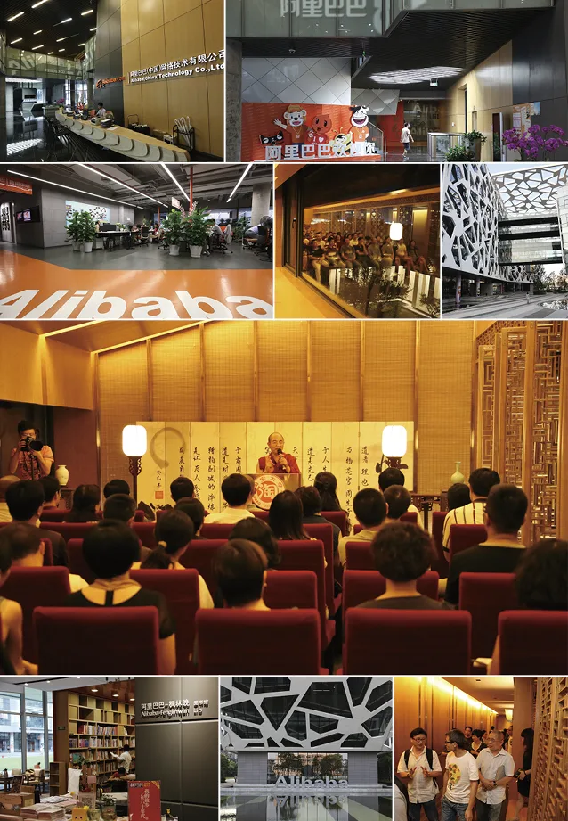
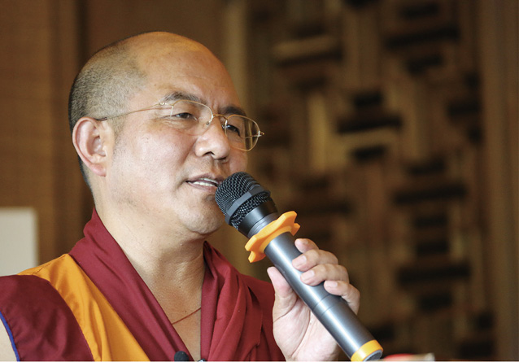
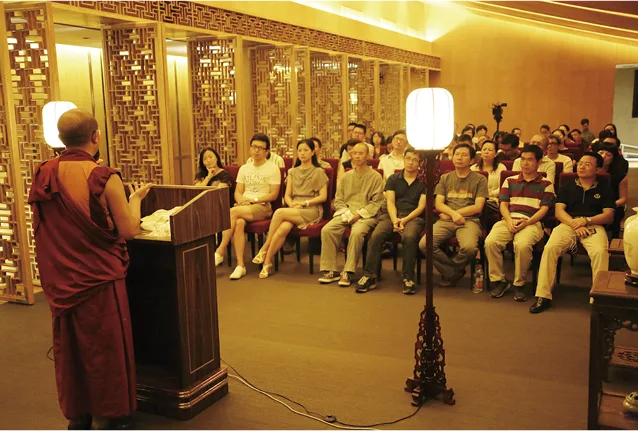
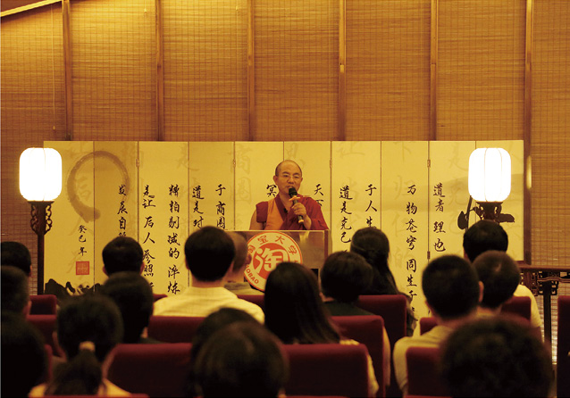
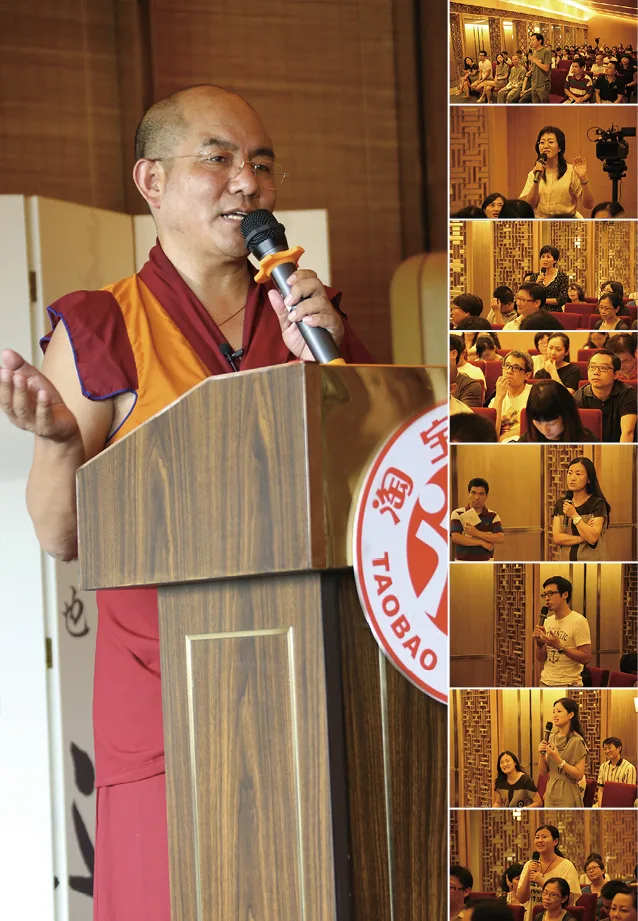
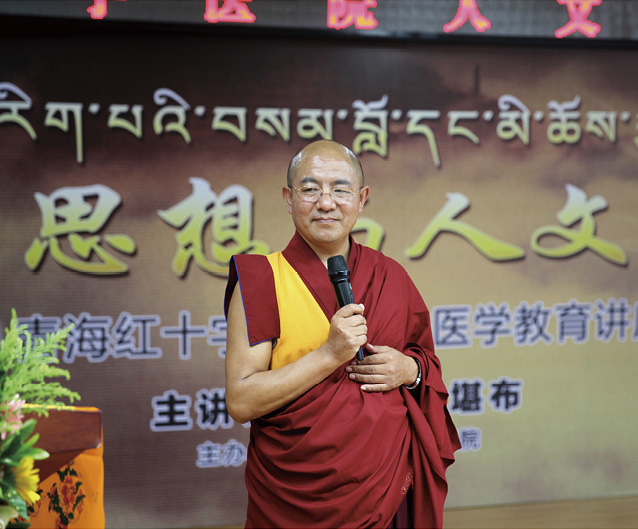
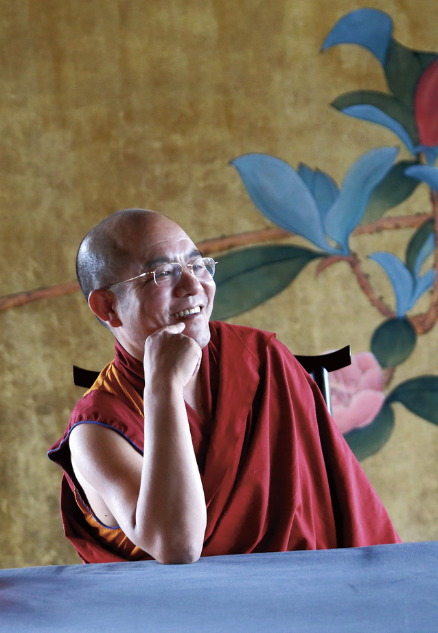

一瞬间的利他心，很有可能改变整个世界的命运。

第12场

杭州阿里巴巴集团

中国·浙江

2013 / 7 / 25

## 借假修真 自利利他

## Manage Unreality for Reality

今天很高兴可以跟大家一起交流。在座的各位，非常有名声，也非常有地位。大家都是阿里巴巴的高层，高级的经营人才。我听说在场的人，几乎管理着整个阿里巴巴，负责着两万五千多人的人事工作。

对现在所拥有的一切，大家要学会珍惜，因为你们所拥有的名声、财富，甚至是点滴的利他之心，都来之不易。你们所做的一切奉献、贡献都非常难能可贵。今天，我们利用宝贵的时间共同学习，也很有意义。

今天的主题是“借假修真，自利利他”，我对这个主题很感兴趣。你们也经常探讨这个话题，所以，应该会跟我这个来自藏地、出家的佛教徒，有一些思想上的碰撞。总的来说，我认为我们的观点是一致的。所谓的“借假修真”，有很多解释方法。佛教有一位非常伟大的论师，叫圣天论师，在他看来，“借假修真”指的是依靠假合的身体，修出真实的内心——即如来藏的本来面目。

## 因缘所造法，一切皆不实

现在是网络与信息的时代，一切都瞬息万变。通俗一点讲，因特网由虚拟的技术产生，依靠这样的技术，客户能获得真实的事物。这一点非常奇妙，一群人坐在办公室里，可以依靠电脑操作，令世界另一端的人得其所需。比如，一个人有购物、订机票等各种需求，都可以通过互联网这种非常便利的方式，实现自己的愿望。

从佛教的角度来看，这种方式体现了不可思议的因缘关系——当因缘具足时，果便可以产生。但是除专业人士外，一般人很难明白其中甚深的因果关系。就像佛教中经常讲“做善事得快乐，做恶事得痛苦”，其中的奥秘，唯有真正了达因果的人才知道。你们应该也很希望依靠这种技术，满足世界上成千上万客户的要求和愿望。但这种技术，掌握在极少数人手里，并不是所有人都能获得。

在这个世界上，看似虚假的事物，在因缘具足时，也能令人获得真实不虚的事物。早在两千五百多年前，佛经中对因缘规律已有宣说：“因缘所造法，一切皆不实。”不知道你们读没读过《金刚经》，经中说的“凡所有相，皆是虚妄”，指的是眼睛看到的、耳朵听到的、手触摸到的、心里想到的所有事情，在未经观察时，都会如梦般显现，但真正去观察时，了不可得。

也许你们会有疑问：“怎么得不到呢？我的手正摸着桌子，所以应该能得到。”有这样的想法，是因为没有详细观察过。一旦详细观察，会发现所谓的“手摸着桌子”，其实并没有实际的接触。思维我的手与桌子有没有接触？如果没有接触，那中间有没有隔开？如果隔开了，实际上就是没有接触；如果没有隔开，我的手应该与桌子融为一体。

佛教经常用极为细致、深邃的智慧对万法进行观察，观察后会发现，原来所谓的与人接触，只不过是一种相似的接近而已，因为一者融入另一者不可能；如果没有融入，二者也不可能接触。对于诸如此类的问题，佛教确实可以通过观察得到实相。

## 在21世纪做管理的窍诀

如果可以信仰佛教，或者过佛教式的生活，对管理工作会很有帮助。如今，东西方的发达国家与地区，对管理都很重视。一般来说，低等的管理，只需要进行简单的学习；中等的管理，需要运用现代化的技术；而高等的管理，则是精神层面的管理。

听说你们有传统的管理方式，也有现代化的管理方式，我以前看过一些相关介绍。我对很多知名的世界企业、集团感兴趣，想了解他们如何守护这么多人的心，如何由极少数人管理这么大的团体，其中有什么秘诀……我去了解这些信息的原因，并不是想成立企业、做开发或者赚钱。当然，你们创办企业的目的，也不仅仅是为了获得利润，其实也希望给大家带来便利。

佛教，是一种精神教育的传递。我自己也探索过如何用现代企业模式去实现这种传递。工业革命时代遗留下来的机械化管理方式，已不适用于当今的企业管理。如果像个别企业，仍然采用这种模式，机械地采用流水线作业——一个人必须完成自己的工作再交给下一个人，以此循环往复，很多人都会觉得自己像一个机器人，身心都很难适应。

除这种管理方式以外，还有一种比较开放的、可持续性的现代化管理方式。为了适应这种方式，人的素质也要相应地提高。如果无法提高，在依靠个人自觉的管理模式当中，很多人确实难以约束自己。

当今时代，我们需要的是什么呢？在21世纪，应该有一种随顺世间的智慧。个人智慧要跟得上时代，无论是年长还是年轻，都要不断地学习。如果没有求知精神，很有可能十年后就与时代脱节了。甚至前一年习得的技术和知识，后一年就被淘汰了。如果你热爱学习，并且能够认真去学，即使年龄不断增长，也可以跟得上时代的脚步。

对于高层管理人士来说，尤其要不断地学习。学习什么呢？其中一个就是要学习古老的传统文化，这是很重要的。我个人认为，佛教的理念与思想，适合现代人去学习，它并没有被时代所淘汰。在未来任何一个时代当中，人类对心灵层面的希求都不会被淘汰。

## 心灵希求的不同层次

在佛教中，专门讲过心灵希求的层次。人们首先追求的是生存，解决了温饱问题，才会希求更为丰富的物质；物质的极大丰富实现后，再有更高的追求。

佛教中有这样一个公案，有一次佛陀与弟子出游，看到一个乞丐非常痛苦，弟子便祈求佛陀给乞丐传法，佛陀说：“如果遵循人类基本的心理规律，在一个人特别饥饿的时候，应该先给他一些食物，等他的饥饿消除、身体恢复之后，再为他传授佛法，这才是合理的。”在座的人可能也知道，在上世纪60年代，中国遭遇了严重的饥荒，如果在那时，给人们讲一些所谓的艺术、精神价值、更高的追求，根本不会有人接受。因为心灵追求是有前提的，这一点很重要。

我听过汉地的一个公案，有一个小和尚走在路上，碰到了一个农民，农民背着一个特别大的包，累得满头大汗，他问小和尚：“你信的是道教还是佛教？”小和尚说：“您无须了解我信什么，您自己信什么呢？”农民回答说：“我既不信佛教，也不信道教，我只信睡觉。”“睡觉”的“觉”有两层意思，后来很多人分析他的语言，觉得他说的话很有意义——无论是信佛教、道教，还是信共产主义，或者遵从其他任何一种信仰，都需要先解决基本的生存问题。

佛陀在《巴陀伽摩经》中说：“人类的追求和愿望可以分为四个方面，第一是财富增长，第二是对名声的渴望，第三是健康长寿，第四是死后的幸福。”不信佛教或者不相信有来世的人，会认为人死如灯灭，死后也没什么可追求的，但这种见解是错误的。

当今时代的人，温饱问题已基本解决。大部分人应该已经有一些积蓄，有吃有穿，解决了温饱问题，这方面没什么忧虑。除一些偏远地区外，大家解决生活问题应该没有太大困难。

第二，追求自己的名声、事业的成功。等你有了一定的名声和财富，又会觉得出名不过如此：“就算天下人都知道我又有什么用呢？”其实没什么用。积累财富也是如此，就算有再多的钱，除增加个人压力以外，也不一定用得上，所以追求财富没什么可值得称道的。第三，我们希求身体健康。第四，我们会有一个更高的精神追求，会去思考：“今生结束之时，会不会死亡？将死之时，会不会痛苦？死亡之后，灵魂是否会延续？如何处理后世的投生……”对这些问题，有智慧的人会进行观察。而佛教的智慧对此有很精确的分析。

## 盲目、独目与双目

佛经对人类的道德观念也有所涉及。《鸯觉经》中说：“人类的价值观可分为三种，以是否具有眼睛为喻，第一种是盲人；第二种是独眼，即只有一只眼睛的人；第三种是具足双目、有两只眼睛的人。”

首先第一个，“盲目”指的是什么呢？盲目者，钱财和道德的观念都没有。这样的人每天浑浑噩噩，连积累财富、提升智慧与慈悲的心念都没有。经中把这样的人比喻作盲目的人，两只眼睛都没有。在世间就有这样的人，什么追求都没有，甚至于说，他来到这个世界就只是父母、亲朋好友的一种拖累、负担，除此之外没有任何意义。这是盲人的比喻。

第二种人，心里只有钱财，没有道德观念，经中将这样的人比喻作只有一只眼睛的人。就像现在社会上的一些人，觉得金钱是万能的，除钱以外什么都不想——心里想着钱，嘴里说着钱，眼睛也死死盯着钱，认为钱是一切幸福的根源、一切成功的来源、一切名声的源泉……一直对金钱特别关注。我们将这种人比喻作仅有一只眼睛的人，他只能看到一个方面，就是只看钱。

那么，第三种具有双目的比喻指的是什么呢？既有财富的观念，也有智慧和道德的观念，这是很重要的。现在的人确实需要智慧，因为身处信息时代，如果没有智慧，说什么话、做什么事、有什么想法，都难以圆满。智慧中包括道德与良心，也就是说，在完善人格的基础上，才可以建立智慧。我遇到过很多人，通过与他们的相处，我体会到，无论是什么身份的人，如果只有智慧和才能，没有道德和良心，肯定是不行的。

有些人是某某高校毕业的博士生、硕士生，大家都很羡慕，觉得他们很了不起。这样的人，一般说起话来头头是道，天花乱坠，比如我如何成功，将来计划如何如何，说得特别好，但等他去做事的时候，不一定能做到，因为人格太差了。如果没有人格作为基础，纵使高楼建造得再庄严，也一定会倒塌，这样的人终将落得一败涂地的下场，这是一种自然规律。

现在这个社会，虽然人有很多，但真正的人才、有智慧的人却很少。我所说的有智慧，并不是只懂技术，如果懂技术就算是有智慧，那有智慧的人应该比较多。我所说的有智慧，包括了有道德，因此指的是德才兼备，这样的人并不多。原因是什么呢？其中一个原因是，家庭教育从小就没有教给我们这些，尤其是“文革”以后。虽然80后、90后的年轻人，与熟悉传统文化的老一辈人比起来，有很多的才能，很适应现在的时代，对大众在想什么、做什么，都很清楚，而且对新兴技术也特别容易掌握，但他们对传统文化却知之甚少。

曾几何时，我们有信仰儒教、道教、佛教的传统，这样的传统延续了几千年。但“文革”之后的情况大家也都知道，传统文化受到了很大冲击。因此在新时代中，很多人无法接受传统文化的教育。这种现象应该说是历史的产物，或者可以说，时代浪潮中的个体也都是受害者。在传统文化受到冲击之后，我们也能感受到，在用人的过程当中，具足道德、良心，且人格非常稳重的人比较少——在社会的各个阶层当中，这种现象都比较普遍。

在藏传佛教中，有一部著名的论典，我以前也学习过，讲了做人的几个基本条件。第一是要稳重，这样的人是很可靠的，在任何时候都不会欺骗别人。第二是要有智慧，如果没有智慧，比较愚笨，很多事情都无法成办。第三是要有诚信，人要诚实、忠厚，不欺惑他人。第四是要正直，一个人说话也好，做事也好，不是当面一套，背后一套，如果嘴上说得非常漂亮，实际上做得相当糟糕，这样的人就可以叫做“狡猾者”。“心里思维一件事，口上言说另一事，此乃名为狡猾者，亦是愚人装学者。”藏族格言中是这样说的。这种人对社会而言没有实际作用。第五是要有利他心，这是最关键的，我们今天的主题也正是自利利他。

## 你的利他心可以改变世界

实际上，想具备自利利他的条件是很容易的。如果一个人一心一意想帮助别人，那么无论他是什么身份，高官也好，平民也罢，这个人都是非常值得尊敬的。因为他的内心当中，除帮助别人的心以外，从来都没有害别人的心，而且想要利益别人的心态非常强烈。当然，这样的人也不免遭到他人非议，甚至是言语攻击。

在现在这个时代，很多人都以自己的利益为中心，因此，如果有人的利他心特别强，他有可能会改变这个社会，乃至改变整个世界。按照大乘佛教的理念，真实利他心的力量非常强大，因此，一瞬间的利他心，很有可能改变整个世界的命运。

这种理念应该跟你们企业的愿景有着异曲同工之妙，因为你们所提倡的，是让天下没有难做的生意。我以前听过这个说法，它确实能够帮助到许许多多的人，让他们有非常简单、可靠的途径去做生意。如果采用传统的经营模式，可能在人力、财力等方面都有相当大的困难，而通过这种新兴的方法，经营就显得轻而易举了。因此，提供方便其实是一种利他心的表现，是非常有意义的，这也是佛教当中，最重视、最赞叹的一种理念，这种理念非常值得在世间推广。

现在大多数人，自私自利的心特别强，凡事以自我为中心。我们也可以看到，在一些高校里，思想教育大多贯彻了以自我为中心的理念。虽然在一些情况下，自我的概念也需要被提及，比如，独立的个体要有毅力、要坚强；个体集聚形成集体之后，要有集体感、凝聚力等等，这些都是需要的，佛教也并不反对。但自我发展、自我意识的增强，应该在利益他众的前提下实现，唯有如此，自我发展才是有意义的。如果自我发展建立在伤害他人的基础上，那么，自我发展没有也罢，要是有的话，于人于己都十分不利。

## 佛陀教你理财之道

对于佛教的道理，如果大家有时间，应该去探索。这样的探索是值得的，因为它可以给个人的家庭、工作、生活，带来非常大的转变。我遇到过很多企业家、哲学家、各个领域的知识分子，他们在没有学习佛法之前，虽然在一些领域也比较成功，但在面对各种问题，包括处理家庭关系、私人关系时，内心都会有很多困惑和苦恼。而在学习佛法之后，通过实践佛教智慧、慈悲的理念，灵活运用方便方法，轻而易举地解决了很多问题。对于佛教理念，我个人多年以来，将它们与当前先进的思想进行了对比，并非常惊讶地发现，佛教理念可以非常好地适用于现代社会。

去年有一段时间我阅读了《阿含经》，经中有一段专门针对财富分配的教言，我当时就想：“如果经营企业的人能够懂这些道理就好了。”佛陀在《阿含经》里是怎么讲的呢？我们所拥有的钱财，不能全部做投资，也不能一次性都用完，而应该将自己的钱财分成四部分：四分之一用在自己的生活上；四分之一用于做生意、经营；四分之一储存起来，等以后发生金融危机或其他情况时急用；最后余下的四分之一，最好用来做一些善事。对于这样的分配，估计很多现在的企业家都不懂。当他们积累了一定的财富，便认为自己永远都会这么有钱，于是把资金全部用来投资，最后血本无归。

前两天有一位女众，哭得特别伤心，她说她有六百万，又跟同事借了两三百万用于投资。她觉得自己发现了一个好机会，能赚很多很多钱，所以就把自己和同事的钱全部投进去了。但最近她所在的城市，发生了严重的金融危机，其实不仅是她的城市，国内很多其他城市也是如此，所以她投资的钱全部拿不回来，她的投资之梦也就此如泡沫般破灭。

## “赢”字的奥秘

在座的各位，从事的是与互联网相关的行业，对全世界的金融状况了如指掌，所以我在这里不必班门弄斧。当如飓风一般的危机席卷而来时，即佛教所讲的无常现前时，无论是个人还是集体，都应该保持高度警惕，要有随时面对危机的意识。

我看过的一本书里说，“赢”字由几个不同的字组成：上面是“亡”，中间是“口”，下面是“月”“贝”“凡”，这是什么意思呢？一个成功人士，比如赢得世界金奖的人，或者因为其他原因而引人注目的人，如果想要变得更加成功，需要具备五个条件。

第一，从创立企业的第一天开始，始终要有危机感，要假想“我的企业什么时候倒闭、什么时候被吞并”等等，所以“赢”字最上面是死亡的“亡”字。如果想在任何领域取得成功，应该把危机意识放在第一位。就像一个运动员，要预想自己可能会受伤，甚至退出比赛的情况。

第二，为了取得成功、达到自己的目标，要与他人进行交流、探讨和沟通。对于沟通来说，语言当然是最好的工具，这是“口”字所代表的意思。

第三，沟通一两次可能还不够，应该要不断地沟通，就像运动员训练一样，只训练一两天肯定不行，要反反复复地训练千百万次，之后才会有成果，所以需要时间上的积累，这是“月”的意思。

第四，需要付出人力、财力以及很多珍贵的东西，否则，想要“赢”还是有困难的，这是“贝”的内涵。

最后，为了实现“赢”的最终目标，在遇到任何困难的时候，你要把自己当作一个普普通通的平凡人，不畏困难，踏实肯干，这是“凡”的意义。

对于大家秉持的很多理念，我作为一个佛教徒，是非常认可的。比如，一些高层，在给客户服务的时候，把自己当作小二等。如果别人说你是主席、会长，或者什么大人物，你自然而然会生出一种傲慢心，但如果说你是小二，即使你的地位很高，也会觉得自己平凡而普通。这应该是现在很流行的一种理念，心理学把它称为平常心。其实，平常心是每个人都需要的心态。即使你的智慧再高、身份再特别，在与人交往、相处、交谈时，也不能给人一种高高在上的感觉。

以上讲的是五种条件。当这些条件具足的时候，一般而言，很多人就会获得成功。从另一个角度讲，要想获得成功，需要具备一些条件，我个人是这样认为的。

## 谁偷走了“长命百岁”

按照佛教的说法，任何人都会示现无常。虽然今天我活在人间，但百年之内，或者更短的时间里，我一定会示现无常。世间人经常说“长命百岁”，这应该是很多人的一种理想。佛教中也有很多高僧大德是这样发愿的，后来也以此缘起，得以满愿，因此我们可以看到，在佛教历史上，有很多高僧确实活了一百多岁。所以，在某种意义上，这样的理想和发愿也是需要的，但我们也要有一种无常观。

我们可能会活一百多年，但也很有可能会随时示现无常。像苹果公司的创始人之一乔布斯，就经常这样思维，他认为每一天都可能是生命中的最后一天。在他生命最后的时光里，即使面对严重的疾病，他也一点没有畏惧，这正是因为他每天都思维无常。同样的道理，无论我们是做企业，还是做任何事情，也可以这样思维：“这可能是我做这件事的最后一天，因为世事确实无常。”

## 无常观消极吗？

我经常想，尤其是在这个时代，如果你可以把握世间发展的形势，获得一些窍诀，就很有可能依靠非常简单的方法或途径，在很短的时间内，在世界范围内立足——你可以站得更高，也可以看得更远。但也有另一种可能——在形势、政策等外在因缘变化的时候，迅速衰落，甚至沉寂。

摩托罗拉公司的衰落就是这样，我以前了解过市场情况，苹果、三星等公司新兴产品的出现，令老牌公司的产品，在很短的时间里，就从市场中消失了。不仅公司的命运难以预料，对于个人来说，人生际遇也是无常的，比如说，今天的你可能是一个风云人物，受到全世界的关注，但明天的你就有可能失去这一切。

佛教对无常观非常重视，但难免有些人会有疑虑，“佛教是不是很消极，是不是没有勇气积极地面对人生”，等等。对此我今天下午也谈到，这种观点源于一些电影、电视传递的误导性信息，致使给大众留下了这样的印象。但实际上，佛教只是如实揭示了人生中最重大的问题，比如生老病死。如果对无法治疗的疾病、无法挽救的死亡，都可以有勇气面对，那么，面对生活中的问题，不会有太大困难。而且，真正的佛教徒，没有一个不是积极面对人生的。

现在有些人认为，生活出了问题的人才会出家，他们从电影中得到了这样的信息。尤其是在上个世纪八九十年代，很多人受到一些七十年代电影的影响，对佛教有这样的刻板印象。比如，家里经常吵架，有人就说“我要出家”，好像走投无路的时候才想到寺院，这是一种误解，其实佛教并不是这样。实际上，对于正处在悲伤之中的人，佛教是不接受他立即出家的，要等他的情绪恢复正常之后，再观察他四个月，甚至是四年，才能准许他进入佛教僧团。

在一些影视作品中，会出现对佛教历史的歪曲，所以我们很有必要对佛教进行符合实际的正面了解。信仰佛教的人多也好，少也好，佛教从来不会通过大肆宣传来拉拢人。与此相反，佛教一直强调随缘。但在随缘之中，当因缘聚合时，自己也需要做一定的争取。

## 苦才是人生

在众生之中，能够获得人身是非常不容易的，今生能够拥有的一切事物，基本来源于前世的福报。因此，自己应该觉得一切来之不易，要有这种意识。这样你才会珍惜生命中的每一件事——我们所遇到的好事也好、坏事也好，好人也好、坏人也好，其实都是帮助我们成长和学习的助缘。有些人只愿意遇到好人，不愿意遇到坏人。如果事情成功、顺利，就感觉很好，但千万不能遇到不吉祥、令人痛苦的事，否则就受不了。

对于真正有能力面对逆境的人来说，如果一生中遇到的都是好事，其实不一定很好，因为这可能会增长傲慢、贪心，不断助长不良心态，当然，一些不好的遭遇对于心态脆弱的人来说，会是一种打击。就像下大雨的时候，雨水会将小草连根冲毁，但对于枝繁叶茂的大树来说，雨水会成为它生长的助缘。所以，当际遇不好时，希望大家不要过于伤心，也不用总是抱怨：“我为什么不顺？为什么经常遇到不开心的事情？”

在遇到坎坷时，你会难受，倍感煎熬，但等事情过去，再次回想起来，也许你会发现这要比遇到一件顺心的事情更有价值。这是因为，顺心的事情不一定能让你成长、成熟，而如果遇到一些坎坷，你不得不去寻找应对的方法，发现自己的不足，与此同时，你也能发现人生的真相——人生大部分都是痛苦的。

我去年写了一本书，叫做《苦才是人生》，包括官员、明星在内的很多人都非常喜欢，很多人在阅读。我问过一些读者：“你的人生看起来不错，为什么还要看这本书？”他们告诉我：“对于我这种身份的人来说，虽然表面很成功，有钱、有势，什么都有，但内心其实很困惑、很浮躁，感觉压力非常大。如果有人说‘苦才是人生’，我是相信的，如果说幸福才是人生，我反倒不怎么信，因为我一点都不幸福。如果说上学时还比较幸福，但自从成了家、挣了钱，就有了很多痛苦。但我无法向别人倾诉，因为别人认为我很不错，我自己也装作很不错，实际上，人生是被痛苦塞满的。”

每当看到众生的这些痛苦，我就会感到佛教说得千真万确。佛陀专门宣讲过人生中各种各样的痛苦，比如，生老病死之苦；爱别离苦，最爱的人离自己而去；不欲临苦，越是不想得到的，越是降临到头上；苦苦，一个苦还没有结束，另一个苦就接踵而至，各种痛苦纷至沓来，比如家里刚出了事，紧接着单位又出事，身体不好，心情也不好，很多苦叠加在一起；还有变苦，比如你今天本来开开心心，突然发生了水灾、地震，出现了各种难以预料之事——前一刹那还快快乐乐，后一刹那马上就变成苦。我坐车的时候经常会想：“这一刻我活在人间，但下一刻如果车翻了，我就变成中阴身了，成为另一个世界的众生。”所以大家时时刻刻要有一种警醒的心态，这是非常重要的。

## 最高级的管理方式

在痛苦降临之际，谁都希望自己能够调整好心态。所以，现在我们最需要的，正是对自心的调整，这可以说是最高级的管理。一旦内心有了信仰，通过对身语意的约束，就可以克制烦恼、获得自在，比如通过禅修、诵经等方式，令身心完全放松，从中找到心的本来面目。

一旦认识了烦恼的本性，贪心、嗔心、嫉妒等不良习气，以及狡诈、欺骗、迁怒等不良心态，就会被遣除无余，现前佛教所讲的“心净则国土净”的境界。也就是说，当心已清净的时候，外在世界也会美好；当心不清净的时候，即使外面的世界再好，你也感觉不到。比如你在一个美丽的花园里，心情不好时，觉得花都很难看，甚至生起厌烦心；即使最好的朋友就在身边，你也觉得他非常讨厌。反之，如果你的心情很好，即使在环境特别恶劣的地方，也会觉得很开心、很轻松。所以，一切感受都是心在起作用。当然，对于这些现象，佛教中有更详细的解释方法。

去实践佛教的调心方法，非常重要。而对年轻人来说，首先要做的就是学习，尤其是进行心灵方面的学习。当然，技术上的学习也需要，因为佛教提倡拥抱世界、拥抱变化，所以心应该要开阔，不要非常狭隘，对各种先进技术也应接纳。只要心很广阔，就可以拥抱整个世界。有句话是这样说的：“大海无边无垠、非常广阔，比大海更广阔的是天空，而比天空更广阔的是我们的心。”心若广阔，便可以包罗万象、容纳万物；心若狭隘，则细微之物也难以容纳。

有时候，家人因为一件小事说了你，你可能特别生气。其实家里的争吵，大多是小事引起的，很少有特别重大的事情，没有家庭会因为国际关系而争吵。其实，争吵是由我们的执著所引起的，是心没有被调伏的表现。

## “唐僧团队”的启示

尤其是像你们这样的企业，在发扬团队精神的时候，更需要调伏自己的心。说到团队精神，佛陀在世时，就有僧团组织，在世界上所有组织当中，僧团的组织架构是相当完善的。当前，组织的架构、愿景、价值观、使命等经常被提及，其实在佛经中，这些内容早有涉猎。《毗奈耶经》中说，一个组织必须要有自己的使命，使命对于一个组织来说占有主要地位，经中还讲了组织的领导架构以及品牌文化等等。

我听说马云以前讲过“唐僧团队”。在佛教中，四个出家人以上才叫做僧团，如果是三个人，就不算僧团。在这四个人的团队中，一个人要占主导地位，就像唐僧；还要有一个人像孙悟空一样聪明、能干、具备对外交际能力，相当于外联部长；也有像猪八戒一样偷懒耍滑的人；还有像沙和尚一样的人，不一定很会说话，沟通能力比较欠缺，但干起活来确实卖力，能够承担很多重任，为人也实诚。

一个团队里肯定有各种类型的人，但不管是什么样的人，在团队中都非常重要，他们扮演着不同的角色。我以前也说过，团队里不同职位的人，就像机器上不同位置的螺丝，有些螺丝在明显的地方，有些在不明显的地方，甚至有些螺丝谁也不知道，只是默默无闻被拧在了无人知晓的角落，但这颗螺丝不能掉，否则，整个机器就无法运转。作为领导者，除了懂得识人用人以外，对于管理的力度也要有所把握，如果过松或过紧，都是不行的。

在佛教中，僧团应该是很成熟的团体。佛陀早已宣讲过，组建一个团队，一定要有不同类型的人参与，管理层要了解每种类型人才的特征、能力、优势，不能要求所有成员都与自己一样。比如我口才非常好，就要求所有人都要口才好；我自己特别能干，就要求所有人也这样，这是不可能的。只有让不同的人参与，才能提升团队的力量。对此，我经常用彩虹来比喻，正因为彩虹有七种颜色，才显得格外美丽、绚烂多彩。同理，人的爱好不同，特长也不同，集聚在一个团队里，整个团队才有多样化的优势。反之，团队里如果只有一种类型的人，就像彩虹只有一种颜色，天空就不会如此美丽多彩。因此，团队共同目标的实现，需要不同类型的人才各自发挥所长。

有些人拥有在团队中发挥才能的机会时，因为喜新厌旧的习气，觉得做不做都无所谓，没什么可珍惜的。其实，这是对你的一种考验。我个人认为，人要稳重，做任何一件事情，最好从开始坚持到最后，一定要非常圆满。除一些特殊因缘或单独作业的工种外，自己要经常跟大家在一起，为了共同的目标而努力。只有这样，才能让自己有所成长，才有能力帮助更多的人。

现在有些年轻人，包括佛学院的年轻法师，技术水平和智慧很不错，但人生阅历、管理经验都不足。所以，在做事情的过程当中，往往会犯大的错误，对自己不利，对别人也不好。我们在做事的时候，要无愧于良心、非常认真，否则，最后会导致悔恨终生的结局，给他人带来难以弥补的损失，甚至造成更严重的后果。因此，我们在凭良心的前提下，应该以一颗诚心做任何事情，这对别人有利，对自己也有利。

## 利他第一，此生无悔

其实，关于到底是利他还是利己，如果先有利他的心，那么利己的结果自然而然会发生。比如说用木柴生火的时候，只要有火焰，灰烬自然而然会有。我们只要能帮助别人，表面上看来我天天都是帮助别人，好像自己的事情都忘了，不太好。但是到一定的时候，其实利己的人往往是失败的，利他的人往往是成功的，这是一个自然规律。

世界上的任何一个企业也是，如果这个企业所有的手段、所有的员工都只想自己，想方设法骗别人，长此以往，企业定将难以维系。在这个时代，大多数人都不笨，如果无法从商品或服务中得到满意，他们肯定会采取行动进行攻击，终将使这个企业走向灭亡。如果企业中的所有人，都能以利他为主，久而久之，就会赢得大众的信任，自己的利益也会成办。

我经常这样想，在做事情的过程当中，要尽量把利他放在第一位。我有时候有真正的利他心，有时候只有假装的利他心，不过，我还是会尽量帮助他人。最后的结果，也许真正能利益到他人，也许利益不到，但即使利益不到、事情没有办成功，我也不会后悔。因为我在这个过程当中，没有做违背良心的事情。我在自己的岗位上，很认真地做事，对自己部门的人、对世间人、对任何一个人，都已尽最大努力去帮助。以后，等我离开这个岗位时，也能无怨无悔，无愧良心，对得起自己，也对得起他人。

管理人员需要有一颗非常纯洁的心，这一点很重要。如果有纯洁的心，即使偶尔在行为上有些差错，也不会造成太大的不良影响；如果没有纯洁的心，初心、动机早已改变，那么，即使不良行径暂时未被发现，犯下的错误只能用来世弥补。这种现象，在任何一个集体里，都有可能出现，所以大家也需要注意。

高管有能力、有智慧、有权势，当高管有当高管的好处，但也有它的坏处，比如，如果你作为高管作风不正、行为不良，你所说的每一句话、你所做的每一件小事，都有可能对整个集团乃至整个社会，造成非常大的不利影响。所以，在做事情的时候，应当按照佛教里所讲的，身口意务必谨慎——口中说的话，身体做的事情，心里的所思所想，都要谨慎。

时时刻刻要提醒自己：我作为一个人，我现在所拥有的一切，都来之不易；我现在在做事情的时候，一定要以一种非常真诚、虔敬的心来完成。这样一来，即使世界上的人都说我不好，我自己也能很负责任地说：“我的身口意很清净，这是别人的误解，不是我自己的问题。”但如果自己的事情本来就做得不好，即使别人赞美我，我也会像吃了毒药一样，感受不到快乐，觉得很不舒服，因为就算别人没有发现，自己内心当中也知道是自己的问题。

我希望在座的高层人士们，以后在自利利他的定位上，把利他放在第一。对你个人来讲，这是未来获得成功的唯一因。当这种精神遍于世间，也将为世界带来极大的利益。多年以来，日本企业家稻盛和夫，以佛教的理念经营企业。在参加“杨澜访谈录”时，杨澜问他：“您短期出家的原因是什么？”他回答说：“学佛的目的实际上就是自利利他，如果我能帮助他人，自己的事情自然而然会成功。”他在访谈中还说了一句话，我觉得很好，他说：“人来到这个世界上，从出生到现在，最好有一点点进步，最后要带着更美好、更高尚的灵魂死去，这是一种光荣。”

他说的话很有现实意义，人来到这个世界，不要造很多恶业，否则，最后离开的时候，就要带着很多恶业前往来世。我们来到这个世界的时候，是赤裸裸地来，所以在离开之际，也应该将对身体的执著完全放下，心识赤裸裸地离开。这时最好带着善业，不要带很多恶业。无论是什么身份的人，最终都将离开这个世界，而住于此世时，要借假修真、自利利他，这就是佛教所讲的——依靠虚假的身体来利益天下无边的众生。

现场互动

问：我今天下午看了您的微博，我猜测这应该是您的一个感想：“佛菩萨没有高高在上，而是把自己放至最低，去承载一切众生的苦乐。因此，无论你的地位是高是低，若想与佛菩萨相应，就要在心中放低自己，放得越低，佛菩萨越容易住进你的心里。”能不能请您再展开解释一下这段话？

堪布：从传记中可以看出，大乘的佛菩萨、具有菩提心的传承上师们，无论做什么事情，唯一目的就是利益众生，并不是利益自己。这完全不同于世间人。有很多世间人，在大学毕业之后想当官，认为当官之后可以很享受、很有势力。在佛教的理念当中，佛和菩萨犹如公仆，真正服务于众生，他们的行为并不是假意为之，并非在做一种形式、塑造一个形象，而是发自内心地真诚助人，甚至不惜以自己的生命为代价。佛菩萨的传记当中就有这样的描写，佛菩萨可以放弃自己所有的财富，甚至是生命，来帮助他人，这种精神在当今的价值体系当中，是极为罕见的。因为我们的布施，在行为上，只会用个人财产中的一少部分，在心念上，会认为自己确实帮助了别人。而传记中讲的菩萨的利生，其心与行都远远超越我们。

当我们把自己放到最低，并诚心为众生服务，佛菩萨的加持便会融入我们的相续。在企业中，如果一个人很真诚地服务他人，即使一开始他的地位很低，但久而久之，发心为他人服务的人，一定会在社会中受到重用，终将处于万人之上。

问1：现在经常会看到一些人，在寻求他人的帮助，但我觉得他们很有可能是假扮的。他坐在地上，向你要路费，但你经常看到他在那里要钱，所以你知道他并不是真的没有钱回家，因此他很有可能是在骗取你的同情心。

每当遇到这种情况，如果选择帮他，我会觉得自己被愚弄了，但不帮他好像又过意不去，因为他的行为也是一种示弱，是他的一种谋生手段。您刚刚说，帮助别人是快乐的源泉，但在这种情况下，我们到底是帮还是不帮？

堪布：遇到这种情况，如果是我的话，我会观察。如果各方面的证据比较充分，基本可以确定是假的，我就不会给他钱。但如果理由不充分，很有可能不是假的，而且从他的言行举止，看出他真的很可怜，我就会给他钱，所以要具体情况具体分析。

前段时间，我讲过一个故事，有一个中国人和一个带着孩子的美国人，一起走在街上。路边有一个乞丐，美国人的孩子想把买玩具和笔的钱送给乞丐，那个中国人就说不要给：“我们这个地方假乞丐多得很，都是骗人的。”但美国母亲还是让孩子把钱给了乞丐。后来，中国人就问她：“为什么要给？这些乞丐都是假的。”美国母亲是这样回答的：“乞丐有可能是真的，也有可能是假的，但我不希望给孩子留下乞丐都是假的这个印象。如果在他小的时候，父母就跟他说乞丐都是假的，那么他长大之后，每当看到乞丐的时候，就会觉得他们都是骗人的。爱的价值要比金钱高，今天我们给了乞丐一些钱，这是一种爱的表现。金钱不重要，爱很重要。”

像刚刚我说的，如果各方面的证据确凿，确定是假的，那就不给。但如果有可能不是假的，那么给予对方钱财其实是一种爱意的表示，与爱相比，钱财并不是很重要，所以我选择尽量给。

现在很多人都宣传乞丐是假的，所以就算是真乞丐，也没有人给钱。而且在各种媒体的宣传中，比如一些电视节目里，对乞丐处境可怜的一面宣传得不多，对于存在欺骗性的一面，却宣传得比较多。所以，人们获取的大多数信息，都说乞丐是假的，以至于一看到乞丐就这样认为。

有时大众对出家人的态度也是如此，看到出家人就认为是假的。我有一次去一个地方，几个小孩看到了，就指着我说：“看这个光头假和尚！”“电视里的假和尚又出来了！”我当时心里想：“为什么说我是假和尚，我又没有骗他。”但我也没有辩解。所以有的时候，媒体给大众传递的信息，不一定完全准确，可能本来真实的事物，却被认作是假的。当然，对于这些问题，还要具体分析。

问2：所以，我们尽量还是要给他们钱。

问：刚才您所讲的观点，可能更多是从佛教层面来讲的，而我们在学校也学过一些西方理论，比如西方经济学。市场经济会强调，每一个个体都是理性的，其主要目的就是利己，因此先要满足个人利益，这样才能保证整个群体的利益最大化。换句话说，如果你连自己的利益都不能保障，很难相信你能更好地帮助别人。

我们经常会看到一些新闻，比如一位警察为了执行公务，即使家人得了重病、病情快速恶化，他也没有回去。现在对这类事件也有争论——他到底应该坚守岗位、帮助更多人，还是应先帮助自己的家人？在家人病情迅速恶化并要求他去照顾的情况下，应该如何选择？在做选择时，利己和助人之间的界限要怎么来界定？我想听一下您的见解。

堪布：从佛教的观点来讲，它们的层次不同，利己也重要，利他也重要，但是佛教怎么分析呢？实际上要观察你心的水平——如果你心的水平非常高，那就以利他为主。

从人生的价值上讲，其实利他是最重要的，哪怕有些选择会伤害你的身体或家人的利益。不过，如果自己还没达到这种境界，利己都没办法保证，想利他也很困难。

佛教中的利己，是只追求自我解脱，在保障自己利益的基础上再考虑利他。这个时候有一个冲突：到底是以利他为主还是利己为主？佛教中讲过，这时要看利益他众的数量。比如你在一个团体当中，如果选择利他，可以利益一百个人，这时候家里一个人的利益就不是很要紧，利益一百个人更重要。

因此，在佛教当中，利他和利己相比，利他的价值更高。而在利他和利己发生冲突时，要在价值上进行衡量。利他和利己，这两个概念有些笼统，也比较复杂，所以要进行对比，还要进行分析。

问：在座的各位高管，身上承担的责任、承受的压力都非常大，如果用一个词来概括他们的生活状态，就是“忙碌”。在这种忙碌和高压的状态下，随着时间的推移，健康会出现一些问题，比如高血脂、睡眠不佳等，这些情况比较普遍。所以，很想请堪布从佛法的角度，给在座的各位一些建议：怎样以智慧的生活方式去追求身心平衡？

堪布：按照佛教的观点，人的身心平衡很重要。首先要保证睡眠，《黄帝内经》中也是这样讲的，所以除特殊情况外，再怎么忙，至少也要睡六七个小时。以前有一种说法，人至少要睡八个小时，但现在西方医学认为，睡八个小时反而对寿命有害。所以我个人选择睡五六个小时，再怎么累，再怎么忙，也必须把睡眠调整好，不能熬夜，不能作息颠倒。

现在有些网络工作者，白天晚上的作息是颠倒的，这对健康非常不利。我以前读过《黄帝内经》，也看过一些藏医的书，其中都提到，从晚上十一点至次日凌晨三点之间，如果能处于睡眠状态，对健康是最有利的。所以一般来讲，到了十一点就一定要去休息。这是通过睡眠来调整身体的方法。

同时，我们也可以通过一些方式，来净化自己的内心。目前普遍使用的方法，有禅修，还有念诵，而更为重要的一种方法是什么呢？就是在内心波动时，不失轻松感。在座的高管，不可能天天都盘腿坐着，否则，别人也会觉得你有问题，“该去管理不去管理，天天都打坐”，这可能行不通。所以，不需要天天打坐，只需要在做事的过程中，心里有一种放松、轻松的感觉。密法当中讲，要随时观察自己的心态，在观察时会发现，所谓的压力和痛苦，其本体并不存在。

压力和痛苦，都是自己定义的。对一些年轻人来说，早上起来上班是一种压力和痛苦，但在其他人看来，这件事却很平常——早上六点该上班就上班，在上班的时候，该怎么工作就怎么工作，这不叫什么压力。作为人，生存在这个世界上，需要有活力。修行更应如此，在动中住，在住中动，这是最高层次的修法之一。达到这样的境界时，在你的起心动念中，会有一种放松感，而且在动中也能够安住，无论是平时说话，还是跟大家开会交流，都不失这样的境界。

大家不能总喜欢抱怨。比如开会的时候，有些人觉得好烦，“这个人说一件事，那个人又说一件事”。其实所谓的烦，是自己的一种烦恼，不应该随顺这样的烦恼。应当想一想：“我既然做这份工作，就需要面对这些，不然怎么叫上班呢？”这样的话，内心有一种轻松感，否则，会觉得开会很烦，坐车很烦，堵车很烦，下雨很烦——其实，堵车的时候，我还是很高兴的，可以顺便看看书；下雨的话，也觉得很舒服，所以还是要看自己的心态。很多人心态不好的时候，觉得天热好烦，下雨好烦，走路好烦，坐车好烦，吃饭好烦……如果什么都“好烦”，那整个世界除了烦以外，不会有快乐。如果你把自己需要做的事，全部视为负担，即使想通过修行来调心，也很困难。

其实，无论遇到什么事情，都要稍微放一放，安住一下，放松一下。熟练运用这个方法，你会发现，其实烦恼并没有那么大。

有些人的工厂倒闭了，欠的钱还不起，这种压力确实很大。我昨天听说有一个人就遇到了这种情况，工厂倒闭，钱还不上，很想自杀，但又觉得如果自杀了钱不还，良心上过不去。我自己也想了想，如果我碰到这样的事情，确实很难解决，通过修行也很难调心。除这种严重的情况外，平时上班需要做的事情，尽量把它当作一种快乐，这样就不会感觉很烦。

对心态的调整，有助于身体健康，幸福指数也会提升。如果一直把工作当作压力和痛苦，你的幸福指数会不断下降，甚至患上抑郁症、引发各种身心疾病。因此，没有必要把工作当作压力和痛苦。

问：在国外的时候，我遇到过一件事：我和朋友驾车行驶在路上，有一位朋友身体不舒服，到路边呕吐，一位外国友人马上把自己的车停下来，过来问我们是否需要帮助，还照顾我的朋友。我在国内也碰到过类似的事情，有一次是下雨天，我一个人开着车，停在路口，有一个人淋着雨过来敲我的玻璃窗。我其实很想把车窗摇下来，问他有什么需要帮忙的，他可能想搭车，也可能想问路，但我还是踩了刹车。因为我很害怕他放迷烟进来，把我迷晕，然后威胁到我的人身安全，新闻里报道过这样的事件。

之后的两天，我的内心很不平静，我有谴责自己，不知道这样的状况应该如何去处理。中国民众的整体素质，与许多欧美国家相比还是有比较大的差距，而我们这一代人，实际上应该承担起责任，去改变一些现状。我觉得我在公司里是可以做到的，譬如说有些事不是我分内的事，但如果我看到一些不太合理的情况，也会去跟同事说怎样会更好，给予一些建议。但对于公司之外的事，我有时候就会觉得社会这么大，我的力量又如此微弱，在个人安全可能会受到威胁的时候，即使我出于良知想去帮忙，也还是会却步。对此特别想请堪布指点一下。

堪布：听了你讲的两件事，一个是遇到施助者，另一个是遇到求助者。在第二个情景中，求助者会不会放一些能迷晕你的东西也很难说，因为之前确实有过这样的报道。在这种情况下，拿不定主意，最终也不得不保护自己。

但无论如何，就现状而言，年轻一代的责任确实很重。但以个人的力量，确实很难改变这个世界。其实不要说改变世界了，想改变身边最信赖的人，都有一定的困难。

我以前在书里读到过一个小故事，一个小孩走在河边，看到岸边有很多鱼正在被太阳暴晒，不久之后就会被晒死，所以他开始救这些鱼。其他人见状说：“这么多鱼，你也救不过来，就别救了，谁在乎呢？”小孩却坚持说：“虽然我没办法全部救下来，但这一条鱼在乎，这一条鱼也在乎……”他一边说，一边把鱼一条一条地扔回河里。

后来我再再品味这个故事，觉得它确实引人深思。它是在告诉我们：想改变所有人可能很困难，但如果我们能身体力行地付出，自己也向正确的方向不断努力，也许在这条道路上，会有一些人因你的语言、行为而改变。哪怕是为了一个人、两个人，我们也不要退缩，要坚持去做。

当然，想要一下就改变整个世界是很困难的，尤其是现在的年轻一代，有很多人由于所受教育的影响，自身也会出现一些问题。当然，这些问题并不仅仅是年轻人才有。

另外，不同媒体也传播了一些不利于身心健康的讯息。我们现在吃的食物、穿的衣服，都让人没有安全感。如果制作食物的人没有道德底线，那么他所制作的食品肯定让人难以放心，我们会怀疑，吃了这个会不会得癌症，吃了那个会不会有什么问题，总之，吃什么东西都会胆战心惊。但即使处于这样的社会之中，我们也不要放弃去改变现状的努力。

之前去欧美国家时我也有一些感受。第一个感受，对比而言，从民众的总体素质上来说，我们还有提升的空间。第二个感受，那边的很多建筑，几百年前就已建成，安稳地矗立在那里，让人感觉很平静。还有另外一个感触，那里的人好像对钱财、轿车、房子没有什么攀比的习惯，不像我们这里有些人，别人买了一辆车，我也非要买一辆车，别人买了一栋房子，我也非要买一栋房子——如果不买，好像就跟不上时代。其实，很多不必要的竞争和攀比现象，应当不断减少。即使社会的现状就是如此，我们在不同的团体当中，也应该坚持对正确行为的倡导。

问：请您讲一讲您对不同宗教的看法，比如基督教、伊斯兰教以及佛教。

堪布：我对各个宗教也在学习当中。前两天我们在香港举办了“第三届世界佛学青年研讨会”。今年在可持续发展的研讨当中，有一个跨宗教的对话，邀请了天主教、基督教、道教、儒教、伊斯兰教、佛教等八个宗教，八个宗教对议题各自发表了看法，比如人类推进可持续发展所面临的挑战和问题，等等。在交换意见时，我们也基本达成了共识：除物质财富外，人类也需要精神财富，而这种精神财富，是可以依靠信仰得到的。

当时大约有六百多人参会，参会者基本都是知识分子，有佛教徒，也有非佛教徒，其中也包括其他宗教的信徒。在讨论当中，我们认识到，在当今时代，应该要提倡求同存异，在世界范围内，应该有一个“地球村”的理念。各宗教不应互相排斥、以自我为中心，而应当团结和合、理解包容、互相学习。

虽然各宗教的教义不同，但总体而言，并无矛盾之处。其实，在佛教内部也有很多不同的派别，比如汉传佛教、藏传佛教、南传佛教等。而在汉传佛教当中，又有天台宗、净土宗、华严宗、禅宗等不同宗派，宗派之间并无矛盾。世界上所有宗教的存在，都有其历史渊源、价值与意义，因此我对各个宗教都非常恭敬，也很愿意去学习。

问：在中国，不同的人对佛教的看法不尽相同。很多寺庙里供奉了释迦牟尼佛、观音菩萨的像，作为人们供养的对境。有些人去寺庙上香的时候会有很多欲求，想到的都是利己的事情。我在寺庙里见过的人，都是因为有希求才去祈求——这种类似于偶像崇拜的现象与佛教有关系吗？

堪布：有些人确实经常到寺院里烧香、拜佛，为自己的愿望祈求，这在佛教当中是合理的。按照《地藏经》的观点，对殊胜的对境，比如佛像、法宝，在殊胜的道场当中，进行许愿、朝拜、转绕等，都会有不可思议的功德。但没有信仰的人可能感受不到，因为信心是很重要的；如果有信仰，通过自己的祈祷和发愿，可以得到许许多多真正的利益。但这会不会变成一种偶像崇拜，会不会因为不符合佛教究竟的本意而不合理呢？其实并不会如此。因为佛教有不同层次，在基础层次，求保佑、平安、发财都是可以的；层次提升一些后，最好发愿利益众生、弘扬大乘佛法、回向世界和平；如果层次再提升，可以了知一切万法皆平等，进而现前豁然开悟的境界，照见无我、无众生。在没有达到最高的层次之前，需要一层一层地提升。每一层的存在，在佛教中都完全合理。

在一些人的人生当中，确实通过在寺院发愿，发生了很多奇迹。而且对佛菩萨的恭敬，并不是一种偶像崇拜，其实，这样的恭敬恰恰是我们所需要的。不仅在佛教团体中需要有恭敬，在企业集团中也是如此——对集团最主要的精神领袖，也需要有一种恭敬，我想在座的各位应该有。如果对精神领袖有一种恭敬，对于他的言传身教，你便能够铭记于心。这样一来，你会获得来自他的一种力量，你会感觉他说的话跟别人说的话完全不同，这就是精神的力量。

问：您讲的利他，这个“他”有没有一个范围？比如说我们做企业，能不能爱自己的竞争对手，能不能做有利于竞争对手的事情？刚才我的脑海中浮现出很多事情，大概在我二十多岁的时候，当时有一个天主教徒，是一个美国的老太太，特别希望我能够信耶稣，所以她跟我说了很多次，后来我跟她说：“我非常坦率地告诉您，我心里有一种抗拒感，因为我觉得耶稣是个外国人，我很难接受他。”

通过这件事我就在想，每个人生下来就活在一个框架里，我们对世界的认知生来就有很多框架。比如说要保护环境，并不是因为我们真的爱什么，而是因为我们知道，如果不保护环境，我们的子孙可能就没有生存空间，因而这应该算是一种利己的行为。而在讲利他的时候，我个人感觉心里还是有个范围，比如说我不会做有利于苍蝇的事情。虽然佛教徒可以“爱惜飞蛾纱罩灯”，但就一般人而言，利他总是会有一个范围。我们总会有价值的判断，如果是一个杀人犯，能不能做有利于他的事情？所以我心里的疑问就是，利他的范围是什么？

堪布：关于利他的范围，包括佛教在内的各个宗教，都有各自的说法。比如基督教谈及爱仇敌时说：“有人打你的右脸，你就连左脸也转过来由他打。”当然，如你所说，这是国外的说法。又比如国内的孔子，你应该不认为他是外国人，他说：“在面对敌人的时候，若以儒家思想去应对，应该是亲怨分明的，敌方就是敌方，己方就是己方。”

而按照佛教的说法，利他是分不同层次的。在大乘佛教最究竟的教义中，除自己外，天下无边的有情，所有的人和动物，只要是有五蕴感受的生命，都是所谓的“他”。在修持的时候，也有如是次第——刚开始时，对自己生起慈悲心、饶益心；然后扩展至自己的家人、亲朋好友，乃至自己的民族、国家等，不断把“他”的范围扩大；到最后，对天下所有众生，都像对自己一样，可以全心全意进行饶益，那么自他平等的心就修圆满了。

所以，你所说的“他”的范围，实际上可大可小。我如果只关心自己的事情，这个范围就只有自己一个人，这是小的范围。我也可以把范围扩大，扩大到我的民族、我的国家，乃至我所在的地球、宇宙。我所的执著是可以不断扩大的。人都有一种对“我”的执著，你在国内的时候可能感觉不到，本国人跟你在一起的时候，你也没什么亲切感，但当你到了欧美国家，再遇见一个中国人的时候，你心里一想：“这是我们国家的人！”就感觉很亲切，其实这就是人的一种我执。

总之，所谓的“他”是可以按不同层次定义的，范围也可以不断扩大。

问：我现在负责淘宝的业务。有一个问题，我始终很难跟我们团队的一些年轻人讲得清楚，所以特别需要您的帮助。我们毕竟是一个企业，所以每年都会设定一个目标，对每个员工来说也是这样，年底时会用这个目标对比你完成工作的成果，以此作为个人绩效的考核。但在这个过程当中，我们就发现，如果一个人过于执著结果，可能就会造成很多所谓的“动作变形”。有时候我们会跟他们讲，是不是可以稍微放下一些，不那么执著结果，但是又很难解释清楚。所以，在执著结果和专注过程之间，应该用什么样的心态去平衡？堪布您是否可以帮助我们这些管理者，在这方面给予一些建议，来帮助这些年轻人。

堪布：实际上，我对现在很多年轻人的心态，也很难去把握。现在年轻人的思想普遍比较浮躁、复杂，这是由于不同文化的交流、网络等媒介的发展，以及信息不断传播所导致的，应该可以说这是时代的产物。

以前，在一个小时之内，我们能够很平静地坐着，但现在坐一个小时，可能要看二十遍手机和电脑，心里一直想着“有没有新消息”“要不要发信息”等等，所以不断地看、不断地看。

手机上的资讯，对做业务的人来说，也会有一定的影响。比如，本来他在踏踏实实、勤勤恳恳地做事，结果周围充斥着讯息和暗示，这时他的心，一方面要放在业务上，另一方面还要放在其他事情上，比如“我一会儿要怎么回话”“我今天收到了什么邮件、信息”等等。也就是说，除了该做的工作以外，他的心思还放在别处，虽然看上去人在上班，但心不一定在上班，如果心思没放在上班上，工作质量肯定会打一定的折扣，那么最后就会导致你所说的“动作变形”。所以，对于很多年轻人来说，确实要学会放下对自己无意义的知识和技能。

其实佛教里所讲的放下，并不是放下所有的事情。现在好像很多人都觉得，佛教讲的放下和看破，就是什么都要抛弃——家人不用管，工作也不用上心。人们一提起佛教的时候，也只能想起“放下”两个字。甚至，很多人对佛教的看法，就是什么都不管、没有良心。

我研究佛教这么多年，并没有发现“放下”说的是抛弃一切。佛教里讲的是“该放下的东西要放下”，要放下不清净的思想、不清净的行为，但并没有要求放下清净的行为、具有责任心的行为。佛陀要求我们，一定要约束自己的身语意，就像在佛教的僧团制度当中，念经、禅修、为众生超度等等，是必须要去做的。如果你没有这样去做，通过做事所获得的经济收益，你就没有办法分得一份。举个例子，比如你在一个念经的僧团当中，如果你没有念经，通过念经获得的收入就不能分给你，这些规定在经济分配制度当中讲得很清楚。

通过我刚才的说明，大家应该可以理解，佛教里并不是什么事情都要放下。虽然到了最高境界时，佛教也讲万法皆空，一切都要放下，但这个境界并不是一般人所理解的境界，也不是轻易能达到的。要想达到这样的境界，还需要经过多年乃至更久的修行。现在有些人把佛教最高境界的语言，错乱地用在世俗名言中，要求把世间的事情全部放下，我不认同这种选择。

在管理的过程当中，有些时候应该要严格，那么，严格的管理会不会违背自己的良心呢？其实是不会的。我在学院也管理着上千僧众，每年都有考试，有专门针对管理的规划、策划。如果有人该遵守的规定没有遵守，那么该怎么惩罚就怎么惩罚，所以即使是僧众的团体，也没有通融的余地，该开除也得开除，该怎么做就怎么做。因为在建立管理制度的时候，我们已经在无愧良心的基础上，为大家指出了一条不甚严苛、甚为合理的道路。如果你没有如法而行，那么无论你是谁，我们都会采用公平公正的方式进行处理。

对于年轻人的管理，有时候的确要宽松一些，但要完全地放宽，在这个时代是行不通的，因此，还是要把管理制度，与其自身利益挂钩。而且，在管理过程中，宽松与严格的方式交替使用，才能真正管住人。

其实，按照佛教高层次的管理方式，应该开展心灵教育，但对于现在的很多人来说，能不能达到高层次的境界呢？很难。所以，现在一般是采用教育与管理相结合的方式。对于现代企业来说，这种方式不太常用。

问：其实每个人都有惯性，比如在做业务的过程当中，你会发现做得越成功，过去的经验带来的牵绊越大。因此，做业务的人可能也知道，有的时候，想往前走会成为一个问题，但你会有所反思，也会有所警醒。但即便如此，在往前走的过程当中，这种惯性还是特别大，会把自己又重新拉回来。所以，需要有一个创新、重生、超越的过程。特别是要在离开原来的自己之后，到新的环境当中去重建一个自己，这件事情会特别困扰我们，所以特别想得到您的一些智慧开示。

堪布：对于人力资源部来说，有他心通是最好的，这样你看到一个人的时候，就能了知对方的心理、了解对方的性格……开玩笑的。（众笑）

在一个人前进的路上，的确需要不断创新。佛教中有一句话：“已知者非智者，未知者乃智者。”意思是说，了知已知的事情，不是真正的智者，而了知未知的、未被开显的所知，才是真正的智者。

企业要做成像阿里巴巴这样的集团，需要有伟大的构想、远大的目标，也需要有很多创意。如果只局限在互相学习、借鉴，没有创新、没有新的力量、没有开创新的道路，到一定阶段，企业就失去活力了。

人类已经发现的事情，已成为一种经验，是已拥有的智慧，也可以说成了一个美好的回忆，可以作为未来发展的基础。但我们不应止步于此，要继续不断地探索。现在有很多成功人士，希望通过对未来的探索来抓住机遇，这一点很有必要，因为这个世界正在迅速发展，变化得特别快，日新月异。十年之后，市场会透露给我们什么讯息，由什么样的集团所主导，有智慧的人的确会有所了知——他们能够预知未来的市场和人们所关注的事情。

很多人从小接受的是灌输式教育，学生只是听老师讲课，没有参加过创新训练。在一些欧洲的大学里，有些老师要求学生一定要提一些特别奇怪的问题。如果你能对奇怪的问题进行思考，或者对不容易回答的问题进行探索，他们就会觉得你这个人是很有创意的。

在现在，就可以对未来进行预测与推断，或者说，对暂时深藏在表象之下的事情进行推测。如果我们可以通过智慧、禅定了知未来之事，这种能力本身就是最好的资源。不过，要想获得这样的智慧和禅定，还是需要下一定的功夫。

一般人无法预测未来，如果任何人都能预测，肯定任何人都想占领未来的市场。但成功的预测要靠平时的沉淀与积累，而且也需要因缘的和合。对于大众普遍在探讨的问题，谁都能进行判断，但对于未来的问题，一般人却无法预知。未来会发生的问题，可能是非常大的社会问题，也有可能是个人的人生问题。如果你能预知它，就可以感受到它蕴藏的真理。

问：刚刚您谈到“放下”，我特别有感触。放下，说起来很容易，但是做到很难。一直以来，我们都在往前冲，总想获取更多。在得到很多之后，有些事物反而成了包袱。因此自己也觉得应该放下，可是往往不知道，什么时候该放下，怎么去放下？想听听您的看法。

堪布：我刚才也讲了，在佛教当中，并不是所有事情都要放下。刚开始学着放下的时候，首先要放下害别人的行为；到一定时候，害别人、害自己的行为都要放下；到了最高的境界，一切行为都要放下。这时，佛教所宣说的确实是放下、自由、解脱，但在世俗层面，佛教没有提倡这样做。在汉传佛教中，放下、解脱、自在这些词广为人知。

当我们遇到困难的时候，所谓的放下，对自己是个很好的安慰。比如说你的一些事情没做成功，没得到非常好的结果，这时就说：“算了，放下吧！”

我觉得“放下”在佛教中的真正内涵，指的是放下自我执著，这在所有的放下当中是最重要的。因为对自我的执著，给我们带来了许许多多的痛苦——生活中的痛苦，乃至轮回中无边的痛苦，因此，在佛教修行的最后阶段，需要放下对自我的执著。但暂时来讲，在“无我”的境界还未现前时，世俗中的自我发展也是需要的。

可能有些人会怀疑：“自我的放下与自我的展现会不会相违？”实际上并不相违。为什么呢？因为在最究竟的境界中，所谓的“我”是不存在的，在空性层面，不要说“我”不存在，整个世界中所有的一切都是不存在的，这就是万法的真相。当然，这是真正成就时的境界，而不是我们现在的境界。对于现在的我们，自我是不能放下的，就像在过河时，船只不能放下一样，因为一旦放下，就会掉到河里，所以一定要等过了河以后，再把船只放下。我们现在正漂泊在轮回的海上，在这个阶段，依靠“自我”修习善法、断除恶业十分必要，包括在企业里，需要“自我”来参与团体的建设等等。

今天在座的人，其中有很多非常有智慧的人，可谓人才云集。在佛教中，团体与组织的团结，不能放下、舍弃，而个人的自我完善，也是不能放下的。

问：我们的生存环境有些复杂，也有些令人不安，所以在做一些决定的时候，需要比较理性。但做出这样的决定，有时让我们并不快乐，所以我们越来越倾向于听从内心。我想请堪布分享一下，您认为的听从内心指的是什么？

堪布：按照我们佛教的观点，对于重大的抉择，如果需要一个人决定、其他人不能参与，就以自己的智慧，反反复复观察之后再抉择。如果其他人可以参与，应该让更多有智慧、有阅历、有经验的人来参与，这是很重要的。在佛教当中是这样讲的：“即使我有最后的决定权，也最好不要一个人做决定。如果做了决定，得到好的结果还可以，但万一结果不好，很多人都会有怨言。”因此，一定要召集相关的人共同商量，最后自己再决定，这样一来，即使这件事情没有成功，也不会有争议。

有些人，当最终决定权在自己手上的时候，立刻就做出决定、提出决策，得到的结果往往不太理想。一个人的智慧是有限的，再加上做事的时间又短，经验积累得不够，有时候认为是正确的决定，最后可能会出现难以避免的错误。

现在佛教一直在反复重申民主的重要性。不知道你们是以什么方式处理集体问题的？在我们的团体当中，对一件事有不同观点时，基本都以民主的方式做决定，以大多数人的意见为准，不是一个人想什么就做什么。如果一个人做决定，久而久之，很有可能出问题。在以西方国家为主的集体当中，民主是比较成功的形式。佛教对民主也非常重视，个人不能成为做决定的主体，要以大多数人的决定为准。每当我遇到难以抉择的事情，都会把相关人员集中起来，以无记名投票的方式做出最终决定。总之，采用民主管理，在现在这个时代非常重要。

管理集体的方式主要有两种，一种是君主式，一种是民主式。对于采用君主式管理的集体来说，如果君主世世代代非常英明，这个集体就很容易取得成功。如果找不到特别英明的君主，民众可以民主选举出一位管理者。选举出的管理者，无论最后管理得如何，民众一般也不会有太多怨言，因为是自己选择的。

我前几年了解到不丹国王辛格·旺楚克的做法，他很英明地选择了退位。退位的主要原因是，他认为国家的维系需要依靠民主，因为国家就像一个由民众组建的大家庭，所以他当时要求，从他以后由世袭君主制改为君主立宪制，举行全国大选，建立两党制度。以前我去不丹的时候也见过这位国王。

对于一个非常成功的集团来说，实行民主选举，是非常重要的。通过民主选举，请大家一起来做决定，请相关参与者共同发表意见，以这样的方式行使决定权，我觉得非常有必要。

另外，集体内部需要有言论自由。我前几天听集团的人说，你们有一个阿里微平台，员工可以在平台上自由发言，可以说好的方面，也可以说不好的方面。我觉得这个平台很有意义，它可以实现集团内部的开放。虽然外面的人不能使用这个平台，但至少对内部有这样一种开放的心态，是非常有必要的。

我去年去香港大学的时候，看到外面的黑板上，可以公开发表对校长不利的言论。这种方式似乎很疯狂——居然敢对重要人物说这样的意见，但它对言论自由、价值观的多元化非常有益。我个人觉得这种方式很有意义，我也很感兴趣。

问：我的问题是关于对恶的态度。恶，指的是恶意、恶行，或者一些恶的事物。对恶的态度，之前我看到过几种，有一种是劝恶从善，还有一种是惩恶扬善。另外，我也了解过您讲的稻盛和夫对恶的态度，他说《金刚经》经名中的“金刚”，是非常坚硬的物质，它可以摧毁一切，而不被一切所摧毁，他自己所行的就是金刚之道。至于李嘉诚，他也研究佛教，他把对恶的态度，比喻作仁慈的狮子——你不侵犯我，我也不会消灭你，但如果你侵犯了我，我也可以消灭你。我想问一下，在社会正气逐渐减弱、恶越来越多的情况下，您对恶的态度是什么？

堪布：虽然稻盛和夫和李嘉诚都是佛教徒，但他们对“恶”的态度有所不同。李嘉诚受母亲的影响，是一位非常虔诚的佛教徒，在他的言论和文章中，对此也公开承认过。

在这个社会中，当人们内心的恶越来越多时，我们应该持什么样的态度呢？其中有一种态度是以恶治恶，按照佛教的说法，即是示现忿怒相或运用降伏法，这些方法主要存在于藏传密教当中。在某些情况下，一些佛和菩萨会示现忿怒相，即显现出很生气的面目。不知道你们是否见过，像马头明王、大威德，都是獠牙毕露的形象，看起来特别忿怒、凶狠，但实际上，就像父母生气打孩子，并不是想害孩子，而是要帮助他，诸佛菩萨示现忿怒相也有这样的原因。至于稻盛和夫或李嘉诚有没有这样的理念，我不是很确定，如果有的话，这是合理的。

如果要问我本人，对如今这个恶意增长的社会，如何看待，我想引用藏地非常著名的一句名言来回答。是怎么说的呢？纵然整个大地充满恶人，自己也不能舍弃高尚的行为。我觉得这句话很重要，虽然我们生存在这样的社会当中，日常生活中经常听到恶的声音、看到恶的行为，心里也不断生起各种恶念，但自己始终都要提醒自己、督促自己、激励自己：“我应该成为一个善良的人。”即使还不够资格成为一个真正善良的人，但至少要做一个向善的人。以这种理念来摄持，即使自己一个人的力量暂时有限，但长期发心的力量是无限的。那么渐渐地，世界的各个角落，都会散发出真善美的光芒——这是世界趋向美好的一种前兆。

## 皈依开示

主持人：

由于时间关系，今天的提问环节就到这里。之后我们想请堪布开示一下皈依的功德和原因。

佛教的皈依，佛陀在经中有讲过，印度、藏地、汉地的高僧大德们也讲过。实际上，皈依和不皈依有很大差别，皈依是一切功德之母。皈依之后，念咒语、修善法、坐禅的功德，与没有皈依时相比有非常大的差别。所以对于一般人来说，在自己各方面因缘具足的时候，选择皈依三宝是很重要的。

当然，有些人可能认为：“皈依之后在行为上会有很多约束，这不行，那也不行。”其实皈依是有很多层次的，如果是一般的皈依，没有过多的要求，心里发愿：“我从此以后皈依以释迦牟尼佛为主的一切佛陀，尽心尽力地按照佛教里所讲的教义去行持。”这样的心态也符合皈依的标准。虽然他们认为皈依后有很多规矩、戒律，很难守持，但实际上，佛教所讲的戒定慧当中的戒律，是对人格进行调整和完善的方式。比如，佛教中说不要偷盗，不要说妄语，其实素质比较高的人也会这样要求自己，他们对不要杀人、邪淫、饮酒的态度也是如此。

实际上，戒律应该是一种规范，就像要加入你们的集团，也会有很多规定，这些规定是对个人的一种有益的约束。像我们开车的时候，如果路上没有红灯、绿灯，任由车乱开，大家的车都会撞在一起。可见，交通灯是规范交通运行的一种方式，而佛教中的戒律与皈依，其内涵与此并没有什么差异。因此，大家若从正面去理解皈依，可以认识到，皈依之后，会让一个人变成真正的好人，或者说，可以提升一个人的思想境界，此外，并没有什么极为特别之处。

守持皈依的戒律，有很多益处，可以使所做善法的功德成万倍增长，这是非常重要的一点。另外，皈依之后，即使处于睡眠或放逸之中，相续中的善根也会不断增长，这是佛陀在《因缘经》里讲的。

在下午的时候，有个别人提出想皈依，所以这边进行了这样的安排。大家在座位上坐好即可，这样我也看不出来谁皈依了、谁没皈依，你们互相之间也看不出来，这样比较好一点。从内心当中想皈依的人，就想“我今天已经皈依了”，还没想皈依的人，我念的经对你也不会有害，这样坐着就可以。我们要民主，不能要求大家一定要怎样做。

主持人：

这是堪布的智慧。

（堪布授皈依）

好，想皈依的人已经皈依了，自己观想获得皈依戒就可以了。你们皈依了也好，没有皈依也好，平时在生活中可以念的几个咒语，我今天给你们传一下。我在这里传授之后，你们平时都可以念诵。首先第一个是莲花生大士心咒，在生活中遇到违缘，或不可逆转的事情时，念这个咒语的力量非常强大——“嗡啊吽 班匝儿格热巴玛色德吽”。之后是观音心咒，也就是六字真言，如果经常念诵，内心会得到平静——“嗡玛呢巴美吽”。还有一个是绿度母心咒，如果希望事业迅速成就，或者想快速成办一件事情的时候，度母的加持是非常快速的——“嗡达热度达热度热所哈”。

（堪布念诵一段祈祷文）

这是一个祝愿词，祝愿你们身心健康，快快乐乐！
