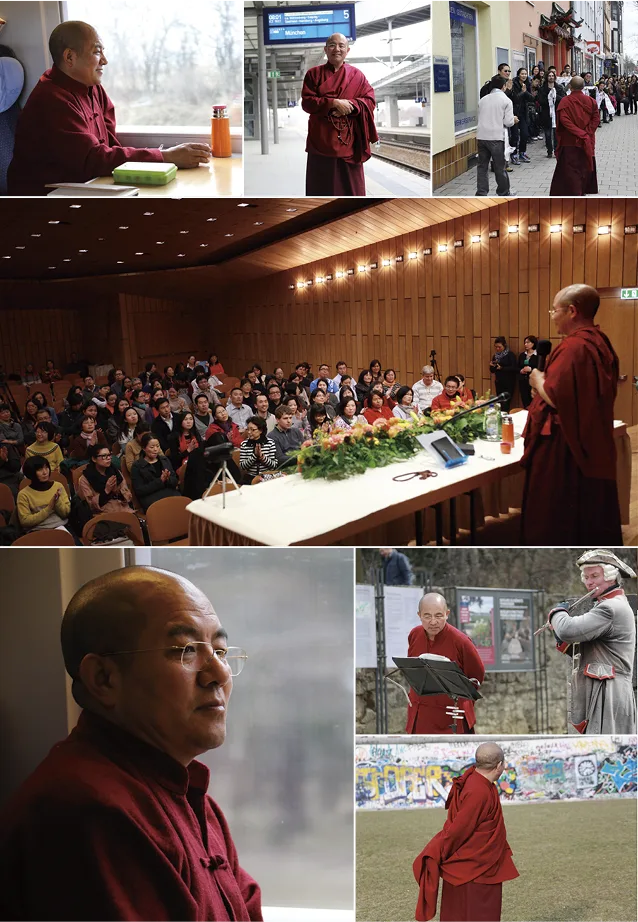
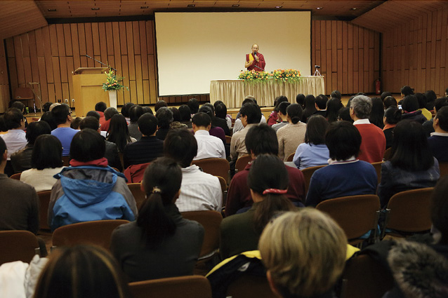
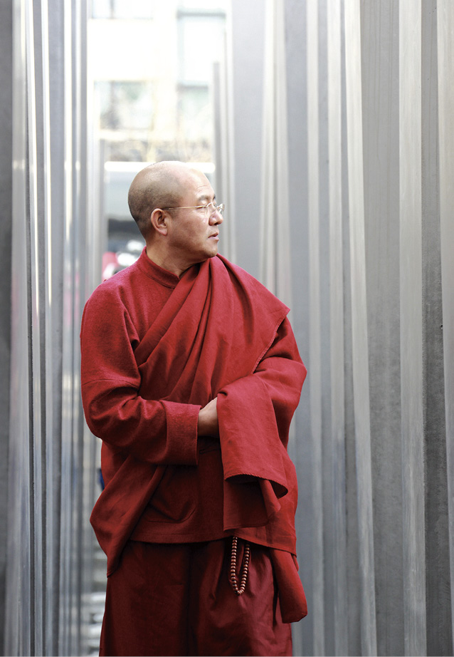
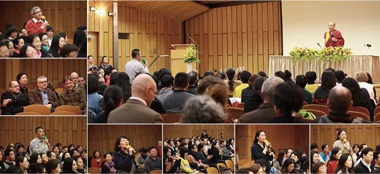
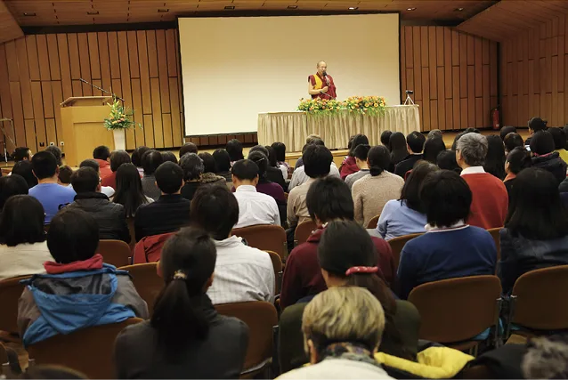

爱因斯坦说：“无论时代潮流与社会风尚如何变化，  
人总得要凭自己的高尚品德，  
超脱于当下的时代与社会，走正确的道路。”

第10场

德国埃尔朗根“开元讲坛”

Lotus Meditation Zentrum Erlangen, Germany

德国·埃尔朗根

2013 / 4 / 9

## 现代文明里迷失的精神生活

## Lost in Civilization

主持人：

女士们、先生们，大家晚上好！欢迎大家来参加今晚的讲座。我们有幸请到了索达吉堪布。堪布来自雪域高原的四川喇荣五明佛学院，这所佛学院是世界上最大的佛教学院。堪布精通显密教法，在佛学院中主管汉僧。

今天能够请到这样一位精神导师，我们由衷地高兴，感谢堪布的到来！

在座的很多人是从欧洲各国来的朋友，大家可能对德国埃尔朗根这个城市非常陌生，以前没有听说过。埃尔朗根这座城市，居住人口只有一百多万，与伦敦、巴黎等城市相比，确实非常小。这座城市，是一座大学城，也叫“西门子城”。西门子公司最高的领导层虽然在慕尼黑，但其主要的支柱部门就在埃尔朗根，比如发电部、医疗部等等。所以有些西门子的员工说：“西门子的头在慕尼黑，而心跳动在埃尔朗根。”这是因为西门子54%的贸易合同都是签自这里。

埃尔朗根有一所大学，叫做纽伦堡埃尔朗根大学，建成于1942年，是北巴伐利亚州最大的大学。另外，可能大家之前不知道，我们都在用的MP3、MP4，也发明于埃尔朗根。

在距离埃尔朗根不到十八公里的地方，就是阿迪达斯和彪马的总部，也是世界第二大轴承厂INA舍弗勒的发源地和总部。这些世界闻名的公司，每天都会派出成百上千的技术人员、商务人员，奔赴世界各地处理技术问题、进行商务谈判等等。相信在座的各位对此并不陌生，因为你们也经常奔赴世界各地，参加这样的技术交流和商业谈判。因此，从工作到生活的方方面面，埃尔朗根都呈现出现代文明的气息。

今天也有几位朋友，从不远的英戈尔施塔特，也就是奥迪总部的所在地过来。记得有一位大德，在西方开示的时候说过：“你们西方人发明了汽车，而发明汽车的目的是什么呢？实际上是为了赢得更多休闲的时间，但你们的生活却越来越忙碌。”对此，我们自己也有体会。每天我们衣着整齐地上班，处理很多工作；忙完工作之后，又忙着度假；忙完度假，忙家庭；忙完家庭，可能又要为下一次聚会请哪些朋友发愁。世界各地的人都是如此，忙忙碌碌地积累财富、追求事业。

我总会听到一些朋友说生活很无聊，感觉自己很麻木，因此，各种浪费时间、占据头脑的事物也应运而生，比如网络、游戏。也有些朋友跟我讲：“我从事业到家庭，好像没有不完美的地方，但我的心里好像总是缺了点什么，总是快乐不起来。”现状的确是如此，一些人患有轻微的抑郁症，或者存在心理问题。那么，在这样的文明世界当中，我们到底缺失了什么呢？

今天我们请来了精神导师索达吉堪布，他在今天的“开元讲坛”中，演讲的主题是“现代文明里迷失的精神生活”。请堪布仁波切就这个主题为我们开示，让我们以热烈的掌声迎请堪布仁波切上台——

今天很高兴来到这里。刚才主持人说，德国是MP3、MP4的发源地，我原来也经常用MP3、MP4，所以我也有一些感触。

“开元讲坛”主办方去年十月就邀请我到德国来做讲座，但由于种种原因一直未能成行。今天可以跟各位学者见面，共同学习，是一个很好的机会。同时，也可以与欧洲各国佛教道场的负责人会面，包括英国、法国、荷兰、瑞典、奥地利等等。还有几个国家我暂时想不起来了，你们不要因此不高兴，所以我加上“等等”，“等”字包括了没提到的国家。

说起为什么参加这个讲座，是因为我非常关注当前的社会问题、人类心灵的问题。我发现很多人的心确实比较空虚，因此需要大家一起来学习。无论是对个人，还是对社会，我们都要有负责任的态度，并尽力饶益，这是非常有必要的。

## 现代文明缺失的精神

今天讲座的主题，是文明时代中失去的精神生活，对此大家有必要了解。在座的人，都生活在科技发达的时代当中，居住在极其富裕的欧洲国家。因此从表面上看，每一个人的事业和家庭，都很完美，甚至可以说大多数人都过着天人般的生活。但富裕的生活，优越的物质条件，是否让内心得到了真正的满足？实际上还没有。原因是什么呢？因为我们没有精神的归宿——今天探讨的就是这个问题。

大家都非常有学问、有才华，生活富裕。在座的基本都是学者，或者是富贵之人。但即使别人不知道，在我们每个人的生活中，也都承受着许许多多的压力，比如家庭的压力、夫妻关系的压力，有些人跟家人有矛盾，有些人的信仰、爱好、对生活的看法与家人大相径庭，会有很多这样的问题。

当人长期处于一个环境中，就会渐渐感受到不完美。比如，与伴侣不太熟悉的时候，会觉得对方非常完美、庄严，并期待共同的幸福生活。但正式在一起后，却经常挑对方的毛病，难以接受对方的语言……会出现种种状况。在工作当中，为了追求名声，提升地位，人们的内心也承受着压力。

像欧洲这样条件不错的地方，有很多从中国来的学者、知识分子。在国内时，他们的学术水平非常不错，但到了这里，德语、英语的运用能力、个人的智慧，一定要比得上甚至超过德国本地人，才能找到一份比较满意的工作。但实际上，即使找到满意的工作，也不一定能进入他们的主流社会。所以，在21世纪，无论身处美国、德国、中国，还是其他任何一个国家，都承受着巨大的压力。现在常说“压力山大”，以此形容压力像山一样，非常沉重。你们这里也说“压力山大”，是吧？（众笑）

现在，人们很难从工作中获得满足，也感觉不到快乐。很多人经常见不到阳光，个人的追求也与现实有很大差距，心中常有忧愁之感，不满足，也不快乐。因此，患抑郁症、孤独症，有心理问题的人越来越多。这些人看似没有被确诊患病，但他们的身心早已陷入疾病的困扰。在世界范围内，物质条件要比以往好得多，但人们所承受的痛苦，也比以往增加了很多。

在十八、十九世纪，人们普遍认为，如果有足够的物质条件，人类就能够得到快乐，但后来，人们渐渐发现并非如此。第二次世界大战前，在经济、文化、政治领域，以德国、法国、英国等国家为中心；而在第二次世界大战后，有相当一部分的权力与财富，转移到了美国和苏联。

从此以后，全世界的人都在努力寻找通往快乐的路，拼命地积累财富。后来，以西方国家为主的一些国家，确实拥有了足够的财富。人们驾驶高档轿车，居住在别墅或高档公寓里，通过电视、手机等设备进行娱乐……但物质生活的进步是否真的能给我们带来快乐呢？其实并非如此。因为物质的极大丰富，并不能遣除所有的痛苦，也无法给人们带来更多的安乐。

于是，有一部分人开始寻找心灵的寄托、找寻治愈心灵的妙药。因为他们已经走投无路，完全失去信心，生活百无聊赖。我听说美国有一个“无聊俱乐部”，他们的宣传语是“无聊如大海”——以大海比喻无聊无边无际。俱乐部里的很多人，无法做出改变，只能无聊度日；还有另外一些人在到处流浪。我也了解到，在美国的个别州，人们在精神荒漠里过着特别荒谬的生活，喝酒、吸毒、做没有约束的行为，像动物一样肆意妄为。

有一些人，为了名声和财富，拼命工作；有一些人，因为家庭琐事，特别痛苦。有个说法叫做“过劳死”，即由过度劳累而引发的死亡，这种情况非常多。在日本，每年过劳死的人，大约有一万人。现在，过劳死最严重的国家应该是中国。据说在中国，每年因过劳而死的人大约有六十万。为了得到所谓的快乐，很多人都在拼命工作。但这样的生活，不一定是我们所需要的。其实，这恰恰反映出现代人的内心是极度空虚的。因此，人们的确需要寻找心灵的解脱，不应该沉溺在虚无缥缈的生活之中。

时下人们热衷时尚和奢侈品的现象，也反映出人们精神世界的空虚。曾经，奢侈品需求量最大的国家是日本，居世界首位。从近几年的趋势看，中国也进入到这个行列。在世界范围内，无论是在香港特别行政区，还是在瑞士、德国等国家，在奢侈品柜台购物的人，大多来自中国。因为有很多中国人，认为拥有奢侈品是一种身份的象征，可以体现社会地位。这种观点恰恰体现了人们内心的空虚。在座的学者、智者，可能也知道，一些奢侈品的成本非常低，甚至低至几百、几十块钱，但经过包装，就可以卖几千、几万块。

有些人为了达到自己的目的，拼命挣钱，以致最终性命不保。大家对社会上诸如此类的现象，对人们所追求的事物，要有所关注。

我最近也了解到，以德国为主的欧洲国家的居民，心态比较稳重，没有因为衣物等进行攀比，也没有天天谈论房子、财产。从佛教层面来讲，这样的人是有福报的。即使他们在即生中没有特别努力，也自然而然会得到一些财富，而有些人再怎么拼命，也得不到这样的财富。

欧洲的生活节奏比较慢，大家的心态也比较好。我在这里接触过从中国来的人，他们都说刚来德国的时候，自己的工作、生活方式跟德国人有很大差别。在中国，大家都拼命追求事业，甚至每天要工作十几个小时；而在德国，星期天几乎所有商店都关门，平时的工作也是慢慢来做。德国人在追求事业和财富的时候，并没有特别拼命，但即便如此，也并非完全没有痛苦。

很多人在这里的生活也充满烦恼，为什么呢？就像刚才讲的，人们先拼命工作，再计划度假。但并非所有人都能度假，如果去不了，在别人面前说起来也觉得不好意思，因为对方可能会说：“你天天在家里，都不到海边去，肤色也没有变化。”我在澳洲的一些佛友，也经常这样说，他们那里的成功人士，到海边去一定要晒黑，因为晒黑以后大家都会觉得：“哇，太棒了！你这次又去度假了！”所以，大家对度假还是比较重视的。

但在别的地方，比如中国，对度假就没这么重视。因为大家基本没时间，甚至星期天也要加班。如果想让心灵得到真正的放松与安宁，我个人认为，确实需要寻找一条适合自己的心灵放松之路，这是非常重要的。

## 如何找回迷失的精神生活？

生活匆匆，人心浮躁，唯一的解决方法就是调整自己的心。那如何调整呢？我认为要从佛教中寻找方法。如果心能调整，生活中的问题都可以解决；如果心无法调伏，表象的快乐也无法治愈内心的痛苦。

在座的各位，钱财、地位样样具足，但你们真的快乐吗？或许心里也会有很多空虚和不安。因此，从佛教中寻见真理，非常重要。有些人认为佛教只是一种形式上的宗教，怀疑佛法能否带来真正的快乐。这是非常大的一个问题。每个宗教，都有非常好的一面，比如，佛教有助于约束人心、规范行为，这一点是现代社会不可缺少的。而且，佛教具有严谨性，能帮助所有众生解决心理问题，是特别殊胜的心理学。

梁启超先生是近代著名的文学家、思想家、教育家、作家。他曾说：“研究心理学，应该以佛教教理为重要研究品。”我认为确实如此。世间的心灵导师、心理医师，在佛教中一定会找到他们想要的答案。

在德国，民众对学问、知识非常崇拜。在飞机、汽车、火车上，大家都在看书，没有叽叽喳喳地交谈，都在用知识充实自己。在其他场所也是如此。德国人对学习知识的崇尚与勤奋，在其他一些地方是看不到的。但也有一点要注意，所学的知识需要经得起逻辑的推敲，一定要有严谨性。

说到严谨性，不得不提到藏传佛教，它与其他佛教派别一样，都起源于印度。佛教就像雪域喜马拉雅山上清净、清凉的雪水，犹如甘露一般，流入各个国家。藏传佛教的智慧，令全世界的人，在心灵层面得到了非常大的利益。这种利益并非单单体现在简单的仪轨与行为中，而着重体现在，其十分严谨的理论体系与完整的修行体系中。

德国的国土面积并不是很大，但为什么能够享誉世界？我想很多人也有这样的疑问。有些人也问过我：“为什么德国有这么多的哲学家、思想家以及诺贝尔奖的获得者？”有人回答说：“因为德国的天气不太好，所以每个人都习惯待在室内，就不得不去思维，于是发现了很多真理。”我就接着说：“我们藏地的天气更不好、更冷，可能思想家会更多。”其实，藏地也确实有很多非常了不起的因明学家、中观学家等等。因此，天气不好，也许是有助于人才涌现的外缘，不知道这可不可以算是一种研究结果？（众笑）

德国人确实对学问很重视，从中也涌现出许多哲学家。我个人特别喜欢看他们的著作，其中一些内容与藏传佛教的逻辑推理非常相似。在藏传佛教中，中观、因明、密续以及其他一些大乘经典中的逻辑推理，任何人都没办法找出一丝一毫的错谬。不仅古代人找不到，21世纪的知识分子也找不到。而且22世纪的知识分子，可能还是找不到。

佛教蕴藏了深广的智慧，因此它不局限于阐明一种教义、创造一种崇拜、讲述一个故事。它对人性的洞察，对微观世界、宏观世界的分析，都无懈可击。以凡夫所谓的“智慧”，根本没办法找出佛教中的矛盾、冲突、不合理之处，因为它非常完美。我已经学习佛法三十余年，以我的判断，佛教确实完美无缺。

如今，很多高层次的人，比如西方的科学家、学者，他们通过学习佛法，越发觉得佛法十分稀有。他们深深感受到，两千五百多年前佛陀的智慧，与一千多年以来藏地智者的智慧，水乳交融，无离无合，所以对藏传佛教非常感兴趣。对于很多问题，科学家通过思维、论证后，在佛教之外确实找不到更好的结论。

前两天，我在华盛顿，遇到很多一流的学者。我问他们：“你们为什么学习藏传佛教？”他们说：“世间知识，学到一定程度，再没什么可学的，感觉很无聊。但学习藏传佛教，越学越感觉人类的智慧难以深入。每次探索，都会发现更深的地方。”我想，这些话不单单是口头上的赞美，也没有使用夸张手法，而是他们内心真实的想法。这些学者，对藏传佛教并非一知半解，学习也不是浅尝辄止，有些学者甚至已经学了二十年，藏语也说得特别流利。因此我相信，他们对藏传佛教的评价真实可靠。

当代人的心灵提升，特别需要藏传佛教。学习藏传佛教，的确会让心态有所改变。我认识很多不同层次的人，其中有一些人，原来一直觉得生活没有希望，无聊、痛苦、空虚，但后来通过学习藏传佛教，的的确确有了改变——即使事业不算成功，在生活中也有了归属感。诸如此类的改变比比皆是。因此，对于想解决人生问题的人，我建议他们认真学习佛教。特别是知识分子，我建议他们研究藏传佛教。当然，其他宗教也很好，它们都各有优点。

藏传佛教有什么独特之处呢？对于它的特点，学者应该很容易理解——根本无法从理论或逻辑推理当中，找到藏传佛教任何不合理的地方。其中的每一个道理，都特别严谨，现代的知识分子对此也不得不承认。我认识的个别科学家，在学习因明之后，改变了对自己的认知。之前自以为在量子力学或其他领域中，特别有建树，自从学习了因明，这些傲慢烟消云散。所以，如果大家能学习藏传佛教，是非常好的。

## 佛教中的戒定慧三学

佛教的根本是戒、定、慧。首先讲戒，有些人认为，佛教的戒律，用条条框框来约束人，很麻烦。所以不学习戒律或者学习其他宗教，才没有约束，会很快乐，这种想法是不对的。因为生而为人，应该有底线、有约束，就像开车的时候，如果没有红绿灯，所有人都不方便。而且读书的时候也是这样，小学有小学的纪律，大学有大学的纪律。同样的道理，每个人都要受持戒律，坚守自己的底线。

即使社会中有恶性事件发生，自己也要始终保持善良，坚持道德底线。爱因斯坦曾说：“无论时代潮流与社会风尚如何变化，人总得要凭自己的高尚品德，超脱于当下的时代与社会，走正确的道路。”人的确需要这样做。

有时候，跟随时代潮流不一定好。举个例子，有些人跟随时代潮流的方式，就是每当有个明星穿了某件衣服，便跟风购买，穿上这件衣服之后，感觉自己好像也变成了明星。当一个歌星穿了一双普通的鞋，几乎所有人都会想买一样的鞋。在这些人眼中，这就是一种时尚，是很酷的行为。但实际上，这不一定是有智慧的表现，因为别人穿什么衣服、开什么车，或者做什么，你跟风也成为不了他。

时代潮流很容易让人们的内心发生变化，也很容易让心散乱，这时要提醒自己保持稳重。虽然我的本意并不是强调德国人的优点，但我发现德国人与藏族人有相似的地方——决定做某件事情之后，不会轻易改变，比较稳重。这一点很重要。

有些人认为善于改变是一种先进的思想，他们很难调整这样的认知。当然，如果是改正缺点，这种改变是好的，执迷不悟反而不好。但如果是像做研究这样的好事，就不要改来改去，这一点非常重要。对于每个人来说，做事确实需要稳重，否则今天喜欢这个，明天喜欢那个，今天准备做这个研究，明天想要做那个研究，最后很难有一个圆满的结果。在人格、道德方面，也应该有一种稳定性，即使社会变得再恶劣，自己也要有善良的人格。

我听说现在的德国是一个注重公民品格的国家。虽然在第二次世界大战时，德国也做出许多对人类不负责任的事，但在后来，与其他个别国家相比，德国还是进行了很深刻的忏悔，并且也认识到，嗔恨心所引发的战争，无法给人类带来快乐。我去过柏林墙、波茨坦等几个地方，也了解到德国人对曾经发生过的历史事件，在进行着反思。通过这样的反思，他们感受到善良品格的意义，认识到人格教育的重要性，同时也意识到，从孩童时期的教育开始，就应当注重对孩子品格的培养。如果幼年时特别爱杀生、不爱护动物，孩子长大之后，很有可能会有暴力倾向，这样一来，对他的家庭乃至人类社会都会产生不利影响。所以，在教育体系当中，引入善的理念、爱的教育，对整个人类社会来说，都是不可或缺的。

所谓的戒，是对身语意的约束，非常重要。而对治精神的迷失，有一个最重要的方法叫做“定”，即戒定慧中的“禅定”，它也很重要。为什么说它很重要呢？因为如果没有通过禅修获得心灵的宁静，生活中很难获得快乐。

17世纪法国哲学家布莱斯曾说：“分心、散乱，是安慰痛苦的办法，但它也正是最大的痛苦。”他的意思是说，分心，或者说让心散乱，或许是一种暂时解决痛苦的办法，比如现在一些年轻人，遇到感情问题、工作压力无法排解的时候，就到酒吧里喝酒、抽烟，或者到处流浪、漂泊。但这种方法并不究竟，为什么呢？因为暂时的散乱，随意的闲聊，解决不了根本的问题。

那么，根本的问题如何解决呢？最好是有一种“安心”的状态，将心安住——当心静下来的时候，会发现很多问题其实并不是我们所想象的那样。比如说，单位或家里的事情，让你特别不开心，但等你的心静下来之后，才知道这件事的真相并不是你认为的那样。

《黄帝内经》有云：“静则神藏，躁则消亡。”意思是说，若心能安静下来，便可以收摄暂时隐藏着的智慧，生活本身的价值以及随之而来的快乐都会出现；如果心越来越散乱、浮躁，则会让自己的生活变得一塌糊涂，更有甚者会选择结束自己的生命。

我听说欧洲有很多来自中国的大学生，能够来到这里求学，本应是非常欢喜的事。如果因为自己的心态没调整好，而选择自杀，或者因为回国之前没有取得真正的成就，而患上抑郁症，这样的结局令人非常遗憾。

诸如此类的问题，如何解决呢？禅修。以美国为主的西方国家，现在有许多人，认为禅修是治愈心灵最实用的妙药，这是因为人们的心态普遍非常浮躁。如果早晚各禅修20分钟，或者10分钟，保持这样的习惯，可以提高你的效率。当然，不是只有出家人才禅修，现在有一些特别成功的人也在禅修。像大家熟知的意大利球星巴乔，从1988年至今，十九年间常年如一日地进行禅修，而且每天必须修两次，每次不少于一个小时。他也曾明确表态：“善良的人格，可以从佛教的教育中得到。”

佛教的教育可以使人生走向完满。而且佛教的理念着重利他，拥有利他的心态，将自然而然获得许多快乐。现在有些人总是不开心，不开心的原因是什么呢？因为内心浮躁，觉得生活没有意义，怀疑自己的存在是否有价值。我原来见过一对夫妻吵架，一个人说：“我还活着干什么，活着没有意义！”另外一个人说：“我活着也没意义了！”听起来好像两个人都活得没意义，一直这样吵来吵去，但这是很不好的。家人之间，如果即将发生争吵，或者大家心里都不舒服的时候，应该马上开始坐禅，规定坐一个小时之后才可以吵架：“你闭关一个小时，我坐禅一个小时，现在七点，我们约定八点钟再吵。”过了一会儿，等八点的时候，嗔恨心就都没有了。这样去调伏自己的心是很重要的。

有很多事情并不需要吵架，因为都是很小的事，比如有一对夫妻，在吃午饭的时候，一个人说要吃干饭，另一个人说要吃稀饭，就在这种问题上不断争吵，最后一个人自杀了，另一个人跳楼了。其实这是很小的一件事情，吃干饭也可以，吃稀饭也可以，没什么可吵的，吃凉菜也可以，热菜也可以。有很多家庭内部的争吵，并非关乎国家大事，与政治、经济、贸易毫无关系，而只是围绕着一些很小的问题，比如“你刚才跟我说得不对”“你给我看得不对”，而引发了对方的不悦。这些问题，也反映出现代人的浮躁心态。其实，很多事情并不值得让我们不开心。

如果我们没有吃的、没有穿的，没有任何生存资具，就像生活在饥荒年代，或者身处非洲的一些地区一样，那的确是很痛苦，不过在这些情境下，可能连吵架的力气也没有了。我来到这个世界的时候，是1962年，刚刚度过五十年代末的饥荒——1959年到1961年这三年是饥荒年代。我所了解的家庭，在这三年从没吵过架，非常和睦。生活在那个年代很痛苦，吵架也无可厚非，但实际上，面对绝望和极度的痛苦，连吵架的力气都没有了，因为吵架确实很费力气，所以吵不起来。

反观现在的人们，具足一定的生活条件和资源，却经常吵吵闹闹。如果想对治这种状况，就应该经常禅修。其实禅修在世间是比较普遍的，包括日本松下公司的创始人，也为大众分享过许多禅修方法。这是一位世间成功人士的禅修案例，当然，佛教中的相关案例更是不胜枚举。佛教中的高僧大德、大成就者，常年闭关修行，他们的禅修公案，如果要讲的话，倒是非常多。但我想，在今天这个禅修交流中，对佛教故事就暂时不作介绍了，所以只讲了一些世间的禅修案例。

之后讲最后一个“慧”。如果内心想获得真正的快乐，想更有效率地解决问题，过有意义的生活，就需要有智慧。戒定慧里的慧，即智慧，实际上是我们每一个人都需要具足的，不但要具足世间的智慧，也要具足出世间的智慧。我相信在座的各位，都有很高的世间技能和智慧，否则在这边也待不下来，因为一般人在这里生存是相当困难的。但是这种“智慧”只是一些相似的智慧，比如说对建筑、音乐或某一知识领域的了解，并不是深层次的智慧，而我们恰恰需要更深层次的智慧。

古希腊的一位哲学家曾说：“人可以分为三种，第一种是追求利益的人，第二种是追求荣誉的人，还有一种是追求真理的人。”简单来讲，有些人特别喜欢钱财，有些人喜欢名声，还有些人喜欢追求真理与学问。

第一种人，心里除了钱财以外什么都没有，可以说是很低级的人类。在这些人的言谈中，除了金钱以外，几乎没有更高层次的内容。虽然佛教也强调，生活不能过度贫穷，但也不能太过富裕，用钱财来解决饮食、居住等基本需要，佛教也是提倡的，但过多的贪欲、过度的追求，会给自己带来痛苦。

佛教的《涅槃经》中对此专门有一个比喻，是怎么说的呢？就像家中藏了一条毒蛇，家里人都很害怕，无法安宁、快乐地生活一样，一个人的内心，如果有非常大的欲望，那么他过得也不会很快乐。而且一味追求财富的人，也不能算是一个高尚的人。

第二种，是喜欢名声的人。现在有极个别人，在他们的价值观里，为了出名可以做任何事，甚至进行裸体表演也没关系，反正只要能出名、能吸引别人眼球就行。为了出名，他们拼命地奔波，拼命地追求……其实，这种人活得没有什么意义，因为当他离开世间的时候，什么名声都带不走。即使此生未结束时也一样，所谓的名声，只不过是一个虚妄假立的名称而已，除此之外，名声对人生的价值没有更重要的意义。那么，更重要的是什么呢？是智慧。

第三种，是追寻真理的人。关于真理，大家一定要了解——人必定有生、有死。人死亡以后，并非像火灭了或水干了一样了不可得，而是千真万确地，要在轮回中继续流转。在没有获得解脱之前，一直要如此。对于这个问题，如今有些学者不敢提，因为世间很多人并不承认前生后世。但就我个人而言，无论去哪个大学，无论和哪些学者交流，都在不断地讲因果轮回的道理。因为如果不懂得前生后世的存在，不懂得善有善报、恶有恶报的道理，那么学习佛法也没有什么意义，即使去研究佛教，也研究不透。佛教所宣说的这些道理，都是真理，任谁也破斥不了。无论从科学角度，还是哲学角度去观察，人的灵魂，在没有解脱之前，一直要在轮回中不断流转，这个事实我们不能忽视。

如果人连前生后世的道理都不懂，恐怕被称为高等动物也名不副实。因为这样的人，仍然处于可怜又可悲的境地，就像只承认今天，不承认明天，只承认今年，不承认明年一样。在东西方的许多国家当中，都有充分的证据可以证实前后世确实存在。如果绝不承认前生后世的存在，现在世间发生的许多事情，都没办法找到合理的解释。

## 让心田种满智慧的庄稼

我们需要有智慧，但很多人的智慧是比较浅层的，比如只是了解过一些品牌文化，或者世间很简单的知识。这些不是真正的智慧，只是一些“小聪明”。有些世间知识，甚至会给人类社会带来负面影响，增加负能量。

总之，人类真正需要了解的是前后世存在的真理。同时，也应该懂得善有善报、恶有恶报。不过，有些人的理解有偏差，他们认为在即生中，善报就一定会现前。其实，善的果报不一定即生成熟，对此大家一定要清楚。即生中做的善事，有些在即生中就能带来快乐，而有些善业在来世甚至是来世的来世才能感果。如果不懂这些道理，说明我们的智慧还不够。而人类需要的就是这样的智慧，因为它能帮我们抉择，在世间应该过怎样的生活。在获得这样的智慧之后，很多佛教徒都能感受到，在生活和工作中，无论成功还是失败，内心都充满快乐。

我遇到的很多知识分子，在没有学佛的时候，都非常痛苦，觉得生活无处安放。后来，在认真学习了佛教的道理后，生活完全发生了改变——这种改变，并不是形式上的改变，而是一种发自内心的改变。我相信这样的改变不会随着时代的变化、时间的推移而退失。世界上有很多东西常常在变，比如政治、经济、文化的理念等等，但真理是不会改变的。而认识真理的智慧，确实经得起逻辑推理的检验。因此，我们应该希求彻知前后世存在、业因果不虚的智慧，这一点很重要。

同时，我们还需要具足大慈大悲心，如果具足这样的心，生活会很快乐；如果自私自利、没有大悲心，每天都只是为了自己的利益忙忙碌碌，会给自己带来不同程度的痛苦。如果你的任何一个行为，能够想到他人、顾虑到别人的得失，你会过得很快乐。

从今以后，大家一定要对智慧有一种希求，这种智慧需要通过佛教的闻思修行来获得。内心的散乱，颠倒、不合理的分别念，要通过智慧来遣除。

对于如何遣除不合理的分别念，每个人有不同的方法。你们可能也听过这个故事，古希腊哲学家苏格拉底，在学生即将毕业的时候，把他们全部带到外面的草地上，然后问他们：“这是什么地方？”学生们说：“这是一片旷野、一片很大的草原。”苏格拉底就问：“草原上长的是什么草？”学生们回答道：“都是杂草。”老师又问：“要除去这些杂草，有什么办法？”学生们都开始思索，随后一些学生说“用镰刀把杂草割掉”，另一些学生说“用火来烧”，还有些学生说“用手把它们拔掉”。最后，老师对他们说：“你们用各自的办法除草，我们明年再来看。”

第二年来看的时候，只有老师的地里没有长杂草，这是为什么呢？因为老师不仅把杂草全部拔除了，还在地里种了庄稼，所以地里变成了绿油油的一片。而学生们的地里，都不同程度地又长出了杂草。通过这件事，学生们悟出了一个道理：在心灵的田野中，如果想彻底断除不合理的念头，就需要种上智慧的庄稼。只有让心田种满智慧的庄稼，才能让自己的内心更加美好、快乐。

我特别希望，在这个容易让人浮躁、迷失自我的社会当中，每个人都去寻找本国文明中的智慧明灯。其实，这并不是很困难的事，得益于科技的进步，佛教的传播变得更加容易，所以如果有意乐，通过各种途径都可以获得佛教的真理。我个人认为，真理比世间的金钱、地位、爱情等各种事物都更有价值。在人的一生中，虽然会遇到很多令人难忘的事情，但更值得人们赞叹和追求的是什么呢？就是智慧与真理。无论是东方人还是西方人，没有一个人不需要智慧和真理，因为每个人都必须要面对生老病死的痛苦，应对世间各种各样的压力。因此，如果想从根本上遣除这些痛苦和压力，就需要智慧与真理。

有人可能会问：“已经获得佛教智慧的人，还有没有生老病死的痛苦？”其实，依然会有痛苦，但他面对痛苦的方式与没有智慧的人大不相同。不了知真理的人，无论在生活中如何探索，对于遣除痛苦，都无法找到非常完美、圆满的方式。而一旦具有通晓真理的智慧，抑或说，当智慧、慈悲与你的人生相伴时，你的人生处处都闪着光，处处都特别明亮，始终是一片光明，没有黑暗。如此一来，不但自己能拥有非常有意义的人生，也能为身边的人指明一条美好的光明大道。

现场互动

问：您刚才提到国内现在有很多知识分子，走上了学佛的道路。我也看到过一些报道，有一些知识分子，比如说教师、工程师，他们选择出家，走上学佛之路。另外，也有报道说，国内现在专业人才不足。我想请教一下堪布，对于这种社会现象，您觉得高兴还是可惜？

堪布：现在确实有相当多的知识分子，趋入佛教之道。我所在的佛学院，也有相当多不同层次的知识分子，包括很多在国外留过学的人，在那里出家、学习佛法。在释迦牟尼佛在世的时候，也有许多知识分子，甚至包括一些国王、君主、大臣，曾出家学习佛法。

在中国的唐朝，几乎所有人都对佛教持正面态度。后来，由于种种原因，人们丢失了自己的信仰，如今，他们又开始寻找心灵的归宿。因此，现在有很多人在学习佛法。学习佛法的人来自各个阶层和领域，有官员、知识分子，也有农民、牧民等等。纵观全球，只要能够学习佛法，都非常难得。

无论东方还是西方，除在极个别的国家外，大多数的人都有自己的信仰。由于信仰导致的专业人才短缺，应该只是极个别人的说法而已。因为学习佛法、拥有信仰，不会耽误专业人才的培养。从历史上来看，很多科学家也有自己的信仰，但这对他的专业研究、著作撰写都没有什么影响。

问：龙猛菩萨在《中论》当中说：“诸法不自生，亦不从他生，不共不无因，是故知无生。”我个人认为它的意思是：所有的现象，不是由自己生的，不是靠其他东西生的，不是自己和其他东西一起生的，也不是没有原因而生的。现在无论是科学家，还是佛教以外的其他宗教，都对第一因很感兴趣。科学家对此也有探索，比如说您刚才提到的量子力学，本质上就是在追求万事万物的第一个原因。还有其他宗教对此也各有观点，比如有神论，我认为他们的观点是他生，也就是靠神来生。龙猛菩萨驳斥了这四种生，而说无生，所以能不能请您帮我们用中观的智慧解释一下，为什么是无生？他所说的无生，与释迦牟尼佛所说的因缘所生，从究竟来讲，是不是一个道理？

堪布：你问到的是佛教中很重要的一个话题。针对你问题中提及的这四句话，后来月称论师专门造了一部论，叫做《入中论》。《入中论》第六品的科判就是按照破四生来分的——万法不是自生，不是他生，不是共生，也不是无因而生，这叫做破四生。

无生和因缘生，从表面看，似乎有点矛盾，但实际上并非如此。佛教里讲，一切诸法没有产生，这其实是从空性角度讲的，或者说从本质上讲的；而一切诸法由因缘产生，是从显现上讲的。物理学家的说法与此类似，也讲现象和本质。

一切万法无有自生，因为如果自己生自己，会有无穷无尽的过失；如果依他而产生，那么产生就不需要观待因缘，一个法可以不断产生其他任何不同法相的法，从黑暗中也可以产生光明。如果这两者，自生与他生，任一种方式都不可能产生，那么这两者合在一起也不可能产生。最后，无因产生更不可能，如果无因能产生，就会有任何时间、任何地点都可以产生的过失。

若想进一步了解这种推理，很有必要学一学《入中论》。《入中论》第六品中，对破四生逐一进行了阐述，并最终将万法抉择为空性。这种空性，与量子力学有没有冲突呢？没有任何冲突。爱因斯坦以及很多研究量子力学的物理学家，通过观察也最终得出这样的结论，在这个世界上，根本找不到一个因，包括所谓的磁场、能量和真空等，都不是真正的因。物理学家将物质分析到最后，把分子、原子、原子核、夸克、亚夸克等等，不断分下去，最后，所谓的亚夸克其实是找不到的。而且从亚夸克当中也无法直接产生诸如瓶子一类的粗大物质，从这个角度来讲，对无因生和他生的破斥都已经完成了。

如果一切万法在空性当中没有产生，那么是不是现相的产生也不存在呢？其实也不是。对于现相的产生，佛陀没有遮破，龙猛菩萨也没有遮破。龙猛菩萨在《中观宝鬘论》等中观论典当中，并没有遮破如梦如幻显现的产生，其实这种显现就是缘起而生的。对于这个问题，最好学一学相关的论典，这样才可以完全了解。

问：非常荣幸今天能见到上师！来之前我听主办方说，今天有一个小时可以提问，所以我特地从法兰克福开车赶过来。我准备了很多问题，但我想我不能一个人都问了，所以我把问题压缩再压缩，最后压缩成三个问题。这三个问题从前到后是连贯的，所以应该比较节省时间。

上师刚才讲过，修习佛法，戒定慧很重要，关于戒和慧我先不问，只问关于修定的问题。我学佛七年了，从一开始就在修定，主要是修习安那般那法门，也就是数出入息，从数息到随息，然后得止。我在修习的过程当中，达到随息以后，有一个瓶颈很难突破。我听说很多人修到这里的时候，也有类似的问题。所以在最顺利的情况下，一生也只能得到欲界定或者是相似定，很难达到初禅根本定的状态。所以我想请教上师，怎样修定才能突破这样的瓶颈和困境？这是第一个问题。

我的第二和第三个问题，是关于自己的一些分析，想请上师帮我详细解答一下。由于我无法突破这个瓶颈有很长时间了，所以我分析了一下原因，我想原因可能有两个，一个是自己的业障没有忏悔干净，所以身心没有达到清净、清明的状态；另一个原因是，修显宗的人没有得到上师的加持，所以力量不够。对于我分析的这两个原因，想请上师指点，怎样才能有效地清除业障、得到上师的加持？

堪布：你从这么远开车过来是很辛苦，不过我们这里有个别道友是从伦敦来的，凌晨两点就启程了，然后乘飞机过来，所以跟这些道友比起来，你的情况好像也不算特别。（众笑）

其实修行禅定，还是需要有智慧，如果没有智慧，只是修禅的话，即使你修成了一禅、二禅、三禅乃至四禅，也不是特别殊胜，因为即使得到了四禅，它也是轮回的因，并不能获得真正的解脱。所以在修禅定的同时，要认识心的本体。让心安住，并认识到心有光明与空性的部分，这二者相结合，就叫做寂止和胜观。也就是说，让心安住与认识心的本来面目这二者兼备，会让你的修行有所突破。因为你已经认识了心的本性，安住的时候自然不必说，即使是稍微散乱的时候，你也能够关注心的本体，因此这一点是非常重要的。

无法突破的最根本的原因，可能是还未获得上师指点，或者说你还不知道该怎样禅修。你刚才自己也分析了一些原因，一个是忏悔得不够清净，还有一个是没有得到上师加持，或许也有这方面的原因。修行的确需要忏悔，也需要上师的加持、窍诀、指点，这些都是需要的。即使上师不在身边，但学习上师的理论和教言还是很方便，因为通过书本等很多不同途径都可以得到。

最根本的问题是，可能从一开始就没有上师指点你怎样修禅。其实修禅最为关键的是要认识心的本体，而认识心与心安住是同时的——当心安住以后，再生起观心的分别念，即使是分别念正在生起的时候，它也与心安住的本性无二无别、与光明无二无别。如果这样去修，并有相应的体会，修行肯定会有突破。

与此同时，如果自己业力深重，确实也需要忏悔、修加行、祈祷上师等等。最终，修行一定会有突破。也许等你开车回去的时候，一下子就突破了。（众笑）

问：在今天的演讲中，您着重谈到了智慧，那么慈悲是否与智慧一样重要呢？

堪布：比如说我今天吃了面，但这并不代表我平时不吃饭。今天在这么短短的时间当中，要想把所有内容都讲得面面俱到，还是有一定的困难。所以，一顿饭吃面，一顿饭吃饭，也可以吧？面很重要，饭也很重要。

问：坐禅首先要坐下来，怎么才能坐下来？或者说，如何才能抛开干扰来坐禅？

堪布：在修行的过程中，心首先要“坐”下来。以前有一个学者，他曾思考：“世间人为什么心坐不下来？如果坐不下来，就不可能有大的成就。”他想表达的意思是，世间人的分别念非常重，所以应该经常观察自己的心。其实，大家每天早、晚都可以静坐一会儿。但很多人由于从小的生活习惯、个人习气以及文化的影响，并没有重视这一点。不过今天有个别道友说，他们从早上六点钟起床就开始坐禅，禅修一个小时或半个小时，我想这应该是可以完成的。

早上起来安住一会儿，从中医的角度讲，对全身的气血运行很有益处。同时，这样做也有助于遣除内心的疲劳。如果每天不断训练让心安住，还可以延年益寿。为什么有很多汉地的高僧大德都能活到百岁高龄？原因之一，与吃素有关，而另一个原因，则与坐禅有关，平时坚持对心的训练，让心具有了安详、宁静的特质。

所有人都可以禅坐，虽然每个人的分别念多少不一，有些人的多，有些人的少，但通过不断训练，所有人都可以进行禅修。从历史上大成就者的公案来看，刚开始坐禅的时候，心就像陡山上的瀑布一样；然后慢慢地，心像山谷里的小溪一样；再后来，心像平原上的江河；最终，心如大海，在平静的海面上，即使有微微波浪，也与整个无边无垠的大海无二无别，这时，会认识到心广如虚空般、无可言说的境界。

问：我自己通过学习佛法，渐渐对感情不是很执著了，但我的一个朋友遇到了感情问题。她跟我说：“赶快带我去见上师，我一定要见到索达吉堪布……”我给她看过一些您写的书，但在她遇到感情问题的时候，还是会觉得很痛苦。我就跟她说：“就算见到上师，上师可能也无法立刻帮你解决问题，所以建议你还是多看一下上师的教言，或者换一个环境，让自己的心情释放一下。”所以我想帮她问一下，像她这样还没有开始学佛，但在生活、感情、工作上有一些烦恼的人，有什么办法可以帮助他们？

堪布：对于像她这样心灵比较痛苦的人，现在给她讲一些理论、道理，不一定能起作用。在生活中遇到这样的事，在我个人看来，不一定是个坏事。也许以前她特别成功，生活没有什么压力，对整个世间的痛苦不一定有真切感受。当她在感情上受到很大刺激后，可能会感觉人生走到尽头，没办法活下去，这时她会渐渐领悟人活着的意义是什么。虽然她现在特别痛苦，但过段时间就可以恢复。因为感情方面的痛苦，在大多数情况下，并不像需要持续治疗的慢性病，而像是一种暂时性的疾病。可能一两年，最长三年，感情的创伤就能被治愈。

即便她现在痛苦得要死要活，慢慢也会恢复过来。等四五年后，她再回顾这段经历，会觉得自己太幼稚——其实这段感情不值得这样。因为所谓的感情，无非是一个人对另一个人的执著，但仔细想想，世界上有七十多亿人，如果总是执著一个人，其实很不值得，所以你会慢慢想开。

有些人对另一个人确实非常执著，好像感情生活不圆满，人生就到了尽头。我原来发过一条微博，大概意思是，人生的路，可以往这边走，也可以往那边走。如果这条路走不通，可以换另一条路走；如果那条路还走不通，就再走其他的路。每条路都是路，只不过路与路之间的宽窄长短不同，实际上都可以走。因为道路本身是四通八达的。

感情的创伤会慢慢被治愈。等那时再回过头来看，你会意识到这种痛苦对人生大有帮助。有些成功人士，甚至是一些佛教徒，生活很风光的时候，什么都不愿意学；在遭遇痛苦之后，才遇到真理，或真正开始学习真理。因此可以说，是痛苦让你遇到真正的快乐。很多人的人生正是因此，有了转变的契机。所以，我认为这样的经历并不是坏事，应该可以算好事。

问：在2012年之前，大家都觉得，2012年12月21号是世界末日，但现在好像已经过去了。我的问题是，这个大灾难不会再来了，还是说只是推迟了？希望不是推迟，而是真的过去了。

堪布：2012年已经过去了。2012那一天上午，还有人问我：“今天会不会就是世界末日？”我说：“应该不会，因为按照佛教经论来推测，世界末日还不会这么轻易到来。”不过，世界上的灾难频频发生，这也是正常现象。因此，对于2012这个灾难，我并不认为它推迟了，或者什么时候还会到来。

当然，《2012》的确是一个特别有名的电影，赢得了很多人的共鸣，不过对于电影中的一些情节，我也经常打趣说：“最后还是西藏高原上藏传佛教的喇嘛，在世界末日给予了大众非常大的安慰。”也许在未来，藏传佛教对人心会是特别有效的一种妙药。

我这样说并不是因为自己学藏传佛教，就给大家拼命推销——我不是在推销产品，也没有这个必要。但说心里话，自己多年来学习藏传佛教，确实有这样的感受，即使现在死去也没什么可后悔的。遇到这么殊胜的真理，感觉非常幸运，因此对于佛法的功德，我只是在不同场合中，不得不说而已。

问：这个问题与今天的主题“迷失”有关，在我身上这样的状况表现得非常明显。我感觉自己这么多年来，一直在飘来飘去，执著于追求事业。虽然现在得到了一些成果，可越来越觉得，这些好像都不是我想要的，因此也在寻找生命的意义到底在哪里。所以，这段时间对西藏很感兴趣，甚至有想去西藏修行的想法。如果想去西藏度假或短期修行，有没有什么地方是您推荐去的？

堪布：要去西藏度假的话，恐怕你得做好各方面的准备，因为西藏的条件稍微差一些。当然，如果你想实现对度假的一些期许，比如让皮肤变黑，那应该可以实现。

至于想参加藏传佛教短期修行，西藏的确有很多寺院、佛学院，但可能语言上会有一定的障碍。在一些寺院，高僧大德、知识分子云集，他们当中有国外来的，也有内地去的，有些修了十年、八年，也有些修了几个月，最终都有不同程度的收获。有些人刚开始修行的时候，是很盲目的，因为别人都在修，所以自己也有一种好奇心；或者觉得修行是一种时尚，所以才对修行有所追求。但无论初发心是什么，到最后，每个人还是可以找到终生的心灵依靠处。所以，等有时间的时候还是可以到西藏度假，欢迎你！

问1：开悟的捷径、最简单的方法是什么？因为佛教的书籍太多，这一生肯定看不完，看完也不一定能开悟。

堪布：开悟最简单的方法，就是以心观心。准确来说，是依靠上师的窍诀用心观心，懂了吧？你需要最简单的方法，所以我用最简单的语言。

问2：以心观心的时候，是不是主客分别就不存在了？

堪布：对，那个时候接近开悟，过去心不可得，现在心不可得，未来心不可得。

问：弟子如何才能认出自己的上师？还是上师会认出他的弟子？

堪布：无论是弟子认出上师，还是上师认出弟子，一般来说都需要经过一段时间的了解。现在有些人，看到一位上师，或者听说一位上师来了，马上就去认上师，这并不是太好，因为即使是世间谈朋友，也要先了解对方的家庭以及各种情况。同样，想认出一位上师，或者认出一个弟子，也不能轻易就做决定。如果今天刚遇到，马上就去依止、认定，这不合理。应该通过一段时间的了解，感受到上师对你的智慧、悲心，对你的人生，能带来真正的利益，在佛教当中规定，这个时候你才可以认准他是你的上师。否则，若没有观察，就盲目地去依止，这样对上师不利，对弟子本人更不利。

问：之前听一位师父开示说，密宗就像一节一节地钻破竹筒，这辈子修不成，修到一定程度后，下辈子继续修，而阿弥陀佛的法门是直接钻破竹筒，横出三界。所以对我们一般根器的人来讲，是不是阿弥陀佛的法门更好呢？

堪布：某个法门好，某个法门不好，这种说法不合理。有些人对密宗不一定能生起信心，就以为修净土法门会比较好。其实，净土的法门中也有密宗修法，密宗中也有净土修法。

你刚才的说法，只不过是个别人不了解密宗而已。实际上，在密宗当中，阿弥陀佛的修法是非常多的。我们佛学院开法会的时候，参加者有时可达上万人，他们都要修密宗的阿弥陀佛修法。而且，显宗的阿弥陀佛与密宗的阿弥陀佛是一尊佛，没有什么差别，只不过趋入的道路有点不同，就像你骑行在高速公路或其他路上一样，只是路不同而已，修法在本质上没有什么差别。有些密宗根基的行人，也有可能会通过修一些其他法门，作为修净土法的另一种路径，因此只是路径不同而已，而不能说阿弥陀佛法门是显宗，其他法门是密宗，这种说法对于佛教来说并不是很圆满的诠释。每个人的修行途径不同，每个途径所通向的解脱层次也不同。

问：我现在发愿要修行密宗，最近也在找密宗的师父，然后我在法兰克福见到了阿宗白洛仁波切的弟子，我们大概交谈了一下。我很想皈依密宗，但内心有一个疑惑，因为根据密宗传承来讲，一定要有具格上师的灌顶才可以入门，但在德国乃至欧洲很难遇到真正的具格上师。今天非常荣幸能见到上师，平时我们很难有这样的机会，所以请问，如何才能认出某位上师是真正有资格授灌顶、把我们带入门的上师？

另外，从修行来讲，修显宗时修行的一些内容，能不能带到密宗里来？是不是要从前行开始一点点重新修起？还有在家庭当中，磕大头或者上供等行为都不是很方便，像这样的有相修行，在家里应该怎样进行？另外，进入密宗以后，应该从一个什么样的起点开始去修习？

堪布：选择上师，对于修行人来讲是很重要的。自己通过长期观察，慢慢会找到具格的善知识。

你提到一些修显宗、密宗的问题，我刚才也讲了，实际上，显宗、密宗只不过是途径不同而已，不是像水火一样互不相融。不要错误地认为显宗不需要磕头，只有密宗需要磕头，或者显宗需要直接修，而密宗只是一种表法等，诸如此类的观点都没有正确地理解佛教。像修五十万加行等这样的修法，是佛教中的一种训练，可以理解为：趋入修法的下一阶段，需要具备相应的资格，所以需要数十万次不断的训练之后，才能获得这个资格。

不同修法之间没有严格的界限，像在藏地，从来不会说“我是专门学显宗的”“我是专门学密宗的”，没有这样的说法。可能是在汉地，偶尔有个别人说自己是修显宗的，然后说密宗如何如何。在西方，也基本没有显宗、密宗的严格界限，一般只是说学习佛法，而“佛法”已包括显宗和密宗。在显宗以外寻找一个单独的“佛法”，是找不到的；在密宗以外去寻找“佛法”，也找不到。

所以，在修行的过程当中，你以前修行的一些显宗仪轨、修法，都可以带到密宗的修行里来，并不需要舍弃——只要是正法，就不用舍弃。而密宗当中的一些修行，在显宗中也同样适用。当然，除密宗中极个别高法的正行部分，需要灌顶才能修以外，其他的仪轨都可以去修。因此，不能认为显宗和密宗水火不容，这个观点非常不合理。

问：一般来说，佛教让我们不要太执著，要放下，什么事情都要随缘。但从另外一个角度来看，是不是也不一定要这样，比如，陈景润用很多年才把哥德巴赫猜想证明出来，爱迪生通过成百上千次的试验才成功发明电灯。如果爱迪生在试验失败后不再执著，也许我们今天还生活在黑暗之中。所以，我们什么时候应该执著，什么时候应该学会放下？

堪布：佛教所谓的“不执著”，并不是让我们把有意义的工作放下。佛教说不要执著，是因为众生经常执著没有意义的事情。比如有些人常常执著感情，虽然他明明知道，这样的执著不合理，是一种颠倒，但内心的分别念还是会去执著。我们明明知道一切万法皆无常的道理，比如眼前这个瓶子，刹那刹那都是无常的，但在生活中，我们仍然认为它是常有的。在我们的脑海当中，有很多不合理的观念，因此越执著就越痛苦，所以对于这些执著，佛陀告诉我们要放下。

但佛陀没有说，所有事情都不要执著。对佛教的理解，千万不能断章取义，佛教中的某一个词不能代表所有修证。比如有时候说不执著，有时候说要执著，那么，要执著的是什么呢？要执著修行。佛陀曾在六年当中修苦行，并一直不断修行。佛教徒也一直在修行，比如反复修五十万加行，多次进行闭关等等，这些都是需要执著的事。

现在有些人，由于没有系统学习过佛教，便随意把佛教中的某个词当作全部的教义，比如“不执著”“酒肉穿肠过，佛祖心中留”等等，以偏概全地曲解佛教。这是在佛教传播中出现的问题，尤其是在“文革”以后，问题更加严重。比如，虽然佛教中宣讲了“空性”，但要辨别在哪些场合中空，在哪些场合中不空——因为空性的意思并不是说所有事情全部没必要，也并不是让我们把吃饭、行善等等行为都放下不做。因此，在哪些场合当中空，哪些场合当中不空，在哪些场合当中执著，哪些场合当中不执著等等这些问题，我们应该系统地去了解，这样才能了知佛教的本怀。

佛教并非要把所有事情都舍掉、都放下，所以对于爱迪生发明电灯的不懈努力、科学家们对发明的贡献，佛教都予以肯定。其实，对于佛教修行，也需要去执著和努力。在佛陀的弟子当中，有许许多多的人，经过无数次漫长的修炼后，才获得成就。因此，对佛教进行正面、深入、细致的了解是相当重要的。

问1：由于家庭原因，我经历过很多事情，所以我从小的时候，大约十岁开始，就天天记挂着无常。又过了十多年，也就是两年前，我很幸运地接触到佛法，之后又有幸听您讲法。但我在学修方面太着急，定力不足，总是东奔西跑，所以想请上师指一条明路。

堪布：哪方面的明路？

问2：修行方面的明路。

堪布：有这么多灯，还需要更亮吗？（众笑）

问3：因为我是跟着教材在学，也用了很多方法观无常，但可能因为观得比较久，心态上比较急，所以还是需要上师的加持和指点。

堪布：修学无常，在佛教当中是非常重要的。在生活当中，如果经常有无常感，很多问题就容易想得开。当然，这种无常观，也不能跟悲观混为一谈。

现在有些佛教徒，刚开始修学时会有一点极端，容易偏堕一边，要么什么都执著，要么什么都不执著，要么因为观无常影响了正常生活，要么什么都不观想……其实学习佛法，在某种层面上，与行持世间法相似，在世间，谈任何事情、做任何工作，都不能过于极端。比如上班的时候，你拼命地连续工作十几个小时，老板让你下班，你还要在办公室里继续加班，不愿意回家，这就是走极端；或者根本连一天班也不去上，觉得上班没有意义，这是另一种极端。

修任何一个法，首先要知道它的重要性。另外，修学时要不断调整心态，遇到一些状况的时候，自己要有善巧方便和智慧。在学习佛法的过程当中，所有佛教徒，包括我们已经学习多年的人，在对家庭成员表达关心、对他人解释个人信仰，以及处理其他事情的时候，都非常需要善巧方便。否则，有些佛教徒，刚开始修学的时候，就走了极端，整天只是学习，家里的事什么都不管，等后来感受到家庭、社会的压力之后，又因为难以承受而将信仰完全抛弃，在俗世随波逐流，甚至产生各种邪见，这非常不合理。所以，人在做任何一件事情时，都应该要掌握分寸，一分为二地去观察，这相当重要。

在你还没有遇到佛教之前，就开始观无常，这很好，因为观无常很重要。在西藏，有很多噶当派的格西和修行人，通过观修无常，使自己的弘化事业得以圆满。在历史上也有许多成功人士，一方面了知一切皆无常的道理，另一方面，事业也做得很好。比如乔布斯，他一方面禅修、观无常，每天观想今天是生命中的最后一天，而另一方面，他给整个世界留下了方便的工具和技术。人生的最后，在面对临终的痛苦时，他也有应对的能力，他说：“我对无常早已修习多时，所以不会有什么痛苦，对于自己在这个世界的结局，我已了然于胸。”

在座的人都受过一定的教育，所以，大家对佛教或信仰的态度，千万不要惹人讥笑，也不要因为误解经典中的语句、词汇，或者个别上师、信众的语言，表现出愚痴的行为。当然，我并不是说你们愚痴，而是说有不少佛教徒，还是比较幼稚，因为他们在没有遇到信仰之前，对信仰的认知完全是一片空白。成为佛教徒之后，也没有很好地去学习，甚至有人把佛经中的一两句话，当作佛教的全部教义，再依此去学习和修行，这是很片面的。因此，大家一定要长期进行学习。

听说欧洲有很多同学在网络上共同学习，也有很多人一起在线下学习，这样的集体学习很重要。如果没有参加集体学习，很有可能慢慢就掉队了，最后就不学了。在中国，基本都是大家一起学。虽然刚开始学起来有点困难，但后来大家都学得不错。所以刚入门的人，要依止老道友来修学。我经常讲一个比喻，学习的过程就像种一棵树，刚开始的时候，小树不能自立，要绑在一根木棒上，靠着木棒慢慢成长，再过几年以后，就可以自立了。学习佛法也需如此，刚入门的道友，见解未立，行为懒惰，我刚才也听说，一些老道友提议，大家早上一起共修，这样一来，即使只有一位老道友，也能起到很大作用。等后学者完全可以自立，就要主动去帮助更多的人，带动大家一起学习。也许曾经的你，处于危险边缘，随时都会掉队，依靠道友的力量才得以成长。而现在的你，也可以依靠自己的力量，带动更多的人。

据我个人观察，在汉地的各大城市里，一起学习的佛教徒是比较多的，但在这边不是特别多，可能是因为这里的人本来就不多。坐车的时候，感觉到处都比较荒凉。即便如此，还能遇到这么多佛教徒，真的是很幸运，所以希望大家珍惜因缘，不断学习。

问：弟子一直有一些疑惑，因为刚学佛不久，虽然生起了一些大悲心、菩提心，很想利益众生，但也觉得需要更多时间去闻思。在权衡之中，应该如何抉择？应该更多地发心帮助众生，用自己的所学利益众生，适当地传法，还是应该用更多的时间先闻思，打好基础后再利益众生？

堪布：人身非常难得，因此在短暂的人生当中，比起忙于生活的琐事，更重要的是去学习和发心。对自己的时间可以进行合理安排，在一天的24小时当中，大部分时间可以用在你的生活、工作上，有一部分时间用在个人闻思修行上，另一部分时间用在利益众生的发心上。

有些人经常说“我太忙了，所以不能闻思、不能发心、不能修行”，这通常是一种借口。如果你自己有意乐，时间再少也可以挤出来。其实我的事情也很多，但无论在学院，还是出门外面，我的讲课基本不间断，同时，在力所能及的范围内，也做一些帮助别人的事情。从个人的经验来看，很多人虽然无法像出家人一样，没有什么顾虑，但家庭和修行也是可以兼顾的，应该能协调好时间。

安排个人时间的时候，看的就是你对修行、对佛法有没有特别重视，如果你把它看作生命中非常重要的事情，一定能抽出一部分时间，用于个人修学和为众生发心。如果你认为它不是特别重要，你的时间自然会被懒惰与散乱耗尽，你可能还会以家庭为由，作为浪费时间的借口。

所以，每当有人说“我特别忙”“我没有时间”的时候，我是不太相信的，为什么呢？因为每天连一点时间都空不出来是不可能的事情，应该还没有忙到那种程度。尤其是像你们这边，可能会更清闲一些，闲到什么程度呢？我就不说了（众笑）。虽然我跟这边的人接触的时间不算长，但我还是发现，你们的生活与国内是很不同的。因此，应该有时间看书、修行、发心，现在这边的发心人员是比较缺的。

有些年轻人，有能力、有智慧，但不愿意露面，所有的事情不是推给这个人，就是推给那个人，这不是很好。如果在相续当中，真正生起了菩提心，我们一定会全力以赴去发心，不可能让别人因为一件小事，还要整天求你。所以，人要有自省的心，要有责任心。

前一段时间，从学院出发之前，我参加了一个管理会议，我了解到，很多人起初不愿意出来发心。有些人是觉得不好意思，有些人是怕得罪人，还有些人担心会影响自己的修行，等等。但目前发心的情况大有改善，所以我在路上也很高兴，为什么呢？因为佛教的弘扬需要大家共同的努力。

现在的世界日新月异，所以更需要大家互相学习和借鉴。昨天在一个佛教道场，我也讲了：“我们对于基督徒的长处要借鉴。”比如，学习基督教徒之间的配合与协作，等等。当时翻译的人可能翻译错了，说成了让大家学习基督教，有的人就很疑惑和害怕，不明白为什么要学习基督教。其实也不用害怕，宗教之间互相学习，没有什么不可以的。但后来我也解释了，实际上我们要学习的，并不是他们的见解和修行，而是利他的精神等等。

我不太清楚欧洲基督教的情况，但在其他一些地方，时常会有基督教徒在火车站等一些地方发书，劝人信教。虽然佛教徒不需要这样做，但大家一定要团结。作为佛教修行人，不要永远都停留在只有皈依戒的阶段，更不能只满足于做一个名义上的佛教徒。大家一定要成长起来，为佛教，为一切众生，做一些有意义的事情，这样才能给人类带来更多的希望。谢谢！
