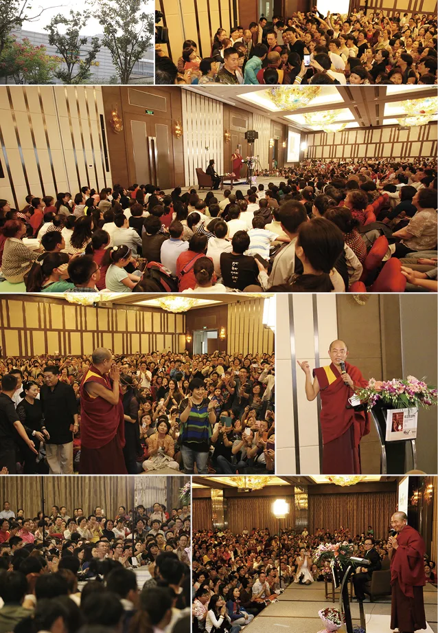
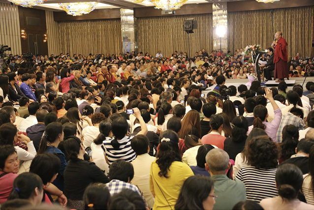
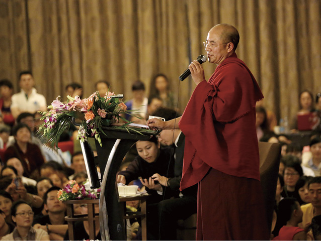
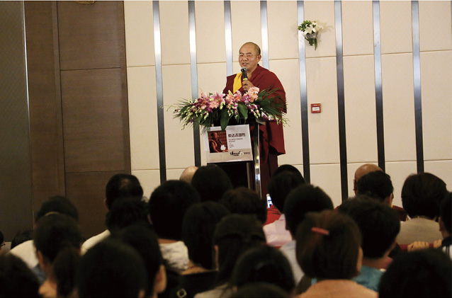
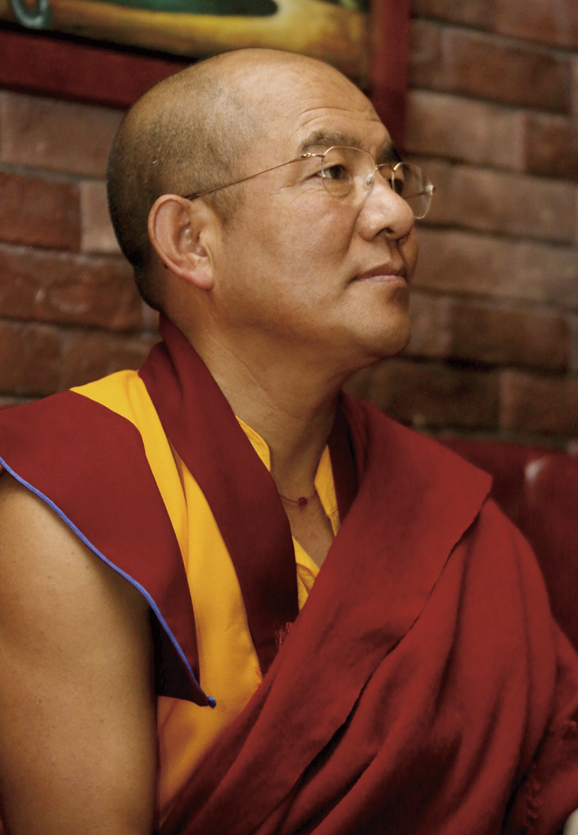
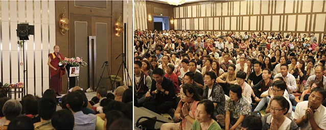
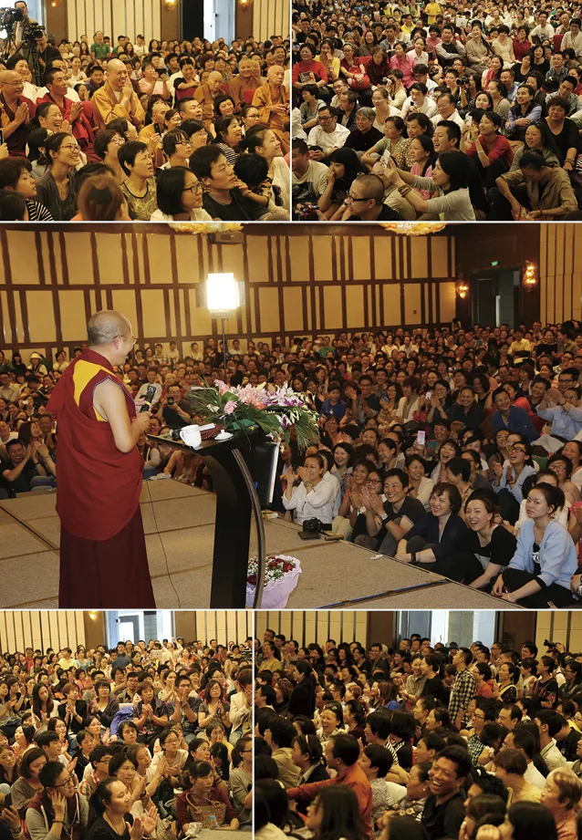
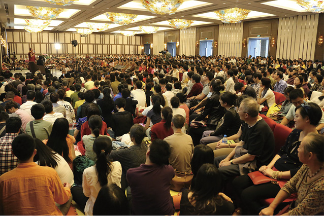
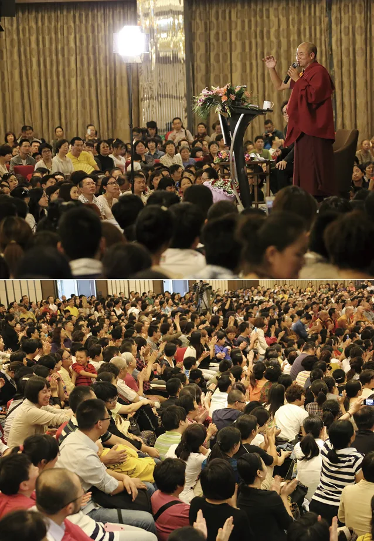

虚荣，让人活得又苦、又累。

第15场

上海佛学文化社会化传播高峰论坛

Shanghai Summit Forum on Buddhist Culture

中国·上海

2013 / 10 / 3

## 一个女人和她的钻石项链

## A Woman and Her Diamond Necklace

今天，我们在此欢聚一堂，认真而有兴致地探讨和交流佛法，我觉得非常有意义。感谢大家的到来！

由出家人谈这样的题目，似乎有点不太适合，不过，一直以来，我对世间人的信仰、情感、苦恼等各类问题也相当关注，关注多了，便想谈谈自己的认识。

先讲讲这几天的感受吧。这几天的“高峰论坛”让我受益颇多，我想在座的也一样，开放包容的聆听，让我们都学到了不一样的知识：延参法师的“参话头”很超越，看似不循常规，还是让人有所领悟；海涛法师以开放、国际性的理念，引导我们学习如何调心、弘扬佛法……

总之，这是不同思想的汇聚、智慧的碰撞，让我们很轻松地感受到了佛教的力量。气氛很好，要珍惜。

## 在和谐气氛中弘法利生

如今的社会需要佛法，但佛法传播得如何，还有赖于佛教徒的彼此团结，出家人与出家人、在家人与在家人、在家人与出家人之间，都要和睦、和合，不能破坏和谐。

昨天我偶尔听到有人说：“这三位法师千万不能在茶馆碰面……”

也许这是开玩笑，也许是认真的，但我自己观察下来，我和藏传佛教、汉传佛教乃至其他宗教人士，没有谁碰不得谁的，相反，我们互相学习，恭听对方的课，了解对方调心修行以及利益众生的方法；这么多年我们发现，这样做既符合佛教的包容理念，也有利于佛法的弘扬。

因此，希望大家对修行人及弘扬佛法者不要有太多的分别，不要看不起甚至诽谤哪个人，这与当前的开放环境不和谐，没有必要。除非你真的发现那是邪法，弘扬它对社会人心有害，可以抛弃，否则，我们最好一起聚集正能量。

以前我也参加过很多论坛，说实话，我感觉有些论坛的目的不纯，不是在弘扬善的、真的、利他的理念，背后好像隐藏着各种私心。但这个论坛不是，你们也看到了，我们自始至终就一个想法：介绍佛教知识，向社会各层面推广好的、向上的理念，都是今天人们最需要的精神食粮。

记得曾经有人这么说，如今这个时代自然科学很发达，不过人们把它当成了全部，忘记了精神科学的发展，以致现在“几乎快要成为思想白痴的时代了”。

我倒并不认为现在完全没有了精神科学，但在西方工业革命和科学文明的冲击下，东方的传统思想和行为规范也确实在渐渐远离我们，这时候我们必须做的，就是共同维护、发扬我们自己的文化，提升我们本有的善良品性。我想，这应该也是本次论坛组委会弘法利生的初衷和责任。

说到弘法利生，这应该也是在座每一位的责任。为什么这么讲呢？因为所谓弘法，就是弘扬真理；而利生，就是帮助所有的人和所有的生命。从这一点看，不管你有没有信仰，是不是都有一份使命、一份责任呢？

这几天是国庆假期，到处人山人海，有的在享受娱乐活动，有的去了藏地，在座诸位，包括法师、文化先锋们，我们一定是为了一种共同的追求——对佛学文化传播的兴趣，才来到这里，既然来了，就有弘扬真理的责任。

要弘扬真理，首先要学习真理。真理是让人清醒的，佛教的真理也好、其他思想中的真理也好，学了之后你会看到，我们身边竟然有那么多人一直生活在不合理甚至颠倒的价值观、审美观、世界观和人生观里，可谓千千万万，这时候你就知道该做什么了：传递正见，并用善的引导转变他们。

## 女人与钻石

回到今天的主题。莫泊桑在小说《项链》里，描写了一个女人和她的钻石项链的故事，故事是这样的：

这个女人家境不富裕，但人长得漂亮，所以她常常觉得委屈，很想在公众面前展示自己。为了在一次舞会上掩饰寒酸、炫耀一番，她向一个女朋友借了一串钻石项链。结果她成功了。但不幸的是，回来的路上项链丢了，怎么也找不到。不得已，她和丈夫四处借钱，买了一串一样的，还上了。

项链是还上了。但为了还债，他们开始省吃俭用、打苦工，过起苦日子。随着时间一年年过去，她失去了美貌，人也变老了。十年后，债还清了。

有一天，很巧地，她碰到了她的那位朋友，带着孩子，还是又年轻又漂亮。她想，反正债也还了，不妨提提那事，于是上前打招呼。但对方根本没有认出她。

她一说出自己是谁，那个女人便惊呆了，因为她和以前完全是两个人，实在认不出来。于是她说起当时借项链、丢项链，然后借钱买了一串同样的还上，之后打苦工到现在的所有经历。正当她颇感轻松、略显得意的时候，朋友很伤心地告诉她，那串项链是假的，不值几个钱。

当初读了这则小说，我很有收获，知道虚荣的可怕，为了一时的荣耀，那个女人付出了青春和美貌。这个故事或许有些偶然，但现实中也有卖肾买手机的例子，而更为普遍、更难以觉察的是，为了表明自己生活有档次，人们一生在车子、房子上攀比，并因此放弃了真正的生命意义。

这些都是为了什么？虚荣。虚荣让人活得又苦又累。

就一个人的基本需要来看，就算生活在城市里，有饭吃、有床睡、有衣穿也就可以了，一件衣服一二十年穿不坏。但问题是，人们不是在愁简单的吃、穿、住，而是要追求高消费、高档饰品，例如钻石之类的。据说自从玛丽莲·梦露唱了那首《钻石是女人的好朋友》之后，全世界刮起了一股钻石风，女士们都以佩戴钻石为荣。

我知道钻石有祛病的作用，但是，人们热爱钻石，可能不是这个目的，多少有些虚荣吧。

## 慈禧的夜明珠

让我们感到虚荣的东西很多，钻石、车、豪宅，甚至是传世之宝，可是要知道，这种可以传世的财富一直在变换主人，就像河流穿过一座又一座城市，没有人能真正拥有它。

而且，人是会死的，你再执著的东西，即便像慈禧太后一样拥有那么多珍宝，一旦入了土，哪一样用得上呢？

慈禧太后不是女皇，但她在三代皇帝的统治中握有重权，相当于女皇。她生活奢侈，一顿饭要摆一百多样菜，而死后的陪葬品，也价值一亿两白银。她嘴里含了一颗夜明珠，据说可以让尸体不腐烂，按1908年的价值算，这颗珠子值一千多万两白银，折合现在的数目是八亿多人民币。

1928年，慈禧死后第20年，军阀孙殿英带领军队花七天七夜时间盗了她的墓，棺木一打开，尸身完好无损，有如生前一般。这就是夜明珠的作用。但他们不管这些，把她的嘴撬开，取出宝珠，连同其他珍宝一起偷走了。

有历史学家分析，这颗夜明珠原本是印度莫卧儿王朝的宝物，史称“莫卧儿大帝金刚石”，后来被阿富汗国王抢去，朝贡给乾隆皇帝，之后便流传下来，到了慈禧手里。

这颗夜明珠分开时是透明无光的两块，合拢时是一个圆珠，它射出的光，在夜晚可以清晰照见百步之内人的头发。

孙殿英把夜明珠献给了蒋介石的夫人宋美龄，宋美龄把它镶到了鞋子上，可能是为显示自己的尊贵，慈禧太后含在嘴里的东西，她却拿来装饰鞋子。在一次舞会上，她让灯都熄了，所有人都看到了夜明珠的光，明亮异常。然而奇怪的是，自从她把夜明珠镶到鞋子上，蒋介石处处战败，诸事不顺，于是宋美龄认为，是那颗珠子的问题，它不吉祥。

不过，我的分析是，凡事都有缘起，对夜明珠或三宝这类珍贵的、尊贵的事物或对境，不应该故意轻视或践踏，否则对自己不好。你不信佛没关系，但对佛像、经书、咒语等神圣和纯洁之物，要懂得尊重，不要动不动就毁佛像、拆佛堂，这会给自己的人生带来不吉祥。所以，她的做法可能有些过分了。据说去台湾时，她没有带上它，留在南京了。

慈禧太后入殓时还盖着一条陀罗尼被，前几天的一则新闻说，当时孙殿英没有偷这个，可能觉得不值钱，但后来发现，上面所有咒语都是金线织成的，当然也是价值不菲。

那颗夜明珠今天在哪儿，还在不在？我不清楚。但有一点我是清楚的：富贵的本质不是别的，就是无常。

## 富贵虽乐，一切无常

不管在任何时代，慈禧时代、宋美龄时代或是今天的时代，人们对富贵的执著是一样的，但当你了解了它的无常性，就不会那么执著了。龙猛菩萨在《大智度论》中说：“富贵虽乐，一切无常，五家[^1]所共，令人心散，轻躁不定。”财富虽然可以给人带来快乐，但这是暂时的、无常的，终将被他人享用；而且，钱财总是让人心思散乱、心神不宁。

今天在座的有很多是两岸商会中的有钱人，所以我想提醒大家：在你死之前，最好对财富的分配有个准备。

人什么时候死很难说。有法师说：“我们暂时不会死。”这是不了义的。禅宗里是有“不生不灭、不来不去”的境界，一切都是鸟语花香，开开心心、快快乐乐，但在了悟这种境界之前，谁能那么洒脱？我们要真切地面对死亡。然而，当你死的那一天，再一条条去安排，可能就来不及了。

前段时间李开复在微博上说：“世事无常，生命有限。原来，在癌症面前，人人平等。”乔布斯也说：“记住，你即将死去。”他确实把每天都当最后一天对待。可能绝症就有这种作用：你知道活不久了，你醒了，于是理性地看待生命。

其实理性不一定要在这时候才开始，越早越好。

我们不是钢铁制成的，我们身体里有的只是血、肉、骨头，哪一样都不坚固。到时能不能烧出舍利？很难吧，要修行。但这个无所谓，最重要的，就是你活着时有没有找好接班人？有没有发现更有意义的事情？说这些也没什么不吉祥的，因为我们一定会离开，而且，说不定非常突然。

我觉得马云做得很好，他提前把有些位置让了。我不知道他是考虑到哪一种无常才这么做的，但这对企业的长期运作的确有好处。人什么时候死是不好说的，很多大企业的总裁就是年富力强时离开的，突然离开了，均瑶集团总裁死的时候只有38岁，留下了39亿。当时人们都觉得突然，但佛教认为这很正常，因为一切法的存在离不开因缘：

因缘聚合了，生；因缘离散了，灭。

这就是无常，客观事实，任何人都无法颠覆。对于这种事实，我想，我们认识它不难，但要正视它，很难。

## 我们只是生命的过客

现在大家每日为钱奔波，有多少都不知满足，甚至到了要钱还是要命的关口上，有些人还是放不下钱。

今年一月份，上海一个农产品中心发生火灾，有个店主不听消防人员劝阻，非要冲进去抢出他的钱，“我五六百万在里面，我一定要去拿！”结果，当他抱着钱出来时，人死了。

这种悲剧处处在发生，所以我希望，人人都能早一点接触佛法，并透过佛法学会取舍，避免无谓的痛苦。

佛法是最实用的真理，从这个角度讲，那些被普遍认可、对生存有益的知识，也是佛法；同样，佛教的十善——不杀、不偷、不邪淫，不说妄语、粗语、绮语、离间语，不生嗔心、贪心、邪见，也是人类基本的道德底线，是在任何国家、社会或文化背景下生存的人，都需要的价值理念。

既然是大家需要的，我们就应该尽力弘扬。不论你是什么身份，出家人也好，在家人也好，都应该去弘扬。

出家人也是人，和大家一样生活在这个社会里，来城市也正常，但有意思的是，也有人不理解。前天我们到机场时，有个小女孩好奇地看着我们，“出家人怎么也坐飞机啊？”她妈妈说：“出家人为什么不能坐飞机啊？”

好像出家人是怪物，不应该出现在这些场合里，一出现，比妖魔鬼怪来了还让人惊讶。这是社会教育的问题。

其实我们出家人讲佛法，最大的受众还是在家人。

出家人在佛教理论上花的精力多，研究的时间长，从我们自身的受用以及传播的经验来看，现在和以往不同，是特别需要信仰的时代。所以，希望大家好好学习佛法，这种机缘很难得，能保持多久很难说；而我们的生命也有限，诚如如藏传佛教的修心窍诀《当日教言》中所说：我们不是以主人的身份生存于世，我们只是生命的过客。

请大家记住：我们是客，不是主，百年之内都会离开的，不可能永远住下去。我今天最想强调的就是这个道理：无常。然而遗憾的是，现在大多数人还没有这个理念，他们只知道为现世的利益忙碌，不知道为后世做些准备。

其实应该早做准备，因为死亡和后世随时会到来。

## 光有信仰是不行的

今天来的多数都有信仰，但是，光有信仰是不行的，信佛就要学习佛陀的教法，学显宗可以，学密宗也可以，学藏传佛教、汉传佛教、南传佛教都可以，但是你一定要学。

### 关于皈依

现在不少人以为，有了皈依证就是佛教徒，还自以为虔诚得很。其实也不尽然，有没有皈依戒很难说。

也有一部分人认为，“皈不皈依都一样，心里有佛、心地善良就可以……”但是你所谓的善良，是个什么标准呢？符合自己的想法就是，还是符合真理才算？值得商榷。其实皈不皈依有很大差别，你皈依了，什么能做，什么不能做，有底线，功德也大；不皈依，可能口头上说得好听，但要确实做到佛教所认为的善良，是很难的。

我们不要以为皈依只是一种形式，有也可、无也可，如果是这样，我曾开玩笑说过：“那你们不用结婚办证了，结婚也是形式，心里有爱就可以。”但事实是，结了婚才有法律效力，同样的，皈依后才会有皈依的功德。

我们要尊重形式。佛陀也要求弟子遵循世间规律，他说，世间承认的，我也承认；世间不承认的，我也不承认。

还有人认为，皈依就行，学不学理论没关系。这也不对。因为皈依只是入门，入了门就要系统学习，像人身难得、寿命无常、轮回过患，这些基本道理要学；什么叫皈依，皈依后守什么戒，也要学；怎么发菩提心，菩萨戒有哪些，怎么入密宗，密宗有什么理念……这些都要学。

让我比较难过的是：在今天的社会里，有相当多的人承认自己是佛教徒，甚至皈依了很多年，但却不懂佛法。

### 关于闻思

修行佛法很讲究次第，那些不按次第来的人，看了几句禅宗、密宗教言便高谈阔论，好像自己就是佛，什么“酒肉穿肠过”“无因无果”……吓唬人，没什么意思。

在这种次第当中，最重要的就是闻思。藏传佛教也好，汉传佛教也好，在所有教授佛法的传统中，僧人们都要透过严密的逻辑去获取正见，但这个过程非常漫长。不信你们去一些正规佛学院看看，他们即便花上一二十年甚至三四十年夜以继日闻思，还是很难通达佛法的甚深奥义。

世间学问没有这么难的，不论是在哈佛、耶鲁、哥伦比亚还是哪所大学，读三四十年还完不成的，有没有？没有吧。

所以，不要小看佛教，不想研究的另当别论，想研究佛法的话，就要转变一些旧的思想和态度。

### 关于态度

那些旧思想就像杯子里的脏水一样，你要倒掉它，把杯子洗净，才可以盛新的、干净的水，否则没有机会。

我们的心是要洗涤一下了。受先入的思想影响，很多人怀疑前世后世，对众生没有慈悲心，对三宝没有恭敬心，心里充满这些，怎么能装入大悲、智慧和信心这些新能量呢？

所以，要做一个真正的佛教徒，首先要有去旧迎新的态度，不论你那些理念得自父母、老师或其他什么人，如果是错的，又何必固守？不过欧美也有这种现象，很多思想明明老化了，但就是不改，这样是很难接受新思想的。

我很欣赏今天的年轻人，70、80、90后，他们的思想比50、60后开放得多，哪里有真理，就真诚接受。这种态度是很有智慧的，不死守老套，活跃、理性而又不缺乏诚恳，从微博、微信上一眼就看得出来，的确充满朝气和活力。

总之，我们只有抛弃旧的、不合理的思想，才能进入一个遍布慈悲能量、清净而纯洁的世界。那要什么时候开始这段新的旅程呢？我认为，越早越好。

## 莫待老来方学道

有些事拖一拖无妨，但学佛最好从当下开始。

学佛不能等。“等孩子读了大学再说”“等退休了再学”……但那时你就老了，老了，身口意都不行了。

我们看看那些老公公、老婆婆，连起来坐下都困难，更不要说磕十万大头了，两三个就不行了。人老了说话都说不清楚，吞吞吐吐，听别人说话也要很大声才行，这样怎么闻法？更严重的是，人上了年纪心就迷糊，连简单的人名、名相都记不住，更不用说分析那些深细的道理了。

所以，“莫待老来方学道，孤坟多是少年人。”

老的时候是要学、要修，但这得从年轻时就打好基础才行。学佛也不是非要出家，对大多数人来讲没有必要，出了家再还俗，变来变去更不好。出家人的因缘不同。你就在家做个居士，有正见、有正信、有智慧、有慈悲，既通达佛理又会做人，做这样的一个佛教徒，不是很好吗？

而且，在家利他也方便，你学了佛，有菩提心，这时候要多想着去帮助他人、社会和国家，乃至为整个世间的所有生命做些奉献。不要老想着自己的痛苦，烦恼都是从自私自利心起的，眼泪都是为自己掉的，谁真的为别人哭了？很少很少。记住这两天法师们的话，多为别人想，人就快乐。

希望大家不要自寻烦恼，如果活在饥荒年代，吃不饱、穿不暖，那你整天想着吃的、穿的也可以；如果被关在监狱里，那你总想见见阳光、和亲人说说话，谁都理解，但现在这些都有了，吃穿不愁、自由自在，有什么可烦恼的？

要有满足感、欢喜感，这样活着才有意义。

当然，也要有紧迫感。今天讲了财富和生命的无常，其实一切的一切都是无常，如果你真的懂了无常，该放的放、该做的做，那其价值不用别人说，如人饮水，冷暖自知。

现场互动

问：自从我女儿接触佛学文化后，就对婚姻很排斥，难道佛教妨碍或排斥婚姻吗？

堪布：佛教不排斥婚姻。佛陀来到世间示现宫廷生活，以及佛子罗睺罗的降生，都说明了这一点。

藏地有99.9%的人信佛，但信佛并没有妨碍或影响人们的婚姻，不仅不影响，《善生经》《阿含经》等经典还开示了如何让夫妻和谐、家庭美满的教言。所以，你的女儿不愿出嫁，或有人想出家，这是个人的事。喜欢单身跟信佛没什么关系。如果孩子迷上唱歌，也过着单身，你要怪歌坛吗？

出家人本来不多，现场也就我们几位，其他人都是在过着各类生活的同时，信佛或对佛教有兴趣的。所以，佛教不排斥婚姻；把佛教当成全然拒绝欲望的宗教，是误解。

问：我婆婆想要一个一万块的金手镯，丈夫打算买，但我不愿出钱。婆婆想要是因为邻居都有，我不同意，是因为我们只有13万存款，开销太大，请问该怎么办？

堪布：在我们藏地，有些法师很慈悲，关心婆媳关系，但有些觉得太复杂，置之不理。我也问过汉地一个有经验的人：“你们汉地怎么样？”他说：“汉地更复杂。”

我不知道你婆婆是怎么想的，只听你的一面之词，也许是你舍不得，或有其他什么原因。但就事论事，从13万存款中拿出1万买金手镯——因为刚讲完女人和钻石的故事，所以我建议不买，非要买，就给她买个假的。（众笑）

问1：我是您的一位80后忠实读者，从《苦才是人生》开始认识您，您说过，“做善事不要拖延，条件成熟时要立即行动”，能否请您再就此开示一下？

堪布：这句话我在微博上也发了。

印度伟大佛学家寂天菩萨在《入行论》中曾经说过，当我们心里生起善念，即使如夜晚虚空划过的一道闪电，转瞬即逝，也要相信这是三宝的加持和馈赠。

善念的确是很难起的，尤其是在五浊恶世，生个善念不容易，生了善念，跟随它行善更不容易。这时我们要从当下开始，不要拖延，一拖延，到明天善念还在不在，就不好说了。相反，如果生了恶念，想去造恶，那尽量拖一拖。

问2：有时帮人也烦，有些人太贪婪或利用你，怎么办？

堪布：只要你发心清净、善良，结果怎么样是另外一件事。这时候要当心的，是不要找借口绕开或放弃善事，人身难得，善心也难起，想做的时候就做。比如遇着乞丐了，有钱就给一点，“他比我们有钱”“他不是乞丐”“他讨了钱去玩”……也许别人说得没错，但该做的我们要做。当然也得是能做的，要是他利用你或太贪了，可以用别的方法应对。

问：为什么我见到您会激动不已，泪流不止？

堪布：感性的人容易流泪。不过理性的人也会流泪，像根登群佩大师在其他宗教的神像前祈祷时，也流泪了。所以他很感叹地告诫后人：“眼泪，是多么不可靠啊！”

我不是说你的眼泪不可靠。大家见面时，也许是前世的因缘，也许是会场的气氛或其他什么因缘，你流泪了。但流不流泪不重要，重要的是，今后大家要一起好好学习善的理念、做善事。激动的泪也好，欢喜的泪也好，如果能转变成善心并给自己带来真实利益，就有意义了。

问：舍不得离开一个人，又不得不离开，怎么办？

堪布：随缘。

问1：我老公小时候穷，偷过东西，但那是为了温饱。从这里我想问，人活着是应以道德为先，还是生存？

堪布：这要看人的层次了，道德高的人，以道德为先。

我父母对我说过，我的家乡有一个女人，1961年闹饥荒时，村里人约她去偷牦牛，“这次不偷，我们会饿死的。”

“饿死就饿死吧，”她说，“我这辈子最不愿做的，就是对不起良心的事。我三十多了，从来没做过不道德的事，我不去。”她没去，其他人去了。但她后来也没有饿死。

所以，人的标准不同，高尚的人宁舍生命不舍道德，其他人可能考虑更多的是生存。

问2：那他该如何面对曾经犯下的错误？

堪布：他也好，在座的也好，偷过东西、杀过生、做过不如法事情的人，要知道这些都有因果，所以要有追悔之心并发愿：今后纵遇命难，也绝不那样做了！之后念心咒忏悔。

同时还要翻倍补偿：你偷过一万，有条件了，就拿出三五万做功德；你杀了一百条生命，至少放四倍生命，或出四倍以上的钱数放生……这样补偿了，罪业会有所清净。

问：看了您的书，我现在慢慢觉得物质已经不那么重要了，但唯有对情爱的执著放不下，怎么办？

堪布：情执是比较难放的，出家人有戒律，而对在家居士们来讲，正常的情欲是不需要断的。不过这些一般也不会困扰我们，困扰我们的是那些迷乱的情执。

现在网络、手机上什么都有，尤其是游戏，很多人一下子就迷进去了。前段时间网游上一个女主角死了，结果有人就“失恋”了，哭了五天五夜……这就有点太迷失了。如果你还不到这个地步，不妨像看淡物质那样，慢慢放下它。

学佛是急不来的。弄得太紧弦会断，一学佛就不看电视、不跟家人说话、不管孩子，成了和尚一样，但等过段时间所有的事堆到头上，佛法学不了，亏欠也弥补不了，就没意思了。所以，我经常跟在家居士们讲：过正常生活就可以，以前怎么过，现在还怎么过，别人怎么过，我们也怎么过，佛教没有让我们不关心家人、孩子，要好好关心他们。

所谓细水长流，学佛就是这样，慢慢学，慢慢修。

不要让别人把我们看成怪物。这么多年大家都缺失信仰，现在一信起来心里激动、行为失控，我很理解，知道大家有信心，但是别人会怎么想，“这不是迷信是什么？”

所以，我们佛教徒要注意公众形象，不要把里面的东西全都翻到外面，让别人看不懂佛教、看不起佛教。

问：现在有很多假出家人打着三宝名义，骗取善男信女的钱财，也有的做一些出格的事，请问该怎么看待？我记得您也发过类似的微博，批评过这种现象。

堪布：我批评的是极个别的、真正意义上的假和尚。

这种骗钱的事，也许是真的被骗了钱，但也许不是，是佛教徒自己的问题——刚开始很激动地去依止、供养，师徒关系也非常好，但后来要么上师变了，要么自己变了，总之发生了矛盾，之后就开始诽谤，这也是有的。

不管是哪种情况，我觉得，最根本的问题是我们首先没有观察。佛教要求依止前必须观察上师，有的教言要求观察12年。昨天我听说，有一个人在某位法王身边待了十几年都没有求法，只是观察，其实这是很稳妥的。观察了再依止不会出问题，发现是假的，远离就可以，这比一上来直接求法、求灌顶，依止后才发现他有家有孩子，明智得多。

找个师父，连“师父”是出家人、在家人都不清楚，结上缘又诽谤，学佛不能这样。你至少得熟悉他吧。找个对象也要知根知底，一见面就结婚，结了婚才发现你的老公原来有家庭，这明显不符合世间规则，是不是自己的问题？

看清了自己的问题，再看看别人。我经常说，佛教是没问题的，不论汉传佛教、藏传佛教，教义百分之百正确，也最适合我们的心灵需要。生活在今天，我们每一个人的心里都遍布困惑、压力和痛苦，但只要你把佛教甘霖洒一滴融到心里，生活就会充满阳光。我的确是这么想的。

当然，佛教好，不代表所有修行人都好。

修行人里有好的，有中等的，也有不好的。那种不好的，的确是为一己私利诱骗甚至伤害信徒的人，有是有，但这只是部分，不是全部。部分不能代表全部，就像上海某某领导犯了错，不代表上海所有领导都犯了错。不能一概而论。

问：我的孙子有20岁了，明明是个男孩子，却打扮得像女人，打激素针、吃激素药，一心要做漂亮女人，遭到了我和他父母的强烈反对，但劝说无效，怎么办？

堪布：这种事不是爷爷奶奶的事，是爸爸妈妈的事。按我们佛教理念看，做了爷爷奶奶的人，好好念佛，一心准备往生极乐世界是最好的。（众笑）

不要管这些闲事了，你也管不了。佛经里早就说了，有的人一生下来就如此，男的带着女性性格，女的带着男性性格，这是前世的业力和习气决定的，用现在的话说，就是基因问题，这个要改是很困难的。先慢慢观察吧。

问：我儿子四岁多了，有类似孤独症的某些症状，他认为按汽车按钮会引发闪电，所以一坐到车上就捂耳朵。他爸爸一看到他的类似行为就会大发脾气，比如今天来的路上，他就两次突然停车，靠到路边，拉扯坐在后座上儿子的手。我对这些很担心，请问该怎么帮助儿子和他的父亲？

堪布：家庭问题很复杂，我听说家人吵架，有时比跟外人吵还厉害，为吃饭吵，为孩子吵，为了不同的爱好和习惯吵……几天就要吵一吵。

以前有一次我在传法时问他们：“以后能保证七天不吵架的举手？”几乎没人举，不敢，“七天太长了，我们每天吵。”

家人吵架似乎是正常的，但吵架不解决问题。其实孩子有点什么习惯也正常，确实不好，能改的帮他改过来，对他以后的成长好，但不好改的，大人们也尽量保持一种平和、轻松的心态，慢慢教育和劝导，这样可能好一点。

问：我们该不该做生意求发财？

堪布：“君子爱财，取之有道”，我们应该用正当的方法赚钱，用正确的知见看待事物，过一种正常、适度的生活。

问：我做什么样的生意好？

堪布：现在是商业社会，有很多生意可做，只要是对社会、对自己没有危害的，就可以努力去做。我也不是打卦算命的，你做什么好，这个要你自己用智慧观察、用良心掂量。观察好了、掂量对了，你前面的路应该是很宽敞的。

问1：您的《苦才是人生》《做才是得到》，让我知道了很多道理，非常感谢，能为我们签字吗？

堪布：本来说要签字的，但等会儿有采访，没时间。不过上面已经有签字，藏文的，所以不用签了。签了也没人重视，签半天，我累，你们无所谓，想扔就扔，这个我不舒服。我希望你们看书，学习里面那些正的、善的理念；然后去做。

问2：我发现从不知道到知道很难，从知道到做到更难，请问怎样缩短从不知道到知道、从知道到做到的时间？

堪布：精进。如果不爱学、不爱做，即使用去了很长很长时间，可能你还是不知道，也还是做不到。

问：最近社会上发生了“李某某案”，能否请您谈一谈孩子的教育问题？

堪布：我很关注“李某某案”，也注意到人们因此重视起道德教育，不论在学校里、家庭里，认为必不可少。

孩子进学校是为了接受教育。在座的应该有老师，一名老师身边多的可以带百十个学生，我想老师们也知道，你的观念对他们有直接影响。你的言行就是教育，如果能用爱心维护孩子的身心，传递慈悲理念，让他们感受到爱并发展出宽广的胸怀，我认为，这比鼓励赚钱有价值得多。

家庭教育差别很大，生长在佛化家庭的孩子无疑是幸运的，可以接触菩提心教育，而非佛化家庭，我希望你们最好有一些传统文化的氛围。我们的传统很有价值。这几年我在弘扬《弟子规》，你们也可以从自己的家庭开始，让孩子从小懂得孝悌仁爱、知恩报恩，这样等他长大了，成不成功不说，至少不会危害社会，不会为自己的人生留下太多遗憾。

我常常提醒大家留心自己的责任，社会的、单位的、家庭的，尤其是年轻人，为人父母者，20年后你们都成了爷爷奶奶，那时候你要教孙子，他不一定听你的。所以，现在就不要忽略你身上的这份责任，教好自己的孩子。

当然，同时我们也要关注内心，关心社会。

问：请问该如何安住当下？

堪布：从当下出发、安住当下、当下开悟、当下放下、当下快乐……有很多的当下。下面我用藏文念一些皈依偈颂和咒语妙音，让大家当下身心轻安。我念，你们重复：

喇嘛拉嘉森切哦 桑吉拉嘉森切哦

秋拉嘉森切哦 给敦拉嘉森切哦（三遍）

嗡玛呢巴美吽

嗡啊吽班匝儿格热巴玛色德吽

嗡班匝儿萨埵吽

希望大家平时都有一种宁静的心态，当你感受到宁静的当下，就是在安住、观心，也是禅定，这时可以息灭由奔波、驰求带来的身心疲劳，净除心灵垃圾，保持心理健康。

现在很多大学都有禅修中心，爱好者们在那里透过禅修让心灵保持宁静。有经验的人都有体会，宁静的心比散乱的心有力，从中可以发展出良好的抗干扰能力。我知道年轻人都想有所承担，但你的心理首先要健康，要有一种专注的智慧和能量，否则，用一颗散乱、脆弱和苦恼不堪的心，连自己都支撑不住，怎么去维护你的家庭和社会？

学着修修心，让我们也像禅师们一样，在每一个当下里都活得开开心心、快快乐乐、平平安安、健健康康，这样度过自己的一生，离开世间时，也了无遗憾了。

可能有些佛教徒想见见我，摸个顶什么的，说有加持，但一般我到大学或社会演讲时，都不做这些。大家见个面就可以，如果有加持，都在书里了，不在我的手上。这么聊聊就很好，你们也忙，我也忙，不过我们可以共同发愿：从今以后保持心地善良，尽心尽力服务社会、利益众生。

[^1]: 五家：王、贼、火、水、不爱子（败家子）。
