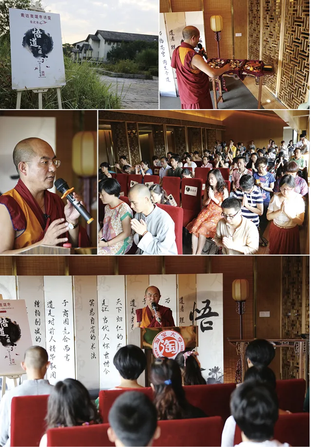
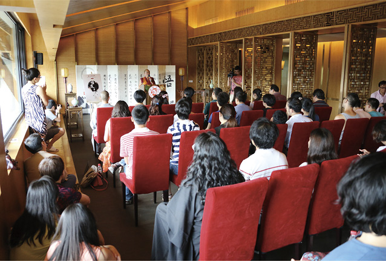
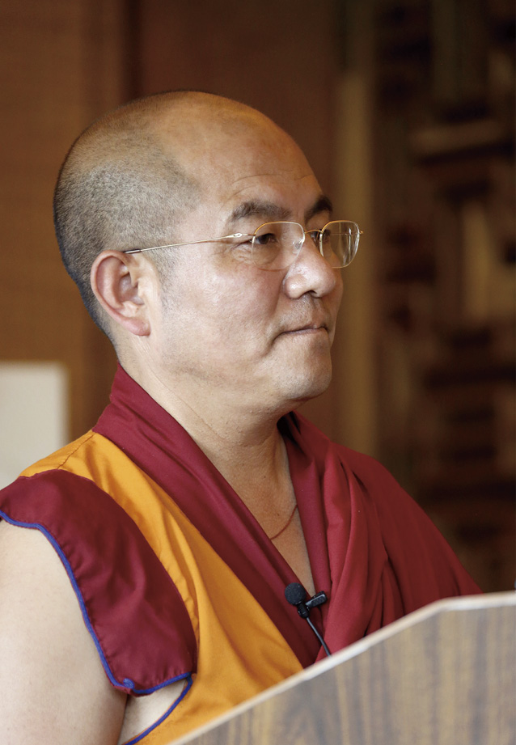
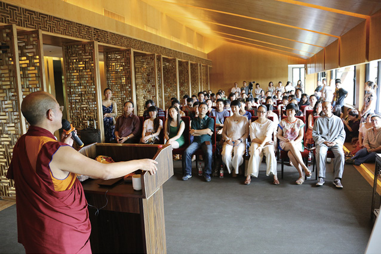
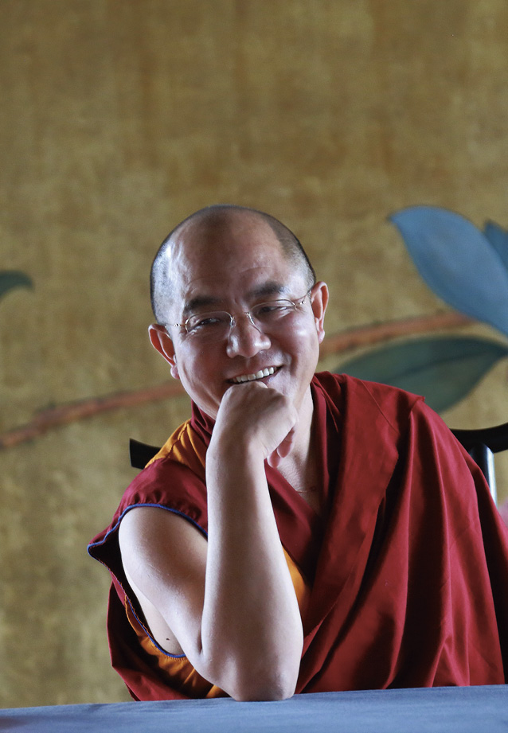
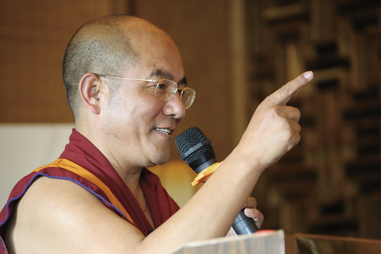
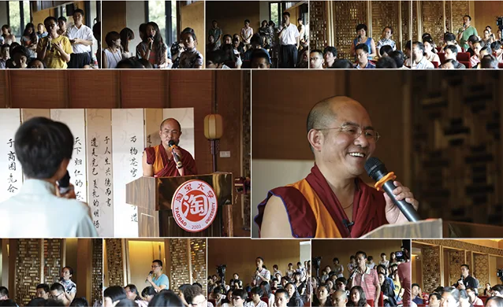
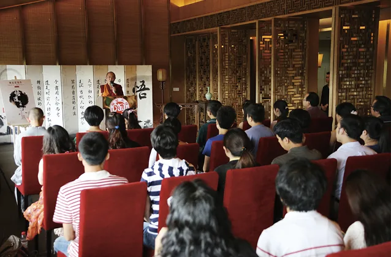
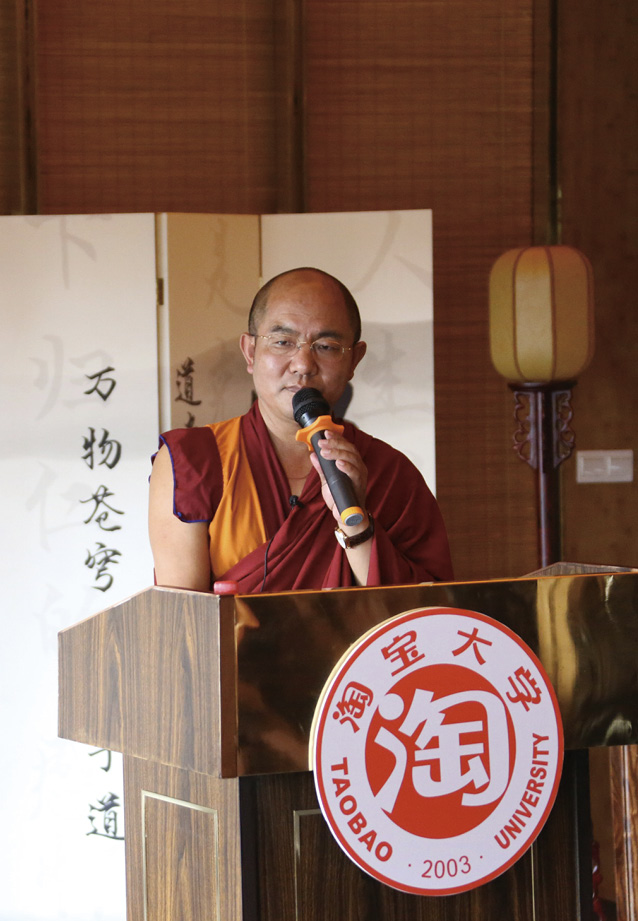
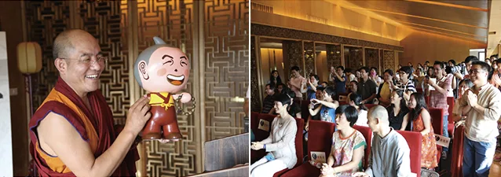

人生恰似采花蜂，飞南飞北飞西东，采得百花成蜜后，一场辛苦一场空。

第13场

杭州淘宝大学

Hangzhou TaoBao University

中国·浙江

2013 / 7 / 25

## 佛法与人生

## Dharma and Life

各位下午吉祥。今天很高兴与淘宝大学的学生们一起学习。去年淘宝年会时，我就有来这里的计划，但由于种种原因未能成行。这次因缘成熟了，我才来到这里与各位见面，正如佛经中所说“诸法因缘生，诸法因缘灭”。

## 因缘果报的奥秘

如今，淘宝大学的学生们、阿里巴巴的员工们共同创业、共同奉献，也是由因缘所生。这种因缘，并非由某个人刻意促成，也并非由所谓的上帝、造物主创造，而是大家曾经造作的善业、恶业、无记业成熟所致。

无论历经多少世纪、度过多么漫长的岁月，因缘果报都不会消失。佛教当中有一部著名经典，叫做《百业经》，其中说道：“众生之诸业，百劫不毁灭，因缘聚合时，其果定成熟。”众生现在所造的业，再过一百劫都不会毁灭，待因缘聚合之时，其果报一定会成熟。

也许有人怀疑：“人到底有没有前后世？生命真能延续到后世吗？如果没有后世，所谓‘因缘聚合’‘果报成熟’还存在吗？”这些疑问的产生，大多来自幼时的熏习。很多人由于教育、家庭环境等因素的影响，对佛教因果不虚等道理，缺乏深刻的理解。

## 拨开误解之迷雾

各位都很成功，令很多人羡慕。但是，如果你们对佛教教义缺乏了解，还是非常可惜。为什么这样说呢？因为佛教是一种真理，是非常科学的。佛陀说法，并非为了自我宣扬，而是为了宣说真理。21世纪的人们正在探索的精神世界，释迦牟尼佛早在2500多年前就宣说清楚了。并非因为我是佛教徒、出家人才这样说，对人类社会做出巨大贡献的智者们，如爱因斯坦、荣格、罗素等，也是这样评价的。

很多人受教育环境的影响，把佛教仅仅当作一种宗教，甚至是一种迷信。其实，这种看法并不科学，甚至也可以说是一种迷信，因为这种观点并未经过认真观察、分析，是经不起推敲的。

上世纪七八十年代以来，即“文革”之后，受电影、电视等媒体的影响，很多人都误以为佛教是一种迷信。当时，佛教的影音资料让大众觉得，人只有在走投无路时才会选择去寺庙出家。由此，大众对佛教的刻板印象日益加深，这也是佛教被误解的根本原因之一。

前段时间，香港举办了“世界青年佛学研讨会”，一位知识分子说，电影《白蛇传》中法海的形象，耽误他学习真理二十年。因为电影里的法海是一个很残忍的人，丝毫不讲情面，也不懂人与人之间的爱，他所宣扬的慈悲，只不过是破坏家庭的手段。看了《白蛇传》以后，那位知识分子对佛教产生了非常深的误解。后来，他经过长期研究才恍然大悟：原来历史中真实的法海，并不是电影中的样子。他也意识到，一些导演拍摄的电视剧、电影，传递的信息充满负能量。

佛教经论浩如烟海，犹如宝库。如今，东西方的科学家、哲学家，都在想方设法地从这个宝库中挖掘珍宝。大家也应该从理论和修证上，对佛教有一个正确的认识。而且要用自己的智慧公正分析，不要人云亦云、盲目相信。

我也学习过辩证唯物主义、辩证法，但后来经过长期观察，发现其中的理念确实需要调整。而佛教的教义，不仅可以体现在理论上，也可以体现在行为上。当然，并非所有佛教徒都如法而行。在佛教徒当中，有行为如法的人，也有行为不如法的人，但个人行为不应该归咎于佛教。

对佛教的理念，如果有问题和疑惑，我们可以一起探讨。到目前为止，我在佛法当中，确实没发现对人类身心健康有损害的内容。而且，通过对东西方的比较研究，我认为佛法在当今时代，的确对全人类有非常大的帮助。

## 金钱如毒蛇？

在阿里巴巴，无论是创始人，还是高层主管，你们的思想、价值观，已经依靠网络的便利，改变了世界上成千上万人的命运。很多人的价值观、生活的便利程度都发生了改变。这些改变是依靠什么途径实现的呢？是一种技术。

一方面，你们比较幸运，赶上了改革开放后网络在中国兴起的浪潮，恰逢从工业时代步入信息时代的时机；另一方面，你们也具备了智慧和利他心。所以，因缘具足的当下，你们开创的事业非常成功。

对于营销和生意，佛教也有自己的看法。佛教经常讲观空，一切如阳焰、如梦幻泡影，因此你们或许会以为，创办企业与佛教教义完全相抵触，或者会困惑争取自我完善、进步与佛教的理念是否有冲突。实际上二者并没有冲突。

很多人并不了解佛教的金钱观。其实，佛教并没有把金钱当作不清净的事物，没有让人排斥、放弃金钱。虽然在一些经典中，佛陀也说过“金钱如毒蛇”，但这种说法是有前提的——对非常执著金钱的人来说，金钱的确像毒蛇一样。

有些贪污的人，钱越来越多，家庭关系却越来越紧张。没有钱的时候，家人之间的感情很好，生活也很甜蜜，但有钱之后，心态和想法都发生了改变。所以，从这个角度来说，金钱有时候确实对我们有损害。但在普遍意义上，佛教对金钱并没有偏见，也没有不让众生发财——恰恰相反，佛陀希望一切众生都获得快乐。

佛教有一部经典叫《善生经》，不知道大家读没读过，经中说：“积累财富就像蜜蜂采蜜一样。蜜蜂为了采蜜，辛辛苦苦地穿梭于五颜六色的花丛中；人类为了积累财富，也一直处于忙忙碌碌的工作中。”按照佛教的观点，我们所积累的财富，生不带来，死不带去，到最后都是一场空。

我以前还看到过一句话：“人生恰似采花蜂，飞南飞北飞西东，采得百花成蜜后，一场辛苦一场空。”其实，很多人的一生就像蜜蜂一样，今天去北京“采蜜”，明天又去另一个地方“采蜜”，经常飞来飞去。

积累财富，无论是为了自己，还是为了家庭，都很辛苦，然而到死的时候，都是一场空。对于这一点，大家可能都有体会。我记得马云也说过类似的话：“无论是什么样的人，最后的结局都一样，都要被送进火化场。”

思想比较成熟的人，可以静下心来想一想：如果没有后世，人在这一生短短几十年中，辛辛苦苦攒来的钱，到最后死的时候，确实是一分钱都带不走。佛教中有这么一句话：“万般带不走，唯有业随身。”你的金钱，你的亲人，你的别墅、豪车，你的名声……一切的一切，全都带不走。

最终，只有你的心识会延续到后世，而你所造的业，无论是善业还是恶业，都一定会跟随着你。因此，大家对前后世存在的实相，一定要去观察。

有些目光短浅的人，认为人只有这一世。一些知识分子，虽然世间的智慧出类拔萃，很令人羡慕，但同时也让人感到悲哀，因为他们只知有今世，不知有来世。不承认来世，其实是全人类的悲哀，因为它透露出人类的愚痴与迷茫。

众生的每一世接连不断地出现，因此一直在轮回中流转。如果仔细去观察，我们可以找到成千上万个理由，来证明后世的存在。但现在的大多数人，由于对真理缺乏认知，所以对这一实相仍然无法认清。

总之，希望大家要相信因果，这一点很重要。不相信因果的人，可能会无恶不作，甚至会为了金钱，做出令人难以想象的事情。一般来说，不成功的人会非常执著金钱，而在事业、学历方面比较好的人，可能会看得稍微淡一些，这是我的想法。而佛教对金钱的看法，是并不排斥，但也不提倡过度贪执。

大家现在可能有很多压力。有一些专家认为，所有的压力，比如家庭、事业、身份地位的压力，归根结底，是来自金钱的压力。无论是佛教徒，还是世间人，内心真正成熟的人，执著心不会特别强，压力也不会特别大。

## 远离“猪圈理想”

我读过爱因斯坦的一本书，叫《我的世界观》，书中说：“每个人还有一定的理想，这种理想决定了他判断的准则和努力的方向。在这个意义上，我从来不把安逸和幸福看作是生活的目的本身——从理论的基础看，我把这种看法叫做猪圈理想。[^1]”

低等动物每天不是吃就是睡，除此以外，没有更高的价值追求。而作为人类，应该追求真正有意义的事物，并具备利他的思想。利他思想，对世间确实非常有意义。而要具备利他思想，首先需要自我完善，这一点很重要。

现在的社会比较浮躁，很多人看起来很成功，被人羡慕，或者至少在生存上不成问题，但他们内心还是会有烦恼、痛苦和纠结。对于这一点，大家应该也能感受得到。比如，有很多家庭看似很美满，但实际上存在着很多问题。我遇到过很多成功人士，他们解决问题很有智慧，可以处理好与成千上万人之间的关系，但在处理个人问题时，内心却很脆弱——家庭、感情、金钱的问题，让他们长期处于痛苦之中。

佛教中常讲，人生的诸多痛苦，都是由自己的执著所引生的。现在的成功人士，如果可以多学一些佛法，不仅会对来世大有助益，对此生的心态调整也很有帮助。学会调整心态是很重要的，如果心态没有调整好，开展任何事业都有一定的困难，因为你很难坚持下去，即使能坚持下去，也会感觉勉勉强强、困难重重。

关于调整心态，佛教有一些特别殊胜的教言，这些教言对出家人、在家人，或者任何身份的人，都非常适用。因此，我在不同场合，尤其是在大学里，经常鼓励大家多看一些佛法的内容。我这样做，是出于强烈的利他心，而不是私心，因为我并不想通过弘扬佛法来谋取私利。我是怀着真诚、恳切的心，来推荐大家学习佛法的。也许有些人接受，有些人不接受，每个人有各自的因缘。有朝一日，等大家了解佛教价值观之后，对其中的道理自然会明白。

世间成功人士的价值观，一般也是以利他为主的。在阿里巴巴，虽然没有倡导佛教价值观，但秉承的也是利他的理念，比如客户第一、员工第二、股东第三，有这样的说法。世界上大部分的成功人士，都有类似的理念。

而佛教所推崇的，是把众生放在第一位，自己放在第二位，追求自他的解脱，这是很高的境界。当然，佛教中也有追求自我解脱的修行者。只追求自我解脱，层次是比较低的，好比世间人只顾自己的生活，不管别人的事一样。如果把他人的事情放在心上，一心一意想要帮助他人，是真正具有利他心。

在企业中，有许多利他的践行者，其中就包括华人首富李嘉诚。有人这样评价他：“他不是一个‘精算师’，而是一个‘让利专家’。”他做生意有自己的原则，如果对别人有利，对自己也有利，这样的生意他愿意去做；如果对别人有害，对自己有利，他就不做；如果对别人无利无害，只对自己有利，他也不做。

据之前了解到的数据，阿里巴巴在全球240个国家和地区，拥有4500万个中小企业用户，覆盖范围广泛，给大众提供了便利。虽然我没有网络购物的习惯，但在我的寺院和学院里，也可以感受到技术带来的便利。通过降低商品价格、缩短购物时间，你们为大众提供了便利，同时，自己也获得了利益。

在世间，存有利他心，是非常有意义的。只要拥有利他心，即使事情做得不完美，自己也不会有遗憾。就我个人而言，无论到哪里去，无论做什么，我都会观察自己的心是不是真实的利他心。发心做一件事，如果怀有真实的利他心，就应该去做；如果利他心和利己心都有，但很有可能伤害别人，就不要去做；如果对别人没有伤害，对自己有利，可以选择去做。

在做事情的时候，有很多烦恼、争端、痛苦是正常的，因为这就是娑婆世界的常态。“娑婆世界”之所以得名，正是因为它有纷争，不可能像极乐世界一样太平无事。所以，人生在世，最关键的就是要调整好心态。

如果心态调整得好，那么即使在行为上，稍微有一点点不合理、不如法，也是可以的。在佛教的大乘戒当中，如果心清净，没有贪心、嗔恨心，即使说妄语、绮语，甚至说别人的过失，也可以开许——四种不善的语言，粗语、绮语、离间语、妄语，在心清净的情况下，都可以开许。

如果你的利他心非常强烈，没有丝毫自私自利，那么在某些特定情况下，杀生、邪淫、偷盗，也可以开许。但要特别注意的是，在这种情况下，要仔细观察自己的心到底清不清净，以及最关键的——是否真正想要利他。

## 学佛“危险”吗？

很多人学佛之后，父母很担心，同事也很担心。认为佛教是迷信的人，还会对你说：“你在学佛啊，这很危险！”因此，很多佛教徒不敢说自己信佛，只能在心里默默坚守自己的信仰。也有的佛教徒，担心身边的人说自己精神有问题、头脑不清醒，所以也一直隐瞒自己正在学佛的事实。

实际上，在一些国家，学佛是很光荣的事情。对于不学佛的人，大家反而很害怕，因为他很有可能给大众带来麻烦。没有信仰的人，想做什么就做什么，思想和行为都没有底线，很容易对社会造成危害。所以，大家对这样的人，会感到恐惧。

虽然目前由于种种原因，很多人都不敢说自己学佛，但在22世纪，或者更远的未来，佛教将被更广泛地认可。

学习佛法，可以提升心灵的力量，或者说，佛法所开显的，是一种能将心灵提升到最高层次的智慧。无论是谁具有这样的智慧，对自己的事业、家庭等各方面都会大有助益。

我经常推荐大家学习大乘佛法，这一方面可以促进家庭和睦，另一方面，也能明显提升工作水平。如果你可以调整好心态，发自内心地认为“工作就是修行，修行就是工作”，那你每天的所作所为都会很有意义。否则，你的内心会充满矛盾，比如有些人说“我只想闻思修行”，这样一来，闻思修行就会与你的工作产生矛盾。

在现代社会，工作与家庭之间经常会出现矛盾，这时就需要有协调的智慧。如果没有智慧，像有些人特别关心家庭，结果把事业丢掉了，这样不合理。还有另一种极端，有些人只顾自己的修行，对工作、生活中的事情一点都不管，这也不合理。而有智慧的人，应该可以兼顾二者。总之，想要平衡事物之间的关系，确实需要智慧。

对佛陀、佛法、僧众，有真诚的信心是很重要的。有句话叫做“英雄到老皆皈佛”，真正有智慧、有思想的人，最后都会皈依佛门。当然，也不是说所有人都必定如此。人在年轻的时候，禁不住诱惑，为了感情、金钱、地位，一直在追逐。但世间的名闻利养就像彩虹一样，追着追着，越追越远，但终究还是徒劳无益。等到了一定年龄，你就会明白——其实人生仅此而已，远没有想象中完美。

当代人有一种口号式的理想，叫做“拥有幸福美满的生活”，但在真实的人生当中，无论什么层次的人，都不一定幸福。举个例子，中高层次的人，在未得到某一事物的时候，会觉得它很美好。比如，在还没拥有一栋房子之前，会一直打工，想尽办法去得到它。拥有房子之后，刚开始住的时候感觉很舒适，一切都很好，但再过两三天，就没太大感觉了，好像跟住草坯房也没什么区别。有些人没有车的时候，很想买一辆车，认为有车以后自己就会特别幸福。等真的有了车，刚开始还比较开心，坐在车里感觉很好，但后来发现还要找停车位、加油、保养、维修……为车做许多事情，烦恼便接踵而至。

总之，人生中的确有许多痛苦，因此我们需要有面对痛苦的方法。

## 让烦恼无处可逃

虽然有些人有一定的智慧，但内心还是比较脆弱。在生活和工作中，遇到不开心的事情时，经常会无法面对。因此，需要通过心理锻炼，让心变得更加坚韧。众所周知，身体需要通过锻炼才可以变得更加健康，心也是如此，也需要一些方法来锻炼。我希望大家都能修持、运用这些方法。

修行，实际上是将烦恼转为道用的过程。也就是说，在你不认识烦恼的时候，会感觉非常痛苦，而一旦认识了烦恼的真相，烦恼就很容易对治。

有些令人烦恼的事，其实根本不会发生，因此它仅仅是你的担忧而已。有记者采访英国前首相丘吉尔，丘吉尔说：“当我观察所有烦恼之后，想起了一位老人的话：虽然一生中有太多烦恼，但你所担忧的事情，大多不会发生。”

我们的确有很多恐惧和担忧：“我未来会怎么样”“我的身体会不会生病”……有很多这样的烦恼，经常杞人忧天。实际上，有些烦恼只是当下的一种执著。比如，现在很多人都有感情方面的烦恼，问题刚出现时，你会觉得天都要塌下来了，特别痛苦，但过了十几二十年之后，你再去回顾时就会感慨：“原来那只是一场梦，甚至比梦还要虚妄。”

做网络的人应该知道，虚幻可以创造现实，现实也可以归于虚幻。物理学家也承认，在对茫茫无垠、含藏万千的宇宙，进行不断剖析之后，除了“空”之外，任何法都得不到。如果以微尘为单位对宇宙进行剖析，可以了知，整个宇宙都是由极小物质所构成的。而把微小的物质累积起来，最终也可以变得如山海一般庞大。

人们内心的执著与烦恼也是如此，一件小事被无限扩大，就产生了烦恼。比如，有人在网上或者当面说了一句你的过失，你心里就特别难受，不断地想“怎么会这样呢，这个人怎么这样说我，语言也太难听了”等等。但其实你可以换一个角度去思维：世界如此广阔无垠，在无尽的时空中，有无数的宇宙，在无数的宇宙中，看似广阔的银河系，其实是微不足道的。而在银河系中的地球，就像一粒小小的微尘一样。在地球上又有72亿人，其中一个人的小小的烦恼又算得了什么呢？大家应该有过类似的体验，乘飞机从高空俯瞰高山与大海的时候，你会感受到世界的辽阔，会觉得区区小事根本不值得生烦恼。

不知道大家现在的心情如何，虽然有些人看上去很开心，但在他的背后，也许有不为人知的悲欢离合，有泪水、有汗水、有各种各样的痛苦。在面对痛苦的时候，需要有非常坚强的意志。而且，一定要懂得如何去面对痛苦。如果真正懂得其中的道理，面对烦恼和痛苦就会非常容易；如果道理没有明白，一直钻牛角尖、作茧自缚，就无法解开自己的心结，这样反而会更痛苦。

现在很多人的内心都很痛苦，因此，患抑郁症的人越来越多，自杀的现象也越来越普遍。有一项调查说，十个中国人中就有一个人心理不健康，这个比例是很可怕的。虽然心理健康的评判标准不一，但很多人都有相同的问题，就是感觉压力很大。但实际上，我认为很多人的压力不一定真的大。我们确实需要做一些事情，也会比较忙碌，但如果做的是自己喜欢的事，就可以把它当作一种享受、一种生活方式，比如，把出差作旅游想，把谈工作作聊天想。也就是说，看待事物的角度稍微改变一下，所谓的压力就谈不上是压力了。

如果是患了特别严重的疾病，一般人确实难以承受，但其他很多问题的出现，其实是因为自己的心态没调整好。比如，本来不是压力的事情，你认为它是压力；本来不算痛苦的事情，你认为是痛苦。这些压力和情绪，会对你的身体造成不良影响，并让你的内心感到恐惧、忧郁、焦躁。

佛教中经常讲，早上起来的时候，要像习惯洗脸、刷牙一样，对自己的心态进行梳理和观察，把心静下来，不要胡思乱想，避免产生怨恨、嫉妒等不良心态，让内心的痛苦随缘而去，不再去思维它们。晚上将入睡时，不要让当天的事情影响你的睡眠。现在有很多人睡觉、吃饭都没有规律，甚至不清楚自己是在虚拟世界还是真实世界，整天迷迷糊糊的，这就是无规律生活带来的一种迷乱。

实际上，应该尽量把烦恼转为智慧。至于转化的方式，佛教并没有让你抛弃工作、家庭，把所有事情丢下之后到寺院里去。真正的佛教也并非像一些媒体所宣传的那样，我作为一个佛教徒，也从来没有那样宣传过——没有劝你出家，没有让你抛弃家人、生活、感情和金钱等等。

那佛教有没有讲空性呢？确实讲了空性，但空性并不是一无所有。如果说是一无所有，佛教就显得很不明智了，因为明明看到了这张桌子，却还说什么都没有，这肯定不合理。但在真实义中，确实一切都是空性的，包括我们的身体以及内心的执著都是空性。其实，并不是只有佛教徒才这样认为，物理学家也是这样承认的，在物理学家看来，桌子并非实有存在、恒常不变。

现在有很多人，对空性的理解很片面，却还要把问题归咎于佛教：“你看佛教讲的是空性，一切都是空空空，这是一种虚无主义，是消极的、逃避现实的。”这种人并没有了达佛教所开显的真理。实际上，物理学家也会做相似的分析，把粗大的物质分解至分子、原子、电子等，但却没有人指责物理学家说：“你们的量子力学把一切都变成分子、夸克了，那这个世界怎么办，是不是都不存在了？”他们没有对量子力学发这样的太过，却经常对佛教发这样的太过，我个人觉得有点不公平。

这种现象背后的原因是什么呢？我个人认为，跟个别媒体的宣传有关。有很多电影、电视节目，都在宣扬一个观点——“佛教认为什么都是空的”。虽然在究竟层面，佛教的见解和修行确实都指向空性，但不能把它理解为虚无。

对于空性，应该正确地理解和运用。比如，在你非常执著某一段感情、无法释怀的时候，通过闻思佛法可以了知，这种执著其实是自己的一种烦恼。实际上，无论是这段感情，还是烦恼本身，从本质上来说，都是空性。如果运用智慧，以各种角度去分析、观察，你一定能够完全接受空性的道理，就像“今天所做的事情，明天便不复存在”这样的观点大家都能接受一样。

## 总结与寄语

关于“佛法与人生”，今天的分享已经圆满了。

我想强调的有四点：第一，我希望在座的各位，要真正了解佛教的教义；第二，佛教，尤其是大乘佛教，其教义的核心归根结底就是要利益众生，这是非常重要的；第三，我也劝大家，在有时间、有机缘的时候，要好好了解和学习佛法，这会给你的生活，带来无比的快乐和无尽的利益；第四，在修行过程中，需要用智慧去分析，不能用歪曲的思想玷污真正的佛教，以致造成对佛教的误解，而且，这也不符合科学对事物的判断方式。总而言之，要想对人生有所感悟，就需要多维度、多方面地去了解，这样人生才会有进步。

现在大部分人每天追求的是什么呢？是外在的物质财富。而对于内在的精神财富，确实“充电”比较少。其实，人最需要的就是内心的财富，因为它的力量更为强大。法兰西第一帝国的缔造者拿破仑曾说：“世上只有两种力量：利剑和思想。从长而论，利剑总是败在思想手下。”

因此，我们先要调整心态，调整好心态之后，再做任何事情，都会更有毅力、更勇敢无畏。如果做不了太大的事，那么，即使在做小事的时候，也能够怡然自得——去哪里都会感觉很好，面对任何事情都会认为是对自己的一种锻炼。

我接触过各种各样的人，有信仰的、没有信仰的，白头发的、黑头发的，蓝眼睛的、黑眼睛的，不同肤色的，什么样的人都有。他们有不同的语言、思想、观点等等，我在与他们的交往当中，学到了很多知识。同时，我也会把不同的想法分享给他们。至于他们有没有收获，就要看佛教所讲的因缘了。

无论如何，对人生不要有消极、逃避的心态，也不要对已经取得的成功不知足，而让欲望不断膨胀，这样做不是很好。人应该有一种感恩心，要感恩所有的人，因为自己能够拥有今天的生活，并非完全依靠自己的能力，也不可能只依靠自己的能力。

对经常给自己制造违缘的人，甚至是自己怨恨的敌人，也应该去感恩。在其他宗教中也讲过这样的道理：“在所有的爱当中，对敌人的爱是最可贵的一种爱。”虽然很多人现在无法真正做到爱敌人，还没有这种境界，但应该去学习这种精神。如果有一颗包容的心，对世界上任何一种声音，你都能够欣然接受。我们所遇到的事情，不可能都一帆风顺；所听到的语言，也不可能都是赞美——如果听到的语言都是赞美，未免也太单调了一些。就像出门在外时，如果所有环境都是鸟语花香，所有声音都悦耳动听，你可能反而感受不到它的美好，因为没有其他环境作为对比。

生活中有苦也有乐，我们有时会听到反面的声音，有时会收到正面的声音。但无论如何，我们都要坚强，并怀有感恩心，把应该做的事情坚持做下去。这是具备勇气的一种表现。这种勇气与现在所倡导的“正能量”的内涵一致。如果拥有正能量，对身心健康有极大利益。但反观现在有些人，却对服用营养药物特别执著，这些药实际上是好坏参半。

要把自己的心态调整好，平时无论遇到什么样的情况，能处理的就尽量处理。但如果想让世界上所有的冲突、矛盾都消失，是不可能的，因为有正就有反——阴阳学说的理论也是这样讲的。有此即有彼，有彼即有此，这是一种社会现象，也是一种自然规律。所以最关键的，是要用智慧去化解矛盾、调解纷争。同时，我们要有开阔、包容、公正的心，以这样的心审视自己的经历，以这样的心看待世界，审视过去、现在与未来，这样一来，我们会对这个世界的真实样貌有更深的体会。

今天就讲到这里。最后，我把心里最美好的祝福送给大家。谢谢！

现场互动

问：末法时期，如果想在家实修，最需要注意的问题是什么？或者说，最应该去重视的核心要义是什么？

堪布：如果在家修行，有几个核心。第一，你应该有一位对佛学比较明白，并有修证经验的善知识，也就是所谓的上师。如果没有上师的带领，仅凭自己的智慧恐怕很难有成就。《华严经》中说：“佛法无人说，虽慧莫能了。”意思是，如果佛法没有人来宣说，即使你有一定的智慧，也不能了知其义。就像学开车也是一样，刚开始需要有人带你一段时间，否则，刚买了车就自己开，很有可能会撞到其他人。所以第一个，在家人的修行，需要懂佛法的上师的指引。

第二个核心，作为一个在家人，要规范自己的行为，至少要受三皈依，或者五戒当中的任何一条戒律。如果连三皈五戒这样的基本行为规范都没有，学佛很难成功，因为一个行为非常颠倒的人，想要具备正确的学佛心态是不可能的事。

第三，要奠定学修的基础。只依止上师还不行，只受戒也不够，还要至少在两三年的时间中，对佛教有一个比较全面的认识。对显宗也好、密宗也好，或者你自己所学的法要，要有真正的了解，有了了解之后，再继续修下去。

第四点，如果你修的是大乘佛教，就要具足菩提心；如果你学的是小乘佛教或者南传佛教，就一定要具足出离心。修菩提心，是层次比较高的一种修行方法，如果你的理想没有那么远大，那至少也要希求自我解脱，或者至少要有想获得健康、平安的愿望，之后再根据修行的传统和仪轨去修持。

如果能做到这四点，我想作为一个在家人，对于比较简单的修行，应该是可以圆满的。

问：如何用佛法教育小孩，特别是年龄很小的，比如三四岁的小孩子？这是第一个问题。还有一个问题是，我看到堪布写的书，有教育儿童的教育册，也听闻网上有教育小孩子的学习机构，所以堪布有没有到杭州来创办佛法教育的想法？

堪布：大约在十年前，我编集过《儿童佛教课》，里面讲的是一些以佛教为基础的内容，适用于小学学习。一共编了两本书，一本是小学一册到三册的内容，另一本是三册至六册的内容。本来还想编第三本，这样就可以涵盖小学的所有内容了，但因为比较忙没有编成，所以现在《儿童佛教课》只有前面两本[^2]。

编写的初衷，是希望现代教育学，可以加入一些感恩、慈悲的理念，比如爱护动物、关爱父母等等。虽然这两本书的内容，与官方教材没有冲突，但我们也没有在学校里推广。在藏地和其他一些地方，一些佛教徒的孩子，以及对佛教感兴趣的人，通过学习这两本书也得到了一些利益。

你刚才提到对三岁孩子的教育，是非常重要的问题。一些科学家认为，孩子从三岁到十三岁之间，是智慧增长的关键时期，他所形成的价值观会影响终生。如果在这一阶段，能接受来自父母关于感恩的教育，那么，孩子在一生当中，都会有这样的理念。但如果在十三岁之前，孩子天天看电视、沉迷娱乐，那么，他所接受的价值观，也会影响他的一生。

其实，现在有很多父母，并没有真正去关心孩子。也许在“文化大革命”以后，父母自己也欠缺正确的价值观，因此，孩子也无法从父母那里得到这样的教育。学校关心的只是考试考了多少分，却没有教孩子如何树立人生目标，这样的教育是有缺失的。既然学校里没有这样的教育，父母更应该在孩子十几岁之前，告诉他人生中什么才是有意义的。现在有很多人认为佛教是迷信，因为在十几岁之前，父母就是这样告诉他的，所以他一辈子也都这样认为，但实际上，他根本无法证明这种观点。

任何有价值的知识，需要父母在孩子小的时候就教给他。虽然孩子当时没有什么明显变化，但在潜移默化中，他的人生观就形成了。所以说，在长大之后教他一百遍，都不如小时候在他耳边好好讲一遍。据人类学家分析，人在小的时候，尤其是幼儿园和小学阶段，父母、老师的教育可以影响他的一生。

有孩子的家庭，一定要关心孩子的未来，考虑到他未来会成为什么样的人。是成为具备利他心、有思想的人？还是只会一点电脑，追求一点分数，什么理想都没有的人？在孩子小的时候，我们就要考虑他的未来。

问1：咒语一般都是藏文，比如说“嗡班匝儿萨埵吽”。如果我们念的时候发音不准，佛陀能听懂吗？

堪布：念诵任何咒语，佛陀都听得懂，因为佛陀是遍知，他对所有语言都精通。

佛陀在说法的时候，有一种特殊的语言功能，他可以了知世界上的所有语言，包括动物的语言。他从任何语言中获取信息都轻而易举，如果我们发心是清净的，念咒自然会有功效。

其实藏语也有发音的差异，藏地主要有三大语系，康巴人的语音跟拉萨人和安多人就不一样，因此三大语系里的“嗡班匝儿萨埵吽”的发音也不同，不同地区有各自的发音方法。包括“嗡玛呢巴美吽”，他们的发音也不同。但只要是以清净心所发出的声音，都可以得到咒语的加持。

我听你刚才念的“嗡班匝儿萨埵吽”，应该是很标准的。这个咒语可以忏悔我们无始以来的业障。无论是年轻人，还是老年人，每个人多多少少都造过罪业，所以忏悔是相当重要的。

问2：您说懂得安逸和幸福的人，其实是思想境界比较高的人。但据我所见，藏民好像经常在苦修，我看到的一些书里也在讲苦修，包括您，在修行时也应该很辛苦。所以，追求安逸与选择苦修之间的关系是怎样的？

堪布：我刚才提到爱因斯坦的一句话，他说过度希求安逸和幸福，不是人生真正的目标，而是一种“猪圈理想”。如果一个人每天只对幸福和钱财特别关心，那这个人的层次就不是很高。

人的生活可以分为三个层次，第一个层次是物质层面的生活，对吃、穿、住等方面比较追求；第二个层次是精神层面的生活，对艺术、哲学、逻辑学等比较希求，而对钱财、感情并不是很重视；最后一个层次叫做灵魂生活，除了哲学、逻辑学之外，还关注更高一层的生活，比如生死问题、修行问题，等等。要确定真正的生活目标，就要看自己到底追求什么样的生活。

当然，我在修行过程中，有时候也会遇到一些状况，比如身体生病、心态不好等等。对于这些痛苦和烦恼，我会自己进行调整。但我身边有些人却不会调整，包括我读书时的一些同学。之前我生病、身体不好的时候，我同学的身体也不好，所以我们都在住院输液、吃药，但我的心态远远好过他，比他快乐。当我用佛法的窍诀来调心时，痛苦对我来说，不但不会构成任何障碍，反而是修行的动力和助缘。

问：最近这几年，家里的长辈年龄都越来越大，也出现了很多状况，比如身体不好，患上绝症，或者突然去世。其实我也看了一些关于死亡的书，人在面临死亡的时候，是很无助的，也非常痛苦。而作为临终者的亲人，我很想帮助他们，但又不知道怎么做。不知道您有没有什么方法，可以给我们介绍一下。

堪布：我认为，对于死亡，以及人生中的各种痛苦，每个人最好提前做好准备。因为无论你再怎么成功、再怎么出名，都离不开生老病死。有些人会因为衰老而感到痛苦，其实这没什么可痛苦的；有些人在拿到病危通知的时候，也非常痛苦。但我自己认为，这些都不难面对。

在佛教当中，生老病死叫四大痛苦，所以患上疾病、甚至是绝症，确实令人难以承受。现在无论汉地还是藏地，得癌症的人都特别多。很多人知道自己得了癌症之后，完全处于恐慌当中，反而加重了病情。这也是因为他们对死亡没有训练过的缘故。

每个人都要面对死亡，而死亡是最令人恐惧的事，以至于很多人根本不敢提起。但这样做并不合理。我们对死亡应该提前准备，除自然老死外，死亡的方式通常有两种，一种是暴死，即突然死亡，还有一种是住在医院里，被疾病所困扰，一段时间之后才死。在面对死亡之前，如果可以了解佛教所讲的“死亡无常”“身体是四大假合”等道理，在身体健康时有一些训练和修行，那么，等真正遇到死亡的时候，就不会害怕。

前段时间，我去了一所大学，当时有一个人跟我说，他的哥哥是一名科学家，但在临终的时候特别害怕。而他的奶奶是佛教徒，虽然是文盲，不认识字，但在面对死亡的时候很从容。他的哥哥和奶奶同样是面临死亡，但两个人的状态完全不同，科学家特别害怕，痛苦地死了，而奶奶走得非常安详，知道自己即将死亡的时候，也没有任何恐惧。通过这个经历，那个人深深地感受到，在面对死亡时宗教给人带来的力量，以及有信仰和没有信仰的巨大差别。

所以，无论是对自己的死亡，还是他人的死亡，我们都应该有所准备。我以前看过一本《西藏生死书》，是法国的索甲仁波切写的。我跟他平时会通过邮件交流，今天早上他还给我发了一封信，说了一些他的书在汉地的情况。《西藏生死书》是一部很有影响力的著作，书中呈现了莲花生大士中阴法门对死亡的修持方法。对欧美国家的读者来说，这本书通俗易懂，很生活化。仁波切写完这本书之后，由台湾的郑振煌教授翻译成中文，他翻译得也很不错。自从有了中译本，汉地也有很多人在读这本书。读了这本书之后，大家应该会有一些感触。

对于人生中的生死大事，每个人还是要提前做一些准备，否则等死亡降临的时候，肯定会措手不及。到了那时，内心惶惶不安，再补救也无济于事。因此，每个人要提前做好对死亡的准备，这是极为重要的。

问：作为一个纯粹的佛教徒，应该在入世的环境中修行，还是在出世的环境中修行，为什么？

堪布：作为一个纯粹的佛教徒，想处理好入世和出世的关系，可以根据自己的修行和情况来看。

一般来讲，刚开始的时候，需要比较系统的学习，在这一时期，世间的城市、环境和人群，就显得比较吵闹了，会给你带来修行上的违缘。等修行达到一定境界的时候，在世间也完全可以修行，这时你的出定与入定已经没有什么差别了。所以，对于一般的修行人来说，要观察自己的心，如果自己的心修得比较不错，就可以做到“在生活中修行、在修行中生活”。作为在家人，有家庭、工作等很多方面的责任，学佛后还有自己闻思修行的责任，其实，这些责任都可以在修行当中去履行。如果有智慧、有善巧方便，就可以在各种责任之间找到平衡。

实际上，我们的很多时间，不一定用在了工作上，而是用在了散乱上，所以有些时间是因为不珍惜才被浪费了。我看到有很多官员、老师、企业家，都可以安排好修行、工作、照顾家庭的时间——这是在世间修行需要处理好的事情。

还有一种修行方式，修行者不愿再面对生活琐事，想珍惜一切时间用来修行，因此想从工作和家庭中彻底逃出来。但这种方式对在家人来说，不太现实，而且如果你出来之后又回去，这样反复不定也不是很好。所以，人生中如果没有特殊的必要，最好不要做很多转变，因为开启一段新的生活，换成另一种生活方式，这需要很长的时间来适应。

每个人所处的环境，实际上有它显现的因缘。你可以在你所处的环境中修行、工作，也可以做很多利益众生的事情。尤其是如果已经在做利益他人的工作，就不要轻易放下来。实际上，如果你很真诚地在利益他众，这就是修行中最重要的修行。因为修行的目的，一方面是为了调伏自己的烦恼，另一方面，按照大乘佛教的观点，就是为了帮助众生。哪怕只能帮助一个众生，也是修行中最伟大的修行，是最值得赞叹的事情。如果你不能帮助他人，只考虑自己的修行，这属于小乘的行为，因为小乘追求的是自我解脱。而作为大乘修行人，不能把利益众生只挂在口头上，而要实实在在去帮助别人。至于帮助别人的方法，有很多，但无论如何，只要你做的事情对别人有利益，就是在修行佛法。

问1：我刚才一直在悟上师所讲的空性，在工作中碰到问题、生起烦恼的时候，怎样把烦恼转化为智慧？

堪布：六祖在《坛经》中讲过“烦恼即菩提”，实际上，在我们还没有认识烦恼的本体时，烦恼就是烦恼，不是菩提，众生就是众生，不是佛。但在认识了烦恼的本体之后，烦恼确实就是菩提，为什么这么讲呢？举例来说，烦恼中有五种根本烦恼，贪心、嗔心、痴心、傲慢、嫉妒，当其中任何一个烦恼在你心里生起时，要去认识它的本体。比如，我现在生起特别猛厉的嗔恨心，由此大发雷霆，这时，我用自己的心来观察这个嗔恨心——它的本体是什么样，颜色是什么，形状是什么，它从哪里来，它到哪里去……当你真正去观察的时候，就会发现在身体的任何一个部位，都找不到所谓的嗔恨心。这时，你就会明白，原来所谓的烦恼是不存在的，这就是空性。

那么，“不存在”是不是就像虚空一样空空荡荡，什么都没有呢？也不是，还是有一种明明清清的东西，这就是光明。光明与空性，叫做明空无二的觉悟，这是禅宗最高的一种认识，各位也可以稍微观一下。我们之前没有这种认识，只不过是因为没人提醒你要这样观。现在真正去观，当你起烦恼的时候，生起的嗔恨心到底在何处，就发现根本找不到。这时，再观它的光明与空性无二无别，这就是不可思议的法界，也是我们经常讲的如来藏、智慧、觉性——这些只是在名称上略有不同而已。心的本体也可以叫做菩提，所谓的菩提，实际上是没有任何烦恼的一种状态。禅宗经常说开悟，对开悟的大德来说，所有烦恼都不会有任何危害。

禅宗大德和我们一样是人，密宗的虹身成就者也是人，为什么他们能找到“烦恼即菩提”的窍诀，我们却没有呢？一方面是因为前世的善根和今生的修行不同，另一方面，也是因为很多人根本没有修过。如果经常去修，无论是出家人，还是在家人，都有机会认识自己的心。一旦你认识了自己的心，任何烦恼都将无机可乘，不会对你造成危害。因此，认识自己的心，在生活、修行当中非常重要，大家要多加关注。

问2：我想知道在您的心目中，怎样去定义所谓的幸福和自由？

堪布：关于幸福与自由，佛经中有这样的说法：“一切自由皆幸福，一切控制皆痛苦。”意思是说，人们生活在这个世界上，如果能够自由、洒脱，就是一种快乐、一种幸福；如果我们有一种控制的心，或者被他人所控制，是一种最大的痛苦。

大家也都知道，监狱里的人是不自由的。前段时间，我去一个监狱做讲座，里面大概有一千多人，有些人吃得还可以，穿得也比之前好，住的监狱宿舍就像学校宿舍一样，是上下铺，每个人在门口还种了花，花上面写着自己的名字。我问其中几个人：“你们幸福吗？”他们说：“不幸福，因为没有自由。”我问吃得怎么样，他们说吃得还可以。又问穿得怎么样，他们说穿得也不错。但他们最需要的还是自由。我跟他们开玩笑说：“没事，藏地有很多出家人在闭关的时候，也要闭关十几年、二十几年，跟你们没有什么差别，你们在这里就像闭关一样。”

所以，自由实际上是一种幸福。南非总统曾被关在监狱里27年，当时他说：“如果我可以拥有半天的自由，这将是我生活中最大的幸福。”但后来他被释放之后，也没有听说他因为自由而感到幸福。因此，在我们拥有自由的时候，要去珍惜。现在大家有吃有穿，身体很健康，想到哪里去也很自由，这对没有自由的人来说，真的是一种莫大的幸福。

问：科学发展至今，一直在丰富我们的生活，但也在一定程度上，用唯物主义的理念，摧毁了人们心中的信仰与期许。因此，在某种意义上，科学的发展，或许站在了宗教的对立面上。那么，您怎么看待科学与宗教的关系？

堪布：大概十年前，我写过一本书，叫做《佛教科学论》。在书中，我对佛教与科学的关系进行了一些分析。

第一，我分析了现代科学对人类心灵等方方面面的认识，从中可以发现科学并不是特别究竟；第二，我分析了科学与佛教的共同点，二者有个显著的共同点，就是对真理的追寻；第三，2500多年前，佛陀已经告诉了人们，心灵世界与外在世界的很多奥秘，对其中的一些内容，科学家至今还在探寻。关于科学与佛教之间的关系，我在其他课程中也给大家分享过。

在座的各位可能认为，科学是一种客观的知识，而所谓的宗教，则是一种主观的传统思想，但实际上，这只是个人的想法而已。科学家自己也认为，对于很多奥秘，科学还在不断探索，对于很多问题，还没有得到最完美的结论，因此，科学理论还需要不断更新。而佛教对心灵的认识非常深广，有其不共的殊胜性，所以科学家也在参考佛教的观点。

当然，并不是因为我是佛教徒才这么说，中国科技大学前校长、现任深圳南方科技大学校长朱清时，曾经在一篇文章中也说过这样的话。这篇文章我读过，他在文章结尾处说：“当科学家千辛万苦爬到山顶的时候，佛学大师早已在此等候多时了。”这句话有非常重要的意义，它向我们揭示了一个事实：真正的佛教大师，在这2500多年的时间里，已经在真理的高峰上等着了，而科学家还在用仪器等研究方式，对真理进行着探索。

前一段时间，在“世界青年佛学研讨会”上，香港理工大学前校长潘宗光教授，引用了这句话。我之前去复旦大学的时候，也引用过这句话。潘宗光教授作为一位校长，同时作为一名科学家，在自己的研究领域耕耘多年，根据他的判断，最终也得出了这样的结论。当然，事实的确如此，对于真理，科学家还在辛辛苦苦不断地探索着。

中国著名思想家鲁迅先生，在看了《贤愚经》和《瑜伽师地论》之后说过：“释迦牟尼佛真是一个很伟大的哲人，思想家们辛辛苦苦探索的道理，释迦牟尼佛早已为我们解释得非常清楚了。”我看过鲁迅先生的传记，知道他看的佛教书籍并不多。我以前开玩笑说，如果鲁迅先生看过《大藏经》，学过中观、因明，一定会对佛教更加赞叹。从他的传记来看，他可能最多读过三本佛教书籍，但即便是这样，他对佛教都如此赞叹。我们在小学的时候，对鲁迅先生是很崇拜的，当时读过他的很多书，觉得他有一种刚强的意志，有自己不共的思想，所以他对佛教有这样高的评价，也是非常难得的。

这样回答你满意吗？满意是吧。（众笑）

问1：我们都相信因果、相信前世和今生，请问，怎么理解我们当前承受、经历的一些事情？如何站在因果和前世今生的角度，来理解其中的因果关系？

堪布：关于前世后世和业因果，有一本叫做《前世今生论》，是我们学院的慈诚罗珠堪布撰写的。在书中，他引用了许多现代科学的案例，以及东西方国家发生过的真实事件，同时，运用佛教的逻辑学，证成前世后世以及业因果的存在。在座的各位，有时间的话，不妨去看看这本书。

有的人很盲目地活着，连前世后世的存在都不承认。如果前世后世真的不存在，倒也不要紧，这一辈子过了就一了百了，但实际上并不是这样。如果我们真正懂得，这一辈子过完以后还有下一辈子，而且下一辈子更漫长，就会明白这一生对未来的生生世世，有多么重要的意义——如果此生造的业特别重，之后的很多世都将感受痛苦。在即生中，你们中的一些人很成功，拥有幸福和财富，这些好的果报与前世做善事有关。

关于这些问题，今天在短短的时间中，三言两语很难说清楚。你们这里很多人都很善良，但也有一些比较盲目，觉得“佛教虽然有这方面的道理，但我不用去追求，反正活着就活着”，这种想法很普遍，也是教育所导致的。如果我们接受的教育比较积极，关注到前世后世，而且从小时候就开始接受这样的理念，那很多人就不会这样浑浑噩噩地活了。所以，我希望大家，对于前世后世是否存在，拿出充分的时间来观察。

问2：净土宗和密宗，对我们的修行而言，从增长智慧的角度，有什么不同的效果？

堪布：净土宗和密宗，实际上没有什么差别。密宗中有很多净土宗的修法，净土宗中也有很多密宗的咒语和见解。对密宗的道理，如果净土宗不承认，实际上是不合理的。只不过汉传佛教的个别大德，之前对密宗并不是很了解，导致一些信徒误以为密宗和净土宗水火不容，所以才分别“我是学密的”“我是学净土的”，甚至强烈地反对密宗。

在藏地，好像从来没有听说过密宗和净土宗是完全分开的，因为几乎所有藏地的寺院，都学净土宗、学显宗，没有说只学密宗、不学显宗的。但在汉地，有些人把藏地所有的佛教传承都看作是密教。在一些错误的介绍中说，藏地的宗教就是喇嘛教，喇嘛教就是密教，汉地的佛教就叫汉教，汉教就是显教，等等。我以前看过一本书，书里的说法就是这样，我当时很想跟这本书的作者辩论，但也没有找到作者是谁。他这样的说法会误人子弟，因为他根本没有做过研究，对藏地的情况也不了解。

我们应该对这个问题有正确的了解。实际上，净土宗和密宗的观点是一致的，而且兼修密宗和净土宗，即净密双修，是很普遍的，以前有很多大德和修行人都是这样修的。认清这一点非常重要。

问：佛是否会遇到心爱而不可得的人，如何放下，如何不心痛？

堪布：佛会遇到心爱的人，但佛心爱的对境是所有众生，并不像凡夫人所爱的只是一个人、两个人，最多三个人。（众笑）

佛也不会因为爱人，而引发人与人之间的矛盾，因为佛陀的爱是无条件的、真诚的，是把所有众生当作自己的身体一样去爱。佛爱所有的众生，所以，如果我们伤害众生，佛会心痛。在著名的《入菩萨行论》中有讲，佛把所有众生视为父母一样去爱护，所以，如果我们害了任何一个众生，佛都会很心痛。如果一边杀众生、害众生，还一边供佛，佛肯定也不会欢喜。

## 皈依开示

主持人：

非常感谢堪布的开示！应部分朋友的祈请，我们今天也特别增设了一个皈依的环节。对很多学佛的人来讲，皈依是一个非常重要的入门仪式。那么，皈依对学佛意味着什么，它对我们今后的修行生活，有什么积极的意义？请堪布为我们作进一步的开示。

关于皈依，我要讲的不是很多，但也可以讲一下。我这几天遇到了你们淘宝大学的一些工作人员，他们对佛很崇拜，也承认佛教中有一些奥秘。有些人确实有皈依的心，但还没有皈依。当然，佛教也承认，皈依或不皈依完全是一种自由，可以通过自己的智慧去选择，不能强迫别人皈依或者不皈依。

我个人认为，皈依相当于是加入了佛教。有些人觉得，皈依之后需要吃素、需要守一些戒律，所以做不到。其实皈依的戒律，对有信仰的人来说，要求并不算很高。如果要受持出家戒或者居士戒，这个层次比较高，而仅仅是受皈依，并没有要求必须吃素，也没有要求必须守杀盗淫妄酒这五条戒律。哪怕是心里对佛陀非常敬仰，发誓以后不诽谤、不舍弃佛法僧三宝，发自内心地去恭敬、去信仰三宝，这也是一个初步的皈依。

皈依的方式比较简单，大家想皈依也可以，不想皈依也可以。皈依后要守持的戒律也比较简单，比如，皈依佛之后，要经常在寺院或家里，对佛表示一种敬仰；皈依法以后，对佛陀所讲的法要有尊重、恭敬之心；皈依僧之后，要追随佛陀的僧众，尊敬出家人、在家菩萨，有恭敬心、团结和合的心。这就是皈依戒的一些要求。

不皈依和皈依的功德差别非常大。一般来讲，一个人皈依之后，哪怕是念一句观音心咒，做一点点善事，功德都相当大，就像在世间，入会之后有特殊优惠一样。虽然皈依并不是佛陀给佛教徒的优惠政策，但这是一种法性的自然规律，因此皈依后的功德确实很大。佛陀在经中也讲了，这一世作为人道众生，即生中皈依了三宝，下一世便可以不堕地狱、饿鬼、旁生。如果你不承认有后世，那就另当别论，因为你连皈依的条件都不具足；如果你承认有后世，而且后世再也不想堕入地狱、饿鬼、旁生道，那么，即生中至少要受持皈依三宝的戒律。

在藏传佛教中，对皈依三宝非常重视。如果没有受持皈依三宝的戒律，来世确实不知道会生于哪一道。现在有些人经常跟我讲：“我只要心地善良就可以了，皈不皈依都无所谓，酒肉穿肠过，佛祖心中留。”其实佛祖到底留没留在心间也很难说，可能只是一个借口，给自己找个理由。有些人认为自己很善良，但其实也不一定，因为你也有很多不善良的地方。

真正皈依佛教之后会有一些利益，我个人认为，戒律是一切的所依，就像所有的草木都依靠大地而生长一样，所有的功德也依靠戒律而增长。所有戒律中标准最低的戒律，就是皈依戒，之后是居士戒、出家戒。对于在家人，按照显宗来讲，由受皈依戒开始，之后再受居士戒；而进入密宗之后，则需要接受密乘灌顶后守持密乘戒，是这样层层递进的。

总之，对于皈依的功德，在有关经论当中讲了很多。想皈依的人，可以在内心当中皈依，这样去发愿。大家也不用换座位，这样坐着就可以。

（堪布念诵皈依仪轨……）

好，已圆满！（大众鼓掌）

[^1]: 摘录自《我的世界观》。
[^2]: 现已合并成一本，详见索达吉堪布全集102《儿童佛教课》。
