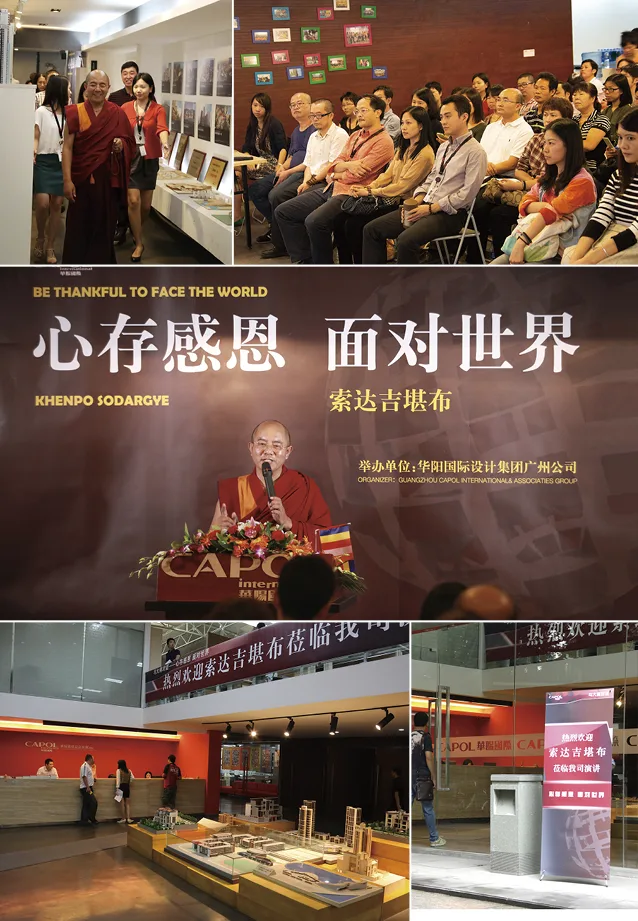
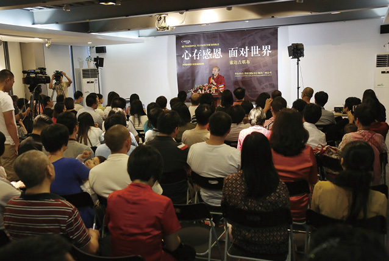
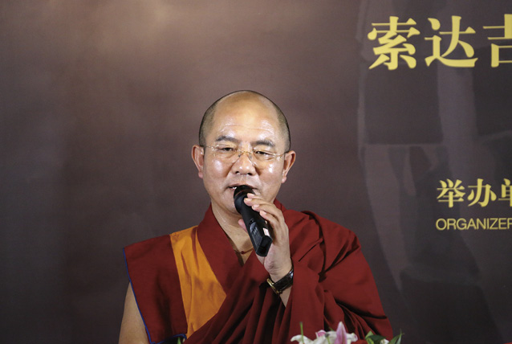
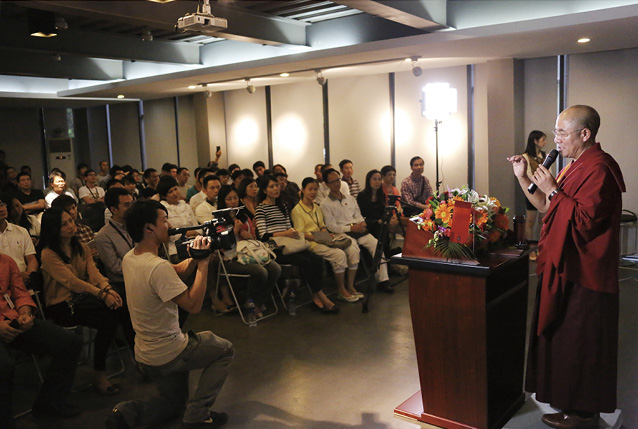
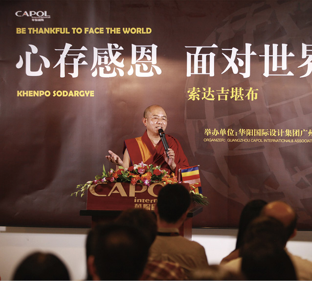
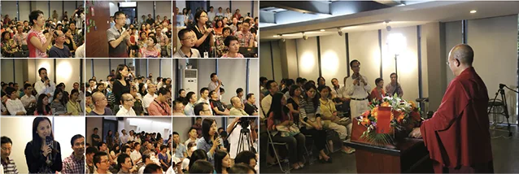
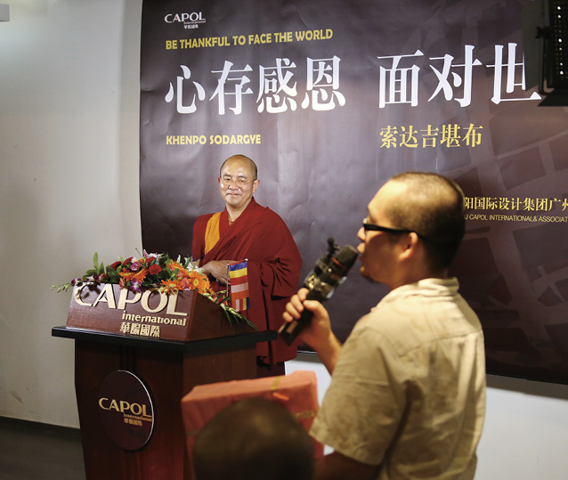

内心的转变，会让世界变得像阳光一样灿烂。

第14场

广东华阳国际设计集团

CAPOL International & Associates Group, Guandong

中国·广东

2013 / 9 / 30

## 心存感恩 面对世界

## Facing the World with Gratitude

主持人：

今天，非常荣幸地邀请到了尊贵的索达吉堪布莅临我公司，为我们做“心存感恩，面对世界”的演讲。

欢迎堪布——

很高兴和大家在这里相识。作为一名出家人，我想从佛教的角度与大家交流今天的主题。

关于感恩，大家都有不同的理解。一般来说，只有懂得感恩的人，才能让自己过得快乐，也能让身边人感到幸福；如果不懂感恩，自己会经常处于忧愁、焦虑和浮躁的状态中，给身边人也会带来困惑、痛苦和不安。

## 心不唤物，则物不至

人活一生，最关键的是心态。如果心态改变了，行为就会改变；如果行为改变了，性格就会改变；如果性格改变了，家庭就会改变；如果家庭改变了，整个社会、国家，乃至全世界都会发生改变。因此，大家要学会反观自心，不要总觉得别人欠自己的。在反思的过程中，我们会收获很多感悟。其实，只是以前没有观察而已，真正去观察时会发现，确实有很多值得感恩的人或事。

小的时候，父母有养育之恩；长大以后，老师有教育之恩；工作以后，领导和同事有帮助之恩；成家以后，家人有维护之恩；老了以后，晚辈有照顾之恩。总之，在这个世界上，值得我们感恩的地方实在是太多。包括现在所处的这个房子，大家能够在这里一起学习，这背后凝聚了无数人的心血和汗水。从建筑设计到建筑施工，每个工程的背后都有许多辛勤付出的工作者。包括每一条公路、每一口食物、每一件衣服，无不凝聚着许多人点点滴滴的付出。

关于这一点，现在的年轻人不一定理解，所以经常会抱怨：“父母对我不公平，老师对我不友好，领导对我不关心，同事对我不关注……”认为自己很厉害，很有本事，却一直怀才不遇。我之前看过一份统计，里面讲到：在中国，84%的人对生活现状不满意，总觉得自己被大材小用了，认为凭自己的本事不至于如此。实际上，每个人都应该扪心自问：自己的能力是否真的这么厉害？

我看过一个故事。相传，有个寺院的住持，给僧众立下一个特别的规矩：每到年底，针对整个寺院的状况，每个人都要对住持说两个字。

第一年年底，住持问一位新和尚最想说什么，新和尚说：“床硬。”

第二年年底，住持又问他心里最想说什么，他回答说：“食劣。”

第三年年底，他没等住持问便说：“告辞。”

住持望着新和尚的背影，自言自语地说：“心中有魔，难成正果，可惜可惜！”

在这三年里，新和尚用六个字表达的全是抱怨。就像现在社会上的有些人，总觉得领导对自己不满意，工作量大，工资又少，还得天天加班，然后住得不好，吃得不好，什么都不好。很多年轻人都抱有这种想法，原因就在于从小没有接受过感恩的教育。虽然从五六岁就开始读幼儿园，然后小学、初中、高中，一直到大学，有的还继续读硕士、博士，可以说一半人生都徜徉在知识的海洋里。但真正应该拥有的感恩心、慈悲心、宽容心、敬畏心等，这些在学校里很少学到。虽然不能说一点都没有，但确实没有引起足够的重视。在这种教育背景下培养出来的学生，步入社会以后，经常会散发出一种怨气，这也影响了他们身心的健康。

## 不忘久德，不思久怨

德国著名哲学家尼采曾经说过：“感恩，即是灵魂上的健康。”实际上，无论和谁相处，都应该有一颗感恩心，这对心灵健康有非常大的帮助。比如，在一个公司里，你觉得一个月拿三千块的工资还不错；吃的方面，一菜一汤可以，两菜一汤也可以，怎么样都觉得好吃，毕竟很多非洲人连饭都没得吃；穿的方面，有两三件衣服就足够了，毕竟还有很多人无衣可穿；住的方面，两个人一起住可以，三个人一起住也可以，一个人也可以。总之，一切都随缘。

有一个人，在一家美国公司任职。他的文化水平不是很高，但一直以一颗感恩的心与人交往，从来不会和人吵架。只要能对别人有帮助，他愿意付出很多时间和精力。后来，他成为这家公司的一名高管。

所以，如果没有感恩心，很难在这个社会上立足。虽然能勉强维持生计，但不仅自己会感到痛苦，还会给身边人带来不安全感。

因此，在平时的生活中，大家对父母、老师、同事，甚至是素不相识的人，都要有一种感恩心。实际上，感恩心越多越好，时间越长越好。《弟子规》中说：“恩欲报，怨欲忘。报怨短，报恩长。”意思就是，他人对我有恩惠，要心怀感恩，时时想着报答；他人与我有仇怨，应该尽快忘掉，不要耿耿于怀。如果十年以后还记得别人对你的批评，这样不是很好。如果别人对我们有所帮助，应该滴水之恩，涌泉相报。但很多人正好相反，把别人的恩德忘得一干二净，不该忘的已经忘了，该忘的怨恨却一直忘不了。

其实，报恩的次数应该越多越好，哪怕是别人的一点点帮助，都应该铭记于心；而别人对自己的伤害，最好不要伺机报复。要知道，报仇不是智者的行为。现在有些年轻人，严重缺乏感恩心，报恩心更是少之又少。据《中国青年报》2006年4月24日报道，20多年以来，退伍军人高健民倾个人之力，先后关怀资助过130多名学生。而这些受助的学生在毕业后，主动与他联系并表示过感谢的还不到10％。

在2005年，被评为“感动中国十大人物”之一的丛飞，他是深圳著名的歌星。从1994年开始，11年间共资助了178名贫困学生。但在他被查出患有胃癌晚期，住院治疗期间，没有一个他所资助的孩子或家长到医院探望他。反而很多家长不断打电话来质疑丛飞不遵守承诺，半路断掉了资助。有一位家长，还气势汹汹地打电话说：“你不是说好要将我的孩子供到大学毕业吗？他现在在读初中，你就不肯出钱了，这不是坑人吗？”丛飞的朋友向对方解释了他当时的情况，对方仍然问道：“那你问问他什么时候治好病出来挣钱？”根本不关心丛飞的病情究竟如何。

我之前通过各种方法建立了一个基金会，希望能够帮助到贫困的大学生。我这样做不是为了求回报。但反过来说，如果一个人没有报恩心，说明他的人品很有问题，这样谁都不会愿意帮助他。

今年夏天，我们资助了200多名大学生。发放助学金的时候，我特意要求每个人说两句话——“谢谢你！”“感恩你！”这样做的目的，并不是为了让别人感谢我，满足一下虚荣心，而是为了让他们学会说“谢谢”和“感恩”。但有些人还是不愿意说，想直接把钱领走。我就强迫他一定要说“谢谢”，他死活都不愿意，只是“嗯嗯”两声就把钱拿走了。

## 重视教育，开启感恩

以上这些现象，都是由于人们缺乏感恩心和报恩心，这是非常可怕的现象。《大乘本生心地观经》中说：“世出世恩有其四种：一父母恩，二众生恩，三国王恩，四三宝恩。”意思是说，我们要报父母的恩德，报众生的恩德，报国王的恩德，报三宝的恩德。这也是佛教回向偈中“上报四重恩，下济三途苦”中的“四重恩”。

按照佛教的观点，每个人都要对父母有一种感恩心。如果没有父母，就没有我们。在孩童时期，父母教会我们走路、吃饭、说话、穿衣，又教会我们很多世间知识。因此，一定要对父母心怀感恩。现在有些年轻人，经常以工作忙为借口，不回家看望父母，甚至连个电话都不打。即使见了面，态度也比较恶劣，这种行为非常不好。

另外，对于身边的好心人，我们也要有感恩心。包括对这个世界的青山绿水、蓝天白云、清新空气等，要感恩它们给我们的生存提供了能量。同时，我们还要感恩国家领导，毕竟是依靠他们的威德，我们才生存在这个国家。更要感恩三宝，即佛、法、僧，三宝给我们带来的不仅仅是今生的快乐，还有生生世世的快乐。

关于“四重恩”，在《正法念处经》中有不同的说法。其中讲到，四重恩是指报父恩、报母恩、报佛恩、报师恩——老师哪怕只传授了一句特别短的教言，我们也要有报恩心。

德国著名诗人歌德曾说过：“你要欣赏自己的价值，就得给世界增添价值。”因此，大家一定要教育自己的子女有感恩心。不然的话，当你老的时候，孩子不一定会对你孝顺。

前段时间，有一位老师跟我讲，他在某个场合见到了自己的学生，但这个学生并没有理睬他，这件事令他十分伤心。我当时跟他说，一方面这是学生的问题，另一方面也是老师的问题。因为你当年教他们的时候，没有教会他们感恩。所以，培养出来的学生，既不懂得感恩，也不懂得报恩。

因此，我们一定要明白感恩的含义，还要接受感恩的教育。希望大家能够通过佛教的教理，或是其他有益的世间知识来充实自己。更重要的是，我们要教会孩子们感恩。

英国哲学家、教育家约翰·洛克的教育学著作《教育漫话》[^1]，其中就讲到：“我们幼小的时候得到的印象，哪怕极其微小、几乎觉察不到，都会对一生产生长久而深远的影响。正如江河的源泉，水性柔和，稍用一点人力就能将它引向别处，使河流的方向发生根本的改变。只要最初从根源上这么引导一下，河流就有了不同的趋向，最后流到十分遥远的地方去了。”我非常赞同他的观点。从学生时代开始，就应该给孩子们灌输感恩的理念。当前，学校课程中基本没有感恩的教育，即使有一些，大多也没有实质性内容。所以，这方面的学习非常重要。

## 人人感恩，事事感恩

按照佛教的理念来讲，对于有恩德的人，我们应该常怀报恩之心，而对于那些伤害过我们的人，不但不能伺机报复，还应该感谢他。比如，怨恨的敌人诽谤我、损害我，不但不能报仇，反而还要想尽一切办法帮助他，赞扬他的功德。很多人可能没办法接受这种观点，但这就是大乘佛教的理念。

有些人可能想：“如果别人对我好，我当然也会对他好。人不骂我，我不骂人；人若骂我，我必骂人。”这是一种比较狭隘的思想。其实，认真观察就会发现，如果我帮助了别人，他可能会帮助我，也有可能反过来伤害我。即便是在这种情况下，我们还是要不断地去帮助别人，就像有的智者讲的那样，如果能以爱心来帮助敌人，到了一定时候，敌人也可以变成朋友。

在生活中，我们既要学会迎接好的一面，也要学会面对不好的一面。现在很多年轻人，处处希望自己万事顺利、开开心心。但其实生活有好坏两面，并非全是好的。人生这条路，不可能永远一帆风顺，而是像翻山越岭一般，一会儿看到森林，一会儿看到平原，一会儿看到江河，一会儿看到高山。每个人在成长过程中，都经历过磨难，也享受过快乐。在面对人生种种境遇时，如果能保持一颗感恩的心，就可以坦然面对一切。所以，关键在于我们的心态。如果别人谩骂你、损害你，你依然能以从容、包容的心态去接受，那他的损害不但不会对你造成危害，反而你可以将这种违缘转为道用。这就是大乘佛教中所讲的，把负能量转变为正能量。

对一般人来说，受到别人谩骂的时候，把它当作空谷声，当作最好的修行方法，这一点确实很难做到。慈济基金会创始人证严法师曾说过：“时时感恩，处处感恩，人人感恩，事事感恩。”也就是说，不管在任何时候，做任何事情，都要有一颗感恩心，这样整个世界就会变得美好。相反，如果以一种抱怨心或仇恨心看待这个世界，世界也会变得很糟糕。

从前，有一个小男孩，因为对某人的一时气愤，就跑到山谷里面大声喊道：“我恨你，我恨你！”结果整个山谷传来回音：“我恨你，我恨你！”小男孩特别伤心，觉得一切糟糕透了，连外面的山河大地、花草树木都说恨他，感觉自己的世界都要崩塌了。

然后，他跑回家里把这件事告诉了母亲。母亲说她有一个好办法。接着，就把小男孩带回山谷中，并要他大声喊：“我爱你，我爱你！”小男孩照母亲说的做了。这次他发现，山谷也反过来和他说：“我爱你，我爱你！”这时他才明白，原来内心的转变会让世界变得像阳光一样灿烂。

因此，对待任何人任何事，都应该心存感恩。虽然这个时代非常复杂，人心极其浮躁，我们每天都要面对各种人和事，同时还要承受极大的生活压力，但只要内心坚强、长存感恩，一切都会变得更加美好！

现场互动

问：我家里有很多蚊子，请问到底能不能拍死？

堪布：昨晚在广州时，有只大蚊子一直咬我的手和脚。我把被子盖上后，它又钻进来不停地咬。后来我想它毕竟是一条生命，它咬我，我不会死，我打它，它却会死。另外，身为一名佛教徒，我更不应该杀死它。从一切生命都是平等的角度讲，我们不应该杀害任何动物，包括蚊子在内，否则就会欠下命债。虽然蚊子很小，但它的生命跟人一样珍贵。因此，即便它可能会伤害我们，我们也不能杀它。

听说如果把空调温度调低，让屋子冷一些，蚊子就不会咬人。你也可以试试，最好不要杀死它，应该想办法让它失去咬人的兴趣。把空调开低一点，这样它也凉快，你也凉快。

问：刚才您讲到，我们应该学会感恩。但由于种种原因，现在很多人生不起感恩心，这是缺乏因果正见造成的吗？

堪布：普遍来看，现在大部分人都缺乏因果正见。1919年“五四运动”以后，马克思主义与自由主义在中国得到广泛传播，形成了一股强大的社会思潮，中西观念孰是孰非争执不下。1949年以后，受到西方文明的冲击，作为四大文明古国之一的中国，其原有的传统文化精髓，包括儒、释、道共同提倡的“善有善报，恶有恶报”，慢慢也消失殆尽了。

我小的时候，经常会看到“批林批孔”运动——对于孔子思想进行全盘否定和彻底批判。前几年，我听说孔子像在天安门展览了一段时间，后来不知道什么原因又没有了。不管怎样，现在最重要的是在教育上要有善的引导，因为很多父母自己都不懂得感恩，更别说教育小孩子了。

要知道，在社会和家庭里，感恩心是非常重要的。遗憾的是，很多人不明白这一点。在这样的社会环境下，人们变得越来越麻木，别人对他好，没有一句感谢，而对他坏，可能会记恨一辈子。

现在虽然外面的世界五彩缤纷，楼房盖得越来越高，人们穿得越来越美，吃得越来越好。但是，人们内在的贪心、不满也在随之增长。究其原因，就是传统文化遭到了破坏，所以人心才会变成这样。

问：如何理解“出世”和“入世”？

堪布：一般来讲，修学佛法叫出世，沉浸于世间叫入世。而在佛教中，出世是指证悟空性，获得佛果，已经超越了世间；入世则是处于轮回，有“善有善报，恶有恶报”等因果正见——整个轮回的流转过程就叫做世间。

所以，“出世”和“入世”这两个词，在不同的场合会有不同的解释，不同的修行阶段也有不同的定义。

问：我总觉得人的一生最终不过是两手空空而来，又两手空空而去。请问，应该怎样看待死亡？

堪布：在这个世界上，每个人出生时都是拳头紧握，两手空空而来；到了断气时，又是两手空空而去。

当死亡来临之际，唯有善法才对我们死后的去处，乃至生生世世最有帮助。这个问题在佛经中有非常详细的阐述。以我多年研究佛法的经验来看，人不能只耽著眼前这几十年。如果认为人生是短暂的，存有“人死如灯灭”的想法，说明目光太短浅。我们应该懂得生命的来龙去脉，及其流转的规律。

因此，从现在开始，我们应该多做善事，少造恶业。如果造了恶业，即生也许会升官发财，但下一世要承受这种恶业带来的果报。佛经中讲了很多这样的故事，可以进一步说明因果的道理。今天时间有限，很难用短短一两句话解释清楚。但等你真正了解佛教以后，就会明白如何修行和利他，如何报答如母有情的恩德。

问：我时常心怀感恩，但在跟别人接触的过程中，也会发生一些争执，或是被骗、被打。请问应该如何面对这类事情？

堪布：在与人交往的过程中，虽然我们心怀感恩，但仍会发生争执、受骗等状况。其实，这里讲到的感恩心，是指与他人进行合理的沟通。当感恩心越来越强时，会不会出现受骗的现象呢？这种可能性很小。因为在跟别人起争执的时候，我们是以真理为主导。别人也许不讲道理，但这是别人的事，我们应该以一种清净的心态面对他，保证自己的纯净。

佛教中讲：“亏损失败自取受，利益胜利奉献他。[^2]”也就是说，别人欺骗了你，但你如果没有欺骗他，没有以牙还牙，暂时好像特别懦弱，但其实你会从中得到更多。

英国作家萨克雷说过：“生活好比一面镜子，你对它笑，它也对你笑；你对他哭，它也对你哭。”所以，如果常有报恩之心，就会经常遇到报恩的人；如果常有抱怨之心，生活中也会经常上演抱怨的场景。

生活确实像一面镜子。因此，我们没有任何理由对别人不感恩、不报恩。如果有了感恩心，无论走到哪里，任何事情在你眼里都不算大事，完全可以做到随缘、从容、洒脱地面对。

问：您刚才讲到的，是一种很高的层次。作为一名普通人，在帮助别人的过程中，难免会有抱怨心、计较心。请问如何转变这种心态？

堪布：那种层次确实比较高，但实际上非常合理。任何一个人，都应该朝这个方向努力，这才是明智的选择。我们应该沿着正确的方向砥砺前行，这一点很重要。

当然，我也不是说每个人都要达到这种境界。毕竟大家的认知不同，很难做到完全无有嫉妒心、竞争心和抱怨心。但有嫉妒心的时候，还是要想着帮助别人；有竞争心的时候，应该合理竞争，不要采取非法手段打击对手；有抱怨心的时候，也不要觉得整个世界都对你不公平。

我认识的一个人，他一年之内换了五份工作，因为总觉得人和环境都不好。还有一个人，在一个地方工作了很多年，总觉得各方面的待遇不错，别人对他也很好，其实他的工资并不高。事实上，这就是心态的问题。

问：父母给了我们生命，抚养我们长大，确实应该感恩。但有些父母，对弱小的孩子做了非常让人难以接受的事情。在这种情况下，为什么还要去孝顺父母？

堪布：不同的父母，教育孩子的态度和方式，有温和的，也有粗暴的，有符合人性的，也有不符合人性的。

但总的来讲，父母为孩子付出的关爱，是常人难以想象的。因此，从这个层面来讲，所有的父母都值得孝顺。当然，也有极个别的父母，堕胎或是对孩子不管不认，这种情况另当别论。一般来讲，父母都会特别疼爱自己的孩子。所以，我们应该尽心尽力地孝顺、赡养和照顾他们。

问：我个人认为，出世和入世中的“世”，是指我们眼前看到的这个世界，而前世和后世都不是现在可以见到的。我最近在读弘一法师写的《李叔同说佛》。书中讲到，所谓的“世”是指一种时间的变化，“出”是超越的意思。按照他的解释，一个人如果没有接触佛教，没有真正思考生命的意义，那在处理与万物的关系时，就会处于一种蒙蔽的状态。这种状态就叫入世，而超越这种状态，了知生存的意义，以及与万物的关系时，可以称为出世。请问到底应该怎样定义？

堪布：实际上，“出世”与“入世”是内涵非常广的概念。道教有道教的说法，佛教有佛教的说法。在佛教中，获得涅槃，超越时空，这叫做真正的出世。除此之外的法，叫做世间法。六祖惠能大师曾说：“佛法在世间，不离世间觉。”意思是说，佛法与世间法是融入在一起的，世间中的一切，都可以用佛法的境界去摄持。

在这两层意思中，弘一大师所说的，与第一层意思相同。也就是说，“出世”是指出世间的法，超越时空，超越过去、现在、未来三世一切，这就是佛教中讲到的涅槃，也叫做“般若波罗蜜多”，即智慧到彼岸。

问：从历史上看，任何一个民族或国家，一旦尊崇了佛教，国事就会逐渐由盛转衰。有些人信仰佛教后，虽然心态会变得平和、宽容，但也会变得缺乏上进心。请问您怎么看待这个问题？

堪布：实际上，佛教只是一种信仰，并没有涉及政治、经济、军事等方面的问题。所以，无论是古代还是现代，没有出现过因为佛教兴盛而国家衰败的情况。

从整个历史来看，唐朝最兴盛的时候，佛教也最兴盛。而唐朝最后的灭亡，并不是因为信仰佛教，恰恰是因为不信仰佛教。当时不信佛教的皇帝出世以后，就出现了各种各样的灾难。宋朝也是如此。原本宋朝非常兴盛，可出现灭佛运动之后，宋朝逐渐走向解体。同样的道理，阿富汗把巴米扬佛像毁掉之后，各种战争此起彼伏，最后变成了现在这样。

佛教是一种宗教，也是一种信仰。对于一个国家来说，并不会因为信仰佛教，所有人的心态就都变得平和，什么事都不干了。其实，按照大乘佛教的理念来讲，学佛的境界越高，利他心也会越强，通过这种心态，完全可以实现世界和平、人民安乐。

因此，有些国家经济落后，没有任何理由说，这是因为佛教的原因。事实上，世间万物的盛衰，所经历的风风雨雨，都有自己的因缘。如果把过错都归结于佛教，这种想法是不客观的，也是不公平的。

问：佛教是世界三大宗教之一，也是超越世俗的一种哲学。但现在很多佛学人士在慢慢世俗化，给大家提供的是类似心灵鸡汤的滋养，这样佛教会不会变得浅薄媚俗？

堪布：佛教思想确实是一种很深的哲学，佛经中也有对宏观世界和微观世界细致入微的分析，但现在很多人的智慧有限，未必能真正懂得佛法的意义。因此，个别人士传讲的心灵鸡汤式佛学，并不能完全代表佛教。

要知道，佛法是根据不同众生的根基而宣讲的。如果人们只关注心灵鸡汤，佛教也会与时俱进。如果人们的智慧跟得上佛法境界，那传统佛教依然存在。尤其在藏传佛教中，宣讲传统佛法的高僧大德非常多。如果人们的智慧跟得上，无论是中观、因明等显宗法，还是时轮金刚等密宗法，都是可以讲的。因此，不能轻易断定所有佛法都变成了心灵鸡汤，这是一种比较片面的说法。

大家应该清楚，个别现象不能代表总体。其实，藏地有很多佛学院，里面讲的佛法都非常深奥，一般人很难听懂。而对于听不懂的人，就不得不讲一些心灵鸡汤。

问：我皈依佛教有十年了，听说修行越久，头就会越圆，但我的头越来越凹凸不平，这是什么原因？

堪布：在我看来，你的身体并没有发生很大变化。而且你的头比我的还平，看起来没什么问题，可能只是一种心理作用。从修行的角度来讲，身体一般不会发生很大变化。除非是修藏传佛教的颇瓦法，时间久了，头顶可能会发生一些变化。除此之外，应该都是正常的。

问：我现在越来越想出家，但我还有家庭责任和社会责任放不下。请问如何平衡这种心态？

堪布：从心态方面来讲，最关键的是平和寂静，时时刻刻要有一颗无私的心。

如果自私自利的心越来越少，利他的大悲心越来越强，这是好的修行验相。即使是学习世间知识，也要有一颗慈悲心。让人变得调柔、寂静最好的方法，就是增上慈悲心。

问：如何引导企业家和富豪承担社会责任？

堪布：作为一名企业家或富豪，如果想让身边人有责任感，首先自己要为别人付出。除了金钱以外，更重要的是心灵财富的给予。

企业领导要注重维护员工的心态平衡。否则，即使是给每个员工发八千块钱，一旦他们听到别人得到一万块钱，心里还是会不舒服、不满足。如果给每人发一万块钱，他们听到别人得到一万一千块钱，心里照样还是不快乐。因此，作为一名企业家，应该关心员工的身心两方面。

如果只为欲望活着，人就会成为欲望的奴隶，变得心灵空虚，容易患上身体疾病。所以，我们要不断地给他们灌溉妙法甘露，这样自他都会过得快乐。

问：我从小体质弱，得了一种病，二十多年来一直没治好，以后可能也治不好了。每一次的手术，不仅给身体带来疼痛，对心灵也是一种折磨，这让我生不起感恩心。但我自认为没做过坏事，也算是比较善良，这是为什么呢？

堪布：这一辈子你也许没做过坏事，但前世可能做过，所以即生才会出现这种状况。

要知道，因果规律丝毫不爽。如果你对病魔生不起感恩心，那生活中也快乐不起来。其实，疾病对你也有帮助，它会让你对人生有更深的感悟。如果永远快快乐乐，没有任何挫折，我们根本不会知道轮回的真相。

因此，通过病痛的折磨，换一个角度看人生，往往可以看得更清楚。佛教中有一位特别伟大的智者，叫无垢光尊者，他曾说过：“我们应该感恩怨敌、病魔，还有经常对我们制造违缘的人。这些给我们带来的恩德，远远超过亲朋好友。”我相信你也会慢慢明白这个道理。有时候，疾病带来的利益，确实难以想象。

问：通过经常读经，我感觉自己的悲心越来越重了。请问，每天诵经、持咒可以去除心魔，改变不好的习气吗？

堪布：事实上，对佛教中讲到的空性、慈悲心观想越多，对生活越有帮助。有些人可能认为，这会不会让自己变得消极，工作没有动力？其实不会。抱有这种怀疑的人，是对佛教的教理还不太精通。

通过持咒、念经，可以平衡心态，去除生活中的烦恼，所以，我建议大家多念《心经》。无论是跟家人吵架，还是对同事不满，都可以想一想：“既然眼耳鼻舌身都没有，我还痛苦什么，伤心什么？”我认识的一个人，他每次跟家人吵架后，都会念一遍《心经》，然后就可以心平气和跟家人说话了。否则，他可能三天都不理人，但念完《心经》之后，三分钟就说话了。所以，每次他和家人吵架时，家人都会说：“你快去念《心经》吧。”

问：我有一位亲戚，他经常说：“我要借钱去救儿子。”但我心里清楚，他每次都用这种说辞问人借钱，实际上不一定为了家人，可能是为了生意或别的事情。作为一名佛教徒，应不应该帮他？

堪布：虽然我们是佛教徒，但不代表可以随随便便被人欺骗和利用。如果是你说的这种情况，确实不能把钱借给他。

当然，这种事也分两种情况：一种是你本身不想帮助这个人，所以找了一个借口。比如，有人看见乞丐很可怜，不给钱又不好意思，就和别人说这个乞丐其实很富裕，不要随便给他钱。自己不但不给钱，反而给对方扣上一个“帽子”。还有一种情况是，对方确实经常利用这种方式骗钱。

其实，佛教中也会出现这种情况。虽然佛法的核心是慈悲和智慧，两千五百多年以来，谁也无法推翻。但在佛教徒当中，无论是出家人还是在家人，或多或少都会有一些不如法的行为。因此，不管是以佛教的名义，还是以其他名义来为己谋利，都是不合理的。大家应该客观公正地分析，排除不合理的现象，这在佛教中也是开许的，而且是必须做的。

问：拜佛与拜祖先最大的区别是什么？

堪布：拜祖先表达的是一种感恩。因为每个人的祖祖辈辈，对后代子孙都有一定的付出，所以，对他们礼拜应该是出于感恩。而对佛陀进行礼拜，是因为他为我们宣说了从轮回中获得解脱的智慧。因此，对佛陀的感恩心要超过对祖辈的感恩心。

当然，每个人的信仰不同，朝拜的对象也不同，有人还会拜玉皇大帝或其他天尊。他们和祖先之间最主要的不同点，在于感恩心的不同。总体上，可以把这些都当作功德田。但一般来讲，佛教徒不会经常拜祖先。因为祖先已经离开这个世间，不知道轮回到何处了，因此，也没法了知他们的功德。

问：祖先的照片可以放在佛堂上吗？

堪布：祖先或父母的相片，最好不要跟佛像放在一起。因为他们是凡夫人，与佛菩萨像摆在一起，恐怕不太适合。虽然有些民间传统会这样，但道理上可能说不通。

问：如何面对工作中的压力？

堪布：生存在这个世界上，尤其是21世纪，很多压力都是自己带来的，并不是公司带来的。

现在很多人不是拿着手机，就是拿着电脑，收集着各种各样的信息，然后花费大量时间处理信息，实际上这就是压力的来源。如果把工作当成一种修行，当成一种享受，上班时调整好心态，觉得在这么好的环境中工作多快乐、多惬意，就不会压力很大；如果没有调整好心态，觉得每天闷在这里很痛苦，就会感觉“压力山大”。

其实，如果你觉得上班是一种压力，那吃饭、睡觉也是一种压力。若不懂转变心态，始终会在压力中走不出来。人活在这个世界上，应该通过修行，从压力中找到快乐。

[^1]: 《教育漫话》是17世纪英国著名哲学家和思想家洛克的代表作之一。全书以“绅士教育”为主题，分为体育保健、道德教育、智育（包括学问、知识和技能）三个部分，阐明了如何才能培养出符合时代需要的有理性、有德行、有才干的绅士或者有开拓精神的事业家。
[^2]: 选自朗日塘巴尊者所造的《修心八颂》。
