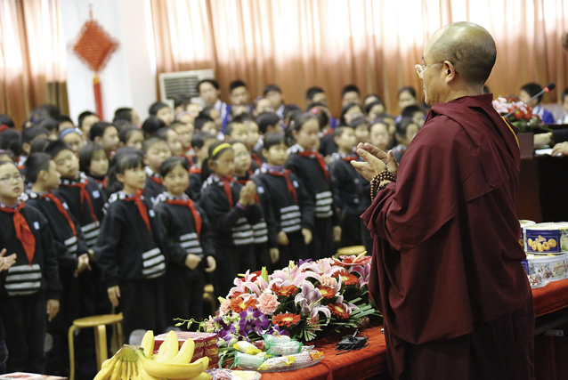
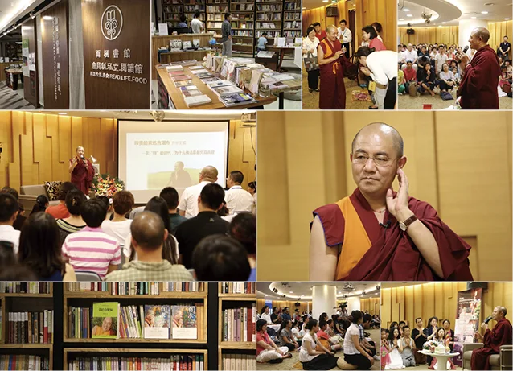
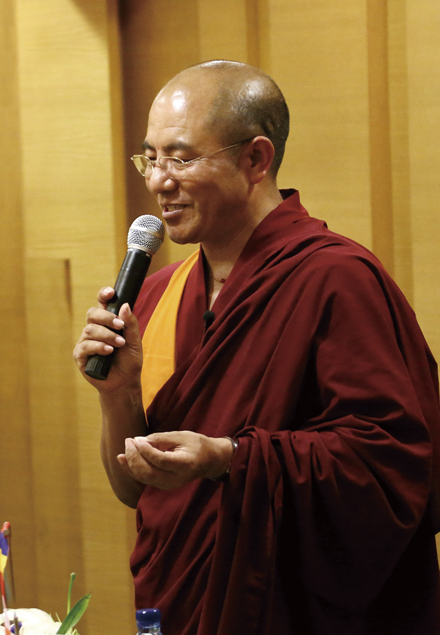
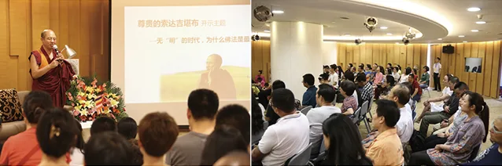
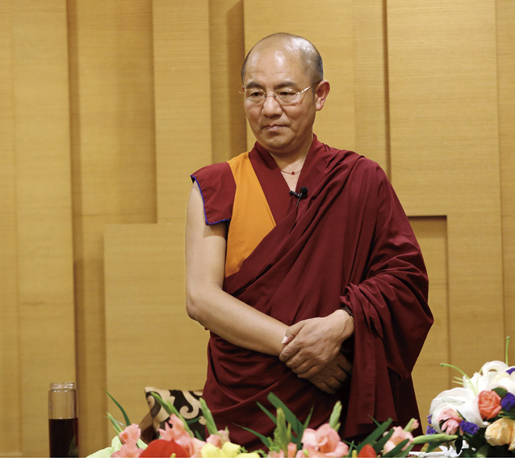
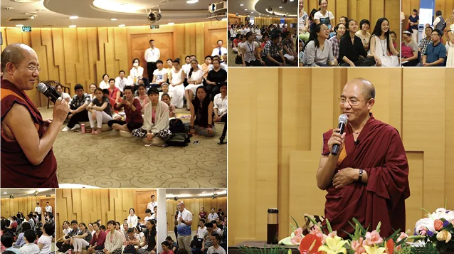
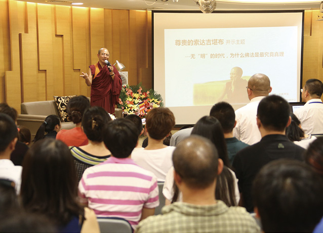

我们每天有着各种各样的分别念，其实心的本体并非如此。

第18场

北京雨枫书馆

Beijing Rain Library

中国·北京

2014 / 6 / 29

## 无“明”的时代，佛法 为什么是究竟的真理

## Dharma for the Age of Confusion

如今这个时代，可以说是无“明”的时代，也可以说，是一个让人感觉迷茫、没有方向感、思想普遍浮躁的时代。相较过去而言，这个时代应该说是成功的，从物质层面来讲，现在的资源比以往任何一个时代都丰富。但从精神层面来讲，人们却愈发迷茫。

## 让思考成为一种习惯

现代人似乎处于一种“无思”的状态。尽管有思想，但既没有深度，也没有广度，大多数是碎片化思维。因此，这个时代又被称为“微时代”，微信、微博、微小说、微电影等微产品层出不穷。外界各种爆炸式的信息，让我们的思想变得非常碎片化，难以整合起来。从生活中可以看到，始终能保持整体性、完整性、长久性思考的人，非常鲜少。

近二三十年来，产品更新的速度也日新月异。有的甚至还没等到人们熟悉，就已经消失了，紧接着被另一个新产品取代。或者，刚学会了一门技术，很快就被淘汰了，随后又出现一门新技术。可见，现在是一个竞争激烈、攀比心高涨的特殊时代。

当然，想要改变这个时代，回到原来物质落后、思想简单的时代，也是不现实的。那么，应该以怎样的方式来适应它呢？大家需要改变心态和观念，尽量给下一代留些财富——不仅仅是物质上的财富，更重要的是精神上的财富。

在座各位大多喜欢读书，我们都有这个共同爱好。在整个人生当中，我始终没有对读书生起过厌倦心，觉得最清净的生活状态就是读书。读书的时候，好像世间杂念当下就消失了，沉浸在智慧的海洋中，这何尝不是一种幸福的人生？

如果时间充裕，我们可以围绕读书的话题聊很多。有些人虽然没有信仰，在某些问题上可能有不同的观点，但总体来讲，我们对现在和未来的关注，以及当下个人的感受，应该会有一些共鸣。目前是一个复杂的时代，基于多年的学习和修行，我个人有些心得体会想跟大家分享。

在佛教中，一些道理特别甚深，现在人的智慧有限，不论怎样思考、研究，都很难通达佛法中最究竟的思想。因此，我们有必要多读书，包括宗教、艺术以及修行道理，这些可以让心真正平静下来。在这个无“明”的时代，读善书是很重要的。尤其是学习古德先贤的智慧，对我们来讲更为重要。

## 有质量的读书和写书

现在的书店每天都会更换新书，尤其是现代人写的一些书，特别受欢迎。因为他们在写作的过程中，抓住了读者的喜好和关注点，但在深度方面，有些书可能只是为了迎合受众心态，开卷未必有益。因此，关键在于书的内容及其所要传递的价值观，是否对我们的人生有所帮助。

现在市场上的很多书，一方面是为了顺应时代，以及当代人的心态，有一定的思想价值。但另一方面，在古代，比如唐朝曾出现过很多有贡献的思想家；在近代，像鲁迅等人，也有他们独特的思想，而如今这个时代，想要拥有非常大的影响力，确实有一定的困难。按理来讲，每个时代都会出现一些智者，人们也很喜欢他们的思想。但现在大多数人的兴趣和爱好就是赚钱——这是一个经济高速发展的时代，大家都喜欢研究怎样赚钱。还有一部分人，他们关注的焦点是电影明星、著名歌手、篮球赛、世界杯等。因此，具有吸引力的作者和作品很少。即便出现了，也不一定有人认识和喜欢。

现在大多数人喜欢看娱乐节目，比如电视剧、电影、动画片等。由此可见人们的思想会逐渐走向何方。即使有些作者真的写出关心时代、关心社会的作品，又有多少人可以接受？这也是值得思考的问题。比较而言，古人写的非常著名的书，就能影响一代又一代，流传上百年、上千年。比如，《弟子规》的内容很简单，文字也少，却可以影响非常多的人。事实上，现在很多人也具有聪明才智、独特的思维模式，如果他们能以这种思想作为指导写出一些书，也会利益好几代人。

为什么这样的思想没有被开发出来呢？从国外来看，欧美学者的思维依然还保留着创造力，在孩童时期，学校和老师就会开发他们的想象力，而不是只灌输一种思想。所以，这与整个教育体制也有一定的关系。相较而言，我们的古文化思想传播得并不理想，尽管拥有着非常完整的汉藏论典传承，却每天都在走向消亡。原因就在于，后人不清楚它的价值，也没有人愿意去传讲，这就导致了古哲的思想与现代人的思想无法对接。到了一定时候，新思想开发不出来，原本有价值的思想也慢慢消失不见——人们虽然拥有财富，却没有深刻的思想。

按理来讲，人类应该拥有更高尚的品德和智慧，而现在人们却变得越来越浅薄。为什么？因为很多人特别喜新厌旧，那些对人生有益的书籍，往往被束之高阁。所以，作者们要不断变换写作方式来适应人们的口味，否则没人愿意购买。这样来看，现代人缺乏有深度的思维，也是没办法的事情。

## 跳出小我的内心困境

虽然有没有信仰是个人的选择，但如果能以佛教的利他思想来面对人生，即使出现灾难、死亡等难以想象的现象，自己也知道如何面对。所以，我发自内心地希望，大家能将佛教的思想运用到生活中，这样就不会觉得很痛苦。

其实生活中的很多痛苦，都是由虚假的分别执著引起的。正因为我们没办法放下执著，所以始终就像坐牢一样。毫不夸张地说，现在很多人非常自私，做事只考虑自己，真正想利他的人很少，即便有一些，他们的力量也非常薄弱。

最近，我正在翻译一部大乘论典，叫做《大乘经庄严论》，属于“弥勒五论[^1]”之一。截至昨天，已翻译完了第九品。这部论共二十一品，在大乘佛教中占有非常重要的地位。虽然唐代也有人翻译过，但跟藏文版本有一定的差距。近代也有个别学者再次翻译，但仍有必要对照藏文版本重新翻译，这样可能更为妥当。所以，不管是外出还是在佛学院，我每天都会抽出时间翻译。

昨天翻译的时候，里面有一句话对我触动很大。我当时就在想：如果能把这种伟大的利他思想运用于现实生活中，该有多好啊！大乘佛教中讲，最上等的精进就是利益众生，而《大乘经庄严论》整部论都在讲如何帮助他人。大乘佛法可以分为甚深见派和广大行派。甚深见派，主要讲中观的见解，比如龙树菩萨的“中观六论[^2]”，每一部都在讲空性法门；广大行派，主要讲在世俗中如何发菩提心、积累资粮、修持五道十地等，这些在弥勒菩萨的论典中有详细阐述。

大乘菩萨行持的六度包括布施、持戒、安忍、精进、禅定和智慧，也叫六波罗蜜多。精进就是第四个方面，即勤奋努力。大乘菩萨最殊胜的精进就是成熟众生。为了成熟别人的相续，哪怕令他心中生起一个善念，菩萨可以千百世不间断地进行利益，并且无有厌倦心。这种思想多么伟大！如果能够帮助到别人，哪怕半天、一天、一月、一年，都是很有意义的事。

普通人无条件地帮助他人时，容易生起脆弱、厌倦的心态。而大乘菩萨为了度化众生，可以在百千万年当中做别人的仆人，不仅毫无怨言，反而欣喜若狂，没有丝毫厌倦。反观我们自己，不要说为了众生，哪怕为自己做一点事情都会嫌累，非常容易生起厌倦心。

藏地有一位大德，叫麦彭仁波切，他在解释《大乘经庄严论》的时候说：“哪怕为了一个众生生起一刹那的善念，千百万劫做他的仆人也愿意。”所以，我们也要思考一下，在这么多的世间思想中，有没有讲到如此殊胜的利他心？如果有了这样的利他心，很多痛苦都会烟消云散。如今为自己流泪的人比比皆是，为众生流泪的却寥若晨星。大多数人痛苦，都是因为我的家人、我的感情、我的财物……如果一个人真的有利他心，表面上可能有痛苦，但实际上并不一定。

## 信仰之力能减轻痛苦

2010年4月14号玉树地震时，我们佛学院组织了出家人救援队，在那里待了将近一个礼拜。当时，发生了几件令我终生难忘的事。有一次，我们看到一位老太太拿着念珠坐在废墟上，就想去宽慰一下。我们问：“您有什么需要帮忙的吗？”她说：“你们想帮也帮不了，我的家人都埋在这里，可能没有人活着了。”我们就开始帮她挖，但她整个人显得非常自在，让人感觉不到痛苦。我想这就是信仰的力量。这位老太太还说：“人最后都会死的，只是方式不同而已。不过他们很可怜，全都埋在这里了。”但她也没有哭，一直捻着手里的念珠，口里念着观音心咒，脸上表情很平静……

当时，每天挖出来的尸体有几百具，暂时安置在一个地方。在这个过程中，按照藏传佛教的传统，上千名僧众会为这些亡者念经超度。一些幸存的家属也会到现场助念，有的也会哭，但大多都在合掌念诵观音心咒。如果换成其他地方，发生类似的事情时，人们可能会大哭大闹，但这里的人会说：“人总有一天要死，这次能有这么多僧众为他们念经超度，是一种福报。”

当时我住在临时搭建的小帐篷里，旁边住着一位专程从北京赶来的记者。他以前是心灵救助中心的主任，这次特意带队来做心理辅导。凡是发生过地震的地方，包括汶川，他都去做过志愿者。在聊天的过程中，他告诉我明天就要回去了，因为这里几乎找不到有严重心理问题的人。虽然他们还专门请了中央民族学院几名懂藏语的学生做翻译，但发现这里并不像汶川地震时那样——有些人精神严重崩溃，甚至疯掉了。

通过这些真人真事可以看出，如果有了信仰，内心就有了寄托。不过，很多人遇到难以解决的问题时，会想起祈祷佛菩萨，比如生意倒闭、走投无路时，会想到“菩萨保佑我”，而生活一帆风顺时，就想不起来了。

总之，大家要思考一下：大乘佛教的理念到底是什么？实际上，就是利他。但这与人们平时所说的无私奉献，有一定的差别。

## 系统化学习的重要性

总体来讲，藏汉两地都属于大乘佛教。藏地非常注重大乘佛教的思想传播，早期就已建立了完整的教育体系。一般来说，藏地寺院里都有大乘佛法的学习制度，否则算不上一个真正的寺院。从外在的建筑看，藏地跟汉地的寺院差别不大，但其内在的教学模式，的确有很大不同。在藏地，寺院存在的主要意义就是让人们学习佛法。并非简单地学一两部佛经论典，而是首先学习基础法门，再进一步学习更高深的内容。

在藏地，要想成为真正的佛教行者，一般需要十到二十年的时间。我的一位老师曾经说过：“你们这些年轻人千万不要觉得当学者是很容易的，看看那些古老的寺院，大多数人得到格西或堪布学位时，都已经白发苍苍了。”从这句话不难看出，藏传佛教的教育体系是非常严格的。作为寺院的高层管理人员，以及传授佛法的教职人员，至少需要十年、二十年讲论、辩论和造论的经验。他们都是通过多年理论培训和实践锻炼相结合培养出来的。

当然，汉地佛教也很兴盛，比如烧香、拜佛、放生、念经等，人们的信仰也很虔诚。但就真正的佛教理论体系而言，虽然一些寺院里也有佛学院，但课程只是个别大德临时制定的。目前来看，有些佛学院虽然建立了教育体系，可是为数不多。

如果想要学习大乘佛法，最好是系统化地学习。只是在书店里买几本书，随便看一看就说：“我已经读了两三本书了，所以我也是学佛的。”这种说法有失偏颇。还有些人经常说：“我是佛教徒，因为我皈依了。”但实际上，你可能只是名相上的佛教徒，真正的佛学思想、修行次第，以及度化众生的行为，未必能讲得出来。

学习一门世间专业知识，尚且需要好几年才能拿到文凭，更不用说学习深奥的佛学思想了。一些具有聪明才智的人，经过多年夜以继日的思考和辩论，对于某些道理仍无法通达，所以说佛法是一门非常深奥的学问。有些人也许认为：“我很懂佛教，因为我看过《金刚经》《楞严经》。”其实并不一定。如果一位物理学家，既没有导师的引导，也未曾进入大学物理系学习，只是在某个书店随便买几本书翻看一下，就说自己对量子力学非常精通，恐怕不太可能。当然，极个别的天才确实有可能做到，但对于大多数人来说，学开车都需要找个教练，之后才有上路的资格，更别说佛教中的实修了。

有些人虽然皈依了佛门，却没有把兴趣放在学习上，仅仅是形式上的皈依、学佛和修行。他们认为，只要办一个皈依证，或者看一两本书，就可以称得上是佛教专家了。有些所谓的佛学教授，甚至都没有系统地学习过佛法。还有些寺院的管理人员，也没有接受过系统的培训。这样的话，从事与佛教相关的工作确实有一定难度。

## 大乘佛教中的闻思修

在《大乘庄严经论》中，讲到了很多利益众生的行为。其中第九品《成熟品》讲到，如果想要帮助他人，首先要成熟自己的相续，否则是很困难的。世间人也会说：“泥菩萨过河，自身难保。”有些年轻人，虽然身体和生理已经成熟了，但内心特别脆弱。遇到一点点事情就特别痛苦，甚至想要自杀，这就是内心没有成熟的表现，如同三岁孩童一般。其实，如果你没有很大的执著，就不会产生特别大的痛苦。有的修行人大智若愚，外表看起来笨笨的，实际上内在思想已经完全成熟了。《亲友书》里面引用了芒果的比喻[^3]：芒果有外成熟内不成熟、内成熟外不成熟、内外都不成熟、内外都成熟四类情况。事实上，人类也是如此。我们的利他心，以及人生观、价值观、世界观，也存在内外成熟、不成熟的差别。

表面上看，人与人之间穿着同样的衣服，似乎没有区别。但是，如果跟他接触一段时间，可能一天两天、一两个月，就会发现有些人内心很坚强，无论遇到什么痛苦，他们不仅有面对的勇气，更有解决的智慧。相反，有些人不但没有解决的办法，反而把事情复杂化了。从生活中就能看出来，由于内在思想的成熟或不成熟，智慧尖锐或不尖锐，导致了种种快乐和痛苦的产生。基于这种情况，我建议大家学习一下佛教的中观思想。

中观的核心思想是将一切万法都抉择为空性。关于这一点，运用逻辑推理与哲学推理完全可以成立。人们通常认为眼睛看到的是真实的，耳朵听到的也是真实的。但实际上，运用中观智慧去观察时就会发现，眼睛看到的只是假象，并不是真实的，耳朵听到的也是假的。正如《心经》中所说：“无眼耳鼻舌身意，无色声香味触法。”意思是说，一切法只是暂时显现在我们面前而已，实际上根本找不到它的实体。

事实上，万法的实相，既不是看到的色法，也不是听到的声音，由此你会越来越明白《心经》中所说的“色不异空，空不异色；色即是空，空即是色”。这句话看似有两个矛盾点，色怎么是空，空怎么是色呢？其实，一切万法的自性，包括心的本体，都是不可思议的，如佛经中所说：“不可言说智慧到彼岸，无生无灭虚空之体性，各别自证智慧之行境，顶礼三世诸佛之佛母。”意思是说，诸法的本性是不生不灭、不可思议的，这就是真正的智慧到彼岸。

众生由于虚妄分别，认为万法有生有灭，可以通过思考和言词来表达，并非不可思议。但如果认真去观察，就会发现心的本体不是有生有灭，而是空性和光明无二无别。当你真正静下来的时候，可以观察到内心的很多世界，会发现原来自己每天有着各种各样的分别念，但其实心的本体并非如此。

当一个新事物出现时，我们很容易会认定它是最好的，然后另一个出现时，又认为那才最好的。只有真正认识了心的本体，才会了知这些所谓有价值的物质并不是真实的。在内观的时候，自然而然会出现这种境界。这不是哪位天人、上帝或佛赐予的，而是心的本性原本如此，这也是禅宗中说的明心见性。

对于某些学者来讲，很容易通达上述道理。一般来说，学者分为两种：一种是寻伺观察的学者，他们永远见不到心的本来面目；还有一种学者，一边翻阅古今中外的千经万论进行思考，一边把所学到的内容运用到实际行动中，同时还会反观内心，这就是佛教中讲的修行。

所谓的修行，不一定非要闭目打坐。作为学者，应该既要思维法义，又要观察内心，这样很容易明心见性。我们每天忙忙碌碌地奔波，从中又得到了什么呢？纵观整个大千世界，人类可能连一只小虫都不如。生活中，我们会觉得有些事情很重要，包括买房、买车。其实，这就像小蚂蚁一样，得到一块小泥土时，它也是很执著的。而当生命结束的时候，才知道原来只不过是一场美梦。这样的美梦，每个人都会做，但未必知道它的真相。作为读者和学者，应该有一种稳固的智慧，这才是真正的思想。

现场互动

问：我是新浪佛学频道的工作人员。看到您关于麦当劳和肯德基的开示后，我们对此展开了讨论：如果一个人去麦当劳或肯德基吃一个鸡腿，要承担所有连锁店的杀业果报，那我们以后吃饭是否先要看一下这个餐厅是不是连锁的，去超市买一根火腿肠，也要看一下它的牌子呢？因为中国最大的火腿肠制造商，一天至少要杀掉七万头猪。这样的话，买一根火腿肠是不是要承担七万头猪的杀业果报？

堪布：你提的问题很好。我讲这个问题的时候，其实跟当时的主题有一定关系。所以，无论是阐述哪个问题，关键要看当时以怎样的背景而讲的。

事实上，无论是造善业，还是造恶业，涉及的因果都非常微妙。比如，有位大德正在做一件非常广大的善事时，我们哪怕是随喜一分钱，也会像往大海里投入一滴水一样，在大海没有干涸之前，这滴水也不会干涸，由此结上一个善缘。结恶缘也是一样，很多人一起残杀几条生命，做成肉汤喝了，算不算共同杀生呢？算的。

如今这个时代非常特殊，人们的所有食物仅与一个生命结缘，恐怕是不可能的。因果的甚深意义，不要说一般凡夫人，就是菩萨也很难了知，唯一是佛的智慧行境。因此，善业和恶业的细微因果，需要以佛的智慧进行抉择，我个人也无法判定它的果报。但是，通过所学的经论可以推测，像这样越来越多的杀生，享用与此相关的肉食，肯定会有一定的过失。这跟真的亲自杀很多猪和鸡是否完全一样呢？也不一定。虽然《楞伽经》里面讲，吃肉与杀生有同等的过失。但按照因明学来讲，杀生的过患更重。当然，从两者罪业都比较重的角度讲，也可以说有同等的过失。

因此，我们可以根据自己现有的智慧进行衡量，尽量参与一些恶业比较少的行为。如果实在无法避免，就要像《地藏十轮经》中讲到的，进行忏悔、念咒语。可以多念金刚萨埵心咒、观音心咒和阿弥陀佛心咒，回向给这些众生，同时尽量改变自己的生活方式。

问：佛经中常说人身难得、佛法难闻，但我们暂时很难出家修行。请问，有什么修行方法可以让我们在平时的生活中，获得心灵的宁静？

堪布：有几种比较简单的修行方法，比如以毗卢七法参禅打坐，或者思维一些简单的法义，以此来调整自己的心态。很多佛教大德都有过相关开示，早上起来、晚上睡觉的时候，我们可以打坐观修，也可以念观音心咒、莲师心咒、度母心咒等。这些比较简单的修行方法，对调心有一定的帮助。

如果想要更深入，即使不能出家，也可以修藏传佛教中讲的五十万加行。加行修完以后，是不是真正的修行人呢？也不一定，但这是最基本的修行标准。因此，这些年以来，我一直向大家强调：如果想要成为一名佛教徒，不能只是流于表面、口头上参禅论道，最好能修五十万遍加行，即皈依、发心、顶礼、曼茶罗、百字明各十万遍。按照藏传佛教的观点，五十万遍加行修完以后，再不断串习更深的法义，会比较容易一些。有些人即使暂时不能出家，以在家人的身份来修行，也是非常有意义的。

问：佛经中经常讲因果报应。那么，一个人心向善的国家，是不是应该有好的果报？印度几乎每个人都是佛教徒，但它的经济发展的确有些不尽人意。请问，佛教信仰与整个经济发展有没有必然联系？

堪布：佛经中确实有讲到，行持善法会获得快乐，行持恶法会感受痛苦。对于这样的因果报应，我个人是深信不疑的。但是，善恶业成熟的时间不定，可能是在这一世成熟，也可能是在下一世成熟。在佛教因果经论中讲到，今生所造的善恶业，会有四种果报，即异熟果、等流果、增上果和士用果。其中，有些是现世报，有些是来世报，有些是后世报，所以，业力的成熟需要经过几十年，甚至几个时代。就像农民种庄稼一样，并不是当下种就能当下成熟，善恶报应也不一定在今生就会出现。

现在世界上很多国家的经济发展，跟信仰有没有关系呢？不一定有，因为很多人学佛可能只是为了发财。像印度这样佛教兴盛的国家，现在所感受的贫穷果报，有可能是前世业力所致。

有些人认为，外在的物质越丰富，人就越快乐。但实际上，发展可以分为内在的发展和外在的发展。如果内心没有获得宁静，拥有的外在财富再多，也不一定快乐。不丹的国家领导人，不愿意经济发展得太快，所以规定游客每天最多消费200美元，就是担心外来文化会冲击人们内在的信仰和快乐。

1990年，我去过不丹和印度。当时这两个国家的经济条件差不多，但从国民的幸福感来讲，可以说不丹人更幸福，所以不丹被称为世界上最幸福的国家。

很多人认为，经济发展是为了让人更幸福，但实际上，有了财富以后，有些人比没有财富的时候更痛苦，甚至患上了抑郁症。因此，大家要详细分析因果的奥秘。

问：有些人认为，藏传佛教讲究传承和加持，这种观念过于自私和狭隘。但我认为这也是佛菩萨的一种慈悲。请堪布开示。

堪布：事实上，汉传佛教也有它的殊胜加持。有些大德依靠一些传承和加持，可以度化难以想象的无量众生。我看到新闻里讲，五台山的梦参老和尚昨天刚满一百岁。他老人家既学藏传佛教，也学汉传佛教的天台宗，前两天我还想去五台山拜见他。

无论学汉传佛教还是藏传佛教，都是佛门弟子，其实没什么差别。藏传佛教中有萨迦派、宁玛派等不同教派，不同教派有不同的修行理念，互相之间并不矛盾。任何一个宗派，在建立自宗的不共观点时，都需要与别人不断地辩论。从历史上看，宁玛派的大德跟格鲁派的大德有过非常激烈的辩论，萨迦派的大德跟格鲁派的大德也是如此。在辩论的过程中，智者们用自己的辩才互相交涉，非常精彩。这种智慧的碰撞，相当于现在大学的辩论赛。而智者们的这种游舞，一般人可能无法理解。

有些人觉得藏传佛教最好，有些人觉得汉传佛教最好，其实不能这样取舍。当然，大德们在弘扬佛法或修行的时候，会有自己的不同体会。比如汉传佛教的念佛法门，如果我从中受益匪浅，就会使劲地赞叹，因为对我来讲，这是最好的修行法门。同样，其他人有受益的时候，也会赞叹他所修的法门。

不管是汉传佛教，还是藏传佛教，都有非常殊胜的利他思想。分别来讲，藏传佛教具有严谨的传承体系，如果没有在上师面前得过传承，就不准传讲这部法。比如我想要讲《金刚经》，那一定要上师给我传过。如果只是在寺院里请一本《金刚经》，然后看看相关注疏，是没有资格讲这部法的。无论讲哪一部论典，都必须在上师那里得过传承。其实，这种要求很有必要，它代表了严谨的治学态度，是一种非常好的传统。除此之外，藏传佛教的修行次第也很有特色，但仅凭这些并不能说明藏传佛教的一切都是好的。我们应该要有一种包容心，运用各方面的智慧来观察。

汉传佛教特别契合汉地众生的心态。比如有些人喜欢坐禅，禅宗法门就很适合；有些人喜欢念佛，念佛法门就很合适，所以说“一方水土养一方人”。与此同时，我们还应该接纳一些外来思想，包括西方思想、东方思想、藏传思想、南传思想等。学习时，要博览群书；而修行时，要一门深入，这一点很重要。

如果大家有学习佛法的意乐，最好不要今天学这个法，明天学那个法；今天修这个法，明天修那个法；今天跟这个上师学，明天跟那个上师学，一直跟着感觉走。这样的话，可能一生都在做选择。我们一定要有自己的定位，同时又不能轻易否定别人。在没有确切的理由之前，不要随便破斥别人的观点。如果能做到这一点，说明思想已经比较成熟。

问：我之前看到有篇文章中写道：“目前社会上的一切制度问题都是源于文化，而文化问题又都指向宗教。”道德也是源于文化，那么道德是不是宗教的一种社会表现形式呢？会对人们的生活产生什么样的影响？

堪布：人们的言行举止肯定来源于文化。比如藏地文化，影响了藏族人的生活、言论、思想等。汉地有汉地的文化，藏地有藏地的文化。印度、美国等其他国家，也都有自己的文化。这些文化的根源，有一部分确实来源于宗教。比如，汉地真正的文化根源，应该是儒教、佛教和道教。几千年来，这些思想一直延续，已经成为中国人最根本的道德观。

事实上，人们的生活一直有受宗教思想的影响。就藏地而言，佛教已经融入到藏族人的生活当中。可以毫不夸张地说，所有藏地文化都是受佛教的影响，佛教已经完全成为人们的道德标准。所以，藏族人普遍心地善良。在藏地，除了佛教以外，没有其他传统文化发挥这样的作用，而且千年不衰。同样的道理，许多优秀的汉地传统文化跟宗教也是息息相关的。当然，个别文化和道德规范，或从西方传过来的一些文化或习俗，可能跟宗教没有关系。

不管怎样，宗教中确实有特别人性化的规范，而且从长远来看，适用性比较强。现在这个时代，文化更迭的速度特别快。从适用性上看，有些暂时还可以，但长期来看，确实存在一定的纰漏。如果没有任何宗教或道德的约束，让孩子们直接随着外境成长，当长大以后，物质生活能满足他们所有的欲望吗？恐怕有些困难。

这是一个充满欲望的时代。人们不是按照自己的信仰去生活，而是随着欲望去生活。这些欲望来自于各个方面的信息，如果将这里面的所有对境，一一地去寻找，恐怕有一定的困难。

因此，我个人认为，道德跟宗教应该有一定的关系。

问：请堪布为我们皈依。

堪布：实际上，皈依是一种决心。比如，一个人投靠了某个地区或国家，这也是一种皈依。同样的道理，以前没有一个固定的依靠处，从现在开始可以发愿皈依三宝。

要知道，大家今天皈依的并不是我，皈依我个人是没有用的。否则，如果我死了，你们就没有皈依处了；如果我病了，你们会认为怎么皈依处也生病；如果我不见了，皈依处就不见了。你们可能会因此生起邪见，而皈依三宝就不会发生这些事情。

所以，你们要皈依佛、皈依法、皈依僧。皈依佛，是指皈依释迦牟尼佛，因为他是佛教的创始人。皈依法，是指皈依释迦牟尼佛的思想，从今生乃至生生世世，依靠处都是佛的思想。皈依僧，是指皈依追随佛陀的弟子，像文殊菩萨、观音菩萨那样，真正通达佛陀思想的人。当然，一般的出家僧众也是佛陀的追随者。但严格来说，真正的僧宝是指通达佛教教义的圣者，也就是获得证悟的菩萨。

我们今天皈依的，是以释迦牟尼佛为主的十方佛陀，因为他们已经证悟了宇宙万物的真相，是真正的觉悟者。很多人的思想比较复杂，总是想这想那，根本不知道佛到底是谁。有的人还会担心：“释迦牟尼佛涅槃以后，我还能不能皈依？”实际上根本不用担心。无论是释迦牟尼佛，还是过去、现在、未来的佛，凡是真正觉悟万法实相的就是佛。佛陀证悟以后宣说的真理，就是所皈依的法。在弥勒菩萨的《宝性论》中，讲到了具有六种功德的证悟圣者。他们虽然没有达到佛的境界，但已经是证悟了灭谛和道谛的大乘菩萨，这就是所皈依的僧。

我今天只是给大家做代理。就像一个人要去皈依国王，我相当于一个导游，告诉他“这就是国王，国王定制的法律是怎样的，国王的眷属是怎样的”，我就是中间的介绍人。所以，你们并不是皈依我，不然的确有些危险。因为我还没有证悟，如果你们皈依我，会产生很多怀疑：“堪布没有吃饭，肚子也会饿得厉害，那我好像皈依错了，他只是一个普通人。”这样的皈依有什么用呢？我们之间会出现很多问题，而三宝永远不会欺惑我们。所以，大家首先要对皈依的对境有所认识。然后，如果以前没有皈依过，想从今天开始皈依三宝；如果以前皈依过，可以再次坚定誓言：虽然十年、二十年前皈依过，但我要再次在佛面前发这种誓愿。这样的人都可以皈依。

皈依可分为不同的层次。上等的皈依，不是求三宝保佑自己，而是为了天下无边的众生皈依，这是大乘的皈依方法；中等的皈依，是希望自己先获得解脱，就像现在有些修行人一样，先发愿自己往生极乐世界。有些人认为，这是一种小乘的皈依方法，也有一定的道理。很多人皈依只想着保佑自己，或者是自己获得解脱、修行成功，这些都属于小乘的皈依。因为大乘的究竟思想就是利益众生，而小乘是害怕三界轮回的痛苦，希求自己获得解脱。一般的皈依，是希望自己不堕三恶趣，即地狱、饿鬼和旁生，或者今生平安健康。如果没有度化众生的目标，也不想自己获得解脱，但又对佛法有很大信心，可以发愿：“从现在开始，我要把生活中的皈依处交予佛陀。”

所以，在皈依的心态上，可以有三种选择。按照佛教的戒律来讲，皈依戒只能在这一世具足。但如果皈依时发了大乘菩提心，从今乃至生生世世，戒体可以一直存在。因此，能摄持什么样的戒体，关键要看自己的发心。如果以生生世世利益众生的心态来摄持，由于菩提心的功德，人死了以后，在下一世的相续当中，仍有皈依戒和菩萨戒存在。所以，大小乘的戒体存在时间有所不同。小乘戒的有限期，是这一世的身体毁灭时，戒体也随之消失。而大乘戒不随身体而消失，乃至成佛之前，一直不会过期。

接下来，我用藏语给大家念四皈依——皈依师、皈依佛、皈依法、皈依僧。你们在念诵的时候，要这样观想：“我今天要皈依三宝，最好是乃至生生世世，成为三宝的追随者！”如果没有这种发心，那就发愿今生一定要皈依佛陀，成为三宝的追随者。

（堪布现场给有缘者皈依……）

[^1]: 弥勒五论：《辨法法性论》《辨中边论颂》《究竟一乘宝性论》《现观庄严论》《大乘经庄严论》。
[^2]: 中观六论：《中观根本慧论》《回诤论》《七十空性论》《六十正理论》《精研论》《中观宝鬘论》。
[^3]: 当知人类如芒果：外似成熟内未熟，内成熟外似未熟，内外未熟内外熟。
