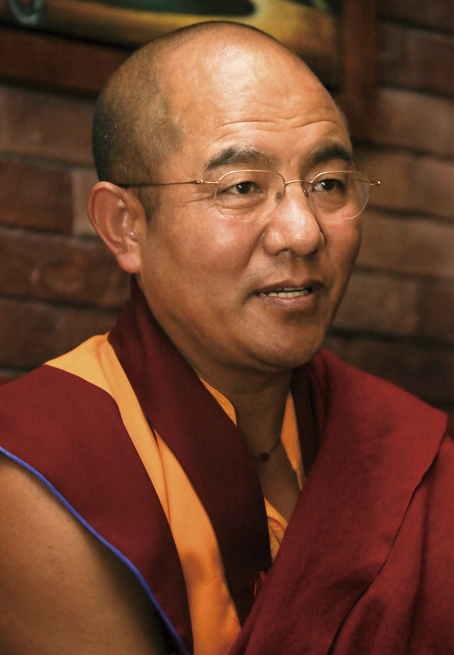
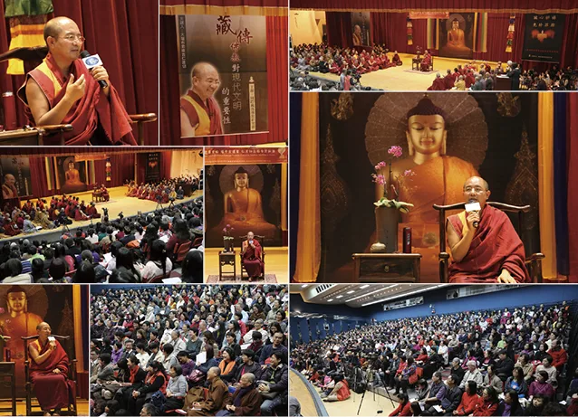
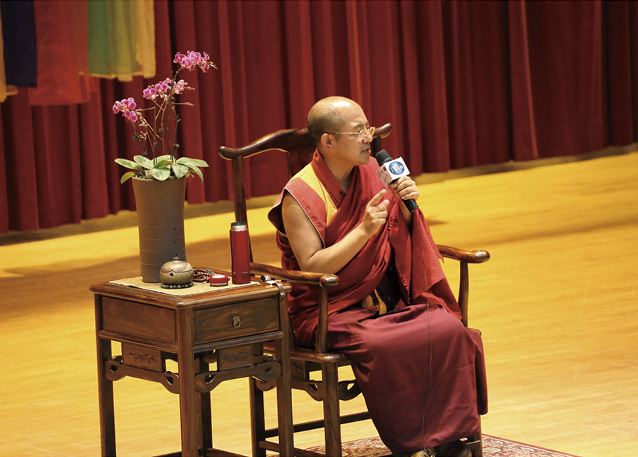
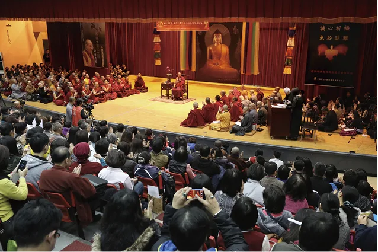
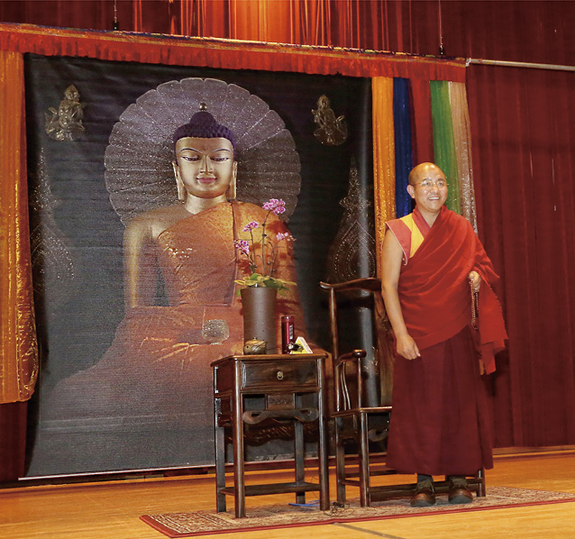
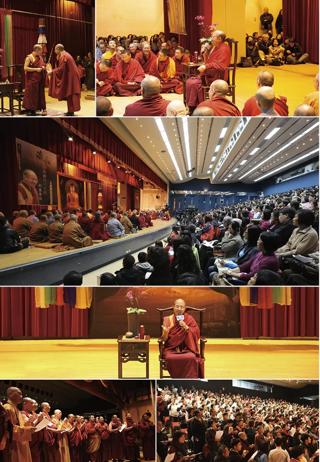
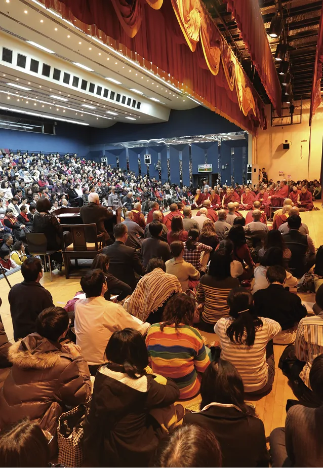
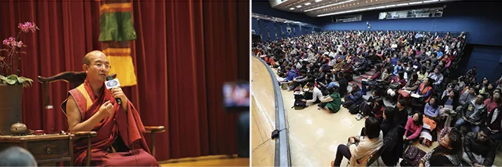

只要众生的心存在，就需要不同乘的佛法。

第16场

国际藏传佛教研究会

International Tibetan Buddhism Study Institute

中国·台湾

2013 / 11 / 29

## 藏传佛教 对现代文明的重要性

## Importance of Tibetan Buddhism in Modern Civilization

各位法师、学者、同修：

大家晚上好！很高兴参加国际藏传佛教研究会举办的这次活动。

见到这么多藏传、汉传和南传佛教的高僧大德，我非常欢喜。因为所谓的佛教徒，都是把清净戒律、闻思修行和利益众生当作自己的人生准则，而高僧大德们正是其中的典范。今天因缘特别殊胜，台湾各个教派的上师和弟子，还有不信仰宗教的人，大家欢聚一堂，以一种包容、开放、和睦的心态来共同追求真理，这是比较难得的。

## 呼唤利美精神

### 宗派融合是时代要求

按照过去的传统，每个上师都有自己的宗派和道场，像藏传佛教，就有宁玛、萨迦、格鲁、噶举、觉囊等很多宗派。每一个宗派又分出许多支派，比如宁玛派中有噶陀、白玉、佐钦、明朗、多扎等多个支派。白玉派当中，也有这个寺院的传承，那个仁波切的道场，分得比较细。当然分得细很有必要，因为众生的根基千差万别，为了适应他们，佛教在入世的时候，的确形成了许多不同的法门。不仅藏传佛教，汉传佛教中也有天台、净土、禅宗、华严、密宗等八大宗派；同样，南传佛教也有很多教派。佛在《楞伽经》中也说：“乃至有心起，诸乘未究竟，彼心转灭已，无乘及乘者。”只要众生的心存在，就需要不同乘的佛法。宗乘的划分是合理的。

然而以前，各宗派之间团结的心态比较少，虽然不是没有。汉传佛教的认为，我们是学汉传佛教的，不应该学习藏传佛教；南传佛教的认为，我们是南传佛教，不应该学北传和藏传；藏传的也认为，我们是藏传佛教，不用学其他教派。藏传佛教内部，各个教派的上师和弟子，不但不互相学习，有时还互相批评，说自己的教法是最好的，自己的上师是最好的，除此以外，其他的教法都不那么殊胜，不那么容易成就。这样的理念和行为，实际上对大家都不利。

当今时代，各种文化正在融合为一体，世界已经变成一个地球村。在此时空缩短、多元理念盛行的环境下，无论学习大乘佛教还是南传佛教，我们都应该明白，现在到底该做什么。

有些汉传佛教的法师能高瞻远瞩，在学习汉传佛教的同时，也经常借鉴藏传佛教各大教派的教义。这一点我特别随喜，因为自古以来这都是非常必要的。藏传佛教中也有许多来自印度、尼泊尔等地的高僧大德，他们并没有把自己束缚在藏传佛教的范围里，而是很广泛地顺应汉地及欧美等不同国家和民族的需求，弘扬自己的理念。有了这样的见识和行为，佛教也有希望继续生存和发展。

如果静心观察就会知道，佛教的融合和团结完全符合佛陀的精神。假设每个人都把自己束缚在一个很小的范围里，那各自都没办法发展，修行也会有一定障碍，很容易争执不息，肆意诽谤，说人过失，甚至会造下谤法罪。这样非常可惜。

### 藏研会的意义

因此，当我听到国际藏传佛教研究会成立的消息时，心里极为欢喜，因为这代表着各大教派的团结和融合。藏研会的历史虽然不长，但是它起到的作用却引人瞩目。前天我到这里时，与藏研会的萨迦派、格鲁派、噶举派、宁玛派的高僧大德见了面。我们在一个圆桌上吃饭，共同探讨各自传承的教义，心里非常欢喜。这里的每一位仁波切各自代表一个教派，可以说是这个时代佛教的一个象征。相应教派的无数弟子，自然都会跟随这些上师。有了这样的眼光和态度，他们的行为也一定会发生更加明显的转变。

因此，我希望，台湾的在家和出家佛教徒、学者和修行人，对这件事情不但要心里随喜，行为上还要去参与，真正以实际行动来一起弘扬佛法。因为我们皈依的时候，并没有只皈依藏传佛教，或者只皈依汉传或南传佛教，更没有只皈依某某上师，除了他以外，其他所有上师都不承认。我们皈依的是佛、法、僧。所谓皈依佛，你只要恭敬，所有的佛都是一样的；从皈依法来说，无论大乘、小乘、南传、藏传，都是佛法。这个道理，大家皈依的时候，应该都明白。

### 利美运动

19世纪，华智仁波切在藏地发起了一场声势浩大的利美运动，直译过来，就是无偏袒运动。当时包括蒋贡贡智仁波切，还有格鲁、萨迦、噶举等四大教派的众多高僧大德，全都参与了这场运动。从那以后，藏地各教派之间大的分歧与不和基本就消失了。

如今欧美很多国家也在提倡利美运动。台湾有些创始人也一直在推动利美运动，并作出了极大的贡献，可以说这是历史性的超越。

现在康区、卫藏以及安多等地方，各个教派的堪布、格西，还有活佛、上师们，也在共同努力，经常开一些圆桌会议，在一个平台上共同探讨如何弘扬佛法，如何利益众生，如何修行。大家不是为个人目的，因为真正合格的善知识根本不需要考虑个人的名声、财产、地位等，真正的佛教徒，也不会去耽著个人利益。在藏地，像藏研会这样的组织在不断地扩大，类似的活动也在不断地开展。这些组织与其他各种大大小小的所谓中心、学会相比，意义不可同日而语。

也许有人会问，如果我们参与利美运动，是不是自己的宗派就不需要了，全部融为一体就好了？不是的。你自己学哪一个宗派，跟随哪一位上师，不需要改变。就像现在各个大学，虽然各有侧重，但总的来说，世界上所有优秀的知识和理念都可以传播。有不同，也有相同。从相同的侧面来讲，我们应该有一个融合的佛教团体，这非常重要。

### 执著越小 空间越大

我的老师堪布晋美彭措，创建了喇荣五明佛学院。上世纪90年代时，他曾经来过这里。你们有些人认识，有些人可能不认识。堪布经常说，他本人是白玉派的，但是喇荣佛学院没有任何派系，只是一个佛教的学院。任何一个佛教徒都可以在这里学习，甚至非佛教徒也可以来这里学习、交流。

同样，有人曾经问星云大师：“你是哪个宗派的？”

他说：“按出家的寺院来说，我是临济宗的。但是佛光山是佛教的，没有什么宗派的区别。如果你们非要让我说一个宗派，那就是释迦宗派。我不愿意分割佛法。”

可见，不管任何上师，越没有宗派的偏执和斗争，他自己的事业反而愈加增长广大。

相反，据说有些地方也发生过一些不太好的情况。在显现上，上师与上师之间，存在一些互相不太恭敬，甚至互相攻击的现象；弟子与弟子之间则更是矛盾重重，互相诽谤。这样的话，不要说弘扬佛法、利益众生，连自己的生存都会成问题。佛教中最基本的要求就是要团结和合。世间没有皈依的人尚可做到和睦相处，而我们学习大乘佛法的人反而不断地勾心斗角、尔虞我诈，那佛教的前途恐怕会在我们这一代佛教徒手里毁掉。本来现在有一个很好的机会，也许佛教会从此兴盛。但这种因缘，很可能因个别佛教徒行为不利而逐渐消亡。

### 见解无偏 容纳百川

有一次，华智仁波切去一个寺院。寺院里的铁棒喇嘛问他：“你是什么宗派的？”

他说：“我是佛教宗派的。”

喇嘛说：“知道你是佛教的。你是戴黄帽子的，还是戴红帽子的？”这是问他是黄教的还是红教的。

华智仁波切回答：“我没有红帽子、黄帽子，只有一顶灰帽子。”这象征说，他是无偏袒的，在见解上可以容纳百川。

因此，我们在不失自己宗派见解的基础上，一定要广泛学习其他教派的知识。比如，喇荣佛学院既传授宁玛派的经论，又传授萨迦派的《量理宝藏论》和《入中论注释》等，也传授格鲁派的《菩提道次第论》《入中论善解密意疏》等，还要传授噶举派的《修心七要》、《修行次第》、觉囊派的《山法》等。包括汉传佛教的，比如禅宗和净土宗的很多经论，也都在学习。我今年正在讲的，就有《六祖坛经》等汉传经典。这些法门只是为适应不同根基的众生而安立的，在本质上并非各自独立。

我特别希望，除了原来的成员，台湾的其他学者和高僧大德也能一起参加藏研会，今后共同弘扬佛法。大家都没有什么私人的目的，私人目的不是大乘佛教的宗旨。我们唯一的目的，就是让天下所有众生离苦得乐，让佛法传遍世界。如果能以这样的心态，无条件地加入藏研会，一直坚持下去，对未来佛法兴盛于世将有极大的利益。

## 藏传佛教的不共特色

今天主办方让我讲一下“藏传佛教跟现代文明”，这非常有必要。藏传佛教如今可以说是世界上很多人的奢侈品。有些奢侈品用完就过期了，内在品质也暴露了，人们都不喜欢了，但藏传佛教是不是这样呢？我在不同国家、不同学校里都讲过，藏传佛教不是这样。因为它与真理已经变成无二无别。

从我个人而言，近30年来，几乎用所有的时间和精力在跟藏传佛教打交道。越研究，越是随时随地想，这个藏传佛教，有缘人如果都能了解该有多好。当然，我的理解和想法不一定堪为证明。但是大家都是有智慧的人，可以从历史和教义上观察，藏传佛教到底是什么样的。

### 三乘教法圆满于密乘

从教义上看，南传佛教主要宣讲的是四谛法门等第一转法轮的内容，以戒为主的教理讲得比较清楚；除此之外，空性和光明讲得不多。汉传佛教则主要讲到第二转法轮的空性，以及禅宗等理念；在学习这些教法的同时，也可以明白第一转法轮的意义。到了藏传佛教，进一步着重宣讲了光明以及如来藏的本体，这在第二转法轮中并没有详细宣说。虽然《维摩诘经》、《楞伽经》和《楞严经》等经典中，在空性的基础上也讲到了光明，但是如果没有涉及藏传密法，想通达这种光明的道理，确实比较困难。藏传佛教的密乘，实际上圆满具足了所有三乘佛法。因此，如果你想懂得释迦牟尼佛三转法轮的全部教义，最好学习藏传佛教。藏传佛教不排斥任何宗派，只要你去学，的确很容易了解世尊三转法轮有关光明空性的所有道理。

### 完整的菩提心学修体系

藏传佛教所呈现的以菩提心理念入世的精神，跟其他宗派有一定差别。它有一个特别系统、次第分明的修法和理论体系。千百年来，印度那烂陀等寺院的所有传承和教法，至今都完好无损地保存于藏地雪域高原。其殊胜性，全世界有那么多佛教徒和修行人可以作证。他们在修行和生活中，各自得到的利益是什么？在座的人应该知道，如人饮水，冷暖自知。很多人经过多年的修行，非常感恩传承祖师，非常感恩这些教法，因为这种次第分明的修行理论和仪轨，的确给大家提供了极为丰富的“美味佳肴”。

### 系统闻思修

还有一点更值得我们深思，藏传佛教并不是简简单单地传播一种教条，而是用尽自己的一切智慧，通过讲、辩、著的途径和闻、思、修的次第，力求通达内在的智慧奥义。这在其他教派中已经很难见到了。这种修学模式从古至今一直传递下来，到现在，藏传佛教的各个寺院已相当于不同的学校。为什么这么讲呢？因为他们不仅传播藏传佛教的显密教义，而且上至天文、下至地理，包括戏剧学、诗学、医学等等，以及其他与现代科技完全相应的包罗万象的知识，也全都在传授。如果有人觉得这可能吗？到底有没有这种事啊？那不妨去藏地正规的佛学院或寺院认真考察一下，看看到底是什么样的。

### 培养人才

藏传佛教非常重视培养人才。众所周知，任何一种教育，任何一个知识，想要让它与时俱进地弘扬于世，如果没有人才则无法实现。这种智慧就会断层，无论再怎么殊胜，也难以弘扬开来。现在有些宗教和教派，就是因为没有人才，已经无法传下去了。藏传佛教并没有陷入这种困境。即使是在“文革”期间，表面上看个别耆宿大德，有的以此而离开了人间，有的去了国外，有的当时并没有展开自己的事业，好像藏传佛教已经凋零了。但实际上有非常多的高僧大德，并没有中断其个人修行及对人才的培养。目前来看，当时培养出来的人才对佛教的教义都非常精通。

很多人问我，为什么在汉地和西方，藏传佛教那么受欢迎？其实人都是一样的，并不是藏人长得更好看，只不过他们学得确实多一点。

说到这里，也许有人会觉得：“他是藏族人，所以自己夸自己的民族，很讨厌。”我从来没这么想过。我只是觉得，有些特点应该实事求是地看待。无论是谁，他的优点应该继承和发扬，他的缺点应该避免和改正。现在信息这么发达，每个人都可以通过各种渠道去了解，如果我是在这里吹嘘，肯定没什么用，也没有必要。以前我经常引用一个教言：即使对自己的根本上师，也不能用妄语来夸赞。这是一个原则，所以我不会那么做。现在是以事论事，而不是因人而厚薄。

事实上，藏传佛教的这些继承者，在藏地的佛学院和寺院里，闻思修行的时间比较长，内心积累了一定的慈悲和智慧。在不同环境中，他们很愿意把自己的所得奉献给大家。其他人从他们的行为中也多多少少能得到一些利益。虽然有些仁波切不会说汉语，但在日常生活中，他的慈悲理念也经常会显露出来。比如非常慈悲地帮助你，当你遇到任何困难时支持你等等，有各种体现。

### 传承严谨

除了完整有效的修行和理论体系，藏传佛教还有一个极其重要的特点：非常重视传承。按照藏传佛教的传统，如果你没有真实得过某个法的传承，就不能向别人传授。这种传统保证了藏传佛教流传一千多年仍然可以保持意义纯正不变，不会因为某个时代个别凡夫的臆造而失去其本来面目。

依靠这些理念，藏传佛教连绵不断地培养出众多具备高深境界的佛教大师。而且它的方法跟现代人的生活很贴近，修行起来没有一点困难，非常实用。这也是藏传佛教的一个重要特色。

## 藏传佛教的发展

藏传佛教研究会在这里努力给大家提供一个无偏袒的环境，这非常有必要。我听说，以此为基础，藏传佛教还要同时迎请汉传和南传佛教的大德一起弘法。他们有什么新的理念，我们学习；我们有什么新的理念，大家一起学习。比如，汉传佛教的素食观，以及一些禅修方法，很值得我们学习；汉传佛教的网络和电视台的弘扬方法，藏传佛教的很多大德也非常随喜和渴望；刚才有的法师还说，以后因缘成熟的时候，要共同创办显密佛学院。这都是很好的计划。

但另一方面，显宗和密宗，不同的传承还要努力实现自身的发展。跟汉传佛教比起来，现在很多藏传佛教的弟子比较羸弱，因为他们没有自信心。也许是因为不懂网络和现代方法，以前藏传佛教的上师们，在各种国际会议中，基本没有以集体名义代表藏传佛教参加的；而汉传和南传佛教就比较多。作为一个体系，藏传佛教应如何发展，这一点更加需要思考。三大体系的佛教，既有一体的一面，也要有他体的一面，因此，弘扬佛法也需要有一体和他体两种方式。

在现代社会中，藏传佛教的修行非常管用。不管是哪一个教派，都有各自传承的理念和加持，修行后都可以获得相应的境界。所以藏传佛教的修行人一方面要跟其他教派一起学习，另一方面也应该好好修行自宗。

## 物质时代更要修行

在这个科技非常发达的时代，大家更要关注佛教的理念，长期修持。很多人认为，所谓科学才能解决人生的最大问题——其实科学只能解决部分问题。梁启超曾说，道德与科学之间的关系是相反的，当科学越来越发达的时候，人的道德会越来越衰退。我比较认可这个观点。为什么呢？因为科技越来越发达，可能会使我们迷失方向，丧失良知。我们不能一味迷失在时代的洪流里，而应该用清净的慧眼，去发现和争取一种不同的理念，这在任何时代都是极为必要的。

现在来看，我们尤其要思考的就是要修行佛法。无论修哪一个本尊，依止哪一个宗派都可以，有缘就很好。重要的是，自己在短暂的人生当中一定要修行。如果没有修，仅仅是在词句上辩论，或者在形象上度日，那到死的时候，恐怕什么境界都没有，那就太遗憾了。

要知道，真正的财富不是金钱和财物，而是认识自己的心灵。有一个故事说，从前有一个云游僧，旅途中得到了一个非常珍贵的珠宝。他把珠宝放到包里，一直赶路。路上遇到了一个人，贫困交加，又渴又饿，看起来非常可怜。修行人想给他一些饮食，就去自己的包里面找，结果发现里面还有珠宝，心里非常欢喜，立即把珠宝给了这个可怜人。那人高兴极了，欢天喜地地离开了。过了一会儿，他又返回来，把珠宝还给了这个修行人。他说：“我虽然特别喜欢这个珠宝，但是我还是决定还给你，因为我现在想要的不是它。这么好的珠宝你都舍得给我，说明你的这颗心更加珍贵。它是哪里来的？这个心态，对我来讲更加重要。我要修行。”

## 是法平等 无有高下

今天，大家在如此和睦的气氛中，非常快乐开心。此时，我们需要得到什么呢？首先是各教派不相违的理念，大家一定要用清净心来完成自己的修行。在藏传佛教中，按照第四世班禅罗桑秋吉的教言，宗喀巴大师、阿底峡尊者和莲花生大士实际上是同一个本体。还有萨迦班智达、克主杰等，所有这些传承上师，也都是诸佛菩萨的化现。有无数的教理可以证明这一点。包括在座的很多仁波切、法师，我昨天看了一下，有这么多高僧大德。我很吃惊。这个格西，那个堪布，还有各位仁波切，而且确实都是有德行的。我倒不是刻意赞叹。听过我课的人都知道，我一般很少夸奖别人，经常都是批评别人。虽然我个人并没有得罪过谁，但是有些不如法的行为，我经常在讲课时说出来，所以很多上师不喜欢我。但昨天看到有这么多高僧大德在台湾，我的确很吃惊。

其实像我们这样的人，大老远跑过来给大家讲一堂课，非常有限。时间有限，精力也有限，你们在短短的几十分钟当中，也得不到太多。但这些上师们，都曾在不同的学校学习过，相续里确实有很多佛教的真理，极其令人欢喜。你们一定要争取这个机会，尽量在上师面前得法，其他并不重要。比如各种随喜功德，很多人心里的“功德”概念都不相同，这些我不破也不立，怎么样都可以。

重要的是，我们现在最需要什么？就是心里的智慧和悲心。上师们留在这里，主要目的也应该是弘扬佛法和利益众生。大家秉持一个共同的目标，尽量断除自私自利的心，一心一意弘扬佛法利益众生。这对每一个大乘佛子来讲，是义不容辞的，也是不可缺少的。如果缺少了利他心，缺少了对佛法的责任心，那我们学法其实也不过成了自私自利。因此，特别希望大家共同弘法利生，每一个人都承担起自己的一份责任。这个责任是什么？就是要维护正法，同时认认真真地修行。怎么才能做到呢？首先需要一种和合，因为和合才是“僧”。和合以后，心态能平和，心态平和以后，法能融入心，当法融入心的时候，每个人的开悟实际上就不远了。

我想，这种理念，科学再发达，时间再改变，东西方各种文化背景的任何层次的人，都没必要舍弃。《金刚经》说：“是法平等，无有高下。”我们每个人都应该发挥自己的自性妙力，在佛法中奉献自己的一切。如果能这样做，佛教的未来会有希望，各位的解脱也会有更加美好的前程。

现场互动

主持人：

谢谢堪钦索达吉仁波切为我们作了这么精彩的开示！接下来邀请郑振煌教授代表大众向仁波切提问。

问：说到现代文明，不得不提起美国哈佛大学教授塞缪尔·亨廷顿。亨廷顿是世界著名的传播学家、文化理论学家。1993年，他在美国外交季刊上发表了一篇文章，题目叫《文明的冲突》，后来扩展出版为一本书，在全世界产生了巨大的影响。

依照亨廷顿教授的理论，未来世界的冲突是文明的冲突。由于资讯的普及，不同文明之间互相接触就产生了冲突。有人把美国和伊斯兰教之间的冲突也解释为文明的冲突。我要请示堪钦仁波切的是：如何以藏传佛教来解决文明的冲突？除了利美运动之外，有没有其他更好的思想理论基础？

堪布：关于亨廷顿讲的文明冲突，我也曾了解过。所谓文明冲突，说的是西方文明、各种宗教以及传统文化之间的冲突。

藏传佛教不仅可以面对这种冲突，而且还可以顺利地化解。

大概前年的时候，中国科技大学前校长朱清时，跟藏传佛教的个别仁波切进行过一场对话。他提到世界上有三大文明：古希腊文明、中国文明和印度文明。中国文明主要指孔孟老庄思想；印度文明主要指佛教，现在分为南传、北传和藏传佛教三大体系。他认为这三种文明，可以分别对应现在科学的三大分支：自然科学、人文科学和心智科学。

前一段时间，我跟他有过一次交流。我特意问他，为什么这样讲三种文明？难道与西方科学的有些理念不冲突吗？他说，自己曾长年研究自然科学，但他发现佛陀的证悟是依靠内证而来的，而科学发明是通过仪器不断探测得到的，证悟跟探测有一定的差别。对于佛教，他还认为，在藏传佛教中，从印度直接传下来的佛法保存得非常完整。

另外，获得诺贝尔文学奖的罗素也曾说过：“在真理发掘方面，科学需要佛教；在物质文明方面，科学更需要佛教。”

按照这些智者的观点，佛教与现代文明不仅不冲突，而且现代文明还非常需要佛教。

在佛教的三大传承中，藏传佛教无论教理体系还是修行体系，教证二法等任何一个层面都非常完整。因此，它面对冲突没有任何问题。

问：在这个科学非常发达的时代，流行一些所谓的现代文明病，包括心脑血管疾病、癌症、糖尿病，以及各种各样的传染病：非典型肺炎、病毒性肝炎、艾滋病等，甚至还有电视肥胖症、电冰箱病等。

所有这些现代文明病，三传的佛法都有对治之道。现在要请示堪钦仁波切的是，藏传佛教在对治现代文明病方面，与南传、汉传有哪些不一样的地方？

堪布：如果广泛地观察，的确如郑教授所说，现代文明带来的问题涉及方方面面，每个众生都不同程度地受到影响。

不论藏传、汉传还是南传佛教，根本的观点都认为，这是不同时期众生的共业所形成的。文明病也好，病毒也好，各种痛苦烦恼，以及种种不良现象，都是众生不同业感的体现。面对这些现象时，佛教的基本原则是以沙门四法来对待。

而不共的方面，我经常发现，藏传佛教有部分修行比较好的人，处处都体现了圆满的菩提心。当然其他教派也提倡菩提心，但是在实地修习的理念、次第和仪轨等方面，藏传佛教确有许多不共的特点。依靠这些方法，有些人完全把无著菩萨和龙猛菩萨的菩提心理念，真正落实到内心，付之于行动。不论疾病还是损害，他们都以全然无私的心来面对。这种行为方式可以作为藏传佛教的代表。

问：历史一直向前进步，人类没有办法后退。请问，佛教如果还一直强调内心的修证，与现代文明的推进能够相融吗？或者是可以自外于现代文明，仍然过着雪山上的闭关生活？

堪布：现代文明愈进步，我觉得内心的修持愈重要。因为如果没有内心的修持，就像古人所说，会“玩物丧志”。

众所周知，现代文明的发展，主要是物质和科技的发展。但物质的发展能给我们带来真正的宁静吗？很难。

原来我们以为，每个人有一部手机，可以成办很多事情，节省很多时间，也可以更好地休息。现在手机已经有了，人却得了手机焦虑症。如果10分钟看不到手机，心好像都没有了一样。所以我觉得，在这个时代更加需要修行。

随着时间之轮的运转，科学越来越发展，大厦越来越高，高级轿车越来越多，我们内心的恐慌、不安和焦虑也越来越严重。此时，内心的宁静变得多么重要！也许我们这才发现，2500多年前，佛陀给我们留下来的宁静的禅法智慧，是这个时代唯一的甘露妙药。

我们每个人，大多已成为这个时代的高速路上正在奔驰的一员，追逐着所谓的现代文明，未曾稍息。但何时才是它的终点？恐怕我只能猜得到开头，但猜不到结果。而佛教既能猜得到它的开始，又能猜得到它的结果。

随着社会如此不断发展，我们的内心也许越来越后退。如果没有佛教的内观，痛苦将越来越严重。因此，现代文明不仅不能自外于内心，相反，它比任何时代都更需要内在智慧。

问：宗教信徒很容易将自己的信仰无限上纲，强调自己所信仰的宗教绝对是对的。尤其是强调绝对信仰上师、佛菩萨、护法神和咒语加持力的藏传佛教，如何能跟强调客观实验的现代文明相应？

堪布：的确，不管任何佛教徒，都对自己的上师是诸佛菩萨的化身，或者是诸佛菩萨所加持的这种理念，有坚定不移的信心。表面看，这似乎跟现代文明重视客观现实的理念有所冲突，但若详加观察则并非如此。

首先，大乘佛教强调视师如佛：到一定境界的时候，要把上师看作是佛菩萨。这种理念，并不是所有的阶段都要强调的。最初时，一定要观察上师，而且要把上师当作自己的朋友、亲人，甚至当作一个坏人来观察，这在佛教当中是开许的。观察一段时间之后，如果确确实实觉得这个上师，即便不说是诸佛菩萨的化现，至少在道德、行为和知识等各方面都没有任何问题，可以当自己的老师时，才可以在他面前求法、受灌顶、求加持等，真正把他当作自己的师父。

不仅是藏传佛教，汉传佛教也说：“一日为师，终身为父。”一旦你将某个人认作师父以后，就要把他当父亲那样来对待。这样到最后，将其当作诸佛菩萨也是可以的。《华严经》中也说：“于善知识生如来想。”

依止上师后，如果某位上师确实对你的人生赐予了转变，赐予了解脱，赐予了真正的智慧和慈悲，那这位上师比任何一个人的恩德都重，比父母还重要。因此你把他当作佛菩萨或者本尊护法，都没有任何问题。

就我个人而言，在我的人生经历中，有过很多非常了不起的上师。在我心目中，确实把他们看作与佛没有什么差别。因为他们给予我的，世间任何人都没办法给予。我相信很多人应该用这种方式来依止，这非常符合佛教的教义。

这种思想与现代文明有没有冲突呢？实际没有。为什么？因为现在是一个非常敬重知识的时代。知识的来源就是老师，老师教给你知识，你需不需要有一种感恩心？我想只要是承认孝顺、承认尊上爱幼理念的人，都会认可这是一种客观事实。

现在，有人认为一切都是平等的：老师和学生是平等的，上师和弟子是平等的，父母和儿子也是平等的。当然，在某些理念下可以说是平等的。但是在有些理念下，却不能视为平等；否则，在平等的领域里，你得不到真正平等的本事。如果学生自以为跟老师完全可以平起平坐，那老师心里的知识，学生能得到多少？因此，所谓的客观，在不同的层面应该有不同的理解。

包括孔子也有类似的思想，在《论语》里，从他对弟子的教言中可以一目了然。

总之，藏传佛教非常强调依止善知识，但并不是刚开始就把上师当作佛。刚开始应该把上师当作普通凡夫人。慢慢地，他给你的知识，真正跟佛给你的没有什么差别时，你把他当作佛也完全可以。

问：佛法常说，心生法生。如果这个法是心内的法，那就是自内证的个人经验，与现代文明无关；如果是心外的法，那么就是心所投射的世界，与现代文明的理念完全不同。这样，又如何能说藏传佛教对现代文明相当重要？心生法生，如何跟现代文明划上等号？

堪布：很多人用一种可怜的眼神看着我，担心我答不上来，对我有一种同情心。（众笑）

佛教讲“万法唯心造”“由戒生定、由定生慧”，有这样一种因果关系。这种观点与现代文明能不能划等号？我觉得完全可以。为什么？

因为现代文明最推崇的是科学，而人们常说，科学来自于心。大家都知道，现代文明中形形色色的一切，各种琳琅满目的产品，全部来自于科学家的发明创造，是他们反反复复思维得到的成果，可以说是他们的一种幻想。这正好符合佛教中所说的，万法由心生。

为什么万法都是心生呢？当我们心没有任何分别，真正达到一定境界的时候，至少也是在我面前的一切现象，隐没于法界当中。因此，包括现代文明的所有一切现象，全都是由心生的。

有些人可能认为，佛教跟不上时代，否则，为什么这些发明创造，在佛教当中没有体现呢？其实，即便在世间，也有一些不注重发明创造的情况。比如诸葛亮曾发明过木牛流马等许多非常先进的工具。但他觉得，这些东西如果流传下去，有可能会毁坏人类，所以就没有传下来。我记得郑振煌教授翻译的《西藏生死书》中也举过一个例子：19世纪末，被称为喜马拉雅发明家的麦彭仁波切，曾经发明了一些加农炮、飞机等。但制造出来后又马上毁掉了，因为他觉得这样的发明只能给人类带来危害。这是这本著作中很深的一个理念。

我相信，古人发现他们所发明的很多事物，对未来的人类没有意义，所以就没有继续下去。而现代一些科学家，包括发明核武器、潜艇等对人类有毁灭作用的武器的人，并没有考虑未来人类将面临什么样的危险，会生活在怎样的危机之中，因此轻易把这些发明留存于世。在如今这个文明社会之中，人们常常有一种恐惧感，这与我们的发明创造也有密切关系。所以我特别希望，现代文明能够像藏传佛教那样，在强调慈悲的大乘理念的指导下进行弘扬。这样，自他的今生来世都会获得快乐和幸福。

问：在现代社会生活的人，要如何真正证得大手印、大圆满的果位？

堪布：在藏传佛教中，噶举派有非常殊胜的大手印教法，宁玛派有大圆满教法。这里有很多噶举派大德，他们会给大家讲一些大手印的传统和具体修法。我对大圆满的法脉比较了解，但是今天在这么短的时间里，不可能说得很全面。而且大圆满法有一层一层的要求，有些道理也不能在这里公开讲。

这个时代很多人都喜欢大圆满、大手印。大圆满、大手印也的确特别适合末法时代的众生，因为它特别简单，获得成就也非常迅速。但也许是快餐时代的原因，许多人以为大圆满也像快餐一样，得了法一修就可以成就。但实际上，修行有自己的规律，不下功夫而获得成就毕竟不可能。

修学大圆满其实需要很长时间。首先，一定要修前行，这一点非常重要，大家一定要知道。前行分“共同前行”和“不共前行”。“共同前行”要思维人身难得、寿命无常、轮回过患、业果不虚；“不共前行”有皈依、发心、积累资粮、忏悔业障等。如果这些没有修，基础没打好，后面的修行很难圆满。因此一定要按照传承，次第地去修持。

前行修圆满之后，还要接受灌顶。现在很多人特别喜欢灌顶，但灌完之后，自己并没有好好地守持密乘戒律，这是不合理的。灌完顶以后，一定要了解和守持密法的戒律，如果犯了密乘戒，密法的修行很难成办。

比如，灌大圆满的顶，至少要守持基本的密宗十四条根本戒为主的戒律和大圆满的不共戒律；如果得到一个“大幻化网”的灌顶，要守持五条戒：不舍无上、不舍弃上师、慈悲金刚道友、不泄露秘密、不间断修行。这些我们一定要去修，否则，即便得到灌顶也不一定有多大意义。

很多佛学爱好者、修行人特别喜欢求灌顶。当然求灌顶很好，它确实有一种不可思议的加持。当你获得灌顶之后，很多贪嗔痴自然而然就消失了。但得灌顶并不那么容易，一般来讲，需要具足二因四缘，这在相关的资料当中有详细说明。而最重要的是，得灌顶后一定要守持戒律。

在灌顶的基础上，真正要认识心的本性的话，首先前面要经过一定的积累资粮，然后次第地去修行，最后可以实现大圆满的妙果。

同样，我相信大手印也有很多要求。

这些修法，前面的次第圆满之后，可以进一步求得甚深的法要。依靠这些深法，具有信心的人在短暂的人生当中，也可以获得不同的果位，如同禅宗的明心见性，或者净土宗在刹那之间往生极乐世界一样。

问：陈那论师是唯识宗的论师，有人认为，采用陈那论师的因明观，去解读中观应成派龙树菩萨《中观根本慧论》的思想会有问题。请问仁波切，您的见解如何？

堪布：无论是按照陈那论师的《集量论》，还是法称论师的《释量论》，以量果、量理、所量这三方面来观察的时候，因明观点最高只能上到唯识宗，基本没有涉及中观的意义。

如果用陈那论师的因明来解读中观，会是什么样的结果呢？实际上中观有两种承认：第一种，在抉择名言的时候，无论中观应成派还是中观自续派，完全可以按陈那论师的因明观来解读。即使龙猛菩萨在后得抉择世俗法的时候，也会承认一切万法是唯心的。暂时抉择所量境时，会依靠小乘经部宗的观点；而在抉择名言实相，或者说抉择心识或能取的时候，要依照唯识宗。这个道理在麦彭仁波切的《中观庄严论释》当中讲得非常清楚。

第二种，如果想用陈那论师的观点来解读中观应成派的不共观点，那就没办法了。为什么？因为《中观根本慧论》主要抉择的是一切万法最究竟的胜义谛。此时，不论是涅槃，还是如来藏、佛陀，以及所有的对境、时空和一切万法，都是空性。这些在《中观根本慧论》的二十多品当中，一丝一毫都没有保留。这样的道理，能不能依靠陈那论师因明中的某种推理方式推出来呢？没办法。只有依靠中观的不共推理才能进入。因明的三相推理，到这里就无有施展之地了。

所以我觉得，刚才教授所提出来的问题，一定要去分析。如果没有分析，只用一个笼统的概念，比如说不能衡量的话，会有一个过失：陈那也不能解读龙猛菩萨的《中观根本慧论》；如果说能衡量，又会有一个过失：《中观根本慧论》就成了一种名言量的对境。我不喜欢有这种过失，所以多加了一些文字进行解释。

教授：

非常感恩堪钦仁波切今天晚上精彩绝伦的开示，让我们见识到了一位藏传佛教上师的风采：一方面可以自由自在、幽默风趣地从他的自性中流露出对佛法的信心和解释；一方面又能够很严谨地引用各种经论，对所有的问题给予圆满的解答。非常感恩我们的仁波切！希望您在台湾过得愉快、健康、吉祥！
