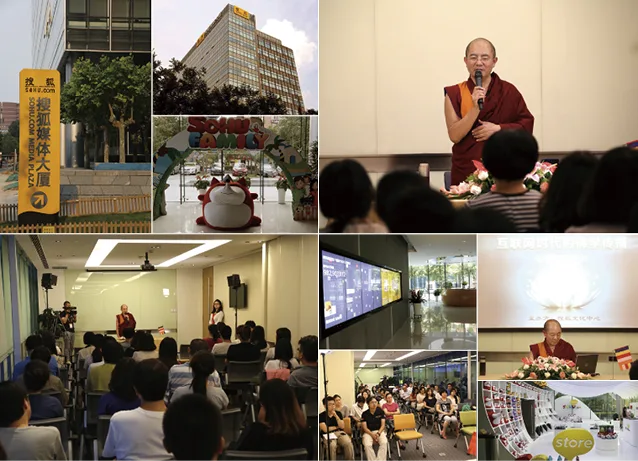
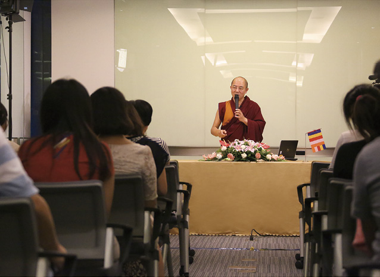
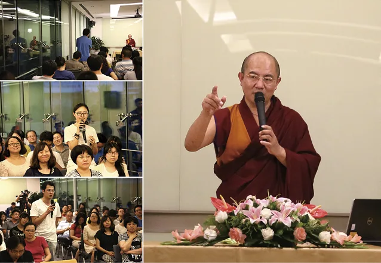
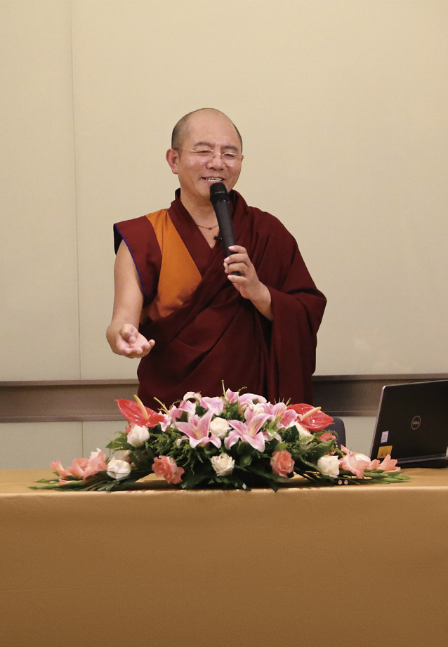

按照大乘佛教的观点，  
只要是利益众生，  
任何一种方便法都可以用。

第20场

北京搜狐公司

Sohu Inc, Beijing

中国·北京

2014 / 6 / 30

## 互联网时代的佛学传播

## Buddhism in the Internet Age

今晚，我想跟大家分享的是“互联网时代的佛学传播”。在座的各位智者，可以围绕这个主题各抒己见。

在互联网的浪潮下，人们享受着信息快速传递的便利，而佛教是否也需要依靠这种途径来传播，很多人对此提出了疑问。虽然我已经舍俗出家近三十年，但也经常关心佛教的传播。随着时代的变化，佛教的弘扬方式在不断地调整。以前，有一位记者问过我：“佛教需要与时俱进吗？”我当时回答说：“佛教的教义不需要与时俱进，完全跟得上时代，智慧和悲心是它的超胜之处。但是管理方法和弘扬佛法的一些方式，确实需要与时俱进。”

我个人认为，佛教的确需要通过网络来传播。在过去，传统的佛教思想，只在寺院或个别寂静处传播，因此，只有寺院里的出家人，以及一些老年人有着非常虔诚的信仰，经常念经修行，而年轻人基本很难接触到佛教，所以他们的佛学知识比较薄弱。如今，知识分子越来越多，不管是金融界、商业界，还是娱乐界的年轻人，都在不同的领域当中，探寻着佛教的智慧。这个时候，依靠网络传播佛法是必经之路。

佛法是一种文化，也是一种传统思想。它带给我们的力量，我不说，相信大家也能明白。现在很多人内心空虚，虚荣心强，在衣服、轿车、房屋等方面，每天都在互相攀比，互相竞争。在这样的忙碌当中，忽略了对人生意义的思考，甚至离开这个世界的时候，仍然没有找到真正的答案，而佛教的确可以帮助我们找到心灵的归宿。其实，人生的终极意义需要一个答案。

## 佛法才是无上至宝

生活中会带来各种心灵上的问题。有些人是从自己的智慧海洋里寻找答案；有些人是从别人的书本里寻找答案；有些人实在找不到答案，就会故意去一些娱乐场所，通过喝咖啡、喝美酒让自己变得麻木……这些逃避问题的方法，不一定是良药。在面对生老病死等痛苦时，佛教理念对每个人都有非常大的利益。

当今时代，我们应该依靠什么方法来了解自己，什么才是最有用的心灵知识？事实上，佛教与现代科学非常吻合。现代人特别推崇科学，而佛教在科学领域中处于怎样的地位，大家有必要了解一下。生活在这个世界上，我们需要有这样的心灵妙药。否则，一旦心里产生纠结、痛苦和焦虑，就很容易生各种疾病。这个时候，依靠佛教的调心方法，能帮助我们从情绪中解脱出来。事实上，现在的年轻知识分子，也能从中受益。这几年以来，我去过很多学校，发现许多人都在研究佛教。有些人是对佛教有信仰，有些人是佛学的爱好者，但不管怎样，他们都有不同程度的收获。

我衷心希望大家以后遇到痛苦的时候，能够依靠佛法来思考和解决问题。这是一个缺乏信仰的时代，所以佛法对于很多人来说是无上至宝。在座各位可能也在思考和寻找让心灵快乐的方法，有的是从外在的财物上寻找，有的是从内心的感悟上寻找。我个人建议，当你不快乐时，应该有一种修行。这种修行非常容易，既不需要花费大量的金钱，也不需要很多的付出，可以说是一种轻而易举的获得，但对整个人生会带来意想不到的转变。一旦有了这种境界，无论遇到任何问题，都可以迎刃而解。

## 网络传法应注意的问题

对于佛教，有些人可能了解一些，有些人不一定了解。事实上，现在人们认为的佛教，未必是真实的佛教，也许连佛教的门槛都没有踏入。而正是那些我们没有了解到的内容，才是佛教真正的本质。

那什么才是佛法呢？佛法分为教法和证法。教法是指所有的佛经论典，通过听闻、讲说，可以获得教法。证法是指在心里生起智慧和悲心的境界。这两者才是真正的佛法。因此，大家最好是通过网络了解佛法的智慧，这一点至关重要。其他烧香、拜佛等行为，只是佛教中的仪式，应该要注意取舍。

佛教的发展离不开传播，而传播的方法有两种，一种是迎合受众，一种是引导受众。如果是引导的话，应该有一种正确的引导。那些不合理的、错误的引导，对身心有非常大的危害。从佛教的观点来讲，传播者也有一定的责任和过失。如果能以正确的思想，将佛教的正能量——智慧、慈悲和善心，传播给世人，很多人的心态会发生改变。让每个人都拥有真正的利他心，这才是一种正确的引导。当然，这样的引导，需要懂得佛教的传播。

其实，网络是一把双刃剑。如果落到有智慧的人手里，会利己利他，对社会与人心有非常大的帮助。如果落到愚痴的人手里，会害己害他，对社会也有破坏性的影响，甚至还会影响子孙后代。大家应该清楚，现在有些教育理念，不一定对人们有利。在这种情况下，佛教也面临着同样的考验。有些人也会心存疑问，和尚到底可不可以上网？有人认为，和尚应该待在寂静的山谷里，天天坐着念阿弥陀佛。如果和尚也用电脑、微信、微博等，人们就会觉得他们变得和世俗人一模一样了。

关于这个问题，需要运用智慧来分析。有的和尚可以上网，有的和尚不能上网。为什么呢？如果以利他为出发点，有一颗真正想要帮助他人的心，依靠网络不会染污自己的相续，那无论是出家人，还是在家佛教徒，都可以使用网络，不但可以用，而且必须要用。按照大乘佛教的观点，只要是利益众生，任何一种方便法都可以用。就像藏传佛教中讲到的五明、十明[^1]，只有内明属于佛学，其他四明或九明都不属于。按照弥勒菩萨的要求，大乘菩萨对这些都要学。

由于历史的原因，很多人认为佛教是一种迷信，出家是一种逃避，觉得只有在生活中遇到挫折，或者是遭遇不幸的人，才会选择出家。他们被看作是特殊的群体，与普通人的生活有一定距离。

事实上，真正具有利他心的人，依靠网络可以做许多事情。现在的年轻人，通过网络来学习佛法的特别多。前段时间，我们佛学院开法会的时候，网络直播大概有两万人在线。现在每次举办公开的法会，以及我个人传授公开课程，都可以通过网络给大家直播。如此一来，既不耽误工作，又可以学到佛法，这是非常好的一种方便。以前，学习藏传佛教要到很远的地方苦行，翻山越岭。而现在只要你打开电脑，完全可以在家里接受佛法的智慧，这种方法很便捷。如果你们感兴趣，也可以通过网络学习佛法。

与此同时，各位也要思考一下，你们作为网络平台的管理者，应该传播什么样的思想。英国著名作家狄更斯曾说过：“这是最好的时代，也是最坏的时代，但不管怎样，我们应该爱它，因为它是我们的时代。”他的话确实很有深意。当时处于19世纪，工业革命已经基本完成，所以，他说出了这番现实主义的言论。但若把这句话用在这个时代，也是比较合适的。

在这个信息爆炸的时代，科技虽然给我们带来了很多便利，但也顺带产生了很多负面影响。我们每天要看很多信息，听很多声音，想很多事情……如此一来，身心疲惫、焦虑，甚至没时间也没兴趣静下心来听一堂课。哪怕是关机半天时间，把所有事情暂时放下来，让心安静一会儿，对自己来说也是一种奢侈。现在人们已经变成了网络的奴隶，而信息成了我们的主人，每天不由自主地围着它打转。为什么人们变得很浮躁？因为眼耳鼻舌等每天都随外境所转，而且转得非常快，连短短的休息时间都没有。

在这种情况下，佛教也会面临很多问题，需要做出一些不被人理解的调整。网络上，有一些佛教正面的宣传，也有一些负面的宣传。因为网络存在夸大的成分，有些负面的宣传可以说是无中生有，任意地夸张、诽谤，甚至有些好的东西也被抹杀掉。有的时候，一件很小的事情，通过网络的宣传，全世界的人都知道了。

几年前在泰国，一位年轻的妇女去寺院里朝拜。她进去的时候高高兴兴，出来的时候却垂头丧气，非常伤心。令她伤心的并不是金碧辉煌的寺院，也不是庄严的佛菩萨像，而是一位和尚的行为。这位和尚在佛像面前，一边拿着扫帚当吉他，一边用摇滚的音调诵经。这位女信徒非常虔诚，所以看见后特别伤心。她说：“寺院还是原来的寺院，菩萨还是原来的菩萨，但和尚不是原来的和尚了。”按理来讲，一位年轻的和尚做出这样的行为，也并不是特别过分。在年轻人的群体当中，这是比较正常的事情。但大家可能认为，他违背了自己的信仰，所以有些不能接受。后来这件事在网络上发酵，短时间内就被转发了无数次。

听说你们准备设立佛学频道，这样做很有必要，我很随喜。但希望大家在做的时候，要注重质量，而不能只顾流量，一定要发挥正面的弘扬作用。现在有些佛学网站，刚开始的时候，为了吸引流量，会做虚假报道。很多人可能愿意看，但法义不一定过关，对佛教也有一些负面影响。所以，作为网络管理人员，一定要懂佛教，还要具备观察的慧眼，知道哪些是真，哪些是假。

当然，佛教的教义不会有问题，但有些人会冒充佛教徒，把本来不是佛教的教义当成了真正的佛教，如此则辨别其真假非常重要。所以，希望在将来的网络中，有人能够传播、弘扬佛教的真实教义。如果打着佛教的旗号，利用佛教的品牌，无论任何时候，我们都要抵制这种行为。在网络上，有些人随意报道佛教的负面信息，却不敢报道其他宗教的负面信息，为什么呢？因为这些人不怕佛教徒，认为佛教徒以慈悲为怀，即使被诽谤、被冤枉，也不会争辩。事实上，佛教徒确实没有报仇的想法，但一定要有辨别真假的能力和智慧。因为这是一个智慧的时代，不应该成为一个愚昧的时代，佛教徒也要与时俱进。

## 最高级的人生智慧

现在有很多人在学习藏传佛教的因明、中观等五部大论，学得也非常好。以我多年教学的经验来看，佛教徒越来越年轻化了，他们依靠网络教学模式，闻思修也很成功。在这个信息时代，通过网络平台来学习佛法，这一点很有必要。而这种平台掌握在不同人的手里，发挥的作用也不同。

今天在座的各位，应该对佛教有一些兴趣。你们也可以思考一下，在当今这个时代，佛教对人类究竟起着怎样的作用？有些人可能认为，佛教对人类起到一些不好的作用，并不像佛教徒所说的那样完美。当然，你也有你自己的理由，我们可以互相辩论和交流。

现代人的内心极其浮躁。这个时候，我们更需要一种宁静。只是依靠网络上的知识，并不足以让心安静下来，还需要长期修行，这就是佛教中讲的闻思修。也就是说，先去听闻，然后思考，再努力修行。这样以后，我们的心会越来越有力量。现在有些年轻人很脆弱，遇到一点小事就想不开，经常为此苦恼，也没有解决问题的智慧。其实，在很多事情的处理上，包括人与人之间的矛盾，只要有一点点智慧，就很容易解决。因此，我们应该通过各种方法来获得这种智慧。

真正的智慧，并不是为了自利，利他才是最有价值的。以自我为中心的智慧，暂时来看是一种自我保护，但从长远来看，都带有一些副作用。相反，如果拥有利他的智慧，无论遇到何种人生境遇，都会活得自在、快乐和充实。大乘佛教中讲到，以利他的菩提心，利益一切有缘众生，这是我们活着的意义。

其实，网络也是一种度化众生的工具，若以此引导人们向善，是非常重要的。如果我们在网络上的发言，只是为了迎合世人，不一定会很有价值。因此，我们应该珍惜时光，经常自我反省。与此同时，还要利用自己所拥有的资源，尽量去帮助众生，这就是人生的意义。

现场互动

主持人：

非常感谢上师给我们带来这么精彩的开示。相信大家和我有一样的感受，无论上师在讲什么，他语气中带有的平静，可以让我们浮躁的心安静下来。虽然经过了一天的忙碌，但我反而觉得心里很平静。

在上师刚才的演讲中，反复提到了“智慧”。作为网络从业者，在日常的工作当中，是不是应该用智慧去传播信息，引导公众，而不是被他们所引导？这个问题值得每一个人深思。

下面进入提问环节——

问：我来自搜狐网文化频道。现在是互联网信息大爆炸的时代，这与佛教的清净似乎有一种矛盾。请问您怎么看待？

堪布：佛教所提倡的，其实与这个时代没什么矛盾。很多人以为佛教只是让人身心清净。确实，在讲到禅定的时候，需要排除一切外境，让心清净下来，但除了禅定以外，佛教中还讲到布施、持戒、忍辱、精进和智慧，也就是六波罗蜜多。

所谓布施，分为财布施、法布施和无畏布施，哪里有众生，哪里就有喧嚣和散乱，这是很正常的现象，正因为如此，我们才要为他们做佛法的布施；所谓安忍，通常来说，一旦有了怨恨的敌人，众生会产生各种烦恼，所以，我们要让自心坚强起来，同时也可以借助网络学习佛法知识，增强信心和定力，最后安住下来——刚刚我看到有些人在玩手机，有些人在打瞌睡，所以讲得比较简短，因为你们坚持不住了，我也有点忍不住了，这也是一种安忍（众笑）；精进，是指精进行持善法，佛教中讲要在无量劫度化无量众生，这需要很大的勇气和精进；智慧，包括空性的智慧和世间的智慧，世间的智慧，除了声明学以外，还包括工巧明、医方明、天文地理等。这些在佛经中都有详细阐述。

很多人对佛教的了解比较片面，认为学佛就是抛弃所有事情，跑到一个寂静的地方剃光头发。其实这与佛教的初衷完全相违。我刚才讲了，有些人认为的佛教，不一定是真正的佛教。除了禅定以外，佛教中还讲到了其他五种波罗蜜多。可是，现在很多人认为，只有禅定波罗蜜多才是佛教，其他五个都不是。因此，需要加强对佛教教义的了解。

问：我是财经频道的员工。近些年来，佛教似乎变得越来越商业化了。比如，游览名山大川的时候，大家会去寺院里烧香拜佛，但里面有很多的收费项目，偶尔还会遇到一些“大师”要求帮你卜一卦，给人的感觉好像捐得越多，功德才会越大。请问捐款和功德之间有怎样的关系？应该如何看待这种现象？

堪布：现在有些佛教的现象，确实不容乐观。从藏地来看，基本上还保留着比较原始的传统。而上世纪七八十年代以后，汉地寺院开始卖门票，尤其以四大名山为主的个别地方，甚至在寺院里面打卦，这是很不好的现象。事实上，真正的佛教并不提倡这些。但这也不能全怪佛教，寺院的住持和常住僧人都不愿意这样。其实，这里面有很多的外缘和内缘，他们也没有自主权，不得不跟着现在的形势改变。希望将来所有的旅游景点，都开发成真正的旅游景点，而寺院也可以变成真正的寺院。

在藏地，寺院里必须讲经说法，否则就不能称为真正的寺院。其实，寺院应该是佛教教育的基地、学习佛法的道场。佛教的“教”，有一种教育的含义。我特别希望未来有很多人弘扬佛法，因为现在知识分子的心态，跟你刚才说的一样。前段时间，我去五台山也有这种感觉。一般来讲，在寺院里拜佛，即使不给钱，菩萨也不会介意，自己想花多少钱供香、供灯，都是根据能力随缘做的。事实上，佛教中并没有所谓的“烧高香”“烧头香”的说法，这些都是后来商家为了赚钱想出来的。

这些行为并不符合佛教的真正教义。因此，我们有必要在网络上多宣传一些佛教知识。现在很多年轻人具有虔诚的信心，想要了解真正的佛教，我们应该给予正确的引导。其实，这些问题非常基础，并不难回答。但由于没有学习过基本的佛教知识，烧香拜佛慢慢就成了一种形式。其实，佛教包括感性和理性两部分。烧香、拜佛等行为属于感性部分，这些行为代表着一种虔诚心，但如果没有理性的指导，人们很容易把它变成一种迷信，自己也会变得迷惑，不解其意。

总而言之，作为佛学爱好者，应该多多学习相关的佛教知识。佛教的教义经得起推敲和质问，但在个别道场里，有些行为的确有待观察。

问：我是读书频道的员工。我的一位朋友说过，60岁之前最好不要学佛，因为很多东西太过随缘或是不强求的话，会造成比较消极的心态。您如何看待这个说法？

堪布：我的观点与他恰恰相反。我认为最好在60岁之前学佛，不然人已经老得糊里糊涂，想学也学不到什么了。

其实，佛教中并没有讲一切都要随缘。在该随缘的时候会随缘，在该积极向上的时候，还是会努力的。

佛教中讲到的六波罗蜜多，是大乘菩萨的基本行为准则。我们做事情的时候，需要精进，并不是消极放松，或者是什么都不做。人们之所以会有这样的印象，是因为对佛教还不够了解。很多人只听到一两个佛教词语，就断章取义地对人说：“学佛要看破一切，你怎么还没看破？”“佛法里讲一切都是空性，你怎么还没有空？”就像用一两个网络词，来代替所有的语言文字，这在专业人士看来，是非常可笑的事情。因此，我们千万不能用一两个佛教词语，来代表整个佛教的教义。

当然，在某些情况下，佛教会提倡随缘。比如，因缘实在无法逆转的时候，一直抓着不放，也没有什么意义。面对感情和死亡都是如此，一旦缘分尽了，谁都无法扭转过来。但是，佛教没有说所有事情都不用做。其实，真正学佛的人，比世间人还要积极。尤其是具有大乘佛教理念的人，为了度化众生，即使不吃不喝，他们也不会觉得累。

有些信仰佛教的人，会选择去藏地支援，他们的坚强力、安忍力和精进力，远远超过了一些自私的年轻人。有些年轻人学佛以后，可能会对家庭和工作不负责任，但这是个别人的做法。如果真正懂得佛教的思想，应该能处理好世间事情，同时也能调整好心态。

以前，总有些人打着佛教旗号去教育别人，而听的人又不懂佛教，认为他们说得很对，好像是佛教的代言人。现在很多人对佛教还不够了解，但又装作很懂的样子，用个别词来概括佛教的所有教义，这样做非常不合理。

问：佛教有一个很重要的观点，就是了生脱死，我皈依是为了在死亡时不害怕。很多人看不到自己的前后世，所以不相信轮回。请问，如何才能对轮回建立起十足的信心？

堪布：佛教经常提到的了脱生死，在生活中也非常重要。能不能了脱生死，关键要看自己的修行力度。如果你修得非常好，哪怕刚入佛门时只是一个普通人，但后来通过听闻佛法，最终也可以认识心的本性。当临死出现各样迷乱现象时，认识到这就是五方佛、是自心的妙用显现，不但不会害怕，还会出现一些非常好的瑞相。

最近，听说我家乡有一位佛教徒，他并不是很有文化，但在临死的时候，在床上跏趺坐，闭着眼睛说了一句“我要走了”，然后就圆寂了。藏地这种情况非常多。在汉地的《唐高僧传》《宋高僧传》《净土圣贤录》中，也记载了很多这样的修行者，他们往生时非常安详。

实际上，每个人都无法逃离死亡。有些人年纪轻轻就死了，有些人最后衰老而死。当死亡来临时，我们有没有这种境界呢？要看自己的努力。佛教也没有说所有人死的时候，都能够了生脱死。

每个人的修行程度不同。如果修得很好，完全可以超越死亡；如果修行力度不够，即便皈依也未必有把握了生脱死。

问：您刚刚讲到，通过互联网也可以学习、传播佛教的思想，不一定非要苦行。请问，您对苦行是持否定的态度吗？

堪布：我并没有对苦行持有否定态度。实际上，在很多人的修行中，苦行是非常有意义的行为。通过苦行找到了真理，这比什么都珍贵。就像有些人去藏地，好多天没有吃到饭、喝到水，但最后求到了正法。

法尊法师是汉传佛教的一位大德，他入藏求法时也经历了很多苦行；能海上师入藏的时候，也有过一段苦行经历。另外，关于唐僧取经的故事，虽然有一部分情节是后人杜撰的，但从历史来看，他路上确实经历了很多苦难。

对于这些苦行，我自己也感同身受。我刚到佛学院时，电也没有，路也没有，甚至一年中连绿色的菜都看不到，基本上每天吃糌粑粉，除此之外什么也没有。通常情况下，我早上会烧一壶开水，中午喝一点奶茶，吃一点糌粑，剩下的留到晚上继续喝，一直都是这样生活的。

在这样的苦行下，我们仍然保持着高强度的背诵和学习。当时自己所背的有些经典和教证，现在还记得特别牢固，就像刻在心里一样。相反，如果通过轻松的方式获得，人们往往不会珍惜。现在这个网络时代，想要什么样的知识，都能在网上下载，而以前的每本书都来之不易。比如藏传佛教中的密宗法本，一旦公开之后，它的加持力就会消失，因此只能以保密的方式学习。只有这样，学习者才能拥有一种特殊的力量，掌握特殊的密码。

如今，在家的佛学爱好者，可以通过网络学到佛教的公开课程，而且不受地区限制。以前听课只能在特定环境中，听课人数有限，而一旦上传到网络，尤其是现场直播，全世界的人都可以参与。

有些人本来想学佛，但一直没有机会，现在这种传播方式就非常好。当然，另一方面，人们也会觉得谁都可以看，没什么好珍惜的。现在的网络上，这个教授在讲，那个教授在讲，有能力的人在讲，没能力的人也在讲，各种知识泛滥，人们看得眼花缭乱，辨不清哪个是真、哪个是假。

在这种情况下，我们需要有一种取舍的智慧，辨别真正有价值的东西。就像买东西，市场上什么都有，有的价值连城，有的以次充好，甚至对身体有害。网络市场也是如此，有真有假，有好有坏。所以，我并不否认苦行，为了求法而苦行很好。可是，如果明明网上有资源，还特意去一个地方苦行，那没有必要。

问：随着微博、微信的流行，这几年出来了很多仁波切。有些人觉得佛法类似心灵鸡汤，已经开始排斥了。一般来说，大家只想解决自己的问题，直接要一个答案，没有时间系统学习。比如，关于觉囊派的他空见，网上只有一些片面的理解。请问，如何通过网络学习到全面的佛法？

堪布：现在网络上的确有很多仁波切、上师、活佛和堪布，他们也有自己的微博、网站、微信平台。其中，大多数都在帮助人们理解佛教的教义，让更多人行善断恶，对此我个人很随喜。虽然有一些所谓的心灵鸡汤，但鸡汤也有鸡汤的“营养”，也有人喜欢喝，而其他比较深广的内容，他们暂时还接受不了。虽然微博140个字无法阐明佛教的根本理念，都是一些碎片化信息，但只要肯花时间，就像古人每天记一个格言，最后一滴一滴水也可以盈满整个器皿。如果长期学习这些教义，会给我们的人生带来改变。

当然，其中或许良莠不齐，鱼龙混杂，这在任何一个文化复兴时，都是在所难免的。比如工业革命时期，很多科技产品真真假假，但也没办法。到了现在的信息时代，有些人打着佛教旗号做事，有的是想真正帮助别人，有的是想自我宣传、别有目的。不仅仅是佛教界，政界、商界和娱乐界也是如此。这些人对人们投其所好，然后传播着不同的思想，这些不一定百分之百有意义。

现在是一个特殊的时代，网络平台比较自由，各种信息不需经过批准和审核，直接拍个图片放到网上，别人就会转发。但觉囊派的他空见等深奥的佛学知识，很难依靠网络来通达，需要非常系统的学习。就好比北大老师也在用微信，但他不会认为通过微信可以传授所有课程，毕竟有些问题需要面对面解决。

关于佛教，大家还有很多地方不了解，所以有不同的评论和看法，甚至怀疑，这都非常正常。

要知道，佛教徒也有自己的自由空间，不一定要按照别人的想法做事。有时候，我发的微博也不会太佛教化，因为很多粉丝不一定信仰佛教。如果我用非常专业的佛教术语，比如他空、自空等，有些人就会看不懂，只有佛教的专业人士才明白。包括物理学家和化学家，他们在发微博的时候，并不会天天发物理、化学的专用词，也会发一些生活化或人们比较关注的内容。

因此，我们不能规定别人只能发有深度的句子，不能有生活化的表达。有些人经常会在我的微博下留言，劝我不要发一些心灵鸡汤。但我第二天还会照样发，因为这是我个人的事情，别人最好不要干涉。我心里是这么想的，不想看的人可以不看，但没有这么说。有些人认为，我应该迎合他们的想法，一定要发有深度的教言，但我也不可能天天发空性的道理。这么多的人看微博，我也要观察一下，大家关心的到底是什么。就像公司生产的商品，不可能只卖给一种人。如果整个公司只为某些人服务，最后可能连成本都赚不回来。所以，要根据市场的具体需求来决定。

问：我刚开始接触佛法，看了您的《有求：二十一度母给你温暖》，里面写到所有女性的本尊是度母。请问，相对于男性，女性在修行中需要注意哪些？

堪布：这本书主要讲了二十一度母的功德。二十一度母是女性的本尊，但男性也可以修，也是他们的本尊。

就我个人而言，刚会叫“爸爸妈妈”的时候，就会念度母心咒了。在那个年代，宗教还没有开放，有一次放牛时，我正在念度母心咒，被村里领导发现了，他一直追问我，我只好说很多妄语。度母心咒是“嗡达热德达热德热索哈”，那个领导问：“你刚才念的‘达热德达热’是什么？”我说：“有一头牦牛叫‘达热’，我在喊它的名字。”当时，我脖子上还戴了一个小皮袋，里面有佛像等加持品。他问我：“里面装的是什么？”我说：“《毛主席语录》。”其实，他也知道并不是，但没有再继续追究，因为我年纪比较小。

所以，很小的时候，我就一直在修度母本尊。即使上学以后，也一直在念，人生中的很多违缘都依此遣除了。所以，我把这本书的名字取为《有求》，意思是有求必应。无论在哪里，只要有求的话，就会获得佛菩萨的加持。去年讲这部法的时候，我就给大家说过，我很有资格讲这部法。虽然对于没有信仰的人来说，可能无所谓，但对于有信仰的人来说，我的专业性还是很强的。因为我不是一年两年的祈祷，是一辈子都在祈祷，也参考了相关的注释，这本书就是这样完成的。

在佛经中，也讲到了女性的特点，与男性确实有些不同。在性格方面，女性心胸相对狭窄，嫉妒心强，心理比较脆弱。无论是高兴还是不高兴，女性的情绪都容易外露，从她的表情上就能看得出来。如果她看起来很阳光，一直笑眯眯的，别人一看就知道她最近应该遇到了好事，而遭遇挫折或失败时，情绪也会表现在脸上。另外，在某些小的问题上，女性的智慧往往特别尖锐，对大的事情反而不太关心。

当然，女性也有超越男性的地方，比如女性的觉察能力很强，照顾人很细心，慈悲心比较重等等。在藏传佛教中，有一位大德专门赞叹过女性，赞其是一切般若佛母的来源。此外，我们经常说“我的母校”，而不是说“我的父校”，或是说“母亲河”，而不是“父亲河”。在不同的佛经当中，都有对女性功德的赞叹。

问：我是一名佛学爱好者。请问，遇到让人愤怒、悲伤的事情时，您是如何化解的？

堪布：以前没有系统学习佛法时，我也会有明显的愤怒和欢喜。尤其在读小学时，每次穿上新衣服，我都会兴高采烈；遇到对我不友好的同学，就会产生一些嗔心。后来随着学习佛法的深入，虽然还是会有开心和不开心，但情绪上不会发生太大改变。有些熟悉的人经常称我为“石头堪布”。因为我的心好像石头一样，对于好坏没有很明显的反应。其实，这是因为我对其中的道理有了更深的理解。比如，遇到令人痛苦或愤怒的事情，我会先分析有没有扭转的机会。如果有的话，可以直接把它改变，没有必要特别愤恨；如果没有的话，就像碗打碎了一样，即使愤怒也无济于事。

很多时候，人们往往因一念之差而犯下错误。所以，遇到让人愤怒的事情时，最好当下安静五分钟，或是半小时。让心稍微平静以后，再去和别人沟通，这一点非常重要。我现在的心态比较平和，也比较容易快乐。无论遇到什么事情，我都比较随缘，但不会放弃努力，要做的事情也会一直坚持，这方面我还是有信心的。

在座各位的工作比较特殊，会影响到很多人。所以，我特别希望你们能有一颗善良的心，力所能及地帮助别人。这颗利他心，就是我一直在和大家谈的主题。活在这个世界上，也许有时会很被动，身不由己，但毕竟选择权掌握在自己的手里。

作为网络工作者，确实可以引导很多人的思想。我每天也会发微信、发微博。虽然有时候很累，但每个人都应该发挥自己的社会作用。所以，我还是会坚持把正能量传递给大家。佛教中经常讲，善有善报，恶有恶报。种下这样的善因，一定会收获快乐。对我个人来讲，这样的行为是非常有意义的。

事实上，社会也需要有正能量的人存在。在这个特殊的时代，网络的影响力非常大。如果每个人都有一颗善良的心，即使没有把事情做得很好，但至少问心无愧。

我由衷地希望这个时代多一些佛教徒。很多佛学爱好者一直在门口徘徊，也许是因为心怀畏惧。人生有限，倘若实在没有兴趣，也没必要强求。但实际上学佛并不可怕，进来以后不会像蹲监狱一样，再也出不去。从某种程度上讲，不但没有痛苦，反而会有利益。所以，我们需要有一种勇气。如果它是一个危险源，确实应该站在门口观望。如果它没有任何危险性，而且能够增强自己在工作、生活中的勇气和力量，那我们应该为了自己，以及有缘的众生发起皈依心。

[^1]: 五明是指工巧明、医方明、声明、因明、内明；再加上诗词学、韵律学、辞藻学、历算学、戏剧学为十明。
