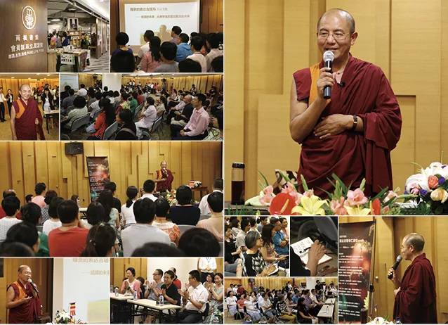
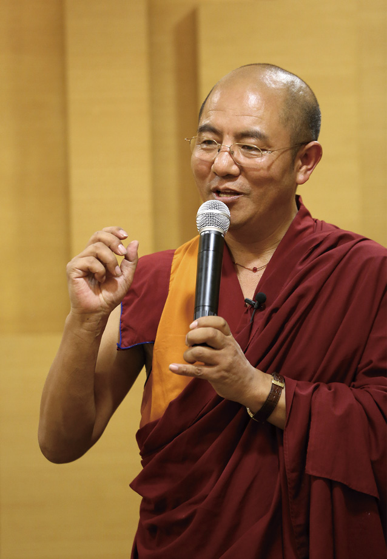
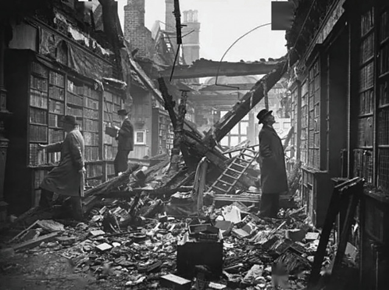
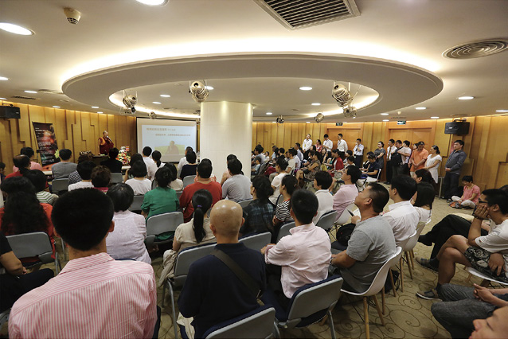
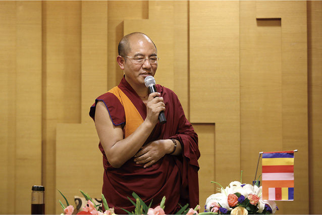
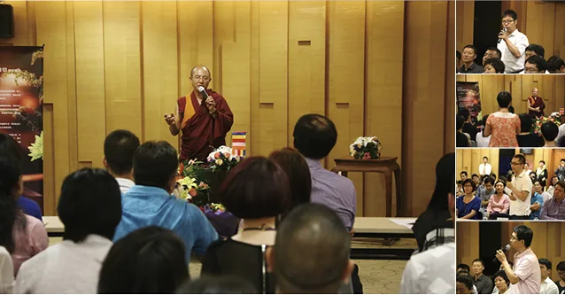
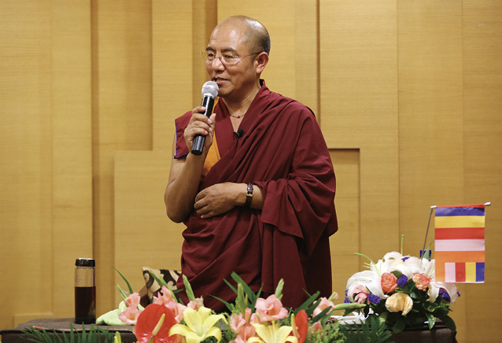

纸媒真正的敌人，并不是电子书等新媒体。

第19场

北京雨枫书馆

Beijing Rain Library

中国·北京

2014 / 6 / 29

## 从佛学角度看纸媒的未来

## Future of Paper Media: a Buddhist Perspective

主持人：

今天的主题是从佛学角度看出版业、纸媒业的未来发展。希望这是一次有智慧碰撞的讨论，而不只是怀着敬仰之心，来咨询一些佛学问题。

欢迎堪布——

今天确实是一个美好而又特殊的夜晚。在座大多是媒体界、出版界的朋友，应该都很喜欢读书。相对佛学而言，这次的主题对我来讲有些陌生。但是，纸媒的未来，尤其是出版行业的未来，我个人也比较关注。当然，谈不上提出一些有建设性的意见，只是抛砖引玉，希望能引起共同的思考。

作为出版工作者，你们都有着丰富的从业经验，而我对这些比较陌生。但大家能相聚在一起，也是殊胜的因缘。我也想简单谈一下自己的看法，如果有不当之处，你们可以直接反驳，或者在最后的互动环节提出来。

就我个人而言，对于书籍出版物确实有很大的信心，因为我最大的爱好就是读书。无论是藏文、汉文的佛学典籍，还是其他世间书籍，我都特别喜欢看。我的房间里几乎都是书，除此之外，其他东西并不多。我小时候就特别喜欢读书，这种阅读习惯一直保持到今天，以后应该也不会改变。所以，我与大家在阅读方面有共同的兴趣和爱好。

## 纸媒面临的挑战及原因

很多人认为，现在的纸媒、纸质出版物，未来可能会面临严峻的挑战，甚至有可能消失。有些报道中说，再过30年，也就是2044年的时候，纸媒会彻底消失——也有说只剩下10年、20年了。所以，纸媒未来的生存空间，确实需要大家深思。以现在的市场情况来看，纸质出版物行业并不是很景气。很多人认为，电子书、因特网等新媒体，现在已经开始冲击纸媒。到了一定的时候，人们可能只看电脑，不一定看纸质书。

佛教中经常讲“诸法因缘生，诸法因缘灭”，如果将来因缘具足，也许没有现在说的那么严重；如果将来因缘不具足，很多纸质书有可能会消失。究其原因，是不是因为电子书的冲击呢？也不一定。暂时来看，书籍最大的敌人是现代人思想浮躁，静不下心来看书。

2011年的时候，有一篇报道中讲，现在很多人都不爱看书。中国人每年人均看书量是4.3本，韩国人是11本，法国人是20本，日本人是40本，犹太人是64本。由此可见，中国现在真正能看得进去书的人越来越少了。我曾问过身边一些人，一年当中看多少本书？有人说一两本，有人说一本都没有。大家可以回忆一下，从2011年到现在，我们每个人有没有看过二十本书？即使在座各位对纸质书有信心，恐怕也未必看过这么多，其他人可能就更少了。而有些国家的人，不管在火车上还是飞机上，都喜欢阅读。我去德国的时候，印象非常深刻。当时有一段路是坐火车，上面的德国人都在看书，而中国人在吃东西、说闲话，整段车程一直这样。

犹太人一直被称为最聪明的民族，就是因为他们特别喜欢看书。我问过一些犹太老师，他们说与生俱来就有这样的习惯。如此看来，我们的出版行业不景气也是有原因的。现在的实体书店，单靠卖书恐怕连成本都赚不回来，只能通过卖咖啡、卖西餐等其他手段来维持开支。严格来说，这不能称为书店，有点像饭店。因此，我们现在最大的挑战，就是大多数人对书本越来越没有兴趣。

在中国，书的价格非常便宜，基本等同于一杯星巴克。美国一本书的价格可以买四杯星巴克。台湾、新加坡等地，一本书至少要人民币七八十元。我们只卖二三十元，可还是很少人购买。可见，现在人越来越不爱看书了，每天只是看一些微博，刷来刷去都是那些内容。如果把这个作为日常生活，不要说形成一种理念，实际上连碎片思想都算不上。为什么现在培养不出很多科学家和思想家？其实，这与我们的生活习惯有很大关系。

大家可以思考一下，纸媒真正的敌人到底是不是电子书等新媒体？很多人认为，一旦新媒体崛起，出版行业会逐渐走向灭亡，然而这只是其中一个原因。事实上，新媒体的出现，不仅冲击了实体书籍，还冲击了我们的生活。比如，三年前看电视的人还很多，而如今的年轻人都不看电视了，他们大多数会选择在网络上看，这导致电视开机率从70%降到30%，而且看电视的大多是中老年人。另外，现在有些美国大学会通过网络授课，这给传统教育也带来了一定的冲击。

## 实体书与电子书的利弊

新媒体确实方便快捷，比如通过iPad可以储存成百上千本，乃至上万本书，而且查阅速度特别快。相对来讲，纸质出版物首先要编辑，编辑完排版，排版完印刷，印刷后发行，最后运输到售卖地点，经过很多环节才能送到消费者的手里。如此一来，就不得不提升价格。而电子书籍，写完之后只需要几句简介，就可以在网络上铺天盖地传播。所以，从时间方面看，这种方式非常高效。

从携带方面来看，纸质书比较重。前段时间，我在北京跟一位清华教授交谈后，他送了我四本书，都特别厚，我很喜欢。虽然这些书跟佛学没什么关系，但涉及科学和哲学，我还是想抽空看一下。后来，我又去了天津、合肥、青岛、五台山等地，这四本书也一直跟着我，不过每次坐飞机都超重，交了很多钱。那时我就想，如果能给电子版的该多好啊，有些书太沉的话，携带也是一种负担。

大家应该清楚，从环保方面来看，制作纸质书的过程中，会砍伐很多树木，而电子书就不需要。所以，二者也有一定的差距。反过来说，电子书都是优点吗？也不一定。一般来讲，新事物刚出现的时候，吸引力非常强，暂时来讲，电子书大大改善了我们的生活，但以后也会发现它的不足。

当初，随着工业革命的出现，人们千百年间无法改变的，依靠现代科学仪器，一下子就改变了。无论是修路还是建造，都方便了很多，工业革命确实给生活提供了很大便利。时至今日，我们再回过头看，才发现这背后付出了很多代价，比如环境污染、水污染、空气污染、资源浪费等，给子孙后代的生存带来许多隐患。更可怕的是，如果这些科学技术，掌握在极个别欲望强烈的人手里，他们可能会肆无忌惮地破坏人们赖以生存的一切。到了那时，人类所要承受的苦难是难以想象的。每次出现一个新事物，人们总觉得它是世界上最好的、最先进的、最方便的、最独一无二的。但是，当它的负作用出现时，的确会带来诸多不利。

五六十年代，电视机刚面世的时候，家家户户都觉得：“全世界的事情通过它都可以一目了然，真是太好了！”我们小的时候，看一个露天电影都觉得非常开心。如果一年能看两次，那就更好了。后来家里有了电视机，又觉得：“这个小箱子可以看到国内外很多事情，多么稀有啊！”但最后大家发现，经常看电视对眼睛很不好，生活也变得非常浮躁。无论是对孩子的读书，还是老年人的健康，都有一定的影响。从自身来讲，也学不到深层的知识。每天把时间散乱在上面，不看觉得无聊，看了也没什么意义，很多事情并没有我们想象中那么美好。这些新媒体，包括在线阅读等电子书，可能需要一段时间才会发现不足之处。

现在，买一本实体书需要几十块钱，而下载电子书价格就很便宜。但实际上，电子书的弊病也会逐渐显现，据说现在70%的电子书公司都维持不下去了。有些人认为电子书很美好。但在我看来，它与传统书籍还是有一定的差距，这也许和我个人的习惯和爱好有关系。比如，同样两本书，如果在网上阅读，我好像无法深入其中。因为屏幕上会出现很多图片和广告，凡夫人特别容易随境而转，心会散乱到别的地方。如果看纸质书的话，心就容易专注。所以，从专注度方面看，两者有一定的差别。

如果在一个寂静的地方，翻开一本纸质书，从头到尾心很容易专注，能够很深入、很圆满地看完，而看电子书就做不到这一点。更重要的是，实体书有其独特的价值。现在的新媒体，人们对它的投入很少，所以不够珍惜，也不觉得珍贵。任何一个东西，如果你渴望很久以后才得到，确实会产生非常大的执著。从前，我很想得到一个法本，但一直得不到。后来听说十多公里以外的一个人有，就翻山越岭去借，结果那个人还不想借。后来我把手表作为抵押，求他借阅一个礼拜，他才勉强同意。回来之后，我连夜抄写，然后又规规矩矩地送回去。到现在我都觉得，这本书得之不易，需要倍加珍惜。每次出门，我一定会用藏式包经布把它仔细包好，似乎这样才对得起当初的付出。

我翻译过一本书，叫做《大圆满前行引导文·普贤上师言教》，不知道你们有没有看过？在过去，这本书数量很少，谁家要是有这本书，就会被视为富人。我们村里有一户人家，虽然不是很富裕，但他家有这本书，别人愿意用一匹马来换，相当于现在一辆小轿车。如今，从网上下载这本书非常容易，即便是纸质版的，也就十几块钱，但大家未必会看。就算偶尔翻阅一下，也是随意放置，并不珍惜。

## 从书籍中汲取精神力量

德国哥廷根大学的图书馆有两百多年历史，珍藏着来自全世界各地的书。我进去参观时，感觉里面充满了历史的味道，也很有神秘感。当时心里就在想：“要是这些书都能放在自己的书房里，该有多么的幸福啊！”由此可见，实体书确实能带来与众不同的感受。在佛教中这叫做加持，也就是世间人说的力量。这种力量，可以从传统的书籍中获得，而在电子书中得到的就很少。

我有一本天天都会念的书。当初，我的老师法王晋美彭措讲过一遍。讲完之后，给在场所有人都发了一本。他说：“如果你们有兴趣，从现在开始一直到离开人间，最好发愿每天念一遍。”当时，学院里比较老的一批学员，都举手且在心里发愿：“乃至死亡之前，我每天都要念一遍！”在这本书的后面，我也标注了发愿时间——“1995年7月25日”。那时，这本书的成本大约是两元钱，制作得并不是很精美。但一方面我们觉得这是上师讲的；另一方面，它的内容非常殊胜。所以，至今我仍每天念一遍。

之前我每次去泰国，如果下飞机没有时间，会在飞机上念一遍，大概需要半小时。有一次，我把书忘在飞机上了，下飞机才想起来。我没有什么财产，唯一这本书对我来讲是最珍贵的，所以当时非常伤心。后来，我一直用各种佛教修法来安慰自己：诸法都是因缘法，都是无常的，最后都会灭的，也许这本书的丢失，对我来讲是一种考验……但晚上睡觉的时候，还是特别执著。所以，又觉得自己修行很差，对一本书尚且如此执著，对其他就更不用说了。幸好第二天，从斯里兰卡飞回来的时候，身边人看我一直特别忧伤，就通过各种办法让这本书重新回到我的手里。

虽然我知道这本书可以在iPad上看，不需要每天都随身携带，但这也是一种信心的表示。古人有些传统的行为，现在未必还能见得到，但确实有它的意义和价值。有人曾经跟我讲过，古代文化与现代文化有一定的差别。古人的心很清净，是以一种肯定的态度来接受知识；而现在人的心比较迷茫，是用一种挑剔、否定的态度来接受知识。另外，古代的文字都是竖着排列，所以读的时候是一行一行地点头，好像在说“是的、是的”。而现代文字横着读的时候，好像在说“不是、不是”。这种说法听起来很有意思，但现在是21世纪，如果再把所有字体竖着出版，也不太可能。但若从中能获得一种难得的思想，也许我们会更珍惜。

我有一位老师叫德巴堪布，现在已经八十多岁了，还在不断地写书。他曾经跟我们讲过，60年代闹饥荒时，他跟一群人去外面劳动。那时候几乎没有粮食，领导们要求他翻过一座山，去找一种叫荨麻的野菜，是人可以吃的。在翻山的途中，他路过一处山洞，发现里面有特别多的书。因为附近有座寺院刚刚受到破坏，所有书籍都被扔到这个山洞里。德巴堪布非常欢喜，在书中翻来翻去，结果找到一本《现观庄严论注疏》，这本书非常稀有。当时已经接近黄昏，但他还没有找到野菜，因为肚子很饿，就先回去了。回去之后，他跟领导说了一些方便妄语，说自己找了半天没有找到野菜。至今，他还珍藏着那本书。堪布说，在那样一个难忘的日子里，他找到了这本书，非常幸运！从他说话的语气和表情，也可以看出他老人家的信心。

我以前看过一张著名的黑白照片：二战期间，整个英国都是一片废墟。在硝烟弥漫的时刻，有三名绅士站在图书馆的废墟里静静地读书。即使在最绝望的日子里，他们仍然保持着对知识的渴求，这是一种多么可贵的品质。现在很多人已经不喜欢读书了，每天都是看一些娱乐节目，一直在想如何赚钱，思想没有深度，智慧也很浅薄。所以，我们需要深入地学习知识，这才是人生真正的价值。如果通过读书有了一种平和的心态，那无论在喧嚣的红尘中，还是在寂静的山林中，都可以做到如如不动。

## 了知一切皆以心为主宰

心一旦寂静下来，就会发现，这世间所有的事情，没有什么是不能面对的。当然，想要永远静下来有一定的困难，但通过学习和修行，暂时可以做到。2013年，由陈坤发起的心灵建设公益项目——“行走的力量”第三季“行·静喜马拉雅”，在拉萨举行了出发仪式。他们一路负重，用了一个礼拜的时间，从拉萨一直走到海拔五千米以上的珠穆朗玛峰。在行走的过程中，大家都不说话，一直观察自己的起心动念。这种简单的世间禅修方法，深受现代年轻人的喜爱。

生活在嘈杂城市中的我们，每天不看书，不学习，处于散乱和迷茫的状态中，这样的人生并没有很大意义。如果没有调整好心态，不要说在城市里，就算在寺院中，也会很苦恼。我们佛学院现在有很多人，但我感觉他们跟城市里的人有些不同，因为他们会寻找心灵的宁静。前段时间，佛学院开法会，虽然来了许多人，但整个僧团并没有受到影响，大家还是一如既往地闻思修行。

在生活中，我们要学会调整自己的心态。早上起来的时候，可以观察自心处于什么状态，有没有被世间得失、喜怒哀乐控制。如果调整好心态，很多问题都能找到解决的办法。所以，最好通过调心的方式来寻找人生的真理。

其实，人生的主宰就是我们的心，其他外在的一切，包括纸质出版物、电子出版物，都只是一种工具。如果内心能够寂静，在网络上看书也可以，关键是要深入地认识自心。佛教中讲“万法唯心造”，这句话的意义非常深奥。有些人不了解佛教的教义，觉得外面这么多形形色色的事物，怎么可能都是心呢？但这不是一两句话能解释的。只有真正懂得了一切的主宰都是心，很多工具都可以为我所用。

不管怎样，我个人特别喜欢纸质书，也喜欢油墨的香味，希望它可以永远留存世间。我始终相信，有了书籍，生活会更加美好，更有意义！

现场互动

主持人：

我是一名经营书店的纸媒工作者，想和大家分享一下自己的感受。其实开书店并不赚钱，这令我时常感觉痛苦。但是，为什么我现在越来越坚定地做传统书店呢？因为学习了佛法，让我的内心无比坚定，阅读也令我感到无限欢悦。

所有的行业，应该先确定理念，后开发市场。经营书店也是如此。我希望大家在书店里都能有所收获。对我个人来讲，也会选择适合自己的修行方式，比如抄经、念经等。我们书店每周还会举办读书会，主题大多是关注心灵的成长。每一位参与者，我们都像是对待自己的朋友一样，认真了解他们的需求。针对他们的困惑，也会推荐一些值得阅读的图书。

在这半年的时间里，我得到了越来越多的支持，生意也越来越好。所以，我今天最大的感受就是，只要真诚地对待每一位读者，相信这个行业会有一次文化复兴。

我在这里先抛砖引玉，感恩大家的聆听！现在，让我们从佛学或是自身经历的角度，聊一聊独立书店、出版人、纸媒的有关问题。

首先，我想问下出版人路先生，有些书真的非常不适合阅读，为什么它还那么畅销？

路先生：

我不认为纸媒会坚持很长时间，纸质的东西一定会慢慢消亡。“出版”在英文中译为publish，它的词根是public，就是公众化的意思。也就是说，出版的核心是让一个作品传播出去，而我们只是媒介。

有些人，他们有自己的学识，有自己的艺术品，但是不会做传播，而我们善于设计和宣传。把一个素材或原生态的东西，进行包装、传播等整合，这就是出版。所以，做出版就是在做传播。把作品传播出去，读者愿意通过哪个渠道获得都可以。只要我们做的是真的知识、真的艺术，就不一定要限定在纸上。客观来看，纸就像以前的竹简一样，一定会消亡的。听了堪布的演讲，我也深有感触。关于实体书和电子书，它们的边界到底在哪？我个人认为，就在于是否对用户的心造成干扰。

有一天，我在地铁上看到一个人，他一边戴着耳机听音乐，一边拿着手机看小说。我就凑近看了一下，发现他看的是那种很香艳、很刺激的网络小说。一会儿来微信，就看一下；一会儿来电话，就接一下。说实话我觉得这样的阅读很不好，在短短的时间内，音乐、小说、微信、通话等，这些只会把读者的心弄得越来越乱。

因此，我希望大家在做一本书的时候，最好能限定一个边界，让读者的心免受打扰。在阅读时，应该处于安静的状态。如此一来，读者和作者才能借助这个载体，在一个相对封闭的空间里进行交流。这才是阅读和出版本身该有的样子，不要加入很多让人散乱的东西。

主持人：

请问许女士，您是怎么看待纸媒的未来？

许女士：

我认为纸媒可能会在30年或50年后消失。这样看的话，我们把过多的时间和精力投入上面，可能也没什么意义。但这是一个多元化的世界，对于现代人来说，最重要的就是拥有自由。

为什么我坚持做传统书店呢？个人的爱好只是一方面，更重要的是我想给更多的人提供一种选择——到书店里面看书。如果你晚上不用去KTV，那你可以来到一家书店，打开一本书，度过一个安静的夜晚。我觉得这种选择，如果能够长久地存在，是一件特别重要的事情。

如果纸质书留存下来，放置在一个地方，无论哪一天，只要你想读了，在那个地方就可以找到它。有选择的世界才是一个有价值的世界，而不是想看一本纸质书的时候，你找不到它，也看不见它。

我个人认为，这就是纸媒存在的意义。正是因为有可供选择的生活方式，所以我们才能拥有最大限度的自由。其实，我一直在选择自己的信仰。这对我来说，是一件幸福的事情。因为有了选择，让我感觉这个世界充满了可能性。

在此，我想邀请中华书局的副社长分享一下他的看法。

副社长：

感谢许老师给我这个机会。关于纸媒的未来，我非常同意前两位的观点。

从历史角度来看，纸只是一个载体，就好像以前的甲骨、简帛一样，也是历史变迁的一个过程。所以，关于今天的讨论，我也有一点不同看法。

出版本质上是一种选择，是由出版社、作者和读者组成的。我个人认为，出版社的危机体现在其他方面。以前，作者和读者之间信息不透明，所以我们有选择的特权，可以从中选择出好的作者和作品，推荐给读者。而未来会出现新的趋势，现在就有很多作者，通过网络平台形成了自媒体的出版格局，可以抛开出版社直接跟读者互动。所以，这才是我们要面临的最大危机。因此，我们首先要做好自己的分内事，尽量把好的作品推荐给读者。这一点对纸媒的未来非常重要。

从发心角度来讲，在做出版的时候，一定要发善心，尽量把最好的作品推荐给读者。不要把出版产业化，只顾经济利益最大化，而不管内容的优劣，以及对社会的影响。这是一种自暴自弃的做法，也会毁掉纸媒的未来。

问：路先生是站在市场的角度，我们是站在服务终端的角度，都有着不一样的感受。请问堪布，您怎么看？

堪布：我对这两个行业都比较陌生，但我刚才也讲了，除了调整心态以外，还要养成良好的阅读习惯。

现在很多人不爱读书，这是令我担心的问题。按理来讲，每个人一年当中至少应该读十几本书。但有些人即使在上学期间，也不爱读书，只是把课程学完、作业做完就可以了。上班以后，也是一直忙于家庭和工作。到了老年，智慧、精力各方面都会减弱，再想读书也是有心无力。很多人都是在这种忙忙碌碌、浑浑噩噩的状态当中，度过了自己的人生，学到的只是碎片知识，没有多大的意义和价值，这是非常可惜的！

当然，无论是纸质书，还是电子书、Kindle等，暂时来讲，有很多不足之处。至于将来的因缘，虽然佛教中也有一些授记，但这不是我能看准的。因为我没有神通，连自己什么时候死都不知道，所以整个出版行业的未来到底怎么样，确实很难说清。

既然我们选择了一个事业，就应该坚定不移地做下去。在这个过程中，一定会遇到各种各样的挫折，想要快速获得成功很困难。现在的年轻人，总是不断地换工作，这一点我并不看好。无论成功与否，如果一个人能在很长时间内从事一种行业，说明他还是有相当的定力和智慧。

佛教中经常讲做人要稳重，稳重的人做稳妥的事。既然你们和出版行业有缘，如果没有特殊情况，一定要坚定不移地做下去，而且要热爱这个行业，对它充满信心。

问：作为家长，该如何培养孩子正确的阅读习惯？

堪布：孩童时代读书确实很重要，尤其是看有价值、有深度、有意义的书。至于用什么方法来引导他们，我也不是特别清楚。从表面上看，有些人拥有很多书，但未必能带来很大的利益。如果是有意义的书，哪怕只是看一本，对人生都会带来非常大的转变。

如果是大人读书，我建议大家看《大圆满前行·普贤上师言教》，这本书在藏传佛教中占有非常殊胜的地位。可能里面的故事一般，有些词普通人也能写得出来，但它的影响力跟其他书完全不同。昨天我刚到这里，他们就送给我这本书的英文版。所以，我刚才自然而然就想起这本书，它确实改变了很多人的命运。如果是孩子读书，读《弟子规》就很好，哪怕只是读懂部分的内容，也会影响他的一生。

我经常问一些出版行业的朋友，现在最畅销的书是什么？他们说大多是关于生活类、爱情类的。事实上，有些书的内容并不健康，甚至违背了道德伦理。现在的出版社为了种种目的，不顾及对人们思想的影响，传播一些不健康的书籍，而且这种不健康，谁看都一目了然。所以，看书很重要，看好书更重要。

问：我是一个书画班的老师。现在学佛以后，特别想用佛法来利益他们，比如让小孩子抄《心经》。请问抄完经的纸怎么处理？

堪布：在练书法的过程中，如果抄写的是经书，按照佛经和高僧大德们所说的，最好是放在清净的地方，或者依靠四大来处理——或用火焚烧，或埋在地里，或放在清净的水里，这是传统处理经文的方法。

如果丢到垃圾桶里，或者从上面跨越，可能会有过失。作为佛教徒应该清楚，皈依三宝以后，即使是佛经的碎片，都要恭敬顶礼，放在干净的地方，这是皈依三宝的基本要求。所以，这些抄过佛经的纸，最好是用清净的方式来处理。

问：贩卖抄写的《心经》有过失吗？

堪布：不管是抄经还是画佛像，买卖都有一定的过失。佛经中讲，禁止贩卖三宝物养活自己。如果想要弘扬佛法，可以抄经送给其他人，或是只收取一些成本费，以此跟更多的人结上善缘。这样的话，我觉得应该不会有过失。

在《金刚经》、《妙法莲华经》以及其他经典中都有讲到，依靠佛经可以行持十种功德法，比如受持、读诵、抄写等等[^1]。现在的出版、印刷行业比较发达，以前基本上都是手抄，不可能全部免费送，所以通过买卖的方式传播出去，不但没有过失，应该还有功德。佛教中讲“心善一切善，心恶一切恶”，所以最关键的还是心态。

问：如何引导家长读好书？

堪布：关于孩子和家长的教育，应该大家共同协商。比如，老师可以和家长一起商量，看哪些书籍、学哪些知识或哪些文化，有利于孩子们的身心健康。大家一起集思广益，老师再根据自己的智慧进行抉择，这样会比较好。我也没有特别好的建议，毕竟每个地方的传统和教育方法都不相同。

问：南传佛教、汉传佛教和藏传佛教，将来会不会走向一个融合？

堪布：南传佛教、汉传佛教和藏传佛教，是佛教的三大体系。从现在的形势来看，三大佛教会越走越近，应该以更包容的心态来共同弘扬，但完全融为一体很困难。

我等大师释迦牟尼佛，一共转了三次法轮，每次的侧重点都有所不同。南传佛教以第一转法轮为主，汉传佛教以第二转法轮为主，藏传佛教以第三转法轮为主——在台湾国际佛学研讨会中，我提出过这种观点，但有个教授认为不对，说汉传佛教和南传佛教都包含了三转法轮。当然，我也不否认他的观点，但各自抉择的侧重点确实不同。

藏传佛教将第三转法轮的光明部分讲得很清楚；汉传佛教更加重视第二转法轮的经典，包括《金刚经》《心经》等；南传佛法则更重视第一转法轮。因此，这三者弘扬的重点各有不同，将来完全融为一体恐怕有一定的困难。根据众生的不同根基，以及不同的修行次第，佛陀应机施教，宣说了三种法门。所以，在后人看来，各教有不同的抉择特点。

如今，在“同一个地球村”这种文化的影响下，情况与以往有所不同。20世纪，汉传佛教和藏传佛教相隔比较远，导致出现一些矛盾和误解。而到了21世纪，彼此的关系有了很大改善，与南传佛教之间的距离也大大缩短，未来也会延续这种融洽的方式。

不过，在南传佛教的寺院，大殿里只有一尊释迦牟尼佛像，其他什么都没有。而汉传佛教的寺院，有八大菩萨等佛像。藏传佛教的寺院里，有很多本尊像。因此，把不同风格的寺院、不同意义的法门融合在一起很困难。

问：关于纸媒未来的发展，请您从佛教角度开示一下。

堪布：这方面，我没有很明确的态度，判断预测出版行业的未来，确实有一定难度。但今天大家一起交流和学习，可以提供一些有价值的思路。

在座各位是出版行业的资深人士，这方面具有丰富的经验。你们的谈话，围绕着纸媒未来的发展、将要面临的挑战等，这些问题值得深思，我也很赞同几位的发言。确实，一本好书，对人心、对社会的影响，是非常深远的。

现在很多出版社追求利润最大化，当然，处于这样一个竞争激烈的社会，如果不顾及经济利益，确实也无法生存。但是，在生存的基础上，大家还应该考虑这些书对未来的影响。作为作者，要想到自己写出来的书，对人们身心健康有利还是有害；作为出版商，应该严格审核内容，不仅要考虑暂时的利润，还要考虑长远的利益。佛教讲“善有善报，恶有恶报”，如果写了一本好书，子孙后代都会有非常好的命运。相反，如果内容不健康，对家人也会带来不好的影响。

现在这个时代非常特殊。一本畅销书，很快就能流传出去上百万册，如果它的内容真能给大家带来利益，无形中会积累很多功德。如果这本书对人们身心有损，从因果规律来讲，作者有一定的责任，传播者也有很大的过失。就像网络上的不良信息，会影响许多人的身心健康。所以，在传播知识时，各位一定要深思！

问：您一直致力于藏汉文化的交流，已经把《弟子规》翻译成了藏文，请问您下一步还有什么翻译计划，比如《三字经》《千字文》《大学》《中庸》等？

堪布：我以前翻译的《弟子规》，很多藏族老师特别喜欢讲，孩子们也很喜欢学，有些还可以用藏语、汉语背下来。青海省教育厅也印了好几万册，可以说整个青海省的藏族学校都在学。虽然《弟子规》的字数很少，但里面的内容非常好，从小就受到这样的教育很重要。汉地的传统文化中，的确有一些值得我们学习的地方。

我也曾经用汉语讲过《弟子规》。虽然我是一名藏族人，汉语不是很好，但我对它进行了很多研究和分析，觉得有必要讲一下。事实上，是哪个国家、民族、地方的人并不重要，关键是看书的内容，如果能给大家带来利益，那就是一种无形的财富。

汉传佛教的经典《观无量寿佛经》，我已经翻译成了藏文，但还没有正式出版。当时印了几千册，结果没有人买。因为藏地的佛经特别多，可能将来会有人重视吧。在翻译的过程中，我花了很多的时间和精力，之后就没有再去管它。其他的《千字文》《中庸》《大学》，这些我也有学习，但的确不好翻译。比如《三字经》，它跟汉地很多历史有关，如果翻译成藏文，藏族学生读了以后，不一定清楚里面的内容。

我原本想过翻译《易经》。据说藏地最早是依靠《易经》来进行历算的，很多历算班也一直保留着《易经》的传承。所以，汉地现在有些传承不一定有，而藏地还有。将来如果遇到好的论典，我也想翻译。暂时来讲，因为这段时间比较忙，所以还没有这方面的计划。

问：我是一名编辑。请问如何解决传统出版社面临的困境？

堪布：今天大家也提出了一些值得思考的建议。事实上，无论是纸质书，还是电子书，每个行业的起伏都是不定的。

世上所有事情，的确像佛经中讲的那样“万法无常”。《贤愚经》中讲到“无常四际”，即聚际必散，积际必尽，生际必死，高际必堕。所以，不单单是传统出版社，就算现在很火的有些网络平台，它们的命运也是无常的，未来也会面临很大危机。因为现在的竞争非常激烈，每当出现一种新事物，原有的就会被淘汰。《西雅图邮报》有将近146年的历史，但在2009年的时候，实在无法经营下去，只好停办。所以，像美国等国家，其纸媒行业也会受到冲击。

你们的竞争对手，其实也处于担忧、不安的状态当中。所以，只有用自己的智慧和能力来维护自己的行业，才是最好的选择。

问：迄今为止，我们藏族上千年的文化，以纸质的方式一直延续到现在，而且还在继续出版和发行。请问您有多少藏文作品？我们民族出版社很愿意与您合作。

堪布：首先，特别感谢您的好意！我翻译的藏文书籍并不多，有一部分其他出版社已经帮忙出版了，剩下的是我还没有跟汉族弟子结缘之前，年轻时写过的几本书。从1987年开始，我的老师法王如意宝让我负责汉族这边的翻译。在那之后，我就一心一意专注于汉文的讲课和翻译工作。所以，我的藏文著作跟同龄人相比很少，像慈诚罗珠堪布他们，每个人都写过六七本厚厚的书。我早期写过的和后来演讲的那些书，如果以后方便，可以合作。

我们都希望纸质书一直存在。像藏传佛教的德格印经院[^2]，有着非常悠久的历史，现在已成为世界非物质文化遗产。我曾经去那里参观过最原始的木刻印版，以及传统的印刷工艺流程，这一切仿佛带我们回到了过去。以前人对纸质书的重视程度，远远超过现在人对金钱的执著。对我而言，最大的财富就是我的法本，我对它们非常执著，也会经常随身携带。

无可否认的是，电子书确实有它的优势。就像刚才路先生说的那样，将来有可能完全取代纸质书。但不管怎样，我们要知道纸质书的价值，它值得保护和弘扬。对于这一点，不能仅仅从生意人的眼光来看，其实人类与书本之间有一种感情，这就是佛教中讲到的加持力。当然，电子书也有加持力，电脑里的佛经也不能跨越，或者放在不干净的地方。尽管如此，纸质书仍然非常重要，每个人都有义务去保护和弘扬它。

如果能遇到一些珍贵的书，对我们一生都非常有意义，这何尝不是一种幸运！我个人很享受这种感觉：轻轻翻开一本书，喝一杯咖啡或一杯茶，抛开一切琐事，一心一意专注在书籍的智慧海洋中，这是多么惬意啊！

问：我来自民族出版社。我们藏文室最近投资了三百万出版《布顿全集》。对方要求印两千套，相当于一套是八千块钱。但就藏区的市场而言，两千套实在是太多了。因为《布顿全集》是95本书合订为一套。我们的建议是一千套，请您给一些建议。

堪布：布顿大师是藏传佛教中著名的大德，他一生中写了九十多本书，这是很了不起的一件事。我以前看过布顿大师的很多书，他编写了《大藏经》的目录，熟知藏传佛教的历史，精通经典和论典，以及五明[^3]等世出世间的知识，所以他的作品非常有价值。

如果各方面因缘条件具足，应该印两千套，以后有机会把它推广出去。毕竟印一千套的成本也非常高，如果以后想要翻印，价钱可能还会增加一倍。对于一些有意义、有价值的事情，我们要有勇气敢于尝试，应该会有好的结果。我们佛学院也有很多推广的途径，对于这么珍贵的书，确实有必要留存于世间。

现在有些书，连个电子版都没有，是比较危险的。所以，我每次翻译完，都会马上放在网上保存，这样还是很保险。如果只有纸质版，那被水淹了、被火烧了，世界上就没有这本书了。

藏传佛教中有很多非常珍贵的古书，但现在连样本都找不到了。如果那时能像现在这样科技发达，可以放在网上保存，一方面全世界的人都可以看到，另一方面也可以长久流传。哪怕整个国家的文化都消失了，在“虚空”当中还是会继续存在。所以，对于一些有价值的书籍，我们应该共同努力来保护。

[^1]: 十法行：是指十种行持经典的方法，即书写、供养、施他、谛听、披读、受持、开演、讽诵、思惟、修习。
[^2]: 据藏文《德格世德颂》记载，印经院系德格四十二世土司却吉·丹巴泽仁（1689-1750）创建。始建于清雍正七年（1729），现已有260多年的历史。
[^3]: 五明：内明、因明、工巧明、医方明、声明。
