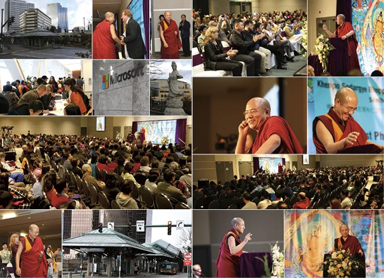
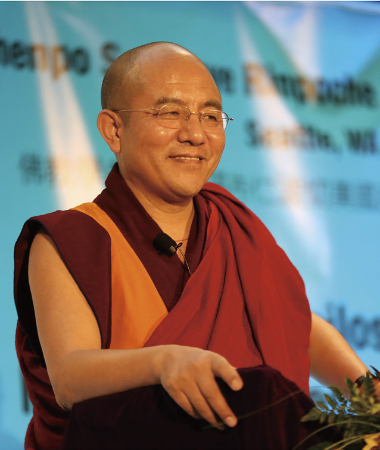
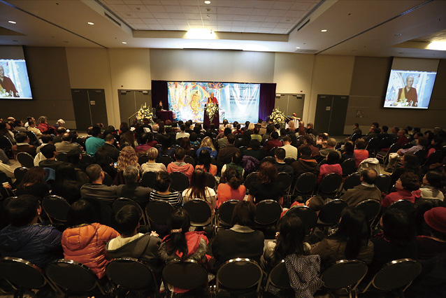
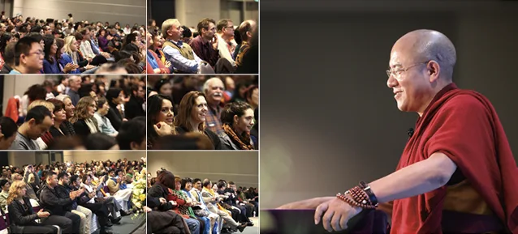
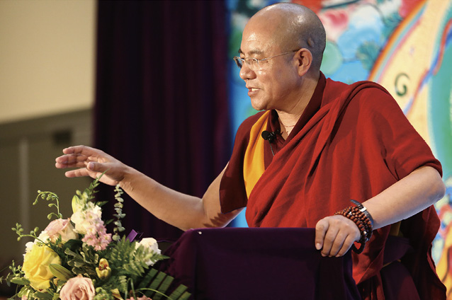
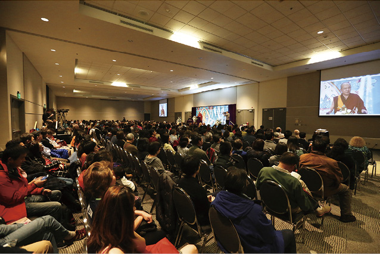
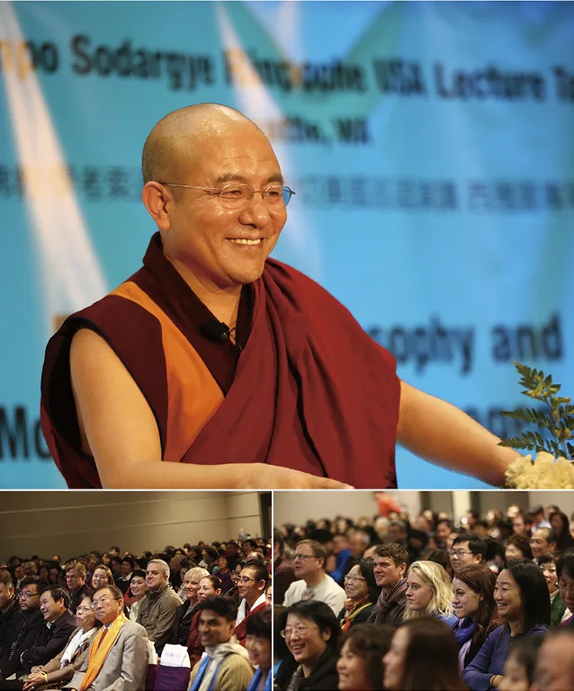
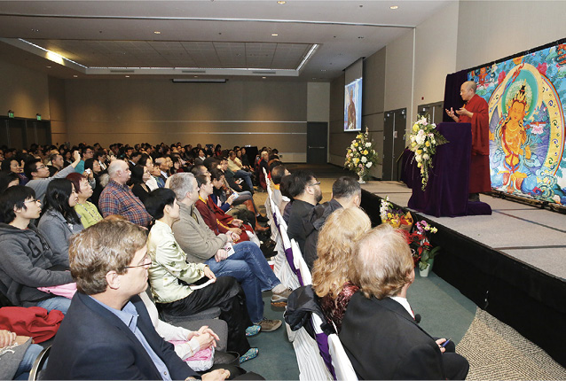
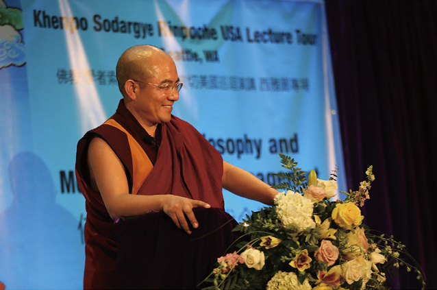

我们心的本体是空性的，  
在这样的空性当中，  
根本找不到任何的负面情绪。

第24场

美国贝尔维尤市中心美邓鲍尔会议中心

Meydenbauer Center, Bellevue, USA

美国·贝尔维尤

2014 / 11 / 23

## 佛教哲学与现代企业管理

## Buddhist Philosophy and Modern Business Management

主持人：

各位女士、先生，欢迎来到贝尔维尤市的美邓鲍尔会议中心。非常荣幸能邀请到尊贵的索达吉堪布仁波切，他将在各位的配合下，在此留下珍贵的教言。这将对我们未来的社区、商业产生深远影响。请各位起立，欢迎索达吉堪布仁波切——

谢谢大家！在正式开始前，我先介绍下我们今天的嘉宾索达吉堪布仁波切。他是当今时代公认的最杰出的佛教上师之一，并且培养了很多高水平的佛学老师。他也是一位作家，出版的书籍已超过一千万字，而且至今他依然在写作。

为了让大家更好理解，托尔斯泰的《战争与和平》也只有五十万字，可见一千万是多么庞大的数字。自2010年起，仁波切应邀到多所全球顶级学府演讲。2013年，中国的《人物》杂志评选仁波切为“年度最具影响力的宗教人物”。

在中国，仁波切俨然已经成为明星。今年美国的巡讲，仁波切去了耶鲁大学、天普大学、斯坦福大学以及加州大学伯克利分校等高校。今天在场的有很多高层管理人员、专业人士，来自亚马逊、微软、谷歌、T-Mobile以及波音公司，这只是列举了一小部分。

感谢各位的到来！最后，我要向大家介绍Conrad Lee，在过去20年，他一直担任贝尔维尤市的议员。Lee先生出生于中国，他是一位退休的波音工程师，也是贝尔维尤市的前市长。

有请Lee先生发言——

Conrad Lee：

尊贵的仁波切，欢迎您！各位来宾，欢迎大家来到贝尔维尤市，谢谢大家！我代表贝尔维尤市，十分感谢仁波切的到来！我觉得我们都备受加持，我非常高兴。我是一名基督教徒，但是我认为，我们都对圣者有信心。

仁波切之前谈到了点灯，我很高兴他在进行全球巡讲为人们点亮真理之灯。

在基督教中，我们阅读《圣经》，我们不愿遮蔽真理，希望与他人分享光明。让全世界的每个人都能认识到真理，因此我们感到非常高兴。

仁波切能在全世界传递这样的智慧明灯，他的足迹遍及欧洲和美国。这次我们有幸邀请他来到西雅图，来到贝尔维尤市，我们希望仁波切能经常来，把这里当作第二个家。希望他的智慧能够让我们更好地成长，以及体悟真理。再次感谢大家来到我们的城市。欢迎来到美国。

主持人：

谢谢！感谢Lee先生。今天仁波切演讲的题目是“佛教哲学和现代企业管理”。

如今我们都逐渐意识到拥有高智商和高情商是企业管理成功的必备条件。如果没有敏锐的头脑，公司就缺乏创造力；如果没有自我认知和慈悲，管理层就会由于压力过大而无法营造出和谐的工作环境。此次演讲结合了西方的管理理念以及东方佛教的智慧和慈悲。这是一个东西方的完美结合。和谐、创新和进取精神对管理层和员工都是有利的。仁波切的演讲结束后，我们安排了足够的时间提问。

请大家起立，与我一起欢迎索达吉堪布仁波切——

首先，非常感谢理事长，感谢主办单位和协办单位。今天能有这么好的缘起和机会让大家聚在一起，也很符合佛教的“因缘和合”。我昨天刚从湾区来到这里，发现这里居住着很多掌握顶尖科学技术的年轻人和科学家。我作为一名传统的佛教徒，今天能和在座的各位这样对话，对我自己来说也是很好的学习机会。

## 世界上再聪明的人，也需要传统理念

我曾在东方传统的佛教寺院中待了很多年，之后到了城市里云游。很多人可能觉得在西方科技非常发达的现代社会，其企业管理与古代的寺院管理不一定相同，甚至还有很多的相违之处。但在我看来，古代的寺院管理模式，可以为现代的企业管理，提供一些建议和参考。我发现寺院的一些管理模式与现代的企业有相同之处，但是你们不一定承认这种观点。俗语说：“有千年的寺院，却没有千年的企业；有打不走的和尚，却没有留得住的员工。”从这个角度而言，传统的佛教寺院所传承下来的且遍布于世界各地的分院或中心，这相当于现代企业的连锁店一样。传统文化和传统组织研发的并不是外在的物质产品，而是内在的精神食粮。

其实，我们生活在这个世界上，不仅需要外在的物质和各种因缘，也需要内在的情绪调整和心灵粮食。我知道，今天在座的各位有很多是有智慧、有能力、有思想的精英，而且也是在微软、谷歌、波音等掌握着世界上许多高科技的企业里工作。从世间研究的智慧层面来讲，你们掌握着现今地球上最高端的理念。但是，如果缺乏传统的宗教信仰和理念，无论世间的智慧再怎么高超，当你向内寻找自己的心灵时将会是一片空白。即便面对最简单的同事关系、家人关系、身体与心灵的关系，也会是束手无策。

我认识很多非常有智慧的人，他们在发明或创业过程中是非常成功的，但在为人处世、待人接物甚至是产生烦恼、负面情绪等小方面却难以对治。长此以往，他们会觉得自己是非常脆弱的人。这个世界有时候是非常奇怪的，因为无论是外在物质，还是内在情绪，包括同事关系、家庭关系等，都是在瞬息变化的。关于这方面，我们需要寻求传统的方法或现代的研究，来解决这些比较棘手的问题。

## 大乘佛教的四摄

谈到现代企业的管理，其实佛教哲学也与之有一定的关系。大乘佛教中讲到四摄，即四种摄受方法。对于现今的企业家来说，如果掌握了这四种摄受方法，无论是对产品研发还是员工管理都有极大的帮助，甚至对平时的生活也会带来一定利益。

其中，第一个是“布施”摄受。大乘佛教认为，对于任何一个组织或集体，管理者应该有财物的布施。如果你非常吝啬、没有财物的布施，周围的人不一定会集聚在你的身边。如果你想要企业有一种凝聚力、有一定的工作效益，那一定要提高员工财物方面的待遇。我认识很多的企业老板，有些老板是特别吝啬。员工毕竟是活在这个世界上的人，他肯定会关心自己的薪资、福利等条件。而作为一名企业管理者，首先应该少考虑自己，多考虑员工、客户以及与你相关的人，你先要无条件地布施给他们才行。人都不是愚笨的，当他满足了一些利益的时候，也会反过来考虑你。从这个层面看，大乘的“布施摄受”，无论在大企业、小企业，还是在任何一家公司、任何一个集体中，都是不可缺少的一环。

第二个是“爱语”摄受。任何一个集体或组织都需要语言的沟通，因为语言是人与人之间关系的桥梁，如果我们没有用好语言，那你最珍爱的、最重要的人很有可能会很快离开你。古人常说：“良言一句三冬暖，恶语伤人六月寒。”一句爱语能带给你春天般的温暖，一句恶语也会带来寒冬腊月般的冰冷痛苦。所以，企业领导、项目经理等在调和人际关系时，一定要会用善巧方便的语言。如果你没有用好语言，人际关系是很容易破坏的，当然，维系它也是很容易的。有智慧的人，该说的时候会说出来，不该说的时候是不会说的，而且说出来的语言也很适合所针对或想表达的。佛教里有专门的语言学知识，而它恰恰是现代年轻人缺少的。也可能是大学里人与人之间的沟通比较少，很多人也比较自我且缺乏社会经验和沟通能力。因此，我觉得我们很需要掌握语言摄，也就是爱语摄。

第三个是“同事”摄受。什么是同事摄呢？作为一名管理者，自己应该展现出合理如法的形象，否则，你自己一点都不守规定却想管理别人，那是非常困难的。古人言：身教重于言教。比如，我是一个出家人，如果我要管理僧团，至少我的言行举止要过关。我看到现在的有些管理人员、经理、总裁、领导等，他自己不受任何约束、随心所欲，却对员工的要求非常高。这是不合理的！在某一个场合的管理中，自己要跟群众、同事、领导之间有一种良性沟通。这种沟通应该是内心的沟通，而现在人们之间缺少了一种信任、一种行为上的交流。有些人觉得自己是领导，实际上很多人都在观察你。你言行中只要有一丁点的不合理之处，别人马上就能看出来。虽然别人不一定敢说，但我们在这方面，尤其是作为领导更要以身作则。这就是同事摄。

四摄中，最后一个是“利行”摄受。利行，就是利他的意思，也就是说我们不管做什么样的工作、做什么样的产品和技术，任何事情都要建立在利他的基础上。如果没有利他心，只有自私心或是害别人的心，到头来害的还是自己。人们常说：利他就是利己，利己不一定是利他。佛教的大乘教义，归纳起来就是利他，也就是帮助别人。在发展高科技的21世纪，有很多人认为自我推崇、自我宣扬才是非常重要的，包括很多先进国家也承认自信是很重要的。但是，利他和自信是不矛盾的。

## 亚当·斯密更看重《道德情操论》

自我价值的真正体现，实际上是去帮助身边的人。我觉得这才真正是人生最有意义的价值观。有些人可能会觉得利他虽然重要，但是利己更为重要。尤其是现代经济学中，比如亚当·斯密的《国富论》精神，提倡自我创新、自我开发，在这种理念下，如果我们无条件地利他，那我怎么赚钱呢？怎么体现自己的竞争力？我又如何在市场经济的竞争中获胜呢？所以，有些人觉得更重要的还是自我。

虽然我的专业是佛学而不是经济学，但我也非常关心现在人的心态，也很关注当前人们所关心的知识。我们不得不承认，西方经济学家亚当·斯密所创立的“资本主义经济”即古典主义政治经济学思想，对全球的影响非常大。我们现今所处的阶段，从已掌握的科技水平上来说，应该是自古以来地球上最高超的时代；从已拥有的物质财富来说，应该也是最富有的时代。但是，人们是不是也相应地处于最幸福、最快乐的阶段呢？我们的心灵会不会也处于最快乐、最幸福的时候呢？这是不一定的。你们可以观察一下，我们现在还处在时刻充斥着不安全感、恐慌感、威胁感的时代。所以，人们不能只追求科学技术、经济发展，却忽视真正能给我们带来永恒不变的快乐幸福的心灵。

在西方哲学史中，亚当·斯密一生中最重视的就是《道德情操论》。他从最初造这部论直到最后要离开人世的时候，一共做了六次校对、修订。直至最后接近离世的时候，他依然很重视这部论。然而，以往遇到过的很多经济学家，和一些高科技公司的管理人员，他们都只重视《国富论》，对《道德情操论》却漠然视之。作为旁观者的角度看，《道德情操论》中讲了经济发展的最基本的基础——即道德、利他心、慈悲心、仁爱心和正义等。在这样的基础上，人类再进一步发展贸易，让大家互相都得到利益。

但是，在如今高科技和经济爆发性发展的时候，我们对很多客户和竞争对手都间接造成了不同程度的伤害。因此，我们在利他心或良心上，也应受到谴责。我非常希望，很多科学工作者在做研究时，要关心环境问题，凡是对环境有害的产品，尽可能地减少对它的研发。同时，也要关心人类身体和心灵健康，任何对心灵健康不利的科技，也不一定有可行性。我们更进一步要关注全球的空气、资源等问题。

尽管在座的各位生活在21世纪，但我们还是不得不考虑一下22世纪、23世纪甚至以后的人类子孙。因此，科学工作者不仅要关心自己以外的芸芸众生，还要关心未来世世代代的众生。虽然我们每个人的能力和智慧是有限的，但在自己活着的时候，应该尽量地多帮助身边的人。这并不是口头上说说而已，而是要发自内心地去做。在实际践行中，我们能不能做到这样呢？

佛教的观念是：只要众生需要帮助，我都会尽量帮助。我们每个人都可以在短暂的人生中，做一些小事来帮助别人。那我们能否产生这样的心呢？我们从来到这个世界起一直到今天，很多人可能从来没有想过帮助别人，但不一定没有这样的心。我记得在《道德情操论》里面，有这么一句话：“虽然人是自私的，但当他看到别人幸福的时候，他也会替别人感到高兴。同样无须证明的事实是，当我们看到别人痛苦的时候，我们也会为别人的痛苦感到伤心。这种情感并不专属于良善君子，尽管他们可能对此最为敏感。即使一个无赖罪大恶极，无视一切社会规范，他也不会完全丧失同情心。就像人性中所有与生俱来的感情一样，我们每个人都具有同情心。”

## 当下，就练习利他

也许在个别人看来，这种想帮助别人的心态、语言和行为，并不是很重要的。但对我来说，我觉得世界上所有学问和知识中，利他是最重要的。我们很多人喜欢帮助自己认识的亲朋好友，但对素不相识的人，比如今天坐在一起却互不相识的各位，你会不会帮助他们？我有个小小的建议，大家可不可以把自己的双臂向左右交叉，然后左、右手分别握着旁边人的左手或右手，并对你两边的人发自内心地说：“我将来有机会的时候，一定会帮助你。”大家一定要很真诚地说：“如果你真正遇到困难的时候，我会帮助你。”然后再紧紧地握着别人的手。

（大家纷纷这么做）

将来不管你的智慧有多高、经济收入有多丰厚、学历和经验有多丰富，当身边有人需要帮助的时候，你一定不要漠视。有智慧固然很重要，但贤善的人格和道德更重要。现在的一些大学毕业生，从智慧上说是相当不错的，因为学校教的科技知识偏多，而怎样为人处世、怎样解决问题以及面对痛苦时要自信、坚强等诸如此类的道理教得偏少。美国也是这样的情况，世界上其他国家也是这样的。很多学校只是一个锻炼技术的学校，而锻炼做人却只能等到学生们进入社会、市场后靠自己摸索。其实做人也是需要提前培训的。

## 观无常对人生有帮助

我还要提出一个建议，在座各位的人生虽然现在看上去很辉煌，而且也过得非常快乐，但是我们需要有一种无常观。佛教里讲的无常的观念是极其重要的。佛陀在《杂阿含经》里讲到：“若过去、若未来、若现在，若内、若外，若粗、若细，若好、若丑，若远、若近，彼一切悉皆无常。”我对这句话的感受非常深。为什么呢？因为在座的领导、员工或其他普通人，今天过得很快乐，明天就可能很痛苦，这些都是瞬息万变的。比如，有个领导特别信任他的手下，但这个人很有可能想离职就离开了；而有的员工很想待在这家公司里，但到了一定的时候，如果技术和工作不过关的话，领导也会残忍地当下就辞退你。那个时候，自己的生存都成了问题。

之前在金融危机爆发的时候，有一家公司在一天之内就辞退了上千人。所以，我们的生存和生活，时刻都有一种危机。对我而言，观无常会对自己的人生非常有帮助。我经常看到很多成功人士对无常修得不好，最后他们选择的道路很悲惨，甚至大多数人选择自杀。如果无常观得好，应该不会有这样的下场。尤其很多年轻人，我特别希望你们心里时时能有无常的观念。因为内内外外的一切万法，包括你的青春都在不断地变化。很多人都希望自己可以青春永驻，但这是不可能的。随着年岁增长，脸上的皱纹也会增加，皱纹越增越多，心里的创伤也会越大。但这也是没办法的事，到了那时候，青春一定会发生变化。

人们很羡慕那些受万众敬仰的领导、富贵者、明星，但他们过一段时间就不一定是这样光鲜了。他们中的有些人很快地住进了监狱，有些人在一瞬间就离开了人世，有些人虽然还没有离开人世，但却过得非常痛苦。因此，因缘聚合的时候，一切法都可以产生，因缘灭尽的时候，任何情况也都会发生。这一点，佛教剖析得非常好。

因此，我们不仅需要计划、目标和理想，也需要保持乐观，不能完全成为悲观主义者。与此同时，我们也要考虑到：一旦自己的工作、生活、感情以及很多方面出现无常的时候，自己应该如何去面对。如果提早有了这样的心理准备，一旦真正出现了一些无法预估的事情时，你就有一个很好很及时的解决方案。我们对生活的态度，应该是正面地、积极地去努力实现自己的目标。假如你没有实现自己的目标，反而失败了，也一定要有一颗坚强的心，不能永远倒下去。我看到有报道说：澳大利亚的小孩子在跌倒的时候，父母是不会去扶他的，而是让他自己站起来，每个小孩子都做过这样的训练和准备。我觉得这种方法很好，我们每个人不能把自己的幸福依赖于别人身上，比如“我的幸福就靠我的伴侣和领导了”等等，而应该靠自己去建立自己的幸福。

这种幸福，应该是内心的幸福。父母从小培养孩子内心坚强的教育很重要。为什么美国的经济和科学水平成为当今世界顶尖水平，自杀率却非常高？据统计，美国的自杀率已经远远超过了癌症、交通事故及其他因素导致的死亡率。这是因为我们的心灵教育没有跟上，导致人类走到了非常可怕的地步。

## 自心管理的两种方法

今天讲的是“现代企业管理”，我认为其中最重要的是内心管理。内心管理，是所有管理中最高级的管理。我们应该先管好自己的心，然后才能管好别人。如果每个人都有反观自心的习惯，那在任何场合中大家都会非常开心。

自心的管理方法中，其一就是禅修。现今各所大学、企业中都有很好的、不同的禅修方法，包括来自藏传佛教的、日本的、印度的以及泰国的一些方法。我希望大家要经常禅修让自己的心静下来，心静下来以后，所有的愤怒、嫉妒、嗔恨、痛苦和烦恼等都集中在心性上，最后在心性中根本找不到这些负面的情绪。因为我们心的本体是空性的，所以在这样的空性当中，我们根本找不到任何的负面情绪。在这样的状态中经常串习，实际上会提高我们的工作效率。我们的身体经常需要按摩、调养，补充维生素、营养药等，同样地，我们这颗非常疲惫的心也需要调整。尤其是每天在电脑前和各种情绪作战的年轻人，他们的心也需要放松、舒缓和安静。这样调整之后，自己的寿命不但会延长，而且也会非常正面地面对自己的情绪。这是一种内心的调整方法。我们也发现，如今这个时代很需要一种安静的妙药。否则，生活太浮躁了，压力太大了。无论哪种方法，如果我们的心很坚强，那在任何环境中以任何方式生活，都会过得很开心、很快乐。如果我们的心没有调整好，那在物质条件再好的环境中，也不一定过得快乐。

还有一种方法是观佛像。印度独立后的第一任总理尼赫鲁在监狱中时，别人送给他一尊佛像，这尊佛像在他之后的人生中，算是他的一个非常重要的伴侣。他觉得这尊佛像给他带来了非常多的力量，在他消沉的时候就依靠它、关注它。今天我们看到的这尊文殊菩萨像是智慧的象征，释迦牟尼佛像也是让我们的心完全沉静、清净的象征。无论你是否有信仰，都可以依靠它使你的心平静。因此，在平时生活中，如果你是佛教徒或是对佛教有兴趣，最好在自己身上、车里放一些佛像，这非常有作用。就像宝珠能对自己的身体起到驱邪、驱毒的作用一样，我们凡夫人虽不一定能想象到，但它的的确确有作用。我认识的很多基督教的朋友也说，他们经常在身上戴一个十字架或在车里挂一个，也是起到一种保佑平安的作用。我相信每个宗教都有其非常甚深的意义，我们用科技的眼光来看的时候也许能看得清楚，但在我们看不清楚的地方，还存在着一个秘密的因缘。

我觉得，处在科学非常发达时代的年轻人，如果你们只掌握了现代科技，却丢失了一直传承至今的本民族传统文化，那会不会成为历史的罪人？如果对今天的讲座做个总结的话，我觉得现代的科学管理固然很重要，但更重要的是内心管理；关心自己、发展经济固然很重要，但更重要的是关心社会上更多的弱势群体和贫穷的人；外在的物质财富固然重要，但更重要的是丰富的内在精神财富！

现场互动

主持人：

仁波切，感恩您带给我们的智慧财富，由我来总结一下今天的演讲。仁波切认为我们应该共同开发智商与情商，将科学和人文结合起来，在我们的工作当中，改变自私就可以改变不良的环境，营造出积极、友好的氛围，这有利于健康的心态，人们也会彼此更加关爱，所以我们要去关心他人。谢谢！

下面是我们期待已久的提问时间——

问：我在墓园殡仪馆工作。刚才您提到帮助人，如果说这个人他本身有私欲和目的，但是他还是需要人的帮忙，在这种情形之下该如何做？

堪布：这有两种情况，其中一种情况是：虽然别人的私欲和目的存在，但他的确需要我们的帮助。在这种情况下，我们不能以“他是自私的、有目的的、有其他想法的”作为借口就不帮他，这是不合理的。从大乘佛教的观念来讲，利益众生是非常重要的、不可推卸的责任。

还有一种情况是对方真的不需要帮助。当我们用智慧来观察时，发现对方确实不需要帮助的话，你不帮他也没有任何过失。如果你用智慧观察，发现他欺骗你或是准备用其他手段来欺骗你的话——现在世间确实有一些狡诈性、欺骗性的行为，那我们可以不帮。也有人把这些作为借口，实际是自己内心不想帮。总之，有两种情况，需要用智慧去观察。

问：我是一名来自微软的工程师。我的问题就是：经常在工作和生活中，有很多的负面情绪，比较焦躁、比较愤怒，这个时候我就想有没有什么好的方法，能够迅速地平息这种负面的情绪，让心灵回到一种比较安定的状态？

堪布：可能很多人有这种情况，因为有时候我们压力比较大，再加上整天工作的关系——大脑过度地使用，可能自己内在的调整就比较少。我刚才也讲了，实际上最关键的就是认识自己的心。这是非常重要的！这些高端的高科技的人才，对人类有很大的贡献。现在包括微软在内的很多成功企业，世界上很多高科技人才都在它们那里。我听说你们十年之内的订单都已经掌握了，不知道是不是真的。但不管怎么样，因为现在有竞争和对手，我们的愤怒等各种情绪就会发生的。我们在这种情况下的确需要修行。

现在很多人通过修行，觉得原来的生活非常浮躁，没有很大的意义。虽然我们金钱方面富裕，智慧方面、技术方面也很聪明，但自己总是不开心。正因为这样，现在得抑郁症的人越来越多了，得自闭症的人越来越多了，得孤独症的人也越来越多了。

在我们藏族的语言里，连“孤独症”这个名词都没有。前一段时间，我在美国时，他们很多人询问关于孤独症的问题。我的家乡有一位专门做英、藏、汉辞典编辑的大法师、大堪布，我问他：“你这么多年以来专门编辑辞典，我们藏文当中‘孤独症’是怎么说的？”他回复我：“我们这里既没有孤独症，也没有它的名词。”

所以，这个词也许来自现在的高科技和大城市当中。我们没掌握自心的时候，反而又产生很多的烦恼。现在这些烦恼暂时是一个小小的肿瘤，如果我们没有很好调整的话，将来很容易变成恶性肿瘤，逐渐地毁坏自己的身心。所以，我们现在通过禅修、通过无我、通过一些宗教的方式来调整是最好的。

问：扎西德勒！仁波切，我的问题可能用藏文好一些吧，先用藏语再用英语吧。我想问仁波切的是：比如有时候两个人初次见面时，我会说我是藏族，他是汉族，然后慢慢会谈到我们都是佛教徒，这样共同的宗教信仰就有了拉近距离的作用，我们有共同的上师、共同的信仰，但是从科学的角度有没有类似的方法，比如说有共同的话题，依靠科学如何拉近人们的距离，从科学的角度是怎么讲的，刚刚佛教的作用已经很明显了，这就是我的问题。

堪布：我刚才听你的问题，可能现在不一定有科学的理念，能把大家都统一起来。而宗教有个好处——这是我们大家的宗教。但是也有不太好的地方，比如说我是汉族、他是藏族，或者我是伊斯兰教、他是基督教，一方面，有宗教信仰的人可能会联系在一起，但另一方面，我是基督教的、他是佛教的等等，这中间好像被一种分别念拉开距离，这也是不好的方面。

所以，我经常在想：不论从宗教还是科学的层面看，最终都可以归结到人的层面。从宗教层面讲，我们不应该有宗教的界限、民族的界限、国家的界限；从内在的价值观层面讲，我们都有离苦得乐的愿望，这个时候我们就会统一起来。所以，有时候宗教对团结有很大的帮助，但有时候宗教也有一种狭隘的思想，会让人与人之间的距离自然拉开，因此，宗教、非宗教的概念不是很重要的。

从人的层面、从生命的层面来讲，大家应该成为一个地球村或是一体化，这一点我觉得才是很重要的。在这个问题上，我讲一下自己的感受：比如说一个人是佛教徒、一个人是基督教徒、一个人是不信仰任何宗教的，但我个人对这些人是没有任何差别的，如果我要帮助他们的话，我不会区分对待——因为我是佛教徒，所以我要帮助他；因为他没有任何信仰，所以我就不帮他；因为不是我们宗教的信徒，我就把他放在最后。我是不会这样的。

所以，从我的理念当中就感觉到，宗教、民族等不应该成为一种隔阂。佛教的教义是：所有众生都一视同仁。它不会因为你是哪个国家的，或者不是这个国家的就对你歧视。类似“不是我这边的，就是他那边的”这种想法，实际上是我们被一种狭隘的执著束缚了，这是现在很多人需要关心的问题。

问：我是做房地产的，有一个很实际的问题想请教您。我发现当你做得越多的时候，就会有更多的工作等着你去做。很多时候在慢节奏的社会生活中，比如说像在西藏，很多事情可以坐下来，大家喝一杯咖啡、喝一杯茶来谈论、来解决，而现在因为现代科技，生活节奏很快，即使很希望能跟对方见面，时间上也不允许，所以就发一个短信或邮件。这并不能帮助人建立更好的人际关系，反而把人与人之间的距离拉得更远了。请问一下您有什么样好的建议？

堪布：她的问题，可能也是大家需要思考的。现在因为科技的发达，越来越多的一些技术，表面上看来好像让我们越来越有效率了。二十年前我来过美国，当时第一次看到传真机，我感到非常惊讶：一封信从这里可以直接传到大陆，然后在那边就原原本本地显现出来了。当时，这在1993年的中国，还没有看到过。我当时非常惊讶，回去后跟很多朋友说：“有一个非常微妙的东西，即使中间隔着大海，也可以让另一边的一封信在这边看到。”

前两天到了美国的时候，我询问：“现在传真机还用不用了？”他们说：“现在基本上不用了，直接发Email就可以了。”但是，我看到美国人并没有因为科技的发达，让他们更加轻松、快乐，好像反而比二十年前更忙了，大家都觉得有做不完的事。

其实，我们的人生是很短暂的，有时候可能需要成功、需要做很多的事情，但有时候，我们的欲望不能太大了。如果欲望无节制，且我们也跟着欲望跑的话，那我们会活得很累的。当你死的那一天，也许还没有做到想做的事的一半。

问：感谢您从远方来到贝尔维尤，我有两个问题。第一个问题是，在家人没法像出家师父们那样，整天禅修得很精进，把一些负面的烦恼解除掉，您有没有什么建议，在家人每天至少要花多少时间，做心理调整的工作？当然您可能会说，有些比较利根的，半小时一天就够了，那钝根的话至少要三四小时。我是想从仁波切这边得到比较务实的禅修经验，就是您观察这些在家人的经验。

第二个问题就是，我自己也是有一些负面的东西，因为我们还是在这个娑婆世界轮回。我比较困扰的就是，每次我坐飞机的时候都会有气流发生，我听说有一些在家师兄，问过雪哥仁波切这样的问题。那我想请问师父，您坐飞机的经验有很多年了，您要是碰到这种情况，您怎么建议在家人或是您自己？当然您已经修行非常高深，您都不会有这种困扰，但万一那个时刻来了，那要怎么解决？

堪布：第一个，在不同的工作当中，都有不同的一些调节方法。但我的建议，是从五分钟到二十分钟，作为一次坐禅的时间。坐禅，根据自己的情况可以定，至少也是要五分钟，然后二十分钟。如果时间越来越长，当然是最好的。一天当中，最好早上起来的时候安住一下，晚上睡觉之前也可以安住一下。早上起来的时候，你要想到：我今天工作、上班之前，应该要有一个很好的情绪，不要被自己的各种贪婪和嗔恨心所左右。

心清净一下，这点相当重要。就像早上起来洗漱一样，也要对心灵有一种洗涤。晚上睡觉之前，跟很多人习惯洗漱一样，也可以净化一下心灵，因为白天环境的很多污染都在心里。我自己也是经常这样做。但有时候我本来想好好禅修一下，结果就睡着了。

第二个问题，我坐飞机的时候也经常遇到气流。这次我出来到明天回上海，我算了一下，坐飞机已经有88个小时了。在这个过程中经常有气流，心里觉得“哇，这次已经不行了”，有时候我会祈祷，有时候是安住心性，安住心性对我来讲是最管用的。也许你们不相信，确实如果没有安住心性的话，我也经常很害怕。安住在心性当中的话，所有的恐惧在那个时候就没有了。所以，有时候需要安心，但有时候需要祈祷。有一次，我坐飞机时使劲地祈祷，旁边的人全部都在睡觉，后来我想何必这样祈祷呢，我也装着不祈祷，我也睡觉。（众笑）

问：欢迎您来西雅图，我来自谷歌柯克兰，我的问题主要是关于帮助别人的。对我来说，我现在年纪三十多岁，上有父母六十多岁了，我妈妈有些生病，下面又是小孩、老婆，岳母也在这边，各种各样的问题，更远的有我的同事、很多朋友，也有很多其他公司的人，他们都需要帮助。我在帮助他们的过程中，发现我的时间是很大的问题：我怎么能够有效地管理自己的时间，能够帮助别人，还能使我自己不至于太累，中间的平衡怎么样来找到，既能帮助别人，也能帮自己保持心理平衡？

堪布：很好！你现在帮助别人的话，资源很丰富——上面有老人，中间有爱人，下面有孩子，这些都是你应该帮助的对象。

你可以先从自家的老人开始关心。现在很多人对老人根本不关心，很多老人非常可怜、孤零零的，他们没有人关心、没有人安慰。我听说美国也有很多这样特别可怜的老年人。

然后，对自己的伴侣也要关心。现在这个时代，有些高科技人才只关心他自己的事业，根本不关心家人的感受。家人一直等待着有很多话想说，但也不给他们机会，甚至连基本的交流都很缺乏。我接触到的一些科学工作者，他们可能太注重自己的事业，在短暂的人生中基本没有陪过家人，到最后很后悔也没办法。有些人对自己的孩子也不关心，孩子的成长跟父母非常有关系，但是父母因为忙着自己的事业，最终孩子的成长缺乏同情心、慈悲心、人格。这样培养出来的下一代，可能不是自己所想象的。

所以，如果我们有了利他心，可以先从自己的家人开始，不一定是你单独拿出一部分时间，而是随时随地关心他们。之后，再把这个利他心扩大到你的工作当中以及你周围的事业当中。

我们经常遇到各种各样的人，这个时候，自己应该要想帮别人，至少不要害别人。有了这样的心，那自己周围的氛围也会越来越好。帮助别人并不是要求你把所有的家人都放弃了，专门到一个地方去天天做义工。我们每个人都有最基本的同情心，要把它更有深度、更有广度地开发出来。科学技术和人类的同情心是可以并驾齐驱的。

主持人：

仁波切，感恩您智慧的教授！我们非常感恩您的到来，希望您能尽快再次来访！
