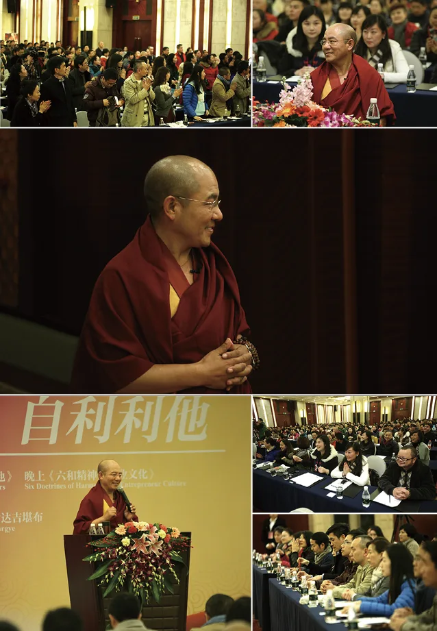
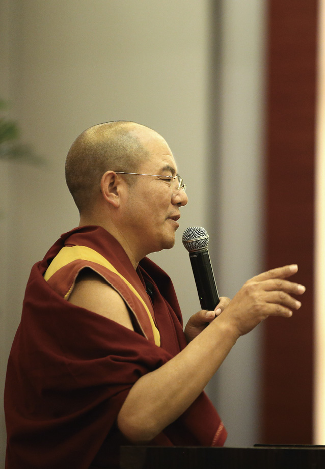
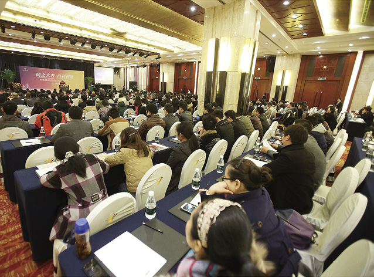
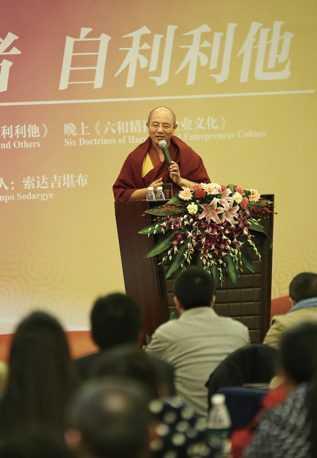
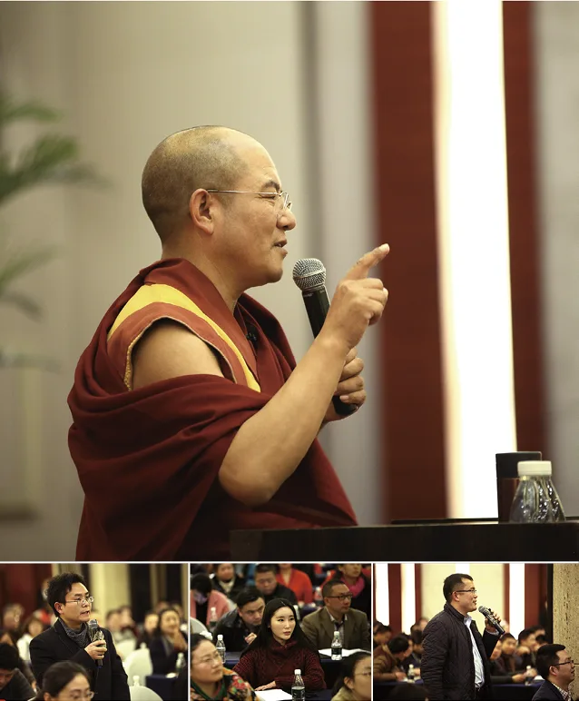
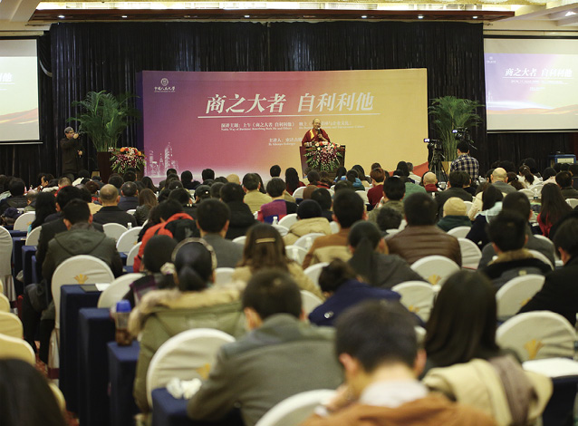
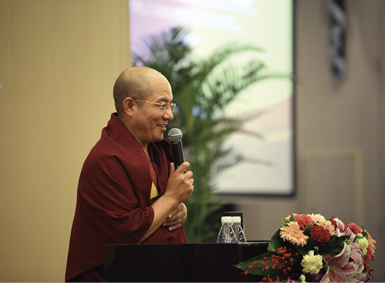

生活中，  
有些看起来是顺缘，也许会变成违缘；  
有些看起来是违缘，有可能会变成顺缘。

第25场

中国人大重庆校友会

RUC Chongqing Alumni Association

中国·重庆

2015 / 3 / 1

## 六和精神与企业文化

## Six Harmonies and Corporate Culture

主持人：

大家晚上好。感谢各位如约来到我们的现场，相信各位跟我一样都迫不及待了。在此我宣布，“六和精神与企业文化”主题演讲现在正式开始。

掌声有请索达吉堪布上师——

今天上午我们进行了关于自利利他的学习，晚上就来讲讲“六和精神与企业文化”。从上午的学习状况来看，我觉得大家的整体状态非常好，虽然我讲得不怎么样，但从表情上、态度上可以看出很多人的素质。

## 当下正是利他时

晚上想跟大家分享的是，现代企业文化与两千多年前古老的佛教文化有何相同之处。在座各位对此可以用智慧分析，有些地方可能你们认可，有些地方不认可，有些地方半信半疑，这都是可以的。我只是跟大家讲讲自己的心得，并没有期待所有人都接受，毕竟仁者见仁，智者见智，每个人的见解不尽相同，判断一切的价值观也不一样。

其实，在不同的场合交流，让所有人都满意是很困难的。因为我是一个穿着僧衣的人，如果讲世间文化，有些人觉得太世俗，没有什么好听的；如果只讲佛教的内容，有些人觉得这是在传教，跟自己没有什么关系。在座有信仰、没信仰的都有，我很难抓住所有听众的心，而且每个人的心态都不同，有些喜欢听高深点的理论，有些愿意听生活化的内容，一百个人有一百个想法，众口难调，佛教中说，众生的业力不同，感受也千差万别。

尽管如此，我还是想尽量跟大家分享一下。在南传佛教和大乘佛教的经论中，“六和精神”出现过许多次，可以说，这种精神在僧团中一直保持得非常好。而这样的精神，与诸位关心的企业文化也可以对应。

有些人经常跟我说：“我在世间的话，心比较乱，要不要到寂静的寺院去出家？”我说：“不用吧，你在世间能帮助这么多员工、这么多人，这是一种重要的利他，甚至很多出家人都做不到。”

在中国人的观念里，出家人应该待在寂静的寺院，天天念阿弥陀佛，如果到了城市里，很多人就感觉怪怪的。实际上，出家人和在家人也有同样的感受，同样可以为社会做一些事。

很多人觉得出家人应该四大皆空，如果与世间有一些交往，会招来不同的非议。但实际上，佛教徒既有出家众，也有在家众，而且按照大乘佛教的理念，出家人应该广结善缘，只要是能让众生获得快乐的事，都要去做。

作为企业家、各行各业的精英，你们也应该想想，自己的人生是有限的，能活过一百岁的寥寥无几，即使活了一百岁，身心也会衰老不堪，活着也没法做什么事了。所以，趁着现在这个年龄，最适合做什么呢？就是一些利他的事。因为人在年少时，思想非常浮躁，工作、家庭等没有着落；人到了六七十岁时，眼耳鼻舌身意六根都衰退了，想做一些对社会有益的事也力不从心了。你们现在刚好处于壮年，从三十岁到六十岁，这三十年的时光虽然不多，但也可以为社会做一些事。当然，如果你没兴趣为社会做事，至少应该为家人做点有意义的事。什么才是有意义的呢？和谐，也就是要具有“六和精神”。

## 有“和”才有意义

藏族有种说法：家里再穷，只要有“和谐”在，也会很快乐。虽然这只是民间说法，其涵义却非常深。

有些人家里应有尽有，财富地位样样俱全，但因为缺少和谐，经常和家人吵吵闹闹，苦不堪言。所谓“家和万事兴”，如果夫妻不和，孩子的性格也不会很好，即使物质上非常富裕，也始终得不到真实的快乐。

所以，对家庭而言，我觉得这个“和”非常重要。为了得到“和”的境界，希望很多人以后在行为上，尽量不吵架、不打架，这是你们可以做到的。现在有些人开口闭口都是争吵，在家里已经习惯了，一直吵了几十年，天天如此，这真的很痛苦。

家庭是社会的一个细胞，家“和”是非常重要的。当然，不吵架的关键是什么？就是自身观念的调整和改变，心要比较豁达、宽容、包容，有一种正确的信念。我看到很多吵架的家庭都不幸福，其实他们也不是为国家大事、为获得佛果、为特别重要的事而吵，只是为了一个小小的观点吵来吵去。无论是汉族、藏族，还是其他民族，在家人吵架大多如此。那天我去一个地方，见到几个非洲人，就问：“你们非洲夫妻平时会不会吵架？”他们说：“吵得厉害。”“主要吵些什么呢？”“就是他说一个观点我不承认，我说一个观点他不赞成，之后就吵得不可开交。”这样的现象可能贯穿于每一个家庭，也同样贯穿于我们每一个团体。

《论语》中说：“君子和而不同，小人同而不和。”真正有智慧的君子，在抉择重大问题时，他的智慧、能力、见识都高人一筹，所提出的想法跟别人截然不同，但即便如此，他也照样能与大家谈笑风生、相处融洽。而小人，表面似乎和别人打成一片，观点和别人一模一样，但却经常跟大家不和。你们在企业里应该也有这种感受，人格不好的人在团队里非常麻烦，他走了以后，大家都松一口气，“哇，真舒服！”一旦他回来，大家又要看他的脸色说话做事。

现在有些年轻人，在学校里接受的人格教育不多，父母教他为人处世的道理也不多，所以在跟别人交往时，表现得非常差。包括我们出家人中也有这种情况，虽然某人是名校毕业的硕士或博士，在国外留学多少年，看起来相当了不起，但跟别人交往一段时间后，就会发现他跟谁都不和，整个集体的气氛都被搞乱了。而有些人虽然没有这么高的学历，但是人格稳重随和，谁都喜欢接近他。

可见，“和”在任何团体中都非常重要。佛教中的“六和敬”，就是这样一种文化。佛教的出家僧团，看似和世间团体也差别不大，但实际上，它背后有极深的文化渊源。所谓的和尚，就是以“和”为最高精神追求的一群人。所谓的出家僧团，梵语叫桑嘎，音译为僧伽，意思就是和合众。这样的出家僧团，在2500多年中虽然经历过风风雨雨，但却能一直延续到今天，这在人类历史上也极为罕见。

## “六和敬”与企业管理

在座的企业家可以想想：出家僧团为什么有这么强的生命力？他们是以什么样的组织架构、管理观念，一直支撑到现在的？像斯里兰卡、缅甸、泰国等南传佛教国家，每个寺院都有那么多僧人聚在一起，藏传佛教和汉传佛教的僧团也是如此，实际上，这就是因为他们有佛教的六种“和”。下面我做个简单介绍，大家也可以对照一下，看自己的企业有没有这些特点。

### 一、见和同解

指的是见解相合，同样都追求解脱。

僧团有共同的见解、共同的理念、共同的追求目标。具体而言，他们都承认前世后世、因果不虚，诚信万法都是无常、无我的，最后都希求获得寂灭的解脱。每个出家僧团都是如此，这是他们的共同见解。

那么，企业有没有这样的“见和同解”呢？我觉得是有的。很多企业经常说，所有人都为了同一个目标，大家就像坐在一艘船里，企业负责人相当于船长，同一个时间在船上的人就是这个企业的员工。所以，对企业而言，大家有共同的远大目标，这一群人同舟共济，即使途中遇到狂风巨浪，大家也会风雨同舟、同甘共苦，只要一直努力，最终定会抵达目的地。

但是，现在有些企业就缺少这一点，负责人没有明确告诉大家企业到底是干什么的，结果员工每天除了挣钱以外漫无目标，这实际上是不成功的。

### 二、戒和同修

佛教中有统一的戒律，出家僧众有沙弥戒、沙弥尼戒、比丘戒、比丘尼戒，在家人也有居士戒。但佛教戒律不像各国的法律，法律通过商议可以不断修订，而佛教戒律一直没有改变过，像戒杀盗淫妄，就是2000多年前佛陀制定的戒律，但放到如今也仍不过时。

其实，戒律并不是一种约束，而是对底线的一种提示。如果你想成为高尚的人，可以守持比丘戒，里面要求比较多；想做中等的人，可以受沙弥戒；想成为基本可以的人，那就受持居士戒，戒除杀、盗、淫、妄、酒。这些戒律都代表了佛陀，佛陀在圆寂前说：佛住世时，以佛为师；佛圆寂后，以戒为师[^1]。正是依靠这些戒律，佛陀涅槃之后，僧团一直存在于世。

有些人总认为，佛教戒律是用来约束我们的。其实并非如此。纵观人类历史，无论过去还是现在，任何人都会守一些行为规范，包括我们读书时，无论是小学、中学还是大学，都有相关的规章制度，这些也可称为“戒律”。如果你认为佛教戒律不合理，那这些学校的制度也不合理，各国的法律也不合理，因为都是用来规范行为的条条框框。

对企业来说，其实需要一套完善的制度。西方国家的企业发展比较平稳，就是因为他们是法治国家，企业对每个人的行为要求、日常制度的运行，拟定得比较全面。所以，大至一个国家，小至一个团体，都要根据需求来定好制度，否则，运行或维持起来非常困难。

南怀瑾先生曾说，所谓的“管理”，是西方的一个词汇演变过来的，在中国的古文化中没有，“管理是现在的名称，从政治术语来讲，就是‘统治’，从军事的术语来讲，也就是‘指挥’”。

总之，企业离不开管理，合理的管理非常需要。无论是僧团还是企业，都需要完善的制度。

### 三、利和同均

就是利益方面要均分。

你们可能没体验过出家生活——现在有些地方虽开许短期出家，但与真正出家还是不同，而且佛经中对此是否开许，也有一些争议。但不管怎么样，如果你没机会终生出家，试一试短期出家也很有意义。

出家人的利益是怎么分配的呢？比如有人去寺院供斋，所有僧人都可以享用；施主供养的钱、布、食物等，所有僧人都可以分到。任何一个寺院，对僧众的钱财分配都非常注意，不可能无视因果而独自私吞。

当然，作为企业，不可能上上下下所有人的工资都平等，但在分配利润的时候，也应该遵循比较公平的分配原则，例如“多劳多得，少劳少得”。

有些企业中，管理者因为安排不善，以至于没做什么事的人，每个月的工资最高，而非常辛苦的人，拿到的钱却很少。对大部分世间人来说，工作的唯一目的就是赚钱，如此一来，有些员工的心理就会不平衡。

听说还有些企业推行终身制，满足条件的人会成为终身员工，工资也随之翻倍增加。有些终身员工觉得：“既然我都熬到这一步了，少做点也可以。”而非终身员工的工资不高，却非常辛苦，所以很多人心里不舒服。

人们对自己的收入，往往有一种攀比心。本来每个月三千块完全够用，自己也比较满足，可一旦知道别人拿了六千块，嫉妒和怒火马上就盛燃起来，觉得世界太不公平，进而失去工作的动力。这时候，管理者就需要非常有智慧，善巧地跟员工解释清楚，平衡好各自的利益关系。

这方面，我看到很多企业经常出问题，这与僧团有很大差别。僧团里，比如分配念经钱，出家人本来对此看得淡，所以没有什么好争的，基本听不到“不公平”“这次谁分了多少”之类的话。但企业在月底、年底时，经常会听到各种议论——即使我不在企业里，耳边也经常传来很多类似“这不公平”“这个人得多少、那个人得多少”的抱怨。这就是没有做到六和敬中的利益平等。

当然，所谓的平等，简单而言，就是多做多得、少做少得。但具体怎么落实，还是需要智慧的。

### 四、身和同住

指自己要在团体里跟大家共住。

在佛教中，不管是南传佛教还是其他传承的佛教，出家人都要住在寺院中，有统一的服饰，每隔十五日就要诵戒，如同你们的半月例会。很多寺院有这种统一的管理。

像我们佛学院，很多人来旅游时，看到出家人穿着红色僧衣，居住在小小的山沟里，经常被眼前的景象所震撼到。有人在网上形容这里是“红色的海洋”，说出家人的僧衣映红了整个天空。虽然他们有各种感慨，但由此对出家人的统一安住也可见一斑。

那么，企业需不需要“身和同住”呢？也需要。有些老板对企业一直不管不顾，很少来上班。我以前遇到一个总经理，他说：“我们经常看不到公司的最高领导，下面的管理松松垮垮，非常脱节。”所以，若想办好一个企业，领导层必须要经常出现在下属面前，及时有效地处理各种问题。

我看到现在企业的很多人，经常没有兴趣待在企业里，工作只是迫于无奈。这是一个很不好的现象，我们应该热爱自己的团体。我在学校给老师们开会时也说过：“作为老师，应该热爱学校，因为学校是我们共住的地方。如果老师都不热爱学校，以后怎么教书育人？”因此，共住在团体中是非常重要的。就像寺院，如果连一个出家人都没有，这个寺院应该很糟糕。同样，当你进入一个企业时，如果看到上上下下的人都安住于这个群体中，那它的凝聚力、团结力自然会呈现出来。

### 五、口和无诤

这是对语言的要求。一个人从进入佛门开始，就要做到身体不杀生、不偷盗、不邪淫，断除身体的三种罪业；语言不说妄语、恶语、离间语、绮语，断除语言的四种不善。僧团中要求什么呢？要求互相赞叹，不允许讲别人的过失。在僧团里，除了管家以外，一般听不到其他人说是道非，评论别人的短处、缺点。因为“祸从口出”，口是一切祸害的根源，所以大家都以敬语为主，语言交流非常谨慎，除了日常念诵、辩论，或者讲一些佛法教义以外，出家人不允许讲是非。

我认为企业也需要这样。有些企业在抉择一些重大事情时，让大家提出建议、方案，很多人说不出什么，也提不出什么建设性意见，但他们平时的话特别多，喜欢讲各种是是非非，甚至将本不算什么过失的事也到处宣扬。本来，中国人有“家丑不可外扬”的说法，可有些企业内部的各种是非在外传来传去，这是非常不应该的。因此，每个人的语言要谨慎，这对企业来说非常重要。人与人之间的矛盾，甚至团体之间、国家之间的冲突，大多是由语言引起的，因此，很多人应严格断除这种过失。

### 六、意和同悦

这讲的是心灵方面。在出家人的团体中，心灵要清净，始终处于善念中，尽量断除嗔心、贪欲、邪念、无知、傲慢等不良心态，护持自己的慈悲和爱心。僧团的日常理念也是强调心地善良，心善一切善，心恶一切恶。

刚才有人问我：“好人和坏人的差别到底是什么？善和恶如何区分？”其实归根结底，就是看你的心善不善，如果心地善良，就可以叫好人。当然，有些人自认为很善，但实际上很恶，这不是真正的善，只是他的错觉而已。

在出家僧团中，大家都会注重培养善的心念。同样，企业也需要共同培养爱心。有些老板对下属有一种爱的传递，这种企业文化很重要。当然，企业文化的形成，还需要每一个员工将其落到实处。如果在二十个人、两百个人、两千个人中，大家都积极发挥自身的作用，以实实在在的行动传递爱，将爱传递给自己的家庭、自己的周边，延伸出去会是一种很高的境界。而且，大家有了爱和慈悲，自然会过得非常快乐。

《道德经》中说：“以其无私，故能成其私。”意思是，一个人正因为没有自私自利，才能成办自己的事情。确实，很多企业家的成功，就是以无私而造就的。当然，有些人口头上说自己无私，但别人也都不笨，你到底是无私还是自私，大家一目了然、心知肚明。

其实，如果企业真的在传递爱，久而久之，也会获得相应的回报。为什么有些企业生存时间很长，有些企业在一夜间倾家荡产？其背后隐藏着一种因果规律。美国曾有一家著名的能源企业，本来已发展为上市公司，但因为做假账骗人，很快就从市场上销声匿迹了。包括我们这边也有这种情况，不管是做医药、做食物、做产品，如果是损人利己、不择手段，大众对你产生严重的信任危机，你未来也不会有太大的生存空间。

如果这个企业尽量为世人创造安乐，也会给自己带来意想不到的利益；如果直接间接对人类或动物造成巨大损害，那前途也会非常危险。因果是不虚的，并不随个人的意愿而改变。自私只会带来一败涂地，只有心怀慈悲、善良，才会有广大的发展空间。

总之，上述的六和精神在佛教中随处可见。尤其是我所在的佛学院，都是出家人，我们的“和”文化是什么呢？就是不准吵架，不准打架，如果发生矛盾而互不说话，必须不过夜而彼此忏悔，否则就不能待在学院——这一点在企业里很难做到。

## 我们都是第一责任人

我们佛学院成立的时间并不长，只有三十几年，但影响非常大。佛学院主要秉承的原则是，包括高层的大德、管理人员在内，不管是表面还是真心，所有人都要非常和合，彼此不能产生嫉妒心等。以前法王如意宝规定：和合的人，才可以住在学院里，即便是暂时来喇荣的出家人、在家人，也一样要遵守。尽管法王圆寂已有十多年，但我们一直执行这个规定。如果互相不和、互相不说话、互相不忏悔，那么——对不起，请离开。不管你有多高的智慧、是什么样的人才，若跟别人合不拢，想待在这里也没办法。所以，我们佛学院在和合方面，确实比较有特色。

以前有一个藏族人，应该是藏地历史上的第一个博士，他写博士论文时，研究主题是“喇荣五明佛学院有几千人，为什么上上下下相处得如此和睦”。为了找出其中秘密，他采访了很多堪布、法师，但最后采访的结果如何，我也不太清楚。

对我们喇荣来说，法王如意宝是整个僧团的灵魂人物。同样，企业也需要一位非常了不起的灵魂人物，这样在管理上不容易失控。要知道，灵魂人物的抉择、智慧、行为很重要，如果他这方面不如法，就会导致上行下效，整个企业偏离了方向。就像在学校里，班主任是什么样的见解，班上的学生就会跟着班主任跑，因为学生很难有能力去辨别，即使有，在老师面前，也只能假装跟他保持一致。

我们佛学院，非常重视和谐、和睦，“团结和合”可以说是一种校训。其实，团结和合的力量非常强大，有了它，无论在哪个地方，你都会意识到“我们来自同一个团体”，这有一种强大的力量，会让我们走得更远。如果内部不和，彼此之间我说你的过失、你说我的过失，上上下下都不开心，那想要做对自己、对别人有意义的事，也非常困难。

如何才能做到“和”呢？首先，每个人要把自己当成中心，当成第一责任人。看看周围、看看家人，你要尽量与所有接触的人和合，不要搞破坏。有些人是故意搞破坏，包括一些领导，每天以吵架度日，没必要这样。虽然有时候批评别人需要讲过失，但大多数时间，应该以慈悲心、宽容心，在和善的气氛中度过，这样你的人生会比较美好。一个人不管怎样都会走完这一生，如果整天伴随着脾气和眼泪，一天天都这样度过，那最后离开世间时，会留下遗憾的。

对每个人来说，实际上自己就是“国家总统”，周围的世界就是“地球”，所以我们应该具有正知正念，经常观察自己口中在说什么、身体在做什么、心里在想什么——其实最难管的就是这颗心，但还是需要学会观察，这在生活中非常重要。可惜的是，很多人在学校里、在父母跟前很少学这些，尤其在座各位来到这个世界时，“文革”浩劫刚刚结束，有价值的传统文化正在消失，此后，完全靠外在的物质来支撑人生，心灵很苍白、很空虚。所以，这个时代需要一种精神的传承、精神的传递。你们应该已为人父母，对下一代要传递什么样的价值观？人生又该以怎样的方式度过？这也是不得不考虑的现实问题。

## 让爱连接你我

有时候我出国时发现，跟其他国家相比，我们的文化在人与人之间的关系上，非常冷漠。我去一些欧美国家时，不管到哪里，即使素不相识，在电梯里碰到，大家都会打招呼。尽管我从没见过这个人，他也会冲我友好地微笑。刚开始我会想“我认识他吗”，后来才发现，这是他们的习惯。可是在我们的文化中，即使是熟人、是同事，彼此就像陌生人一样，互不说话。这意味着什么？我们的人际关系并不和睦，可以说，这是很悲哀的。

全球那么多地方的人，即使没什么共同信仰，但看到陌生人时，也会主动打招呼。我原来想：“是不是因为我是出家人，他们特意跟我打招呼？”结果不是。不管是谁，他们在电梯里碰到时，都会主动说：“你好，上去还是下去？”每个人对陌生人的戒备心没有那么强。

当然，也不是说我们不好，但是，我们的“和”文化，不管是对陌生人还是熟人，可能都用得太少了。这样一来，人与人之间就没有以一条爱心和慈悲的线来连接。如同一串念珠，没有线的话，念珠都是散的，但若用线把它们连在一起，才能发挥念珠的作用。

一个团队也是同样，如果有统一的战略思想、未来愿景，大家都会朝这个方向共同努力，就像佛教所说，我们共同发菩提心、共同度化众生、共同解脱，这是共同的愿力。为什么几千年来，佛教有顽强的生命力？就是因为它背后有共同的愿力。企业也是一样，大家要有共同的愿景或口号，在这个过程中要关爱每一个人，这一点很重要。

今天在座的很多人都是高管，下面有特别多的员工依赖你，他们的一切都依靠你。如果你没有慈悲心，只是把这些人当作工具、当作机器人，需要时拿来用一下，不需要时生锈了也不管，这是很没有良心的。其实，当你用不上他们时，比如他生病了、得癌症了，我们所有人也要去帮助他。现在的社会非常需要这种理念，只有在和合的气氛中共同努力，企业才会获得很好的收益。

佛教里有一句话：“诸恶莫作，诸善奉行，自净其意，是诸佛教。”也就是说，不做坏事，勤做善事，经常调自己的心，这就是佛教的根本宗旨。对每个人而言，这是一种正面教育。无论是什么样的时代、什么样的国家、什么样的人类，只要生存在这个世界上，就需要这种教育。因为人都需要善良，都不喜欢恶心，如果与之背道而驰，这辈子、下辈子，都不会有一个好的结果。

## 自净其意

另外，我上午也讲了，希望大家有一种开朗的心态。心的状态很重要，生活中发生任何事情，都应以欣然欢喜的心态去接纳它、去迎接它。

有些人可能想：“我求的是快乐，当生活中出现一些不快乐，怎么迎接啊？”其实，人生中并不全是快乐，反而大多数是痛苦：富人有有钱的痛苦，穷人有没钱的痛苦；有地位者有位高的痛苦，低下者有没地位的痛苦，各自都有不同的痛苦。如果有一种开朗的心态，生活中的很多遭遇、很多相遇，对你来讲都可以变成机遇。有这么一句话：“生活中，有些看起来是顺缘，也许会变成违缘；有些看起来是违缘，有可能会变成顺缘。”这句话很重要。有些人经常抱怨“我怎么这么不顺啊，经常碰壁，经常遇到痛苦和困难”，实际上，对你来说，这也是自我提升、自我锻炼的好机会。根据佛教的观点，如果身边经常有脾气不好的人，就是修安忍的机会，同样，人生中经常遇到不开心的事，也是一种难得的机遇。

佛教中说“自净其意”，我们的心态要始终保持清净、平和、自在、洒脱。若能如此，自己无论是住五星级宾馆，还是住在家徒四壁的破房子里，都会很开心。

人生中总有各种各样的事情发生，但我们的心态始终要保持淡定，不要因为工作、家庭的酸甜苦辣，一会儿开心、一会儿痛苦，就像春天的天气一样变幻莫测。如果你的情绪不稳定，生活也会不稳定。所以，无论发生什么，应该像老人看孩童游戏一样，或者像自己看节目表演一样，将所有得失观为如梦如幻，这也是佛教的最高境界。这种境界，我们每个人都可以得到，只需稍微把其中的道理搞明白，然后反观自己的心，最终你会发现，现实就是这样，生活就是这样。

## 佛法让内心强大

大家可以想想，自己辛辛苦苦了一辈子，赚了一辈子的钱，死时又能带走多少？活到一百岁的人那么少，而自己现在已经多少岁了？在座很多人都四五十岁了，还能活多少年呢？在这种情况下，自己还在特别拼命地索求，跟别人不断地攀比计较，每天过得特别痛苦，有没有这个必要？

有些企业家，钱确实赚够了，但欲望还在不断扩大。当然，如果欲望的扩大对身边的人有帮助，那也可以。但如果没有帮助，就应当适可而止、量力而行，这也是减少烦恼的一种方法。

其实，每个人要对社会做一些贡献，有一种责任感。这种责任感，相当于大乘佛教讲的利他心。有了利他心，有了和合的精神，然后用实际行动去尽量帮助别人，那企业也好、企业家也好，活在这个世界上是非常有意义的。即使做的事情很渺小，实际上也非常伟大。希望各位经常体会这种内在的价值观。

遗憾的是，现在很多人对佛教的教义不太懂，我也不可能今天就给大家讲明白。有必要的时候，大家应该通过网络、光盘好好地学一学，学习之后对自己确实会有帮助。当然，要学得深一点，不能太浅了。有些年轻人对佛教感兴趣，但一直流于表面，没有用上自己的智慧，这是非常可惜的。其实如果能通达佛教的一两部重要论典，你这一辈子会有非常大的转变，从中能得到无尽的受用。有了佛法的引导，当你内心坚强以后，做任何事情都会轻而易举；如果内心比较脆弱，即使你拥有千军万马，实际上还是一个懦夫，还是一个失败者。

当然，我并不是以佛教徒的身份在给大家打广告，这没有任何必要，不管去哪里演讲，我都没有这样想过。但是，佛教让内心强大的方法，确实很殊胜，每当我看到内心脆弱的人，心里就会想：“哎，他真该学学佛教的空性见、无常观、生死轮回等道理，这样以后，他会站得更高、看得更远、看得更透彻。”世间人非常执著的这些事，用佛教的观点进行分析，真的非常简单。

有些人可能担心：“学了佛之后，会不会消减我的积极性？”其实不会的。学得越成功的人，他的利他心也越强。你看世间有很多伟大的佛教徒，在全球非常有影响，他们并没有因为学习佛教就避世了，企业就倒闭了。比较典型的是日本有些成功企业家，你们可以了解一下他们的成功来自什么文化。

人如果想要成功，需要一种“和”与“善”的理念，这对自己的今生和来世都非常有意义。因为人并不是这一辈子过完就没有了，否则，跟一朵花又有什么差别？实际上，我们的生命还会延续，生生世世都是自己在受苦、自己在享乐，这些苦乐都是自作自受。为什么有些人今生中很苦？其实不应该怨别人，应该怨自己，是自己往昔造恶太多。为什么有些人很快乐？应该要感谢自己，因为往昔在生活中行过善。这一点，我有非常多的理论依据，但今天没时间在这里讲。

总之，给大家敲一个警钟吧，轮回是非常漫长的，在人生旅途中遇到这样的教义，也是难能可贵的，应该珍惜现在这个人身。佛教中讲暇满人身相当难得，但也很容易与其擦肩而过，如果你没有抓住这次机会，何时才能再得到呢？所以，大家应该再三想想，自己的人生到底该怎样度过。我们这一辈子不能只是赚点钱就够了，这样的想法比较鼠目寸光。如果将人生的目标扩大一点，关注到周围，关注到人类和其他众生，关注到未来的生生世世，那你的人生会活得非常精彩。佛教经常强调“世间正见”，也就是相信因果不虚，在这种见解的引导下，你做的好事会越来越圆满。

## 结语

今天晚上，大概跟大家就分享这些。希望我们的这次相遇、这次结缘，是一种善的开端。我们可能是第一次见面，也可能是最后一次。茫茫人海中，每个人都是独来独去，生时一个人来到这个世间，死时也是独自而去。我们在这里相识，是一种善妙的缘分。

最后，非常感谢主办单位——人民大学校友会的领导们，也感谢组委会的所有工作人员，给大家创造这样的因缘。从佛教讲，这让大家种下善根；从世间讲，我们彼此结上了善缘，这跟工作人员的筹备是离不开的。非常感谢！

同时，也特别感谢你们！因为周末每个人都很忙，上午听了那么长时间，晚上又听了这么长时间，占用了你们很多休息时间。等会儿你们打开手机，可能会发现很多未接的电话和微信。以前关机一个小时都无所谓，但现在对很多人来说是一大损失。你们承受着这样的损失来跟我一起学习，也是非常难得的。特别感谢大家！

现场互动

主持人：

今天整整一天的时间，索达吉堪布上师给我们带来了许许多多精神层面的财富。接下来就是提问环节。

在提问正式开始之前，我有一个小小的请求：刚才在交流当中，上师跟我们讲过，人要相互和善对待，比方说，彼此仅仅是简简单单的一个微笑，生活中许许多多的事情可能会变得更加简单、轻松。那么，接下来我建议，大家与我们的“左邻右舍”、与前来听课的我们的校友，共同握手，相互认识一下好不好？大家互相给一个微笑、说一声“你好”，好吗？

可能有的是老朋友了，可能有的是新朋友，不管怎样，从此之后咱们也算是认识了，地球上又多了一位兄弟姐妹，都是一家人。

好的，那我们的提问现在开始——

问：六和敬是佛陀僧团的团队精神，孝和悌是我们的传统文化，在家人如何结合孝悌的内涵打造团队精神？

堪布：在六和敬传播的过程中，实际上已间接说明了我们需要孝和悌。大家知道，《弟子规》对孝和悌非常重视。按照六和敬中提倡的和睦精神，在僧团中，对戒腊长的长辈要非常尊重，对戒腊短的晚辈要关心爱护，这也相当于孝悌文化中的尊老爱幼。这种孝悌文化，在佛教的《善生经》里讲得很细致，在儒家传统文化中，《弟子规》也讲得很好。

我希望每个企业最好都有自己的文化。以前我去过云南的一个企业，员工每天早上都会念一遍《心经》，而且每个人都必须背下来，否则不能加入他们的团队。这是一种很好的企业文化。其实背《心经》非常容易，记性再不好的人都可以。按照般若空性的观点，通过念诵《心经》，很多恐惧、痛苦、悲哀都比较容易消失。我们人生当中，难免有各种各样的想不开，对一个企业来讲，《心经》的空性智慧应该是断掉痛苦、增强善念的非常好的方法。所以我觉得，企业以后应该弘扬传统文化中的般若智慧，这是第一点。

还有一点，现在国家领导非常重视《弟子规》，《弟子规》也值得在企业中弘扬，大家应该集体学习。我以前要求我们的学校，以及跟我有关的一些人，组织学习《弟子规》。大人也要学，像你们这个年龄的人，以前应该没有学过。会不会背《弟子规》呢？可能很少有人会，有些人连看都没有看过。所以我希望，以后在企业当中多弘扬《弟子规》。

其实，人要懂得孝顺、悌爱，若能如此，做事就会容易很多。同时，大家还要有一颗感恩的心，对社会、对团队、对他人都要学会感恩。像刚才主持人的方法很好，要求素不相识的人相互握手。企业中的员工也是一样，大家要经常互相拥抱、握手，互相信任、感恩。这也是《弟子规》的精神，是我们非常需要的。我曾把《弟子规》翻译成了藏语，虽然藏地也有丰富的孝文化，但大家学了《弟子规》，还是收获很大。因此，以这种方式来打造团队，可能更为妥当。

问：非常荣幸能见到您，并在这儿聆听您的教诲。《心经》说“色即是空，空即是色”，这是缘起性空，但证悟它事实上很难，尤其在这样的世俗社会中，我们不可避免都要做一些追名逐利的事情。我想请教您：如何平衡“色即是空，空即是色”与现实社会追名逐利的心态及行为？或者说，如何理解“色即是空，空即是色”对现实生活的指导？

堪布：“色即是空，空即是色，色不异空，空不异色”，这是《心经》中很重要的一段教言。

所谓“色即是空”，拿这瓶矿泉水来说，如果佛教去剖析它的本体，外面的瓶子由很多很多微尘组成，里面的水也由很多很多微尘组成，而每一个微尘，当我们进一步剖析时，它的本体了不可得，最终这瓶水根本找不到。这一点，中观有很多剖析方法，比如大缘起因、离一多因、金刚屑因等。

现代物理学中，也可以找到类似的观察方法。到最后，当我们看到这个瓶子时，肉眼告诉我们这是个瓶子，但实际上它只是一种虚幻的概念，瓶子本来由无数微尘组成，但对每一个微尘去观察，最后什么也得不到。所以，瓶子本身是空性。

包括“我”也是同样。在座的每个人都有“我”，未经观察时“我”肯定存在，但若真正去观察，“我”的色蕴、受蕴、想蕴、行蕴、识蕴中任何一者，上面都找不到真正的“我”。这就是佛教所说的，世俗中一切都有显现，但在胜义中去观察时，万法皆空。

早在2000多年前，佛陀就对宇宙万物的真相剖析得非常透彻。这一点，包括西方非常顶尖的科学家去观察时，也惊奇地发现，他们得出的结论与佛陀一致。

“色即是空，空即是色”，已经揭示了万法的本体是空性，但这个空性，在我们的五根识面前却有无欺的显现，这就是色与空之间的关系。

现在，很多人在现实生活中离不开追逐名利，对此佛教也并不排斥。佛教没有否认人类的正常需求，你可以务农，可以放牧，可以经商，这些都是开许的。但要知道，你所追逐的事物，有可能并不存在。比如名声，其本体也是空性的。或许你在一个团体中很出名，到了其他团体，就无人问津；也许你在这个城市很出名，到另一个城市就门可罗雀了。或者，几百年前鼎鼎大名的人，到现在还有人认识吗？名声是这样，财富也是这样。所以，在追求名利的同时，也要知道这些东西并不可靠。所以，佛教称之为“世俗谛”，原因就在于此。

所谓的世俗谛，是指在世俗人的面前，是一种真实的存在，但在圣者眼里，以更高的智慧去观察时，这些并非实有。以前你追名逐利时，觉得这些实实在在，但若去观察它的本体，一切根本无法成立。

当然，要想平衡佛教的空性见和世俗的追名逐利，有一定难度，因为二者的层面不同。但是，了解这个道理很重要。有些人活得太实有了，对感情、名声、财富特别执著，尤其是家人死了，就变得万念俱灰。当然，这是人之常情，可以理解，但另一方面，如果懂得无常观，就会知道所有人一个一个都会死，有的人先离世、有的人后离世，有什么不可以呢？爱因斯坦曾有一个朋友病逝，爱因斯坦是这样为他写吊唁信的：“现在，他又比我先行一步，离开了这个奇怪的世界。但这并不意味着什么。对于我们笃信物理学的人来说，过去、现在和未来之间的区别只不过是一种幻觉而已，尽管这种幻觉有时还很顽固。”他是在用科学的观点看待这个问题。

当用佛教的观点看待这个世界时，虽然一切皆空，但只要是对众生有利的事，我们再辛苦也要努力。在努力的同时还要清楚，万法的本体不值得特别执著，否则会给自己带来痛苦，因为它是不真实的。这就是“逐梦人生”。

问：我可以说是您的学生，在网上学过您的很多视频，我也是一个团队的负责人，今天想请教一个我工作中碰到的问题。我需要在两个员工中选出一个当经理：一个是非佛教徒，不重视修行、不关心解脱，推崇物质第一，非常希望事业成功，工作非常卖力，加班积极主动，能力也不错；另一个是佛教徒，工作很踏实，与人为善、很诚恳，但他不太愿意加班，因为下班后他要修加行、放生或参加共修。对此，我该怎样抉择呢？

堪布：其实，你们做企业的话，员工修不修行并不是很关键。你选经理的话，要看他对你工作的帮助，因为企业不是佛教团体，只是一个世间营利组织。

当然，能修加行、行持佛法也很好。目前包括中国在内的很多国家，修行人其实并不少，但对企业来讲，看你需要什么样的人，需要什么样的工作能力，这个很关键。

如果你实在选不出来，也可以像我一样——我选人的时候，有时候怕得罪他们，自己又拿不定主意，经常会抽签来决定。如果抽签不太方便，我觉得你应以适合工作需要为主，这也是一种方法。

问：我很仰慕您的智慧和慈悲。现代企业管理是鼓励、培养员工按照自己的特长发展，发挥员工的积极性；而在普通人的心目中，学习佛法要守持戒律，好像这也不能做、那也不能做，处处受限制。这二者看上去有冲突，如果以佛法的观点来管理企业，如何解决这个矛盾呢？

堪布：作为一个企业，确实需要培养人才，尤其是自己所需要的技术人才、管理人才等。不过，现在是个比较特殊的时代。我在香港遇到很多企业家，他们都说自己企业很需要人才，但就是找不到合适的人；同时，很多人也在找工作，但找不到心仪的工作。为什么呢？因为很多人贪心太大，提的要求太高，而企业也希望用最低的成本，找到最适合的人。因此，这两者之间的缺口越来越大，有能力的人也在不断跳槽。我昨天遇到一个企业家，他说每年的员工流失基本是30%左右。这应该是一个普遍现象。

在这种情况下，企业应该多考虑员工的需求，用有价值的企业文化凝聚人心。当然，如果你想以佛法的观点来管理企业，佛教戒律也并不障碍企业的发展。在佛教中，出家人的戒条比较多，但作为在家人，并没有很多戒律，最多是守居士戒，断除杀、盗、淫、妄、酒。其实，这也应该是人的底线，世间因杀、盗、淫、妄而入狱的人比比皆是，所以，这并不是佛教徒才需要遵守的行为规范。

此外，佛教的因果观也非常重要。如果员工信仰因果，做事会更加可靠，做人也会知恩图报；如果企业对他很好，他不可能随便跳槽，同时有一种满足感，觉得自己不能太贪，等等。

当然，坦白说，佛教徒中也有好有坏，有些人的戒律和修行只是徒有其表，实际上连做人都做不好。这种比较差劲的佛教徒，不要说对企业，对家庭来讲也是一个负担。他经常打着佛教名号去影响别人，以佛教徒的名义与别人不和，有数不胜数的负面行为，直接让很多人误解佛教。有了这种人，佛教团体中会有很多是非，产生种种矛盾冲突，人与人经常不和合，甚至他和家人也天天吵架，这种人只能称为“形象佛教徒”，不是真正的佛教徒。因为自净其意、调伏自心的佛教理念根本没有融入他的心，他只是用佛陀的教理在包装自己。

要想成为真正的佛教徒，首先要与家人的关系处理好，无论家人对他怎么样，都应该安忍；在工作中，他也会默默奉献，谁都做不到的事，他却能做到，这才是名副其实的佛教徒。

然而，现在个别佛教徒的行为，让很多人都看不惯。虽然佛教的教义很好，这些人却以佛教徒的名义，抹黑了佛教。像这样的佛教徒，对企业没有任何帮助，甚至有非常坏的作用和影响，企业尽量不接受，我也会赞叹。

问：我们凡人很多时候会有痛苦，与烦恼和空虚相伴。从佛法来讲，这是因果的原因，还是我们没有智慧造成的？能否通过训练来化解？

堪布：佛教中经常讲人生很苦，当然也不否认快乐存在。我写过一本书叫《苦才是人生》，当时很多人批评我：“你搞错了！快乐才是人生。”其实，我的本意并不是说，人生连一点快乐也没有，只不过是在提醒大家，痛苦比快乐多很多。

如果你能认清痛苦、明白人生实苦，那在痛苦降临时，提前会有一种心理准备。但若世间教育都在宣传人生多么快乐，在这样的氛围中长大，那你一旦遇到痛苦，就会非常脆弱。

其实，人生中的快乐，在佛教眼里也是一种痛苦。佛教把痛苦分为变苦、行苦、苦苦，而快乐的生活，就是一种变苦——你今天很快乐，明天可能就痛苦。所以，佛教不是不承认快乐，而是认为这种快乐会变成苦。你看世间哪一个快乐不会变化？最后它都离不开痛苦。

人来到这个世界上，为什么都是哇哇大哭，没有一个是哈哈大笑？就是因为人生太苦。前不久我看唐玄奘的纪录片，他这么了不起的高僧大德，刚出生时也一直在哭。所以，“苦才是人生”并没有错。每一个人都是生时在哭，死时很苦。所以，大家这辈子要有心理准备，要知道痛苦比较多，而快乐是无常的、变化的。

其实企业家也很痛苦。今天你非常风光，但明天在意想不到的情况下，可能因为一条热搜，就让你家破人亡，沦落为乞丐。因此，在这世上，什么事情都有可能发生。如果你知道人生皆苦的道理，就会坦然面对，“没事，我也曾快乐过，现在痛苦很正常”。尽管谁都不喜欢痛苦、喜欢快乐，但也没必要特别执著，“随缘吧，苦也好、乐也好，人生这条路就是这样”。

包括电影中描述的人生，也是苦多乐少，没有一部电影从头到尾一直快乐，大部分全是让人流泪的，观众看到受苦的情节就很有共鸣。所以，很多导演在拍电影时，会特意选择用打动人心的悲剧结尾，这也是现实生活的一种写照。

总之，大家要看清人生的真相。这样的话，一旦自己死时，没有什么好痛苦的；见到亲朋好友死时，也比较容易面对，“哦，人肯定会死，没有什么”。以前我父亲去世时，妹妹在一旁放声大哭，我说：“你哭吧，使劲哭！但是我不会哭。”她非常生气，觉得我没有良心。

其实，世间的很多痛苦，你哭也没有用。如果早就看明白了，发生什么都知道如何面对。因此，换一种方式看人生，也许效果更好一点。

问：听了您刚才的讲座非常受益。请问，商界如果太执著于“和”，是否会丢失利润、商机等其他东西？如何进行两者之间的调和？

堪布：不管是什么事，太执著都没有必要。但是，作为商界，有时候为了争取利润，也不得不互相竞争。

不过，商界包含很多企业组织，这些组织需要一种凝聚力，这种力量离不开和合。就像面粉里没有水的话，不可能揉成面团，人与人如果缺少关系上的和合、心灵上的和谐、行为上的和睦，表面上是一个组织，实际上也创造不出共同的利润。既然利润很重要，就应该通过合理、正常的途径来合作。

当然，有些人可能有不同的理解，认为不需要和合，不需要这样的力量，应该用其他方式抓住商机。对此我也不反对，我只是站在大多数组织的层面上考虑的。像佛教的僧团，直到今天都强调和合，出家人的衣服2000多年来一直没变，试问，世间哪一个组织的集体服装，直到今天还穿着？不敢说没有，应该非常少。那么，这种文化为什么可以延续百年、千年？它的灵魂在哪里？这是企业需要具备的长远目光。

很多人办企业，并不希望它只是兴极一时，像彩虹那样灿烂，但也很快就消失。要想企业“长期住世”，就需要找到核心价值观，这是最重要的一环。当然，在此基础上，企业也需要利润，如果连利润都没有，恐怕没办法生存。

问：感恩法师今天给我们非常宝贵的分享，同时也感谢主办方给我们提供这样宝贵的机会。今天法师一直强调现代人要学会调心、修心，晚上也讲到了六和精神中的“意和同悦”，就是我们心心念念都要向善。但因为现代生活纷繁复杂，现代人的烦恼也层出不穷，我有时静下来仔细观察自心，会觉得心很飘忽、很杂乱，充满了烦恼。请问，有什么方法能够让我们的心更安宁、更清净，满满都是良善？

堪布：每个人都有烦恼，但若观察烦恼的本体，烦恼并不是实有的东西。比如，当我生起非常大的嗔恨心时，我可以看看这颗嗔恨心的本体是什么样的，通过观察，发现它从来没有产生过。可能有人认为：“我明明正在发脾气，怎么可能没有产生？”但你若观察你的心，会发现心的本体是空性，这叫做心的本来面目。

在禅宗中，用心观心的时候，利根者会当下开悟。大家都知道，六祖惠能大师、天台智者大师，这些高僧大德也是领悟了这样的境界。而我们这些普通人，在修行过程中要经常反观自心，从而认识到：烦恼没有产生过；既然没有产生，也不可能安住；既然没有安住，最后也不会灭除。藏传佛教的修心窍诀，就是要观察心的来处、住处、去处，这样一观察，才知道烦恼无来无去。

在日常修行中，如果你有信仰，可能还需要有一种祈祷。对我而言，无论早上晚上还是走路时，经常祈祷观世音菩萨、释迦牟尼佛、莲花生大士、度母等。诸佛菩萨的加持，的的确确不可思议。

当然，如果你没有信仰，也可以纯粹用智慧来观察。看看自己的烦恼是哪一种？是嗔恨心、嫉妒心、贪心、无明、愚痴，还是其他什么烦恼？所谓的烦恼，在不同的经论中，分为四十种、五十种或二十多种。但不管是哪一种，当你心烦意乱时，都可以观察它的来龙去脉，通过修行进行化解。

有些人原来脾气特别不好，心很浮躁、很痛苦，但后来通过这种调整，不管在任何场合中，都是乐呵呵的。这种调整，可以通过一种祈祷，也可以通过观察分析。现在很多人之所以做不到，是因为没有下功夫，如果下功夫了，调心并没有那么难。

当然，要想修成佛教的最高境界，还是有一定的距离，但最基本的心态调整，应该易如反掌。在美国、德国、俄罗斯、加拿大等国家，很多大学都开设有禅修、静坐的课程，这就是很简单的调心方法。今天在座的有些企业家，在自己的企业文化中也提倡过这些，这是很好的。希望大家在弘扬企业文化的同时，让员工们看一看自己的心，哪怕只看五分钟，不然，整天被烦恼束缚着、驾驭着，人会活得很累。

如果没有太高境界，可以只做简单的禅修，或者唱诵观音菩萨的心咒“嗡玛呢巴美吽”，在悦耳的梵音声中，大家也会心情放松。我去过很多企业，有一些企业就让员工共同唱诵，这样做的话，至少在念诵过程中，每个人的心都会很平静、很享受，哪怕只有十分钟，也是很有必要的。所以，心态调整对每个人来讲不可缺少。

主持人：

非常感谢索达吉堪布上师这一整天给予我们的宝贵分享。今天在座的各位都是全天坐着，而上师是一直站立着为大家演讲。现在让我们再一次以热烈的掌声感谢上师！请全体起立，欢送索达吉堪布上师！

[^1]: 《佛遗教经》：“汝等比丘，于我灭后，当尊重珍敬波罗提木叉，如闇遇明，贫人得宝，当知此则是汝等大师，若我住世无异此也。”
