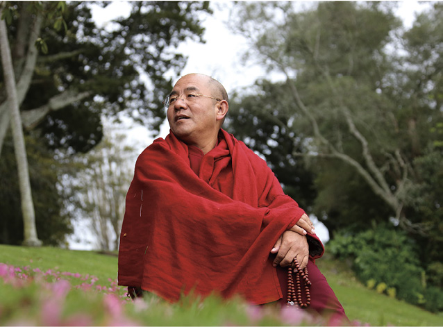
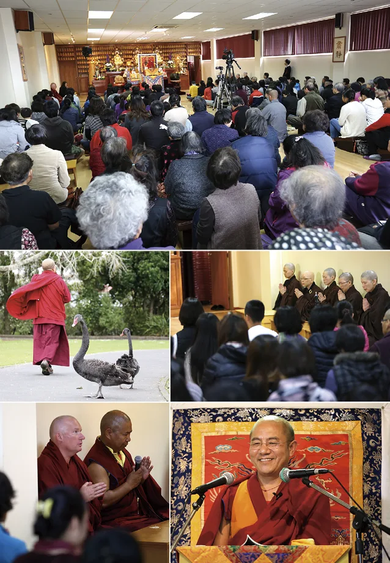
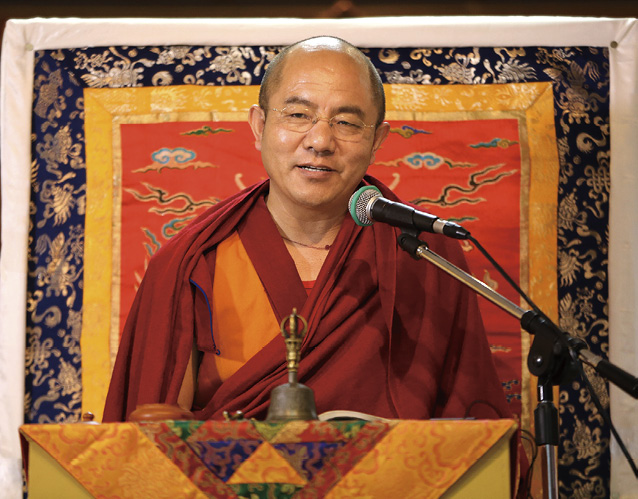
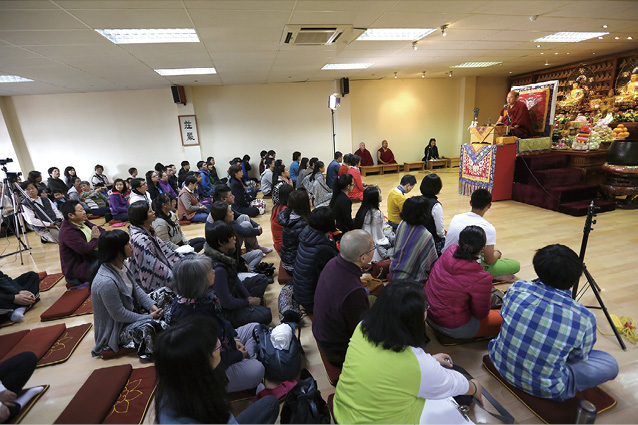
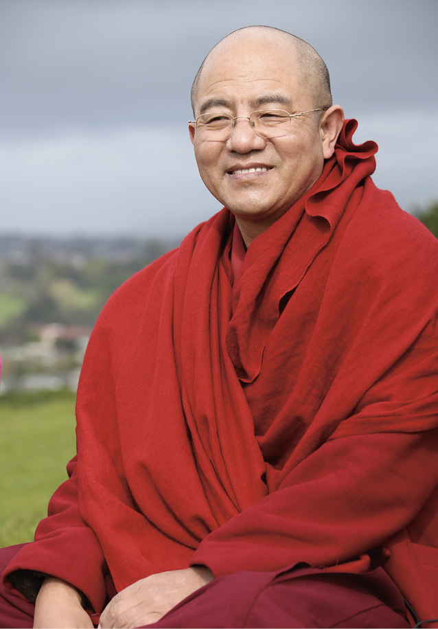
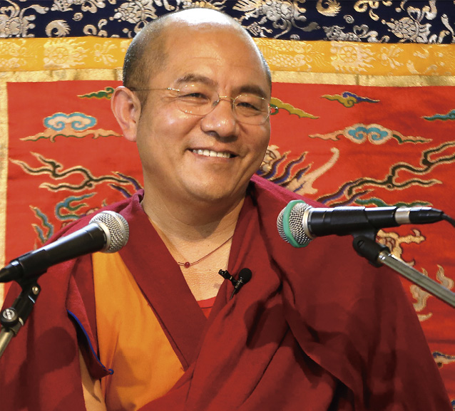
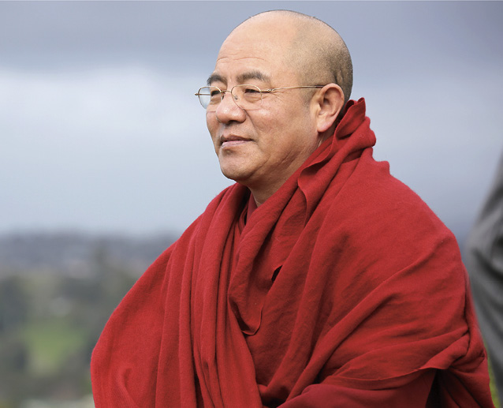

我也不知道自己能活多长时间，  
我没有很高的要求，  
只要还能活一天，  
哪怕只有一个人，  
我都想用佛法来饶益他。

第22场

奥克兰普贤净苑

Pushien Temple

新西兰·奥克兰

2014 / 10 / 12

## 当代佛教徒的品质

## Character of Modern Buddhists

今天要跟大家聊一聊关于慈悲的话题。之前给大家做了一个简单的灌顶仪式，实际上，任何一个修法都需要有专门的一种仪式，这种仪式在佛法中非常重要。有些人可能以为，仪式不重要，只要心怀良善、心中有佛、心地清净就可以了，实际上并非如此。从真正意义上讲，任何一个仪式背后都有其深远的历史、深层的意义，以及甚深的窍诀和道理。接受灌顶并不是像吃饭一样，吃完就可以了。无论是藏传、汉传还是南传佛教的前辈大德，他们只要得到了一个法，在之后的生活和修行当中都会一直修持。

## 一、多念观音心咒

今天我们聚集于此，这是一个很好的缘起，希望这种缘起永远存在，永远对你们每个人能有利益。所以我想给大家制定一个简单的修行要求，当然有些人能够做到，而有些人则不一定。因为现在的人大多都很浮躁，如果不想修行，总能找到所谓压力大、工作忙、身体不好、比较懒惰之类千万个理由，要么就是在修行方面怀着患得患失、得过且过、浑浑噩噩的心态。我希望这次传的法能真正对各位的生活和修行起到帮助，所以，要求大家至少每天念一百零八遍观音心咒，这应该是能够做到的。你们早上起床或者晚上睡觉的时候，“嗡玛呢巴美吽、嗡玛呢巴美吽”这样念一会儿，也非常简单。不管在任何地方，我们都需要保持内心的安宁，当你安静下来的时候，通过禅修以及念诵观音心咒来现前自己的清净本性，这是修行中非常好的一种方便方法。

为什么观音菩萨的心咒有这么大的功德呢？释迦牟尼佛在因地时曾遍历无数世界寻求观音心咒，了知到其功德不可思议、无法衡量，在汉地的《大乘庄严宝王经》中讲了许多这方面的功德。在以前的一些相关课程中，我也讲解过观音心咒、莲师心咒、金刚萨埵心咒等咒语的功德，你们有兴趣也可以了解一下，今天在这里就不专门讲了。

前段时间我在翻译《八大菩萨传》，也就是藏传佛教中的一部关于八位大菩萨的专门记载。作者麦彭仁波切在这部传记中将诸多佛教经典中的片段“下载”了下来。叫“下载”可能不合适，“下载”是现在的术语，那个时候还没有电脑，应该叫做摘录，或者COPY，不过那个时候也没有COPY（笑）。我在翻译的过程中，特别想每天都念念观音心咒。

我经常想，我们藏族修行人福报是非常大的。为什么呢？因为不管是在家人还是出家人，藏地的修行人一辈子都在念观音心咒，有许多人都念了好几个亿，念了几千万的就更多了。我身边一些根本不识字的人，他们从小都会念“嗡玛呢巴美吽”，就在观音菩萨的心咒声中度过自己的整个人生。他们不论放牛还是干农活时，甚至跟别人交谈的时候，稍微有一点空就会开始念，念久了就成为习惯，任何时候都一直念着。在我读小学的时候，有一位老喇嘛，他整天都在念咒语，那个年代宗教还没有开放，不准念咒，但他已经习惯了，经常在开会的时候不断念“嗡玛呢巴美吽”，所以他经常挨批评，但即使如此也改不了从小养成的习惯。那些人拿他没办法，就狠狠打他、批斗他，可他在挨打的时候还是不停地在念咒。那些人特别生气：“叫你不准念咒，你还在念！”老喇嘛答应着：“哦，对对，不准念。”过一会儿又自然而然念起来了。所以，我觉得修行水平跟我们的长期习惯有很大关系。

我特别希望大家看一看汉传佛教里宣讲六字真言功德的那些经典，看了以后你们会很想念诵这个咒语。我在藏地有几个居士林、养老院，我让那里的法师就修这个咒。在汉地，大家都认为念阿弥陀佛非常重要，这也非常好。这次灌顶的时候我看到有很多老年人来参加，老年人现在要做大量的闻思恐怕不太容易，因为智慧和身体条件不一定跟得上。但是不要紧，只要在临终之前遇到了观音心咒，遇到了阿弥陀佛法门，这对我们来讲就已经非常殊胜了。

我很希望大家在有生之年，依靠一个本尊来修持，要么修金刚萨埵，要么修度母，要么修阿弥陀佛，要么修观音菩萨。作为一个修行人，你对哪一位本尊信心最大，在你临终的时刻，就会显现这位本尊。就像我们上学时，要有一个主要的老师，比如你要攻读博士学位，就必须有一位博士生导师；你要从大学和中学毕业，也必须要有一位班主任。所以，我们要从三界轮回中获得解脱，也需要一位本尊作为怙主，这对每个修行人来讲是不可或缺的。

因此，在修行过程中一定要好好念观音心咒。遇到任何灾难的时候，观音心咒特别重要。大家也知道，在汉地，只要祈祷救苦救难观世音菩萨，观世音菩萨就会以三十二应身加持救护，特别灵验。且不说为了来世的解脱，就是即生当中为了寻求一些保佑，祈祷观世音菩萨都非常重要。比如生病的时候、发生紧急情况的时候，或者生活、事业上遇到一些违缘的时候，都要马上祈祷观世音菩萨。

前段时间发生的台湾“7.23”空难中，个别生还者在事后接受采访时说，当时全靠祈祷观世音菩萨才能安全脱险。这在很多可靠的媒体报道中都可以看到。我完全相信观世音菩萨的加持和力量不可思议，尤其是观音心咒“嗡玛呢巴美吽”，这个咒语的功德，就连遍知的释迦牟尼佛都难以说尽，更何况是我们。要相信，这六个字背后的确蕴藏着极大的功德和力量。所以，我有时想起观音心咒的功德，就觉得哪怕其他咒语都不念，一心只念观音心咒也是可以的。

今天也正好是观音菩萨的出家纪念日，所以就先跟大家讲了这个观音法门。我听说普贤净苑这边也对观音法门非常重视，经常举办这方面的法会。汉地有一些观音法会，依靠观音菩萨的加持，帮助可怜的众生，包括一些亡者，让他们得到超度，这样特别好。在我们藏传佛教当中，阿弥陀佛的身边就是大势至菩萨和观世音菩萨。阿弥陀佛在极乐世界中圆满了他的伟大事业之后，观音菩萨和大势至菩萨就是他的补处，会继承极乐世界的所有功德和事业。依靠观音菩萨加持，离开人间的众生也可以往生极乐世界。所以，不论是对亡者超度，还是对活人消灾祈福，祈祷观世音菩萨都非常重要。对于我们每一个人来讲，观音法门对于今生的身心健康，乃至生生世世令自相续生起大悲菩提心，都有着非常大的作用。

在我们菩提学会中，有一部分人是终身学员。我曾对他们说过，在你们离开人世的时候，也许我做不了其他事，但我会为你们每个人念一百遍观音心咒，因为你们在我的生命中是非常重要的。我是这样发愿的，我身边的人也这样发了愿，这几年我们一直在这么做。

通过念诵观音心咒，对生者可以带来加持和保佑，对亡者可以带来功德和利益。所以你们之前要我传授观音法门，我当时就欣然答应了。一方面因为这里是经常修持观音法门的一个非常清净的道场；另一方面是因为我自小就对观世音菩萨充满信心，从能喊爸爸妈妈的时候就开始念观音心咒了，一辈子念了很多数量，而且也在具德上师面前得过这方面的传承。所以我觉得，这次把自己从小一直修到现在，特别喜爱的这样一个法门传给大家的话，应该会稍微有一点加持和作用。

今天大家因缘具足，得到了这个法门，以后要坚持念诵。如果让你们每天念一遍《金刚经》或者《地藏经》，很多人可能做不到，念一遍《普贤行愿品》也需要十分钟左右，但是念观音心咒对每个人来说都不算难，所以大家以后最好能多念一些。这是我想说的第一件事。

## 二、把握当下 勤修善法

下面讲第二件事。大家目前最重要的事情，就是要好好修学佛法，这是我最大的愿望。在座各位应该大多数都是汉族人，从各个地方来到这里，最后定居在了这片国土，从因缘上讲这是非常殊胜的。然而要知道，我们即生当中所做的很多事，再过几十年后基本上全都会失坏。为什么这么说呢？我们为了钱财、事业、感情、家庭，日复一日年复一年不停奔忙着，但是当死亡来临的那一刻，不论你在这世上如何成功，所有的作为、所有的事业，对你来讲统统变成了零，再也不会有任何作用。对我们真正有永恒价值的，只有自己积累的善法和资粮。

当然，从现实层面来讲，我们肯定需要处理好家庭、工作、生活上的事情。尤其是有些人作为家里的顶梁柱，上有老，下有小，中间还有亲戚朋友，都需要你们扛起责任。谁也不可能每天不吃不喝，一直修炼辟谷，这样肯定是不行的。就连我们这些出家人也要穿衣吃饭，虽然没有其他大的需求，但基本的生活总要过下去。但是，在这个过程中，我们千万不能盲目，不能像那些没有信仰的人一样，每天一直忙于今生的琐事。因为我们都知道，终有一天，每个人都要离开这个世界。扪心自问，我们从小到现在所做的一切，到了那个时候，到底用不用得上？你最爱的人、最珍视的财产，最后也只能留在世上，带不走的。就连现在的这个身体，纵然你对它百般爱护，别人碰不得、说不得，可不论你怎么在乎它，到了那个时候也没办法带走，也只能留在殡仪馆里，自己赤裸裸地离去。

在死亡时，我们唯一能用得上的，就是善法。所以大家不要盲目地紧紧抓着世间法。有些人就连每周学习一点佛法、参加法会，或者念一些佛号，都没有时间，好像始终都有忙不完的事。可是到最后真要离开时怎么办呢？那时候你说：“我忙得很，先等一等，我现在不能死，还有好多事没有做完。”可是阎罗狱卒未必会对你让步。

死亡来临时什么都用不上，希望大家趁活着的时候、健康的时候、有自由的时候，不要忘记积累善法。现在我们有这么好的机缘，如果什么法都没有修到，到那时可能会很遗憾。尤其作为佛教徒，很多人明明懂得有今生来世，明明知道因果不虚，明明了解很多道理，却一直没有好好学习，好好实修，最后离开人世的时候，懊悔已经来不及了。这就是我今天想说的第二点。我们要时刻准备着，为来世积累善法。

## 三、包容各派 明确宗旨

第三点，对于大家的学佛方式，我有两个要求。

一是应该有比较开放的氛围。关于这方面，我们这里做得很好，大家不论对藏传、汉传，还是南传佛教，都没有太大的排斥。就像我们五明佛学院，上师如意宝最初的目的就是要建立一个非常开放包容的佛学院，所以五明佛学院接纳了来自各个地方、各个宗派的学人，汉传、南传的都可以来。正因为当初法王如意宝开创了这么一个开放的平台，如今我们不管走到哪里，提倡世界和平、宗教和谐，以及各宗派不偏堕的理念，都非常方便。

我们每个人都要有一种包容的心态，这对大家很有必要。作为佛教徒，我们一方面要对藏传佛教各个教派的高僧大德们保持清净的信心，一方面在不同教派之间要以一种开放的姿态和睦相处。大家都知道，在如今这个地球村当中，我们要维护好与其他宗教以及非宗教徒之间的关系，这样才会有更好的生存空间。如果我们傲慢自矜，恐怕到了最后会变得无比孤独。所以我们要跟世界的各个宗教保持团结。

作为世界主要宗教之一，我们佛教徒的人数本就不多。在各种统计数据里，全球佛教人口有四个亿到六个亿的不同说法。据统计，中国大陆的佛教信众有大概三个亿，但不知是否真有那么多。不管实际有多少人，我们佛教徒的总人数跟印度教、伊斯兰教、基督教比较起来，还是偏少的。我们人数这么少，如果内部还不和，教派之间互相排斥，恐怕不是太好。所以，我们佛教内部应该形成一种开放、包容、合作的共处方式。这是我在这里想提出的一个建议。

二是在这个过程中，我们自己也应该有自己的原则。比如，这个道场主要修持的是《普贤行愿品》，那就不要放弃这个传统，这就是我们该坚持的原则。任何一个道场，一定要秉持自己的宗派以及自宗主修的法门。就像我们佛学院，一直以来的原则就是闻思修行。要与佛教界的其他宗派合作，前提是要确立我们自己的宗旨。就像现在的企业，都要有属于自己的品牌文化、企业愿景和产品特色。所以，每个道场、每个宗派，最好都要明确自己的特点。

我希望，将来各个教派既能互相包容，又能保持自己的宗旨和原则，让各个道场都体现出自己的特点和优势。如此一来，宗派之间就不会有内部的矛盾，也更有利于彼此的交流融合，比如一起合作举办法会、灌顶之类的活动，也是可以的。

## 四、提升闻思修行水平

平时也要秉持自己的原则来进行闻思修行，这非常重要。所以第四点我要强调闻思修行。我听说我们这个道场的法师常常讲经说法，也经常邀请一些高僧大德来给大家传法，这是很好的。在新西兰这个地方，能这样做的道场并不多，所以，不论是今天在座的道友，还是以后来到这里的佛教徒，都应该要认识到闻思修行的重要性和必要性。

作为佛教徒，应该下一番功夫来学习汉藏显密以及南传的佛法，一定要提升自己的综合素质和佛学水平，否则在这个世界上很难立得住脚。为什么呢？因为当今世界是一个文化和智慧的世界。一个人如果有文化、有才华，就可以被这个世界所认可。然而，如果我们佛教徒一个个都盲从迷信、没有原则、颠颠倒倒，那佛教还有什么希望？所以，无论是在家人还是出家人，要做到既相合于世间的规则，又相应于佛陀出世间的究竟意趣，这样的人在当今这个世界上一定会有光明的前途。

我二十年前去过台湾，当时对那里一些佛教徒印象不太好，因为他们信佛的方式就只是接个灌顶，求个加持，做个火供，搞一些形式。去年我又去了台湾，发现有些佛教徒的水平相比二十年前几乎没有提高，对于佛教的五部大论和密宗的基本修法，都只是一知半解，有人甚至连最基本的皈依和发心的道理都不懂，真是可怜。所以，我和慈诚罗珠堪布都在不同的场合批评过他们。这些是我接触的一部分人，并不代表台湾所有的佛教徒。但我们佛教徒当中确实有很多人不爱闻思，只重仪式，这样不是很好。因此我特别希望，我们这个道场能始终坚持对于佛法的闻思，这样我会非常随喜。

虽然这边的菩提学会，没有大陆那样的条件，但这里也有一些人有意愿学习佛法。前段时间我们安排了一些人员针对这里进行管理，为一些愿意学习的人提供方便。由于菩提学会提倡的是次第性地闻思大乘教义，所以在大陆有很多人一直在持续地学习，导致现在我们需要管理的人数越来越多，于是只能尽量地提高门槛。但在海外参与学习的人确实不算多，其实人多人少并不是关键，关键的是要对佛法深入学习。不学习的佛教徒，其实只算是形式上的佛教徒。

因此，我特别希望佛教徒未来能有更专业的综合水平。尤其是年轻一代，如果要当佛教徒，就不要连教义也不懂，光是办个皈依证，挂个虚名。就像不会开车的人，有了驾驶证也没用的。真正的皈依并不是一个证件能代表的，而是至少要懂得大小乘皈依三宝的基本道理，这样的人才有资格成为真正的佛教徒。

这就是我要讲的第四点。希望将来的佛教徒不要像从前个别人一样，光挂一个佛教徒的名字。当别人问起你为什么是佛教徒，你只会说：“我在某某上师那里皈依了，所以成了佛教徒。”那样的皈依未免太简单了，我五分钟就可以给你念个皈依仪轨，但你能在五分钟内胜任一份职业吗？世上任何一种专业、任何一项事业，都不可能在五分钟内完成。通过仪轨进行皈依只是开启你学佛之路的一个仪式。从此之后，既然要做一名佛教徒，那佛教的教义你要怎么了解和学习？懂得了教义之后，要怎么把其中的精神传递出去？这些都是需要认真思考的。

大家都见过基督教是怎么宣传他们的教义的，他们那种积极的精神，其实是对自己的宗教非常负责的一种态度。我们佛教徒更是担当着利益无边众生的责任，所以我非常希望大家一定要学懂佛教的教义，而不只是会念佛号、念咒语。当然，如果你信心特别大，只是念佛持咒也可以，尤其是老年人。但是年轻人如果不学佛法，光会念经，那可不太够。前几天有人跟我说，他会念《地藏经》和《金刚经》，可经念得再好，如果不懂内容含义，又不肯好好学习，那就叫做鹦鹉学舌。鹦鹉也可以做到给他念什么，他就模仿着念什么。天天光是这样念，意义并不大。憨山大师也讲过：“口念弥陀心散乱，喊破喉咙也枉然。”到底什么是念经？念经其实是经文的一种引申。通过念诵经典，把其中的法义引到自己心里来，这才是念经真正的意义所在。

当然念经有念经的作用，但更重要的，是要学习其中的佛法。学习佛法不是一两天的事，而是要长期不懈地学下去。学了以后是不是就可以了呢？不行，还要深入思维，还要实际修行，这就叫做佛教中的闻思修行。我们藏传佛教对于闻思修向来非常重视，希望大家以后也要尽量重视起来。这是我要说的第四点。

## 五、担起弘法利生责任

第五点，也是我要说的最后一点，我们每个人都要担当起弘法利生的责任。在座的各位法师就不用多说了，作为出家人，他们都有着超胜世间的出离心和菩提心，正是为了佛教的传续，为了自他的解脱而看破今生、放下一切，就连人们最喜爱的头发也剃掉了。在家人也同样，每个人都是弘法利生的一员，不能坐等什么时候开悟了才去利益众生，倘若一直这么等下去，这辈子都不一定有弘法利生的机会。所以，我们每个人都应该把自己学到的佛法一方面用于修行，一方面用于利益众生，这是对佛陀的一种报恩方式。我们要通过佛法来饶益一切众生，特别是身边那些不懂佛法、不明真理的人。这是我发自内心的希望。

以前我曾想过，每个人的因缘都是不同的，我也不知道自己能活多长时间，我没有很高的要求，只要还能活一天，哪怕只有一个人，我都想用佛法来饶益他。作为一个出家人，如果要用金钱、地位或其他东西来饶益众生，我也无能为力。但是我懂佛法，哪怕只是稍稍讲一点，也能给他人带来一笔精神上的财富，这是非常重要的。所以，我非常希望大家以后在自己力所能及的范围中，先尽量多学一些佛法，然后用所学的佛法来饶益这个世界的众生，这对每个人来讲应该都是能够做到的。我不要求你们必须做到什么程度，必须度化多少众生，但是我希望你们在生活中，能时常为弘法利生的事业创造一些好的机缘。

我们今天所传的大悲法门，就是一种特别适合利益众生的法。大悲心并不是口头上说说就有的，只有当我们真正发自内心地为芸芸众生无私奉献的时候，才会生起一颗无伪的悲心。当拥有了这样一种无伪悲心的时候，我们就不必等到像六祖惠能大师那样开悟以后才去传法。那时候，我们的言行举止，都能影响身边的人，使他们慢慢地发生改变。即使是以前心特别恶的人，我们也能潜移默化地给予他引导。哪怕暂时引导不了也不要紧，我们的努力不会就此停下。

我经常看到西方的一些学者和官员，在演讲的时候特别喜欢强调努力、希望、坚强，而尽量避开悲观的论调。我们佛教徒也应该这样，不要自卑，不要总觉得自己修行很差、烦恼很多，自身尚有许多问题无法解决，没有能力帮助别人。一味强调自己的痛苦，其实就是找一堆理由来贬低自己的能力，我觉得这是没有必要的。虽然每个人都难免有烦恼和痛苦，但我们要有一种让自己开心、快乐、放松的能力，然后在这个基础上，尽己所能在有生之年去帮助他人。

我们佛教徒如果能从内部团结一致，再加上利他心的驱动，这样就会有非常大的能量。同时还要经常祈祷观世音菩萨、祈祷传承上师，得到诸佛菩萨和传承上师的威力和加持。此外，还要加上大悲菩提心的力量。当这些因缘具足的时候，想要成办利益众生的事业，其实也并不是很难。要度化天下的众生虽然有一定难度，但如果我们从身边做起，循序渐进地去帮助众生，那也不算难。这就是大乘菩萨真正的意义所在。这些就是今天给大家的开示的主要内容。

这次来到新西兰，我和常灵法师以及普贤精舍，结下了非常殊胜的因缘。尤其在与常灵法师交流的过程中，我发现她非常有智慧、有悲心，而且她联合了世界各地许多藏传、汉传、南传佛教的高僧大德，有着弘法利生方面的远大理想，真是非常非常随喜。确实，我也遇到过某些男众、女众的高僧大德，心态比较保守，不太愿意接触外界。我自己虽然没有多么宽广的心量，但还是希望佛教界内部能以一种放松的心态去交流与合作。在我们弘扬佛法的过程中，如果一位上师有这样的心态，他的弟子和信众也都会变成这样的人。同样，如果上师或者一个道场的主持，是一个排外的人，他的追随者也会变得排外。老师就是学生的一个模版，在我们藏传佛教里叫做“小擦擦”，老师这个模版是什么样，学生就会显现成什么样。所以，我特别希望以后这里能迎请更多世界著名的大德来讲经说法、灌顶加持，这是非常好的。我们佛教之中，不管是大德还是弟子，如果大家都能以一种开放、包容的心态一起来弘扬佛法，那将会是非常好的缘起。

下面，我这里有一个长寿佛像的缘起物要赠送给常灵法师，祝您健康长寿、广转法轮。

最后，感谢普贤精舍的所有义工和发心人员，以及这里菩提学会的所有负责人和发心人员，还有其他的参与这次活动的发心人员。今天下午讲完《入行论·安忍品》的最后一堂课，明天我就要离开新西兰了。以后如果还能再来那固然很好，但人生无常，你们也是无常的，我也是无常的。希望以后还能有见面的机会，但具体怎么样，确实我们都把握不住，也许还会有机缘。不管怎么样，我们大家唯一的愿望就是弘扬佛法、利益众生，这就是我们共同的发愿。谢谢大家！
