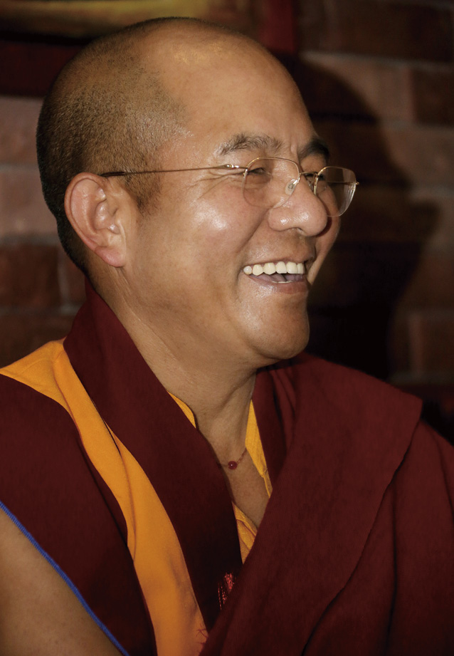
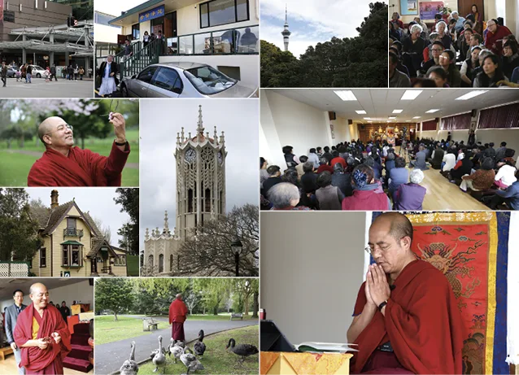
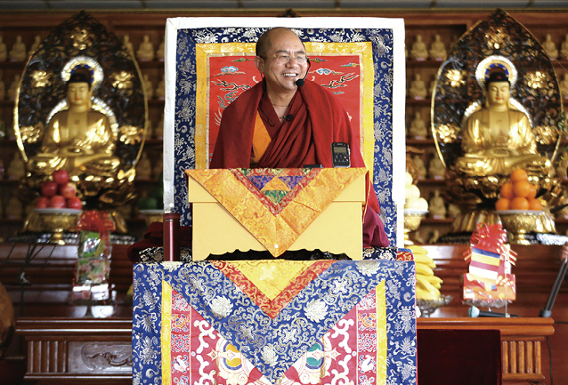
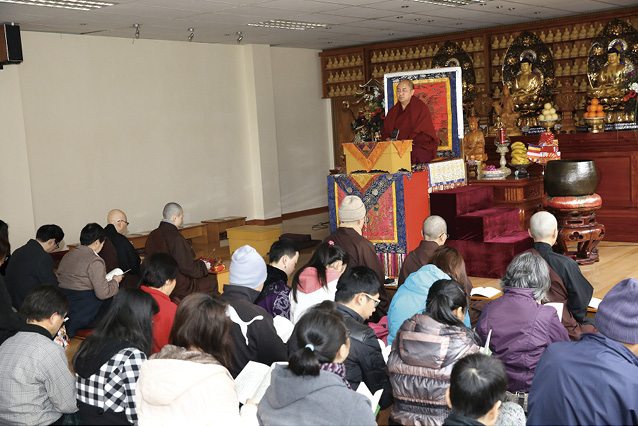
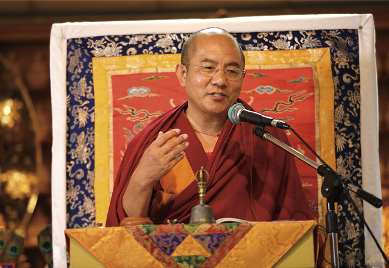
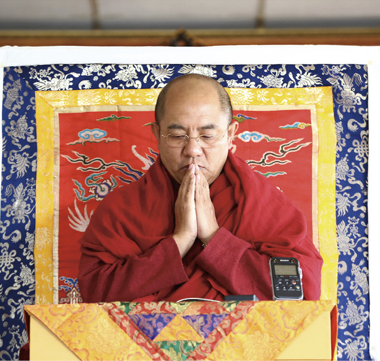

真正的修行，要看内心的境界。  
而内心的境界，又来自平常的修行，  
也就是哪怕对待一次生病时的心态。

第21场

奥克兰普贤净苑

Pushien Temple

新西兰·奥克兰

2014 / 10 / 5

## 病缘中如何修行

## How to Practice in Sickness

今天在普贤净苑，我们一起来了解一下如何在病缘中修行。

## 一、痛苦是轮回的底色

在座的各位都是修行人，明白每个人都会感受生老病死等轮回的痛苦。我们都知道，轮回其实就是苦海无边。佛陀在相关经典中也讲过：“三界无安，犹如火宅。”整个三界轮回就像火坑一样，众生在火坑中遭受焚身之苦，不可能有丝毫快乐。表面上看，这个世界是美丽、快乐、富饶的，很多人会有这样的感觉。但实际上，从生活的细节上去感受，世间其实充满了痛苦。人的出生、患病、衰老，以及最终的死亡，这就是人类最基本的几大痛苦。更为根本的，还有苦苦、变苦、行苦，日日夜夜不断地折磨着我们。这时候我们会发现，这些痛苦其实就是轮回的自性，是一种底色，而不是偶然的不幸。所以我们一定要知道，只要转生于轮回之中，就必然有痛苦。

昨天我在梅西大学演讲时，有人提到：人面对出生很高兴，面对死亡却特别恐惧。当时我以开玩笑的方式回答：生的时候也并不高兴，因为没有一个孩子是笑着来到世上的。有一部纪录片叫《玄奘之路》，习近平主席访问印度时，就以这部片子作为礼物赠送给了印度总理。我想国家领导选择赠礼一定有他的理由，于是就去看这部片子。其中有一个画面是玄奘大师出生时哇哇大哭的场景，当时我想，原来这样的高僧也是大哭着来到人世的。大家都知道，玄奘大师是一代伟人，他在国际文化交流方面贡献卓著，更是历史上罕见的大译师，但他在显现上也是哭着降生的。当然，这是导演按世间常理设计的镜头，事实上他到底哭没哭过，我们也不得而知。不管怎样，人确实逃不过生老病死。佛经中也说，人出生之时，伴随着哭声，死去之时，眼中含着泪水。这就是人生痛苦的一种标志。所以，我们应该在心里提前做好打算和准备，当你的身体出现疾病时，千万不要想：我怎么这么不幸，疾病缠身，我多么可怜啊！这种想法会把自己的心态变得越来越脆弱，是不明智的。

《维摩诘经》中也讲：“身不离病，病不离身。”这句话很重要，我们只要有身体，多多少少都会出现不适。再健康的人，也会偶尔感冒，或是哪里不舒服。有些人可能由于一些特殊的业力，身体的不适较为严重，甚至一辈子都在病痛中度过。这种情况下，我们不要把患病看成不幸或者是倒霉。应该以什么方式对待疾病呢？不同人有不同的方法。没学过佛法的人可能会服用各种药品，进行各种锻炼，想尽一切方法来治疗。这是世间通常的做法，我们佛教徒当然可以这样做。只要是对我们身心有益的方法，修行人都可以采用，而并不像有些人认为的，只要一心一意修行，不用吃药、看医生，这不一定妥当。

相关经典中也讲到，依靠医生的医术和药物的力量来治疗疾病，这也是佛陀的一种加持。即使是释迦牟尼佛本身，也示现过找当时的名医耆婆来诊疗疾病。《毗奈耶经》和《大藏经》的一些公案里都有记载，当僧团中有人生病时，佛陀也要求耆婆为首的医师们进行治疗，同时要求阿难、舍利弗、目犍连等弟子照顾病人服药。在佛教之中，对各种行为阐述最为细致的就是戒律，而戒律之中也有关于怎样熬药、怎样用药、用药时具体情况如何开许的说明。我们知道，出家人要遵守过午不食的戒律，但在身体不健康时，是可以特别开许食用药品和一些食物的。诸如此类的道理有很多，可见，生病时不去医院，只顾一心修行，什么也不管，这种等死一样的心态是不可取的。

过去很多修证很好、对佛教很有贡献的修行人，示现上也要看病吃药。比如我一直依止的上师如意宝晋美彭措，他一生所有的精力和时间全部都用在弘扬佛法和利益众生上。从我依止他开始，直到他示现圆寂，我都没有把他当成一个凡夫人。我是因为他的所作所为让我非常感动，而不是因为名气和智慧佩服他。他的广大事业和修证境界，是一般人无法想象的。像这样的大成就者，在显现上也经常去成都等地的医院住院治疗，出国弘法时也带着随行医生，每天早晚都要定时服药。我想，既然像这样的大成就者，在人间也要随顺众生而显现生老病死之相，也要看病吃药，所以有些佛教徒生病时还是很有必要去看医生的。有些人刚开始生病时一直忍着：“我要修行！我要修行！”最后到了实在忍不住的时候又不得不去医院，这样也没必要。作为修行人，该看病就去看病，要是看了实在没有用，也不必伤心。

## 二、病痛不一定是坏事

有些人可能会想，既然修行也要生病，不修行也要生病，那是不是修行对疾病起不到作用？实际上不是这样的。修行对我们的疾病其实有非常大的作用，这个作用对不同人有不同层次的体现。有的人把疾病真正当作顺缘来看待，这样疾病在他的生活中就不是一件坏事，而是一种很好的修行机会。为什么呢？我们如果用智慧来详细分析，疾病对于好的修行人会产生很多的功德。《入菩萨行论》有云：“乐因何其微，苦因极繁多。无苦无出离，故心应坚忍。”意思是说，在这个世间之中，轮回的本性就是痛苦，痛苦的因非常多，而快乐的因却很少。但正是由于存在这些痛苦，我们的修行才有了助缘，因为要是没有痛苦，就难以对三界产生厌离，不可能生起真正的出离心。因此，当你在生活中遇到重大的痛苦、困难、疾病，这个时候就能让你真正生起无伪的出离心。有些人学佛，就是因为身体、家庭、感情、事业出现问题，人生濒临崩溃，于是才去寻找答案，想找到解脱之法，结果正是从这样的痛苦之中，发现了人生的真理，了知了轮回的真相。

人在身体健康的时候，很难知道世间有这样的痛苦，当身体产生疾病甚至危及生命时，就会重新对人生产生一种认识。我也经常有这种感觉，自己在比较健康的时候，就忙于各种琐事，连修行都忘了；一旦生了病，才开始想起善法功德。不论从历史还是现在来看都是这样，一个修行人要遇到珍贵的佛法、具德的上师、真正的解脱道，因缘会有各种各样的呈现。大多数的因缘是从难以面对、无可奈何的痛苦中找到一丝光明，从而走上了解脱之道。

表面上看，生病是件坏事，但其实可能是非常好的因缘。我在2000年生了一场大病，当时医生说至少要住院半年。我想既然要住院那么久，不如就用这段时间来翻译《释迦牟尼佛广传》。因为不想外传生病的消息，所以就对外声称我在闭关，这样名声可能比较好听（众笑）。当时为了确定病情，我去了两所医院检查，因为不喜欢有人跟着，是自己去的，结果确诊了脊椎有问题，必须安排半年以上的治疗周期。我想，这么长的时间应该翻译一部大些的论典，于是就选择了麦彭仁波切的《释迦牟尼佛广传·白莲花论》，法王如意宝以前也讲过这部论，一共有500多页。我在厦门的医院治疗了半年，病情好转的时候，这部论也翻译完毕了，有三十多万字，于是我就宣布出关了。所以有时候生病不一定是坏事。

起初我觉得，自己一直以来讲课从未间断过，但不治病不行，而治病就要停课那么长的时间，心里是不太舒服的，所幸后来治病的这段时间也好好利用上了。住院期间我每天要输液三四瓶，边挂吊瓶边打开经书翻译。有一次一位护士态度不太好，用脚踢我的床，命令我：“把这些长长的烂书拿出去！”我说：“这可不是烂书，是你没有缘分。”如此辩论一番，结果她更生气了。所以有时候疾病突然降临，虽然一开始心里会很难受，但如果能把疾病利用起来，那实际上也不一定是坏事。

印光大师自幼患有眼疾，读书写字的时候，常常双眼血红，疼痛难忍。于是他就靠一心念佛来对治病痛，还写了一个“死”字挂在自己的禅房之中，最后他成为净土宗一代祖师，获得了伟大的成就。世间凡人要是眼睛坏了，通常会非常伤心，万念俱灰，但印光大师把眼病作为念佛的助缘，这就是他对待疾病的方法。法王如意宝从1990年去印度到2004年圆寂的近十四年中，眼睛几乎看不见，但他从未停止过向国内外弘法。上师如意宝传法时，我们先把法本内容录音，然后上师戴着耳机一边听一边讲解，十四年来始终如此。普通人要是眼睛看不见文字，讲经说法根本不可能，对于某些懒惰的人，这更是他们懈怠的最佳理由。而真正坚强、勇敢、有智慧的人，就能为他人所不能为。

## 三、修行人的疾病观

总之，不论你是什么样的修行人，将来都难免有生病的时候。当疾病折磨、痛苦难受之际，要想：世界上有许许多多众生都在跟我一样感受疾病的痛苦，但愿他们的痛苦都由我来承受。这就是自他相换的修法，是一种很高的修行方式。藏传佛教中有一个以修行著称的宗派叫噶当派，在他们的修行过程中，经常把病缘转为道用。什么是转为道用呢？本来是得了一场病，却可以把它用来修行。这对我们很多人来说并不容易做到。大部分人在医院一旦检查出比较严重的疾病，就会特别伤心：“医生我该怎么办？求求你想想办法！我还有孩子，还有家人……”可医生往往也无能为力。这种时候，如果我们的境界稍高一些，就可以用大乘的菩提心和慈悲心来修行。

就像噶当派有的大德，当别人问起：昨晚您修行得如何？他这样回答：我昨晚修得不好，因为我身体没有病痛。为什么这么说呢？因为如果生病，他就可以依靠病缘观想，修行自他交换；但没有生病的话，就可能一夜沉沉睡去，什么都没有修起来，他觉得这不是件好事。身体上有病痛，一方面可以借此减少睡眠，一方面可以观想代受众生的病苦。这是一种很好的修行方法，但我们很多人达不到这样的境界，唯愿自己别生病，修行不好也不要紧，但一定要睡得好。（众笑）

汉地的弘一大师有一次病得非常严重，广洽法师前来探视，问他病好些没有。弘一大师却说，你不要问我这些没用的，应该问我病中还能不能念佛。所以，修行人的价值观和世间人是有很大差别的。表面上看，修行人和世间人都会有各种感受，但感受的角度大不相同。就像普通人看到花花草草并不会想到它们的作用，但如果草药学家看到了，就会想到每种植物的功效，能把它们用于配制妙药。同样的道理，当我们面对生活中的顺缘违缘、种种处境，如果没有修行到位，就会很难掌控自心，还容易滋生烦恼痛苦。所以，真正的修行，要看内心的境界，而内心的境界，又来自平常的修行，也就是哪怕对待一次生病时的心态。

当然，对于大多数人来说，如果暂时还不能把疾病转为道用，也可以修一些法来让自己避免生病，在佛教中有很多这样的修法。生病时应该观察，如果这场病对众生没有什么用处，自己也会陷于苦恼，那么对于大部分人来说，还是让身体健康一些比较好，因为好的身体可以用来修行。

我以前翻译过无著菩萨的《快乐之歌》，里面这么说道：如果没有生病是很快乐的，因为身体健康可以好好修行[^1]。这也是我们很多人的普遍观点，只要身体健康，即使修行不好，也能好好生活、好好工作、好好睡觉；可要是生了病，就像《大圆满前行引导文》中所讲，纵然是十分强壮的人，一旦染病，也如鸟雀被石头击中一样，身衰力竭，甚至卧床不起。有时甚至一个小小的感冒，都会让很多人咽痛咳嗽、浑身乏力、睡不着觉。人类的身体和生命其实是非常脆弱的，尤其是对于不够坚强的人，平时即使再傲慢、再强悍，一旦生病，的确如同这个比喻一样，麻雀飞得再高，被石头打中时也只会动弹不得，委顿在地。

患病的人，不管问题出在哪里都很痛苦：眼睛有毛病时，就会觉得眼病最痛苦，其他问题都不要紧；脚有病痛时，就会觉得只要脚能恢复正常，其他毛病都没事；牙不好时也会觉得牙齿至为重要……不管什么地方，只要有病痛，就会变得异常敏感。我有一段时间脚特别痛，看到走路顺畅的人，就会觉得他们很幸福。还有一次我眼睛不舒服，一看书就流眼泪，看到别人睁着大大的眼睛，觉得他们真是快乐。所以，我们每个人只要自己哪里不舒服，就会特别在意此处，但实际上不管身体哪一处，都是同样脆弱敏感的。所以不生病当然有不生病的好处，依靠健康的身体，可以正常生活、正常修行。这是无著菩萨的一个快乐原则。

同时，他也说：这个幻化的身体，如果生病，也是很快乐的，因为可以消除业障，增上修行。如果修行较好，就会发现生病有生病的好处——没有经历病痛，确实难以对轮回生起出离心。有些人正是因为经历过生活、感情、健康方面的种种违缘痛苦，才真正遇到了善知识和解脱道。藏传佛教中有位无垢光尊者，他在《窍诀宝藏论》中讲：因为病魔缠身才能行持解脱之法，所以要感谢病魔。我们平时觉得病魔十分讨厌，但实际上正是由于病魔督促我们才去寻找解脱之道，所以遇到病魔不一定要觉得不好而舍弃[^2]。

另外，我们都知道，即生中的疾病大多来自过去自己所造的恶业。多病短命就是前世伤害诸多众生所致，所以有些人现在每天都得吃药。龙猛菩萨的《中观宝鬘论》中有“小苦除大苦”之说[^3]。什么意思呢？虽然我们今生患病是一种痛苦，但通过感受这种人间的小痛苦，能够断除将来生死轮回中转生于地狱、饿鬼、旁生界的极大痛苦，这是非常值得的。就像只要开刀做个小手术，就能免除癌症的大病患，那我们自然心甘情愿去接受手术的小痛苦。

今世的病苦往往来源于前世害过众生。比如现在感受到头痛，可能就是因为前世用种种手段令其他众生遭受过严重的头痛；今生四肢不全的残疾人，可能是因为前世砍断过其他众生的肢体。由于过去的这些因缘，我们即生之中难免感受种种病痛。我在住院时看到电视上播放西班牙斗牛，牛的背上被插了许多剑，场面非常惨不忍睹。我当时脊背很痛，心想，可能我前世就是个西班牙斗牛士，用剑刺过牛的背，如果用我今生的疼痛来偿还，那我是很愿意的，但要是让我投生成牛，以前的牛变成人，再来刺死我，那我难以接受。因此，我们要知道，是因为自己在漫长轮回中所做下的种种坏事，才在即生中产生了疾病的痛苦。这种时候我们要想到业因果的道理——通过重罪轻报减轻自己未来的恶趣感受，也是一种很好的修行方法。

外面下大雨了，原来新西兰也跟我们偏远藏地一样，一会儿停电，一会儿下雨。人说新西兰是天堂一样的国家，原来这里也同样不离生老病死。

活在这个娑婆世界中，需要有一颗坚强的心。刚才讲到“无苦无出离，故心应坚忍”，这句话很重要。我们身处于世间，不管是遇上疾病的痛苦，还是人际间的矛盾，心态一定要坚强，心态若不坚强，就很难存在于这个世间。人本身就有许许多多的烦恼痛苦，它们都是依靠各种因缘而产生的，这些因缘需要用智慧去观察。好的因缘如果集聚，会对我们很有利，然而不好的因缘却处处都在呈现，给我们的生活和修行带来不利。所以我们在娑婆世界的任何环境和群体中，要始终保持一种冷静的心态。这种心态不是光想想就能有的，需要通过长期的学习、思考和串习才能得到。

一个很好的修行人，在世间无论是生病还是健康都会非常开心。当他身体健康的时候，他可以认真工作、修行、尽到各种义务，能处理好家人、同事、上上下下的人际关系。而当他生病的时候，不管在家里还是医院的病床上，他也同样能够好好修行，同时积极地面对生活。所以，真正的修行人，无论身体好或不好，无论身处哪个国家，无论住在寂静深山还是繁华都市，都会过得快乐。而修行不好的人，无论到哪里去都摆脱不了痛苦。有的人在大城市里过得很郁闷，就到我们佛学院来出家；结果待了一段时间之后，依然不开心，于是又到亚青寺；在那里过了两三年，后来又去五台山待了几年，但还是烦恼缠身。所以痛苦的人不论在藏地汉地、在家出家，都很难拔除痛苦。有些人以为出了家，剃去了头发，就不再痛苦了，但其实痛苦也不一定长在头发上。（众笑）

其实在家出家都可以，出家人当中也有不开心的人，最关键的是要在内心中对佛法产生坚固的信心。这种信心，刚开始可能是依靠一种简单的信仰，但我们作为佛教徒，最终一定要把信心建立在理性的智慧和认知上。我去过很多地方，看到很多佛教徒仍然比较迷信，对佛教的道理不太明白，不管念佛、参禅、修功课，做很多表面形式都没有真诚地去修心。现实中很多问题看似很重要，但作为佛教徒最好发自内心生起出离心。如果我们在短短的人生中，自相续中能够生起真正的出离心，了知三界轮回中无论何处都不离痛苦，想从轮回中解脱，以这短短人生作为因缘，发自内心一定要解脱，如果能有这么一种决心，它的力量是无比强大的，我们的修行就需要强大的心力。如果没有这种心力，过一天算一天，浑浑噩噩，就如同汉地的说法一样，当一天和尚撞一天钟。

现在很多在家佛教徒，生活上琐事比较多，在家人、事业、社会等很多方面花了大把时间。我发现如今很多人都很累，整天把“压力太大”挂在嘴边，这个词确实很符合当代人的心态，以前没有这个词，而现在的人要付房贷，付车贷，要买社保、买医保……表面上看似乎过得很光鲜，但内心其实充满了各种各样的痛苦。这个时候，很多人把最重要的希望从轮回中解脱的出离心，仅仅落在了文字和口头上，没有真正用心去实践它。即使茶余饭后偶尔想一想，但没有花时间去修行，大多数时间用在生活上，甚至用在休闲娱乐上了。很多人没有时间修行，但有时间玩，提起修行就说“我忙得很”，但出去旅游、玩耍却总能抽出时间，这也是我们很多凡夫人的一个通病。

当然，一点时间都不用来休闲和社交，这也有点过分，不是很好。我们作为修行人，还是应该当一个正常人，尤其是学佛的在家人，刚开始不能过于热情、过度勇猛。有些人把家庭和工作全都抛下，一味修行，跟家人的关系也处理不好，工作也干不下去，跟谁都不联系，就像闭关的隐修士一样，结果一段时间下来，就产生了很多问题。刚开始学佛没必要这样，在家人就要做好在家人的角色，而出家人就要有出家人的威仪、行为和戒律。

但学佛后期很多人最大的问题就是没能长久地坚持下去。有的人去了一个道场，没几年就退出了，可能是一种喜新厌旧的心态，这也是现代人的一种通病。就像购买一个产品，刚开始觉得特别好，可新鲜劲过不了两三天，就去换新的了。有人先买了五万的车，过不了多久又想换更好的，这种习惯我觉得很不好。在这方面我更欣赏欧洲人，像德国和英国人，他们买东西重视耐久，有一个就可以了，不会经常想要换新的。有的修行人就是这样，刚遇到一位上师时：“这位上师真是慈悲，我要去依止他！”但过一段时间又觉得：“他好像也没那么慈悲，还有很多烦恼，不像刚开始时那么慈祥，连微笑都是假装的。”于是又远离他，去寻找更慈悲的上师了。当然，有人刚开始观察得不是很准，但我还是希望你们进入一个道场之后，不要轻易改变心态，这是很重要的。

不知道这里的状况怎么样，西方的一些道场在这方面做得不错。我二十多年前去过美国的一些道场，去年再去的时候发现当年的一些老弟子现在还在那个道场里，我觉得这样的人修行一定很可靠。我经常跟很多佛教徒讲，不要把自己主修的法门变来变去，你如果学的是净土法，那就一辈子好好学下去。我昨天在《上帝和佛陀》的演讲中也提到，不要轻易改变信仰。我们对待一位上师、一个道场、一脉传承，应该像藏族的一句谚语：“好人一辈子扮演一个角色。”我觉得这句话很有意味，人一辈子应该如初见一样，而不是刚开始演好人的角色，然后换成中等人的角色，最后又去扮坏人的角色。人不应该在一辈子的这场戏里转换各种各样的角色，跟自己的道场和法脉脱离关系，甚至进行损害。现在确实有这种现象，有的上师慈悲培养了弟子，后来这个弟子却变成了上师事业里最大的违缘。

## 四、病痛违缘如何转为道用

我们作为修行人，一方面在自己的生活中，要做好各方面的准备，当生活中出现疾病和各种困难的时候，修行人应该有自己的方法去面对和对治，这是非常重要的。尤其是病缘中如何修行，我认为有几种方法：

首先，可以通过病缘修出离心，观三界轮回的痛苦。

第二，可以在病缘中修菩提心，要想世间有这么多可怜众生，我的区区疾病又算得了什么。释迦牟尼佛在因地时，曾有一世与母亲争吵时踢了母亲的头，后来堕入恶趣，遭受铁轮在头顶旋转的剧烈痛苦。当时他心想：世上若还有人像我一样因脚踢母亲而感受此种痛苦，但愿所有这些众生的痛苦都由我一人来承受。当他发起这么一刹那菩提心之时，立刻就从痛苦中解脱了，这就是菩提心不可思议的力量。我们虽然不一定能做到这样，但我们可以这样想。

藏传佛教《修心七要》的注释中说，生病时应当这样祈请诸佛菩萨加持：“如果我生病对众生有利，就愿我生病；如果我康复对众生有利，就愿我康复；如果我死亡对众生有利，就愿我赶快死去；如果我活着对众生有利，就愿我活着。”要发这样的愿，这是一种非常殊胜的修法。当然，这种修法需要强大的心力，自私心较重的人可能不一定能这样修。通过菩提心在生病时修行，这是第二种方法。

第三，可以通过空性观的一些修法，在生病时去寻找病痛的感受。这需要中观的见解和一定的修行基础，但这种方法的确非常重要，是一种十分尖锐有力的修法。具体怎样观呢？比如心脏痛的时候要去想，所谓的痛只是一种感受和假象，这种痛觉到底存在于身体的内部还是外部？存在于过去、现在还是未来？这样一步一步去观察和寻找，就会认识到这种病痛的感受之心，除了我们分别的假象执著之外，实际上根本无处可寻。

还有一种密宗和禅宗中的认识方法。生病的时候，去看心的光明和空性无二无别的状态。这种状态下，并不是把病观在自己的心上，而是以觉悟的智慧观察病的本体。这个时候就会觉得，原来所谓的疾病从来没有产生过，只是众生的分别念把它当作了疾病，实际上从它的内外、前后、左右等所有体性上观察，都根本不成立。

《金刚经》云：“过去心不可得，现在心不可得，未来心不可得。”过去心已经过去了，不再有了；未来心还没有产生，也不可得。很多人可能会想，虽然过去心和未来心不可得，但现在心应该是有的，因为我现在正在感受病痛。作为凡夫，确实会感到现在正在痛，但对于真正圣者的境界，或者从理论上观察，现在感受疾病的心也是不可能得到的。为什么呢？因为所谓的现在只是一个笼统的概念。从时间范围的长短来说，现在可以指整个21世纪，也可以指眼下的一天、一小时、一分钟、一秒钟，一秒钟还可以再分成无数份，所以真实的“现在”，从理论上是找不到的，因此，佛说万法皆空并非没有道理。

如果这样好好去观察，未来没来，过去已过，二者确实是没有的，这点我们都能想得通，然而所谓的疾病似乎的确发生在现在。如果没有经过对无明烦恼束缚的观察，我们可能会有这种“正在生病”的感觉，但这种感觉其实只是一种迷乱的现象，是一种错觉。为什么呢？因为它在理论上并不成立。就像刚才所讲，如果我们“现在”正在生病，那所谓的“现在”到底是什么？你可以这样去观察：去掉过去和未来，如果要寻找到一个“现在”，那也许就是当下的1秒钟，可在1秒之内我们有时间生病吗？并没有。而1秒钟又可以分成100份，甚至不断继续细分下去。科学家已经指出，时间和空间只是人的一种错觉，爱因斯坦也这么说过。既然时间是一种错觉，那与时间相结合的感受，就更是错觉了。人类非常可怜，对于根本没有存在过的东西，无始以来却都把它当作实有。

了解佛教的观点之后，我们就会明白，所谓的疾病、感受、痛苦，实质上的确都是不存在的。这里还用不到密法中觉性、觉悟的认识方法，如果通过密法观修自心，会知道心本来是光明分和空性分，疾病、痛苦等都是分别念假立的，实际上它们的本体根本不成立。对于这点，禅宗有禅宗的认识方法，密宗有密宗的认识方法。在这种境界中痛苦的本体是根本找不到的。这个道理我们暂且不谈，先从般若经典中的“过去现在未来心不可得”这点来想一想，现在生病的心到底本体何在？很多人觉得自己生病很痛苦，但如此观察之后，就会发现这种痛苦只是一种错觉。只要意识到这是错觉，就会知道疾病的本体原来是空性，对我们其实无利无害，只不过众生没有认识到它的真相，把本来虚无缥缈、显而不实的东西当作了真实的存在。所以，这就是众生的可怜之处。

有些人可能会这样想：我虽然知道现在心不可得、病痛心不可得的道理，可我明明正在感到痛啊，这是为什么呢？其实，这是因为我们只在理论上认识到了，但修行还没有到位。比如说，有人生了病，看雪山变成了黄色，别人告诉他雪山是白色，不是黄色的，他道理上虽然明白，但视觉还没有恢复。同样的道理，我们虽然现在能从佛陀讲的理论上明白，从过去心、现在心、未来心上观察，现在所执著的病痛是得不到的，但为什么还消除不了痛苦？这就需要空性的修行。这种空性的修行并非一天两天能完成的，但通过我们这短短的一生，的确可以修成。在历史上就有很多证悟空性的高僧大德和修行成就的居士，他们跟世间凡夫完全不同。我经常看一些科学家和政治家的传记，他们虽然享有盛名，成就卓越，对人类贡献很大，但在临终的时候往往也很痛苦。而很多连字都不识的学佛老太太，临终时却十分安详，没有丝毫恐惧。

我们都会病，都会死，这是修行人也避免不了的，包括释迦牟尼佛和历史上的大成就者们，都会示现生老病死。不同的是，我们有面对的方法。通过修行，病的时候会很坦然，死的时候也会很坦然，不会恐惧。有时我们可以看到修行人和非修行人面对医院诊断结果的时候，心态上的确有天壤之别。修行人有各种各样的方法面对疾病，即使拿到病危通知书，也会觉得死就死吧，没什么了不起的。但如果是没有学佛的人，一说起死，可能就会怕得不得了。一方面我们知道轮回中本来就有生老病死的痛苦，另一方面，我们对于疾病，有转为道用的窍诀。有的人表面看上去好像过得很不顺，身体也很不好，但也许正是因为这样，他的修行能修得很好。也有的人身体虽然很好，但修行很差。有人仗着自己身体好，觉得暂时不好好修也没事，结果死亡突然来临的时候，什么法也没有修成。所以，我们作为修行人，不仅仅是疾病，面对世间任何的困难和违缘，我们都要学会转为道用。

这就是修行人的特点。一件事成功固然很好，如果不成，也可以以另一种方式利用起来。如果今天突然停电，那也很好，依靠这种情况我们可以观修无常，可以练习对电不要过度依赖，还可以观修生命如果也像电一样突然消失该怎么办……对于生活中的任何突发意外，我们都可以当下利用起来。有的人遇上飞机延误，就非常烦躁，但如果把延误的时间利用起来，也可以有另一种收获。噶当派有这样一种说法：大多数商人不愿遇到下雪天，因为路不好走，但有智慧的商人会觉得下雪也很好，因为雪地对驮运货物的马比较有利，这样蹄子不会太干燥。换一种认识角度，就能发现一切境况潜藏的益处，这是修行中的一种很好的方法。

我们在人生中，可能会遇到家人去世、事业不顺、身体患病、他人诽谤等不顺心的事，每当遇到这些违缘时，要学会转为道用。藏传佛教中非常伟大的麦彭仁波切曾经说过：有时表面上看是顺缘，但也会变成违缘；有时表面上看是违缘，但也会变成顺缘。我非常重视这句教言。生活中我们确实也会看到，有些人好像一时过得顺风顺水，但也许这给他的人生埋下了隐患。就像有些人升官时非常高兴，但后来却锒铛入狱，所以仕途的顺缘对他其实并非好事。而有些人虽然遭遇不顺，但却因此获得了走上解脱道的顺缘。所以，人生的因缘有时候是看不出来的，当时你觉得是违缘，其实不一定；你觉得是顺缘，其实也不一定。因此，我们在人生中一定要以智慧来观察，这样才合理。

我们要学会在病缘中修行，我自己其实也一直疾病缠身，但我从没把疾病当作违缘。你们看到的我的很多作品，都是在住院时完成的。我生病时常常带上法本去医院翻译研读，因此看了不少书，也做了不少翻译。《入菩萨行论·善说海》就是我以前在杭州第六人民医院住院时翻译的。在北京和成都的医院里我也翻译过一些论典。以前有人问我，前辈大德们著述论典的时候，都要去寂静之处，你是不是也特意去医院里翻译？我说，我不是刻意为之，但的确在医院里完成了很多作品。这几年我身体好些了，没怎么住院，但以前确实在各地的不少医院里待过，边看书，边翻译，边校对。所以我觉得，有时候生病更能让自己好好修行，要是身体健康的话，就免不了到处跑。这两三年来我没有住院，翻译得就少了，到处跑来跑去，这对我来讲到底好还是不好，我也不知道。

现场互动

问：戒贤论师曾因为生病的违缘而想结束生命，对此您怎么看？

堪布：我认为每位高僧大德示现的情况都不尽相同。有些人可能会因为生病而舍弃这个色身，转世换一个更健康的身体。在我们藏传佛教中有这样的例子，有的大德显现上此生不一定能给众生带来很大的利益，用其他的身体可能更好。我记得一位大德在自己的传记中说，这一辈子依靠这个不健康的身躯，没有实现自己最初的发愿。麦彭仁波切的传记中也说过：他本来是大菩萨，但并没有告诉别人，因为担心被视为妄语，现在接近圆寂，不可能说妄语。他作为大菩萨乘愿来到藏地，但由于藏地福报浅薄，他的身体不是很好，没有实现最初利益众生的发愿，所以换一个身体，下一世以其他的方式再来利益众生。所以从这方面看，有些大德可能考虑以当时的身体利益众生效果不是太好，换成另一个身体会更为方便和殊胜，可能有这个原因。

[^1]: 《快乐之歌》：“自他虚幻此蕴身：如若患病当快乐，灭尽昔积诸恶业，修行正法众所作，皆为净除二障碍。如若无病亦快乐，身心舒适善行增，欲令人身具实义，三门奉行诸善法。”
[^2]: 《窍诀宝藏论》：“五是从不舍弃能鼓励我们行持善法的种种病魔，因为在病魔等违缘的催促下，能警醒我们提持正念而精进用功修行。”
[^3]: 《中观宝鬘论》：“如医术中说，以毒能攻毒，小苦除大苦，如是何相违？”
